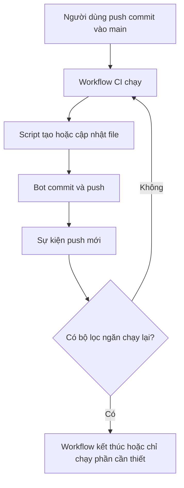

# Ngăn vòng lặp khi pipeline tự tạo commit, nhãn hoặc sự kiện mới

Pipeline CI/CD không chỉ phản ứng với thay đổi từ con người. Trong quá trình chạy, workflow có thể tự tạo commit, đẩy tag, mở pull request, thêm nhãn, bình luận issue hoặc gửi một sự kiện điều phối sang workflow khác. Mỗi hành động đó có thể tạo ra một sự kiện Git hoặc sự kiện nền tảng mới. Nếu workflow lại lắng nghe chính sự kiện mà nó vừa tạo, hệ thống có thể kích hoạt lặp đi lặp lại.

Vòng lặp sự kiện thường làm tăng số lần chạy CI, tiêu tốn runner, tạo commit hoặc nhãn trùng lặp, gửi thông báo liên tục và thậm chí kích hoạt triển khai ngoài ý muốn. Trong trường hợp nghiêm trọng, một workflow có quyền ghi có thể tự tạo ra chuỗi hoạt động không giới hạn hoặc khiến các workflow khác liên tục gọi lại nhau.

Nguyên tắc thiết kế là **xác định rõ sự kiện nào được phép kích hoạt workflow, phân biệt hành động do người dùng và bot tạo ra, chỉ thực hiện thay đổi khi trạng thái thực sự cần đổi, đồng thời bảo đảm mỗi lần xử lý có thể lặp lại an toàn**. Không nên dựa vào một mẹo duy nhất như thêm `[skip ci]` vào commit message. Cần kết hợp trigger hẹp, điều kiện kiểm soát, quyền tối thiểu và logic idempotent.

## 1. Vòng lặp sự kiện trong CI/CD hình thành như thế nào?

Một workflow thường bắt đầu từ sự kiện như `push`, `pull_request`, `issues`, `issue_comment`, `release` hoặc `workflow_dispatch`. Khi workflow thực hiện hành động ghi vào repository hay gửi yêu cầu tới nền tảng, hành động đó có thể tạo thêm sự kiện.

Ví dụ, workflow chạy khi có `push` vào `main`, sau đó cập nhật file phiên bản và commit thay đổi trở lại `main`. Commit mới tạo ra một sự kiện `push` khác. Workflow lại chạy, cập nhật file và commit tiếp. Nếu script luôn tạo commit dù nội dung không đổi, vòng lặp có thể tiếp tục không dừng.



Không phải mọi sự kiện mới đều là lỗi. Có những luồng được thiết kế để nối tiếp nhau, chẳng hạn workflow build tạo artifact rồi workflow deploy nhận kết quả build. Vấn đề xuất hiện khi chuỗi không có điểm dừng, không phân biệt được nguồn sự kiện hoặc lặp lại cùng một hành động mà không tạo ra tiến triển mới.

### Các tình huống thường gặp

| Hành động của workflow | Sự kiện có thể phát sinh | Nguy cơ vòng lặp |
|---|---|---|
| Tạo commit rồi push | `push` | Workflow CI chạy lại trên commit do chính nó tạo |
| Tạo hoặc cập nhật tag | `push` tag, `create` hoặc sự kiện liên quan tùy nền tảng | Workflow phát hành tự kích hoạt lần phát hành tiếp theo |
| Thêm hoặc xóa nhãn issue/PR | `issues` hoặc `pull_request` với action `labeled`/`unlabeled` | Workflow lắng nghe nhãn lại chạy khi chính nó thêm nhãn |
| Tạo bình luận | `issue_comment` | Workflow phản hồi bình luận của chính bot và tạo thêm bình luận |
| Mở hoặc cập nhật pull request | `pull_request` | Bot tạo PR hoặc cập nhật branch khiến workflow PR chạy lại |
| Gửi `repository_dispatch` hoặc `workflow_dispatch` | Sự kiện dispatch | Hai workflow gọi qua lại hoặc một workflow tự gọi lại |
| Hoàn tất workflow | `workflow_run` | Workflow được kích hoạt sau khi một workflow khác hoàn tất và tạo ra chuỗi lặp |

Khi phân tích, hãy vẽ lại quan hệ giữa trigger, hành động ghi và sự kiện phát sinh. Một workflow đơn lẻ có thể không có vòng lặp rõ ràng, nhưng nhiều workflow kết hợp lại vẫn có thể tạo thành chu trình.

## 2. Phân biệt các cơ chế kích hoạt và giới hạn của chúng

Mỗi nền tảng CI/CD có quy tắc riêng về việc một hành động do token hoặc bot tạo ra có kích hoạt workflow tiếp theo hay không. Cần hiểu chính xác quy tắc của nền tảng đang sử dụng trước khi thiết kế guard.

### GitHub Actions và `GITHUB_TOKEN`

Trong GitHub Actions, sự kiện được tạo bởi `GITHUB_TOKEN` của workflow thường không kích hoạt một workflow run mới. Quy tắc này giúp ngăn nhiều trường hợp tự kích hoạt ngoài ý muốn. Các ngoại lệ quan trọng gồm `workflow_dispatch` và `repository_dispatch`: workflow có thể chủ động gọi hai loại sự kiện này để khởi chạy luồng tiếp theo.

Ví dụ, workflow dùng `GITHUB_TOKEN` để commit file sinh tự động thường không làm một workflow `on: push` khác chạy lại. Tuy nhiên, nếu dùng personal access token (PAT) hoặc GitHub App installation token để push, tạo nhãn hoặc mở PR, hành động đó có thể kích hoạt các workflow tương ứng như một hoạt động được xác thực độc lập.

Do đó, không thể giả định rằng mọi token đều có cùng hành vi. Trước khi thay token, hãy xem xét lại toàn bộ đồ thị sự kiện. Việc thay `GITHUB_TOKEN` bằng PAT hoặc GitHub App token để giải quyết một giới hạn quyền có thể vô tình làm xuất hiện vòng lặp mà trước đó không tồn tại.

### Khi nào cần PAT hoặc GitHub App token?

Một số thao tác có thể cần danh tính hoặc quyền khác với `GITHUB_TOKEN`, hoặc cần tạo sự kiện kích hoạt workflow tiếp theo. Khi đó, PAT hoặc GitHub App token có thể phù hợp, nhưng cần kiểm soát chặt:

- Dùng token có phạm vi quyền nhỏ nhất và thời hạn phù hợp.
- Ưu tiên GitHub App với quyền được khai báo rõ khi cần tự động hóa lâu dài ở cấp tổ chức.
- Chỉ cấp token cho job thực sự cần thao tác ghi.
- Không đưa token vào job chạy mã không tin cậy từ pull request hoặc fork.
- Bổ sung guard theo actor, branch, path hoặc loại sự kiện để tránh tự kích hoạt.
- Theo dõi và thu hồi token khi không còn sử dụng.

### Phân biệt `github.actor` và người khởi chạy lại

Trong GitHub Actions, `github.actor` là người dùng hoặc bot khởi tạo workflow run. Khi một run được chạy lại, `github.triggering_actor` có thể là người yêu cầu chạy lại; quyền của lần chạy lại vẫn dựa trên actor ban đầu. Vì vậy, không nên dùng hai giá trị này thay thế cho nhau nếu cần kiểm tra nguồn gốc commit hoặc quyết định quyền.

Nếu dùng PAT thuộc một tài khoản dịch vụ, `github.actor` có thể là tài khoản dịch vụ đó. Với GitHub App, actor thường có dạng tên ứng dụng kèm hậu tố `[bot]`. Hãy xác minh giá trị thực tế trong log hoặc context trước khi viết điều kiện so sánh.

## 3. Thiết kế guard để workflow không tự chạy lại

Một guard là điều kiện xác định workflow hoặc job có được phép xử lý sự kiện hiện tại hay không. Guard nên thể hiện ý định rõ ràng và dựa trên dữ liệu đáng tin cậy của sự kiện.

### Thu hẹp trigger trước

Chỉ lắng nghe sự kiện và nhánh thực sự cần thiết. Nếu workflow chỉ cần kiểm tra mã nguồn ứng dụng, không nên để nó chạy trên mọi tag, mọi nhánh hoặc mọi loại hoạt động issue.

Ví dụ:

```yaml
name: Verify application source

on:
  push:
    branches: [main]
    paths:
      - 'src/**'
      - 'build.gradle*'
      - 'settings.gradle*'
  pull_request:
    branches: [main]
    paths:
      - 'src/**'
      - 'build.gradle*'
      - 'settings.gradle*'

permissions:
  contents: read

jobs:
  verify:
    runs-on: ubuntu-latest
    steps:
      - uses: actions/checkout@v4
      - run: ./gradlew --no-daemon check
```

Trong ví dụ, commit chỉ thay đổi file sinh tự động ở thư mục `generated/` sẽ không kích hoạt workflow này. Tuy nhiên, path filter cần bao phủ đầy đủ các file có thể ảnh hưởng tới build. Nếu bỏ sót workflow, script CI, lockfile hoặc cấu hình dùng chung, thay đổi quan trọng có thể không được kiểm tra.

Một lưu ý khác: nếu workflow bị bỏ qua do `branches` hoặc `paths` filter, check tương ứng có thể ở trạng thái pending và làm pull request không thể merge khi check đó là required status check. Với check bắt buộc, hãy cân nhắc để workflow điều phối luôn được kích hoạt rồi cho job nội bộ quyết định có cần chạy test hay không, đồng thời bảo đảm check tổng hợp trả trạng thái cuối rõ ràng.

### Lọc theo actor hoặc bot

Nếu workflow chỉ nên phản ứng với thay đổi do con người tạo, có thể bỏ qua actor của bot. Ví dụ dưới đây dùng tên bot giả định; cần thay bằng login thực tế của tài khoản hoặc GitHub App trong repository:

```yaml
jobs:
  verify:
    if: github.actor != 'release-helper[bot]'
    runs-on: ubuntu-latest
    steps:
      - uses: actions/checkout@v4
      - run: ./gradlew --no-daemon check
```

Guard này hữu ích khi bot dùng PAT hoặc GitHub App token để tạo commit và sự kiện push tiếp tục kích hoạt workflow. Nhưng không nên bỏ qua mọi bot theo cách tổng quát nếu một số bot như Dependabot cần được kiểm tra như pull request bình thường. Hãy lọc đúng actor và đúng loại sự kiện.

Nếu bot chạy dưới tài khoản dịch vụ thông thường thay vì GitHub App, tên actor sẽ là login của tài khoản đó, không có hậu tố `[bot]`. Điều kiện phải dựa trên giá trị thực tế.

### Lọc theo commit message

Một quy ước phổ biến là đánh dấu commit do pipeline tạo bằng chuỗi nhận diện, chẳng hạn `chore: update generated files [skip ci]` hoặc một marker riêng như `[bot-generated]`. Workflow có thể đọc commit message và quyết định bỏ qua job tốn kém.

Ví dụ guard theo commit message cho sự kiện `push`:

```yaml
jobs:
  verify:
    if: ${{ !contains(github.event.head_commit.message, '[bot-generated]') }}
    runs-on: ubuntu-latest
    steps:
      - uses: actions/checkout@v4
      - run: ./gradlew --no-daemon check
```

Marker riêng cho phép workflow vẫn được tạo và job có thể bị skip theo điều kiện. Điều này khác với việc nền tảng bỏ qua toàn bộ workflow do token hoặc do skip instruction. Cần cân nhắc check bắt buộc và trạng thái tổng hợp để pull request không bị kẹt.

Commit message có thể chứa dữ liệu do người dùng kiểm soát. Không đưa nội dung message trực tiếp vào shell command. Khi dùng biểu thức trong `if`, chỉ dùng để so sánh hoặc kiểm tra dữ liệu, không biến nó thành lệnh thực thi.

### Lọc theo branch hoặc đường dẫn đầu ra do bot quản lý

Nếu workflow chỉ tạo file trong `generated/`, có thể dùng nhánh riêng như `automation/generated-metadata` hoặc chỉ theo dõi thay đổi ở các đường dẫn nguồn. Một workflow khác chịu trách nhiệm review hoặc merge đầu ra đó.

Guard theo branch và path dễ hiểu, nhưng cần bảo đảm không bỏ qua thay đổi nguồn hợp lệ. Ví dụ, nếu bot commit cả file sinh tự động lẫn một file cấu hình build, việc chỉ dựa vào path có thể không đủ. Có thể kết hợp nhiều điều kiện: actor là bot, branch có prefix dành riêng và các file thay đổi chỉ nằm trong thư mục được phép.

## 4. Dùng `GITHUB_TOKEN`, skip marker và điều kiện job đúng cách

Không có một cơ chế nào phù hợp cho mọi trường hợp. Hãy chọn dựa trên việc có cần workflow tiếp theo chạy hay không và các check bắt buộc cần trạng thái thế nào.

| Cơ chế | Hành vi | Khi phù hợp | Điểm cần chú ý |
|---|---|---|---|
| `GITHUB_TOKEN` | Phần lớn sự kiện do token tạo ra không kích hoạt workflow run mới | Bot commit hoặc cập nhật nhãn mà không cần pipeline chạy lại | `workflow_dispatch` và `repository_dispatch` là ngoại lệ; token cần quyền đúng |
| PAT/GitHub App token | Hành động có thể tạo sự kiện kích hoạt workflow | Cần chủ động khởi chạy workflow khác hoặc quyền của token mặc định không đáp ứng | Phải có guard và quyền tối thiểu; dễ tạo vòng lặp nếu thiếu kiểm soát |
| Job-level `if` | Workflow được tạo nhưng job không chạy khi điều kiện sai | Bỏ qua riêng phần việc do bot tạo hoặc sự kiện không liên quan | Job bị skip thường được coi là thành công; kiểm tra phụ thuộc và required check |
| Commit marker riêng | Job đọc marker và bỏ qua xử lý không cần thiết | Phân biệt commit sinh tự động với commit mã nguồn | Phải thống nhất cách đặt marker và tránh dùng nội dung tùy ý làm lệnh |
| `[skip ci]` hoặc biến thể hỗ trợ | Nền tảng bỏ qua workflow liên quan tới commit | Một số luồng commit tự động không cần check trên PR | Với GitHub, check có thể ở trạng thái pending và chặn merge |
| Branch/path filter | Workflow chỉ chạy khi nhánh hoặc file thay đổi khớp | Tách kiểm tra mã nguồn khỏi file sinh tự động | Bỏ qua workflow có thể khiến required check pending |

### Hiểu đúng `[skip ci]` trên GitHub

GitHub Actions hỗ trợ các chuỗi skip như `[skip ci]`, `[ci skip]`, `[no ci]`, `[skip actions]` và `[actions skip]` trong commit message cho workflow `push` và `pull_request`. Khi commit có marker, workflow liên quan có thể không chạy.

Điểm dễ gây lỗi là các check bị bỏ qua có thể vẫn ở trạng thái pending. Nếu check đó là điều kiện bắt buộc của pull request, PR có thể không merge được dù lý do skip là hợp lệ. Vì vậy, không thêm `[skip ci]` một cách máy móc vào mọi commit do bot tạo. Với nhiều repository, một guard ở cấp job hoặc một workflow kiểm tra tổng hợp luôn hoàn tất sẽ dễ kiểm soát hơn.

Nếu dùng nền tảng khác, cú pháp và trạng thái của skip marker có thể khác. Không áp dụng cú pháp của GitHub Actions cho GitLab CI, Jenkins hoặc hệ thống khác khi chưa xác minh tài liệu nền tảng.

## 5. Ngăn vòng lặp khi pipeline tự tạo commit

Tạo commit tự động thường phục vụ cập nhật version, sinh tài liệu, định dạng file, đồng bộ metadata hoặc cập nhật lockfile. Đây là các tác vụ hợp lệ, nhưng cần thiết kế để chỉ tạo commit khi nội dung thực sự thay đổi.

### Chỉ commit khi có diff

Nếu script chạy lại mà kết quả giống hiện tại, không nên tạo commit rỗng hoặc commit có cùng nội dung. Kiểm tra diff trước khi commit giúp tránh phát sinh sự kiện không cần thiết.

Ví dụ script:

```bash
#!/usr/bin/env bash
set -euo pipefail

./scripts/generate-metadata.sh

# Chỉ stage đúng thư mục do script quản lý.
git add generated/

# Không có thay đổi thì kết thúc bình thường.
if git diff --cached --quiet; then
  echo "No generated changes; nothing to commit."
  exit 0
fi

git config user.name "github-actions[bot]"
git config user.email "41898282+github-actions[bot]@users.noreply.github.com"
git commit -m "chore: refresh generated metadata [bot-generated]"
git push
```

Script chỉ stage thư mục `generated/` để không vô tình commit file khác do bước trước tạo ra. `git diff --cached --quiet` trả mã 0 khi không có thay đổi đã stage; khi có thay đổi, script tạo commit. Cần bảo đảm script sinh đầu ra có tính xác định: cùng đầu vào phải tạo cùng nội dung, không chèn timestamp hoặc dữ liệu ngẫu nhiên nếu không cần thiết.

Nếu workflow dùng `GITHUB_TOKEN` với quyền `contents: write`, push do token tạo thường không khởi chạy workflow `push` tiếp theo. Nếu thay token bằng PAT hoặc GitHub App token, hãy thêm guard theo actor, branch hoặc marker và kiểm tra rằng commit mới không tiếp tục tạo một commit giống hệt.

Ví dụ job gọi script:

```yaml
name: Refresh generated metadata

on:
  push:
    branches: [main]
    paths:
      - 'schema/**'
      - 'scripts/generate-metadata.sh'

permissions:
  contents: write

jobs:
  refresh:
    if: github.actor != 'github-actions[bot]'
    runs-on: ubuntu-latest
    steps:
      - uses: actions/checkout@v4
        with:
          persist-credentials: true
      - name: Generate and commit metadata
        run: ./scripts/commit-generated-metadata.sh
```

Ví dụ dùng `GITHUB_TOKEN` mặc định của `actions/checkout`, với quyền ghi `contents`. Guard actor là lớp bảo vệ bổ sung khi luồng có thể thay đổi token hoặc được kích hoạt bởi bot khác. Nếu workflow cần chạy lại để kiểm tra metadata sau commit, hãy thiết kế một workflow riêng với trigger và điều kiện rõ ràng thay vì tạo vòng lặp bằng cách push liên tục.

### Không dùng `git push --force` để né vòng lặp

Force push không phải giải pháp cho vòng lặp. Nó có thể ghi đè commit của người khác, làm mất lịch sử và khiến nhiều workflow đang xử lý revision cũ. Với nhánh dùng chung, ưu tiên commit bổ sung hoặc revert. Nếu cần cập nhật nhánh bot riêng, dùng cơ chế đồng bộ có kiểm soát và giới hạn phạm vi nhánh.

## 6. Ngăn vòng lặp khi pipeline tự thêm nhãn hoặc bình luận

Workflow phân loại issue và pull request thường thêm nhãn như `needs-triage`, `ready-for-review`, `release-candidate` hoặc bình luận trạng thái. Nếu workflow lắng nghe `labeled` hay `issue_comment`, nó có thể phản ứng với chính hành động của mình.

### Lọc đúng action và tên nhãn

Đừng chỉ lắng nghe mọi sự kiện `issues`. Khai báo đúng action cần thiết và kiểm tra tên nhãn trong điều kiện job. Ví dụ:

```yaml
name: Triage issue

on:
  issues:
    types: [opened, labeled]

permissions:
  issues: write

jobs:
  triage:
    if: >-
      github.event.action == 'opened' ||
      (github.event.action == 'labeled' && github.event.label.name == 'needs-triage')
    runs-on: ubuntu-latest
    steps:
      - name: Add triaged label
        env:
          GH_TOKEN: ${{ secrets.GITHUB_TOKEN }}
          ISSUE_NUMBER: ${{ github.event.issue.number }}
        run: gh issue edit "$ISSUE_NUMBER" --add-label "triaged"
```

Khi issue được mở, workflow thêm nhãn `triaged`. Sự kiện `labeled` tiếp theo có thể được tạo nếu dùng token kích hoạt workflow; nhưng job chỉ chạy tiếp khi nhãn vừa thêm là `needs-triage`. Sự kiện thêm `triaged` sẽ bị guard loại bỏ. Với `GITHUB_TOKEN`, sự kiện do token tạo thường không kích hoạt workflow mới, nhưng guard vẫn hữu ích khi token hoặc cách tích hợp thay đổi.

### Kiểm tra trạng thái trước khi ghi

Thao tác thêm nhãn nên idempotent: nếu nhãn đã có thì không thực hiện thay đổi. Tương tự, chỉ bình luận khi nội dung hoặc trạng thái thực sự cần cập nhật. Trước khi tạo comment, hãy tìm comment do bot trước đó tạo và cập nhật comment cũ nếu phù hợp.

Với GitHub CLI, có thể lấy danh sách nhãn hiện tại bằng `gh issue view` hoặc API rồi quyết định hành động. Khi gọi API, cần xử lý trường hợp hai workflow chạy đồng thời và cùng cố gắng thêm một nhãn. Một thao tác cập nhật trạng thái cần an toàn khi được gọi nhiều lần.

### Tránh bot phản hồi bình luận của chính nó

Nếu workflow lắng nghe `issue_comment`, hãy giới hạn theo action `created` hoặc `edited` cần thiết, kiểm tra nội dung lệnh có prefix rõ ràng và bỏ qua comment do bot tạo.

Ví dụ điều kiện:

```yaml
on:
  issue_comment:
    types: [created]

jobs:
  command:
    if: >-
      github.event.issue.pull_request &&
      github.event.comment.user.type != 'Bot' &&
      startsWith(github.event.comment.body, '/ci ')
    runs-on: ubuntu-latest
    steps:
      - run: echo "Handle an approved /ci command"
```

Điều kiện trên là lớp lọc ban đầu, không phải cơ chế phân quyền đầy đủ. Nếu lệnh có thể triển khai hoặc truy cập dữ liệu nhạy cảm, cần xác minh người gọi thuộc nhóm được phép, kiểm tra quyền trên repository và yêu cầu approval phù hợp. Không chạy trực tiếp nội dung comment như shell command.

## 7. Ngăn chu trình giữa nhiều workflow

Một hệ thống có thể có nhiều workflow: workflow A build artifact, workflow B deploy staging, workflow C cập nhật trạng thái PR. Nếu B gửi dispatch để gọi A hoặc C lại gửi dispatch cho B, các workflow có thể tạo chu trình dù từng file riêng lẻ trông hợp lý.

### Vẽ đồ thị phụ thuộc

Trước khi dùng `workflow_run`, `workflow_dispatch` hoặc `repository_dispatch`, hãy liệt kê:

- Workflow nào là điểm bắt đầu.
- Workflow nào phát sinh sự kiện tiếp theo.
- Sự kiện tiếp theo mang payload hoặc artifact gì.
- Điều kiện dừng là gì.
- Có thể có hai lần chạy cùng xử lý một sự kiện hay không.
- Nếu một bước thất bại và được retry, workflow sau có chạy trùng không?

Một luồng tốt thường có hướng rõ ràng, ví dụ `build → publish artifact → deploy staging → verify`. Không để workflow cuối cùng gọi lại workflow đầu mà không có một mục đích nghiệp vụ và điều kiện dừng cụ thể.

### Lọc `workflow_run` theo workflow, branch và conclusion

`workflow_run` chạy khi workflow được chỉ định hoàn tất. Nên giới hạn theo tên workflow nguồn, branch và conclusion trước khi tải artifact hoặc thực hiện hành động có quyền cao.

Ví dụ:

```yaml
name: Deploy after build

on:
  workflow_run:
    workflows: [Build and test]
    types: [completed]
    branches: [main]

permissions:
  contents: read
  actions: read

jobs:
  deploy-staging:
    if: github.event.workflow_run.conclusion == 'success'
    runs-on: ubuntu-latest
    steps:
      - name: Download artifact from the triggering run
        run: echo "Download the artifact for workflow_run.id"
      - name: Deploy to staging
        run: echo "Deploy the verified artifact"
```

Đây là khung minh họa, cần dùng API hoặc action phù hợp để tải artifact theo đúng `workflow_run.id`. Không lấy artifact của lần chạy mới nhất một cách mơ hồ vì có thể tải nhầm artifact của commit khác. Khi workflow nguồn chạy trên mã không tin cậy, workflow được kích hoạt qua `workflow_run` có thể có quyền cao hơn; không thực thi script hoặc binary lấy từ artifact không tin cậy nếu chưa xác minh nguồn và nội dung.

### Dispatch có loại sự kiện và correlation ID

Khi dùng `repository_dispatch`, hãy đặt `event_type` cụ thể và payload có thông tin nguồn, revision và mã tương quan. Workflow nhận chỉ xử lý những event type được cho phép.

Ví dụ payload khái niệm:

```json
{
  "event_type": "deploy-staging-requested",
  "client_payload": {
    "source_workflow": "build-and-test",
    "source_sha": "<commit-sha>",
    "correlation_id": "<unique-request-id>"
  }
}
```

Correlation ID giúp ghi nhận các bước thuộc cùng một yêu cầu và phát hiện yêu cầu đã xử lý. Không tin cậy payload chỉ vì nó đến từ dispatch; cần xác thực nguồn gọi, kiểm tra revision, kiểm tra quyền và xác minh artifact.

Nếu workflow nhận dispatch rồi lại gửi đúng `event_type` về workflow nguồn, hãy xem đó là chu trình cần loại bỏ hoặc thiết kế lại. Nếu chuỗi nhiều bước là chủ đích, mỗi workflow chỉ nên phát sự kiện tiếp theo sau khi điều kiện hoàn tất được đáp ứng.

## 8. Idempotency: điều kiện quan trọng để tự động hóa an toàn

Idempotency nghĩa là thực hiện cùng một yêu cầu một lần hay nhiều lần đều đưa hệ thống về cùng một trạng thái cuối, không tạo thêm tác dụng phụ không cần thiết. Đây là nguyên tắc quan trọng để chống vòng lặp và xử lý retry.

Ví dụ:

- Nếu nhãn `triaged` đã tồn tại, không tạo thêm thao tác thay đổi nhãn.
- Nếu file sinh tự động không đổi, không tạo commit mới.
- Nếu comment trạng thái đã tồn tại, cập nhật comment đó thay vì tạo comment mới mỗi lần chạy.
- Nếu artifact của commit SHA đã được publish và xác minh, không publish bản trùng với cùng định danh nếu chính sách yêu cầu bất biến.
- Nếu một dispatch có `correlation_id` đã xử lý, không thực hiện lại hành động có tác dụng phụ.

Một thao tác idempotent thường có ba phần:

1. **Đọc trạng thái hiện tại:** lấy commit, nhãn, comment, artifact hoặc trạng thái triển khai đang tồn tại.
2. **So sánh trạng thái mong muốn:** xác định khác biệt thực sự cần thay đổi.
3. **Chỉ áp dụng phần khác biệt:** không ghi lại nếu trạng thái đã đúng.

Với các thao tác đồng thời, chỉ kiểm tra trước khi ghi có thể chưa đủ. Hai workflow có thể cùng đọc trạng thái chưa có nhãn rồi cùng tạo thay đổi. Nếu API hỗ trợ conditional update, ETag hoặc idempotency key, hãy dùng chúng. Nếu không, cần chấp nhận và xử lý trạng thái xung đột theo cách an toàn.

## 9. Kết hợp nhiều lớp bảo vệ

Một cấu hình tốt thường kết hợp nhiều biện pháp để nếu một guard bị thay đổi hoặc một token khác được sử dụng, workflow vẫn khó tạo vòng lặp ngoài ý muốn.

| Lớp bảo vệ | Câu hỏi cần trả lời | Ví dụ |
|---|---|---|
| Trigger hẹp | Workflow có lắng nghe đúng sự kiện cần thiết không? | Chỉ `push` vào `main`, chỉ `issues.labeled` |
| Actor guard | Có nên xử lý sự kiện do bot này tạo không? | Bỏ qua actor `release-helper[bot]` |
| Branch/path guard | Sự kiện có đến từ nhánh hoặc file được phép không? | Bỏ qua branch `automation/*`, lọc thư mục `generated/` |
| Event/action guard | Có đúng loại hành động và tên nhãn không? | Chỉ xử lý label `needs-triage` |
| Idempotency | Chạy lại có tạo thêm thay đổi không? | So sánh diff trước commit, kiểm tra nhãn trước khi thêm |
| Quyền tối thiểu | Workflow có thể tạo loại sự kiện nào? | `contents: write` hoặc `issues: write` chỉ ở job cần thiết |
| Giới hạn tài nguyên | Nếu có lỗi, mức tiêu thụ có được giới hạn không? | `concurrency`, timeout, giới hạn retry |
| Quan sát và cảnh báo | Có phát hiện số lần chạy tăng bất thường không? | Theo dõi run frequency, actor và commit liên tiếp |

Không nên thêm mọi guard theo kiểu sao chép mẫu. Mỗi điều kiện phải gắn với một nguy cơ thực tế. Quá nhiều điều kiện chồng chéo mà không có tài liệu có thể khiến workflow không chạy khi cần hoặc khiến người vận hành không hiểu lý do job bị skip.

## 10. Chẩn đoán khi phát hiện vòng lặp

Khi runner hoặc thông báo cho thấy workflow chạy lặp, cần dừng tác động trước rồi mới điều tra sâu.

### Bước 1: Xác định chuỗi sự kiện

Thu thập các lần chạy gần nhau và ghi nhận:

- Tên workflow, run ID và thời điểm bắt đầu.
- Event name, action, branch, ref và commit SHA.
- Actor hoặc danh tính token tạo sự kiện.
- Job và step thực hiện thao tác ghi.
- Commit, label, comment, tag hoặc dispatch được tạo ra.

So sánh đầu vào và đầu ra giữa các lần chạy. Nếu mỗi lần chạy tạo một commit mới, xem nội dung commit và diff. Nếu chỉ nhãn thay đổi, xác định workflow nào lắng nghe action `labeled` hoặc `unlabeled`. Nếu nhiều workflow nối tiếp, dựng đồ thị theo run ID và event payload.

### Bước 2: Chặn tác động lặp

Tạm thời vô hiệu hóa trigger hoặc job gây vòng lặp, thu hồi token có quyền ghi nếu nghi ngờ bị lạm dụng và dừng các lần chạy đang tiêu tốn tài nguyên khi nền tảng cho phép. Giữ lại log và run ID trước khi xóa hoặc thay đổi dữ liệu phục vụ điều tra.

Nếu vòng lặp do commit bot, có thể tạm giới hạn workflow theo branch/path hoặc bỏ qua actor cụ thể. Nếu do dispatch, tạm dừng bước phát dispatch. Nếu do comment hoặc label, thu hẹp action và tên nhãn. Chọn biện pháp nhỏ nhất đủ để chặn tác động.

### Bước 3: Xác định nguyên nhân gốc

Kiểm tra liệu workflow có tạo thay đổi ngay cả khi trạng thái đã đúng không. Kiểm tra token đang dùng, quyền được cấp và quy tắc kích hoạt của nền tảng. Đọc lại trigger của mọi workflow liên quan để phát hiện chu trình gián tiếp.

Một số nguyên nhân thường gặp:

- Script luôn ghi timestamp hoặc dữ liệu ngẫu nhiên vào file nên lần nào cũng có diff.
- Job commit toàn bộ working tree thay vì chỉ stage file do nó quản lý.
- Workflow dùng PAT hoặc App token nhưng vẫn dựa vào giả định suppression của `GITHUB_TOKEN`.
- Workflow lắng nghe mọi `labeled` rồi tự thêm một nhãn khác mà không có điều kiện lọc.
- Workflow phản hồi mọi comment, kể cả comment do bot tạo.
- Hai workflow dispatch qua lại mà không có correlation ID hoặc điều kiện kết thúc.
- Retry tạo thêm tài nguyên hoặc commit thay vì kiểm tra trạng thái hiện tại.

### Bước 4: Sửa và xác minh trong phạm vi nhỏ

Thêm guard, idempotency và kiểm tra không có diff. Thử nghiệm trên repository hoặc branch thử nghiệm, sau đó kiểm tra từng đường đi: sự kiện do người dùng tạo, sự kiện do bot tạo, trạng thái đã tồn tại và trường hợp chạy lại.

Không chỉ xác minh rằng workflow không còn chạy lặp. Cần xác nhận hành động hợp lệ vẫn hoạt động: người dùng thêm nhãn cần xử lý vẫn được workflow nhận, commit mã nguồn vẫn chạy CI, và luồng dispatch có chủ đích vẫn hoàn tất.

### Bước 5: Theo dõi sau khôi phục

Theo dõi số lần chạy, số commit bot tạo, số label/comment thay đổi và mức sử dụng runner. Nếu workflow tiếp tục tăng bất thường, xem lại chuỗi sự kiện hoặc điều kiện đồng thời. Ghi lại nguyên nhân, phạm vi ảnh hưởng và biện pháp ngăn tái diễn.

## 11. Những cách làm dễ gây lỗi

| Cách làm | Vấn đề | Hướng xử lý |
|---|---|---|
| Dùng PAT để push nhưng không thêm guard | Commit bot có thể kích hoạt lại workflow push | Xác định actor, branch và path; kiểm tra diff trước commit |
| Thêm `[skip ci]` vào mọi commit bot | Required checks trên PR có thể pending | Dùng job-level guard hoặc check tổng hợp khi phù hợp |
| Bỏ qua tất cả actor có hậu tố `[bot]` | Có thể bỏ qua Dependabot hoặc bot hợp lệ khác | Chỉ lọc bot cụ thể theo mục đích |
| Trigger theo mọi action của issue/PR | Chạy nhiều lần cho opened, edited, labeled, closed... | Chỉ khai báo action cần thiết |
| Luôn tạo comment mới | Comment kích hoạt comment workflow và làm issue nhiễu | Tìm rồi cập nhật comment do bot sở hữu |
| Commit toàn bộ thay đổi trong workspace | Có thể đưa file không liên quan vào commit và kích hoạt workflow khác | Stage đúng đường dẫn được phép |
| Dùng `workflow_dispatch` hoặc `repository_dispatch` không kiểm soát | Có thể tạo chu trình giữa các workflow | Giới hạn event type, xác thực nguồn và dùng correlation ID |
| Dựa hoàn toàn vào suppression của token | Đổi token có thể làm thay đổi hành vi kích hoạt | Xem suppression là lớp bảo vệ, vẫn thiết kế guard và idempotency |
| Dùng retry vô hạn | Tăng chi phí và khuếch đại sự cố | Giới hạn retry, timeout và theo dõi lỗi cuối cùng |

## 12. Checklist thiết kế trigger không tạo vòng lặp

Trước khi merge workflow có thao tác ghi hoặc gửi sự kiện, hãy kiểm tra:

- [ ] Đã liệt kê mọi trigger mà workflow lắng nghe.
- [ ] Đã xác định commit, label, comment, tag hoặc dispatch mà workflow có thể tạo.
- [ ] Đã biết token nào thực hiện thao tác và quy tắc kích hoạt tương ứng của nền tảng.
- [ ] Trigger được giới hạn theo branch, path, event type hoặc action cần thiết.
- [ ] Actor guard chỉ loại trừ bot cụ thể cần bỏ qua.
- [ ] Job không tạo commit khi không có diff và chỉ stage đúng file cần thiết.
- [ ] Thao tác label/comment có kiểm tra trạng thái trước khi ghi.
- [ ] Workflow không phản hồi bình luận hoặc sự kiện do chính nó tạo ngoài ý muốn.
- [ ] Chuỗi `workflow_run`, `workflow_dispatch` và `repository_dispatch` có hướng và điều kiện dừng rõ.
- [ ] Có correlation ID hoặc cách nhận diện yêu cầu đã xử lý khi cần chống chạy trùng.
- [ ] Quyền ghi được giới hạn ở job cần thiết; secret không đi vào job chạy mã không tin cậy.
- [ ] Skip marker không làm required check bị pending ngoài dự kiến.
- [ ] Có timeout, concurrency và giới hạn retry phù hợp.
- [ ] Đã thử sự kiện do người dùng tạo, do bot tạo và trường hợp chạy lại.
- [ ] Có log đủ để lần theo run ID, actor, event và commit liên quan.

Ngăn vòng lặp không chỉ là giảm số lần chạy workflow. Mục tiêu là bảo đảm mỗi sự kiện có ý nghĩa, mỗi hành động tự động chỉ thay đổi trạng thái khi cần và các workflow phối hợp theo một luồng có thể dự đoán. Khi trigger được giới hạn, token được hiểu đúng, thao tác có tính idempotent và chuỗi sự kiện có điểm dừng, CI/CD có thể tự động hóa commit, nhãn và phát hành mà không tạo ra những lần chạy ngoài ý muốn.
