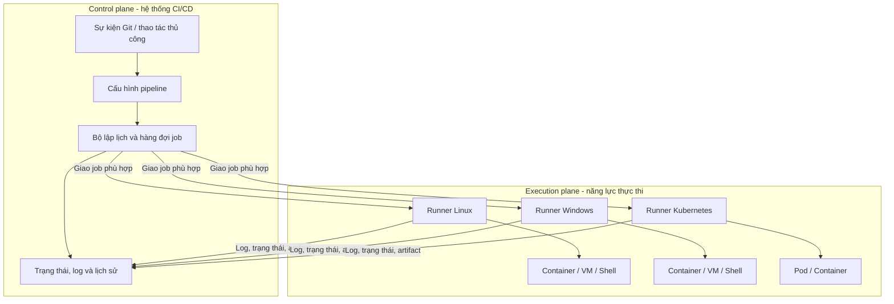
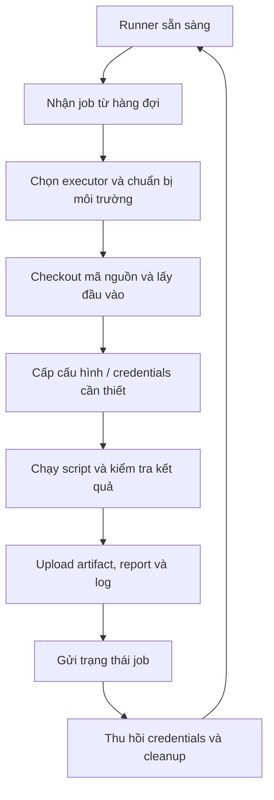
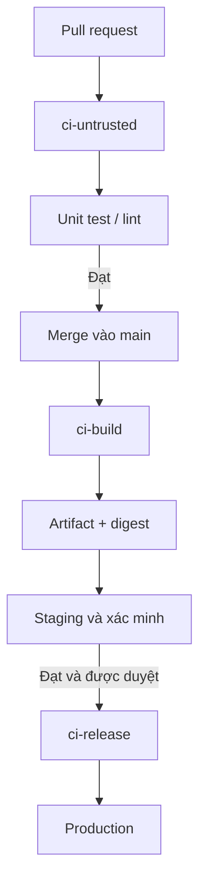

# Vai trò của runner, agent hoặc worker trong việc chạy công việc

Pipeline mô tả công việc cần thực hiện, nhưng bản thân pipeline không biên dịch mã nguồn, chạy test hay triển khai ứng dụng. Những thao tác đó cần một thành phần thực thi nhận nhiệm vụ từ hệ thống CI/CD và chạy lệnh trong một môi trường có tài nguyên phù hợp. Thành phần này thường được gọi là **runner**, **agent** hoặc **worker**, tùy nền tảng.

Runner/agent/worker là cầu nối giữa bộ điều phối CI/CD và máy móc thực thi. Nó nhận job, chuẩn bị workspace và công cụ, chạy các bước được khai báo, thu thập log cùng kết quả, chuyển artifact hoặc báo cáo về nơi lưu trữ rồi thông báo trạng thái cho hệ thống điều phối. Chất lượng của thành phần thực thi ảnh hưởng trực tiếp đến tốc độ pipeline, khả năng tái lập kết quả, độ tin cậy và ranh giới bảo mật của toàn bộ quy trình phát hành.

## 1. Phân biệt pipeline, job, runner và executor

Các thuật ngữ thường xuất hiện cùng nhau nhưng đảm nhiệm những vai trò khác nhau:

| Thành phần | Vai trò | Ví dụ |
|---|---|---|
| Pipeline | Mô tả và điều phối toàn bộ luồng công việc | Build → test → scan → package → deploy |
| Job | Một nhiệm vụ cụ thể trong pipeline | Chạy unit test hoặc tạo container image |
| Runner/agent/worker | Thành phần nhận job và tổ chức việc thực thi | GitLab Runner, GitHub Actions runner, Jenkins agent |
| Executor | Cơ chế hoặc loại môi trường mà runner dùng để chạy job | Shell, Docker, Kubernetes, VM |
| Execution environment | Không gian thực thi thực tế với OS, CPU, RAM, filesystem, network và toolchain | Container Linux có JDK 21, hoặc VM Windows có .NET SDK |
| Artifact | Đầu ra được lưu lại để job khác hoặc người dùng sử dụng | JAR, container image, báo cáo test |

Có thể hình dung runner như người nhận và điều phối nhiệm vụ tại xưởng; executor là cách bố trí dây chuyền và không gian làm việc; execution environment là máy móc, hệ điều hành và công cụ cụ thể mà lệnh chạy trên đó. Một runner có thể quản lý nhiều executor hoặc nhiều môi trường thực thi tùy sản phẩm và cấu hình.

Tên gọi không hoàn toàn thống nhất giữa các nền tảng. GitLab dùng thuật ngữ *runner* và *executor*; GitHub Actions gọi tiến trình chạy job là *runner* và phân biệt GitHub-hosted với self-hosted runner; Jenkins thường dùng *controller* và *agent*, trong đó agent có một hoặc nhiều executor slot. Trong tài liệu này, runner/agent/worker được dùng như tên khái quát cho thành phần nhận và thực thi job.

## 2. Control plane và execution plane

Kiến trúc CI/CD thường có thể chia thành hai phần logic:

- **Control plane (mặt phẳng điều khiển):** nhận sự kiện Git, đọc cấu hình pipeline, lập lịch job, quản lý trạng thái, phân quyền, lưu lịch sử và cung cấp giao diện theo dõi.
- **Execution plane (mặt phẳng thực thi):** các runner/agent/worker và môi trường mà chúng sử dụng để chạy lệnh, truy cập đầu vào, tạo đầu ra và gửi kết quả về control plane.



Control plane quyết định job nào cần chạy và điều kiện nào cho phép job bắt đầu. Runner thực hiện công việc trong giới hạn quyền được cấp rồi gửi kết quả trở lại. Sự tách biệt này cho phép tổ chức mở rộng năng lực thực thi ở nhiều máy, vùng mạng hoặc nền tảng khác nhau mà vẫn quản lý pipeline tập trung.

Trong một số sản phẩm, control plane và runner có thể cùng chạy trên một máy hoặc được đóng gói chung. Đây là cách triển khai vật lý; về mặt trách nhiệm, vẫn cần phân biệt nơi lập lịch và quản lý với nơi chạy mã do pipeline chỉ định.

## 3. Vòng đời của một job trên runner

Một job thường đi qua các giai đoạn sau. Tên chính xác và thứ tự một số thao tác thay đổi theo nền tảng hoặc executor:

1. **Đăng ký và sẵn sàng:** runner xác thực với hệ thống CI/CD, công bố nhãn, khả năng và trạng thái sẵn sàng nhận việc.
2. **Nhận job:** runner hoặc manager hỏi control plane để nhận job đang chờ phù hợp với nhãn, nhóm runner và chính sách phân quyền.
3. **Chuẩn bị môi trường:** tạo container, pod, VM hoặc workspace; chuẩn bị shell, toolchain, biến cấu hình và network cần thiết.
4. **Lấy đầu vào:** checkout đúng commit, tải artifact phụ thuộc, cache và các file cấu hình được phép truy cập.
5. **Cấp thông tin xác thực:** nhận token hoặc secret theo phạm vi và thời gian cần thiết. Không nên đưa thông tin xác thực rộng quyền vào mọi job.
6. **Thực thi:** chạy script theo thứ tự, ghi log, thu thập mã thoát và đánh giá các điều kiện đã khai báo.
7. **Đóng gói kết quả:** lưu artifact, báo cáo test, log và metadata; gửi trạng thái job về control plane.
8. **Dọn dẹp:** thu hồi token, xóa workspace hoặc hủy container/pod/VM theo chính sách; giải phóng tài nguyên cho job tiếp theo.



Nếu một giai đoạn thất bại, runner cần báo trạng thái cùng log đủ để xác định lỗi nằm ở đâu. Ví dụ, lỗi không tải được mã nguồn là lỗi chuẩn bị đầu vào; lỗi test assertion là lỗi kiểm thử; lỗi hết dung lượng đĩa là lỗi tài nguyên của môi trường thực thi. Phân loại đúng giúp nhóm chọn cách xử lý phù hợp.

## 4. Các mô hình môi trường thực thi phổ biến

Runner có thể dùng nhiều executor. Không có mô hình duy nhất phù hợp cho mọi công việc; lựa chọn phụ thuộc vào yêu cầu hệ điều hành, công cụ, mức cô lập, tài nguyên và độ tin cậy.

| Mô hình | Cách hoạt động | Điểm phù hợp | Điều cần cân nhắc |
|---|---|---|---|
| Shell executor | Chạy lệnh trực tiếp trên OS của máy runner | Script nhẹ, công cụ cài sẵn, môi trường nội bộ | Các job có thể chia sẻ filesystem và tiến trình; cleanup và cô lập phụ thuộc cấu hình |
| Container/Docker executor | Tạo container làm môi trường job | Linux build, dependency có thể đóng gói bằng image | Container chia sẻ kernel host; quyền privileged hoặc Docker socket làm tăng rủi ro |
| Virtual machine | Mỗi job hoặc nhóm job chạy trong VM | Cần OS/kernel riêng hoặc mức cô lập mạnh hơn container | Khởi tạo chậm và tiêu tốn CPU/RAM/disk hơn |
| Kubernetes executor | Tạo pod để chạy job trong cluster | Tự động mở rộng, quản lý tài nguyên theo cluster | Cần quản lý namespace, service account, network policy, quota và vòng đời pod |
| Bare metal/dedicated host | Chạy trên máy vật lý hoặc máy chuyên dụng | Build cần phần cứng đặc biệt, thiết bị hoặc hiệu năng cao | Tốn công quản trị, cập nhật và làm sạch máy giữa các job |

### Shell executor

Shell executor chạy lệnh bằng shell có trên máy runner, ví dụ Bash hoặc PowerShell. Cách này đơn giản và hữu ích khi cần truy cập công cụ hoặc thiết bị đã cài trên host. Tuy nhiên, job có thể để lại file, tiến trình, package hoặc cấu hình ảnh hưởng tới job chạy sau. Nếu nhiều repository không cùng mức tin cậy dùng chung host, nguy cơ đọc dữ liệu lẫn nhau hoặc truy cập credential còn sót lại sẽ tăng.

Chỉ nên dùng shell runner cho workload có mức tin cậy phù hợp và có chính sách workspace, user account, cleanup cùng quyền truy cập rõ ràng. Tránh chạy job không tin cậy trên máy shell runner đang giữ credential production hoặc có quyền truy cập sâu vào mạng nội bộ.

### Container executor

Container executor thường khởi chạy image làm môi trường cho job. Image có thể đóng gói JDK, Node.js, .NET SDK, compiler và công cụ cần thiết, giúp các lần chạy dùng cấu hình gần giống nhau. Nên chọn image có phiên bản rõ ràng, cập nhật bảo mật và pin theo digest khi yêu cầu tái lập cao.

Container giúp tách filesystem và process namespace, nhưng không tương đương VM có kernel riêng. Container thường chia sẻ kernel với host; cấu hình privileged, mount thư mục host rộng hoặc gắn `/var/run/docker.sock` có thể cho job quyền rất lớn. Không nên xem việc chạy trong container là bảo đảm cô lập tuyệt đối.

### VM và Kubernetes executor

VM cung cấp ranh giới kernel riêng, phù hợp với job cần hệ điều hành hoặc driver đặc thù. Runner có thể tạo VM theo yêu cầu rồi hủy sau job để giảm trạng thái tồn đọng. Kubernetes executor thường tạo pod riêng cho job, tận dụng scheduler và quota của cluster. Tuy nhiên, nếu các pod cùng dùng service account quyền rộng, cùng namespace hoặc network không được giới hạn, mức cô lập thực tế vẫn yếu.

Với VM và Kubernetes, cần quản lý cả lớp hạ tầng: image nền, bản vá OS, quyền điều khiển cluster, giới hạn CPU/RAM, lưu trữ tạm, network policy và quyền truy cập registry.

## 5. Runner labels, tags và khả năng nhận job

Hệ thống điều phối cần biết runner nào phù hợp với job. Các nền tảng thường dùng tags, labels, runner groups, capabilities hoặc executor constraints để mô tả khả năng của runner.

Ví dụ, một job có thể cần:

- Linux và Docker để build container image.
- Windows để build ứng dụng .NET Framework.
- JDK 21 để biên dịch dự án Java.
- Quyền truy cập một registry nội bộ.
- Một GPU hoặc thiết bị kiểm thử chuyên dụng.
- Nhóm runner được phép xử lý workload production.

Ví dụ GitLab CI:

```yaml
build_app:
  stage: build
  tags:
    - linux
    - docker
  image: eclipse-temurin:21-jdk
  script:
    - java -version
    - ./gradlew assemble --no-daemon
```

Job chỉ có thể được runner nhận khi có runner được đăng ký với tag tương ứng và được phép chạy job đó. `image` yêu cầu executor hỗ trợ container image, chẳng hạn Docker hoặc Kubernetes; shell executor không tự tạo môi trường từ trường này. Nếu không có runner phù hợp, job có thể nằm chờ (pending/stuck) dù cấu hình script không có lỗi cú pháp.

Không gán tag quá chung cho mọi loại công việc nếu các runner có quyền và khả năng khác nhau. Ví dụ, runner có quyền truy cập mạng production nên có tag hoặc nhóm riêng, kèm chính sách chỉ cho phép job phát hành đã được bảo vệ sử dụng. Tag chỉ là tiêu chí định tuyến; nó không tự tạo ra ranh giới bảo mật. Quyền truy cập vẫn phải được cấu hình ở control plane, host, network và secret store.

## 6. Lập lịch, concurrency và năng lực thực thi

Runner thường có giới hạn số job đồng thời (concurrency/executor slots). Khi nhận một job, scheduler phải tìm runner còn chỗ, đúng nhãn và đáp ứng các điều kiện. Nếu không có runner phù hợp hoặc tất cả slot đang bận, job sẽ chờ trong hàng đợi.

Một số yếu tố ảnh hưởng đến năng lực:

- **CPU:** compile, test song song hoặc nén image có thể cần nhiều core.
- **RAM:** test suite lớn, compiler hoặc nhiều container đồng thời có thể gây thiếu bộ nhớ.
- **Disk và I/O:** checkout repository lớn, dependency cache, image layer và artifact có thể làm đầy đĩa.
- **Network:** tải dependency, đẩy image và gọi dịch vụ kiểm thử phụ thuộc băng thông và độ ổn định mạng.
- **Concurrency:** tăng số job đồng thời có thể giảm thời gian chờ nhưng cũng làm tranh chấp tài nguyên và tăng chi phí.
- **Thời gian khởi tạo:** VM hoặc pod mới có thể thêm độ trễ trước khi lệnh bắt đầu.

Đặt concurrency quá cao có thể làm host quá tải, test chậm hoặc thất bại ngẫu nhiên. Đặt quá thấp khiến hàng đợi dài và lãng phí tài nguyên. Nên theo dõi thời gian chờ, thời gian thực thi, mức dùng CPU/RAM/disk, tỷ lệ job thất bại do hạ tầng và chi phí trên mỗi pipeline.

### Runner cố định và runner tự động mở rộng

Runner cố định (static) luôn tồn tại và chờ job. Cách này dễ dự đoán, hữu ích khi workload đều hoặc máy cần cấu hình chuyên dụng. Tuy nhiên, máy có thể nhàn rỗi ngoài giờ cao điểm và dễ tích tụ trạng thái giữa các job.

Runner tự động mở rộng (autoscaling/ephemeral) tạo thêm máy, VM hoặc pod khi hàng đợi tăng và thu hồi khi công việc hoàn tất. Mô hình này phù hợp với workload biến động, giúp cô lập tốt hơn nếu mỗi job dùng môi trường mới. Đổi lại, hệ thống cần xử lý thời gian khởi tạo, quota cloud, image cache, giới hạn chi phí và tình huống runner bị hủy khi job chưa hoàn tất.

Một thiết kế thực tế có thể kết hợp runner thường trực cho công việc nhẹ, runner chuyên dụng cho nền tảng đặc thù và runner ephemeral cho build/test có mức tin cậy thấp hoặc tải biến động.

## 7. Cô lập job và ranh giới tin cậy

Runner thực thi mã do repository và pipeline cung cấp. Khi job chạy một script, script đó có thể đọc file trong workspace, gọi network, tạo tiến trình và sử dụng các quyền được cấp. Vì vậy, runner là một phần của ranh giới bảo mật, không chỉ là máy tăng tốc build.

Hãy phân loại workload theo mức độ tin cậy:

- **Workload tin cậy:** pipeline được bảo vệ, commit đã qua review, quyền và nguồn đầu vào được kiểm soát.
- **Workload chưa tin cậy:** pull request từ fork, nhánh thử nghiệm, script do người dùng bên ngoài cung cấp hoặc repository chưa được xác minh.
- **Workload đặc quyền:** deploy production, ký artifact, truy cập cloud account hoặc registry phát hành.

Không nên để workload chưa tin cậy chạy trên runner có thể truy cập secret production, SSH key quản trị hoặc socket điều khiển host. Nên dùng runner group hoặc pool tách biệt, tài khoản hệ điều hành riêng và môi trường ephemeral cho các workload có mức tin cậy thấp.

### Workspace và dữ liệu còn sót lại

Nếu runner được tái sử dụng, dữ liệu từ job trước có thể còn trên đĩa: source code, file cấu hình, token, cache, log hoặc artifact tạm. Cleanup cần xóa đúng vùng làm việc, thu hồi credential và bảo đảm job tiếp theo không đọc được dữ liệu trước. Chỉ xóa thư mục checkout là chưa đủ nếu tiến trình nền, container, volume hoặc file tạm vẫn tồn tại.

Môi trường ephemeral giúp giảm rủi ro này bằng cách hủy toàn bộ VM hoặc pod sau job. Dù vậy, cần xác minh rằng volume, disk snapshot, cache dùng chung và log không giữ lại dữ liệu nhạy cảm ngoài chính sách.

### Quyền tối thiểu và bảo vệ secret

- Dùng tài khoản runner với quyền hệ điều hành tối thiểu cần thiết.
- Chỉ cấp token/secret cho job cần dùng, với thời hạn ngắn và phạm vi hẹp.
- Không ghi secret ra log, command line hoặc artifact công khai.
- Giới hạn network egress và quyền truy cập dịch vụ nội bộ theo workload.
- Tách runner build/test khỏi runner deploy hoặc ký release khi mức tin cậy khác nhau.
- Bảo vệ registration credential và khóa kết nối runner; luân chuyển khi nghi ngờ bị lộ.
- Cập nhật runner agent, OS image và executor thường xuyên để nhận bản vá.
- Ghi log hoạt động quản trị runner và thay đổi cấu hình, đồng thời giám sát job bất thường.

Với container, tránh cấp `privileged` hoặc mount host filesystem/socket nếu không có lý do vận hành cụ thể. Với Kubernetes, giới hạn service account, namespace, pod security settings và quyền tạo tài nguyên. Với VM, quản lý image nền và metadata credential để job không thể lấy được thông tin điều khiển máy chủ.

## 8. Artifact, cache và workspace giữa các job

Runner cần xử lý ba loại dữ liệu khác nhau:

| Dữ liệu | Mục đích | Cách quản lý |
|---|---|---|
| Workspace | Nơi checkout mã nguồn và chạy lệnh trong job | Cô lập theo job, cleanup sau khi hoàn tất |
| Cache | Tăng tốc bằng cách tái sử dụng dependency hoặc dữ liệu có thể tạo lại | Có cache key, phạm vi và chính sách hết hạn; không dùng làm nguồn phát hành |
| Artifact | Đầu ra cần chuyển cho job khác hoặc lưu để phát hành/kiểm tra | Lưu ở nơi có quản lý quyền, phiên bản và nguồn gốc |

Một job build có thể tạo JAR và upload thành artifact. Job test hoặc deploy ở runner khác sẽ tải artifact đó về workspace riêng. Không nên giả định các job luôn chạy trên cùng một máy hoặc cùng filesystem. Nếu cần chuyển dữ liệu, hãy dùng cơ chế artifact/cache của nền tảng hoặc kho lưu trữ được quản lý.

Cache có thể làm build nhanh hơn nhưng phải được thiết kế theo khóa phù hợp với OS, toolchain, dependency lockfile và branch/phạm vi tin cậy. Không chia sẻ cache chứa dữ liệu nhạy cảm giữa các nhóm không cùng quyền. Với workload chưa tin cậy, cache dùng chung có thể trở thành đường đưa dữ liệu giả mạo hoặc độc hại vào job tin cậy sau đó.

Artifact cần có định danh nội dung như checksum hoặc digest và metadata chỉ ra commit/pipeline tạo ra nó. Runner upload artifact phải báo lỗi nếu upload không hoàn tất hoặc digest không khớp. Job tiếp theo nên xác minh đầu vào đã nhận trước khi sử dụng.

## 9. Quản lý môi trường thực thi có thể tái lập

Kết quả build có thể khác nhau nếu runner dùng toolchain, dependency hoặc hệ điều hành khác nhau. Để tăng tính tái lập:

1. Chọn OS image và phiên bản toolchain rõ ràng.
2. Pin phiên bản dependency bằng lockfile hoặc cơ chế quản lý tương đương.
3. Dùng image đã được kiểm tra và cập nhật theo lịch.
4. Khai báo biến môi trường cần thiết trong cấu hình có quản lý.
5. Tránh phụ thuộc vào package cài thủ công hoặc file không được quản lý trên host.
6. Ghi nhận runner image, toolchain version và các tham số ảnh hưởng tới build.
7. Giữ build script độc lập với tên host, thư mục cá nhân hoặc trạng thái còn sót lại từ job trước.

Ví dụ một GitHub Actions workflow chọn môi trường thực thi theo nhãn runner:

```yaml
jobs:
  test-linux:
    runs-on: ubuntu-24.04
    steps:
      - uses: actions/checkout@v4
      - uses: actions/setup-java@v4
        with:
          distribution: temurin
          java-version: '21'
      - run: ./gradlew test --no-daemon

  test-windows:
    runs-on: windows-2025
    steps:
      - uses: actions/checkout@v4
      - uses: actions/setup-java@v4
        with:
          distribution: temurin
          java-version: '21'
      - run: .\gradlew.bat test --no-daemon
```

Hai job kiểm thử cùng mã nguồn trên hai hệ điều hành để phát hiện khác biệt nền tảng. Nhãn runner hosted có thể thay đổi theo danh mục và thời điểm hỗ trợ của nhà cung cấp; hãy kiểm tra tài liệu nền tảng khi chọn image. Với self-hosted runner, cần tự quản lý image, toolchain và cập nhật.

## 10. Quan sát và xử lý sự cố runner

Khi job không chạy hoặc chạy chậm, hãy phân biệt lỗi scheduler, runner, executor và lệnh của ứng dụng. Các tín hiệu hữu ích gồm:

- Số runner online/offline và thời điểm heartbeat cuối.
- Số job pending, thời gian chờ và lý do không tìm được runner phù hợp.
- Số executor slot đang dùng và giới hạn concurrency.
- Thời gian chuẩn bị môi trường, checkout, tải dependency và cleanup.
- CPU, RAM, disk, I/O và network của host hoặc pod.
- Tỷ lệ lỗi do runner mất kết nối, timeout, thiếu tài nguyên hoặc image pull thất bại.
- Phiên bản runner agent, executor và OS image đang triển khai.

Một số tình huống thường gặp:

| Triệu chứng | Nguyên nhân có thể | Hướng kiểm tra |
|---|---|---|
| Job pending lâu | Không có runner đúng tag/label, runner offline hoặc hết slot | Kiểm tra tag, nhóm runner, heartbeat, concurrency và queue |
| Job fail trước khi chạy script | Không checkout được mã, image pull lỗi, credential hết hạn | Đọc log giai đoạn prepare, kiểm tra network và quyền registry |
| Job chạy chậm bất thường | CPU/RAM/disk thiếu, cache miss, tải network cao | So sánh thời gian từng giai đoạn và metrics host |
| Job sau đọc được file của job trước | Workspace hoặc volume dùng chung chưa cleanup | Kiểm tra executor, user, volume mount và quy trình dọn dẹp |
| Chỉ một runner thường xuyên fail | Image hoặc toolchain lệch phiên bản, host bị hỏng | So sánh cấu hình với runner khỏe, kiểm tra disk và agent version |
| Job có thể truy cập secret không liên quan | Runner group hoặc credential scope quá rộng | Rà soát quyền job, secret scope, network và trust boundary |
| Runner biến mất giữa job | Autoscaler/host bị thu hồi, mất kết nối hoặc hết quota | Kiểm tra event hạ tầng, timeout, quota và cơ chế retry |

Không nên khắc phục mọi job pending bằng cách tăng concurrency hoặc đăng ký thêm runner không phân loại. Trước tiên cần xác định job đang yêu cầu năng lực nào, runner nào được phép nhận và nút thắt nằm ở hàng đợi hay tài nguyên.

## 11. Ví dụ kiến trúc runner cho một nhóm phát triển

Giả sử một nhóm phát triển dịch vụ Java có ba loại workload:

- Pull request chạy unit test và lint trên Linux.
- Build image cần Docker và quyền push vào registry phát triển.
- Release production cần quyền truy cập môi trường production và phê duyệt.

Có thể chia runner thành các pool:

| Pool | Workload | Môi trường | Quyền |
|---|---|---|---|
| `ci-untrusted` | PR và test thông thường | Runner ephemeral, container hoặc VM sạch | Không có secret production, network hạn chế |
| `ci-build` | Build/package và push image phát triển | Runner Linux có Docker hoặc build service được quản lý | Token registry có scope giới hạn |
| `ci-release` | Deploy production | Runner riêng, được bảo vệ và kiểm soát truy cập | Credential ngắn hạn, quyền deploy tối thiểu, có phê duyệt |

Luồng công việc có thể như sau:



Điểm quan trọng là quyền tăng dần theo mức độ tin cậy của thay đổi và mục tiêu công việc. Runner dùng cho PR không cần giữ quyền triển khai production. Runner release chỉ nhận job từ pipeline/branch/tag được bảo vệ và chỉ cấp credential đúng lúc triển khai. Việc chia pool không thay thế kiểm soát quyền ở repository, cloud, registry và môi trường đích; tất cả các lớp cần đồng bộ.

## 12. Checklist thiết kế và vận hành runner

Khi xây dựng hoặc rà soát hệ thống runner, hãy kiểm tra:

1. Có phân biệt rõ pipeline, job, runner/agent, executor và execution environment không?
2. Runner có đăng ký đúng nhóm, tag/label và quyền nhận job không?
3. OS image, toolchain, dependency và executor có phiên bản được quản lý không?
4. Có đủ CPU, RAM, disk, network và concurrency cho workload cao điểm không?
5. Có cơ chế autoscaling hoặc queue management phù hợp với biến động tải không?
6. Workspace, volume, cache và credential có được cô lập giữa các job không?
7. Workload chưa tin cậy có bị tách khỏi runner giữ secret hoặc quyền production không?
8. Secret có scope hẹp, thời hạn ngắn và không xuất hiện trong log/artifact không?
9. Runner agent, OS image và executor có được cập nhật, vá lỗi và giám sát không?
10. Artifact, report, log và trạng thái job có được chuyển về control plane đầy đủ không?
11. Cleanup có xử lý tiến trình nền, container, pod, volume và file tạm không?
12. Có metrics để phân biệt thời gian chờ, thời gian chuẩn bị, thời gian chạy và lỗi hạ tầng không?

Runner/agent/worker là nơi biến cấu hình pipeline thành công việc thực tế. Khi thành phần này được chọn đúng, cấp quyền đúng, cô lập phù hợp và vận hành có quan sát, pipeline sẽ ổn định hơn, kết quả dễ tái lập hơn và luồng CI/CD có thể mở rộng mà vẫn giữ được khả năng kiểm soát.
