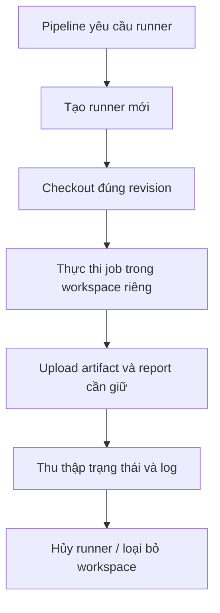
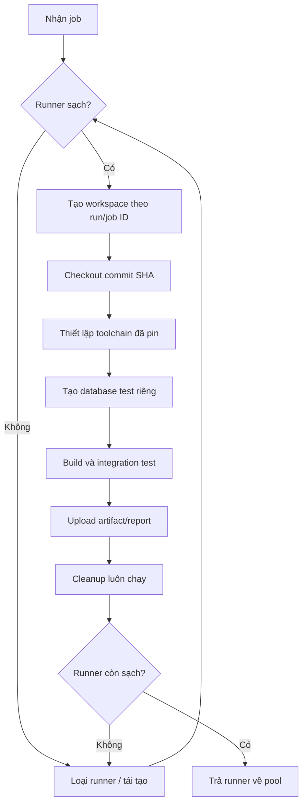

# Thiết kế vùng làm việc sạch và cách ly các lần chạy

## 1. Vì sao workspace sạch và cách ly lần chạy quan trọng?

Mỗi lần CI/CD thực thi đều cần một vùng làm việc để checkout mã nguồn, khôi phục dependency, tạo file build, chạy kiểm thử và chuẩn bị artifact. Vùng làm việc này thường được gọi là workspace. Nếu nhiều lần chạy dùng chung workspace mà không kiểm soát trạng thái, file cũ, tiến trình còn sót hoặc cấu hình từ lần trước có thể ảnh hưởng đến lần sau.

Ví dụ, một job build thất bại giữa chừng và để lại file JAR. Lần chạy tiếp theo checkout mã nguồn mới nhưng bước đóng gói lại vô tình lấy file JAR cũ. Pipeline có thể báo thành công trong khi artifact không được tạo từ commit đang kiểm tra. Một trường hợp khác là hai job chạy đồng thời cùng ghi vào thư mục `build/`, khiến kết quả bị ghi đè hoặc test đọc dữ liệu của nhau.

Thiết kế workspace sạch và cách ly các lần chạy nhằm bảo đảm:

- Mỗi lần chạy có đầu vào xác định và không phụ thuộc file dư từ lần trước.
- Các job chạy đồng thời không ghi đè hoặc đọc nhầm dữ liệu của nhau.
- Mã nguồn, tiến trình, biến môi trường và credential được giới hạn trong phạm vi cần thiết.
- Artifact được chuyển giao có chủ đích, có định danh và truy vết được.
- Runner có thể được tái sử dụng an toàn hoặc được loại bỏ sau khi chạy theo chính sách.
- Khi job thất bại hoặc bị hủy, tài nguyên và dữ liệu tạm được xử lý đúng cách.

Workspace sạch hỗ trợ tính tái lập của build và test. Cách ly còn là một biện pháp bảo mật: mã pipeline hoặc mã nguồn do người đóng góp bên ngoài gửi lên có thể không đáng tin cậy, vì vậy không nên để lần chạy đó truy cập dữ liệu hay quyền của lần chạy khác.

## 2. Phân biệt workspace, job, runner và môi trường thực thi

Các thuật ngữ này liên quan nhưng không đồng nghĩa:

| Thành phần | Vai trò | Ví dụ |
|---|---|---|
| Pipeline run | Một lần thực thi pipeline được kích hoạt bởi một revision hoặc sự kiện | CI run cho commit `abc123` |
| Job | Đơn vị công việc được lập lịch và thực thi | Job `unit-tests` |
| Runner/agent | Máy hoặc tiến trình nhận và thực thi job | Máy ảo Linux, máy Windows tự quản lý, runner container |
| Execution environment | Hệ điều hành, container, runtime, công cụ và cấu hình nơi lệnh chạy | Ubuntu với JDK 21 và Gradle |
| Workspace | Thư mục chứa checkout và file làm việc của một job hoặc một lần chạy theo cách nền tảng quy định | `/work/project` hoặc `D:\agent\_work\app` |
| Artifact | Đầu ra được lưu để job hoặc pipeline khác sử dụng | JAR, container image, test report |
| Cache | Dữ liệu có thể tạo lại được lưu tạm để giảm thời gian xử lý | Dependency cache, build cache |

Trong nhiều nền tảng, mỗi job được cấp một workspace riêng, nhưng điều đó không bảo đảm runner hoặc máy vật lý cũng riêng. Runner có thể là máy ảo dùng một lần, container trên máy chủ dùng chung hoặc máy tự quản lý tồn tại lâu dài. Cần đọc đúng mô hình của nền tảng và cấu hình thực tế.

Một workspace riêng chỉ giới hạn file trong thư mục đó. Nó không tự động cách ly tiến trình, mạng, Docker daemon, quyền hệ thống, credential hoặc dữ liệu nằm ngoài workspace. Muốn bảo vệ đầy đủ cần xem xét nhiều lớp cách ly.

## 3. Nguyên tắc nền tảng của một workspace sạch

Một workspace được xem là sạch khi trạng thái mà job có thể quan sát được bắt đầu từ một baseline đã xác định. Baseline đó gồm revision mã nguồn, dependency, công cụ, biến môi trường và dữ liệu kiểm thử được khai báo hoặc tạo ra cho lần chạy.

Các nguyên tắc cơ bản:

1. **Một lần chạy, một vùng làm việc riêng:** không để hai pipeline run đồng thời dùng chung thư mục checkout hoặc thư mục build có thể ghi.
2. **Một job, một workspace theo hợp đồng của runner:** nếu job cần dữ liệu từ job khác, truyền qua artifact hoặc cơ chế chia sẻ được khai báo.
3. **Checkout đúng revision:** ghi nhận commit/ref được kiểm tra; không dựa vào trạng thái repository còn sót.
4. **Tạo lại trạng thái có thể tạo lại:** dependency và build output cần có thể khôi phục từ định nghĩa và đầu vào đã khóa.
5. **Tách dữ liệu lâu dài khỏi workspace:** log cần lưu, báo cáo và artifact phải được upload hoặc lưu vào nơi được quản lý trước khi workspace bị xóa.
6. **Dọn dẹp có kiểm soát:** xóa file tạm và credential sau khi sử dụng, kể cả khi job thất bại hoặc bị hủy.
7. **Không tin cậy mặc định:** mã từ pull request bên ngoài hoặc nguồn không được kiểm soát phải chạy với quyền và tài nguyên giới hạn.

Sạch không có nghĩa mọi lần chạy phải tải lại toàn bộ dependency từ Internet. Có thể dùng cache để tăng tốc, miễn là cache được tách theo phạm vi tin cậy và khóa theo các đầu vào phù hợp. Cache là tối ưu hiệu năng; nó không phải nguồn dữ liệu chính thức thay cho artifact hoặc repository.

## 4. Các chiến lược tạo workspace

### 4.1. Runner dùng một lần (ephemeral runner)

Ephemeral runner được tạo cho một job hoặc một lần chạy, sau đó bị hủy hoặc đưa về trạng thái sạch. Cách này giảm nguy cơ dữ liệu còn sót giữa các job và giúp môi trường thực thi dễ dự đoán hơn.

Luồng khái quát:



Ưu điểm là ranh giới giữa các lần chạy rõ, giảm công việc dọn trạng thái cũ và phù hợp với mã nguồn không đáng tin cậy hơn runner tồn tại lâu. Đổi lại, thời gian khởi tạo runner và tải dependency có thể tăng; cần dùng image nền đã được chuẩn bị, cache an toàn hoặc runner pool được cấp phát theo yêu cầu.

Ephemeral runner không tự động giải quyết mọi vấn đề. Nếu nhiều runner cùng truy cập một Docker daemon, volume, cache hoặc dịch vụ bên ngoài dùng chung, các tài nguyên đó vẫn cần cách ly. Cần kiểm tra cả nơi lưu log, artifact, cache và credential.

### 4.2. Runner tồn tại lâu (persistent runner)

Persistent runner được sử dụng cho nhiều job qua thời gian. Cách này có thể tiết kiệm chi phí khởi tạo và giữ cache cục bộ, nhưng đòi hỏi quy trình làm sạch đáng tin cậy.

Các rủi ro thường gặp:

- File untracked hoặc file bị ignore từ lần trước vẫn còn.
- Tiến trình nền, service hoặc container test chưa dừng.
- Biến môi trường, credential hoặc file cấu hình nhạy cảm còn sót.
- Phiên bản công cụ được nâng cấp thủ công làm các job có môi trường khác nhau.
- Người dùng hoặc repository khác có thể đọc dữ liệu còn trên đĩa nếu quyền thư mục không được phân tách.

Nếu phải dùng runner tồn tại lâu, nên:

- Dùng tài khoản hệ điều hành riêng và quyền tối thiểu cho runner.
- Tạo workspace riêng theo repository, job và run ID; không dùng chung thư mục build có thể ghi.
- Xóa workspace hoặc tạo checkout mới sau mỗi job theo chính sách.
- Dừng process/container và thu hồi credential tạm sau khi job kết thúc.
- Cập nhật image/công cụ theo quy trình có phiên bản; tránh chỉnh sửa thủ công không truy vết.
- Giám sát dung lượng, trạng thái runner và dấu hiệu workspace bị nhiễm bẩn.
- Định kỳ tái tạo máy hoặc image runner từ cấu hình chuẩn.

Nếu runner chạy job từ nhiều repository hoặc nhiều mức độ tin cậy, cần đánh giá kỹ rủi ro chia sẻ máy. Một workspace riêng không đủ để ngăn mã độc trong job truy cập file hoặc tiến trình của job khác nếu chúng cùng chạy dưới một tài khoản hoặc cùng quyền hệ thống.

### 4.3. Workspace trong container hoặc máy ảo

Container giúp đóng gói môi trường và cô lập filesystem/process ở mức nhất định. Máy ảo cung cấp ranh giới hệ điều hành riêng, thường mạnh hơn container khi cần cách ly giữa các tenant không tin cậy. Mức bảo vệ thực tế phụ thuộc cấu hình kernel, runtime, quyền, mount, network và hypervisor.

| Mô hình | Lợi ích | Điểm cần kiểm soát |
|---|---|---|
| Thư mục riêng trên cùng runner | Đơn giản, chi phí thấp | Quyền filesystem, process, biến môi trường và file dùng chung |
| Container riêng cho job | Môi trường đóng gói, filesystem và namespace riêng | Container dùng chung kernel; quyền privileged, host mount và Docker socket có thể phá vỡ ranh giới |
| Máy ảo riêng | Cách ly hệ điều hành và kernel tốt hơn | Chi phí khởi tạo, quản lý image, cập nhật và hủy tài nguyên |
| Máy vật lý/runner chuyên dụng | Có thể tách phần cứng hoặc mạng cho workload đặc biệt | Chi phí, bảo trì, lịch sử dữ liệu và quyền quản trị máy |

Không nên coi container mặc định là ranh giới bảo mật đủ mạnh cho mọi mã không tin cậy. Tránh chạy container với quyền privileged, mount toàn bộ filesystem host hoặc cấp Docker socket của host cho job không đáng tin cậy. Nếu cần build container, hãy chọn mô hình builder và quyền truy cập phù hợp, hạn chế quyền daemon và tách runner theo mức độ tin cậy.

## 5. Tách workspace theo pipeline run và job

Tên thư mục workspace nên có định danh duy nhất để hai lần chạy đồng thời không ghi đè nhau. Một cấu trúc minh họa:

```text
runner-work/
  repository-a/
    run-1042/
      job-build/
      job-test/
    run-1043/
      job-build/
      job-test/
```

Đường dẫn thực tế do nền tảng quản lý và không nên tự giả định. Nếu tự xây dựng runner hoặc script điều phối, có thể tạo workspace dựa trên repository ID, run ID và job ID. Không dùng tên nhánh làm định danh duy nhất vì nhiều run có thể chạy đồng thời trên cùng nhánh.

Ví dụ shell minh họa việc tạo thư mục riêng:

```bash
set -eu

: "${RUN_ID:?RUN_ID is required}"
: "${JOB_ID:?JOB_ID is required}"

WORK_ROOT="${RUNNER_TEMP:-/tmp/ci-work}"
WORKSPACE="$WORK_ROOT/$RUN_ID/$JOB_ID"

mkdir -p "$WORKSPACE"
test -d "$WORKSPACE"
printf 'Workspace: %s\n' "$WORKSPACE"
```

Đây là ví dụ cho runner tự quản lý; các biến và đường dẫn cần điều chỉnh theo nền tảng. Cần bảo đảm run ID và job ID được tạo từ nguồn tin cậy, được kiểm tra trước khi ghép thành đường dẫn và không chứa thành phần `..` hoặc ký tự điều khiển. Thư mục gốc cần có quyền phù hợp để job không thể truy cập workspace của job khác.

Không nên dùng một thư mục cố định như `/tmp/build` hoặc `C:\temp\build` cho mọi run đồng thời. Nếu cần một thư mục cố định bên trong job, hãy tạo nó dưới workspace riêng của job.

## 6. Checkout sạch và xác định đúng revision

Checkout là điểm bắt đầu quan trọng để bảo đảm workspace phản ánh đúng mã nguồn cần kiểm tra. Một quy trình checkout đáng tin cậy cần:

- Xác định repository và commit/ref cụ thể.
- Làm sạch hoặc thay mới thư mục checkout trước khi lấy mã nguồn.
- Kiểm tra submodule, Git LFS hoặc dependency nguồn ngoài nếu dự án sử dụng.
- Ghi nhận commit SHA và trạng thái checkout trong log/metadata.
- Không dựa vào file đã sửa thủ công trên runner.

Với Git, có thể dùng clone mới vào workspace riêng. Nếu tái sử dụng checkout, cần hiểu chính xác cách công cụ checkout xử lý file tracked, untracked và ignored. `git reset --hard` chỉ đưa file tracked về commit hiện tại; nó không xóa toàn bộ file untracked. `git clean` có thể xóa file và thư mục chưa được Git theo dõi.

Ví dụ làm sạch checkout đã xác định:

```bash
git reset --hard HEAD
git clean -ffdx
git checkout --detach "$SOURCE_REVISION"
```

Các lệnh trên có tác động xóa file untracked và ignored trong repository hiện tại. Chỉ chạy trong checkout tạm đã xác định rõ, không chạy từ thư mục người dùng hoặc thư mục chứa dữ liệu cần giữ. `git clean -ffdx` có thể xóa output build, file cấu hình local và dữ liệu kiểm thử chưa được commit; do đó cần upload artifact/report trước khi dọn dẹp nếu chúng cần được giữ lại.

Đối với pipeline release, nên ghi nhận commit SHA thực tế thay vì chỉ ghi tên nhánh. Nhánh có thể tiến lên commit mới sau khi pipeline bắt đầu; commit SHA giúp xác định chính xác revision đã được build.

## 7. Phân biệt workspace, artifact và cache

Ba khái niệm này thường bị nhầm lẫn, dẫn đến việc lưu dữ liệu sai chỗ hoặc vô tình phụ thuộc trạng thái cũ.

| Thành phần | Tính chất | Vòng đời | Có nên dùng làm đầu vào phát hành? |
|---|---|---|---|
| Workspace | Thư mục làm việc tạm của job/run | Thường kết thúc cùng job hoặc run | Không trực tiếp; cần đóng gói và upload artifact |
| Artifact | Đầu ra được tạo có chủ đích và lưu để chuyển giao | Theo retention và chính sách kho artifact | Có, sau khi được xác minh và định danh |
| Cache | Dữ liệu có thể tạo lại nhằm tăng tốc | Có thể bị xóa, hết hạn hoặc thay thế | Không; phải có khả năng build lại nếu cache mất |

Ví dụ, thư mục `build/` trong workspace có thể chứa class và file tạm. File JAR đã đóng gói, kiểm thử và upload thành artifact có thể được job deploy tải về. Dependency cache chỉ giúp giảm thời gian tải thư viện; nếu cache bị xóa, build vẫn phải tạo được đầu ra từ dependency đã khóa.

Cache cần có key phản ánh đầu vào ảnh hưởng đến nội dung, chẳng hạn hệ điều hành, phiên bản runtime, file lock dependency và phiên bản công cụ build. Nếu hai nhánh hoặc hai mức độ tin cậy dùng chung cache có thể ghi, cần phân vùng cache hoặc giới hạn quyền ghi để tránh cache poisoning. Mã từ pull request bên ngoài không nên có quyền ghi vào cache mà pipeline release đáng tin cậy sẽ sử dụng nếu cơ chế cache không bảo vệ nguồn dữ liệu.

Không lưu secret trong cache hoặc artifact. Dù nền tảng có thể mã hóa dữ liệu khi lưu, việc đưa credential vào dữ liệu dùng lại làm tăng phạm vi người có thể truy cập và thời gian tồn tại của bí mật.

## 8. Cách ly các lần chạy đồng thời

Nhiều pipeline có thể chạy đồng thời trên cùng repository hoặc cùng runner. Cách ly phải ngăn một lần chạy ảnh hưởng đến file, tiến trình và tài nguyên của lần chạy khác.

Các tình huống cần xử lý:

- Hai run cùng ghi vào một thư mục build hoặc một đường dẫn artifact tạm.
- Test của hai run cùng sử dụng một database/schema hoặc tên bucket cố định.
- Hai job cùng triển khai vào một môi trường và ghi đè phiên bản của nhau.
- Một job bị hủy nhưng tiến trình con vẫn chạy nền.
- Cache hoặc volume dùng chung bị cập nhật đồng thời.

Biện pháp phù hợp gồm:

1. Tạo workspace riêng theo run/job ID.
2. Đặt tên database/schema, bucket hoặc resource kiểm thử theo run ID và dọn sau khi kết thúc.
3. Dùng lock hoặc concurrency group cho tài nguyên không thể chia sẻ an toàn.
4. Đặt timeout và cơ chế hủy tiến trình con khi job bị cancel.
5. Dùng artifact bất biến để chuyển file giữa job thay vì đọc một thư mục đang được job khác ghi.
6. Chỉ cho một luồng triển khai ghi vào cùng môi trường tại một thời điểm nếu release có thể ghi đè nhau.

Ví dụ, hai test run có thể tạo database `test_run_1042` và `test_run_1043`, thay vì cùng dùng `test_db`. Khi job hoàn tất, bước cleanup xóa database tương ứng. Nếu môi trường kiểm thử dùng chung và không thể tạo database riêng, cần khóa tài nguyên hoặc xếp hàng các job có khả năng xung đột.

Không phải mọi công việc đều nên khóa. Lock quá rộng làm mất lợi ích chạy song song. Chỉ khóa tài nguyên có trạng thái dùng chung và không thể phân vùng theo run/job.

## 9. Dọn dẹp sau khi job hoàn tất

Dọn dẹp là một phần của thiết kế job, không phải thao tác tùy chọn chỉ chạy khi thành công. Job có thể thất bại ở bất kỳ step nào hoặc bị hủy giữa chừng; tiến trình, file tạm và tài nguyên bên ngoài vẫn có thể tồn tại.

Một trình tự dọn dẹp thường gồm:

1. Thu thập log, test report và artifact cần giữ.
2. Dừng tiến trình nền, service và container do job tạo ra.
3. Thu hồi token/credential tạm hoặc kết thúc phiên xác thực.
4. Xóa database, namespace, bucket hoặc tài nguyên thử nghiệm được tạo riêng.
5. Xóa workspace tạm nếu runner được tái sử dụng.
6. Ghi lại kết quả cleanup để dễ điều tra nếu còn tài nguyên sót.

Cleanup cần được đặt trong cơ chế luôn chạy/finally của nền tảng nếu có. Nếu cleanup thất bại, hệ thống nên cảnh báo và có cơ chế dọn định kỳ dựa trên nhãn hoặc run ID. Không nên xóa tài nguyên chỉ dựa vào tên chung; hãy kiểm tra quyền sở hữu và định danh của lần chạy để tránh xóa nhầm tài nguyên khác.

Ví dụ shell đơn giản:

```bash
cleanup() {
  if [ -n "${TEST_CONTAINER_ID:-}" ]; then
    docker rm -f "$TEST_CONTAINER_ID" || true
  fi
  if [ -n "${TEMP_DIR:-}" ] && [ -d "$TEMP_DIR" ]; then
    rm -rf -- "$TEMP_DIR"
  fi
}

trap cleanup EXIT INT TERM
```

Đoạn mã chỉ minh họa cách gắn cleanup với vòng đời shell. Trong triển khai thật, cần bảo đảm các biến đường dẫn và container ID do job tạo ra, được xác thực và giới hạn trong workspace/tài nguyên của job. Không lấy đường dẫn tùy ý từ input không tin cậy rồi đưa trực tiếp vào `rm -rf`.

Với runner ephemeral, hủy runner là một lớp cleanup hữu ích, nhưng vẫn cần thu thập artifact và thu hồi quyền ở hệ thống bên ngoài. Không giả định việc hủy máy tự động xóa mọi bản sao log, cache hoặc volume được lưu ở nơi khác. Nếu cần bảo đảm xóa dữ liệu theo yêu cầu bảo mật, cần dùng cơ chế lưu trữ, mã hóa và hủy khóa phù hợp; xóa file thông thường trên SSD hoặc storage dùng chung không luôn chứng minh dữ liệu vật lý đã biến mất.

## 10. Cách ly mã nguồn không đáng tin cậy

Pull request từ fork, nhánh do người ngoài đóng góp hoặc script lấy từ nguồn chưa được xác minh có thể chứa mã tùy ý. Khi pipeline chạy mã đó, mã có thể đọc file mà tài khoản runner truy cập, gọi mạng, khởi chạy tiến trình hoặc cố lấy credential.

Các biện pháp bảo vệ:

- Chạy mã không tin cậy trên runner ephemeral hoặc pool runner riêng không chứa dữ liệu nhạy cảm.
- Không cấp secret production, quyền ghi registry hoặc quyền triển khai cho job kiểm tra pull request từ nguồn không tin cậy.
- Dùng token có quyền đọc tối thiểu và thời hạn ngắn.
- Tách job build/test khỏi job publish/deploy có quyền cao.
- Hạn chế quyền truy cập mạng ra ngoài nếu không cần thiết; allowlist endpoint khi phù hợp.
- Không mount thư mục host, Docker socket hoặc credential của máy chủ vào container không tin cậy.
- Phân vùng cache và artifact theo repository, branch và mức độ tin cậy.
- Giới hạn CPU, bộ nhớ, thời gian và số tiến trình để ngăn job chiếm tài nguyên.
- Review các workflow có quyền cao, đặc biệt khi chúng được gọi từ pull request hoặc nhận input do người đóng góp kiểm soát.

Một điểm quan trọng là file pipeline cũng có thể bị thay đổi trong pull request. Nếu workflow đọc từ nhánh đang kiểm tra, người đóng góp có thể sửa chính định nghĩa job để tìm cách lấy secret hoặc mở rộng quyền. Cần dùng cơ chế bảo vệ workflow và secret của nền tảng, kiểm soát nguồn workflow có quyền cao và tách sự kiện không tin cậy khỏi quy trình phát hành.

## 11. Kiểm soát môi trường và tính tái lập

Workspace sạch không đủ nếu cùng một commit được build với runtime, dependency hoặc công cụ khác nhau. Để kết quả có thể tái lập, cần quản lý các thành phần của môi trường:

- Pin phiên bản JDK, Node.js, Python, compiler, package manager và công cụ build.
- Dùng lockfile hoặc cơ chế khóa dependency; kiểm tra nguồn và checksum khi phù hợp.
- Sử dụng image runner/container có phiên bản hoặc digest rõ ràng.
- Đặt locale, timezone và biến môi trường cần thiết một cách tường minh.
- Tránh phụ thuộc vào file cấu hình local không được version control.
- Ghi nhận phiên bản runner, image, toolchain và dependency quan trọng trong metadata build.
- Phân biệt cấu hình môi trường với artifact; không build lại theo cấu hình khác nhau mà không có lý do được kiểm soát.

Ví dụ, cùng một commit Java được build lúc sáng trên JDK 17 và buổi chiều trên JDK 21 có thể tạo kết quả khác nhau. Ghi nhận commit mà không ghi nhận toolchain sẽ chưa đủ để tái hiện lần build. Pipeline nên khai báo JDK cụ thể và ghi phiên bản thực tế vào log hoặc build metadata.

Với dependency cache, cần bảo đảm cache không làm thay đổi tính đúng đắn. Một build sạch không cache nên vẫn thành công. Cache chỉ được xem là tối ưu; nếu xóa cache làm build hỏng, quy trình có thể đang phụ thuộc vào dữ liệu không được khai báo.

## 12. Quan sát và chẩn đoán workspace contamination

Workspace contamination là tình trạng kết quả của job bị ảnh hưởng bởi dữ liệu hoặc trạng thái còn sót từ lần chạy khác. Dấu hiệu có thể gồm:

- Build thành công trên một runner nhưng thất bại trên runner mới.
- Test chỉ thất bại khi chạy song song hoặc khi chạy sau một test khác.
- Artifact có timestamp cũ hoặc chứa class không tương ứng với commit.
- Job thất bại khi chạy sạch nhưng thành công sau khi chạy lại trên cùng runner.
- Dung lượng workspace tăng bất thường hoặc xuất hiện file không thuộc checkout hiện tại.

Để điều tra:

1. Ghi nhận run ID, job ID, runner ID, commit SHA và thời gian bắt đầu/kết thúc.
2. Ghi lại phiên bản hệ điều hành, image, runtime và công cụ build.
3. Kiểm tra trạng thái Git: commit hiện tại, file modified, untracked và ignored khi cần.
4. Kiểm tra process/container còn chạy và tài nguyên dùng chung.
5. Chạy lại trong workspace mới hoặc runner ephemeral để so sánh.
6. So sánh artifact digest và metadata giữa lần chạy thành công và thất bại.
7. Xác định nguồn dữ liệu sót lại rồi bổ sung isolation, cleanup hoặc khai báo dependency.

Không nên chỉ chạy lại job nhiều lần cho đến khi thành công rồi bỏ qua nguyên nhân. Nếu lỗi biến mất trên runner mới, đó là tín hiệu cần điều tra trạng thái runner hoặc workspace, không phải bằng chứng rằng mã nguồn đã đúng.

## 13. Ví dụ: thiết kế job build và test an toàn trên runner tự quản lý

Giả sử tổ chức dùng một pool Linux runner tồn tại lâu để chạy pipeline cho nhiều dịch vụ Java. Mỗi lần chạy cần checkout mã nguồn, build JAR và chạy integration test bằng database tạm.

Thiết kế đề xuất:

1. Bộ điều phối cấp một workspace duy nhất theo `run_id/job_id` dưới thư mục gốc chỉ runner account truy cập.
2. Job checkout commit SHA cụ thể vào workspace mới; không dùng thư mục của run trước.
3. Toolchain được chọn từ image hoặc cấu hình đã pin; phiên bản JDK và Gradle được ghi vào log.
4. Job tạo database riêng có tên gắn với run ID, sau đó chạy build và test.
5. JAR và test report được upload thành artifact có metadata commit và run ID.
6. Bước cleanup luôn chạy để dừng container, xóa database và workspace tạm.
7. Runner kiểm tra không còn process/resource của job trước khi nhận job tiếp theo; nếu trạng thái không sạch, runner bị loại khỏi pool và tái tạo.
8. Job từ pull request bên ngoài chạy trên pool không có secret triển khai và không có quyền ghi registry production.

Luồng tổng quát:



Thiết kế này cho phép tái sử dụng runner mà vẫn kiểm soát trạng thái giữa các job. Nếu workload có mức độ tin cậy khác nhau hoặc cần cách ly mạnh, nên dùng runner ephemeral hoặc pool riêng thay vì chỉ dựa vào cleanup trên một máy dùng chung.

## 14. Những sai lầm thường gặp

| Sai lầm | Hệ quả | Cách cải thiện |
|---|---|---|
| Dùng chung workspace cho nhiều run | File bị ghi đè, build không xác định và lẫn dữ liệu | Tách workspace theo run/job ID |
| Chỉ chạy `git reset --hard` | File untracked/ignored vẫn còn và có thể ảnh hưởng build | Checkout mới hoặc làm sạch checkout có kiểm soát |
| Xem container là ranh giới bảo mật tuyệt đối | Host mount, privileged mode hoặc Docker socket có thể mở đường truy cập host | Giới hạn quyền, mount, network và dùng VM/ephemeral runner khi cần |
| Giữ runner lâu nhưng không tái tạo | Toolchain, process và credential tích tụ qua thời gian | Dọn workspace, kiểm tra runner và tái tạo định kỳ |
| Dùng cache làm nguồn artifact | Dữ liệu có thể bị thay thế hoặc hết hạn, khó truy vết | Upload artifact bất biến và dùng cache chỉ để tăng tốc |
| Hai test dùng chung database | Test cạnh tranh dữ liệu, gây lỗi ngẫu nhiên | Database/schema riêng hoặc khóa tài nguyên |
| Cleanup chỉ chạy khi thành công | Job thất bại để lại container, token hoặc dữ liệu tạm | Dùng finally/trap và quy trình cleanup định kỳ |
| Cấp secret cho pull request không tin cậy | Mã độc có thể lấy credential hoặc dùng quyền của pipeline | Tách workflow và runner theo mức độ tin cậy, áp dụng least privilege |
| Chỉ lưu log trong workspace | Log biến mất khi runner bị hủy | Upload log/report trước cleanup |
| Không ghi nhận commit và toolchain | Khó tái hiện kết quả build | Lưu revision, image và phiên bản công cụ trong metadata |

## 15. Checklist thiết kế workspace và isolation

Trước khi đưa runner vào sử dụng, hãy kiểm tra:

- [ ] Mỗi pipeline run/job có workspace riêng và định danh rõ.
- [ ] Checkout bắt đầu từ revision cụ thể và có baseline sạch.
- [ ] Job không phụ thuộc file còn sót từ lần chạy trước.
- [ ] Workspace không được chia sẻ ngoài ý muốn giữa các repository hoặc mức độ tin cậy.
- [ ] Process, container, database và resource tạm có quy trình dừng/xóa.
- [ ] Artifact/report cần giữ được upload trước cleanup.
- [ ] Cache được tách theo nguồn tin cậy và khóa theo đầu vào; cache có thể tạo lại.
- [ ] Credential có thời hạn ngắn, quyền tối thiểu và không được lưu trong workspace lâu hơn cần thiết.
- [ ] Runner có timeout, giới hạn tài nguyên và chính sách xử lý khi job bị hủy.
- [ ] Mã nguồn không tin cậy chạy trên runner/pool không có quyền nhạy cảm.
- [ ] Có cách phát hiện runner bẩn và loại bỏ/tái tạo runner khi cần.
- [ ] Log lưu run ID, job ID, commit SHA, runner/image và kết quả cleanup.

## 16. Nguyên tắc thực hành cốt lõi

1. Xem workspace là dữ liệu tạm của job, không phải nơi lưu trạng thái lâu dài.
2. Tạo vùng làm việc riêng theo lần chạy và công việc; không dùng chung thư mục có thể ghi giữa các run đồng thời.
3. Ưu tiên runner ephemeral cho workload không tin cậy hoặc yêu cầu cách ly cao; nếu dùng runner persistent, phải có baseline sạch và quy trình tái tạo.
4. Hiểu rõ ranh giới của thư mục, process, container, VM, mạng và quyền hệ điều hành.
5. Checkout đúng commit, khóa toolchain và dependency để kết quả có thể tái lập.
6. Dùng artifact cho đầu ra cần chuyển giao, cache cho dữ liệu có thể tạo lại.
7. Dọn dẹp bằng cơ chế luôn chạy, đồng thời lưu log và report trước khi xóa workspace.
8. Phân tách runner, secret, cache và quyền theo mức độ tin cậy của nguồn mã.
9. Theo dõi dấu hiệu contamination và xử lý nguyên nhân thay vì chỉ chạy lại job.

Một môi trường thực thi đáng tin cậy bắt đầu từ workspace có trạng thái xác định và ranh giới cách ly rõ ràng. Khi mỗi lần chạy có dữ liệu, quyền và vòng đời riêng, CI/CD sẽ giảm được lỗi khó tái hiện, hạn chế ảnh hưởng chéo và tạo ra artifact có thể kiểm chứng trong suốt quá trình phát hành.
