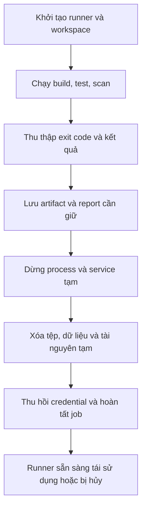

# Dọn tiến trình, tệp tạm và dữ liệu sau khi kết thúc

Một job CI có thể chạy test, khởi động database tạm, tạo container, sinh report và tải nhiều dependency. Khi lệnh chính kết thúc, công việc của môi trường thực thi chưa chắc đã hoàn tất. Một tiến trình con có thể vẫn chạy nền, container có thể tiếp tục chiếm cổng mạng, tệp tạm có thể chứa token hoặc dữ liệu kiểm thử, còn workspace có thể được tái sử dụng cho job tiếp theo.

Nếu không dọn dẹp có kiểm soát, runner dần tích tụ tiến trình mồ côi, tệp lớn, container, volume và dữ liệu nhạy cảm. Các job sau có thể thất bại vì hết dung lượng, xung đột cổng, dùng nhầm dữ liệu cũ hoặc đọc được thông tin của job trước. Trong CI/CD, **cleanup là một phần của vòng đời thực thi**: mọi tài nguyên được tạo cho một lần chạy cần có chủ sở hữu, thời điểm kết thúc và chính sách xử lý rõ ràng.

Mục tiêu không phải xóa mọi thứ ngay khi job kết thúc. Nhóm cần phân biệt tài nguyên tạm phải thu hồi, dữ liệu cần giữ làm bằng chứng, artifact cần phát hành và dữ liệu cần lưu theo chính sách. Dọn dẹp tốt giúp runner có thể tái sử dụng an toàn, giảm chi phí và giữ khả năng truy vết của pipeline.

## 1. Vòng đời của một môi trường thực thi

Một job CI/CD thường đi qua các giai đoạn:

1. **Khởi tạo:** cấp runner hoặc container, checkout mã nguồn, tạo workspace và cấp credential cần thiết.
2. **Thực thi:** chạy script, build, test, scan, tạo process con, container và dữ liệu tạm.
3. **Thu thập kết quả:** tổng hợp exit code, log, test report, coverage và artifact cần lưu.
4. **Dọn dẹp:** dừng process còn sống, giải phóng tài nguyên tạm, xóa dữ liệu không cần giữ và thu hồi credential.
5. **Kết thúc:** ghi trạng thái job, giữ lại bằng chứng theo retention policy và giải phóng runner.



Thứ tự giữa lưu kết quả và xóa dữ liệu rất quan trọng. Nếu xóa workspace trước khi upload report, pipeline sẽ mất bằng chứng. Nếu lưu toàn bộ thư mục tạm như artifact mà không phân loại, token, file cấu hình hoặc dữ liệu kiểm thử có thể bị phát tán.

### Cleanup phải chạy trên mọi đường kết thúc

Job có thể kết thúc do:

- Thành công.
- Lệnh build hoặc test trả mã lỗi.
- Timeout.
- Người dùng hoặc hệ thống hủy pipeline.
- Runner mất kết nối hoặc máy thực thi bị dừng.
- Một job khác khiến workflow bị hủy.

Cleanup cần được thiết kế cho cả đường thành công lẫn thất bại. Tuy nhiên, không phải cơ chế nào cũng chạy được khi máy bị tắt đột ngột hoặc process bị kill cưỡng bức. Vì vậy, script cleanup cần đi cùng runner có vòng đời ngắn, cơ chế thu hồi theo TTL và quy trình quét tài nguyên tồn đọng.

## 2. Phân loại tài nguyên trước khi xóa

Không nên dùng một lệnh xóa chung cho toàn bộ workspace. Trước hết, hãy xác định tài nguyên nào thuộc loại nào và ai cần sử dụng nó sau job.

| Loại dữ liệu hoặc tài nguyên | Ví dụ | Xử lý thường phù hợp |
|---|---|---|
| Process tạm | Test server, mock service, browser driver, compiler daemon do job tạo | Dừng và chờ kết thúc trước khi giải phóng runner |
| Tệp tạm | File trung gian, socket, PID file, file tải dependency chưa hoàn chỉnh | Xóa sau khi không còn process sử dụng |
| Workspace | Source checkout, thư mục build, thư mục test | Xóa hoặc tạo mới trước job tiếp theo theo chính sách runner |
| Test data | Database, schema, bucket, user hoặc queue tạo riêng cho test | Xóa theo phạm vi sở hữu; giữ lại có thời hạn nếu cần điều tra |
| Container và network | Container test, network, volume tạm | Dừng và xóa tài nguyên thuộc đúng project/run |
| Artifact phát hành | JAR, image, package, bundle đã được xác minh | Publish và giữ theo retention policy; không xóa cùng tệp tạm |
| Báo cáo kiểm thử | JUnit XML, coverage, scan report | Upload làm bằng chứng, giới hạn quyền và thời gian lưu |
| Bí mật | Token, credential file, private key, secret env | Thu hồi hoặc hết hạn; xóa bản sao tạm và tránh lưu vào log/artifact |
| Cache | Dependency cache, build cache | Giữ theo cache policy; không dùng cache thay artifact phát hành |

Một quy tắc thực tế là phân loại ngay khi tạo tài nguyên. Đặt tên, thư mục hoặc tag có chứa pipeline run ID để có thể xác định tài nguyên thuộc job nào. Khi cleanup, chỉ xóa tài nguyên có định danh và quyền sở hữu đã xác minh.

## 3. Quản lý vòng đời process và tiến trình con

Một lệnh trong pipeline có thể tạo nhiều tiến trình con. Ví dụ, lệnh test khởi động test runner, test runner khởi động browser, browser mở process renderer và ứng dụng cần test mở thêm server nền. Khi process cha kết thúc, process con không phải lúc nào cũng tự kết thúc.

### 3.1. Phân biệt process cha, process con và process mồ côi

- **Process cha:** tiến trình khởi chạy một hoặc nhiều tiến trình khác.
- **Process con:** tiến trình được tạo bởi process cha.
- **Process mồ côi:** process còn chạy sau khi process quản lý trực tiếp của nó đã kết thúc hoặc không còn theo dõi được.
- **Zombie process:** trên hệ thống Unix, process đã kết thúc nhưng trạng thái chưa được process cha thu hồi bằng thao tác wait.

Process mồ côi có thể giữ cổng, file handle, CPU, bộ nhớ hoặc kết nối database. Nếu runner được tái sử dụng, job sau có thể gặp lỗi khó giải thích như `address already in use`, test nhận response từ server cũ hoặc tiến trình Java vẫn chiếm RAM.

### 3.2. Theo dõi PID và quản lý process group

Nếu script khởi động process nền, cần lưu PID hoặc dùng cơ chế quản lý process của nền tảng. Trên Linux, process group hoặc session giúp gửi tín hiệu đến cả nhóm tiến trình. Trên Windows, Job Object hoặc cơ chế kết thúc cây process giúp quản lý process con.

Không nên chỉ tìm và kill theo tên chung như `java`, `node` hoặc `python` trên runner dùng chung. Lệnh đó có thể dừng process thuộc job khác hoặc dịch vụ của runner. Hãy giới hạn thao tác vào PID, process group, Job Object hoặc container mà job hiện tại tạo ra.

### 3.3. Dừng có trật tự trước khi cưỡng bức

Một quy trình dừng an toàn thường gồm:

1. Ngừng nhận công việc mới hoặc đóng listener.
2. Gửi tín hiệu yêu cầu process kết thúc có trật tự.
3. Chờ process hoàn tất trong một khoảng thời gian hữu hạn.
4. Nếu hết thời gian, gửi tín hiệu cưỡng bức đến đúng process group hoặc cây process đã sở hữu.
5. Thu hồi process handle và kiểm tra tài nguyên đã được giải phóng.

Với dịch vụ test, có thể gọi endpoint shutdown hoặc lệnh dừng do ứng dụng cung cấp trước khi kill. Cách này giúp flush log, đóng connection và giải phóng lock đúng cách.

### Ví dụ Linux: dọn thư mục tạm khi script kết thúc

Đoạn Bash sau minh họa việc tạo một thư mục riêng cho job và đăng ký cleanup khi shell thoát:

```bash
#!/usr/bin/env bash
set -Eeuo pipefail

temp_root="${RUNNER_TEMP:-/tmp}"
work_dir="$(mktemp -d "${temp_root%/}/ci-job.XXXXXX")"
child_pid=""

cleanup() {
  exit_code=$?
  trap - EXIT INT TERM

  if [[ -n "$child_pid" ]] && kill -0 "$child_pid" 2>/dev/null; then
    kill -TERM "$child_pid" 2>/dev/null || true
    for _ in {1..10}; do
      kill -0 "$child_pid" 2>/dev/null || break
      sleep 1
    done
    kill -KILL "$child_pid" 2>/dev/null || true
    wait "$child_pid" 2>/dev/null || true
  fi

  rm -rf -- "$work_dir"
  exit "$exit_code"
}

trap cleanup EXIT
trap 'exit 130' INT
trap 'exit 143' TERM

./run-tests.sh --output "$work_dir/results" &
child_pid=$!
wait "$child_pid"
child_pid=""
```

Ví dụ này theo dõi trực tiếp một process con. Nếu `run-tests.sh` tạo thêm process nền, cần quản lý process group/session hoặc dùng cơ chế timeout và process-tree của runner để bảo đảm các tiến trình hậu duệ cũng kết thúc. `trap` không chạy khi máy bị mất điện, process bị kill bằng SIGKILL hoặc runner bị hủy đột ngột.

### Ví dụ Windows PowerShell: luôn xóa thư mục tạm

```powershell
$tempRoot = if ($env:RUNNER_TEMP) { $env:RUNNER_TEMP } else { $env:TEMP }
$workDir = Join-Path $tempRoot ("ci-job-" + [guid]::NewGuid().ToString("N"))

New-Item -ItemType Directory -Path $workDir -ErrorAction Stop | Out-Null

try {
    & .\run-tests.exe --output $workDir
    if ($LASTEXITCODE -ne 0) {
        throw "Test process failed with exit code $LASTEXITCODE"
    }
}
finally {
    if (Test-Path -LiteralPath $workDir) {
        Remove-Item -LiteralPath $workDir -Recurse -Force -ErrorAction SilentlyContinue
    }
}
```

`finally` giúp dọn thư mục khi khối lệnh kết thúc bình thường hoặc phát sinh exception. Ví dụ gọi executable native nên `$LASTEXITCODE` phản ánh exit code của chương trình. Nếu script khởi chạy process nền bằng `Start-Process`, cần giữ process handle và dừng cả cây process hoặc đặt process trong Job Object phù hợp; xóa thư mục trong `finally` không tự dừng process đang sử dụng file.

## 4. Dọn dẹp tệp tạm và workspace

Tệp tạm có thể được tạo bởi script, build tool, test framework, compiler, package manager hoặc ứng dụng. Chúng thường nằm trong thư mục tạm của hệ điều hành, workspace của runner hoặc thư mục build riêng của repository.

### 4.1. Tạo thư mục riêng cho từng lần chạy

Không nên để nhiều job cùng ghi vào một thư mục có tên cố định như `/tmp/test-output` hoặc `C:\temp\build`. Dùng tên duy nhất dựa trên UUID hoặc pipeline run ID để giảm xung đột.

Ví dụ:

```text
runner-temp/
  ci-10482-7f3a/
    logs/
    test-data/
    downloads/
  ci-10483-a92c/
    logs/
    test-data/
    downloads/
```

Job chỉ được xóa thư mục mà nó sở hữu. Không xóa thư mục gốc của runner hoặc thư mục tạm dùng chung. Đường dẫn cleanup cần được chuẩn hóa, kiểm tra nằm dưới root được phép và không rỗng trước khi thực hiện thao tác đệ quy.

### 4.2. Tránh lệnh xóa quá rộng

Các lệnh xóa đệ quy có thể gây hậu quả lớn nếu biến đường dẫn sai hoặc rỗng. Trước khi xóa, cần:

- Xác minh biến đường dẫn đã được gán và không phải chuỗi rỗng.
- Dùng đường dẫn tuyệt đối đã chuẩn hóa.
- Xác minh thư mục đích nằm dưới thư mục gốc được cấp cho job.
- Chỉ xóa thư mục có tên hoặc marker nhận diện run hiện tại.
- Không đi theo symlink hoặc junction ra ngoài vùng sở hữu nếu công cụ có thể kiểm soát điều đó.
- Ghi log tên tài nguyên được xóa mà không ghi nội dung nhạy cảm.

Ví dụ, `rm -rf "$WORK_DIR"` chỉ an toàn khi `WORK_DIR` đã được kiểm tra và thuộc workspace của job. Một lệnh `rm -rf "$WORK_DIR"/*` có thể mở rộng thành thao tác xóa ngoài dự kiến nếu biến rỗng hoặc sai. Tránh xây dựng đường dẫn cleanup từ input chưa xác thực.

### 4.3. Dọn file tải xuống và cache tạm

Download bị gián đoạn có thể để lại file chưa hoàn chỉnh. Job nên tải vào tên tạm rồi đổi tên nguyên tử khi xác minh thành công. Nếu thất bại, cleanup xóa file tạm thuộc lần chạy đó.

Cache có vòng đời khác với file tạm. Cache có thể được giữ qua nhiều job để tăng tốc, nhưng cần key, giới hạn dung lượng, chính sách hết hạn và quyền truy cập. Không xóa cache dùng chung trong cleanup của một job nếu chưa có quy tắc quản lý cache riêng.

### 4.4. Workspace của runner dùng chung

Runner persistent có thể giữ source checkout, build output và cấu hình sau khi job kết thúc. Nên dùng một trong các cách:

- Tạo workspace mới cho mỗi job và xóa sau khi hoàn tất.
- Dùng workspace riêng theo pipeline run, không chia sẻ cho job không liên quan.
- Dùng runner ephemeral, hủy máy hoặc container sau một lần chạy.
- Chạy bước reset workspace trước khi nhận job mới và xác minh trạng thái sạch.

Không nên dựa vào việc `git clean` luôn đủ. Build tool có thể tạo file ngoài repository, process nền có thể tiếp tục ghi file, còn dữ liệu trong thư mục cache hoặc thư mục home có thể tồn tại qua nhiều lần chạy.

## 5. Dọn container, network và dịch vụ phụ trợ

Integration test thường cần database, message broker, cache, mock server hoặc service phụ trợ. Những tài nguyên này có thể chạy trong Docker Compose, Kubernetes hoặc môi trường cloud tạm.

### 5.1. Docker Compose

Mỗi pipeline run nên có project name riêng để tránh hai job cùng thao tác vào một nhóm container. Sau khi thu thập log và report, job có thể dừng stack được tạo cho chính project đó.

Ví dụ minh họa:

```bash
#!/usr/bin/env bash
set -Eeuo pipefail

compose_project="ci-${CI_PIPELINE_ID:-local}-${CI_JOB_ID:-test}"

cleanup() {
  exit_code=$?
  trap - EXIT INT TERM
  docker compose -p "$compose_project" logs --no-color > integration-services.log || true
  if ! docker compose -p "$compose_project" down --remove-orphans; then
    echo "Compose cleanup failed for project $compose_project" >&2
    if [[ "$exit_code" -eq 0 ]]; then
      exit_code=1
    fi
  fi
  exit "$exit_code"
}

trap cleanup EXIT
trap 'exit 130' INT
trap 'exit 143' TERM

docker compose -p "$compose_project" up -d --wait
./run-integration-tests.sh
```

Trong script thật, cần đặt lệnh chạy test trong cấu trúc `trap` hoặc `try/finally` để `down` vẫn được gọi khi test thất bại hoặc bị hủy theo cách shell có thể xử lý. Lệnh trên không dùng `--volumes`; volume có thể chứa dữ liệu cần giữ để điều tra. Chỉ xóa volume khi nó được tạo riêng cho run hiện tại và đã qua bước thu thập dữ liệu cần thiết.

Không dùng `docker system prune` trên runner dùng chung như một bước cleanup của job nếu chưa có quyền sở hữu và chính sách rõ ràng. Lệnh prune toàn cục có thể xóa image, container hoặc cache thuộc job khác.

### 5.2. Kubernetes namespace tạm

Một job có thể tạo namespace riêng theo run ID, triển khai service và test, sau đó xóa namespace. Cần gắn label như `managed-by=ci` và `run-id=<id>` để xác định chủ sở hữu. Cleanup chỉ xóa namespace có label và run ID khớp.

Việc xóa namespace là thao tác bất đồng bộ. Pipeline cần theo dõi trạng thái xóa và đặt timeout. Finalizer hoặc tài nguyên không thể thu hồi có thể khiến namespace ở trạng thái `Terminating`; cần log và cơ chế xử lý tồn đọng thay vì giả định lệnh delete đã giải phóng mọi tài nguyên.

### 5.3. Tài nguyên cloud tạm

Integration hoặc performance test có thể tạo bucket, database, VM, load balancer, queue hoặc security group. Mỗi tài nguyên cần tag chứa project, pipeline run, owner và thời điểm hết hạn. Một bộ thu hồi định kỳ có thể xóa tài nguyên quá TTL nếu job bị hủy trước khi cleanup hoàn tất.

Tài khoản CI chỉ nên có quyền xóa tài nguyên thuộc phạm vi nó tạo. Tránh cấp quyền xóa toàn bộ resource group hoặc project chỉ để cleanup một môi trường test.

## 6. Dọn dữ liệu kiểm thử và trạng thái ứng dụng

Dữ liệu kiểm thử có thể gồm bản ghi database, file upload, object trong bucket, message trong queue, tài khoản thử và trạng thái cache. Nếu dùng chung giữa các job, dữ liệu cũ có thể làm test phụ thuộc thứ tự hoặc đọc nhầm kết quả.

### 6.1. Dùng namespace dữ liệu riêng

Ưu tiên tạo dữ liệu có định danh theo pipeline run hoặc test suite. Ví dụ, mỗi run có schema `ci_run_10482`, tenant `test-10482` hoặc prefix bucket `ci/10482/`. Cleanup chỉ xóa phạm vi này.

Nếu nhiều test chạy song song, mỗi shard có thể dùng namespace riêng. Điều này giúp tránh hai test cùng xóa một bảng hoặc cập nhật cùng một user.

### 6.2. Dọn theo thứ tự phụ thuộc

Trước khi xóa dữ liệu, cần dừng consumer và process đang sử dụng nó. Ví dụ, dừng worker xử lý queue trước khi xóa queue; dừng test server trước khi xóa database schema; chờ upload hoàn tất trước khi xóa bucket tạm.

Với database có foreign key, có thể xóa theo thứ tự phụ thuộc hoặc drop toàn bộ schema riêng. Không chạy lệnh `TRUNCATE` trên database dùng chung nếu job không sở hữu toàn bộ dữ liệu.

### 6.3. Xử lý dữ liệu nhạy cảm

Test data có thể chứa thông tin cá nhân hoặc dữ liệu được sao chép từ production. Nên ưu tiên dữ liệu tổng hợp hoặc đã ẩn danh. Nếu phải dùng dữ liệu nhạy cảm, cần kiểm soát quyền, mã hóa, giới hạn thời gian tồn tại và ghi nhận người hoặc job truy cập.

Cleanup không thay thế yêu cầu bảo vệ dữ liệu. Xóa một file không bảo đảm dữ liệu đã biến mất khỏi snapshot, backup, log, cache, artifact hoặc storage versioning. Vì vậy, không đưa dữ liệu nhạy cảm vào môi trường CI nếu không có cơ chế quản lý vòng đời phù hợp.

## 7. Thu hồi credential và bí mật tạm

Runner có thể nhận token registry, cloud credential, SSH key, file cấu hình hoặc certificate. Những bí mật này cần thời hạn ngắn và phạm vi quyền tối thiểu.

Các nguyên tắc cần áp dụng:

- Ưu tiên OIDC hoặc workload identity để cấp credential ngắn hạn theo job.
- Không ghi secret vào command line, log, test report hoặc artifact công khai.
- Nếu cần ghi credential ra file, tạo file trong thư mục riêng, giới hạn quyền đọc và xóa sau khi dùng.
- Thu hồi token hoặc session nếu hệ thống hỗ trợ; xóa file local không làm token đã phát hành mất hiệu lực.
- Không truyền secret qua cache hoặc artifact dùng chung giữa các job.
- Tránh để credential tồn tại trong environment của process lâu hơn thời gian cần thiết.

Ví dụ, một job deploy có thể lấy token ngắn hạn, thực hiện thao tác và kết thúc session. Khi cleanup, job xóa file credential và gọi lệnh logout/revoke nếu nhà cung cấp hỗ trợ. Nếu runner bị kill đột ngột, thời hạn token ngắn sẽ giới hạn thời gian credential còn có thể bị lạm dụng.

Không nên tuyên bố rằng ghi đè file nhiều lần hoặc xóa file là bảo đảm xóa an toàn tuyệt đối. SSD, copy-on-write filesystem, snapshot và storage phân tán có thể giữ bản sao vật lý. Với dữ liệu nhạy cảm, cách đáng tin cậy hơn là không ghi ra đĩa khi không cần, dùng storage mã hóa tạm thời và hủy khóa hoặc môi trường ephemeral theo chính sách.

## 8. Giữ artifact và bằng chứng trước khi cleanup

Một trong những lỗi cleanup thường gặp là xóa workspace trước khi pipeline lưu kết quả. Trước khi xóa, hãy xác định rõ những gì cần giữ.

| Dữ liệu | Có nên giữ sau job? | Lý do |
|---|---|---|
| Test report | Thường có | Bằng chứng quality gate và điều tra lỗi |
| Coverage report | Theo chính sách | Theo dõi chất lượng và xu hướng |
| Scan report | Theo chính sách bảo mật | Bằng chứng đánh giá lỗ hổng và policy |
| Artifact phát hành | Có theo retention policy | Triển khai, rollback và truy vết |
| Build provenance và manifest | Có | Nối artifact với nguồn và pipeline run |
| Log chẩn đoán | Có thời hạn | Điều tra thất bại, giới hạn dữ liệu nhạy cảm |
| File trung gian và download tạm | Thường không | Không cần sau khi artifact đã được publish |
| Database hoặc bucket test | Thường xóa; có thể giữ bản sao đã kiểm soát khi điều tra | Tránh dữ liệu cũ và chi phí tích tụ |
| Credential file | Không | Giảm nguy cơ lộ bí mật |

Nên có bước `publish-results` hoặc `upload-artifacts` trước cleanup. Bước này chỉ upload danh sách file được cho phép, không upload toàn bộ workspace một cách mù quáng. Có thể dùng allowlist theo đường dẫn và kiểm tra nội dung để tránh secret hoặc dữ liệu nhạy cảm lọt vào artifact.

Retention policy cần phân biệt artifact release, test report, log và cache. Mỗi loại có thời hạn, quyền truy cập và yêu cầu lưu trữ khác nhau. Artifact cần phục vụ rollback có thể được giữ lâu hơn file log tạm; cache có thể bị xóa sớm hơn report kiểm thử.

## 9. Thiết kế cleanup chạy cả khi lỗi và hủy job

Một cleanup đáng tin cậy cần được gọi từ nhiều lớp:

1. **Trong script:** dùng `trap`, `finally` hoặc cơ chế defer để xử lý exit, exception và tín hiệu có thể bắt.
2. **Trong job runner:** khai báo bước cleanup hoặc post-job action chạy sau các bước chính theo ngữ nghĩa của nền tảng.
3. **Trong môi trường:** dùng container hoặc VM ephemeral để thu hồi toàn bộ trạng thái khi job kết thúc.
4. **Ngoài job:** dùng TTL tag và sweeper để xử lý tài nguyên còn sót sau crash hoặc mất kết nối.

Không nên chỉ dựa vào một bước cuối workflow. Nếu job bị hủy giữa chừng, một số nền tảng có thể không chạy bước sau cùng; nếu runner mất kết nối, script không thể thực hiện cleanup. Cơ chế nhiều lớp giúp giảm rủi ro còn sót tài nguyên.

### Phân biệt cleanup và bước hậu xử lý

Một số công việc cần chạy ngay cả khi test thất bại, ví dụ upload report và thu thập log. Một số công việc chỉ nên chạy sau khi có artifact thành công, ví dụ publish release. Vì vậy, pipeline cần phân biệt:

- **Always-run diagnostics:** thu thập log, test report và trạng thái process.
- **Cleanup:** dừng service tạm, xóa file và thu hồi tài nguyên.
- **Success-only publish:** publish artifact hoặc release khi quality gate đạt.
- **Failure handling:** giữ lại bằng chứng cần thiết, tạo thông tin chẩn đoán và đánh dấu trạng thái thất bại.

Nếu mọi bước đều được đặt chế độ “always run”, pipeline có thể vô tình publish artifact lỗi hoặc triển khai sau khi test thất bại. Điều kiện của từng bước cần phản ánh mục đích của nó.

### Cleanup không được che giấu lỗi gốc

Giả sử test thất bại với exit code 1 và cleanup cũng thất bại vì không xóa được container. Pipeline cần giữ được cả hai thông tin. Không để exit code 0 từ cleanup ghi đè lỗi test; cũng không bỏ qua hoàn toàn lỗi cleanup nếu nó để lại credential hoặc tài nguyên có chi phí.

Có thể ghi nhận:

- Kết quả chính của job: success/failure/canceled.
- Kết quả cleanup: success/partial failure/failure.
- Danh sách tài nguyên còn tồn tại và lý do.
- Hành động tiếp theo hoặc ID ticket nếu cần xử lý thủ công.

## 10. Runner ephemeral và cơ chế thu hồi dự phòng

Runner ephemeral là môi trường thực thi được tạo cho một job hoặc một nhóm job ngắn hạn, sau đó bị hủy. Khi runner được hủy, workspace, process, filesystem tạm và nhiều trạng thái cục bộ cũng biến mất cùng môi trường.

Lợi ích gồm:

- Giảm khả năng job sau đọc dữ liệu hoặc credential của job trước.
- Hạn chế process mồ côi và file rác tích tụ qua nhiều lần chạy.
- Tạo môi trường sạch, dễ tái lập và dễ điều tra.
- Đơn giản hóa cleanup cục bộ vì toàn bộ máy hoặc container sẽ được thu hồi.

Runner ephemeral không tự động xóa mọi tài nguyên bên ngoài. Database cloud, volume persistent, bucket, image registry, DNS record hoặc load balancer có thể sống lâu hơn runner. Những tài nguyên này vẫn cần owner, tag, TTL và sweeper.

### TTL và sweeper

Một sweeper là tiến trình định kỳ tìm tài nguyên tạm đã quá hạn hoặc không còn job sở hữu. Tài nguyên cần có metadata như:

```text
owner=ci
project=orders-api
run_id=10482
created_at=2026-11-18T07:00:00Z
expires_at=2026-11-18T09:00:00Z
```

Sweeper cần:

- Chỉ tác động đến tài nguyên có tag hoặc namespace thuộc phạm vi CI.
- Kiểm tra thời hạn và trạng thái trước khi xóa.
- Có chế độ dry-run hoặc báo cáo trước khi bật xóa tự động.
- Ghi audit log cho mỗi hành động.
- Bỏ qua tài nguyên đang được gia hạn hoặc gắn với job còn hoạt động.
- Có quyền tối thiểu và giới hạn vùng quản lý.

TTL là lớp bảo vệ dự phòng, không phải lý do để bỏ qua cleanup chủ động. Nếu mọi job đều dựa vào sweeper, tài nguyên sẽ tồn tại lâu hơn cần thiết và làm tăng chi phí.

## 11. Dọn dẹp trong pipeline nhiều job và chạy song song

Khi nhiều job chạy đồng thời, cleanup phải tôn trọng quyền sở hữu. Một job không được xóa tài nguyên mà job khác đang sử dụng.

Ví dụ, nếu nhiều test shard dùng chung một database, mỗi shard nên có schema riêng hoặc phải phối hợp qua cơ chế khóa. Nếu mỗi shard có namespace riêng, job có thể xóa namespace của chính mình mà không ảnh hưởng nhánh khác.

Các nguyên tắc:

- Đặt run ID và job ID vào tên tài nguyên.
- Dùng thư mục, container, namespace và dữ liệu riêng cho từng job khi có thể.
- Không dùng `docker prune`, xóa cache toàn runner hoặc xóa thư mục cha từ cleanup của một job trên runner dùng chung.
- Khi một job bị hủy, chỉ dọn tài nguyên nó sở hữu; tài nguyên dùng chung cần có owner điều phối.
- Job tổng hợp chỉ xóa dữ liệu sau khi tất cả consumer đã hoàn tất và report đã được lưu.
- Nếu một job phụ thuộc thất bại, vẫn thu thập report của các nhánh khác trước khi xóa workspace tương ứng.

Một mô hình hữu ích là mỗi job có một resource scope riêng, còn pipeline run có một scope cha để quản lý tài nguyên dùng chung. Cleanup của job chỉ xóa scope con; cleanup của pipeline chỉ xóa scope cha sau khi mọi job kết thúc.

## 12. Quan sát và đo lường hiệu quả cleanup

Cleanup cần có bằng chứng để biết nó thực sự hoạt động. Một lệnh xóa chạy không báo lỗi chưa chắc đã giải phóng process hoặc tài nguyên từ xa.

| Chỉ số | Ý nghĩa | Điều cần phát hiện |
|---|---|---|
| Orphan process count | Số process thuộc job còn chạy sau khi job kết thúc | Script không quản lý process con hoặc runner bị hủy không đúng cách |
| Temporary storage usage | Dung lượng tệp tạm còn lại | File rác, download dở dang hoặc workspace không được xóa |
| Container/resource leftovers | Container, namespace, volume hoặc cloud resource còn tồn tại | Cleanup thiếu hoặc quyền xóa chưa đủ |
| Cleanup duration | Thời gian dọn dẹp | Bước teardown chậm hoặc chờ process quá lâu |
| Cleanup failure rate | Tỷ lệ cleanup thất bại | Quyền hạn, timeout hoặc logic sở hữu tài nguyên có vấn đề |
| TTL sweep count | Số tài nguyên được sweeper thu hồi | Cleanup chủ động đang bỏ sót tài nguyên nào |
| Secret exposure findings | Bí mật xuất hiện trong log, artifact hoặc workspace tồn dư | Rủi ro lộ credential và dữ liệu nhạy cảm |

Không cần thu thập nội dung nhạy cảm để đo cleanup. Chỉ ghi ID tài nguyên, loại, trạng thái, thời điểm và owner là đủ cho phần lớn tình huống.

Nếu cleanup thường xuyên mất nhiều thời gian, hãy xem lại cách tạo tài nguyên. Có thể service test cần một cơ chế shutdown tốt hơn, môi trường tạm cần TTL hợp lý hoặc test suite đang tạo quá nhiều dữ liệu không cần thiết.

## 13. Ví dụ xuyên suốt: integration test với database và browser

Giả sử pipeline cần kiểm thử `orders-api` cùng database PostgreSQL và browser test cho giao diện đặt hàng.

**Khởi tạo:** pipeline cấp runner ephemeral, tạo workspace riêng theo run ID, khởi động database container và API container trong Compose project có tên riêng. Browser test chạy trong container khác cùng network của project.

**Thực thi:** test tạo schema và dữ liệu theo run ID, chạy API integration test, sau đó chạy browser test. Các process được quản lý bởi runner hoặc container runtime. Log và test report được ghi vào thư mục output riêng.

**Thu thập bằng chứng:** dù test thành công hay thất bại, pipeline upload JUnit report, browser screenshot đã được kiểm tra dữ liệu nhạy cảm và log dịch vụ cần thiết. Artifact phát hành chỉ được publish khi các quality gate bắt buộc đạt.

**Cleanup:** pipeline yêu cầu browser và API dừng, chờ process kết thúc, thu thập log cuối cùng, sau đó dừng Compose project. Volume database tạm được xóa vì chỉ chứa dữ liệu tổng hợp của run này. Workspace và credential file được xóa; token ngắn hạn hết hiệu lực theo thời gian.

**Thu hồi dự phòng:** nếu runner bị mất kết nối trước cleanup, sweeper tìm container hoặc resource có label `run-id` đã quá TTL và thu hồi. Audit log ghi lại tài nguyên được dọn và lý do.

Luồng này bảo đảm test có thể chạy lặp lại, không phụ thuộc dữ liệu cũ và không để service tạm tiếp tục chiếm tài nguyên sau job.

## 14. Những anti-pattern thường gặp

| Anti-pattern | Hệ quả | Cách cải thiện |
|---|---|---|
| Chỉ dọn khi job thành công | Process và file còn lại sau test thất bại | Dùng `trap`, `finally` và post-job cleanup |
| Chỉ kill process cha | Process con tiếp tục chạy nền | Quản lý process group, process tree hoặc container |
| Kill theo tên process chung | Có thể dừng job hoặc dịch vụ khác | Dùng PID, process group, Job Object hoặc resource ID riêng |
| Dùng thư mục tạm cố định | Job song song ghi đè hoặc xóa dữ liệu của nhau | Tạo thư mục duy nhất theo run/job ID |
| Xóa toàn bộ workspace trước khi upload report | Mất bằng chứng kiểm thử | Thu thập artifact và report trước cleanup |
| Upload toàn bộ thư mục tạm | Có thể làm lộ token và dữ liệu nhạy cảm | Dùng allowlist và kiểm tra nội dung trước upload |
| Dùng lệnh prune toàn cục trên runner dùng chung | Xóa tài nguyên của job khác | Cleanup theo project, label và owner |
| Không có TTL cho tài nguyên cloud | Tài nguyên tồn tại sau khi runner mất | Gắn expires_at và dùng sweeper |
| Dùng dữ liệu test dùng chung | Race condition và test không ổn định | Namespace dữ liệu theo run hoặc shard |
| Coi xóa file là thu hồi credential | Token đã phát hành vẫn còn hiệu lực | Revoke hoặc dùng credential ngắn hạn |
| Cleanup lỗi nhưng job vẫn báo thành công không dấu vết | Tài nguyên và bí mật có thể tồn dư | Ghi trạng thái cleanup riêng và cảnh báo |
| Dùng cleanup để xóa luôn artifact phát hành | Không thể rollback hoặc truy vết | Phân biệt artifact, report, cache và file tạm |

## 15. Checklist thiết kế cleanup cho môi trường thực thi

Trước khi xem một job là hoàn tất, nhóm có thể rà soát:

- [ ] Mọi process hoặc service do job tạo đều có cơ chế theo dõi và dừng.
- [ ] Process con được quản lý bằng process group, process tree, Job Object hoặc container scope phù hợp.
- [ ] Cleanup được thực hiện khi success, failure và các tín hiệu hủy có thể xử lý.
- [ ] Có timeout và phương án dừng cưỡng bức cho process không phản hồi.
- [ ] Mỗi job có thư mục tạm và resource ID riêng.
- [ ] Đường dẫn trước khi xóa được chuẩn hóa và xác minh thuộc phạm vi sở hữu.
- [ ] Không dùng lệnh xóa toàn cục trên runner hoặc tài nguyên dùng chung.
- [ ] Test data, database, queue, bucket và namespace được cô lập theo run hoặc shard.
- [ ] Log, report, provenance và artifact cần giữ đã được upload trước cleanup.
- [ ] Artifact phát hành, report, cache và file tạm có retention policy riêng.
- [ ] Secret file được xóa, token/session được thu hồi hoặc có thời hạn ngắn.
- [ ] Runner ephemeral được ưu tiên khi cần cách ly dữ liệu giữa các job.
- [ ] Tài nguyên từ xa có owner, run ID, TTL và cơ chế sweeper dự phòng.
- [ ] Cleanup không ghi đè exit code hoặc che giấu lỗi gốc của job.
- [ ] Trạng thái cleanup và tài nguyên tồn dư được ghi nhận để điều tra.
- [ ] Có kiểm tra định kỳ để phát hiện process mồ côi, file rác và resource tồn đọng.

## 16. Kết luận

Dọn tiến trình, tệp tạm và dữ liệu là một phần thiết yếu của quản lý môi trường thực thi CI/CD. Một job chỉ thực sự kết thúc khi process thuộc quyền sở hữu đã dừng, tài nguyên tạm được thu hồi, dữ liệu cần giữ đã được lưu đúng nơi và bí mật không còn tồn tại ngoài vòng đời được phép.

Thiết kế cleanup đáng tin cậy cần kết hợp quản lý process tree, thư mục riêng theo run, cô lập dữ liệu kiểm thử, teardown container và dịch vụ, thu hồi credential, upload artifact trước khi xóa, runner ephemeral cùng cơ chế TTL dự phòng. Khi cleanup có chủ sở hữu, có thể lặp lại và có thể quan sát, pipeline giảm rò rỉ tài nguyên, tránh ảnh hưởng chéo giữa các job và duy trì môi trường sạch cho lần thực thi tiếp theo.
