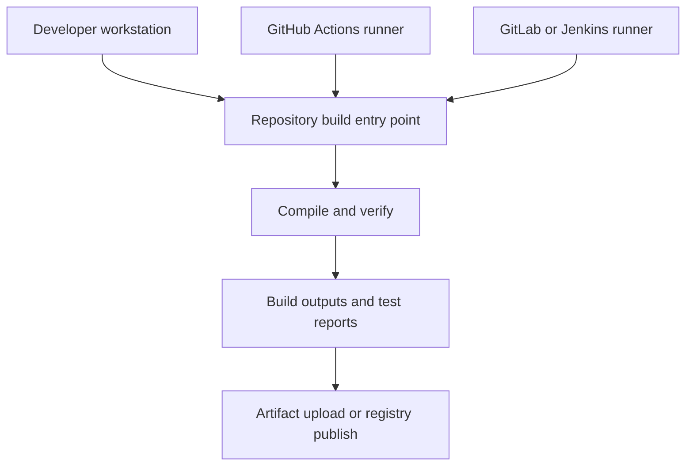

# Tự động hóa build bằng một lệnh rõ ràng

Một quy trình build tốt cần có một điểm vào thống nhất để developer, máy CI và người vận hành có thể chạy cùng một chuỗi kiểm tra bằng một lệnh dễ nhớ. Lệnh đó phải xác định rõ mã nguồn, toolchain, dependency, cấu hình, các bước build và kiểm thử, đầu ra cần tạo cũng như cách báo lỗi. Khi cùng một lệnh được dùng ở máy cá nhân và trong pipeline, nhóm giảm được tình trạng “máy tôi chạy được” và có thể điều tra kết quả build bằng bằng chứng cụ thể.

Trong CI/CD, tự động hóa build không chỉ là gom nhiều câu lệnh vào một dòng. Mục tiêu là tạo một hợp đồng thực thi ổn định: đầu vào được kiểm soát, các bước chạy không cần tương tác thủ công, kết quả có thể kiểm tra, lỗi trả về mã thoát khác 0 và artifact được tạo ở vị trí xác định. Một lệnh rõ ràng là cửa vào của quy trình; tính tái lập còn phụ thuộc việc khóa phiên bản công cụ, dependency và các yếu tố môi trường có ảnh hưởng đến kết quả.

## 1. Vì sao cần một lệnh build thống nhất?

Nếu mỗi developer tự nhớ một chuỗi lệnh khác nhau, quy trình dễ lệch theo thời gian. Người này chạy compile rồi test, người khác chỉ chạy package; có người dùng JDK cài toàn hệ thống, người khác dùng phiên bản khác; CI lại có một script riêng. Khi build production thất bại, nhóm phải tìm hiểu không chỉ lỗi trong mã mà còn cả khác biệt trong cách chạy.

Một lệnh chuẩn giúp:

- **Giảm khác biệt giữa local và CI:** cùng một wrapper và task được gọi ở cả hai nơi.
- **Làm rõ tiêu chí hoàn tất:** build chỉ thành công khi các bước bắt buộc đều đạt.
- **Tự động hóa được:** không cần người dùng nhập lựa chọn hoặc xác nhận giữa chừng.
- **Dễ truy vết:** log cho biết revision, phiên bản toolchain, lệnh đã chạy và kết quả.
- **Dễ tích hợp:** pipeline chỉ cần gọi entry point đã được repository định nghĩa.
- **Dễ cải tiến:** nhóm cập nhật quy trình ở một nơi và review thay đổi như mã nguồn.

Một lệnh thống nhất không buộc mọi tác vụ phải chạy trong một tiến trình duy nhất. Bên dưới entry point có thể có nhiều task, script và job. Điều quan trọng là người gọi biết chính xác lệnh nào đại diện cho một lần xác minh build đầy đủ.

## 2. Hợp đồng của lệnh build

Trước khi chọn công cụ, hãy xác định lệnh chuẩn phải làm gì. Một hợp đồng build có thể mô tả các phần sau:

| Thành phần | Câu hỏi cần trả lời | Ví dụ |
|---|---|---|
| Source | Mã nguồn nào được build? | Commit SHA đã checkout từ Git |
| Toolchain | Dùng runtime và công cụ phiên bản nào? | JDK 21, Gradle Wrapper đã ghim phiên bản |
| Dependencies | Dependency được resolve từ đâu và có được khóa không? | Lockfile, repository đã cấu hình, checksum |
| Configuration | Tham số nào ảnh hưởng đến build? | Profile, target platform, build flags |
| Steps | Các tác vụ bắt buộc nào phải hoàn tất? | Clean, compile, test, package, static checks |
| Outputs | File nào được tạo và nằm ở đâu? | `build/libs/app.jar`, test reports |
| Exit status | Điều gì quyết định thành công? | Mọi tác vụ bắt buộc đạt, lệnh trả mã 0 |
| Evidence | Cần lưu thông tin nào để điều tra? | Commit, tool versions, log, test report, digest |

Lệnh nên có hành vi nhất quán khi được chạy từ thư mục gốc repository. Nếu cần tham số, hãy đặt tên rõ ràng, có giá trị mặc định an toàn và kiểm tra đầu vào trước khi thực hiện. Không để lệnh phụ thuộc vào thư mục hiện tại ngẫu nhiên, biến môi trường bí mật không được khai báo hoặc trạng thái còn sót từ lần chạy trước.

Ví dụ hợp đồng cho một ứng dụng Java dùng Gradle:

```text
Entry point: ./gradlew --no-daemon --console=plain clean build

Inputs:
  - Git revision đã checkout
  - JDK theo toolchain của dự án
  - Dependency được khai báo trong Gradle

Required work:
  - Clean output cũ
  - Compile source và test source
  - Chạy unit tests và các task thuộc check
  - Tạo package có thể triển khai

Outputs:
  - build/libs/*
  - build/test-results/*
  - build/reports/*

Success:
  - Exit code = 0
```

Lệnh trên là ví dụ cho repository Gradle có cấu hình `build` đúng mục đích. Mỗi dự án cần xác nhận task graph và output thực tế của mình trước khi công bố đây là lệnh chuẩn.

## 3. Dùng Wrapper để khóa công cụ build

Không nên yêu cầu mỗi máy tự cài một phiên bản Gradle hoặc Maven rồi gọi trực tiếp công cụ đó. Phiên bản cài trên máy có thể khác phiên bản mà dự án đã dùng để phát triển. Wrapper cho phép repository cung cấp script khởi chạy và cấu hình phiên bản công cụ.

Với Gradle, các file thường được quản lý trong repository gồm:

```text
gradlew
gradlew.bat
gradle/wrapper/gradle-wrapper.jar
gradle/wrapper/gradle-wrapper.properties
```

File `gradle-wrapper.properties` xác định distribution cần tải, ví dụ:

```properties
distributionBase=GRADLE_USER_HOME
distributionPath=wrapper/dists
distributionUrl=https\://services.gradle.org/distributions/gradle-8.10.2-bin.zip
distributionSha256Sum=<sha256-of-the-approved-distribution>
zipStoreBase=GRADLE_USER_HOME
zipStorePath=wrapper/dists
```

Phiên bản trong ví dụ chỉ minh họa. Dự án phải chọn phiên bản Gradle tương thích với plugin, JDK và cấu hình của mình; checksum phải là giá trị đã xác minh từ nguồn phát hành tin cậy. Không tự điền checksum giả. Khi nâng cấp Gradle, thay đổi wrapper nên được review và kiểm tra trên CI.

Trên Linux hoặc macOS:

```bash
./gradlew --version
./gradlew --no-daemon --console=plain clean build
```

Trên Windows PowerShell:

```powershell
.\gradlew.bat --version
.\gradlew.bat --no-daemon --console=plain clean build
```

Developer và CI đều gọi wrapper trong repository. Wrapper có thể tải distribution đã khai báo nếu máy chưa có trong cache; vì vậy lần chạy đầu tiên cần kết nối tới nguồn tải được cho phép. Nếu môi trường build bị giới hạn mạng, tổ chức cần cấu hình mirror hoặc cache phân phối công cụ đáng tin cậy.

Với Maven, dùng Maven Wrapper (`mvnw`, `mvnw.cmd` và cấu hình wrapper) để dự án chọn phiên bản Maven. Một lệnh thường dùng cho xác minh đầy đủ là:

```bash
./mvnw -B -ntp clean verify
```

`-B` bật batch mode để tránh prompt tương tác; `-ntp` giảm thông báo tiến độ tải transfer trong log; `clean verify` chạy vòng đời kiểm tra đến phase `verify`. Trên Windows có thể gọi `mvnw.cmd -B -ntp clean verify`.

## 4. Chọn một task đại diện cho build đầy đủ

Lệnh build chuẩn nên gọi một task cấp cao có ý nghĩa rõ ràng thay vì yêu cầu mọi người tự nhớ danh sách task thấp hơn. Với Gradle, task `build` thường phụ thuộc vào `assemble` và `check`; `check` bao gồm các kiểm tra và test được gắn vào lifecycle. Vì vậy, một dự án Java thông thường có thể dùng:

```bash
./gradlew --no-daemon --console=plain clean build
```

Ý nghĩa:

- `clean` xóa output build trước đó để tránh file cũ che khuất lỗi hoặc bị đóng gói nhầm.
- `build` chạy các task cần thiết để tạo output và thực hiện các kiểm tra đã được cấu hình.
- `--no-daemon` phù hợp với một số môi trường CI ngắn hạn; dự án có thể bỏ tùy chọn này nếu runner được tái sử dụng và daemon giúp tăng tốc.
- `--console=plain` tạo log đơn giản, thuận tiện lưu trữ và đọc trong CI.

Không phải mọi repository đều cần `clean` trong mọi lần chạy. Khi developer đang làm việc nhanh, chạy `./gradlew build` có thể tận dụng incremental build. Trong CI tạo môi trường sạch, `clean build` giúp phát hiện phụ thuộc ngầm vào output cũ. Nếu pipeline cần tối ưu thời gian, hãy đo và thiết kế cache đúng cách thay vì âm thầm bỏ kiểm tra.

Với Maven, `verify` thường là phase phù hợp để chạy các plugin được gắn trong lifecycle đến bước xác minh. Nếu dự án có integration test riêng hoặc profile đặc biệt, hãy đưa chúng vào entry point chuẩn hoặc định nghĩa một lệnh CI được tài liệu hóa. Tránh để lệnh chuẩn chỉ chạy `package` trong khi nhóm kỳ vọng test và quality checks cũng đã chạy.

## 5. Tổ chức repository để lệnh dễ tìm và dễ bảo trì

Một cấu trúc rõ ràng giúp developer nhận ra entry point mà không cần tìm trong nhiều workflow:

```text
repository/
├── gradlew
├── gradlew.bat
├── settings.gradle.kts
├── build.gradle.kts
├── gradle/
│   └── wrapper/
│       ├── gradle-wrapper.jar
│       └── gradle-wrapper.properties
├── scripts/
│   └── ci.sh                 # tùy chọn nếu cần điều phối thêm
├── .github/
│   └── workflows/
│       └── ci.yml
└── src/
    ├── main/
    └── test/
```

Không cần tạo thêm script nếu Gradle Wrapper đã cung cấp đủ một lệnh rõ ràng. Nếu có nhiều bước ngoài build tool, ví dụ kiểm tra schema, tạo code, xác thực manifest hoặc chạy công cụ bảo mật, có thể thêm script điều phối tại `scripts/ci.sh` hoặc một task Gradle chuyên dụng. Tên và vị trí phải thống nhất với tài liệu dự án.

Ví dụ script Bash điều phối:

```bash
#!/usr/bin/env bash
set -Eeuo pipefail

ROOT_DIR="$(cd "$(dirname "${BASH_SOURCE[0]}")/.." && pwd)"
cd "$ROOT_DIR"

if ! command -v java >/dev/null 2>&1; then
  echo "ERROR: Java runtime is required." >&2
  exit 1
fi

echo "== Build metadata =="
git rev-parse HEAD
java -version
./gradlew --version

echo "== Build and verify =="
./gradlew --no-daemon --console=plain clean build

echo "== Expected outputs =="
test -d build/libs
find build/libs -maxdepth 1 -type f -print
echo "Build completed successfully."
```

Script này minh họa cách đặt thư mục làm việc, kiểm tra công cụ, in metadata và xác minh output. Nếu repository cần hỗ trợ Windows, hãy cung cấp entry point tương đương bằng PowerShell hoặc ưu tiên wrapper/task đa nền tảng để tránh duy trì hai luồng logic khác nhau. Không nên để Bash script là cách duy nhất khi developer chủ yếu làm việc trên Windows mà không có môi trường Bash được chuẩn hóa.

`set -Eeuo pipefail` giúp script dừng khi một lệnh thất bại, biến chưa được khai báo hoặc một thành phần trong pipeline shell trả lỗi. Những lệnh được phép không tìm thấy cần được xử lý tường minh, như `command -v` ở ví dụ. Nếu script bỏ qua exit code hoặc dùng `|| true` rộng rãi, pipeline có thể báo xanh dù bước bắt buộc đã thất bại.

## 6. Xây dựng task graph có ý nghĩa

Một lệnh build có thể gọi nhiều task, nhưng mỗi task cần có trách nhiệm rõ và quan hệ phụ thuộc đúng. Ví dụ, dự án có thể cần compile, unit test, kiểm tra định dạng, phân tích tĩnh và package. Hãy gắn các kiểm tra bắt buộc vào lifecycle `check` hoặc một task xác minh có tên rõ ràng để lệnh chuẩn gọi được.

Ví dụ Gradle Kotlin DSL:

```kotlin
plugins {
    java
    id("com.diffplug.spotless") version "6.25.0"
}

tasks.test {
    useJUnitPlatform()
}

spotless {
    java {
        googleJavaFormat()
    }
}

tasks.named("check") {
    dependsOn("spotlessCheck")
}
```

Đoạn code minh họa plugin Spotless tạo task `spotlessCheck` và gắn task đó vào lifecycle `check`. Phiên bản plugin chỉ là ví dụ; dự án cần chọn phiên bản đã được phê duyệt và tương thích với Gradle đang dùng. Không để task rỗng hoặc luôn thành công được coi là bằng chứng kiểm tra định dạng đã chạy.

Khi mở rộng task graph, lưu ý:

- Task chỉ tạo output cần khai báo input/output để Gradle có thể đánh giá incremental và cache đúng.
- Task xác minh phải trả lỗi khi điều kiện bắt buộc không đạt.
- Không tạo phụ thuộc vòng giữa các task.
- Không dựa vào thứ tự khai báo task trong file để suy ra thứ tự thực thi; khai báo dependency hoặc ordering phù hợp.
- Không cho task package chạy với file output cũ nếu task tạo file mới thất bại.
- Tách kiểm tra nhanh với tác vụ tốn tài nguyên nếu chúng có tần suất hoặc mục tiêu khác nhau, nhưng phải công bố rõ lệnh nào là build đầy đủ.

Một lệnh chuẩn có thể gọi `build` cho kiểm tra thường lệ và một lệnh phát hành riêng cho các bước bổ sung như integration test, scan hoặc tạo SBOM. Tên lệnh phải phản ánh phạm vi thật; không gọi `build` là “release verification” nếu nó chưa chạy các gate phát hành.

## 7. Giữ môi trường build nhất quán

Một lệnh giống nhau vẫn có thể tạo kết quả khác nhau nếu toolchain hoặc môi trường khác nhau. Để giảm sai lệch, cần quản lý rõ:

| Đầu vào môi trường | Cách kiểm soát |
|---|---|
| JDK/runtime | Khai báo Java toolchain; CI cài đúng vendor và version theo chính sách |
| Build tool | Commit wrapper và ghim distribution version, xác minh checksum |
| Hệ điều hành/kiến trúc | Dùng runner hoặc container image có phiên bản được kiểm soát khi cần |
| Locale/timezone | Đặt giá trị chuẩn nếu build hoặc test có phụ thuộc định dạng/ngày giờ |
| Environment variables | Khai báo danh sách biến được phép và giá trị mặc định; kiểm tra biến bắt buộc |
| Dependency repositories | Dùng repository tin cậy, mirror được quản lý và quy tắc resolution rõ |
| Dependency versions | Khai báo version cụ thể, lockfile hoặc cơ chế khóa phù hợp |
| Build arguments | Ghi lại tham số ảnh hưởng đến output |
| Network inputs | Pin theo version/checksum hoặc tải từ nguồn có xác thực |

Với Gradle, có thể khai báo toolchain trong build script:

```kotlin
java {
    toolchain {
        languageVersion.set(JavaLanguageVersion.of(21))
    }
}
```

Toolchain giúp Gradle chọn JDK phù hợp cho compile/test, nhưng môi trường vẫn cần cung cấp cách tải hoặc cài toolchain đáng tin cậy. Khai báo major version `21` không tự khóa mọi bản patch, vendor hoặc hệ điều hành; mức pin cần phù hợp với yêu cầu tái lập của dự án.

Đối với build cần tái lập nghiêm ngặt, có thể dùng container image theo digest thay vì tag thay đổi, khóa cả JDK patch/vendor và kiểm soát kiến trúc runner. Tag như `jdk:21` dễ đọc nhưng có thể được cập nhật; digest xác định chính xác image bytes.

## 8. Kiểm soát dependency và nguồn tải

Dependency là một trong những nguồn biến động lớn nhất. Nếu khai báo version dạng khoảng hoặc để công cụ tự chọn bản mới nhất, cùng một commit có thể resolve dependency khác nhau ở các thời điểm khác nhau.

Các thực hành cần cân nhắc:

- Dùng version cụ thể và cập nhật có review.
- Bật dependency locking khi hệ sinh thái hỗ trợ; commit lockfile vào repository.
- Xác minh checksum hoặc chữ ký của dependency khi có thể.
- Dùng repository/mirror được kiểm soát; tránh thêm nguồn không rõ nguồn gốc trong build script.
- Ghi lại dependency snapshot hoặc SBOM cho artifact phát hành.
- Kiểm tra plugin build và action CI như dependency có thể ảnh hưởng đến output.
- Tránh tải script không pin phiên bản rồi thực thi ngay trong build.

Cache dependency giúp giảm thời gian tải, nhưng cache không thay thế lockfile hoặc checksum. Build phải vẫn đúng khi cache trống. Nếu cache chứa dependency đã bị thay đổi hoặc cache key không phản ánh lockfile, runner có thể sử dụng dữ liệu cũ ngoài dự kiến.

Với Gradle, dependency verification có thể được cấu hình để kiểm tra checksum hoặc chữ ký dependency đã được phê duyệt. Khi thêm dependency mới, cần tạo và review metadata xác minh theo quy trình của nhóm; không tắt verification chỉ để làm build xanh.

## 9. Tạo build không phụ thuộc trạng thái ẩn

Một build tái lập cần khai báo đầy đủ đầu vào. Những yếu tố ẩn thường gây khác biệt gồm:

- File sinh ra từ lần chạy trước còn nằm trong thư mục output.
- File cấu hình cá nhân trong thư mục home hoặc IDE.
- Biến môi trường có giá trị khác nhau giữa máy local và CI.
- Thời gian hiện tại, timezone, locale hoặc thứ tự duyệt file không xác định.
- Dependency được tải theo nhãn thay đổi hoặc từ repository khác nhau.
- Dữ liệu bên ngoài thay đổi nhưng build không ghi nhận phiên bản.
- Script build đọc thông tin Git hoặc file chưa được commit mà không ghi nhận.
- Một task phụ thuộc vào daemon, service hoặc tiến trình chạy sẵn trên máy.

Để phát hiện trạng thái ẩn, hãy chạy build trong workspace sạch, container hoặc runner mới; thử build hai lần với cùng đầu vào; kiểm tra file được tạo ngoài output directory; và so sánh metadata cùng digest. Nếu đầu ra khác, điều tra timestamp, thứ tự file, dữ liệu ngẫu nhiên, đường dẫn tuyệt đối hoặc dependency chưa pin.

Một lệnh `clean build` giúp xóa output build đã biết, nhưng không xóa mọi trạng thái bên ngoài như thư mục home, cache toàn cục, daemon hoặc dịch vụ mạng. Tính tái lập cần dựa trên việc kiểm soát những đầu vào này, không chỉ thêm từ khóa `clean`.

## 10. Phân biệt build thành công với build tái lập bit-for-bit

Hai khái niệm liên quan nhưng không đồng nghĩa:

- **Build tự động và nhất quán:** cùng một entry point chạy các bước đã định nghĩa, trả exit code đúng và tạo output theo hợp đồng.
- **Reproducible build theo nghĩa nghiêm ngặt:** cùng source, dependency, toolchain, cấu hình và đầu vào được kiểm soát tạo ra artifact có nội dung bytes giống nhau, thường được so sánh bằng digest.

Một lệnh chuẩn là điều kiện nền để tái lập nhưng chưa đủ. Ví dụ, nếu package ghi timestamp hiện tại vào manifest, hai lần chạy cùng commit vẫn có thể tạo digest khác. Nếu dependency `1.+` resolve thành bản mới, đầu ra cũng có thể thay đổi. Nếu compiler khác patch version, output có thể khác.

Để tiến tới bit-for-bit reproducibility:

1. Khóa commit, dependency, toolchain và build arguments.
2. Loại bỏ timestamp, random value và đường dẫn tuyệt đối không cần thiết khỏi output.
3. Chuẩn hóa timezone, locale, thứ tự file và metadata archive nếu công cụ hỗ trợ.
4. Kiểm soát network input và dữ liệu được tải trong build.
5. Build độc lập hai lần trong môi trường sạch.
6. So sánh SHA-256 của artifact và điều tra mọi khác biệt.

Một số hệ sinh thái cung cấp biến chuẩn hóa thời gian như `SOURCE_DATE_EPOCH`, nhưng chỉ có tác dụng với công cụ đọc và hỗ trợ biến đó. Không nên đặt biến rồi mặc định mọi plugin hoặc archive đã bỏ timestamp. Hãy kiểm tra trực tiếp output.

## 11. Thiết kế lệnh không tương tác và dễ chẩn đoán

CI thường chạy không có người ngồi trước terminal. Lệnh build cần kết thúc bằng trạng thái rõ ràng thay vì chờ prompt, nhập mật khẩu hoặc chọn profile.

Một lệnh phù hợp CI nên:

- Chạy ở batch/non-interactive mode.
- Có timeout ở cấp job hoặc từng tác vụ có thể treo.
- Ghi log đủ thông tin để biết task nào thất bại.
- Trả exit code khác 0 khi bước bắt buộc thất bại.
- Không nuốt lỗi bằng `|| true`, `continue-on-error` hoặc xử lý exception quá rộng.
- Không in secret hoặc token trong command line và log.
- Dùng đường dẫn output xác định, tránh ghi file vào thư mục tùy ý của người chạy.
- Có thể chạy lại sau khi sửa nguyên nhân mà không tạo trạng thái trùng hoặc hỏng.

Để dễ chẩn đoán, hãy giữ test report và build scan nếu tổ chức sử dụng. Với Gradle, report test thường nằm trong `build/reports/tests/test` và kết quả XML trong `build/test-results/test`. Với Maven, Surefire/Failsafe thường ghi report trong `target/surefire-reports` và `target/failsafe-reports`. Đường dẫn cụ thể phụ thuộc plugin và cấu hình dự án.

Log nên ghi revision và phiên bản công cụ ở đầu lần chạy. Không cần in toàn bộ environment variables vì có thể làm lộ secret. Chỉ in các biến không nhạy cảm đã được chọn như `JAVA_VERSION`, commit SHA hoặc build profile.

## 12. Gọi cùng một lệnh từ GitHub Actions

Workflow CI nên gọi đúng wrapper/task được tài liệu hóa trong repository. Không nên viết lại các bước compile/test/package khác với lệnh mà developer được hướng dẫn chạy.

Ví dụ GitHub Actions cho ứng dụng Gradle:

```yaml
name: CI

on:
  pull_request:
  push:
    branches: [main]

permissions:
  contents: read

jobs:
  build:
    runs-on: ubuntu-latest
    steps:
      - name: Checkout source
        uses: actions/checkout@v4

      - name: Set up Java
        uses: actions/setup-java@v4
        with:
          distribution: temurin
          java-version: '21'
          cache: gradle

      - name: Run the repository build command
        run: ./gradlew --no-daemon --console=plain clean build

      - name: Upload test reports
        if: always()
        uses: actions/upload-artifact@v4
        with:
          name: test-reports-${{ github.run_id }}-${{ github.run_attempt }}
          path: |
            **/build/test-results/**
            **/build/reports/**
          if-no-files-found: warn
          retention-days: 7

      - name: Upload application package
        if: success()
        uses: actions/upload-artifact@v4
        with:
          name: application-${{ github.sha }}
          path: build/libs/*.jar
          if-no-files-found: error
          retention-days: 14
```

Workflow này minh họa một lệnh build duy nhất và tách hai loại đầu ra: report có thể cần upload ngay cả khi build thất bại; package chỉ được upload khi build thành công. Với multi-module Gradle, pattern report và package cần được điều chỉnh để bao phủ đúng module. Tên artifact có run ID/attempt hoặc commit để tránh nhầm lẫn giữa các lần chạy.

`ubuntu-latest` và Java major `21` là cấu hình tiện dụng nhưng chưa khóa hoàn toàn môi trường để bảo đảm bit-for-bit reproducibility. Nếu yêu cầu nghiêm ngặt, cần pin runner/container image và bản JDK cụ thể, kiểm soát toolchain, dependency và các nguồn đầu vào khác.

## 13. Gọi cùng một lệnh từ GitLab CI

GitLab CI cũng nên gọi wrapper đã được repository quản lý. Ví dụ:

```yaml
stages:
  - verify

build:
  stage: verify
  image: eclipse-temurin:21-jdk
  script:
    - ./gradlew --no-daemon --console=plain clean build
  artifacts:
    when: always
    paths:
      - '**/build/test-results/'
      - '**/build/reports/'
    expire_in: 7 days
```

Image ở ví dụ dùng tag dễ đọc. Để kiểm soát môi trường nghiêm ngặt hơn, hãy pin image theo digest và xác minh image đó thuộc nguồn tin cậy. Trong cấu hình thật, có thể tách test reports khỏi package và dùng `artifacts:reports:junit` để GitLab hiển thị kết quả test theo định dạng hỗ trợ.

Điểm quan trọng vẫn là cùng một entry point. Không để GitHub Actions chạy `clean build`, GitLab chạy `assemble`, còn developer chạy `test` rồi gọi đó là cùng một quy trình.

## 14. Tích hợp nhiều nền tảng mà không nhân đôi logic

Một repository có thể được build trên máy local, GitHub Actions, GitLab CI hoặc Jenkins. Nên giữ logic build trong wrapper, build script hoặc task của dự án; cấu hình nền tảng chỉ cung cấp runner, toolchain, quyền, secret, cache và nơi lưu artifact.



Các nền tảng có thể khác nhau về cú pháp, nhưng repository cần một định nghĩa duy nhất về lệnh build chuẩn. Nếu có bước đặc thù nền tảng, ví dụ upload artifact hoặc cấp OIDC token, giữ bước đó ở workflow; không nhân bản logic biên dịch, kiểm thử hoặc đóng gói nếu build tool có thể thực hiện.

Khi thay đổi entry point, cập nhật tài liệu README hoặc hướng dẫn phát triển, workflow CI và script liên quan trong cùng một thay đổi được review. Điều này tránh tình trạng tài liệu hướng dẫn một lệnh nhưng pipeline đã chuyển sang lệnh khác.

## 15. Cache và incremental build mà vẫn giữ tính đúng đắn

Build nhanh giúp developer nhận phản hồi sớm. Gradle, Maven và các công cụ khác có thể dùng cache dependency, incremental compilation hoặc build cache. Tuy nhiên, cache phải là tối ưu hóa có thể bỏ đi, không phải một đầu vào bắt buộc không được khai báo.

Nguyên tắc:

- Key cache dựa trên lockfile, toolchain, hệ điều hành/kiến trúc và cấu hình ảnh hưởng đến kết quả.
- Không chia sẻ cache ghi được giữa các trust boundary không tương đương, ví dụ workflow từ fork và workflow production.
- Có thể chạy build sạch định kỳ hoặc trên nhánh chính để phát hiện lỗi incremental/cache.
- Không dùng cache làm nơi lưu artifact phát hành duy nhất.
- Khi nghi ngờ cache gây lỗi, chạy lại với cache mới và so sánh kết quả.
- Task tùy chỉnh phải khai báo input/output đúng để build tool biết khi nào có thể tái sử dụng output.

Một lệnh có thể hỗ trợ chế độ nhanh cho developer và chế độ đầy đủ cho CI, nhưng cần phân biệt tên và phạm vi. Ví dụ `./gradlew test` phù hợp chạy test nhanh; `./gradlew clean build` là lệnh xác minh đầy đủ. Không để pipeline production gọi chế độ nhanh mà bỏ qua gate bắt buộc.

## 16. Quản lý cấu hình và secret

Build nên nhận cấu hình qua tham số hoặc biến môi trường có tên rõ ràng. Cấu hình không nhạy cảm có thể được commit nếu áp dụng chung; cấu hình theo môi trường nên được quản lý riêng và có schema/validation. Secret phải đến từ secret manager hoặc cơ chế cấp danh tính của nền tảng CI, không nằm trong source, wrapper properties, command argument có thể bị log hoặc file report.

Nếu một biến là bắt buộc, lệnh build nên kiểm tra ngay đầu quy trình và trả lỗi dễ hiểu khi thiếu. Không dùng giá trị mặc định ngầm cho endpoint production hoặc credential. Build thông thường cũng không nên cần quyền deploy production; tách build khỏi deploy giúp giới hạn tác động khi workflow chạy trên mã không đáng tin cậy.

Đối với build tái lập, secret không nên làm thay đổi bytes của artifact nếu không thật sự cần thiết. Ví dụ, không nhúng token truy cập hoặc thông tin cá nhân vào manifest. Nếu cần ký artifact, nên thực hiện trong bước ký riêng với quyền hạn chế, ghi nhận danh tính ký và liên kết chữ ký với digest của package.

## 17. Những lỗi thường gặp khi tự động hóa build

| Lỗi | Hậu quả | Cách khắc phục |
|---|---|---|
| Gọi Gradle/Maven cài toàn hệ thống | Local và CI có thể dùng phiên bản khác | Dùng Wrapper đã commit và ghim phiên bản |
| Mỗi nơi dùng một chuỗi lệnh | Kết quả local và CI không tương đương | Công bố một entry point duy nhất |
| Chỉ chạy compile hoặc package | Test và quality checks có thể chưa chạy | Chọn lifecycle task như `build` hoặc `verify` phù hợp |
| Lệnh cần nhập tương tác | CI bị treo hoặc thất bại do không có người trả lời | Dùng batch/non-interactive mode |
| Script không dừng khi lỗi | Pipeline có thể báo xanh giả | Kiểm tra exit code và bật chế độ xử lý lỗi phù hợp |
| Dùng `|| true` cho bước bắt buộc | Lỗi bị che khuất | Chỉ xử lý ngoại lệ có điều kiện và ghi rõ lý do |
| Dependency không được khóa | Cùng commit có thể resolve phiên bản khác | Version cụ thể, lockfile và checksum |
| Dựa vào output cũ | Package có thể chứa file từ lần build trước | Dùng clean workspace và kiểm tra output |
| Dựa vào cache như nguồn sự thật | Cache miss làm build hỏng hoặc dùng dữ liệu cũ | Đảm bảo cache miss vẫn build đúng |
| Dùng runner image thay đổi | Toolchain có thể tự đổi ngoài review | Pin image/version theo mức tái lập yêu cầu |
| Không lưu test report | Khó điều tra lỗi sau khi job kết thúc | Upload report kể cả khi test thất bại |
| In toàn bộ environment | Secret có thể lộ trong log | Chỉ in metadata không nhạy cảm đã chọn |

Một lỗi thiết kế khác là làm script quá thông minh: tự đoán branch, tự tải phiên bản công cụ mới nhất, tự chọn profile theo tên máy hoặc tự bỏ qua test khi không tìm thấy dependency. Các quyết định đó làm hành vi khó dự đoán. Hãy biến lựa chọn quan trọng thành cấu hình có tên, giá trị hợp lệ và kiểm tra đầu vào.

## 18. Ví dụ thực tế: chuẩn hóa build cho dịch vụ Java

Giả sử nhóm có dịch vụ `order-service` dùng Gradle. Trước đây developer chạy `test` trong IDE, người khác chạy `gradle build`, còn CI dùng một script tự cài Gradle. Khi chuyển máy hoặc nâng cấp runner, nhóm gặp lỗi khác nhau và khó biết package production đã qua những kiểm tra nào.

Nhóm thống nhất quy trình:

1. Commit Gradle Wrapper và cấu hình distribution đã được review.
2. Khai báo Java toolchain trong build script và thống nhất JDK được CI cài.
3. Đưa unit test, formatter check và static checks bắt buộc vào lifecycle `check`.
4. Đảm bảo task `build` tạo package và chạy các kiểm tra đã định nghĩa.
5. Công bố lệnh chuẩn `./gradlew --no-daemon --console=plain clean build` trong tài liệu repository.
6. Cấu hình GitHub Actions và GitLab CI gọi cùng lệnh đó.
7. Upload test report kể cả khi build thất bại; chỉ publish package khi lệnh thành công.
8. Gắn package với commit SHA và tính digest trước khi chuyển sang bước kiểm thử hoặc triển khai.
9. Khi cần chứng minh build bit-for-bit, chạy lại cùng revision trong hai môi trường sạch đã khóa đầu vào và so sánh digest.

Sau thay đổi, developer có thể chạy cùng một lệnh ở máy cá nhân và đọc kết quả theo cùng quy ước. CI trở thành nơi thực thi tự động entry point đã được review; artifact chỉ được chuyển tiếp khi build và kiểm tra bắt buộc thành công.

## 19. Checklist thiết kế một lệnh build chuẩn

Trước khi đưa entry point vào sử dụng, hãy xác minh:

- [ ] Có một lệnh chuẩn được tài liệu hóa ở thư mục gốc repository.
- [ ] Local và CI dùng cùng wrapper/task hoặc script điều phối.
- [ ] Phiên bản build tool được ghim và wrapper files được quản lý trong Git.
- [ ] JDK/runtime và toolchain được khai báo, cài đặt theo quy tắc rõ ràng.
- [ ] Dependency có version cụ thể, lockfile hoặc cơ chế xác minh tương ứng.
- [ ] Lệnh chạy không tương tác và không phụ thuộc vào thao tác IDE.
- [ ] Các bước compile, test, static checks và package bắt buộc đều thuộc task graph.
- [ ] Lỗi bắt buộc làm lệnh trả exit code khác 0.
- [ ] Output và test report có vị trí xác định; report được lưu khi build thất bại.
- [ ] Cache chỉ tăng tốc và pipeline vẫn chạy đúng khi cache trống.
- [ ] Workspace sạch không phụ thuộc file còn sót từ lần chạy trước.
- [ ] Cấu hình được xác thực; secret không nằm trong source, output hoặc log.
- [ ] Workflow CI gọi đúng entry point và lưu commit, toolchain, artifact identity.
- [ ] Nếu cần bit-for-bit reproducibility, có phép thử build độc lập và so sánh digest.

## 20. Kết luận

Một lệnh build rõ ràng tạo ra điểm vào chung cho developer và CI. Để lệnh có giá trị, repository cần xác định đầu vào, toolchain, dependency, task graph, cấu hình, output, log và exit status. Wrapper giúp khóa build tool; lifecycle task gom các kiểm tra cần thiết; workflow CI gọi cùng entry point; artifact và report cung cấp bằng chứng cho các bước tiếp theo.

Lệnh thống nhất giúp tự động hóa và giảm sai lệch, nhưng chưa tự bảo đảm artifact giống nhau từng byte. Muốn build tái lập nghiêm ngặt, nhóm còn phải kiểm soát dependency, môi trường, timestamp, network input và trạng thái ẩn, rồi xác minh bằng cách build độc lập và so sánh digest. Khi các phần này được quản lý cùng nhau, mỗi lần build trở thành một hoạt động có thể lặp lại, giải thích và truy vết trong toàn bộ quy trình CI/CD.
