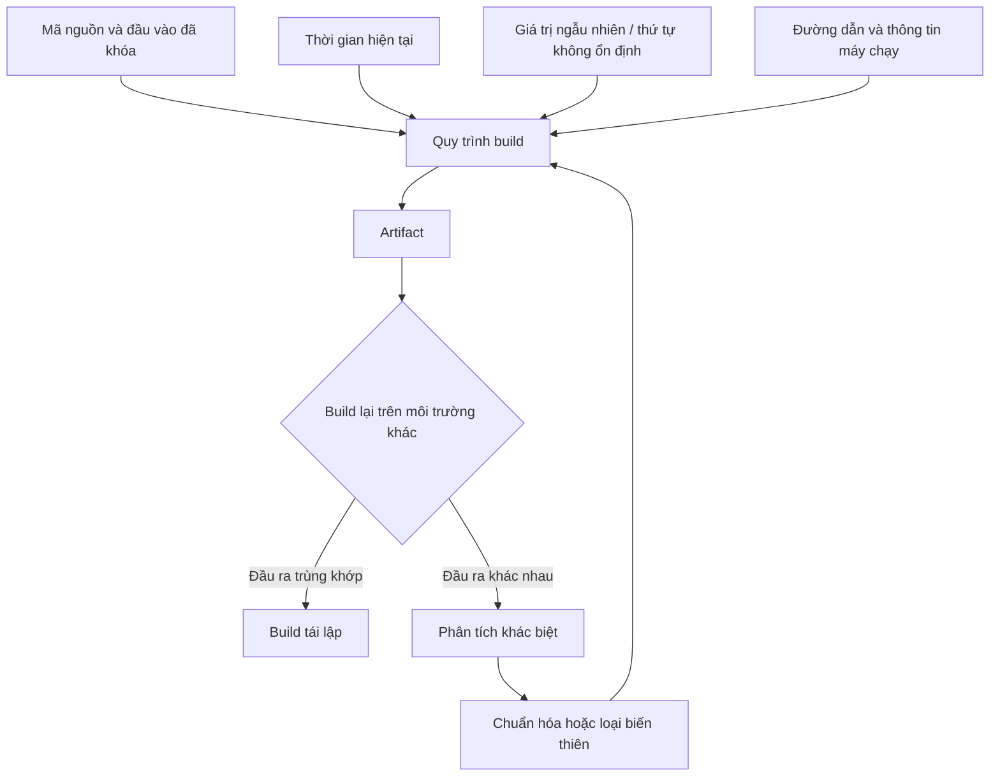

# Kiểm soát phụ thuộc vào thời gian, ngẫu nhiên và đường dẫn máy

Một build tái lập (reproducible build) phải tạo ra cùng đầu ra khi được chạy lại với cùng mã nguồn, công cụ và đầu vào đã xác định. Trên thực tế, hai lần build cùng một commit vẫn có thể tạo ra file khác nhau vì chương trình vô tình đưa thời điểm hiện tại, số ngẫu nhiên hoặc đường dẫn của máy chạy vào artifact.

Những khác biệt này thường khó nhận ra: tên file và nội dung ứng dụng có vẻ giống nhau, test vẫn đạt, nhưng checksum của hai gói không trùng. Điều đó làm giảm khả năng xác minh artifact, so sánh kết quả build giữa các runner và chứng minh gói phát hành đúng là đầu ra đã được kiểm tra. Muốn build tái lập, cần nhận diện các nguồn biến thiên này, chuẩn hóa chúng thành đầu vào có chủ đích hoặc loại chúng khỏi artifact.

## 1. Build tái lập và các nguồn biến thiên ẩn

Một build có thể được mô hình hóa như hàm:

\[
Artifact = Build(Source, Toolchain, Dependencies, Configuration, Environment)
\]

Nếu một giá trị trong môi trường thay đổi mà không được khai báo, artifact có thể thay đổi dù commit không đổi. Ba nhóm biến thiên cần kiểm soát trong bài này là:

| Nhóm | Nguồn biến thiên | Ví dụ xuất hiện trong artifact |
|---|---|---|
| Thời gian | Đồng hồ hệ thống, timezone, thời gian sửa file, ngày tạo gói | Header build time, timestamp trong ZIP/JAR, manifest, generated source |
| Ngẫu nhiên | PRNG, UUID, hash seed, thứ tự duyệt dữ liệu, concurrency | ID sinh tự động, thứ tự file, nội dung được sắp xếp khác nhau |
| Đường dẫn máy | Workspace, thư mục tạm, home directory, tên host, separator | Debug information, source map, manifest, file generated, log được đóng gói |



Mục tiêu không phải loại bỏ mọi thông tin thời gian, UUID hay đường dẫn khỏi hệ thống. Mục tiêu là không để các giá trị thay đổi theo máy hoặc theo thời điểm chạy một cách ngoài ý muốn. Nếu thông tin đó cần thiết cho vận hành, hãy lưu nó trong metadata của lần chạy hoặc release record riêng, thay vì nhúng vào nội dung artifact cần tái lập.

## 2. Kiểm soát thời gian và timestamp

### Vì sao đồng hồ làm artifact thay đổi?

Một số công cụ ghi thời gian hiện tại khi tạo file hoặc đóng gói. Ví dụ:

- Script sinh `BuildInfo.java` bằng `new Date()` hoặc `datetime.now()`.
- File ZIP/JAR giữ lại modification time của từng file đầu vào.
- Manifest ghi thời điểm build theo đồng hồ của runner.
- Công cụ tạo tài liệu nhúng ngày xuất bản vào nội dung.
- Lệnh `date` tạo version như `2026.11.18` trong mỗi lần build.

Hai lần build chạy cách nhau vài giây có thể cho ra timestamp khác nhau, từ đó checksum của gói cũng khác. Nếu runner ở hai múi giờ khác nhau, cùng một thời điểm còn có thể được định dạng thành hai chuỗi ngày giờ khác nhau.

### Dùng một mốc thời gian chuẩn

Một cách phổ biến là dùng biến môi trường `SOURCE_DATE_EPOCH`, theo quy ước của dự án Reproducible Builds. Giá trị là số giây Unix UTC được chọn làm mốc ổn định cho lần build. Nhiều công cụ đóng gói và compiler có hỗ trợ quy ước này, nhưng không phải công cụ nào cũng tự động đọc biến; cần kiểm tra tài liệu và cấu hình từng thành phần.

Với một build gắn với commit cụ thể, nhóm có thể chọn committer timestamp của commit làm mốc:

```bash
export SOURCE_DATE_EPOCH="$(git show -s --format=%ct "$GIT_COMMIT")"
export TZ=UTC
export LC_ALL=C
export LANG=C

./gradlew clean build --no-daemon
```

`GIT_COMMIT` cần trỏ tới commit thực sự được build. Nếu không có biến này, có thể dùng `HEAD` sau khi pipeline đã checkout đúng revision. Điều quan trọng là mọi lần build cùng revision phải chọn cùng một mốc và không lấy thời gian hiện tại của runner. `TZ=UTC` giúp các lệnh có hỗ trợ timezone dùng cùng múi giờ; `LC_ALL=C` và `LANG=C` giúp tránh một số khác biệt do locale trong định dạng và sắp xếp.

Không nên chỉ đặt `SOURCE_DATE_EPOCH` rồi mặc định toàn bộ build đã tái lập. Một script có thể bỏ qua biến và vẫn gọi đồng hồ hệ thống. Cần tìm các chỗ sinh timestamp, cấu hình tool tạo archive và xác minh artifact sau khi build.

### Chuẩn hóa timestamp trong archive

Archive như ZIP, JAR hoặc TAR có thể lưu thời gian sửa file. Nếu mỗi lần build dùng timestamp gốc của file trên workspace, kết quả có thể khác nhau. Với Gradle, có thể cấu hình các tác vụ archive để không giữ timestamp của file đầu vào và dùng thứ tự file tái lập:

```kotlin
import org.gradle.api.tasks.bundling.AbstractArchiveTask

tasks.withType<AbstractArchiveTask>().configureEach {
    isPreserveFileTimestamps = false
    isReproducibleFileOrder = true
}
```

Với Maven, có thể cấu hình `project.build.outputTimestamp` theo định dạng được plugin đóng gói hỗ trợ, ví dụ trong `pom.xml`:

```xml
<properties>
    <project.build.outputTimestamp>2026-01-01T00:00:00Z</project.build.outputTimestamp>
</properties>
```

Giá trị trên chỉ minh họa một mốc cố định. Trong pipeline thực tế, nên truyền mốc được chọn từ revision hoặc release metadata theo cách plugin đang dùng hỗ trợ; tránh thay đổi thủ công theo từng lần build. Hãy xác minh plugin và phiên bản cụ thể có áp dụng property này cho tất cả archive được tạo hay không.

### Không nhúng thời gian hiện tại vào mã nguồn sinh tự động

Nếu ứng dụng cần hiển thị phiên bản hoặc thời điểm phát hành, hãy phân biệt:

- **Build identity:** commit SHA, release version hoặc artifact digest, có thể tái lập.
- **Build execution time:** thời điểm một runner thực hiện build, thuộc metadata của lần chạy.
- **Release/deployment time:** thời điểm artifact được đưa tới một môi trường, thuộc deployment record.

Không nên ghi `Instant.now()` vào source file hoặc manifest nằm bên trong artifact nếu trường đó khiến nội dung thay đổi ở mỗi lần build. Nếu cần một timestamp có trong artifact, hãy lấy nó từ `SOURCE_DATE_EPOCH` hoặc metadata release đã được cố định trước build.

## 3. Kiểm soát ngẫu nhiên và thứ tự dữ liệu

### Ngẫu nhiên trong build đến từ đâu?

Build có thể sử dụng ngẫu nhiên một cách trực tiếp hoặc gián tiếp:

- Script sinh UUID hoặc random suffix để đặt tên file.
- Test sinh dữ liệu ngẫu nhiên mà không lưu seed.
- Generator tạo key, ID hoặc dữ liệu mẫu trong quá trình đóng gói.
- Runtime ngôn ngữ dùng hash seed ngẫu nhiên làm thay đổi thứ tự duyệt collection.
- Các tác vụ chạy song song ghi chung một file hoặc gom kết quả theo thứ tự hoàn thành.
- Công cụ chọn một phần tử từ tập hợp mà không sắp xếp trước.

Không phải mọi khác biệt do ngẫu nhiên đều xuất hiện dưới dạng một số random rõ ràng. Một `HashMap`, `HashSet` hoặc danh sách file lấy trực tiếp từ filesystem có thể cho thứ tự khác giữa runtime, hệ điều hành hoặc lần chạy. Nếu thứ tự đó được ghi vào archive, manifest hay generated source, artifact sẽ thay đổi.

### Seed cố định cho kiểm thử và generator

Với dữ liệu giả lập hoặc kiểm thử, hãy dùng seed được khai báo và ghi lại khi cần tái hiện lỗi:

```python
import random

TEST_SEED = 7319
rng = random.Random(TEST_SEED)

sample_ids = [rng.randrange(1_000_000) for _ in range(10)]
print(sample_ids)
```

Khi test thất bại, log seed để có thể chạy lại cùng dữ liệu. Với test chạy song song, nên tạo seed ổn định cho từng test case từ một seed gốc và ID test, tránh phụ thuộc vào thứ tự mà scheduler thực thi test.

Seed cố định không phải giải pháp cho mọi loại ngẫu nhiên. **Không dùng seed cố định để tạo mật khẩu, token, khóa mã hóa hoặc nonce bảo mật.** Dữ liệu bảo mật phải dùng nguồn ngẫu nhiên mật mã phù hợp. Nếu cần build tái lập, hãy tách việc sinh bí mật khỏi quá trình build: artifact tham chiếu tới secret được cấp lúc triển khai, còn giá trị secret được tạo và quản lý bởi secret manager.

### Ổn định thứ tự file và collection

Nếu đầu ra chứa các phần tử lấy từ map, set hoặc filesystem, hãy sắp xếp trước khi serialize hoặc đóng gói:

```python
from pathlib import Path

root = Path("src")
files = sorted(
    (p.relative_to(root).as_posix() for p in root.rglob("*") if p.is_file()),
    key=lambda value: value.encode("utf-8"),
)

for relative_path in files:
    print(relative_path)
```

Thứ tự nên độc lập với locale, thứ tự directory entry và cách biểu diễn separator của hệ điều hành. Với dữ liệu dạng JSON/YAML hoặc manifest, cần quy định thứ tự key và cách serialize nếu định dạng/công cụ cho phép thứ tự thay đổi. Tránh phụ thuộc vào thứ tự phần tử của collection không có cam kết ổn định.

### Kiểm soát concurrency và race condition

Chạy job song song có thể làm kết quả phụ thuộc vào thứ tự hoàn thành. Ví dụ, hai task cùng ghi `version.txt`, task kết thúc sau ghi đè kết quả của task trước; hoặc một task đóng gói trong khi task khác vẫn đang sửa file. Các cách giảm rủi ro:

- Mỗi task ghi vào output directory riêng.
- Khai báo dependency giữa task thay vì dựa vào thời điểm tình cờ.
- Chỉ gom kết quả sau khi tất cả task hoàn tất.
- Sắp xếp dữ liệu trước khi ghi đầu ra.
- Tránh chia sẻ mutable state hoặc file trung gian giữa các tiến trình.
- Nếu bắt buộc phải dùng tài nguyên chung, dùng cơ chế lock có phạm vi rõ ràng và bảo đảm cleanup khi lỗi/hủy.

Không cần tắt toàn bộ build song song để có tính tái lập. Cần làm cho các tác vụ độc lập thật sự độc lập và kết quả hợp nhất có quy tắc xác định.

## 4. Kiểm soát đường dẫn của máy chạy

### Vì sao đường dẫn tuyệt đối làm build khác nhau?

CI runner thường checkout cùng repository vào các thư mục khác nhau:

```text
/home/runner/work/api/api
/builds/team/api-42
D:\a\api\api
C:\agent\_work\17\s
```

Nếu compiler, code generator hoặc script ghi đường dẫn đầy đủ vào artifact, hai lần build trên các runner khác nhau sẽ tạo byte khác nhau. Đường dẫn có thể xuất hiện trong:

- Debug information của binary.
- Source map hoặc metadata của compiler.
- Generated source, manifest và file báo cáo được đóng gói.
- Stack trace hoặc chuỗi `__FILE__` được biên dịch vào chương trình.
- Cache key, metadata package hoặc file version được sinh tự động.

Đường dẫn tuyệt đối cũng có thể làm lộ cấu trúc thư mục nội bộ, tên tài khoản hoặc tên agent. Vì vậy, loại bỏ path phụ thuộc máy vừa giúp tái lập, vừa giảm rò rỉ thông tin môi trường.

### Dùng đường dẫn tương đối và workspace chuẩn

Build script nên coi repository root là gốc logic và lưu đường dẫn tương đối trong metadata. Ví dụ, thay vì ghi:

```text
C:\agent\_work\17\s\src\main\java\com\example\App.java
```

hãy ghi:

```text
src/main/java/com/example/App.java
```

Tránh lấy `pwd`, `$HOME`, `%USERPROFILE%`, tên máy hoặc thư mục temp để tạo nội dung artifact. Nếu cần thư mục tạm, dùng nó cho thao tác trung gian và không đưa tên/đường dẫn tạm vào gói cuối cùng.

Một số CI có thể mount repository vào một đường dẫn cố định bên trong container, chẳng hạn `/workspace`. Cách này giảm biến thiên trong một nhóm runner nhưng không thay thế việc loại bỏ path khỏi artifact: môi trường local, runner khác hoặc build ngoài CI vẫn có thể dùng đường dẫn khác.

### Ánh xạ đường dẫn trong compiler

Với GCC, các tùy chọn prefix-map có thể thay đường dẫn build root bằng một tiền tố ổn định trong thông tin file được ghi vào binary:

```bash
BUILD_ROOT="$(pwd -P)"

gcc -O2 \
  -ffile-prefix-map="$BUILD_ROOT"=. \
  -o app src/main.c
```

`-ffile-prefix-map` được GCC cung cấp để ánh xạ tiền tố đường dẫn trong thông tin file; các tùy chọn liên quan như `-fdebug-prefix-map` và `-fmacro-prefix-map` có phạm vi cụ thể hơn. Hãy kiểm tra hỗ trợ và hành vi của phiên bản GCC/Clang đang dùng. Không phải mọi compiler hoặc linker đều hiểu cùng một cờ.

Với MSVC và các toolchain khác, hãy tìm tùy chọn path mapping tương ứng hoặc cấu hình build để không nhúng đường dẫn workspace. Không nên chép nguyên cờ GCC vào compiler khác. Có thể kiểm tra artifact bằng cách tìm chuỗi đường dẫn như `C:\agent\_work`, `/home/runner/work` hoặc tên user/host trong binary, source map và manifest.

### Chuẩn hóa separator, chữ hoa/thường và symlink

Windows thường dùng dấu `\\` và filesystem có thể không phân biệt chữ hoa/thường; Linux thường dùng `/` và phân biệt chữ hoa/thường. Symlink cũng có thể được resolve thành đường dẫn khác nhau tùy workspace. Khi tạo metadata hoặc archive:

- Dùng một định dạng đường dẫn logic thống nhất, thường là `/` trong metadata.
- Không dựa vào khác biệt chữ hoa/thường để phân biệt hai file nếu cần hỗ trợ nhiều OS.
- Quy định cách xử lý symlink: giữ nguyên link hay ghi nội dung đích; không để công cụ tự chọn khác nhau giữa nền tảng.
- Không đưa drive letter hoặc mount point của host vào nội dung artifact.
- Kiểm tra tên file và ký tự đặc biệt tương thích với hệ điều hành đích.

## 5. Kết hợp chuẩn hóa thời gian, ngẫu nhiên và đường dẫn

Ba nhóm biến thiên thường xuất hiện cùng nhau. Một script sinh manifest có thể vừa ghi thời gian hiện tại, vừa tạo UUID, vừa lưu đường dẫn workspace. Nếu chỉ sửa một yếu tố, checksum vẫn có thể khác.

Ví dụ shell minh họa cách thiết lập môi trường ổn định trước build:

```bash
#!/usr/bin/env bash
set -Eeuo pipefail

export TZ=UTC
export LC_ALL=C
export LANG=C
export PYTHONHASHSEED=7319
export SOURCE_DATE_EPOCH="$(git show -s --format=%ct "$GIT_COMMIT")"

repo_root="$(git rev-parse --show-toplevel)"
cd "$repo_root"

./gradlew clean build --no-daemon
```

Ví dụ thiết lập timezone, locale, Python hash seed và mốc thời gian dựa trên commit. `PYTHONHASHSEED` chỉ có tác dụng với tiến trình Python được khởi chạy trong môi trường này; nó không thay thế việc sắp xếp collection. `SOURCE_DATE_EPOCH` chỉ có tác dụng với công cụ có hỗ trợ hoặc được script chủ động đọc. Đường dẫn `repo_root` dùng để điều hướng trong script, nhưng không nên được ghi nguyên vẹn vào artifact.

Đối với build yêu cầu tái lập cao, hãy kiểm tra cả:

- Timestamp trong từng entry của archive và file generated.
- Thứ tự entry, key và danh sách file.
- UUID, random suffix, build number và ID của runner.
- Đường dẫn source, workspace, temp, home và thông tin host trong binary/metadata.
- Locale, timezone, line ending và quy tắc sắp xếp.
- Kết quả của task song song và cách tổng hợp output.

## 6. Ví dụ kiểm soát trong dự án Gradle

Một dự án Java có thể áp dụng một số cấu hình sau trong `build.gradle.kts`:

```kotlin
import org.gradle.api.tasks.bundling.AbstractArchiveTask

tasks.withType<AbstractArchiveTask>().configureEach {
    isPreserveFileTimestamps = false
    isReproducibleFileOrder = true
}

tasks.register("writeBuildIdentity") {
    val commit = providers.environmentVariable("GIT_COMMIT").orElse("")
    val sourceDateEpoch = providers.environmentVariable("SOURCE_DATE_EPOCH").orElse("")

    inputs.property("commit", commit)
    inputs.property("sourceDateEpoch", sourceDateEpoch)
    outputs.file(layout.buildDirectory.file("generated/build-identity.txt"))

    doLast {
        val commitValue = commit.get().takeIf { it.isNotBlank() } ?: error("GIT_COMMIT is required")
        val epochValue = sourceDateEpoch.get().takeIf { it.isNotBlank() } ?: error("SOURCE_DATE_EPOCH is required")
        val output = layout.buildDirectory.file("generated/build-identity.txt").get().asFile
        output.parentFile.mkdirs()
        output.writeText("commit=$commitValue\nbuildEpoch=$epochValue\n")
    }
}
```

Task này minh họa việc ghi identity từ đầu vào đã được khai báo thay vì gọi đồng hồ hiện tại hoặc tạo UUID ngẫu nhiên. Trong dự án thật, cần nối task vào source set hoặc packaging task phù hợp và bảo đảm không ghi thêm đường dẫn tuyệt đối vào file. Nếu file identity nằm trong artifact, cùng commit và cùng `SOURCE_DATE_EPOCH` sẽ tạo cùng nội dung.

Không nên tạo `build-identity.txt` bằng cách ghi `new Date()` trong `doLast`. Thời điểm task chạy là thuộc tính của lần thực thi, không phải thuộc tính ổn định của source revision. Nếu cần ghi lại thời điểm runner thực sự chạy, lưu trong log hoặc CI metadata bên ngoài artifact.

## 7. Kiểm chứng build tái lập

Không thể kết luận build tái lập chỉ bằng cách đọc cấu hình. Cần chạy lại cùng đầu vào trong các điều kiện khác nhau và so sánh artifact thực tế.

Một quy trình kiểm chứng cơ bản:

1. Chọn commit SHA và ghi lại toolchain, dependency, cấu hình cùng các đầu vào build.
2. Build sạch lần thứ nhất trong workspace A.
3. Build lại cùng commit trong workspace B, có thể khác đường dẫn hoặc runner.
4. So sánh checksum của từng artifact.
5. Nếu khác, so sánh cấu trúc archive và phân tích byte khác biệt.
6. Sau khi sửa nguồn biến thiên, lặp lại cho đến khi có kết quả ổn định.

Ví dụ trên Linux:

```bash
sha256sum build-a/libs/app.jar build-b/libs/app.jar
```

Nếu checksum giống nhau, hai file có cùng nội dung byte theo SHA-256 với xác suất va chạm không đáng kể trong thực tế. Nếu checksum khác, hãy kiểm tra cấu trúc archive trước:

```bash
unzip -l build-a/libs/app.jar
unzip -l build-b/libs/app.jar
```

Sau đó có thể dùng công cụ như `diffoscope` để tìm khác biệt ở timestamp, file metadata, debug path, manifest hoặc nội dung generated. Công cụ so sánh byte cho biết có khác biệt; diffoscope giúp giải thích khác biệt nằm ở lớp nào.

### Kiểm thử trên hai workspace khác nhau

Một bài kiểm tra hữu ích là build cùng commit trong hai đường dẫn khác nhau, ví dụ:

```text
/tmp/build-a/project
/agent/work/92/project
```

Nếu artifact khác nhau chỉ vì workspace path, cần loại path khỏi binary hoặc metadata. Có thể chạy thêm trên Windows và Linux nếu dự án tuyên bố hỗ trợ build đa nền tảng, nhưng phải phân biệt mục tiêu nào yêu cầu byte-identical giữa hai OS. Một số toolchain tạo artifact khác nhau có chủ đích theo nền tảng; khi đó hãy so sánh các build cùng nền tảng hoặc xác định rõ phạm vi tái lập.

### Không bỏ qua khác biệt nhỏ

Một byte khác cũng làm checksum thay đổi. Những trường thường bị bỏ sót gồm:

- ZIP extra fields hoặc timestamp của từng entry.
- Thứ tự file trong archive.
- File permission hoặc owner metadata.
- Manifest chứa build number, hostname hoặc thời gian.
- Debug path, source map và generated code.
- File JSON có key order hoặc whitespace khác nhau.
- Nội dung nén có thể khác do phiên bản hoặc tham số compressor.

Nếu chỉ so sánh tên file hoặc chạy test chức năng, những khác biệt này có thể không bị phát hiện.

## 8. Những cách làm dễ phá vỡ tính tái lập

| Cách làm | Vì sao gây khác biệt | Cách xử lý |
|---|---|---|
| Ghi `now()` vào version file | Mỗi lần chạy có timestamp khác | Dùng mốc cố định hoặc lưu thời gian ngoài artifact |
| Dùng `latest`/ngày hiện tại làm version đầu vào | Giá trị thay đổi theo thời điểm | Dùng revision hoặc version đã xác định |
| Tạo UUID ngẫu nhiên khi package | Artifact có ID khác nhau | Dùng ID xác định từ đầu vào hoặc bỏ ID khỏi artifact |
| Duyệt map/set mà không sắp xếp | Thứ tự phần tử không được bảo đảm | Sắp xếp bằng comparator ổn định |
| Ghi trực tiếp `pwd` vào manifest | Workspace mỗi runner khác nhau | Ghi đường dẫn tương đối hoặc bỏ thông tin máy |
| Nhúng debug path tuyệt đối | Binary chứa path của host | Dùng compiler path mapping phù hợp |
| Dựa vào timezone/locale mặc định | Runner có thiết lập vùng khác nhau | Đặt UTC và locale rõ ràng |
| Nhiều task ghi chung output | Race condition làm kết quả phụ thuộc thứ tự | Tách output, khai báo dependency và hợp nhất xác định |
| Giữ nguyên timestamp file trong archive | File checkout có mtime khác nhau | Chuẩn hóa timestamp hoặc tắt preserve timestamps |
| Dùng seed cố định cho secret | Làm suy yếu tính bảo mật | Chỉ cố định seed cho test; secret sinh lúc runtime |

## 9. Checklist kiểm soát biến thiên

Trước khi công bố một build là tái lập, hãy kiểm tra:

1. Timestamp trong artifact có lấy từ một mốc ổn định không?
2. Các tool đóng gói có chuẩn hóa timestamp và thứ tự entry không?
3. Script hoặc generator có gọi đồng hồ hiện tại không?
4. Random seed của test/generator có được khai báo và ghi nhận không?
5. Có UUID, random suffix hoặc ID runner được nhúng vào artifact không?
6. Collection và danh sách file có được sắp xếp theo quy tắc ổn định không?
7. Task song song có chia sẻ file hoặc mutable state gây race condition không?
8. Artifact có chứa đường dẫn tuyệt đối, tên user, hostname hoặc thư mục temp không?
9. Compiler có hỗ trợ ánh xạ source/debug path và đã được cấu hình chưa?
10. Timezone, locale và các quy tắc định dạng có được cố định không?
11. Hai lần build sạch cùng commit có tạo checksum giống nhau không?
12. Khi khác biệt xuất hiện, nhóm có thể xác định chính xác file/metadata gây khác biệt không?

Kiểm soát thời gian, ngẫu nhiên và đường dẫn máy giúp loại bỏ những đầu vào ẩn làm artifact thay đổi giữa các lần chạy. Khi các giá trị này được chuẩn hóa hoặc tách khỏi nội dung phát hành, nhóm có thể so sánh build bằng checksum, xác minh nguồn gốc artifact và tin cậy hơn vào quy trình CI/CD.
