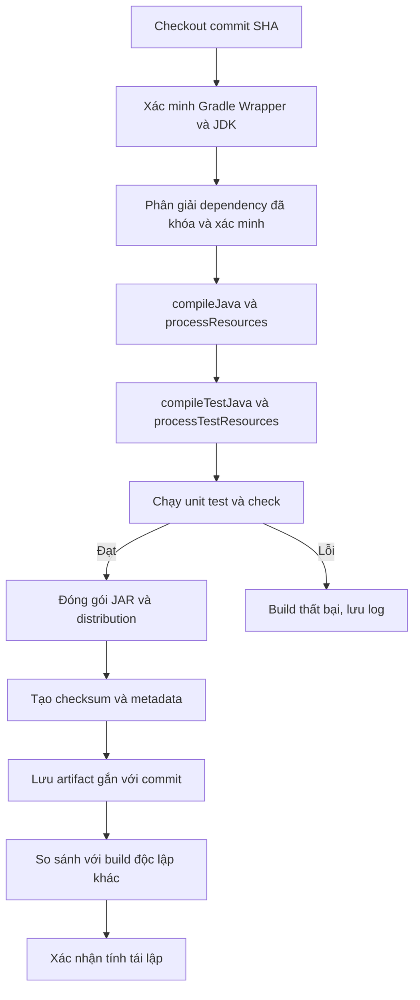

# Ví dụ luồng biên dịch, kiểm thử và đóng gói một dự án Java

Một luồng build đáng tin cậy cần biến một revision mã nguồn cụ thể thành kết quả có thể kiểm tra và truy vết. Với dự án Java dùng Gradle, luồng đó thường gồm checkout commit, chuẩn bị JDK và Gradle, phân giải dependency, biên dịch mã chính, biên dịch mã kiểm thử, chạy test, tạo JAR hoặc distribution, rồi xác minh và lưu artifact.

Để build có thể tái lập, các đầu vào ảnh hưởng tới kết quả phải được kiểm soát: commit nguồn, phiên bản Gradle, JDK, plugin, dependency, cấu hình build và môi trường thực thi. Nếu cùng một revision được build hai lần trong điều kiện tương đương mà tạo ra artifact khác nhau, nhóm cần tìm nguyên nhân trước khi dùng artifact đó làm bằng chứng cho phát hành.

Bài này xây dựng một ví dụ xuyên suốt cho một ứng dụng Java nhỏ dùng Gradle Kotlin DSL. Ta sẽ cấu hình toolchain, dependency locking, dependency verification và archive reproducibility; chạy biên dịch, kiểm thử và đóng gói; sau đó so sánh checksum của các lần build độc lập trong CI.

## 1. Luồng build cần tạo ra những kết quả nào?

Một pipeline Java thường cần trả lời được các câu hỏi sau:

- Mã nguồn được lấy từ commit nào?
- Build sử dụng phiên bản JDK, Gradle và plugin nào?
- Dependency được phân giải từ repository nào và có bị thay đổi ngoài dự kiến không?
- Mã nguồn chính và mã kiểm thử có biên dịch thành công không?
- Những test nào đã chạy và kết quả ra sao?
- Artifact nào được tạo, nằm ở đâu và gắn với commit nào?
- Hai lần build độc lập có tạo ra cùng một artifact hay không?

Luồng tổng quát:



Các bước có thể được chia thành nhiều job để chạy song song hoặc tách quyền. Tuy nhiên, artifact chỉ nên được công bố khi các kiểm tra bắt buộc đã đạt và nguồn tạo artifact được xác định rõ.

## 2. Chuẩn bị cấu trúc dự án Java

Ví dụ sử dụng một ứng dụng console nhỏ tên `hello-service`:

```text
hello-service/
├── gradlew
├── gradlew.bat
├── settings.gradle.kts
├── build.gradle.kts
├── gradle/
│   └── wrapper/
│       ├── gradle-wrapper.jar
│       └── gradle-wrapper.properties
└── src/
    ├── main/
    │   └── java/
    │       └── com/example/
    │           ├── App.java
    │           └── Greeting.java
    └── test/
        └── java/
            └── com/example/
                └── GreetingTest.java
```

`settings.gradle.kts` khai báo tên project:

```kotlin
rootProject.name = "hello-service"
```

`App.java` là điểm bắt đầu của ứng dụng:

```java
package com.example;

public final class App {
    private App() {
    }

    public static void main(String[] args) {
        var greeting = new Greeting();
        System.out.println(greeting.message("CI/CD"));
    }
}
```

`Greeting.java` chứa logic cần kiểm thử:

```java
package com.example;

public final class Greeting {
    public String message(String name) {
        if (name == null || name.isBlank()) {
            throw new IllegalArgumentException("name must not be blank");
        }
        return "Hello, " + name + "!";
    }
}
```

Test tương ứng trong `GreetingTest.java`:

```java
package com.example;

import static org.junit.jupiter.api.Assertions.assertEquals;
import static org.junit.jupiter.api.Assertions.assertThrows;

import org.junit.jupiter.api.Test;

class GreetingTest {
    private final Greeting greeting = new Greeting();

    @Test
    void createsGreetingForName() {
        assertEquals("Hello, CI/CD!", greeting.message("CI/CD"));
    }

    @Test
    void rejectsBlankName() {
        assertThrows(IllegalArgumentException.class, () -> greeting.message(" "));
    }
}
```

Test dùng đầu vào cố định và không phụ thuộc mạng, thời gian hiện tại hoặc trạng thái của một dịch vụ bên ngoài. Đây là một đặc điểm quan trọng của kiểm thử ổn định: cùng một đầu vào phải cho cùng một kết quả.

## 3. Khóa phiên bản công cụ build

Gradle Wrapper giúp mọi thành viên và CI sử dụng cùng một phiên bản Gradle. Không nên yêu cầu mỗi máy tự cài một phiên bản Gradle bất kỳ rồi chạy lệnh `gradle`; hãy dùng `./gradlew` trên Linux/macOS hoặc `gradlew.bat` trên Windows.

Tạo hoặc cập nhật Wrapper bằng một phiên bản đã được nhóm chọn:

```bash
gradle wrapper --gradle-version 8.10.2 --distribution-type bin
```

Lệnh trên là ví dụ về cách cố định phiên bản; dự án thực tế nên chọn phiên bản Gradle tương thích với plugin và JDK đang dùng, sau đó commit các file Wrapper vào Git.

`gradle/wrapper/gradle-wrapper.properties` có thể có dạng:

```properties
distributionBase=GRADLE_USER_HOME
distributionPath=wrapper/dists
distributionUrl=https\://services.gradle.org/distributions/gradle-8.10.2-bin.zip
distributionSha256Sum=<SHA-256-64-ky-tu-lay-tu-nguon-phat-hanh-chinh-thuc>
zipStoreBase=GRADLE_USER_HOME
zipStorePath=wrapper/dists
```

Giá trị `distributionSha256Sum` trong ví dụ là chỗ giữ chỗ, phải thay bằng checksum SHA-256 chính thức của đúng file distribution trước khi sử dụng. Không tự tạo hoặc đoán checksum. Wrapper sẽ kiểm tra nội dung file tải về với giá trị này, giúp phát hiện archive bị thay đổi.

Ngoài distribution ZIP, cần bảo vệ `gradle-wrapper.jar` vì đây là mã được thực thi trước khi Gradle bắt đầu. Hãy lấy Wrapper từ nguồn Gradle đáng tin cậy, kiểm tra tính toàn vẹn theo hướng dẫn chính thức và review mọi thay đổi của các file Wrapper như thay đổi mã thực thi.

### Khóa JDK bằng Java toolchain

Không nên dựa vào JDK mặc định của runner. Khai báo toolchain giúp Gradle chọn đúng phiên bản Java để biên dịch và chạy task liên quan.

Trong ví dụ này, nhóm thống nhất Java 21 và vendor Temurin. Với yêu cầu tái lập nghiêm ngặt, cần cố định cả bản vá JDK hoặc image chứa JDK, không chỉ major version.

## 4. Cấu hình Gradle cho build có thể tái lập

File `build.gradle.kts` hoàn chỉnh cho ví dụ:

```kotlin
import org.gradle.api.tasks.bundling.AbstractArchiveTask
import org.gradle.api.tasks.compile.JavaCompile
import org.gradle.api.tasks.testing.Test
import org.gradle.jvm.toolchain.JvmVendorSpec

plugins {
    application
}

group = "com.example"
version = "1.0.0"

repositories {
    mavenCentral()
}

dependencies {
    testImplementation(platform("org.junit:junit-bom:5.11.4"))
    testImplementation("org.junit.jupiter:junit-jupiter")
    testRuntimeOnly("org.junit.platform:junit-platform-launcher")
}

java {
    toolchain {
        languageVersion.set(JavaLanguageVersion.of(21))
        vendor.set(JvmVendorSpec.ADOPTIUM)
    }
}

application {
    mainClass.set("com.example.App")
}

tasks.withType<JavaCompile>().configureEach {
    options.encoding = "UTF-8"
    options.release.set(21)
}

tasks.withType<Test>().configureEach {
    useJUnitPlatform()
    systemProperty("user.timezone", "UTC")
    systemProperty("user.language", "en")
    systemProperty("user.country", "US")
}

tasks.withType<AbstractArchiveTask>().configureEach {
    isPreserveFileTimestamps = false
    isReproducibleFileOrder = true
}

dependencyLocking {
    lockAllConfigurations()
}
```

Các cấu hình quan trọng:

- `toolchain` chọn JDK 21 và vendor đã thống nhất. `options.release` giới hạn API Java mà mã được phép sử dụng ở mức Java 21.
- `options.encoding` đặt encoding nguồn là UTF-8, tránh kết quả phụ thuộc encoding mặc định của máy.
- `Test` đặt locale và timezone cố định để test không thay đổi kết quả do môi trường. Nếu ứng dụng cần kiểm thử locale khác, hãy truyền locale đó rõ ràng trong từng test.
- `isPreserveFileTimestamps = false` loại bỏ timestamp gốc của file khỏi archive.
- `isReproducibleFileOrder = true` bảo đảm thứ tự entry trong archive ổn định.
- `dependencyLocking` yêu cầu Gradle ghi nhận phiên bản dependency đã phân giải để các lần build sau dùng cùng phiên bản.

Các thuộc tính archive giúp JAR và các archive do Gradle quản lý có khả năng tái lập tốt hơn. Chúng không tự bảo đảm toàn bộ build giống nhau nếu plugin, JDK, dependency, script sinh file hoặc môi trường vẫn thay đổi.

### Vì sao cần kiểm soát thời gian và dữ liệu môi trường?

Một build có thể không tái lập nếu script tự chèn thời điểm hiện tại vào file sinh ra, đọc biến môi trường tùy ý, phụ thuộc thứ tự file của hệ thống, hoặc dùng locale và timezone mặc định. Hãy xác định đầu vào nào thực sự ảnh hưởng tới artifact và truyền chúng rõ ràng.

Nếu cần đưa thông tin thời điểm vào metadata phát hành, hãy phân biệt metadata phục vụ truy vết với nội dung nhị phân cần tái lập. Có thể lưu thời điểm trong provenance hoặc bản ghi phát hành bên ngoài JAR. Nếu bắt buộc đưa thời gian vào artifact, cần quy định một giá trị chuẩn hóa làm đầu vào và dùng nhất quán cho mọi lần build.

## 5. Khóa và xác minh dependency

Khai báo dependency bằng phiên bản động như `1.+`, `latest.release`, version range hoặc snapshot làm cho cùng một commit có thể tải các thành phần khác nhau ở hai thời điểm khác nhau. Khi repository phát hành phiên bản mới, build cũ có thể đổi kết quả dù mã nguồn không đổi.

Nên dùng phiên bản cụ thể, dependency locking và dependency verification.

### Sinh lockfile

Với `dependencyLocking { lockAllConfigurations() }` đã khai báo, chạy build để Gradle phân giải các configuration cần thiết và ghi lock state:

```bash
./gradlew --no-daemon clean check installDist distZip --write-locks
```

Commit lockfile được tạo vào Git. Khi nâng cấp dependency, tạo thay đổi lockfile trong pull request, review danh sách phiên bản thay đổi và chạy lại các test liên quan. Không xóa lockfile chỉ để build tự chọn phiên bản mới nhất.

Lockfile cố định phiên bản được chọn, nhưng chưa chứng minh nội dung artifact tải về không bị thay đổi. Vì vậy, cần thêm dependency verification.

### Sinh metadata xác minh checksum

Gradle hỗ trợ tạo metadata checksum cho dependency đã phân giải:

```bash
./gradlew --no-daemon --write-verification-metadata sha256 clean check installDist distZip
```

Lệnh này tạo hoặc cập nhật `gradle/verification-metadata.xml`. Hãy review các checksum được thêm, xác nhận nguồn dependency và commit file metadata vào Git. Khi build bình thường, Gradle dùng metadata này để xác minh artifact tải về.

Không nên tự động chấp nhận mọi checksum mới chỉ vì lệnh tạo metadata đề xuất chúng. Nếu dependency hoặc nguồn tải bị xâm phạm, việc chấp nhận checksum mà không review có thể hợp thức hóa nội dung không đáng tin cậy.

### Quy trình nâng cấp dependency

1. Tạo pull request nâng cấp dependency có mục đích rõ.
2. Cập nhật lockfile bằng `--write-locks`.
3. Cập nhật checksum verification khi có artifact mới được chấp thuận.
4. Review phiên bản, nguồn, checksum và thay đổi tương thích.
5. Chạy compile, unit test, integration test và kiểm tra bảo mật phù hợp.
6. Merge lockfile cùng metadata verification sau khi các điều kiện đạt.

Với dependency nội bộ, nên lưu artifact trong repository quản lý có retention và quyền ghi rõ ràng. Build cần có khả năng tải lại đúng phiên bản trong thời gian cần tái lập hoặc điều tra phát hành.

## 6. Hiểu thứ tự biên dịch, kiểm thử và đóng gói trong Gradle

Gradle tổ chức công việc thành task graph. Khi chạy task cấp cao, Gradle tự xây dựng các task phụ thuộc cần thiết.

Với plugin `application` và cấu hình ở trên, các task quan trọng gồm:

| Task | Vai trò | Đầu ra thường gặp |
|---|---|---|
| `compileJava` | Biên dịch mã nguồn chính | `build/classes/java/main` |
| `processResources` | Sao chép và xử lý resource chính | `build/resources/main` |
| `classes` | Gom đầu ra mã chính và resource | Classes sẵn sàng cho task tiếp theo |
| `compileTestJava` | Biên dịch mã kiểm thử | `build/classes/java/test` |
| `processTestResources` | Xử lý resource kiểm thử | `build/resources/test` |
| `testClasses` | Chuẩn bị đầu vào cho test | Test classes và resources |
| `test` | Chạy unit test | Báo cáo trong `build/reports/tests/test` |
| `check` | Chạy các kiểm tra verification | Kết quả các task kiểm tra |
| `jar` | Đóng gói mã và resource chính | `build/libs/hello-service-1.0.0.jar` |
| `installDist` | Tạo thư mục distribution có script chạy và thư viện | `build/install/hello-service` |
| `distZip` | Tạo distribution ZIP | `build/distributions/hello-service-1.0.0.zip` |

Các task cấp cao có ý nghĩa khác nhau:

- `compileJava` chỉ biên dịch mã chính, không chứng minh test đã đạt.
- `test` chạy test nhưng không đại diện cho toàn bộ các kiểm tra verification khác.
- `check` gom các task kiểm tra, bao gồm test và các verification task được gắn vào lifecycle.
- `assemble` tạo các đầu ra có thể phân phối theo plugin đã áp dụng.
- `build` là lifecycle task kết hợp `check` và `assemble`.

Vì vậy, với dự án này, `build` là lựa chọn phù hợp cho một lần xác minh build đầy đủ. Khi cần chỉ rõ artifact mong muốn, có thể gọi thêm `installDist` hoặc `distZip`.

## 7. Chạy build ở máy phát triển

Trước hết kiểm tra trạng thái working tree và commit đang dùng:

```bash
git status --short
git rev-parse HEAD
```

Chạy toàn bộ luồng build:

```bash
./gradlew --no-daemon clean build
```

Hoặc gọi rõ các đầu ra cần kiểm tra:

```bash
./gradlew --no-daemon clean check jar installDist distZip
```

`clean` xóa đầu ra build cũ; `check` chạy các kiểm tra; `jar` tạo JAR; `installDist` và `distZip` tạo gói phân phối. `--no-daemon` giúp lần chạy không dựa vào daemon Gradle đang tồn tại, nhưng không tự làm cho môi trường hoặc dependency trở nên bất biến.

Kiểm tra các file đầu ra:

```text
build/
├── classes/
├── reports/
│   └── tests/test/index.html
├── libs/
│   └── hello-service-1.0.0.jar
├── install/
│   └── hello-service/
│       ├── bin/
│       └── lib/
└── distributions/
    └── hello-service-1.0.0.zip
```

Thử chạy distribution đã cài:

```bash
./build/install/hello-service/bin/hello-service
```

Trên Windows, dùng script `.bat` được tạo trong thư mục `bin`:

```powershell
.\build\install\hello-service\bin\hello-service.bat
```

Nếu test thất bại, xem báo cáo HTML và log task `test` để tìm test đầu tiên có assertion hoặc exception. Không chỉ nhìn dòng cuối cùng `BUILD FAILED`, vì task đó có thể thất bại do một bước phụ thuộc trước đó.

## 8. Tạo checksum và xác minh artifact

Sau khi build thành công, tạo checksum SHA-256 để định danh nội dung artifact.

Trên Linux/macOS:

```bash
sha256sum build/libs/hello-service-1.0.0.jar
sha256sum build/distributions/hello-service-1.0.0.zip
```

Trên Windows PowerShell:

```powershell
Get-FileHash .\build\libs\hello-service-1.0.0.jar -Algorithm SHA256
Get-FileHash .\build\distributions\hello-service-1.0.0.zip -Algorithm SHA256
```

Checksum giúp so sánh hai file và phát hiện thay đổi nội dung. Nó không tự chứng minh ai tạo artifact, mã nguồn nào được dùng hoặc artifact đã vượt qua test nào. Để có khả năng truy vết, hãy lưu cùng artifact các thông tin như commit SHA, phiên bản workflow, JDK, Gradle, lockfile và kết quả test.

Không nên nhúng thời gian build hoặc run ID thay đổi vào tên file hoặc nội dung JAR nếu mục tiêu là so sánh bit-for-bit. Có thể lưu chúng trong metadata của CI hoặc tên artifact lưu trữ bên ngoài; tên file chuẩn trong archive nên ổn định theo project và version.

## 9. Xác minh tính tái lập bằng hai lần build độc lập

Một lần build thành công chỉ chứng minh pipeline có thể tạo artifact. Để kiểm tra khả năng tái lập, cần build cùng một commit ít nhất hai lần trong môi trường độc lập, sau đó so sánh checksum.

Điều kiện so sánh nên giữ giống nhau:

- Cùng commit SHA và cùng trạng thái source tree.
- Cùng Gradle Wrapper và checksum distribution.
- Cùng JDK vendor, phiên bản và patch level.
- Cùng lockfile và verification metadata.
- Cùng cấu hình build, locale, timezone và các biến môi trường ảnh hưởng đầu ra.
- Cùng loại hệ điều hành, kiến trúc và công cụ native nếu chúng tham gia tạo artifact.

Để phép thử có ý nghĩa, hai lần build nên chạy trên hai workspace sạch hoặc hai runner riêng. Không chỉ chạy lại task trong cùng một thư mục rồi so checksum, vì output cũ hoặc build cache có thể được tái sử dụng.

Ví dụ quy trình trên hai runner CI:

1. Job `build-a` checkout đúng commit SHA, dùng JDK/Gradle đã pin, chạy `clean check distZip` và upload ZIP cùng checksum.
2. Job `build-b` chạy độc lập trên runner khác, checkout cùng SHA, dùng cùng toolchain và lockfile, rồi upload ZIP cùng checksum.
3. Job `compare` tải hai artifact, tính lại SHA-256 và so sánh.

Lệnh so sánh trên Linux:

```bash
sha256sum build-a/hello-service-1.0.0.zip
sha256sum build-b/hello-service-1.0.0.zip

cmp --silent build-a/hello-service-1.0.0.zip build-b/hello-service-1.0.0.zip
```

Nếu `cmp` trả mã 0, hai file giống từng byte. Nếu khác, cần so sánh checksum và kiểm tra nội dung archive để xác định entry nào thay đổi. Có thể dùng `unzip -l`, `unzip -p` hoặc công cụ phân tích ZIP để kiểm tra thứ tự entry, timestamp, manifest và nội dung file.

### Phân biệt build cache và build tái lập

Gradle build cache lưu đầu ra task để tái sử dụng khi input không đổi. Cache giúp tăng tốc, nhưng hai lần lấy cùng một output từ cache không chứng minh hai môi trường độc lập tự tạo ra cùng kết quả.

Khi xác minh bit-for-bit, hãy tắt build cache hoặc dùng cache home độc lập và đảm bảo task thực sự được thực thi. Ví dụ:

```bash
./gradlew --no-daemon --no-build-cache clean check distZip
```

Có thể vẫn dùng dependency cache nếu artifact dependency đã được xác minh bằng checksum; điều đó không đồng nghĩa với việc tái sử dụng output của task build. Với phép thử mạnh hơn, dùng hai `GRADLE_USER_HOME` riêng để tránh chia sẻ cache giữa các runner.

## 10. Ví dụ pipeline GitHub Actions cho dự án Java

Workflow sau minh họa build, test, đóng gói và lưu artifact trên pull request hoặc push vào `main`:

```yaml
name: Java build and package

on:
  pull_request:
    branches: [main]
  push:
    branches: [main]

permissions:
  contents: read

jobs:
  build:
    runs-on: ubuntu-24.04
    steps:
      - name: Checkout source
        uses: actions/checkout@v4

      - name: Set up Java
        uses: actions/setup-java@v4
        with:
          distribution: temurin
          java-version: '21'

      - name: Build, test and package
        run: ./gradlew --no-daemon clean check installDist distZip

      - name: Calculate artifact checksum
        run: sha256sum build/distributions/hello-service-1.0.0.zip | tee build/distributions/hello-service-1.0.0.zip.sha256

      - name: Upload distribution
        uses: actions/upload-artifact@v4
        with:
          name: hello-service-${{ github.sha }}
          path: |
            build/distributions/hello-service-1.0.0.zip
            build/distributions/hello-service-1.0.0.zip.sha256
          if-no-files-found: error
          retention-days: 14
```

Các điểm cần hiểu:

- Checkout lấy mã nguồn của revision được CI kiểm tra.
- `setup-java` chuẩn bị JDK Temurin 21; Gradle toolchain trong build file tiếp tục xác định compiler Java cần dùng.
- Gradle Wrapper quyết định phiên bản Gradle, thay vì dùng Gradle cài sẵn tùy ý trên runner.
- `clean check installDist distZip` biên dịch, kiểm thử và tạo distribution ZIP.
- Tên artifact chứa commit SHA để liên hệ với nguồn tạo ra nó.
- `if-no-files-found: error` khiến workflow thất bại nếu gói phân phối không được tạo.

Đây là workflow minh họa. Với yêu cầu bảo đảm cao hơn, hãy pin các GitHub Action theo full commit SHA thay vì chỉ dùng tag phiên bản; cố định patch version của JDK và image runner; xác minh Gradle Wrapper; và lưu checksum thành file metadata để job sau có thể kiểm tra lại. `ubuntu-24.04` là nhãn image ổn định theo major release nhưng image vẫn được cập nhật theo thời gian, nên nó chưa bảo đảm môi trường bit-for-bit bất biến.

### Mở rộng thành hai build độc lập

Có thể tách workflow thành hai job build dùng cùng commit nhưng chạy trên hai runner riêng. Mỗi job tạo cùng một đường dẫn artifact, tính SHA-256 và upload với tên riêng. Job thứ ba tải cả hai bản và so sánh checksum.

Khi triển khai mô hình này, cần bảo đảm:

- Hai job checkout cùng `github.sha`, không dùng nhánh di động có thể thay đổi giữa lúc chạy.
- Cả hai dùng cùng JDK, Gradle Wrapper, lockfile, verification metadata và biến môi trường.
- Build không đọc secret hoặc dữ liệu riêng của runner để quyết định nội dung artifact.
- Không chia sẻ build cache giữa hai job xác minh.
- Job so sánh thất bại nếu một artifact thiếu hoặc checksum khác nhau.

Nếu hai artifact khác nhau, không nên chọn tùy tiện một bản làm artifact phát hành. Hãy điều tra khác biệt, sửa nguồn không xác định rồi chạy lại phép xác minh.

## 11. Những nguyên nhân khiến cùng commit tạo ra artifact khác nhau

| Nguyên nhân | Biểu hiện | Cách kiểm soát |
|---|---|---|
| JDK hoặc Gradle khác phiên bản | Bytecode, metadata hoặc task behavior khác | Dùng Wrapper, toolchain và pin bản vá công cụ |
| Dependency dùng version động | Lần build sau tải thư viện mới | Dùng version cụ thể, lockfile và verification metadata |
| Timestamp trong JAR/ZIP | Checksum archive khác dù nội dung file giống | Tắt preserve timestamps và không tự ghi thời gian vào archive |
| Thứ tự file không ổn định | Entry trong archive có thứ tự khác | Bật reproducible file order và sắp xếp dữ liệu trong task tùy chỉnh |
| Locale hoặc timezone khác | Test hoặc file sinh tự động cho kết quả khác | Đặt locale/timezone rõ và kiểm thử các trường hợp cần thiết |
| Số ngẫu nhiên hoặc UUID | Nội dung sinh ra thay đổi mỗi lần chạy | Dùng seed cố định khi phù hợp hoặc đưa giá trị vào input có kiểm soát |
| Đọc dữ liệu từ network | Kết quả phụ thuộc dịch vụ hoặc nội dung bên ngoài | Pin dữ liệu, dùng fixture hoặc lưu artifact nguồn có checksum |
| Biến môi trường khác nhau | Build metadata hoặc resource thay đổi | Khai báo allowlist biến môi trường và giá trị chuẩn |
| Đường dẫn hoặc hệ điều hành khác | File sinh ra chứa path, separator hoặc line ending khác | Chuẩn hóa path/line ending và kiểm tra khác biệt theo nền tảng |
| Build cache che khuất task | Một lần chạy lấy output cũ, lần khác thực thi lại | Tắt build cache khi xác minh độc lập và ghi trạng thái task |
| Plugin hoặc script sinh mã không xác định | Nội dung source/resource sinh ra thay đổi | Pin plugin, kiểm thử task và loại bỏ dữ liệu biến động |

Khi điều tra, bắt đầu từ checksum rồi so sánh cấu trúc archive. Nếu chỉ một file resource khác nhau, xem task sinh resource đó và đầu vào của nó. Nếu các file `.class` khác, xem JDK, compiler options, annotation processor và dependency. Nếu nội dung entry giống nhưng archive khác, kiểm tra timestamp, thứ tự entry và metadata ZIP.

## 12. Lưu artifact cùng bằng chứng truy vết

Artifact được tạo từ CI nên đi cùng metadata đủ để xác định nguồn và quy trình. Một bộ thông tin cơ bản có thể gồm:

```json
{
  "project": "hello-service",
  "version": "1.0.0",
  "sourceCommit": "<full-commit-sha>",
  "gradleVersion": "8.10.2",
  "javaVendor": "Eclipse Adoptium",
  "javaVersion": "21",
  "artifact": "hello-service-1.0.0.zip",
  "sha256": "<sha256-of-artifact>",
  "tests": "passed"
}
```

Các giá trị trong ví dụ là dữ liệu minh họa. Pipeline nên tạo metadata từ các giá trị thực tế của lần chạy, không ghi tay hoặc đoán phiên bản. Không đưa token, secret hay thông tin xác thực vào metadata.

Với hệ thống cần mức bảo đảm cao, có thể bổ sung provenance/attestation được ký bởi hệ thống build, ghi nhận builder identity, source repository, commit, dependency và tham số build. Checksum cho biết file có thay đổi hay không; chữ ký và provenance giúp người nhận đánh giá nguồn gốc và quy trình tạo file.

Sau khi artifact đã được xác minh, nên thăng cấp cùng một artifact qua các môi trường. Không build lại một gói khác cho staging và production rồi giả định chúng giống nhau chỉ vì cùng version. Việc dùng cùng artifact giúp kết quả kiểm thử và kết quả phát hành nói về đúng một nội dung.

## 13. Checklist cho luồng biên dịch, kiểm thử và đóng gói Java

Trước khi coi một pipeline Java là có thể tái lập, hãy kiểm tra:

- [ ] CI checkout commit SHA cụ thể và working tree không chứa thay đổi ngoài dự kiến.
- [ ] Gradle Wrapper được commit, cố định phiên bản và xác minh checksum distribution.
- [ ] `gradle-wrapper.jar` đến từ nguồn đáng tin cậy và được kiểm tra tính toàn vẹn.
- [ ] Java toolchain cố định major version, vendor và mức patch phù hợp với yêu cầu.
- [ ] Compiler encoding và `--release` được khai báo rõ.
- [ ] Plugin và dependency dùng phiên bản cụ thể, không dùng dynamic version ngoài kiểm soát.
- [ ] Dependency lockfile được commit và cập nhật qua pull request.
- [ ] `verification-metadata.xml` được tạo, review và commit.
- [ ] Test không phụ thuộc thời gian, random, locale, timezone hoặc dịch vụ bên ngoài ngoài ý muốn.
- [ ] Archive tắt timestamp gốc và dùng thứ tự entry có thể tái lập.
- [ ] Lệnh build chạy `check` trước khi công bố artifact.
- [ ] JAR/distribution được tạo ở đường dẫn ổn định và không chứa metadata biến động không cần thiết.
- [ ] Artifact gắn với commit SHA và có checksum SHA-256.
- [ ] Hai build độc lập trên cùng input được so sánh khi cần xác minh bit-for-bit.
- [ ] Build cache không được dùng làm bằng chứng duy nhất cho tính tái lập.
- [ ] Artifact đã xác minh được thăng cấp giữa các môi trường thay vì build lại không kiểm soát.
- [ ] Log, test report, checksum và metadata được lưu theo chính sách retention phù hợp.

Một luồng Java CI/CD tốt không dừng ở việc lệnh `build` trả về thành công. Nó phải chỉ ra chính xác mã nguồn, công cụ và dependency đã dùng; chứng minh compile và test đạt; tạo artifact có định danh rõ; và cung cấp cách kiểm tra rằng cùng đầu vào có thể tạo lại cùng kết quả. Khi các yếu tố đó được kiểm soát, artifact trở thành đầu ra có thể tin cậy để đưa qua các cổng chất lượng, môi trường và quy trình phát hành.
