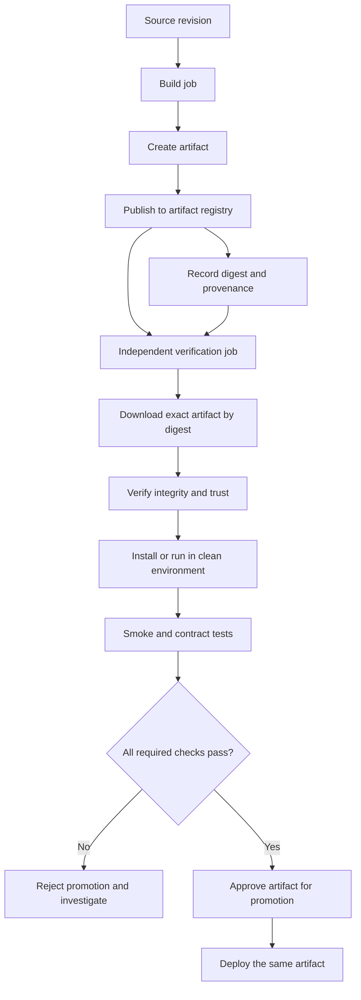

# Kiểm tra artifact độc lập với môi trường vừa tạo ra nó

Một lần build thành công chỉ cho biết quy trình build đã tạo ra đầu ra theo cách công cụ báo cáo. Nó chưa chứng minh artifact có thể được cài đặt, khởi chạy hoặc sử dụng trong môi trường mà người dùng và hệ thống đích thực sự cung cấp. Artifact có thể vô tình phụ thuộc vào file chưa được đóng gói, cache cục bộ, biến môi trường riêng của runner hoặc thư viện chỉ tồn tại trên máy build.

Vì vậy, sau khi tạo và lưu artifact, cần kiểm tra nó trong một môi trường độc lập với môi trường đã tạo ra nó. Môi trường kiểm tra phải lấy artifact từ nơi lưu trữ, xác minh đúng nội dung đã phát hành, rồi cài đặt hoặc chạy artifact theo hợp đồng runtime đã công bố. Mục tiêu là chứng minh gói phát hành tự mang đủ những gì nó phải mang theo và chỉ phụ thuộc vào những thành phần đã được khai báo.

Trong CI/CD, cách kiểm tra này tạo thêm một ranh giới tin cậy giữa build và sử dụng. Nhóm có thể phát hiện sớm lỗi đóng gói, thiếu file, sai cấu hình runtime, dependency ngầm định và khác biệt nền tảng trước khi promotion artifact đến môi trường quan trọng hơn.

## 1. Vì sao phải kiểm tra ngoài môi trường build?

Môi trường build thường có nhiều công cụ và tài nguyên hơn môi trường chạy thực tế. Nó có thể chứa JDK, compiler, package manager, source code, thư viện hệ thống, cache dependency, file cấu hình phát triển và credential được cấp cho pipeline.

Nếu kiểm tra artifact ngay trong môi trường đó, ứng dụng có thể vô tình sử dụng một thành phần không nằm trong gói phát hành. Ví dụ:

- Ứng dụng Java chạy được vì JDK và thư viện nằm sẵn trong image build, trong khi runtime production chỉ có JRE.
- Một file cấu hình được đọc từ thư mục checkout nhưng không được đóng gói vào JAR hoặc ZIP.
- Test thành công nhờ dependency đã có trong Gradle cache dù dependency chưa được khai báo đúng.
- Script khởi động sử dụng một biến môi trường chỉ tồn tại trên runner.
- Container chạy được vì có file được mount từ host nhưng image được phát hành không chứa file đó.
- Package cài đặt được trên máy build vì có công cụ hoặc quyền truy cập đặc biệt, nhưng không cài được trên máy sạch.

Một môi trường kiểm tra độc lập giúp loại bỏ các hỗ trợ vô tình đó. Nó chỉ nhận artifact đã được publish, các cấu hình runtime được phép và những dịch vụ phụ trợ đã khai báo. Nếu artifact thiếu thành phần hoặc phụ thuộc ngoài hợp đồng, kiểm tra sẽ phát hiện.

Điều này đặc biệt quan trọng với artifact được tạo tự động và chuyển qua nhiều giai đoạn. Khi staging và production sử dụng cùng một gói, bằng chứng kiểm tra trên gói đó có giá trị hơn việc chỉ kiểm tra source code hoặc thư mục build nội bộ.

## 2. Phân biệt kiểm tra artifact với build tái lập

Hai hoạt động này liên quan nhưng trả lời hai câu hỏi khác nhau:

| Hoạt động | Câu hỏi cần trả lời | Cách thực hiện |
|---|---|---|
| Kiểm tra artifact độc lập | Artifact đã tạo có thể được xác minh, cài đặt và sử dụng trong môi trường tiêu thụ không? | Lấy artifact từ registry, đưa vào môi trường sạch và kiểm tra |
| Build tái lập (reproducible build) | Cùng source và đầu vào được kiểm soát có tạo ra artifact tương đương hoặc giống hệt không? | Build độc lập lần nữa và so sánh digest hoặc nội dung theo tiêu chí đã định |

Kiểm tra độc lập không yêu cầu build lại artifact. Trọng tâm là dùng chính gói đã được tạo để kiểm tra hành vi của nó. Nếu môi trường kiểm tra tự build lại từ source rồi chỉ kiểm tra bản build mới, nhóm chưa chứng minh artifact được phát hành là bản có thể sử dụng.

Build tái lập có thể bổ sung bằng chứng về tính nhất quán của quy trình tạo artifact. Hai build độc lập tạo cùng digest là bằng chứng mạnh về khả năng tái tạo bit-for-bit. Tuy nhiên, một artifact vẫn có thể cài đặt và chạy đúng dù metadata như timestamp hoặc chữ ký khiến hai lần build không giống từng byte. Ngược lại, hai build tạo cùng digest không tự chứng minh ứng dụng hoạt động đúng khi chạy.

Do đó, nhóm nên xem đây là hai lớp xác minh bổ sung cho nhau: một lớp kiểm tra gói đã tạo trong vai trò consumer, một lớp kiểm tra khả năng tái tạo của quá trình build khi mức đảm bảo yêu cầu điều đó.

## 3. Môi trường độc lập cần độc lập ở mức nào?

Độc lập không có nghĩa là môi trường hoàn toàn không có dependency. Ứng dụng luôn cần runtime, hệ điều hành, dịch vụ hoặc cấu hình nhất định. Điều cần loại bỏ là các phụ thuộc ngầm vào môi trường đã tạo artifact.

Một môi trường kiểm tra độc lập nên có các đặc điểm:

- Được tạo mới từ image, máy ảo hoặc namespace có phiên bản xác định.
- Không dùng lại workspace, thư mục build hoặc cache không được khai báo của job build.
- Lấy artifact từ registry hoặc kho lưu trữ thông qua định danh bất biến.
- Chỉ cài các runtime và thư viện thuộc hợp đồng hỗ trợ của sản phẩm.
- Nhận cấu hình và secret test theo cơ chế giống môi trường tiêu thụ.
- Không có quyền sửa artifact đã publish.
- Ghi nhận digest của artifact thực sự được kiểm tra.
- Có thể xóa và tạo lại mà không cần giữ trạng thái từ lần chạy trước.

Có thể dùng một runner mới, container tạm, máy ảo ngắn hạn hoặc namespace Kubernetes riêng. Mức cô lập phụ thuộc loại artifact và rủi ro cần kiểm soát. Với thư viện Java, một consumer project sạch có thể đủ. Với image container, cần pull image bằng digest và chạy nó trong runtime container. Với package cài đặt hệ điều hành, nên cài trên máy ảo sạch tương ứng với nền tảng hỗ trợ.

Môi trường phải đủ giống hợp đồng sử dụng thực tế để kiểm tra có ý nghĩa. Nếu sản phẩm hỗ trợ Linux và Windows, kiểm tra trên một môi trường Linux không chứng minh gói chạy đúng trên Windows. Nếu sản phẩm yêu cầu JRE 21, kiểm tra bằng JDK 21 có thể che giấu việc runtime image thiếu thành phần cần thiết.

## 4. Luồng kiểm tra artifact độc lập

Một luồng thường gồm các chặng:

1. Build job tạo artifact từ revision đã xác định.
2. Publish job lưu artifact vào registry hoặc kho lưu trữ có kiểm soát.
3. Hệ thống ghi nhận digest, metadata và bằng chứng nguồn gốc.
4. Verification job chạy trên runner hoặc môi trường mới.
5. Job tải artifact theo version bất biến hoặc digest.
6. Job xác minh checksum, chữ ký và provenance theo chính sách.
7. Job cài đặt hoặc chạy artifact trong môi trường consumer sạch.
8. Job thực hiện smoke test, contract test hoặc kiểm tra tương thích phù hợp.
9. Job lưu kết quả gắn với digest và chỉ cho phép promotion khi các điều kiện bắt buộc đạt.

Sơ đồ:



Điểm quan trọng là verification job tiêu thụ artifact đã publish. Không nên truyền thư mục build nội bộ như nguồn duy nhất, vì cách đó có thể che giấu lỗi publish hoặc lỗi đóng gói. Có thể dùng artifact transfer của CI để chuyển file giữa job, nhưng cần bảo đảm job kiểm tra nhận đúng đối tượng đã được ghi nhận và có thể xác minh digest.

## 5. Xác định chính xác artifact cần kiểm tra

Trước khi kiểm tra, phải biết artifact nào là đầu ra chính thức. Một repository có thể tạo nhiều file: JAR, ZIP, image, package, test report, source archive hoặc debug symbols. Không phải tất cả đều được phát hành cùng cách.

Mỗi artifact nên có định danh rõ ràng:

- Tên sản phẩm hoặc module.
- Version hoặc release identifier.
- Target platform và architecture nếu có.
- Loại artifact và định dạng.
- Source revision hoặc commit SHA.
- Build run ID.
- Digest của nội dung.
- Metadata về toolchain và dependency khi cần.

Không nên dựa vào tên file chung như app-latest.jar để xác định đầu ra cần test. Tên có thể bị ghi đè hoặc trỏ sang phiên bản khác. Dùng version bất biến và digest giúp verification job lấy đúng gói.

Nếu một release tạo nhiều artifact cho các hệ điều hành hoặc kiến trúc khác nhau, cần lập danh sách rõ từng biến thể. Kiểm tra một image amd64 không chứng minh image arm64 cũng hoạt động. Nếu có manifest đa kiến trúc, cần xác minh cả manifest và các image con theo nền tảng hỗ trợ.

## 6. Xác minh tính toàn vẹn bằng digest

Digest là dấu vân tay được tính từ nội dung artifact bằng thuật toán băm, thường dùng SHA-256. Nếu nội dung thay đổi, digest gần như chắc chắn thay đổi. Nhờ đó, nhóm có thể kiểm tra file tải về có đúng nội dung đã được publish hay không.

Một luồng đơn giản:

1. Publish job tính digest của artifact và ghi nhận vào metadata đáng tin cậy.
2. Verification job tải artifact theo định danh bất biến.
3. Job tính lại digest từ file đã tải.
4. So sánh với digest được ghi nhận.
5. Dừng kiểm tra nếu không khớp.

Ví dụ với file JAR trên Linux:

```bash
ARTIFACT_FILE="app-2.4.0.jar"

if [ -z "$EXPECTED_SHA256" ]; then
  echo "EXPECTED_SHA256 is required" >&2
  exit 2
fi

printf '%s  %s\n' "$EXPECTED_SHA256" "$ARTIFACT_FILE" \
  | sha256sum --check -
```

Giá trị EXPECTED_SHA256 phải đến từ metadata hoặc kênh tin cậy gắn với lần publish. Nếu tải cả artifact và file checksum từ cùng một vị trí có thể bị sửa, rồi chỉ so sánh hai file đó, kẻ tấn công có thể thay cả hai. Checksum chứng minh nội dung khớp với digest tham chiếu; nó không tự chứng minh người tạo artifact là ai.

Với container image, registry thường cung cấp digest cho manifest hoặc image manifest list. Verification job nên pull và chạy đúng digest đó, thay vì pull một tag có thể thay đổi giữa lúc kiểm tra và lúc triển khai.

Digest cũng cần được lưu trong kết quả test và release record. Nhờ đó, khi có sự cố, nhóm biết chính xác binary nào đã được kiểm tra và triển khai.

## 7. Xác minh chữ ký và nguồn gốc artifact

Digest xác nhận nội dung, nhưng không xác nhận danh tính người hoặc hệ thống tạo ra nội dung đó. Chữ ký số và provenance bổ sung bằng chứng về nguồn gốc.

**Chữ ký (signature)** giúp xác minh artifact hoặc metadata được ký bởi danh tính đáng tin theo chính sách của tổ chức. Verification job cần kiểm tra chữ ký, danh tính signer, issuer hoặc khóa tin cậy và phạm vi được phép ký.

**Provenance** mô tả artifact được tạo ra từ source revision nào, bằng quy trình hoặc builder nào, với các đầu vào nào. Nhóm có thể kiểm tra provenance để bảo đảm artifact đến từ repository, nhánh, workflow và builder được phép.

**SBOM** liệt kê các thành phần phần mềm được đóng gói hoặc sử dụng trong artifact. Nó hỗ trợ kiểm tra dependency, license và lỗ hổng đã biết. SBOM không thay thế test runtime hoặc chữ ký.

Các bằng chứng này có vai trò khác nhau:

| Bằng chứng | Giúp trả lời | Không tự chứng minh |
|---|---|---|
| Digest/checksum | Nội dung có khớp với giá trị tham chiếu không? | Ai tạo ra nội dung |
| Signature | Artifact hoặc metadata có được signer đáng tin ký không? | Ứng dụng chạy đúng |
| Provenance | Artifact được tạo từ source và builder nào? | Không có lỗi chức năng |
| SBOM | Artifact chứa những thành phần nào? | Các thành phần không có lỗ hổng |
| Runtime tests | Artifact hoạt động thế nào trong môi trường kiểm tra? | Nguồn gốc artifact nếu chưa xác minh digest/provenance |

Không nên chấp nhận chữ ký chỉ vì chữ ký hợp lệ về mặt toán học. Danh tính signer và chính sách tin cậy phải phù hợp. Ví dụ, một workflow chạy từ fork không đáng tin không nên được xem là builder có quyền ký release production.

## 8. Kiểm tra nội dung bên trong gói

Trước khi chạy artifact, cần kiểm tra cấu trúc và nội dung để phát hiện thiếu file, file thừa hoặc thông tin nhạy cảm.

Với JAR hoặc ZIP, có thể liệt kê nội dung, xác nhận manifest, resource, service descriptor và file cấu hình được mong đợi. Với package hệ điều hành, kiểm tra danh sách file, metadata cài đặt, script pre-install/post-install và dependency khai báo. Với container image, kiểm tra entrypoint, user, exposed port, package và filesystem cần thiết.

Các câu hỏi hữu ích:

- File thực thi hoặc entrypoint có tồn tại không?
- Resource và file cấu hình mặc định có được đóng gói không?
- Có chứa file test, source nội bộ hoặc dữ liệu phát triển không cần thiết không?
- Có vô tình đóng gói secret, private key, token hoặc file cấu hình local không?
- Metadata version có khớp release không?
- Dependency được khai báo có phù hợp với loại package không?
- Quyền file và script có đúng để cài đặt hoặc chạy không?

Không phải mọi file trong gói đều cần được kiểm tra bằng tay. Có thể định nghĩa allowlist hoặc manifest nội dung mong đợi, sau đó kiểm tra tự động. Nếu package thay đổi cấu trúc hợp lệ theo phiên bản, quy tắc kiểm tra cần được cập nhật và review.

Với container image, kiểm tra cả image cuối cùng sau multi-stage build. Việc scan stage build không đủ nếu image runtime có package hoặc file khác. Ngược lại, không nên yêu cầu runtime image chứa compiler hoặc source code nếu hợp đồng sản phẩm không cần.

## 9. Kiểm tra JAR trong môi trường consumer sạch

Với ứng dụng Java, môi trường build thường có JDK, Gradle hoặc Maven, source code và cache. Môi trường consumer có thể chỉ có JRE tương thích cùng cấu hình và dịch vụ cần thiết.

Một bài kiểm tra độc lập có thể thực hiện:

1. Khởi tạo runner hoặc container mới có JRE theo phiên bản hỗ trợ.
2. Tải JAR từ artifact repository theo version và digest.
3. Xác minh checksum và chữ ký nếu có.
4. Kiểm tra nội dung JAR và manifest.
5. Khởi chạy bằng đúng lệnh vận hành được tài liệu hóa.
6. Cấp cấu hình test từ bên ngoài artifact.
7. Chờ health endpoint sẵn sàng.
8. Gọi một số API hoặc luồng nghiệp vụ quan trọng.
9. Thu thập log và kết quả test.
10. Hủy môi trường sau khi hoàn tất.

Ví dụ kiểm tra cấu trúc:

```bash
jar --list --file app-2.4.0.jar
```

Nếu ứng dụng được đóng gói thành executable JAR, có thể chạy thử trong JRE:

```bash
java -version
java -jar app-2.4.0.jar
```

Ví dụ này chỉ phù hợp nếu JAR có entry point và cấu hình khởi chạy tương ứng. Nhiều thư viện Java không thể chạy trực tiếp bằng java -jar; chúng cần được tiêu thụ từ một project khác.

Với thư viện, tạo một consumer project sạch, chỉ khai báo dependency từ repository staging hoặc package repository. Biên dịch và chạy một đoạn mã sử dụng API công khai. Không dùng project build gốc hoặc output/classes của nó làm classpath, vì điều đó có thể che giấu lỗi package thiếu class hoặc resource.

## 10. Kiểm tra container image sau khi publish

Nếu artifact là container image, verification job cần pull image đã publish bằng digest và chạy image đó như một consumer thực tế.

Các bước thường gồm:

- Xác minh digest và signature theo chính sách.
- Kiểm tra metadata image, architecture, user, entrypoint và command.
- Khởi chạy container với cấu hình gần với môi trường đích.
- Cấp biến môi trường và secret test qua cơ chế an toàn.
- Chờ health check hoặc readiness.
- Chạy smoke test và kiểm tra log.
- Dừng container và lưu kết quả gắn với digest.

Ví dụ lệnh khởi chạy minh họa:

```bash
docker pull registry.example.com/team/service@sha256:REPLACE_WITH_VERIFIED_DIGEST

docker run --rm \
  --read-only \
  --cap-drop=ALL \
  --user 10001:10001 \
  -p 18080:8080 \
  registry.example.com/team/service@sha256:REPLACE_WITH_VERIFIED_DIGEST
```

Digest trong ví dụ là placeholder. Các cờ read-only, cap-drop và user cần phù hợp với ứng dụng; có ứng dụng cần thư mục tạm có quyền ghi hoặc capability cụ thể. Nếu cần, cấp tmpfs hoặc volume riêng cho đường dẫn được phép ghi. Mục tiêu là kiểm tra với quyền gần với môi trường triển khai, không phải thêm quyền rộng chỉ để container khởi động.

Không chạy image vừa build từ workspace khi mục tiêu là xác minh image đã publish. Nếu dùng lại local image cache, job có thể vô tình chạy một image khác với digest đã lưu trong registry. Verification nên pull đúng digest trong môi trường mới hoặc xác minh rõ image ID tương ứng.

## 11. Kiểm tra package cài đặt và thư viện được phát hành

Với package như DEB, RPM, MSI hoặc installer, kiểm tra nên thực hiện trên máy ảo sạch tương ứng với hệ điều hành và phiên bản được hỗ trợ.

Một quy trình có thể gồm:

1. Tạo máy ảo hoặc snapshot mới.
2. Tải package từ kho phát hành.
3. Xác minh digest và chữ ký.
4. Cài đặt bằng package manager hoặc installer chính thức.
5. Kiểm tra dependency hệ thống và quyền file.
6. Khởi động dịch vụ hoặc chạy lệnh CLI.
7. Kiểm tra upgrade từ phiên bản trước nếu đó là luồng hỗ trợ.
8. Kiểm tra uninstall hoặc rollback theo chính sách.
9. Ghi nhận log cài đặt và kết quả.

Với thư viện, cần dùng project consumer mới, không dùng build output của repository nguồn. Project này chỉ nên phụ thuộc vào artifact đã publish, compiler/runtime và dependency đã khai báo. Kiểm tra compile, linking hoặc import API công khai để phát hiện package thiếu metadata hay file.

Đối với package có nhiều biến thể OS/architecture, cần xác định ma trận kiểm tra theo tuyên bố hỗ trợ. Không nhất thiết mọi tổ hợp đều phải chạy mọi test sâu, nhưng mỗi biến thể phát hành cần có ít nhất kiểm tra integrity và cài đặt phù hợp.

## 12. Kiểm tra hợp đồng runtime và cấu hình

Artifact không nên chứa cấu hình riêng của một môi trường triển khai. URL dịch vụ, port, feature flag, giới hạn tài nguyên và credential thường được cung cấp tại runtime.

Verification job cần dùng cấu hình test đại diện cho hợp đồng đã công bố:

- Biến môi trường bắt buộc được cung cấp.
- Giá trị mặc định có hành vi phù hợp.
- Thiếu cấu hình bắt buộc phải báo lỗi rõ ràng.
- Cấu hình không hợp lệ không làm ứng dụng âm thầm khởi động với giá trị sai.
- Secret được lấy từ cơ chế an toàn và không xuất hiện trong log.
- Cấu hình môi trường không bị ghi ngược vào artifact.

Không dùng production secret để kiểm tra artifact. Dùng credential test có quyền giới hạn và dữ liệu giả. Nếu ứng dụng cần kết nối dịch vụ ngoài, chỉ cho phép network đến các endpoint test cần thiết.

Cần phân biệt lỗi artifact với lỗi môi trường kiểm tra. Nếu database test không sẵn sàng, bài kiểm tra chưa có kết luận về artifact. Nếu ứng dụng không khởi động vì artifact thiếu driver database đã được khai báo là dependency bắt buộc, đó là lỗi cần xử lý. Log và trạng thái từng bước phải giúp phân biệt hai trường hợp này.

## 13. Chọn loại test phù hợp cho artifact

Không phải mọi kiểm tra đều có cùng giá trị sau khi đóng gói. Một số test chạy tốt nhất ở source level; một số khác chỉ có ý nghĩa khi tiêu thụ artifact thực tế.

| Loại kiểm tra | Mục tiêu | Ví dụ |
|---|---|---|
| Integrity check | Đúng nội dung đã publish | SHA-256, registry digest |
| Signature/provenance check | Nguồn gốc và builder đáng tin | Verify signer và attestation |
| Package inspection | Cấu trúc gói đúng | Kiểm tra manifest, resource, entrypoint |
| Install test | Có thể cài đặt trên nền tảng hỗ trợ | Cài DEB/RPM/MSI trên VM sạch |
| Startup test | Có thể khởi chạy với runtime đã công bố | Chạy JAR bằng JRE hoặc container image |
| Smoke test | Luồng quan trọng hoạt động | Health endpoint, đăng nhập test, tạo bản ghi mẫu |
| Contract test | Giao tiếp đúng với hệ thống phụ thuộc | API, message schema, database contract |
| Compatibility test | Hoạt động trên các phiên bản nền tảng hỗ trợ | JDK, OS, architecture |
| Security scan | Phát hiện rủi ro trong package cuối | Image scan, dependency/SBOM policy |
| Upgrade/rollback test | Cập nhật và quay lại theo hợp đồng | Upgrade package, rollback service |

Test nên được chọn theo rủi ro. Artifact của thư viện cần consumer test; image của service cần startup và smoke test; package cài đặt cần install và upgrade test. Chạy lại toàn bộ unit test trong môi trường consumer có thể tốn thời gian mà không bổ sung nhiều bằng chứng nếu unit test đã chạy trên cùng revision. Hãy tập trung vào các lỗi chỉ xuất hiện ở ranh giới đóng gói và sử dụng.

## 14. Thiết kế verification job có thể tái tạo

Verification job cũng là một phần của pipeline as code. Cần mô tả rõ môi trường, artifact đầu vào, cách xác minh, test và output.

Một job tốt nên:

- Dùng runner hoặc container mới.
- Không checkout source nếu chỉ cần artifact; nếu cần source để lấy test harness, phải bảo đảm test harness không build lại hoặc thay thế artifact.
- Tải artifact theo version bất biến hoặc digest.
- Xác minh digest trước khi cài đặt hoặc chạy.
- Dùng runtime image đã khóa phiên bản.
- Cấp cấu hình và secret test tối thiểu.
- Có timeout cho từng bước và toàn job.
- Thu thập log, report và thông tin môi trường.
- Hủy tài nguyên tạm sau khi hoàn tất.
- Gắn trạng thái cuối cùng với artifact digest.

Ví dụ YAML khái niệm:

```yaml
jobs:
  verify-published-artifact:
    runs-on: fresh-runner
    steps:
      - name: Download published artifact
        run: fetch artifact by immutable version

      - name: Verify artifact digest
        run: compare downloaded digest with trusted release metadata

      - name: Verify provenance
        run: validate signer and build provenance

      - name: Prepare consumer runtime
        run: create clean runtime environment

      - name: Install or start artifact
        run: install and launch the downloaded artifact

      - name: Run smoke tests
        run: execute consumer tests against the running artifact

      - name: Save verification evidence
        run: publish reports with artifact digest
```

Các lệnh trong ví dụ là mô tả bước, cần thay bằng action hoặc command của nền tảng CI đang dùng. Cấu hình thực tế phải kiểm tra quyền của job, cách tải artifact, cách bảo vệ metadata tin cậy và cách giữ log mà không lộ secret.

Nếu job dùng chung runner pool, fresh-runner phải thực sự tạo ra workspace sạch. Chỉ đổi tên job hoặc tạo một job mới trên cùng workspace persistent không đảm bảo môi trường độc lập. Cần hiểu chính sách tái sử dụng runner, cache và filesystem của nền tảng.

## 15. Phân biệt lỗi artifact, lỗi môi trường và lỗi kiểm tra

Kết quả kiểm tra chỉ hữu ích nếu nhóm biết nguyên nhân thất bại. Có thể phân nhóm:

| Nhóm lỗi | Ví dụ | Cách xử lý |
|---|---|---|
| Integrity/trust | Digest sai, signature không hợp lệ, provenance không đạt | Từ chối artifact, kiểm tra nguồn publish và chuỗi tin cậy |
| Packaging | Thiếu resource, sai entrypoint, file permission sai | Sửa cấu hình đóng gói và tạo artifact mới |
| Runtime | Không có class, thiếu thư viện, runtime version không tương thích | Kiểm tra dependency và hợp đồng runtime |
| Configuration | Thiếu biến bắt buộc, giá trị cấu hình không hợp lệ | Sửa cấu hình mẫu hoặc tài liệu và kiểm tra validation |
| External service | Database test không sẵn sàng, DNS hoặc network lỗi | Khôi phục môi trường test và chạy lại kiểm tra |
| Test harness | Test sai endpoint, dữ liệu không khởi tạo hoặc assertion lỗi | Sửa harness và xác nhận lại trên cùng digest |
| Resource | Hết memory, disk hoặc timeout | Phân tích giới hạn và điều chỉnh có căn cứ |

Không nên tự động đánh dấu artifact thất bại nếu verification environment bị lỗi hạ tầng trước khi artifact được chạy. Cũng không nên coi mọi lỗi là transient rồi retry liên tục. Trạng thái có thể cần ba kết quả: passed, failed và inconclusive/infra-error. Chỉ passed mới đủ điều kiện promotion; infra-error cần khắc phục và chạy lại với cùng artifact digest.

Nếu artifact không đạt, tạo artifact mới sau khi sửa mã hoặc build configuration. Không sửa trực tiếp file bên trong artifact đã publish để làm test xanh. Việc thay đổi nội dung sẽ tạo một artifact khác và phải có digest, metadata, provenance cùng kết quả kiểm tra mới.

## 16. Gắn bằng chứng kiểm tra với artifact

Một kết quả test không có định danh artifact có thể gây nhầm lẫn. Verification record nên ghi lại tối thiểu:

- Artifact name, version và digest.
- Registry hoặc nguồn tải artifact.
- Source commit và build run ID nếu có.
- Signature/provenance verification result.
- Runtime image hoặc môi trường kiểm tra và digest của nó.
- OS, architecture, runtime version.
- Phiên bản test harness và cấu hình test không nhạy cảm.
- Các test đã chạy, trạng thái và thời điểm.
- Log, report và liên kết tới lần chạy CI.
- Người hoặc danh tính hệ thống phê duyệt nếu có.

Bằng chứng này có thể được lưu như release metadata, test report hoặc attestation. Khi promotion sang staging hay production, hệ thống có thể kiểm tra artifact digest đã có verification record đạt theo chính sách.

Nếu cùng một artifact được triển khai qua nhiều môi trường, record kiểm tra trước promotion vẫn gắn với cùng digest. Cấu hình runtime có thể khác theo môi trường nhưng cần có kiểm tra riêng cho các khác biệt có ảnh hưởng đến hành vi.

## 17. Promotion cùng artifact qua các môi trường

Sau khi artifact vượt qua kiểm tra độc lập, nhóm nên promotion chính artifact đó qua staging và production. Không build lại chỉ vì chuyển môi trường.

Luồng:

- Build tạo artifact.
- Publish lưu artifact và digest.
- Verification kiểm tra đúng digest.
- Staging nhận cùng digest đã được kiểm tra.
- Production nhận cùng digest sau khi đạt điều kiện phê duyệt và xác minh staging.

Cấu hình môi trường được cung cấp tại thời điểm triển khai. Artifact không nên được sửa nội dung để thay URL staging thành URL production. Nếu cần cấu hình khác, hãy dùng biến môi trường, config map hoặc secret manager theo thiết kế ứng dụng.

Nếu phát hiện lỗi trong verification hoặc staging, cần tạo phiên bản mới sau khi sửa. Không thay thế nội dung phía sau một tag hoặc version đã được coi là bất biến. Nếu registry hỗ trợ tag có thể thay đổi, vẫn nên ghi và triển khai theo digest.

## 18. Ví dụ tình huống: JAR chạy trong build container nhưng lỗi trên runtime

Một nhóm build ứng dụng Java trong image có JDK 21, Gradle và nhiều thư viện hệ thống. Unit test và package đều thành công. Sau khi deploy, service không khởi động vì một thư viện native hoặc runtime component cần thiết không có trong image chạy thực tế.

Nếu chỉ test trong build container, lỗi có thể không xuất hiện vì môi trường đó có nhiều thành phần hơn production. Nhóm có thể kiểm tra theo quy trình sau:

1. Publish JAR và ghi digest vào release metadata.
2. Tạo một container mới chỉ có JRE theo phiên bản hỗ trợ.
3. Tải JAR từ artifact repository theo version và xác minh digest.
4. Cấp cấu hình test, không dùng cấu hình hoặc file từ workspace build.
5. Khởi động JAR và chờ health endpoint.
6. Gọi API smoke test với dữ liệu giả.
7. Kiểm tra log, resource và kết quả test.
8. Ghi verification record gắn với digest.

Nếu ứng dụng không khởi động vì thiếu runtime dependency, nhóm sửa cách đóng gói hoặc khai báo runtime. Sau khi build lại, artifact mới có digest mới và phải đi qua verification từ đầu. Không dùng lại kết quả test của artifact cũ.

## 19. Các anti-pattern thường gặp

| Cách làm chưa tốt | Hệ quả | Cách cải thiện |
|---|---|---|
| Test trong chính workspace build | Phụ thuộc file và cache ngoài artifact | Tải artifact vào môi trường sạch |
| Verification tự build lại từ source | Không kiểm tra đúng gói đã publish | Dùng artifact đã publish theo digest |
| Dùng tag latest | Có thể test nhầm phiên bản | Lấy theo version bất biến hoặc digest |
| Tin file checksum đặt cạnh artifact mà không xác thực nguồn | Cả artifact và checksum có thể bị thay | So sánh với digest từ metadata tin cậy |
| Chỉ chạy unit test trước publish | Không phát hiện lỗi đóng gói hoặc cài đặt | Thêm install/startup/smoke test |
| Dùng JDK để kiểm tra artifact chỉ hỗ trợ JRE | Che giấu dependency vào compiler/tool | Dùng runtime theo hợp đồng sản phẩm |
| Dùng cache persistent không rõ nguồn | Kết quả phụ thuộc trạng thái cũ | Runner sạch, cache được xem là tối ưu |
| Gắn kết quả test vào build run thay vì digest | Không biết binary nào đã được test | Ghi digest trong mọi verification record |
| Chỉnh sửa artifact sau khi test | Bằng chứng không còn áp dụng | Tạo artifact mới và kiểm tra lại |
| Cấp production secret cho job test | Mở rộng rủi ro khi job hoặc test bị xâm nhập | Dùng dữ liệu giả và credential giới hạn |
| Coi lỗi hạ tầng là lỗi artifact | Từ chối nhầm hoặc retry sai cách | Phân biệt failed với infra-error |
| Promotion bằng cách build lại | Artifact staging và production có thể khác nhau | Promotion cùng digest |

## 20. Lộ trình áp dụng trong một dự án

Có thể triển khai theo các bước:

1. **Liệt kê artifact phát hành:** xác định JAR, image, package, archive hoặc thư viện nào cần được kiểm tra.
2. **Xác định hợp đồng tiêu thụ:** runtime, OS, architecture, cấu hình và dịch vụ mà artifact cần.
3. **Tạo môi trường consumer sạch:** chọn runner mới, container, VM hoặc namespace theo loại artifact.
4. **Publish artifact bất biến:** lưu version, digest và metadata từ build run.
5. **Thêm xác minh trust:** kiểm tra digest, signature, provenance và SBOM theo yêu cầu.
6. **Viết consumer test:** cài đặt, khởi chạy, kiểm tra API hoặc sử dụng thư viện từ package repository.
7. **Tích hợp vào pipeline:** chạy verification sau publish và trước promotion.
8. **Lưu bằng chứng:** gắn test result, runtime và log với digest.
9. **Thiết lập điều kiện promotion:** chỉ cho phép artifact đã được kiểm tra đạt chuyển sang môi trường tiếp theo.
10. **Diễn tập lỗi:** thử artifact thiếu file, digest sai, runtime không tương thích và lỗi hạ tầng test để xác nhận cách phân loại.

Bắt đầu với một artifact quan trọng nhất và một môi trường consumer tối thiểu. Sau khi luồng hoạt động ổn định, mở rộng sang các nền tảng, kiến trúc hoặc package khác.

## 21. Đo hiệu quả kiểm tra độc lập

Một quy trình kiểm tra artifact có giá trị khi nó phát hiện được vấn đề mà build job không nhìn thấy và cung cấp đủ bằng chứng để quyết định promotion.

Một số chỉ số hữu ích:

- Tỷ lệ artifact bị phát hiện lỗi đóng gói hoặc runtime sau publish.
- Tỷ lệ lỗi chỉ xuất hiện trong môi trường consumer.
- Tỷ lệ verification thất bại do hạ tầng so với lỗi artifact.
- Thời gian từ publish đến kết quả verification.
- Tỷ lệ artifact có digest, provenance và verification record đầy đủ.
- Tỷ lệ release dùng lại đúng digest đã được kiểm tra.
- Số lần phải rebuild do thiếu file hoặc sai cấu hình runtime.
- Thời gian tái hiện lỗi bằng môi trường consumer sạch.

Không nên tối ưu bằng cách bỏ smoke test hoặc dùng lại workspace để rút ngắn thời gian. Hãy tối ưu image runtime, tải artifact song song, cache công cụ có kiểm soát và chia test theo rủi ro. Artifact cần được kiểm tra đúng nội dung đã publish.

## 22. Checklist trước khi cho phép promotion

- [ ] Artifact được tải từ registry hoặc kho lưu trữ đã xác định.
- [ ] Version và digest của artifact là bất biến trong lần kiểm tra.
- [ ] Digest tải về khớp với metadata tin cậy.
- [ ] Chữ ký và provenance được xác minh theo chính sách nếu áp dụng.
- [ ] SBOM hoặc metadata dependency có sẵn khi yêu cầu.
- [ ] Verification chạy trên runner, container hoặc VM độc lập.
- [ ] Workspace và cache của build job không làm thay đổi kết quả kiểm tra.
- [ ] Runtime, OS và architecture phù hợp với hợp đồng hỗ trợ.
- [ ] Nội dung package, entrypoint và resource cần thiết đã được kiểm tra.
- [ ] Artifact được cài đặt hoặc chạy bằng đúng cách tiêu thụ thực tế.
- [ ] Smoke test hoặc consumer test quan trọng đã đạt.
- [ ] Secret test có quyền tối thiểu và không xuất hiện trong log.
- [ ] Kết quả được gắn với digest, môi trường và phiên bản test harness.
- [ ] Lỗi hạ tầng được phân biệt với lỗi artifact.
- [ ] Promotion dùng lại chính artifact digest đã được kiểm tra.

## Kết luận

Kiểm tra artifact độc lập với môi trường tạo ra nó giúp chứng minh gói phát hành có thể được tiêu thụ trong điều kiện gần với thực tế. Verification job cần tải đúng artifact từ nơi lưu trữ, xác minh digest và nguồn gốc, đưa gói vào môi trường sạch, rồi kiểm tra cài đặt, khởi chạy và hành vi theo hợp đồng runtime.

Khi kết quả được gắn với digest và promotion sử dụng lại đúng artifact đó, nhóm có bằng chứng rõ ràng về binary đã được kiểm tra. Build tái lập có thể bổ sung bằng chứng rằng quy trình tạo ra artifact nhất quán, còn kiểm tra độc lập xác nhận gói đã tạo có thể được sử dụng an toàn trong chuỗi phát hành.

