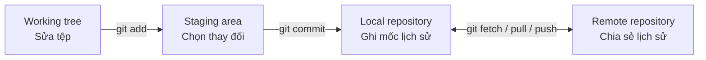

# Git là gì và vai trò trong quản lý mã nguồn

Khi phát triển một phần mềm, mã nguồn thay đổi liên tục: một chức năng được thêm vào, một lỗi được sửa, một cấu hình được điều chỉnh hoặc một đoạn code cần được quay lại phiên bản trước. Nếu chỉ lưu nhiều bản sao của thư mục với tên như `project-final`, `project-final-new` hay `project-final-latest`, nhóm phát triển rất khó biết phiên bản nào là đúng, ai đã thay đổi điều gì và làm thế nào để khôi phục một thay đổi gây lỗi.

Git giải quyết vấn đề đó bằng cách ghi nhận lịch sử thay đổi của dự án. Mỗi thành viên có thể làm việc trên máy của mình, lưu các mốc thay đổi, thử nghiệm trên nhánh riêng và trao đổi kết quả với những người khác. Vì vậy, Git là một công cụ nền tảng trong quy trình phát triển phần mềm, từ dự án cá nhân đến hệ thống có nhiều nhóm cùng tham gia.

## 1. Quản lý mã nguồn là gì?

Quản lý mã nguồn (*source code management*, thường gọi là SCM hoặc version control) là cách tổ chức và theo dõi các phiên bản của mã nguồn trong suốt quá trình phát triển. Một hệ thống quản lý phiên bản giúp trả lời những câu hỏi quan trọng:

- Tệp đã thay đổi như thế nào giữa hai thời điểm?
- Thay đổi được thực hiện bởi ai, vào lúc nào và với mục đích gì?
- Có thể tạo một phiên bản ổn định để phát hành trong khi vẫn phát triển tính năng mới không?
- Nhiều người có thể làm việc đồng thời mà không ghi đè công việc của nhau không?
- Nếu một thay đổi gây lỗi, có thể xác định nguyên nhân và khôi phục trạng thái phù hợp không?

Trước khi dùng hệ thống quản lý phiên bản, nhóm thường phải tự sao chép thư mục, gửi tệp qua email hoặc ghi chú thay đổi bằng tay. Cách làm này nhanh chóng trở nên khó kiểm soát khi dự án có nhiều tệp, nhiều phiên bản và nhiều người tham gia. Version control biến lịch sử dự án thành dữ liệu có cấu trúc, có thể kiểm tra và phối hợp bằng công cụ.

## 2. Git là gì?

**Git là một hệ thống quản lý phiên bản phân tán** (*distributed version control system — DVCS*). Git theo dõi lịch sử của các tệp trong một dự án và cho phép người dùng tạo, xem, so sánh, chia sẻ hoặc khôi phục những mốc thay đổi đó.

Git được gọi là *phân tán* vì mỗi lần clone một repository thông thường, người dùng nhận được một bản sao repository trên máy của mình, bao gồm dữ liệu cần thiết để làm việc với lịch sử dự án. Do đó, nhiều thao tác như xem lịch sử, tạo nhánh và commit có thể thực hiện ngay cả khi máy đang ngoại tuyến. Kết nối mạng chủ yếu cần thiết khi trao đổi dữ liệu với repository ở nơi khác, chẳng hạn tải thay đổi mới hoặc đẩy commit của mình lên remote.

Git lưu các mốc lịch sử dưới dạng **commit**. Có thể hình dung mỗi commit là một ảnh chụp trạng thái của dự án tại một thời điểm, kèm thông tin như tác giả, thời gian, thông điệp mô tả và liên kết đến commit cha. Git tái sử dụng dữ liệu giữa các mốc để lưu trữ hiệu quả; vì vậy, cách hiểu “Git chỉ lưu một bản sao đầy đủ của toàn bộ tệp ở mỗi commit” không phản ánh cách Git tổ chức dữ liệu bên trong.

Một repository Git thường chứa:

- Nội dung và cấu trúc các phiên bản đã được ghi nhận.
- Lịch sử commit và quan hệ giữa các commit.
- Các tham chiếu như branch và tag để đánh dấu những vị trí quan trọng trong lịch sử.
- Cấu hình và dữ liệu cần thiết để Git quản lý dự án.

Thư mục `.git` ở thư mục gốc của dự án là nơi Git lưu dữ liệu repository. Các tệp và thư mục mà người dùng trực tiếp mở, sửa trong dự án tạo thành *working tree*.

## 3. Git đóng vai trò gì trong một dự án?

### 3.1. Lưu lịch sử thay đổi có thể kiểm tra

Mỗi commit tạo một mốc có thể tham chiếu trong lịch sử. Người phát triển có thể xem danh sách commit, đọc thông điệp, so sánh nội dung giữa các mốc và lần theo thay đổi để tìm nguyên nhân của một lỗi. Điều này hữu ích khi cần xác định thời điểm một hành vi xuất hiện hoặc hiểu lý do một đoạn code được chỉnh sửa.

### 3.2. Hỗ trợ thử nghiệm và phát triển song song

Branch (nhánh) cho phép tạo một dòng phát triển riêng dựa trên một commit. Một thành viên có thể tạo nhánh để phát triển tính năng, trong khi nhánh chính vẫn giữ trạng thái ổn định. Khi công việc hoàn tất, các nhánh có thể được tích hợp bằng merge hoặc một cách tổ chức lịch sử khác phù hợp với quy trình của nhóm.

Nhờ nhánh, nhóm không cần đợi mọi người hoàn tất công việc theo một hàng tuần tự. Nhiều tính năng hoặc bản sửa lỗi có thể được phát triển độc lập rồi tích hợp có kiểm soát.

### 3.3. Hỗ trợ cộng tác

Mỗi thành viên có thể clone repository, tạo commit cục bộ và gửi các commit đó đến remote. Nhóm có thể dùng pull request hoặc merge request trên nền tảng lưu trữ để thảo luận, review và thống nhất trước khi đưa thay đổi vào nhánh chung.

Git cũng giúp phát hiện xung đột khi hai thay đổi không thể tự động kết hợp, ví dụ hai người sửa cùng một đoạn trong một tệp. Khi đó, người tích hợp cần xem nội dung liên quan, chọn hoặc kết hợp phần đúng, rồi hoàn tất việc tích hợp.

### 3.4. Giảm rủi ro khi sửa đổi

Commit tạo ra các mốc có thể quay lại hoặc dùng để đối chiếu. Khi một thay đổi làm phát sinh lỗi, lịch sử giúp nhóm xác định phạm vi ảnh hưởng và lựa chọn cách xử lý. Git cung cấp nhiều cơ chế khôi phục, nhưng mỗi cơ chế có tác động khác nhau đến working tree, staging area và lịch sử; cần hiểu lệnh trước khi dùng, đặc biệt với các thao tác ghi đè hoặc viết lại lịch sử.

### 3.5. Tạo cơ sở cho quy trình phát hành

Tag có thể đánh dấu một commit tương ứng với phiên bản phát hành, chẳng hạn `v1.0.0`. Nhóm có thể dựa vào tag để biết chính xác mã nguồn nào đã được phát hành, đối chiếu lỗi giữa các phiên bản và chuẩn bị bản vá.

## 4. Những khái niệm nền tảng của Git

| Khái niệm | Ý nghĩa | Vai trò trong công việc |
|---|---|---|
| Working tree | Các tệp dự án mà người dùng đang xem và chỉnh sửa | Nơi tạo ra thay đổi ban đầu |
| Staging area (index) | Khu vực chọn các thay đổi sẽ được đưa vào commit kế tiếp | Kiểm soát chính xác nội dung của một commit |
| Repository | Cơ sở dữ liệu Git chứa commit, cây thư mục, đối tượng và tham chiếu | Lưu lịch sử đã được ghi nhận |
| Commit | Một mốc trạng thái của dự án cùng metadata và liên kết lịch sử | Ghi nhận một đơn vị thay đổi có ý nghĩa |
| Branch | Một tham chiếu có tên trỏ đến commit, thường di chuyển khi tạo commit mới trên nhánh | Tổ chức các dòng phát triển |
| HEAD | Tham chiếu cho biết vị trí hiện tại mà repository đang làm việc | Giúp Git xác định nhánh hoặc commit đang được checkout |
| Remote | Tên cấu hình trỏ đến một repository ở nơi khác | Trao đổi commit với nhóm hoặc máy chủ |
| Tag | Tham chiếu dùng để đánh dấu một vị trí cụ thể trong lịch sử | Đánh dấu phiên bản hoặc mốc quan trọng |

Ba khu vực đầu tiên tạo nên luồng làm việc thường gặp của Git:



Điểm cần nhớ là `git add` đưa nội dung đã chọn vào staging area; nó chưa tạo commit. `git commit` mới ghi một mốc vào repository cục bộ. Việc gửi commit lên remote là một thao tác riêng, thường dùng `git push`.

## 5. Một vòng làm việc cơ bản với Git

Giả sử bạn vừa tạo một dự án nhỏ và muốn bắt đầu theo dõi mã nguồn. Một vòng làm việc đơn giản có thể diễn ra như sau.

### Bước 1: Khởi tạo hoặc lấy repository

Nếu thư mục dự án chưa được quản lý bởi Git, chạy lệnh sau tại thư mục đó:

```bash
git init
```

Git tạo repository cục bộ trong thư mục `.git`. Nếu dự án đã có repository trên máy chủ, bạn thường bắt đầu bằng cách clone:

```bash
git clone https://example.com/team/sample-project.git
```

`git clone` tạo một thư mục làm việc và cấu hình remote mặc định thường có tên `origin`.

### Bước 2: Kiểm tra trạng thái

```bash
git status
```

Lệnh này cho biết nhánh hiện tại và các tệp đang có thay đổi, đã được đưa vào staging area hay chưa, hoặc chưa được Git theo dõi. Nên dùng `git status` thường xuyên để hiểu trạng thái trước khi thực hiện thao tác tiếp theo.

### Bước 3: Chọn thay đổi để commit

Sau khi sửa `README.md`, có thể xem phần khác biệt và đưa tệp vào staging area:

```bash
git diff
git add README.md
git diff --staged
```

`git diff` mặc định hiển thị thay đổi chưa được stage. `git diff --staged` hiển thị nội dung đã stage, tức phần sẽ được ghi vào commit nếu commit ngay lúc này. Bạn có thể stage một số tệp hoặc chọn từng phần thay đổi để một commit chỉ chứa một nội dung rõ ràng.

### Bước 4: Tạo commit

```bash
git commit -m "docs: add project overview"
```

Commit ghi lại phần nội dung đã stage. Thông điệp commit nên mô tả ngắn gọn mục đích của thay đổi, ví dụ `fix: handle empty input` hoặc `feat: add user profile endpoint`. Một thông điệp rõ ràng giúp người khác hiểu lịch sử mà không phải mở từng tệp.

### Bước 5: Xem lịch sử

```bash
git log --oneline --graph --decorate
```

Lệnh này hiển thị các commit theo dạng rút gọn, kèm đồ thị quan hệ và một số tham chiếu. Khi cần xem chi tiết hơn, có thể dùng `git show` với mã commit hoặc tham chiếu tương ứng.

### Bước 6: Trao đổi với remote

Nếu repository đã cấu hình remote, bạn có thể tải thông tin mới từ remote và gửi commit của mình:

```bash
git fetch origin
git push -u origin main
```

`git fetch` tải dữ liệu và cập nhật các tham chiếu remote-tracking; lệnh này không tự tích hợp thay đổi vào working tree hiện tại. `git push` gửi các commit cục bộ phù hợp lên remote. Với repository mới, tên nhánh mặc định có thể không phải `main`, vì vậy hãy kiểm tra nhánh hiện tại trước khi dùng ví dụ trên.

`git pull` là lệnh tiện ích để fetch rồi tích hợp thay đổi từ remote vào nhánh hiện tại theo cấu hình và tùy chọn đang dùng. Khi làm việc nhóm, hãy hiểu nhánh đích và cách tích hợp trước khi pull để tránh bất ngờ khi có thay đổi chưa commit hoặc xung đột.

## 6. Git và GitHub, GitLab khác nhau như thế nào?

Git là công cụ quản lý phiên bản chạy trên máy tính. GitHub, GitLab và Bitbucket là các nền tảng cung cấp dịch vụ lưu trữ repository Git cùng những tính năng cộng tác như review code, pull request hoặc merge request, quản lý issue, phân quyền và tự động hóa quy trình.

Có thể dùng Git mà không cần GitHub hoặc GitLab: một repository có thể tồn tại và lưu lịch sử hoàn toàn trên máy cá nhân. Ngược lại, khi nhóm cần một nơi chung để chia sẻ repository, review và phối hợp, nền tảng lưu trữ giúp bổ sung các chức năng đó. Nói cách khác, Git quản lý lịch sử mã nguồn; nền tảng như GitHub hoặc GitLab hỗ trợ lưu trữ và cộng tác xung quanh repository.

## 7. Git thường được dùng trong quy trình làm việc nhóm ra sao?

Một quy trình phổ biến cho một tính năng mới gồm các bước:

1. Clone repository hoặc cập nhật thông tin từ remote.
2. Tạo branch từ nhánh nền phù hợp, ví dụ `feature/user-profile`.
3. Sửa mã nguồn, chạy kiểm tra cần thiết và xem lại diff.
4. Stage những phần liên quan rồi tạo commit với thông điệp rõ ràng.
5. Push branch lên remote.
6. Mở pull request hoặc merge request để mô tả, thảo luận và review thay đổi.
7. Sau khi được chấp thuận, tích hợp branch theo quy ước của dự án.

Quy trình này tạo ra điểm kiểm tra trước khi thay đổi đi vào nhánh chung. Chi tiết như cách đặt tên nhánh, yêu cầu kiểm thử, cách merge hay rebase phụ thuộc vào quy ước của từng nhóm; điều quan trọng là mọi người cần thống nhất và thực hiện nhất quán.

## 8. Một số thói quen tốt khi bắt đầu dùng Git

- **Commit theo một mục đích rõ ràng:** tránh gộp sửa lỗi, thêm tính năng và định dạng lại toàn bộ dự án vào cùng một commit nếu chúng không liên quan.
- **Đọc `git status` và diff trước khi commit:** xác nhận đúng tệp và đúng nội dung được đưa vào staging area.
- **Viết thông điệp có ý nghĩa:** mô tả điều đã thay đổi hoặc lý do thay đổi, không dùng các thông điệp mơ hồ như `update` hay `fix`.
- **Dùng `.gitignore` phù hợp:** loại trừ tệp sinh tự động, thư mục build, cache hoặc tệp môi trường không nên được theo dõi. Quy tắc ignore không tự bỏ theo dõi các tệp đã được commit trước đó.
- **Không commit bí mật:** mật khẩu, token, khóa riêng và thông tin xác thực không nên nằm trong lịch sử repository. Nếu bí mật đã bị commit hoặc push, cần xử lý như một sự cố lộ thông tin và thay thế thông tin xác thực liên quan.
- **Đồng bộ theo quy trình của nhóm:** hiểu nhánh nguồn, nhánh đích và cách xử lý thay đổi từ remote trước khi tích hợp.
- **Cẩn thận với lệnh có thể ghi đè hoặc viết lại lịch sử:** một số lệnh khôi phục có thể làm mất thay đổi chưa lưu hoặc thay đổi commit đã chia sẻ. Kiểm tra trạng thái và đọc kỹ tác động của lệnh trước khi chạy.

## 9. Những hiểu nhầm thường gặp

| Hiểu nhầm | Cách hiểu đúng |
|---|---|
| Có cài Git là mọi thay đổi tự động được lưu | Git chỉ ghi nhận thay đổi khi người dùng thực hiện các thao tác phù hợp, thường là `add` rồi `commit` |
| `git add` đã lưu thay đổi vào lịch sử | `git add` chỉ stage nội dung cho commit tiếp theo |
| Commit đồng nghĩa với push | Commit lưu mốc trong repository cục bộ; push mới gửi commit lên remote |
| Git và GitHub là một | Git là hệ thống quản lý phiên bản; GitHub là một nền tảng lưu trữ và cộng tác dùng Git |
| Branch là một bản sao thư mục độc lập | Branch về cơ bản là một tham chiếu đến commit; Git cho phép chuyển đổi giữa các dòng phát triển trong cùng repository |
| Có Git là đã có bản sao lưu an toàn | Repository cục bộ vẫn có thể mất cùng máy tính; cần remote và chiến lược sao lưu phù hợp để bảo vệ dữ liệu |

## 10. Khi nào nên dùng Git?

Git phù hợp khi bạn cần theo dõi lịch sử của mã nguồn hoặc các tệp văn bản, thử nghiệm thay đổi mà vẫn giữ được mốc ổn định, phối hợp với người khác, review code hoặc quản lý phiên bản phát hành. Dù dự án chỉ có một người, Git vẫn hữu ích vì nó giúp ghi lại quá trình phát triển và cho phép so sánh các quyết định theo thời gian.

Khi học các phần tiếp theo, hãy luôn phân biệt ba việc: **sửa tệp trong working tree, chọn nội dung vào staging area và ghi mốc bằng commit**. Đây là nền tảng để hiểu branch, merge, rebase, remote, tag và cách xử lý những tình huống cộng tác phức tạp hơn.
