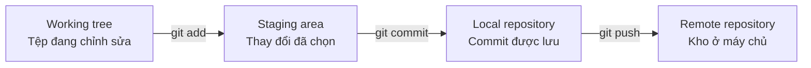
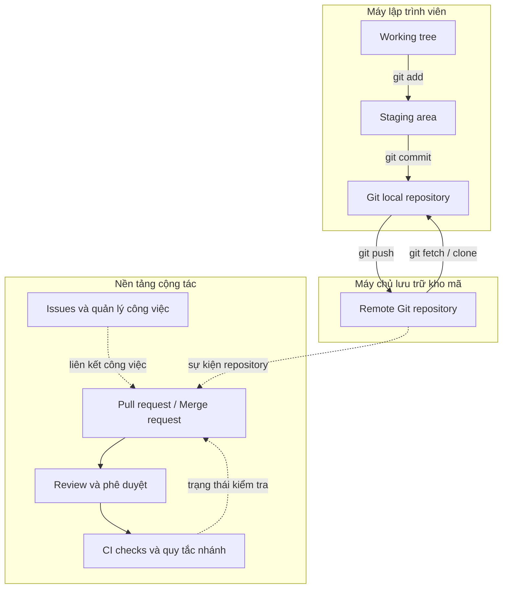

# Git, dịch vụ lưu trữ kho mã và nền tảng cộng tác khác nhau thế nào

Khi làm việc với một dự án phần mềm, ta thường nghe các câu như “đẩy code lên Git”, “tạo repository trên GitHub” hoặc “mở pull request để review”. Những cách nói này tiện trong giao tiếp, nhưng đôi khi khiến người mới học nhầm lẫn ba khái niệm khác nhau: **Git**, **dịch vụ lưu trữ kho mã Git** và **nền tảng cộng tác dành cho nhóm phát triển**.

Ba khái niệm này liên quan chặt chẽ với nhau, nhưng đảm nhiệm những vai trò khác nhau. Git quản lý phiên bản và lịch sử thay đổi của dự án. Dịch vụ lưu trữ kho mã giữ một bản repository ở nơi nhóm có thể truy cập qua mạng. Nền tảng cộng tác bổ sung giao diện và quy trình để nhiều người cùng lập kế hoạch, review, kiểm thử và phát hành phần mềm.

Phân biệt được chúng giúp ta hiểu chính xác dữ liệu đang nằm ở đâu, lệnh Git đang tác động lên thành phần nào và công cụ nào chịu trách nhiệm cho từng bước trong quy trình làm việc nhóm.

## 1. Git là gì?

**Git là hệ thống quản lý phiên bản phân tán (Distributed Version Control System – DVCS)**. Git theo dõi lịch sử thay đổi của các tệp trong một dự án, cho phép xem lại phiên bản cũ, tạo nhánh phát triển song song, kết hợp thay đổi và tìm nguyên nhân của một lỗi.

Điểm quan trọng là Git chạy ngay trên máy của lập trình viên. Sau khi clone một repository, máy tính có thể chứa đầy đủ dữ liệu và lịch sử cần thiết để xem log, tạo commit, tạo branch hoặc so sánh các phiên bản mà không cần kết nối liên tục tới máy chủ.

### 1.1. Git quản lý những gì?

Một repository Git thường có hai phần mà người học cần nhận biết:

- **Working tree (thư mục làm việc):** các tệp mà ta đang mở và chỉnh sửa.
- **Git repository (kho dữ liệu Git):** dữ liệu nội bộ Git dùng để lưu các đối tượng, commit, nhánh, thẻ và thông tin lịch sử. Trong repository thông thường, dữ liệu này nằm trong thư mục `.git`.

Giữa thư mục làm việc và commit còn có **staging area (vùng chuẩn bị, hay index)**. Đây là nơi ta chọn chính xác những thay đổi sẽ được đưa vào commit tiếp theo.

Quy trình cơ bản có thể hình dung như sau:



Ví dụ, sau khi sửa `README.md`, ta có thể chạy:

```bash
git status
git add README.md
git diff --cached
git commit -m "docs: update project instructions"
```

`git add` đưa nội dung thay đổi vào staging area; nó chưa gửi dữ liệu lên máy chủ. `git commit` tạo một mốc lịch sử trong repository trên máy hiện tại. Nếu chưa chạy `git push`, commit đó vẫn chỉ có ở repository local và các bản sao khác chưa nhận được nó.

### 1.2. Commit, branch và lịch sử

Git tổ chức lịch sử thành các **commit**. Mỗi commit ghi nhận trạng thái của dự án tại một thời điểm, kèm thông tin như mã định danh, tác giả, thời gian, thông điệp và quan hệ với commit cha. Về cách lưu trữ, Git dùng các đối tượng để biểu diễn nội dung tệp, cây thư mục và commit; vì vậy có thể hiểu commit là một ảnh chụp trạng thái dự án được quản lý hiệu quả, thay vì chỉ là một dòng ghi “có tệp này đã đổi”.

Một **branch (nhánh)** trong Git là một tham chiếu có tên trỏ tới một commit. Tạo nhánh giúp ta phát triển một tính năng hoặc sửa lỗi độc lập với nhánh khác. Khi hoàn thành, các lịch sử có thể được kết hợp bằng merge hoặc được sắp xếp lại bằng rebase tùy quy ước của nhóm.

Ví dụ:

```bash
git switch -c feature/login
# chỉnh sửa mã nguồn
git add src/
git commit -m "feat: add login flow"
git switch main
git merge feature/login
```

Những thao tác trên đều có thể thực hiện cục bộ. Git không yêu cầu phải có tài khoản GitHub, GitLab hay một dịch vụ đám mây nào mới tạo được commit hoặc branch.

### 1.3. Git không tự cung cấp những gì?

Bản thân Git là công cụ quản lý phiên bản. Git không tự cung cấp một website để cả nhóm đăng nhập, không tự tạo giao diện pull request, bảng công việc, hệ thống phân quyền theo nhóm, máy chạy CI hay trang thảo luận cho issue. Những khả năng này thường do máy chủ Git hoặc nền tảng cộng tác cung cấp.

Vì vậy, câu “dùng Git” nói về hệ thống quản lý phiên bản; câu “dùng GitHub” hoặc “dùng GitLab” thường nói về một dịch vụ hay nền tảng có sử dụng Git và bổ sung các tính năng làm việc nhóm.

## 2. Dịch vụ lưu trữ kho mã Git là gì?

**Dịch vụ lưu trữ kho mã Git (Git hosting service)** cung cấp nơi lưu một repository Git trên máy chủ để người dùng hoặc hệ thống khác có thể truy cập qua mạng. Máy chủ nhận và cung cấp dữ liệu Git, đồng thời thường xử lý xác thực, quyền truy cập và một số chính sách vận hành.

Trong cách làm việc phổ biến, mỗi lập trình viên có một bản repository local. Nhóm duy trì thêm một repository trên máy chủ làm điểm trao đổi chung. Khi lập trình viên đẩy commit lên máy chủ, các thành viên khác có thể lấy những commit đó về repository của họ.

### 2.1. Máy chủ lưu trữ giải quyết vấn đề nào?

Dịch vụ lưu trữ kho mã thường đảm nhiệm các khả năng sau:

- **Lưu repository từ xa:** giữ các đối tượng Git, commit và tham chiếu nhánh/thẻ trên máy chủ.
- **Trao đổi dữ liệu:** cho phép clone, fetch và push qua giao thức được hỗ trợ, thường là HTTPS hoặc SSH.
- **Xác thực:** xác định người dùng hoặc khóa nào đang kết nối.
- **Phân quyền:** giới hạn ai được đọc hoặc ghi repository, tùy cấu hình dịch vụ.
- **Vận hành:** hỗ trợ sao lưu, tính sẵn sàng, lưu trữ và quản trị máy chủ ở mức độ tùy sản phẩm.

Một máy chủ Git có thể chỉ cung cấp repository từ xa, chẳng hạn một repository dạng bare được truy cập qua SSH. Nó không nhất thiết phải có giao diện web, pull request hay bảng quản lý công việc.

### 2.2. Remote trong Git có nghĩa là gì?

Trong Git, **remote** là tên viết tắt mà repository local dùng để tham chiếu tới một repository khác. Remote phổ biến nhất thường được đặt tên là `origin`, nhưng đây chỉ là tên quy ước; Git không bắt buộc phải dùng tên đó.

Ta có thể xem và cấu hình remote như sau:

```bash
git remote -v
git remote add origin git@github.com:example/team-project.git
git push -u origin main
```

Trong ví dụ này:

- `origin` là tên remote trong cấu hình local.
- Địa chỉ phía sau là URL dùng để kết nối tới repository trên máy chủ.
- `git push` gửi các commit và cập nhật tham chiếu nhánh từ local lên remote theo quyền được cấp.
- `-u` thiết lập upstream cho nhánh hiện tại để các lần push hoặc pull sau có thể dùng cấu hình theo dõi mặc định.

Remote không phải một loại dữ liệu đặc biệt trên GitHub. Nó là cấu hình trong repository local, có thể trỏ tới GitHub, GitLab, Bitbucket, Azure Repos, một máy chủ tự quản trị hoặc một repository Git khác có thể truy cập.

### 2.3. Các thao tác trao đổi với repository từ xa

Ba lệnh thường gặp có ý nghĩa khác nhau:

| Lệnh | Vai trò |
|---|---|
| `git clone <url>` | Tạo bản sao local từ repository được chỉ định; thông thường thiết lập remote tên `origin`. |
| `git fetch <remote>` | Tải các đối tượng và cập nhật remote-tracking references từ remote; không tự tích hợp thay đổi vào branch đang làm việc. |
| `git pull <remote> <branch>` | Fetch rồi tích hợp thay đổi vào branch hiện tại. Cách tích hợp thường là merge, nhưng có thể là rebase nếu được chỉ định hoặc cấu hình. |
| `git push <remote> <branch>` | Gửi commit và cập nhật branch trên remote, nếu thao tác được máy chủ chấp nhận. |

Ví dụ, `git fetch origin` giúp cập nhật thông tin mới từ máy chủ. Sau đó ta có thể xem khác biệt trước khi quyết định merge hoặc rebase. Ngược lại, `git pull` thực hiện cả bước lấy dữ liệu và bước tích hợp, nên có thể làm branch hiện tại thay đổi ngay.

Lưu ý: commit, branch và tag được tạo local không tự xuất hiện trên máy chủ. Ta cần push các tham chiếu tương ứng nếu muốn chia sẻ chúng. Tương tự, thay đổi của người khác trên remote không tự đi vào working tree của ta cho đến khi ta fetch và tích hợp.

## 3. Nền tảng cộng tác phát triển phần mềm là gì?

**Nền tảng cộng tác phát triển phần mềm** cung cấp môi trường để nhiều người phối hợp trong suốt vòng đời phát triển: trao đổi mã nguồn, thảo luận yêu cầu, review thay đổi, chạy kiểm thử, quản lý công việc và phát hành sản phẩm.

Nền tảng cộng tác thường tích hợp chức năng lưu trữ repository Git, nhưng phạm vi của nó rộng hơn việc nhận và gửi commit. Người dùng có thể thao tác qua website hoặc API, còn hệ thống có thể tự động kích hoạt quy trình khi repository thay đổi.

### 3.1. Những chức năng thường có

| Chức năng | Mục đích trong nhóm phát triển |
|---|---|
| Pull request / merge request | Đề xuất đưa thay đổi từ một nhánh vào nhánh khác, cung cấp nơi thảo luận và xem xét trước khi tích hợp. |
| Code review | Cho phép thành viên nhận xét từng dòng, yêu cầu chỉnh sửa và phê duyệt thay đổi. |
| Issue / ticket | Ghi nhận lỗi, yêu cầu tính năng, công việc kỹ thuật và trao đổi liên quan. |
| Project board / workflow | Theo dõi trạng thái, người phụ trách, mức ưu tiên và tiến độ công việc. |
| CI (Continuous Integration) | Tự động chạy build, test, lint hoặc các bước kiểm tra khi có sự kiện như push hay mở pull request. |
| CD / release workflow | Hỗ trợ đóng gói, phát hành hoặc triển khai theo quy trình của dự án. |
| Package / artifact registry | Lưu trữ gói phần mềm, image hoặc sản phẩm được tạo ra từ quá trình build. |
| Quản lý quyền và chính sách | Thiết lập vai trò, quy tắc bảo vệ nhánh, yêu cầu review và các giới hạn tích hợp. |
| Wiki, tài liệu và thảo luận | Lưu kiến thức dự án và quyết định kỹ thuật ở nơi nhóm có thể cùng truy cập. |
| Bảo mật và kiểm toán | Hỗ trợ phát hiện phụ thuộc có rủi ro, quản lý secret, ghi nhận hoạt động và áp dụng chính sách tùy cấu hình. |

Không phải nền tảng nào cũng có toàn bộ chức năng trên, và một số tính năng phụ thuộc gói dịch vụ, phiên bản hoặc cấu hình quản trị. Tuy nhiên, điểm chung là nền tảng kết nối repository với quy trình làm việc của con người và các hệ thống tự động.

### 3.2. Pull request và merge request có phải lệnh Git không?

Không. **Pull request (PR)** và **merge request (MR)** là khái niệm quy trình do nền tảng cộng tác cung cấp. Chúng tạo một không gian để nhóm xem thay đổi, thảo luận, chạy kiểm tra và quyết định có tích hợp một nhánh hay không.

Git cung cấp các thao tác nền tảng như commit, branch, merge và rebase. Nền tảng sử dụng dữ liệu Git để hiển thị khác biệt, theo dõi trạng thái review và áp dụng quy tắc của nhóm. Tên gọi PR hay MR tùy sản phẩm, nhưng mục tiêu cộng tác tương tự nhau.

Ta hoàn toàn có thể merge hai nhánh bằng lệnh `git merge` mà không mở PR/MR. Tuy vậy, trong nhóm có quy trình review bắt buộc, việc merge trực tiếp có thể vi phạm chính sách của repository hoặc bỏ qua bước kiểm tra mà nhóm yêu cầu.

### 3.3. Ví dụ về các nền tảng

Một số sản phẩm phổ biến kết hợp lưu trữ Git với các tính năng cộng tác:

- **GitHub:** lưu trữ repository Git, pull request, review, issue, project và các quy trình tự động như GitHub Actions.
- **GitLab:** cung cấp repository Git cùng merge request, issue, pipeline CI/CD và nhiều chức năng phục vụ vòng đời phát triển phần mềm; có thể dùng dịch vụ hosted hoặc triển khai self-managed.
- **Bitbucket:** lưu trữ repository Git và tích hợp quy trình review, pull request cùng các công cụ khác trong hệ sinh thái Atlassian.
- **Azure Repos / Azure DevOps:** cung cấp lưu trữ mã nguồn Git và có thể kết hợp với Boards, Pipelines, Artifacts cùng các dịch vụ quản lý phát triển.

Các ví dụ này cho thấy một sản phẩm có thể đồng thời là dịch vụ lưu trữ kho mã và nền tảng cộng tác. Ranh giới giữa hai nhóm là ranh giới về **phạm vi chức năng**, không nhất thiết là hai sản phẩm tách biệt.

## 4. Ba thành phần phối hợp với nhau như thế nào?

Có thể hình dung quy trình làm việc theo ba lớp:



Sơ đồ trên thể hiện vai trò điển hình, không phải kiến trúc bắt buộc của mọi sản phẩm. Một nền tảng có thể chạy trên cùng hạ tầng với dịch vụ lưu trữ Git; trong sản phẩm khác, các chức năng có thể được triển khai bởi nhiều dịch vụ tích hợp với nhau.

Ví dụ một thành viên hoàn thành tính năng đăng nhập:

1. Thành viên clone repository về máy. Git tạo repository local và thiết lập remote để trao đổi với máy chủ.
2. Thành viên tạo branch `feature/login`, chỉnh sửa mã nguồn, chọn thay đổi bằng `git add` và lưu chúng bằng `git commit`.
3. Thành viên chạy `git push` để gửi branch và commit lên repository từ xa.
4. Thành viên mở pull request hoặc merge request trên nền tảng cộng tác. Nền tảng hiển thị phần khác biệt và cho phép liên kết thay đổi với issue tương ứng.
5. Đồng đội review, trao đổi và yêu cầu chỉnh sửa nếu cần. Mỗi lần push commit mới lên branch, phần thay đổi trong PR/MR thường được cập nhật.
6. Hệ thống CI chạy các bước kiểm tra. Kết quả được hiển thị trong PR/MR để người review và người có quyền quyết định xem xét.
7. Khi đáp ứng quy tắc của nhóm, thay đổi được merge vào branch đích. Thành viên cập nhật repository local bằng fetch và merge hoặc pull theo quy ước của dự án.

Trong quy trình này, Git ghi nhận lịch sử và thực hiện các thao tác trên repository; dịch vụ lưu trữ chuyển dữ liệu giữa các bản repository; nền tảng cộng tác điều phối review, công việc và kiểm tra tự động.

## 5. So sánh trực tiếp

| Tiêu chí | Git | Dịch vụ lưu trữ kho mã | Nền tảng cộng tác |
|---|---|---|---|
| Bản chất | Hệ thống quản lý phiên bản phân tán | Máy chủ/dịch vụ lưu repository Git | Môi trường hỗ trợ quy trình phát triển nhóm |
| Nơi hoạt động | Chủ yếu trên máy local; cũng có thể chạy trên máy chủ | Máy chủ hoặc hạ tầng lưu trữ từ xa | Website, API và các dịch vụ tích hợp |
| Dữ liệu/chức năng cốt lõi | Commit, branch, tag, nội dung và lịch sử | Repository từ xa, quyền truy cập và trao đổi dữ liệu | Review, issue, workflow, CI/CD, chính sách và tích hợp |
| Có thể dùng khi offline? | Có, với dữ liệu đã có ở local | Không thể trao đổi với máy chủ khi mất kết nối | Các chức năng trực tuyến thường cần kết nối; một số dữ liệu có thể được lưu cục bộ |
| Có bắt buộc phải có không? | Cần nếu dự án chọn Git để quản lý phiên bản | Cần khi nhóm muốn chia sẻ repository qua máy chủ | Tùy quy mô và quy trình; nhóm nhỏ có thể dùng công cụ khác hoặc quy trình đơn giản hơn |
| Ví dụ | Git CLI, Git GUI | Git server tự quản trị, dịch vụ Git hosting | GitHub, GitLab, Bitbucket, Azure DevOps |

Điểm dễ gây nhầm là GitHub, GitLab và Bitbucket đều có thể lưu repository Git. Vì vậy, khi nói “GitHub là nơi lưu code”, ta đang nói tới một chức năng của nền tảng. Điều đó không có nghĩa Git và GitHub là cùng một thứ.

## 6. Chọn và sử dụng từng thành phần trong thực tế

### 6.1. Khi nào chỉ cần Git?

Git có thể đủ cho các công việc cá nhân hoặc dự án nhỏ khi mục tiêu chính là theo dõi lịch sử, tạo nhánh, thử nghiệm và khôi phục thay đổi. Ta có thể khởi tạo repository bằng:

```bash
mkdir demo-project
cd demo-project
git init
git status
```

Repository này hoạt động mà không cần tạo tài khoản trên bất kỳ nền tảng lưu trữ nào. Ta vẫn có thể commit, xem log, tạo branch và so sánh phiên bản.

### 6.2. Khi nào cần dịch vụ lưu trữ kho mã?

Khi nhiều máy cần trao đổi cùng một dự án, hoặc khi muốn có bản repository từ xa để dự phòng và chia sẻ, ta cần một nơi lưu trữ Git có thể truy cập được. Dịch vụ đó có thể là dịch vụ hosted của nhà cung cấp hoặc máy chủ do tổ chức tự vận hành.

Khi lựa chọn, cần xem xét giao thức truy cập, xác thực, phân quyền đọc/ghi, khả năng sao lưu, tính sẵn sàng, vị trí lưu dữ liệu và cách quản trị repository. Một repository riêng tư trên máy chủ chỉ giải quyết việc lưu và trao đổi mã nguồn; nhóm có thể vẫn cần công cụ khác để quản lý review hoặc công việc.

### 6.3. Khi nào cần nền tảng cộng tác?

Khi nhóm cần quy trình review nhất quán, kiểm tra tự động, quản lý issue, bảo vệ branch chính, phân công công việc hoặc truy vết quyết định, nền tảng cộng tác giúp gom các hoạt động này vào một luồng làm việc chung.

Trước khi chọn nền tảng, nhóm nên xác định quy trình cần hỗ trợ: ai được tạo repository, ai được review, cần bao nhiêu phê duyệt, kiểm tra nào phải chạy trước khi merge, cách xử lý secret và quyền truy cập, cũng như yêu cầu tích hợp với công cụ hiện có. Sau đó mới so sánh các sản phẩm theo tính năng, chi phí, khả năng tự quản trị và yêu cầu bảo mật.

## 7. Những hiểu lầm thường gặp

### “Git chính là GitHub”

Git là hệ thống quản lý phiên bản; GitHub là nền tảng trực tuyến sử dụng Git và bổ sung chức năng lưu trữ, cộng tác. Có thể dùng Git mà không dùng GitHub, và cũng có thể dùng GitHub như nơi lưu repository trong khi thao tác hàng ngày bằng Git CLI hoặc một ứng dụng giao diện.

### “Commit xong là mọi người đều thấy thay đổi”

Commit chỉ ghi lịch sử trong repository local. Muốn người khác nhận được commit, ta cần push lên remote hoặc chia sẻ repository theo một cách khác. Tương tự, pull request được tạo trên nền tảng sau khi branch đã được đẩy lên nơi nền tảng có thể truy cập.

### “Push là đưa website lên Internet”

`git push` cập nhật repository từ xa. Lệnh này không mặc định triển khai ứng dụng hoặc xuất bản website. Việc triển khai chỉ xảy ra nếu nền tảng hoặc hệ thống CI/CD được cấu hình để chạy quy trình deploy khi có sự kiện phù hợp.

### “Remote là một nhánh trên GitHub”

Remote là tên cấu hình trỏ tới repository khác. Các remote-tracking branch như `origin/main` là tham chiếu local phản ánh trạng thái nhánh mà lần fetch gần nhất ghi nhận từ remote. Chúng không phải branch local thông thường mà ta trực tiếp commit lên.

### “Pull request là cách duy nhất để merge”

Pull request/merge request là quy trình cộng tác của nền tảng. Git vẫn có thể merge branch bằng lệnh. Nhóm sử dụng PR/MR để kiểm soát chất lượng và lưu lại trao đổi trước khi tích hợp; việc có bắt buộc dùng quy trình đó hay không phụ thuộc chính sách của repository.

### “Có repository trên nền tảng nghĩa là đã có bản sao an toàn”

Repository từ xa có thể giúp dự phòng, nhưng mức độ an toàn còn phụ thuộc chính sách backup, retention, quyền quản trị, bảo vệ tài khoản và khả năng khôi phục. Không nên mặc định rằng mọi dịch vụ hoặc mọi gói sử dụng đều đáp ứng yêu cầu sao lưu của tổ chức.

## 8. Tự kiểm tra bằng một tình huống

Giả sử một nhóm có ba thành viên cùng phát triển ứng dụng. Mỗi người clone dự án về máy, tạo branch riêng và commit thay đổi. Nhóm dùng một repository trên máy chủ để trao đổi commit. Khi hoàn thành tính năng, mỗi người mở PR/MR, đồng đội review và hệ thống tự động chạy test trước khi merge.

Hãy thử xác định thành phần chịu trách nhiệm trong từng hoạt động:

1. Tạo commit sau khi sửa mã nguồn: **Git**.
2. Giữ repository từ xa để cả nhóm clone và push: **dịch vụ lưu trữ kho mã Git**.
3. Hiển thị nhận xét review theo từng dòng: **nền tảng cộng tác**.
4. Tạo branch `feature/search` trên máy local: **Git**.
5. Chặn merge khi chưa đủ phê duyệt: **chính sách của nền tảng cộng tác hoặc máy chủ Git có hỗ trợ quy tắc tương ứng**.
6. Tải commit mới từ remote về máy: **Git trao đổi dữ liệu với dịch vụ lưu trữ kho mã**.

Một hoạt động có thể liên quan đến nhiều thành phần. Chẳng hạn, khi nhấn nút Merge trên website, nền tảng kiểm tra chính sách và yêu cầu tích hợp; thao tác cập nhật lịch sử repository vẫn dựa trên mô hình dữ liệu và cơ chế của Git.

## 9. Thuật ngữ cần nhớ

| Thuật ngữ | Ý nghĩa |
|---|---|
| Version control | Quản lý các phiên bản và lịch sử thay đổi của dự án. |
| DVCS | Hệ thống quản lý phiên bản phân tán; mỗi bản clone có dữ liệu repository và lịch sử cần thiết để làm việc độc lập. |
| Repository (repo) | Kho chứa dữ liệu Git và lịch sử của dự án. |
| Working tree | Các tệp đang được checkout để người dùng xem và chỉnh sửa. |
| Staging area / index | Vùng chọn nội dung sẽ được ghi vào commit tiếp theo. |
| Commit | Mốc lịch sử ghi nhận trạng thái dự án và liên kết với lịch sử trước đó. |
| Branch | Tham chiếu có tên trỏ tới một commit, dùng để phát triển các dòng công việc. |
| Remote | Tên cấu hình trong repository local dùng để tham chiếu tới repository khác. |
| Hosting | Dịch vụ cung cấp nơi lưu repository từ xa và cho phép truy cập qua mạng. |
| Pull request / merge request | Yêu cầu tích hợp thay đổi kèm quy trình review trên nền tảng. |
| CI/CD | Các quy trình tự động hỗ trợ tích hợp, kiểm thử, đóng gói và triển khai phần mềm. |

## 10. Kết luận

Git chịu trách nhiệm quản lý phiên bản và lịch sử thay đổi. Dịch vụ lưu trữ kho mã cung cấp repository từ xa để các máy trao đổi dữ liệu. Nền tảng cộng tác kết nối repository với con người, quy trình review, công việc và hệ thống tự động.

Khi làm việc, hãy tự hỏi ba điều: **thay đổi đang được Git ghi ở repository nào; repository từ xa đang được lưu ở đâu; và quy trình review/kiểm thử do công cụ nào điều phối?** Trả lời được ba câu hỏi đó sẽ giúp ta sử dụng đúng lệnh, hiểu đúng trạng thái dữ liệu và phối hợp với nhóm rõ ràng hơn.
