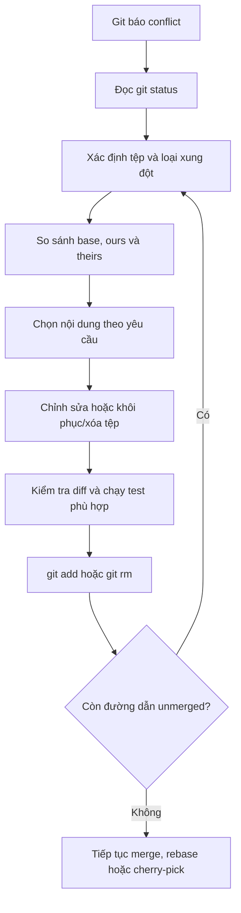

# Giải quyết xung đột sửa cùng dòng và xóa so với sửa

Khi nhiều nhánh cùng thay đổi một tệp, Git thường tự kết hợp được các thay đổi. Xung đột (merge conflict) xuất hiện khi Git không thể xác định kết quả cuối cùng một cách an toàn. Người thực hiện phải hiểu ý định của từng nhánh, chọn nội dung đúng rồi ghi nhận kết quả vào staging area.

Bài học này thuộc module `SOURCE_CONTROL_GIT`, nơi bạn thực hành từ working tree, staging area và commit đến branch, merge, rebase, remote và cộng tác. Phần này tập trung vào hai tình huống thường gặp: hai nhánh sửa cùng một dòng theo hai cách khác nhau, và một nhánh xóa tệp trong khi nhánh kia sửa tệp đó.

## 1. Vì sao Git tạo xung đột?

Khi merge hai nhánh, Git thường dùng phép hợp nhất ba phía (three-way merge):

- **Base**: phiên bản chung trước khi hai nhánh tách nhau.
- **Ours**: phiên bản của nhánh hiện tại, tức nhánh đang nhận thay đổi.
- **Theirs**: phiên bản từ nhánh được merge vào.

Git so sánh cả ba phiên bản để nhận ra phần nào đã thay đổi. Nếu hai nhánh sửa các vùng độc lập, Git thường ghép chúng tự động. Nếu hai nhánh cùng sửa một vùng theo cách không thể kết hợp rõ ràng, Git dừng lại và yêu cầu người dùng giải quyết.

Xung đột không có nghĩa repository bị hỏng. Nó cho biết có một quyết định về nội dung mà Git không thể tự đưa ra. Trong lúc còn xung đột, thao tác merge, rebase hoặc cherry-pick chưa thể hoàn tất.

Sau khi Git báo conflict, hãy xem trạng thái trước:

```bash
git status
git diff --name-only --diff-filter=U
```

Lệnh đầu cho biết thao tác nào đang dở và các tệp cần xử lý. Lệnh thứ hai liệt kê các đường dẫn còn trạng thái chưa hợp nhất (unmerged).

## 2. Hai nhánh sửa khác nhau trên cùng một dòng

Giả sử phiên bản chung có cấu hình:

```python
REQUEST_TIMEOUT = 30
```

Nhánh `main` tăng thời gian chờ lên 45 giây:

```python
REQUEST_TIMEOUT = 45
```

Trong khi đó, nhánh `feature/upload` tăng lên 60 giây để hỗ trợ tệp lớn:

```python
REQUEST_TIMEOUT = 60
```

Khi merge `feature/upload` vào `main`, cả hai nhánh đều thay đổi cùng một dòng nhưng đưa ra hai giá trị khác nhau. Git không biết giá trị nào đáp ứng yêu cầu của sản phẩm nên đánh dấu xung đột trong tệp văn bản:

```text
<<<<<<< HEAD
REQUEST_TIMEOUT = 45
=======
REQUEST_TIMEOUT = 60
>>>>>>> feature/upload
```

Các dấu phân cách có ý nghĩa như sau:

- `<<<<<<< HEAD` mở đầu phần nội dung từ nhánh hiện tại.
- `=======` ngăn cách hai phiên bản.
- `>>>>>>> feature/upload` kết thúc phần nội dung từ nhánh được merge vào; tên nhánh hoặc nhãn ở đây có thể khác tùy thao tác.

Git chèn các dấu này để giữ lại cả hai lựa chọn. Chúng không phải cú pháp của Python, YAML hay ngôn ngữ lập trình đang dùng. Nếu để nguyên, tệp có thể không chạy hoặc không hợp lệ.

### Cách chọn nội dung cuối cùng

Đừng chọn một phía chỉ vì phía đó là `HEAD`, hoặc vì nó đến từ nhánh mới hơn. Hãy xác định lý do của từng thay đổi và yêu cầu thực tế:

1. Đọc phần xung quanh dòng bị xung đột để hiểu cấu hình hoặc logic liên quan.
2. Kiểm tra mục tiêu của hai thay đổi, chẳng hạn qua nội dung commit hoặc trao đổi trong pull request.
3. Chọn một giá trị, kết hợp hai thay đổi nếu chúng có thể cùng tồn tại, hoặc thiết kế lại đoạn mã nếu cả hai phương án riêng lẻ đều chưa đúng.
4. Xóa toàn bộ dấu `<<<<<<<`, `=======`, `>>>>>>>` và phần nội dung không được chọn.
5. Chạy kiểm tra phù hợp với tệp vừa sửa.

Ví dụ, sau khi xác nhận yêu cầu tải tệp lớn cần 60 giây và giá trị đó vẫn phù hợp với các luồng gọi khác, nội dung cuối cùng có thể là:

```python
REQUEST_TIMEOUT = 60
```

Trong trường hợp hai thay đổi thực sự độc lập, bạn có thể giữ cả hai bằng cách biểu diễn chúng riêng rẽ. Ví dụ, nếu một nhánh thêm thời gian chờ mặc định còn nhánh kia thêm giới hạn tối đa, kết quả có thể là:

```python
DEFAULT_TIMEOUT = 45
MAX_UPLOAD_TIMEOUT = 60
```

Chỉ kết hợp như vậy khi mô hình cấu hình và mã sử dụng hỗ trợ hai giá trị riêng. Không giữ cả hai dòng chỉ để tránh phải đưa ra quyết định; điều đó có thể tạo cấu hình trùng lặp hoặc hành vi không xác định.

### Hoàn tất xung đột sửa cùng dòng

Sau khi chỉnh sửa và lưu tệp, xem lại thay đổi:

```bash
git diff -- path/to/config.py
git diff --check
```

`git diff` giúp kiểm tra nội dung đã chọn. `git diff --check` phát hiện một số lỗi khoảng trắng trong phần thay đổi; bạn vẫn cần tự kiểm tra để chắc chắn không còn dấu conflict marker.

Khi nội dung đã đúng, đánh dấu tệp là đã giải quyết:

```bash
git add -- path/to/config.py
git diff --cached -- path/to/config.py
git status
```

`git add` đưa kết quả đã giải quyết vào staging area và báo cho Git biết tệp không còn xung đột. Hãy xem lại bản staged trước khi tiếp tục thao tác đang dở.

## 3. Một nhánh xóa tệp, nhánh kia sửa tệp

Tình huống này thường được gọi là xung đột **modify/delete** (sửa/xóa). Ví dụ, phiên bản chung có tệp `config/app.yml`:

```yaml
service:
  name: billing
  retry_count: 3
```

Sau khi tách nhánh:

- Nhánh `main` xác định cấu hình này đã lỗi thời và xóa `config/app.yml`.
- Nhánh `feature/retry-policy` vẫn cần tệp nên sửa `retry_count` thành `5`.

Khi merge, Git gặp hai quyết định trái nhau: một phía muốn tệp không còn tồn tại, phía kia muốn giữ tệp với nội dung mới. Git không thể biết tệp còn cần cho hệ thống hay không.

Khác với xung đột sửa cùng dòng, tình huống xóa/sửa thường **không có các dấu `<<<<<<<` và `=======` trong nội dung tệp**. Đây là xung đột về sự tồn tại của đường dẫn. Hãy dùng `git status` để xem Git báo tệp bị xóa ở phía nào và kiểm tra các phiên bản còn trong index nếu cần.

```bash
git status
git ls-files -u -- config/app.yml
```

`git ls-files -u` hiển thị các phiên bản chưa hợp nhất đang được lưu trong index. Trong một lần merge thông thường, các stage có ý nghĩa:

| Stage | Nội dung |
| --- | --- |
| `1` | Phiên bản base chung trước khi hai nhánh tách nhau |
| `2` | Phiên bản của nhánh hiện tại (ours) |
| `3` | Phiên bản của nhánh được merge vào (theirs) |

Một phía đã xóa tệp nên stage tương ứng có thể không tồn tại. Có thể xem từng phiên bản còn lại bằng lệnh, ví dụ:

```bash
git show :1:config/app.yml
git show :2:config/app.yml
git show :3:config/app.yml
```

Lệnh cho stage không tồn tại sẽ không trả về nội dung. Điều đó là bình thường trong xung đột xóa/sửa. Không suy ra lựa chọn đúng chỉ từ số stage; hãy xác định nhánh nào đang chứa phiên bản đã sửa.

### Lựa chọn A: Giữ việc xóa tệp

Nếu tệp đã lỗi thời, không còn được tham chiếu và quyết định xóa là đúng, giữ việc xóa:

```bash
git rm -- config/app.yml
git status
```

`git rm` loại đường dẫn khỏi working tree và index, đồng thời ghi nhận lựa chọn xóa là kết quả giải quyết xung đột. Trước khi chọn cách này, hãy kiểm tra các nơi có thể còn sử dụng tệp, chẳng hạn cấu hình triển khai, script, tài liệu vận hành hoặc mã đọc tệp.

### Lựa chọn B: Giữ tệp đã sửa

Nếu ứng dụng vẫn cần tệp, hãy khôi phục nội dung từ nhánh hoặc commit chứa phiên bản đã sửa, sau đó kiểm tra và đưa tệp vào staging:

```bash
git show feature/retry-policy:config/app.yml
git restore --source=feature/retry-policy -- config/app.yml
git diff -- config/app.yml
git add -- config/app.yml
git status
```

Thay `feature/retry-policy` bằng tên nhánh hoặc mã commit thực tế có phiên bản cần giữ. `git restore --source` đưa nội dung từ nguồn đó về working tree; `git add` đánh dấu lựa chọn giữ tệp là đã giải quyết xung đột. Nếu nội dung cần thêm chỉnh sửa để tương thích với nhánh hiện tại, hãy sửa tệp trước khi chạy `git add`.

Trong một số trường hợp, tệp đã có sẵn trong working tree sau khi Git báo conflict. Dù vậy, hãy đọc nội dung và xác định nguồn của nó trước khi chấp nhận. Nếu không chắc phiên bản nào đang có mặt, dùng `git ls-files -u` và `git show :1:`, `git show :2:` hoặc `git show :3:` để kiểm tra.

## 4. Cẩn thận khi xác định ours và theirs

Trong một lần merge thông thường, `ours` là nhánh hiện tại và `theirs` là nhánh đang được merge vào. Tuy nhiên, khi giải quyết conflict trong **rebase**, cách gọi này dễ gây nhầm: `ours` thường là nhánh đích mà commit đang được phát lại lên trên, còn `theirs` là commit thuộc nhánh đang rebase.

Vì vậy, đừng chạy `git checkout --ours` hoặc `git checkout --theirs` theo thói quen mà chưa xác nhận Git đang thực hiện merge hay rebase và bạn muốn giữ thay đổi từ phía nào. Với xung đột xóa/sửa, lệnh chọn một phía cũng có thể đồng nghĩa với xóa tệp hoặc khôi phục tệp. Hãy kiểm tra `git status`, tên nhánh và nội dung thực tế trước khi chọn.

## 5. Quy trình xử lý từ lúc phát hiện đến khi hoàn tất

Có thể áp dụng quy trình sau cho cả hai loại xung đột:



Các lệnh kết thúc phụ thuộc vào thao tác đã tạo conflict:

| Thao tác đang dở | Sau khi mọi xung đột đã được giải quyết |
| --- | --- |
| Merge | `git merge --continue` hoặc `git commit` để tạo merge commit |
| Rebase | `git rebase --continue` |
| Cherry-pick | `git cherry-pick --continue` |
| Revert | `git revert --continue` |

Sau khi đánh dấu các tệp đã giải quyết, chạy `git status` lần nữa. Chỉ tiếp tục khi không còn đường dẫn unmerged. Nếu còn tệp, quay lại xử lý từng tệp; một tệp đã `git add` không có nghĩa toàn bộ lần merge đã hết conflict.

Nếu nhận ra mình đã bắt đầu sai thao tác hoặc không thể đưa ra quyết định an toàn, có thể hủy thao tác đang dở bằng lệnh tương ứng:

```bash
git merge --abort
git rebase --abort
```

Chỉ dùng lệnh phù hợp với thao tác hiện tại. Trước khi hủy, hãy bảo toàn mọi thay đổi chưa commit mà bạn cần giữ; việc hủy merge hoặc rebase không thay thế cho bản sao lưu của công việc chưa được ghi nhận.

## 6. Những lỗi thường gặp

- **Chọn ours hoặc theirs mà không đọc nội dung**: có thể làm mất thay đổi cần thiết, đặc biệt trong rebase hoặc xung đột xóa/sửa.
- **Chỉ xóa dấu conflict marker mà không hiểu logic**: tệp có thể hợp lệ về cú pháp nhưng sai hành vi.
- **Cho rằng mọi conflict đều có marker trong tệp**: xung đột modify/delete thường cần quyết định giữ hay xóa đường dẫn.
- **Chỉ kiểm tra working tree mà quên staging area**: sau `git add`, hãy xem `git diff --cached` để biết chính xác nội dung sẽ được ghi vào commit.
- **Dùng `git reset --hard` để “sửa nhanh”**: lệnh này có thể loại bỏ thay đổi chưa commit. Nó không phải quy trình giải quyết conflict thông thường.
- **Tiếp tục merge hoặc rebase khi vẫn còn tệp unmerged**: thao tác hiện tại chưa thể hoàn tất cho đến khi mọi đường dẫn xung đột được xử lý.

## 7. Tự kiểm tra trước khi tiếp tục

Trước khi hoàn tất merge, rebase hoặc cherry-pick, hãy tự xác nhận:

1. Tôi đã hiểu nguyên nhân và ý định của từng phía chưa?
2. Với xung đột sửa cùng dòng, nội dung cuối cùng có đúng yêu cầu và đã bỏ hết marker chưa?
3. Với xung đột xóa/sửa, tôi đã xác nhận tệp cần được giữ hay xóa và kiểm tra nơi sử dụng tệp chưa?
4. Tôi đã xem `git diff` và `git diff --cached` để kiểm tra cả nội dung đang sửa lẫn nội dung đã stage chưa?
5. Các kiểm tra hoặc test phù hợp đã chạy thành công chưa?
6. `git status` đã xác nhận không còn đường dẫn unmerged chưa?

Giải quyết conflict tốt là giữ lại đúng ý định cần thiết từ các nhánh và tạo ra một trạng thái working tree nhất quán. Khi đã kiểm tra kết quả, staging area sẽ ghi nhận lựa chọn đó để Git có thể tiếp tục thao tác và lưu lịch sử thay đổi một cách rõ ràng.
