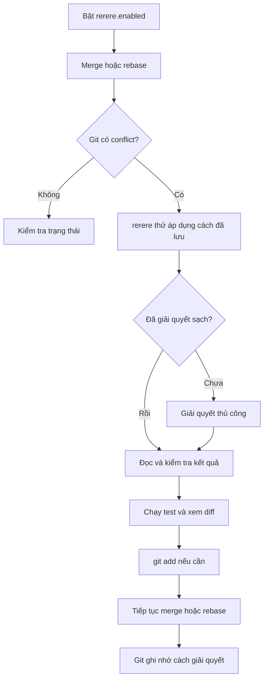

# Ghi nhớ cách giải quyết lặp lại bằng git rerere

Trong quá trình phát triển một nhánh tính năng dài ngày, bạn có thể phải merge hoặc rebase nhiều lần khi nhánh đích tiếp tục thay đổi. Một số xung đột lặp lại vì các nhánh vẫn sửa cùng một vùng mã. Nếu lần nào cũng phải đọc và giải quyết thủ công cùng một xung đột, công việc sẽ tốn thời gian và dễ phát sinh sai sót.

Git có cơ chế `rerere` để ghi nhớ cách bạn đã giải quyết xung đột và thử áp dụng lại cách đó khi gặp xung đột tương ứng. Tên `rerere` là viết tắt của **reuse recorded resolution**. Cơ chế này phù hợp với module `SOURCE_CONTROL_GIT`, nơi bạn thực hành working tree, staging area, commit, branch, merge, rebase, remote và cộng tác. Nó giúp rút ngắn thao tác lặp lại trong quy trình giải quyết xung đột mà vẫn để bạn kiểm tra kết quả trước khi ghi nhận.

## 1. Git rerere hoạt động như thế nào?

Khi một thao tác merge tạo ra xung đột, Git có thể lưu hai trạng thái của từng xung đột:

- **Preimage**: nội dung tệp sau khi Git tự hợp nhất nhưng vẫn còn xung đột, thường chứa các dấu `<<<<<<<`, `=======` và `>>>>>>>`.
- **Postimage**: nội dung cuối cùng sau khi bạn giải quyết xung đột.

Git lưu thông tin này trong vùng cache `rr-cache` thuộc Git directory của repository. Có thể xem đường dẫn thực tế bằng lệnh:

```bash
git rev-parse --git-path rr-cache
```

Khi gặp lại một xung đột tương ứng, Git dùng nội dung xung đột mới cùng với preimage và postimage đã lưu để thử hợp nhất ba phía. Nếu kết quả có thể áp dụng sạch, Git ghi kết quả đã giải quyết vào working tree. Bạn có thể tiếp tục kiểm tra, chạy test và đưa tệp vào staging area.

`rerere` dựa trên nội dung xung đột dạng văn bản và dấu conflict marker để nhận diện. Git chuẩn hóa một số khác biệt như nhãn nhánh trên marker và kiểu hiển thị common ancestor, nên việc đổi tên nhánh hoặc đổi conflict style không nhất thiết làm mất khả năng nhận diện. Tuy vậy, đây không phải bộ phân tích ý nghĩa của chương trình: một kết quả được ghi nhớ có thể không còn phù hợp với yêu cầu mới.

## 2. Bật rerere

Bạn cần bật cấu hình `rerere.enabled` để Git ghi nhận và tái sử dụng cách giải quyết. Có hai phạm vi cấu hình phổ biến.

**Bật cho tất cả repository của người dùng:**

```bash
git config --global rerere.enabled true
```

**Chỉ bật trong repository hiện tại:**

```bash
git config --local rerere.enabled true
```

Nếu nhiều dự án có quy trình merge/rebase lặp lại, cấu hình global thuận tiện hơn. Nếu muốn tự quyết định theo từng repository, hãy dùng cấu hình local.

Mặc định, `rerere.autoupdate` là `false`. Điều này có nghĩa rerere có thể cập nhật working tree bằng kết quả đã nhớ nhưng để index ở trạng thái chưa giải quyết; bạn phải kiểm tra rồi `git add` để xác nhận. Đây là lựa chọn phù hợp khi mới bắt đầu sử dụng.

Bạn có thể đặt rõ lựa chọn đó:

```bash
git config --global rerere.autoupdate false
```

Nếu đã quen và muốn Git tự cập nhật cả index khi áp dụng thành công một cách giải quyết đã lưu, có thể bật:

```bash
git config --global rerere.autoupdate true
```

Khi bật `autoupdate`, kết quả có thể được đưa thẳng vào staging area. Vì vậy, vẫn cần xem lại staged diff trước khi commit.

Kiểm tra cấu hình hiện tại và nguồn cấu hình:

```bash
git config --show-origin --get rerere.enabled
git config --show-origin --get rerere.autoupdate
```

Lệnh `--show-origin` cho biết giá trị đến từ file cấu hình nào. Nếu một khóa chưa được thiết lập, lệnh `--get` tương ứng có thể không in giá trị và trả mã thoát khác 0; điều đó không nhất thiết là lỗi repository.

## 3. Ghi nhớ lần giải quyết đầu tiên

Giả sử nhánh `main` và nhánh `feature/payment` cùng sửa một dòng trong `payment.yml`. Nhánh hiện tại đặt thời gian chờ thành `30`, còn nhánh tính năng đặt thành `60`. Git không thể tự chọn giá trị cuối cùng nên báo conflict.

Khi `rerere.enabled` đã bật, Git tự gọi rerere trong quá trình xử lý merge hoặc rebase. Với một xung đột mới, Git ghi nhận trạng thái xung đột ban đầu để làm preimage. Kiểm tra các đường dẫn mà rerere đang theo dõi:

```bash
git status
git rerere status
```

Bạn giải quyết tệp theo yêu cầu thực tế. Ví dụ, sau khi xác nhận dịch vụ thanh toán cần thời gian chờ 60 giây:

```yaml
payment:
  timeout_seconds: 60
```

Hãy xóa toàn bộ conflict marker, kiểm tra nội dung và chạy test phù hợp. Sau đó đưa tệp đã giải quyết vào staging:

```bash
git diff -- payment.yml
git diff --check
git add -- payment.yml
git diff --cached -- payment.yml
git status
```

Khi bạn hoàn tất merge bằng commit, Git tự gọi rerere để ghi nhớ postimage tương ứng. Bạn cũng có thể gọi `git rerere` thủ công sau khi đã sửa xong để yêu cầu Git cập nhật thông tin giải quyết:

```bash
git rerere
```

Thông tin ghi nhớ được lưu trong cache của repository, không phải một commit mới. Nó vẫn có thể được dùng ở lần merge hoặc rebase tiếp theo ngay cả khi lịch sử nhánh sau đó thay đổi, miễn là Git nhận diện được xung đột tương ứng và cách giải quyết vẫn áp dụng được.

## 4. Tái sử dụng cách giải quyết ở lần sau

Giả sử sau lần merge thử nghiệm, nhánh `main` và `feature/payment` tiếp tục có commit mới. Một lần merge hoặc rebase tiếp theo có thể tạo lại xung đột ở vùng cấu hình thanh toán.

Khi rerere nhận diện được xung đột đã lưu, Git thử áp dụng cách giải quyết cũ vào nội dung xung đột mới. Hãy kiểm tra trạng thái và phần thay đổi:

```bash
git status
git rerere status
git rerere remaining
git diff -- payment.yml
git diff --cc -- payment.yml
```

`git rerere remaining` liệt kê các đường dẫn còn xung đột mà rerere chưa tự giải quyết được. Nếu kết quả được áp dụng vào working tree nhưng `rerere.autoupdate` đang là `false`, index vẫn chưa được đánh dấu đã giải quyết. Sau khi kiểm tra và xác nhận nội dung đúng, hãy stage tệp:

```bash
git add -- payment.yml
git diff --cached -- payment.yml
git status
```

Nếu `rerere.autoupdate` là `true`, Git có thể đã cập nhật index cùng với working tree. Trong trường hợp đó, hãy xem `git diff --cached` để kiểm tra kết quả đã stage trước khi tiếp tục.

Khi tất cả đường dẫn conflict đã được giải quyết và kiểm tra đạt yêu cầu, tiếp tục thao tác đang dở:

```bash
git merge --continue
```

Với rebase, dùng:

```bash
git rebase --continue
```

Với cherry-pick, dùng:

```bash
git cherry-pick --continue
```

Hãy chọn lệnh tương ứng với thao tác đang diễn ra. `rerere` hỗ trợ tái sử dụng kết quả trong merge và rebase; nó không tự quyết định thay bạn rằng thay đổi nào đúng với yêu cầu sản phẩm.

## 5. Các lệnh kiểm tra và quản lý cache

Bạn có thể dùng các lệnh sau để quan sát và quản lý thông tin rerere:

| Lệnh | Công dụng |
| --- | --- |
| `git rerere status` | Liệt kê các đường dẫn có xung đột mà rerere sẽ ghi nhận cách giải quyết |
| `git rerere remaining` | Liệt kê các đường dẫn xung đột chưa được rerere tự giải quyết |
| `git rerere diff` | Hiển thị khác biệt liên quan đến trạng thái giải quyết đang được ghi nhớ |
| `git rerere` | Kiểm tra xung đột hiện tại, thử tái sử dụng kết quả đã lưu hoặc ghi nhận kết quả đã giải quyết |
| `git rerere forget -- path/to/file` | Quên cách giải quyết đã ghi nhớ cho xung đột hiện tại tại đường dẫn được chỉ định |
| `git rerere gc` | Dọn các bản ghi cũ trong cache theo chính sách lưu giữ của Git |

Ví dụ, xem những tệp chưa được tự động giải quyết và xem phần khác biệt mà rerere đang theo dõi:

```bash
git rerere remaining
git rerere diff
```

Nếu rerere áp dụng một cách giải quyết cũ nhưng bạn nhận ra nó không còn phù hợp, yêu cầu Git quên bản ghi cho xung đột hiện tại ở tệp đó:

```bash
git rerere forget -- payment.yml
```

Sau đó tự giải quyết lại tệp, kiểm tra nội dung, stage và hoàn tất thao tác đang dở. Hãy dùng `forget` với đúng đường dẫn conflict cần thay đổi, tránh xóa hoặc làm mất một bản ghi hữu ích khác.

## 6. Những giới hạn cần hiểu

**Rerere không kiểm tra tính đúng đắn về nghiệp vụ.** Một cách giải quyết đúng ở tuần trước có thể sai sau khi quy tắc thanh toán, cấu trúc dữ liệu hoặc giao diện API thay đổi. Luôn đọc kết quả được áp dụng, kiểm tra ngữ cảnh và chạy test.

**Rerere không xử lý mọi loại xung đột.** Cơ chế này dựa vào conflict marker trong nội dung tệp. Xung đột submodule, tệp nhị phân hoặc xung đột không tạo ra marker văn bản có thể không được tự giải quyết. Lệnh `git rerere remaining` giúp nhận diện các đường dẫn vẫn cần xử lý thủ công.

**Conflict marker trong nội dung thật có thể gây nhầm lẫn.** Nếu tệp vốn chứa những dòng trùng với marker, rerere có thể không nhận diện đúng ranh giới xung đột. Git hỗ trợ thuộc tính `conflict-marker-size` trong `.gitattributes` để đổi độ dài marker trong trường hợp cần thiết.

**Cache là dữ liệu cục bộ của Git.** Các bản ghi trong `rr-cache` nằm trong Git directory và không được đưa vào commit hay push như nội dung source thông thường. Mỗi clone có thể tích lũy lịch sử giải quyết riêng. Đồng đội không tự nhận được cache rerere của bạn chỉ bằng cách pull branch.

**Tự động cập nhật index làm giảm một bước kiểm tra thủ công.** Nếu bật `rerere.autoupdate`, Git có thể stage kết quả đã nhớ. Hãy kiểm tra staged diff trước khi commit; nếu chưa quen, để giá trị này là `false`.

## 7. Quy trình thực hành đề xuất

Khi dự án thường xuyên merge hoặc rebase các nhánh dài ngày, có thể áp dụng quy trình sau:



Các điểm cần nhớ trong thực hành:

1. Bật `rerere.enabled` trước khi bắt đầu những lần merge/rebase muốn ghi nhớ.
2. Giải quyết xung đột lần đầu như bình thường; kiểm tra logic, không chỉ xóa marker.
3. Để Git ghi nhận postimage bằng `git rerere` hoặc khi hoàn tất commit merge.
4. Khi gặp lại conflict, xem nội dung mà rerere áp dụng trước khi stage hoặc tiếp tục.
5. Nếu cách cũ sai, dùng `git rerere forget` cho xung đột hiện tại rồi giải quyết lại.

`git rerere` đặc biệt hữu ích khi bạn thường xuyên cập nhật nhánh tính năng dài ngày, thử merge trước khi phát hành, hoặc phải rebase nhiều lần trên nhánh đích đang thay đổi. Nó giảm việc lặp lại thao tác, còn quyết định cuối cùng vẫn cần dựa trên yêu cầu hiện tại và kết quả kiểm thử.

## Tài liệu tham khảo

- [Git documentation: git-rerere](https://git-scm.com/docs/git-rerere) — mô tả cách ghi nhận và tái sử dụng cách giải quyết xung đột.
- [Git documentation: git-config](https://git-scm.com/docs/git-config) — giải thích `rerere.enabled` và `rerere.autoupdate`.
- [Pro Git: Rerere](https://git-scm.com/book/en/v2/Git-Tools-Rerere) — ví dụ thực hành với các lần merge lặp lại.
