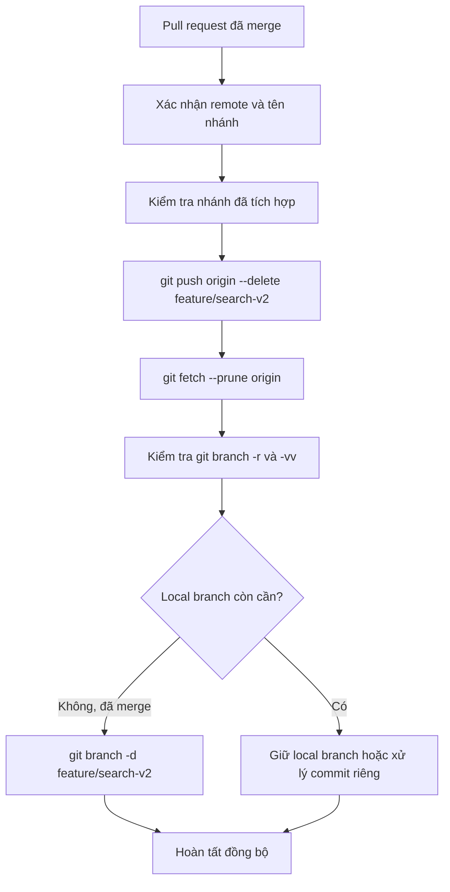

# Xóa nhánh từ xa và dọn nhánh theo dõi cũ bằng fetch --prune

Trong quá trình cộng tác, nhánh tính năng thường được xóa trên máy chủ sau khi pull request đã merge hoặc công việc bị hủy. Tuy nhiên, các bản sao Git của thành viên có thể vẫn hiển thị nhánh đó trong danh sách remote-tracking branch. Những tham chiếu cũ này khiến danh sách nhánh dài và dễ gây nhầm lẫn khi chọn nhánh để merge hoặc rebase.

Git cung cấp `git push <remote> --delete <branch>` để xóa nhánh trên remote và `git fetch --prune` để dọn các remote-tracking ref không còn tồn tại trên remote. Hai thao tác giải quyết hai phần khác nhau của quá trình đồng bộ. Bài học này thuộc module `SOURCE_CONTROL_GIT`, nơi bạn thực hành working tree, staging area, commit, branch, merge, rebase, remote và tag; phần này tập trung vào việc giữ danh sách nhánh cục bộ đồng bộ với repository dùng chung.

## 1. Phân biệt ba loại nhánh

Trước khi xóa nhánh, cần phân biệt nhánh trên máy chủ, remote-tracking branch và local branch.

| Loại | Ví dụ | Nơi lưu | Ý nghĩa |
| --- | --- | --- | --- |
| Nhánh từ xa (remote branch) | `feature/old-api` trên `origin` | Repository trên máy chủ | Nhánh thật mà các thành viên có thể fetch hoặc push nếu được cấp quyền |
| Nhánh theo dõi từ xa (remote-tracking branch) | `origin/feature/old-api` | Repository local của bạn | Tham chiếu cục bộ ghi nhận lần cuối Git biết nhánh tương ứng trên remote ở đâu |
| Nhánh local | `feature/old-api` | Repository local của bạn | Nhánh làm việc riêng, có thể theo dõi một remote branch |

Tên `origin/feature/old-api` không phải nhánh đang chạy trực tiếp trên máy chủ. Đây là tham chiếu cục bộ trong `refs/remotes/origin/`. Khi server branch bị xóa, tham chiếu này vẫn có thể còn trong repository cho đến khi bạn fetch và prune.

Xem các remote đã cấu hình và danh sách remote-tracking branch:

```bash
git remote -v
git branch -r
git branch -vv
```

`git remote -v` hiển thị tên remote cùng URL fetch/push. `git branch -r` liệt kê các remote-tracking branch. `git branch -vv` hiển thị local branch và upstream mà nó đang theo dõi; sau khi upstream bị prune, một local branch còn giữ upstream đó thường được đánh dấu `[origin/ten-nhanh: gone]`.

## 2. Xóa nhánh thật trên remote

Giả sử nhánh `feature/old-api` đã được merge vào `main` trên máy chủ `origin`. Nếu bạn có quyền xóa nhánh, dùng:

```bash
git push origin --delete feature/old-api
```

Lệnh này gửi yêu cầu xóa `refs/heads/feature/old-api` trên remote `origin`. Đây là thao tác thay đổi repository dùng chung. Trước khi chạy, hãy xác nhận đúng remote và đúng tên nhánh, đồng thời kiểm tra nhánh đã được merge hoặc được chủ sở hữu dự án quyết định kết thúc. Nhánh được bảo vệ (protected branch) hoặc chính sách máy chủ có thể từ chối yêu cầu xóa.

Cú pháp cũ tương đương là:

```bash
git push origin :feature/old-api
```

Cú pháp `--delete` dễ đọc hơn và nên được ưu tiên trong hướng dẫn hoặc script mới.

Nếu nhánh đã được xóa qua giao diện pull request, trang quản trị repository hoặc bởi một thành viên khác, bạn không cần push lệnh xóa lần nữa. Việc còn lại là cập nhật thông tin remote-tracking trong repository local.

Có thể kiểm tra nhánh còn được máy chủ quảng bá hay không bằng:

```bash
git ls-remote --heads origin refs/heads/feature/old-api
```

Nếu lệnh không trả về dòng nào, remote không quảng bá head có tên đó tại thời điểm truy vấn. Nếu có kết quả, cột đầu là object ID và cột sau là ref trên remote.

## 3. Dọn nhánh theo dõi cũ bằng fetch --prune

Sau khi nhánh trên remote bị xóa, remote-tracking branch `origin/feature/old-api` có thể vẫn còn trong repository local. Chạy:

```bash
git fetch --prune origin
```

Git fetch thông tin mới từ `origin` và loại bỏ các remote-tracking ref thuộc phạm vi refspec của remote nhưng không còn được remote quảng bá. Sau đó kiểm tra:

```bash
git branch -r
git branch -vv
```

Nếu không còn remote-tracking ref tương ứng, `origin/feature/old-api` sẽ biến mất khỏi danh sách. Local branch `feature/old-api`, nếu có, vẫn tồn tại. `fetch --prune` không xóa nhánh trên máy chủ và cũng không xóa local branch đang làm việc.

Bạn có thể xem trước các remote-tracking ref sẽ bị xóa bằng:

```bash
git remote prune --dry-run origin
```

Nếu danh sách đúng như dự kiến, có thể chỉ prune mà không fetch object hoặc ref mới:

```bash
git remote prune origin
```

`git remote prune origin` chỉ dọn các remote-tracking ref cũ dựa trên thông tin remote; nó không xóa nhánh thật trên máy chủ. Trong quy trình đồng bộ thông thường, `git fetch --prune origin` tiện hơn vì vừa cập nhật thông tin mới vừa dọn thông tin cũ.

## 4. Đồng bộ và prune nhiều remote

Một repository có thể có nhiều remote, ví dụ `origin` trỏ đến repository chính còn `upstream` trỏ đến dự án gốc mà bạn fork. Khi cần cập nhật tất cả remote đã cấu hình và dọn remote-tracking ref cũ của từng remote:

```bash
git fetch --all --prune
```

`--all` yêu cầu Git fetch từ tất cả remote phù hợp trong cấu hình; `--prune` áp dụng việc dọn ref cũ cho các remote đó. Nếu chỉ muốn cập nhật một remote, hãy chỉ rõ tên như `git fetch --prune upstream`.

Các remote được quản lý độc lập. Nếu `origin/feature/old-api` không còn nhưng `upstream/feature/old-api` vẫn tồn tại, prune `origin` chỉ xóa tham chiếu cũ thuộc `origin`; nhánh theo dõi của `upstream` vẫn được giữ.

## 5. Bật tự động prune khi fetch

Nếu nhóm thường xuyên xóa nhánh sau khi merge pull request, bạn có thể cấu hình Git tự prune mỗi khi fetch.

**Chỉ áp dụng cho repository hiện tại:**

```bash
git config --local fetch.prune true
```

**Áp dụng cho tất cả repository của người dùng:**

```bash
git config --global fetch.prune true
```

Sau khi bật, lệnh fetch thông thường như `git fetch origin` cũng thực hiện prune theo cấu hình. Dùng phạm vi local nếu chính sách đồng bộ khác nhau giữa các dự án; dùng global nếu bạn muốn hành vi thống nhất ở mọi repository.

Kiểm tra giá trị và nguồn cấu hình:

```bash
git config --show-origin --get fetch.prune
```

Để tắt cấu hình tại phạm vi đã bật, đặt `false`:

```bash
git config --local fetch.prune false
```

Lưu ý rằng `fetch.prune` mặc định không có nghĩa là mọi local branch đã mất upstream sẽ tự bị xóa. Nó chỉ điều khiển việc dọn các remote-tracking ref theo refspec fetch.

## 6. Prune nhánh không đồng nghĩa prune tag

Mặc định, `git fetch --prune` chủ yếu dọn các remote-tracking ref theo refspec. Các tag được Git tự động theo dõi không nhất thiết bị prune cùng cách đó. Nếu bạn cấu hình tag refspec hoặc dùng `--prune-tags`, Git có thể prune tag local không còn có trên remote.

Ví dụ:

```bash
git fetch --prune --prune-tags origin
```

Chỉ thêm `--prune-tags` khi bạn thực sự muốn đồng bộ tập tag local theo tập tag của remote. Tag có thể được tạo cục bộ hoặc đến từ nguồn khác, nên prune tag có thể xóa tag local mà bạn vẫn cần. Với nhu cầu dọn nhánh theo dõi cũ, thông thường chỉ cần `git fetch --prune origin`.

## 7. Dọn local branch còn theo dõi upstream đã bị xóa

Sau khi prune remote-tracking ref, local branch có liên kết upstream cũ vẫn còn. Kiểm tra:

```bash
git branch -vv
```

Ví dụ kết quả có thể cho thấy:

```text
* main                 a1b2c3d [origin/main] Merge pull request #42
  feature/old-api      d4e5f6a [origin/feature/old-api: gone] Remove old API
```

Điều này có nghĩa local branch `feature/old-api` vẫn tồn tại, nhưng upstream `origin/feature/old-api` không còn. Nếu nhánh local đã được merge vào nhánh đích, chuyển sang nhánh làm việc khác rồi xóa local branch:

```bash
git switch main
git branch --merged main
git branch -d feature/old-api
```

`git branch --merged main` liệt kê các local branch đã được tích hợp vào `main`. `git branch -d` chỉ xóa nhánh local khi Git xác định nhánh đó đã được merge an toàn theo quy tắc của lệnh. Nếu lệnh từ chối, hãy kiểm tra các commit còn riêng trên nhánh trước khi quyết định.

`git branch -D feature/old-api` ép xóa local branch kể cả khi chưa được merge. Chỉ dùng khi bạn đã xác nhận không cần giữ các commit riêng trên nhánh; thao tác này có thể làm mất tên tham chiếu thuận tiện để tìm lại công việc chưa được tích hợp.

Không dùng `git branch -r -d origin/feature/old-api` để thay thế cho việc xóa nhánh trên máy chủ. Lệnh đó chỉ xóa remote-tracking ref trong repository local của bạn. Trong hầu hết trường hợp, `git fetch --prune origin` là cách đồng bộ rõ ràng hơn.

## 8. Quy trình thực hành từ đầu đến cuối

Giả sử pull request của `feature/search-v2` đã được merge vào `main` trên `origin` và nhóm quyết định xóa nhánh tính năng.



Các lệnh có thể chạy theo thứ tự sau:

```bash
# Xem remote và trạng thái các nhánh
git remote -v
git branch -vv

# Xác nhận các commit của nhánh tính năng đã có trong nhánh đích
git fetch origin
git log --oneline origin/main..origin/feature/search-v2

# Xóa nhánh trên remote nếu nhóm đã quyết định kết thúc nhánh
git push origin --delete feature/search-v2

# Dọn remote-tracking ref cũ và kiểm tra local branch
git fetch --prune origin
git branch -r
git branch -vv

# Nếu local branch đã được tích hợp và không còn cần dùng
git switch main
git branch -d feature/search-v2
```

Lệnh `git log origin/main..origin/feature/search-v2` liệt kê commit có ở nhánh tính năng nhưng chưa có ở nhánh đích tại thời điểm so sánh. Nếu lệnh in ra commit, hãy xem xét chúng trước khi xóa nhánh. Nếu nhóm đã xóa remote branch qua giao diện sau khi merge, bỏ qua bước `git push --delete` và bắt đầu bằng `git fetch --prune origin`.

## 9. Những nhầm lẫn thường gặp

- **Nghĩ `fetch --prune` xóa nhánh trên server**: lệnh này chỉ dọn remote-tracking ref trong repository local. Muốn xóa nhánh thật, dùng `git push <remote> --delete <branch>`.
- **Nghĩ prune sẽ xóa local branch**: local branch vẫn còn và có thể hiển thị upstream `[gone]` trong `git branch -vv`.
- **Chạy prune nhầm remote**: `origin` và `upstream` là các remote khác nhau. Kiểm tra `git remote -v` và chọn đúng tên.
- **Cho rằng mọi nhánh cùng tên đều biến mất**: prune một remote chỉ tác động đến các ref thuộc remote đó; remote khác có thể vẫn giữ nhánh cùng tên.
- **Dùng `--prune-tags` khi chỉ muốn dọn nhánh**: tùy cấu hình refspec, thao tác này có thể xóa tag local không có trên remote.
- **Xóa local branch khi còn commit riêng**: kiểm tra `git branch --merged` hoặc so sánh log với nhánh đích trước khi dùng lệnh xóa.

## Tự kiểm tra

Trước khi kết thúc việc dọn nhánh, hãy xác nhận:

1. Tôi đã xác định đúng remote và đúng tên nhánh chưa?
2. Nhánh trên server đã được merge hoặc có quyết định xóa rõ ràng chưa?
3. Tôi hiểu `git push --delete` xóa nhánh thật, còn `git fetch --prune` dọn remote-tracking ref local chưa?
4. Tôi đã kiểm tra `git branch -r` và `git branch -vv` sau khi prune chưa?
5. Nếu muốn xóa local branch, tôi đã xác nhận các commit riêng đã được tích hợp hoặc không còn cần chưa?

Giữ danh sách nhánh gọn giúp quá trình đồng bộ, review và chọn upstream dễ hiểu hơn. Hãy xem remote branch, remote-tracking ref và local branch là ba tham chiếu riêng biệt; khi biết lệnh nào tác động đến tham chiếu nào, bạn có thể dọn repository an toàn và tránh xóa nhầm công việc.

## Tài liệu tham khảo

- [Git documentation: git-fetch](https://git-scm.com/docs/git-fetch) — tùy chọn `--prune`, `--all` và `--prune-tags`.
- [Git documentation: git-push](https://git-scm.com/docs/git-push) — xóa nhánh trên remote bằng `--delete`.
- [Git documentation: git-remote](https://git-scm.com/docs/git-remote) — lệnh `remote prune` và quản lý remote.
- [Git documentation: git-branch](https://git-scm.com/docs/git-branch) — liệt kê, kiểm tra và xóa local branch.
