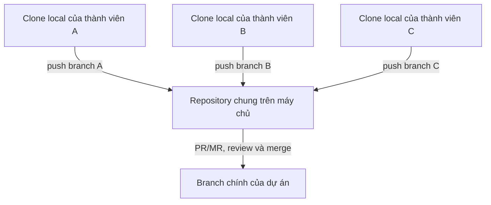
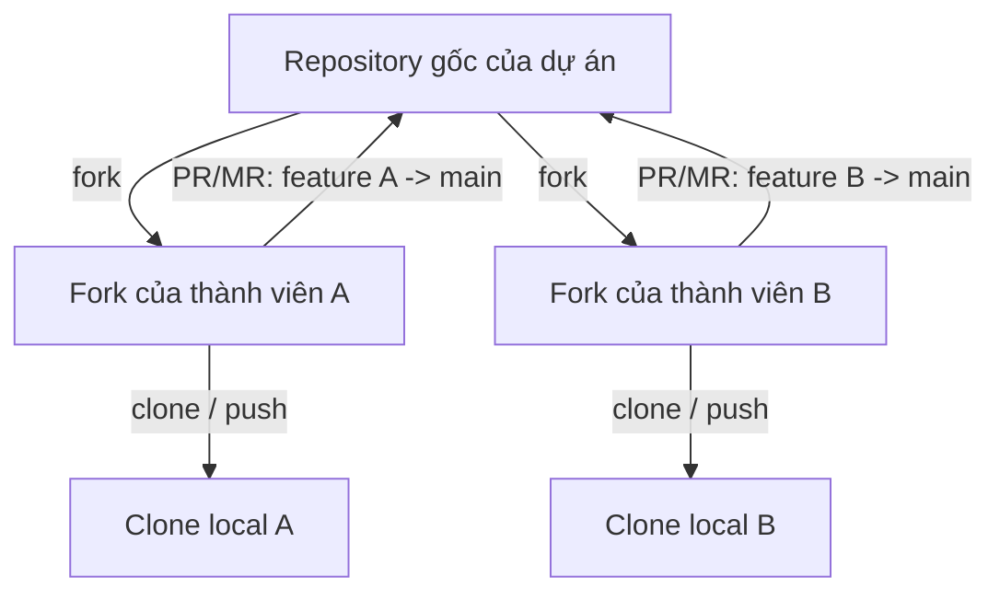

# Quy trình dùng kho chung so với quy trình fork

Khi nhiều người cùng phát triển một dự án Git, nhóm cần thống nhất cách mỗi người lấy mã nguồn, tạo nhánh, chia sẻ commit và đề xuất tích hợp thay đổi. Hai mô hình cộng tác thường gặp là **shared repository workflow (quy trình dùng kho chung)** và **fork workflow (quy trình dùng kho phân nhánh)**.

Ở mô hình kho chung, các thành viên được cấp quyền ghi vào cùng một repository trên máy chủ. Mỗi người clone repository đó, tạo branch riêng, push branch lên repository chung và thường mở pull request hoặc merge request để review. Ở mô hình fork, mỗi người làm việc trên một repository riêng thuộc tài khoản hoặc namespace của mình; sau đó đề xuất thay đổi từ fork về repository gốc.

Cả hai mô hình đều dùng Git để quản lý commit, branch, merge và lịch sử. Khác biệt chính nằm ở **quyền ghi repository, nơi lưu branch đóng góp và cách nhóm nhận thay đổi**. Hiểu đúng khác biệt này giúp chọn quy trình phù hợp với quy mô nhóm, mức độ tin cậy và chính sách bảo vệ mã nguồn.

## 1. Những khái niệm cần phân biệt trước

### 1.1. Repository gốc, kho chung và fork

**Repository gốc (canonical repository)** là repository mà dự án xem là nguồn chính thức. Đây thường là nơi chứa branch mặc định như `main`, các tag phát hành và lịch sử được nhóm duy trì.

Trong **quy trình dùng kho chung**, repository gốc cũng là kho chung mà các thành viên có quyền ghi có thể push branch của họ lên.

Trong **quy trình fork**, mỗi người tạo một bản repository riêng trên cùng nền tảng lưu trữ. Bản riêng đó gọi là **fork**. Fork có quan hệ với repository gốc trong nền tảng, nhưng vẫn là repository độc lập về quyền ghi và có thể nhận commit riêng.

Fork không phải branch. Branch là một ref trong cùng repository; fork là một repository khác. Tạo branch không tạo một repository mới, còn fork không chỉ đơn giản là đổi tên branch.

### 1.2. Clone, remote và upstream

Ba khái niệm sau thường xuất hiện cùng nhau:

- **Clone:** tạo bản sao repository trên máy local bằng `git clone`.
- **Remote:** tên cấu hình trong repository local dùng để kết nối tới một repository khác. `origin` và `upstream` là tên quy ước phổ biến, có thể đổi được.
- **Upstream branch:** branch mà branch local được cấu hình theo dõi, chẳng hạn branch local `main` theo dõi `origin/main`. Cần phân biệt upstream branch này với remote có tên `upstream`.

Trong fork workflow, cách đặt tên thường dùng là:

| Tên remote | Trỏ tới đâu? | Vai trò |
|---|---|---|
| `origin` | Fork của chính người đóng góp | Nơi push branch và commit của mình |
| `upstream` | Repository gốc của dự án | Nơi fetch thay đổi chính thức và là đích của pull request |

Trong shared repository workflow, `origin` thường trỏ thẳng tới repository chung. Nhóm không nhất thiết cần remote tên `upstream`.

### 1.3. Pull request và merge request

Pull request (PR) hoặc merge request (MR) là cơ chế cộng tác của nền tảng lưu trữ mã. Người đóng góp đề xuất tích hợp một branch nguồn vào branch đích; người review có thể xem diff, trao đổi, yêu cầu sửa đổi và kiểm tra trạng thái CI trước khi merge.

PR/MR không phải lệnh Git. Git cung cấp commit, branch, fetch, push, merge và rebase; nền tảng cộng tác cung cấp giao diện và quy trình review. Một nhóm có thể dùng PR/MR trong cả shared repository workflow lẫn fork workflow.

## 2. Quy trình dùng kho chung (shared repository workflow)

### 2.1. Cách tổ chức

Trong mô hình này, các thành viên được cấp quyền ghi vào cùng một repository trên máy chủ. Mỗi người clone repository gốc, tạo branch riêng trong repository local, rồi push branch đó lên cùng repository.



Các thành viên cùng chia sẻ một không gian repository từ xa. Quyền ghi cho phép họ tạo branch trên máy chủ, nhưng branch chính như `main` thường được bảo vệ để thay đổi phải qua review và kiểm tra.

### 2.2. Quy trình làm việc điển hình

Giả sử repository chung có URL SSH:

```text
git@example.com:team/project.git
```

**Bước 1: Clone repository chung**

```bash
git clone git@example.com:team/project.git
cd project
git remote -v
```

Thông thường, Git thiết lập remote `origin` trỏ tới repository chung. Thành viên có thể fetch và push qua remote này theo quyền được cấp.

**Bước 2: Cập nhật branch nền trước khi làm việc**

```bash
git switch main
git fetch origin
git merge --ff-only origin/main
```

`git fetch` cập nhật remote-tracking ref `origin/main`; `git merge --ff-only origin/main` đưa branch local `main` tiến lên nếu lịch sử cho phép fast-forward. Nếu local `main` đã phân kỳ, lệnh dừng để người dùng kiểm tra thay vì tự tạo merge commit.

**Bước 3: Tạo branch công việc**

```bash
git switch -c feature/search
```

Branch `feature/search` được tạo từ `main` hiện tại. Thành viên chỉnh sửa mã nguồn, xem diff và tạo commit:

```bash
git status
git diff
git add src/
git diff --cached
git commit -m "feat: add search feature"
```

**Bước 4: Push branch lên repository chung**

```bash
git push -u origin feature/search
```

Branch được tạo trên repository chung nếu người dùng có quyền và chính sách máy chủ cho phép. `-u` thiết lập upstream cho branch local để các lần push tiếp theo có thể dùng `git push` mà không cần chỉ rõ remote và branch.

**Bước 5: Mở PR/MR trong cùng repository**

Trên nền tảng cộng tác, thành viên mở PR/MR với:

- Source (nhánh nguồn): `team/project:feature/search`.
- Target (nhánh đích): `team/project:main`.

Đồng đội review diff, trao đổi và yêu cầu sửa đổi nếu cần. Khi tác giả push thêm commit vào `feature/search`, PR/MR thường tự cập nhật vì vẫn theo dõi branch nguồn đó.

**Bước 6: Tích hợp thay đổi**

Sau khi review và các kiểm tra bắt buộc thành công, người có quyền merge PR/MR vào `main` theo chính sách dự án. Nhóm có thể chọn merge commit, squash merge hoặc rebase merge tùy khả năng nền tảng và quy ước lịch sử.

**Bước 7: Cập nhật local và dọn branch**

```bash
git switch main
git pull --ff-only origin main
git branch -d feature/search
```

Nếu branch local đã được tích hợp và không còn thay đổi chưa lưu, `git branch -d` xóa branch local. Branch từ xa có thể được nền tảng tự xóa sau khi merge; nếu chưa, người có quyền có thể xóa branch trên remote theo quy trình của nhóm.

### 2.3. Quyền truy cập trong mô hình kho chung

Thành viên cần có quyền ghi phù hợp trên repository chung để push branch. Tuy nhiên, quyền ghi không nên đồng nghĩa với quyền sửa trực tiếp branch chính. Nhóm thường kết hợp:

- Branch protection hoặc ruleset để hạn chế push trực tiếp vào `main`.
- Yêu cầu một hoặc nhiều lượt phê duyệt trước khi merge.
- CI checks bắt buộc như build, unit test, lint hoặc kiểm tra bảo mật.
- Quy định ai được dismiss review, merge hoặc xóa branch.
- CODEOWNERS hoặc cơ chế tương đương để yêu cầu người phụ trách xem xét vùng mã nhạy cảm.

Tên và khả năng của các thiết lập này phụ thuộc nền tảng. Mục tiêu chung là mọi thay đổi quan trọng đều có thể được xem xét và kiểm chứng trước khi vào branch chính.

## 3. Quy trình fork (fork workflow)

### 3.1. Cách tổ chức

Trong fork workflow, người đóng góp tạo một fork của repository gốc dưới tài khoản hoặc namespace riêng. Người đó clone fork về máy, làm việc trên branch local, rồi push branch lên fork. Cuối cùng, họ mở PR/MR từ fork về repository gốc.



Người đóng góp chỉ cần quyền ghi vào fork của mình. Họ không cần quyền push vào repository gốc; quyền review và merge PR/MR vẫn do chủ dự án hoặc người được ủy quyền kiểm soát.

### 3.2. Tạo fork và clone fork

Giả sử repository gốc là:

```text
git@example.com:organization/project.git
```

Trên nền tảng lưu trữ mã, người đóng góp tạo fork dưới namespace cá nhân, ví dụ:

```text
git@example.com:alice/project.git
```

Sau đó clone fork:

```bash
git clone git@example.com:alice/project.git
cd project
git remote -v
```

Sau clone, `origin` thường trỏ tới fork của Alice. Thêm repository gốc với tên remote `upstream`:

```bash
git remote add upstream git@example.com:organization/project.git
git remote -v
```

Kết quả có thể tương tự:

```text
origin    git@example.com:alice/project.git (fetch)
origin    git@example.com:alice/project.git (push)
upstream  git@example.com:organization/project.git (fetch)
upstream  git@example.com:organization/project.git (push)
```

Trong nhiều dự án, người đóng góp chỉ cần fetch từ `upstream`; họ có thể không cần push lên `upstream`. Việc remote có URL push không đồng nghĩa tài khoản hiện tại có quyền ghi vào repository đó.

### 3.3. Đồng bộ branch chính của fork với repository gốc

Repository gốc có thể tiếp tục nhận commit trong khi fork của người đóng góp chưa được cập nhật. Để lấy thay đổi mới:

```bash
git fetch upstream
git switch main
git merge --ff-only upstream/main
git push origin main
```

Giải thích:

1. `git fetch upstream` tải dữ liệu và cập nhật remote-tracking ref như `upstream/main`.
2. `git switch main` chuyển sang branch local `main`.
3. `git merge --ff-only upstream/main` đưa local `main` tiến tới commit mới nếu lịch sử cho phép fast-forward.
4. `git push origin main` cập nhật branch `main` trong fork của Alice.

Lệnh `--ff-only` phù hợp khi branch local `main` chỉ đang đứng sau `upstream/main`. Nếu hai branch đã phân kỳ, Git sẽ dừng. Hãy xem `git status`, `git log --oneline --left-right main...upstream/main` và kiểm tra commit local trước khi chọn cách tích hợp. Không dùng reset cưỡng bức chỉ vì lệnh fast-forward thất bại; có thể branch local đang chứa commit cần giữ.

Một số nền tảng có nút hoặc chức năng “Sync fork” trên giao diện. Cơ chế đó có thể thay đổi theo sản phẩm; dù dùng giao diện hay Git CLI, cần hiểu branch nào được cập nhật và tránh ghi đè commit riêng trong fork.

### 3.4. Tạo branch tính năng trên fork

Sau khi cập nhật `main`, tạo branch mới:

```bash
git switch -c feature/search main
```

Chỉnh sửa, kiểm tra và commit như bình thường:

```bash
git status
git diff
git add src/
git diff --cached
git commit -m "feat: add search feature"
```

Push branch lên fork:

```bash
git push -u origin feature/search
```

Branch `feature/search` nằm trong fork của Alice. Nó không xuất hiện trong namespace branch của repository gốc cho đến khi được tích hợp hoặc được chia sẻ theo cách khác.

### 3.5. Mở PR/MR từ fork về repository gốc

Trên nền tảng cộng tác, tạo PR/MR với:

- Source repository: `alice/project`.
- Source branch: `feature/search`.
- Target repository: `organization/project`.
- Target branch: `main`.

Người quản lý dự án review thay đổi và quyết định có merge hay không. Khi tác giả sửa code và push thêm commit lên branch trong fork, PR/MR sẽ cập nhật theo branch nguồn.

Sau khi PR/MR được merge, branch nguồn trong fork có thể được giữ lại hoặc xóa. Nếu xóa branch nguồn trên fork, thao tác đó không xóa branch `main` trong repository gốc.

## 4. So sánh hai mô hình

| Tiêu chí | Shared repository workflow | Fork workflow |
|---|---|---|
| Nơi người đóng góp push branch | Repository chung | Fork riêng của người đóng góp |
| Quyền cần có | Quyền ghi phù hợp trên repository chung | Quyền tạo fork và ghi vào fork của mình; không cần quyền ghi repository gốc |
| Remote thường gặp | `origin` trỏ tới repository chung | `origin` trỏ tới fork; `upstream` trỏ tới repository gốc |
| PR/MR | Branch nguồn và đích thường nằm trong cùng repository | Branch nguồn nằm trong fork, branch đích nằm trong repository gốc |
| Phù hợp với | Nhóm nội bộ, thành viên đã được cấp quyền | Dự án mã nguồn mở, cộng tác viên bên ngoài, nhóm hạn chế quyền ghi trực tiếp |
| Quản lý branch | Các branch công việc cùng nằm trong repository chung | Mỗi người quản lý branch công việc trong fork riêng |
| Đồng bộ thay đổi gốc | Fetch từ `origin` | Fetch từ `upstream`, sau đó cập nhật fork nếu cần |
| Quản trị quyền | Cần quản lý quyền ghi của nhiều thành viên trên cùng repository | Giới hạn quyền ghi repository gốc cho một nhóm nhỏ hơn |
| Khả năng phát sinh fork/branch cũ | Branch chung có thể còn sót nếu không dọn | Fork có thể chậm cập nhật, chứa branch và commit riêng lâu dài |

Không có mô hình nào luôn tốt hơn. Cả hai đều có thể dùng branch ngắn hạn, PR/MR, review bắt buộc, CI và branch protection. Khác biệt là vị trí branch đóng góp và phạm vi quyền ghi.

## 5. Chọn mô hình nào cho tình huống nào?

### 5.1. Nên dùng kho chung khi

- Thành viên thuộc cùng tổ chức hoặc nhóm đã được xác minh và có thể cấp quyền ghi.
- Nhóm muốn đơn giản hóa việc chia sẻ branch, review và phối hợp hàng ngày.
- Repository có quy trình phân quyền rõ ràng, branch chính được bảo vệ và hoạt động được ghi nhận.
- Nhóm có số lượng cộng tác viên tương đối ổn định và có người quản lý quyền truy cập.

Ví dụ: nhóm phát triển nội bộ có sáu lập trình viên. Mỗi người được cấp quyền ghi repository, tạo branch riêng và mở PR để hai thành viên khác review trước khi merge vào `main`.

### 5.2. Nên dùng fork khi

- Người đóng góp không thuộc tổ chức hoặc chưa được cấp quyền ghi vào repository gốc.
- Dự án chấp nhận đóng góp công khai từ cộng đồng.
- Chủ dự án muốn giữ quyền ghi repository gốc cho một nhóm maintainer nhỏ.
- Cần cô lập quyền ghi để người đóng góp thử nghiệm hoặc phát triển độc lập.

Ví dụ: một lập trình viên muốn sửa lỗi trong thư viện mã nguồn mở. Họ fork dự án, tạo branch sửa lỗi, push lên fork và gửi PR tới repository gốc. Maintainer review và merge nếu thay đổi đạt yêu cầu.

### 5.3. Có thể kết hợp hai mô hình

Nhiều dự án dùng kho chung cho thành viên nội bộ và chấp nhận fork cho cộng tác viên bên ngoài. Đây là cách kết hợp thực tế:

- Thành viên có quyền ghi tạo branch trực tiếp trong repository chung.
- Cộng tác viên bên ngoài tạo fork và gửi PR/MR về repository gốc.
- Cùng một bộ quy tắc review, CI và bảo vệ branch đích được áp dụng cho mọi PR/MR nếu nền tảng hỗ trợ.

Vì vậy, shared và fork là hai mô hình tổ chức quyền truy cập, không phải hai cách quản lý phiên bản khác nhau.

## 6. Giữ branch công việc cập nhật khi dự án tiếp tục thay đổi

Dù dùng mô hình nào, branch tính năng có thể trở nên cũ khi `main` nhận thêm commit. Người đóng góp nên fetch branch nền mới và tích hợp vào branch công việc theo quy ước của nhóm.

### 6.1. Với shared repository

Nếu `origin/main` là branch nền mới nhất:

```bash
git fetch origin
git switch feature/search
git merge origin/main
```

Hoặc nhóm có thể yêu cầu rebase:

```bash
git fetch origin
git switch feature/search
git rebase origin/main
```

Merge giữ nguyên commit đã có và tạo merge commit khi cần. Rebase phát lại commit của branch công việc trên nền mới, làm thay đổi mã hash của các commit được phát lại. Nếu branch đã được push và có người khác cùng sử dụng, hãy phối hợp trước khi rebase và push lại.

### 6.2. Với fork workflow

Fetch từ repository gốc, sau đó tích hợp `upstream/main` vào branch tính năng:

```bash
git fetch upstream
git switch feature/search
git merge upstream/main
```

Hoặc dùng rebase nếu quy ước dự án yêu cầu:

```bash
git fetch upstream
git switch feature/search
git rebase upstream/main
```

Nếu rebase branch đã được push lên fork, cập nhật branch trên fork có thể cần force push. Khi thực sự cần thiết và đã kiểm tra commit mới trên remote, ưu tiên:

```bash
git push --force-with-lease origin feature/search
```

`--force-with-lease` giảm nguy cơ ghi đè thay đổi mới của người khác so với `--force`, nhưng vẫn có thể viết lại lịch sử branch trên fork. Không dùng thao tác này với branch chung mà người khác đang cộng tác nếu chưa thống nhất.

## 7. Xử lý conflict trong cả hai quy trình

Conflict xảy ra khi Git không thể tự kết hợp thay đổi, thường trong merge hoặc rebase. Conflict không phụ thuộc branch nằm trong repository chung hay fork; nó phụ thuộc nội dung và quan hệ lịch sử giữa các commit.

Quy trình xử lý tổng quát:

1. Đọc thông báo Git để biết tệp đang xung đột.
2. Mở từng tệp và xem các vùng đánh dấu `<<<<<<<`, `=======`, `>>>>>>>`.
3. Chọn hoặc kết hợp nội dung đúng theo yêu cầu tính năng; xóa các dấu đánh dấu conflict.
4. Chạy test và kiểm tra diff để xác nhận nội dung cuối cùng.
5. Với merge, dùng `git add <file>` rồi `git commit` nếu Git yêu cầu tạo merge commit.
6. Với rebase, dùng `git add <file>` rồi `git rebase --continue`; nếu cần hủy toàn bộ thao tác đang dở, dùng `git rebase --abort`.

Ví dụ kiểm tra trạng thái:

```bash
git status
git diff
```

Đừng đánh dấu đã giải quyết conflict chỉ để làm Git tiếp tục. Kết quả cần được kiểm tra bằng test và review vì hai phía có thể đều chứa thay đổi hợp lệ cần kết hợp.

## 8. Các lỗi thường gặp khi cộng tác

### 8.1. Push nhầm repository

Trong fork workflow, `origin` thường là fork còn `upstream` là repository gốc. Trước khi push, kiểm tra:

```bash
git remote -v
git status -sb
git branch -vv
```

Đừng dựa vào tên `origin` để suy luận quyền hoặc đích; hãy kiểm tra URL thực tế.

### 8.2. Nhầm remote `upstream` với upstream branch

Remote `upstream` là tên kết nối tới repository gốc trong fork workflow. Upstream branch là branch mà branch local theo dõi, ví dụ `feature/search` theo dõi `origin/feature/search`. Đây là hai khái niệm khác nhau dù dùng cùng từ “upstream”.

### 8.3. Tạo PR/MR sai hướng

Trong fork workflow, PR/MR thường đi từ fork của người đóng góp về repository gốc. Nếu chọn ngược repository hoặc branch đích, thay đổi có thể được đề xuất vào fork cá nhân thay vì dự án chính. Hãy kiểm tra source repository, source branch, target repository và target branch trước khi gửi.

### 8.4. Làm việc trên branch nền đã cũ

Nếu tạo branch tính năng từ `main` local đã cũ, PR có thể chứa thay đổi không cần thiết hoặc khó tích hợp. Fetch và cập nhật branch nền trước khi bắt đầu công việc; nếu branch đã bắt đầu phát triển, tích hợp thay đổi mới theo quy ước merge/rebase.

### 8.5. Commit trực tiếp vào branch chính

Push trực tiếp vào `main` có thể bỏ qua review, CI hoặc chính sách phát hành. Dùng branch công việc và PR/MR nếu đó là quy trình nhóm đã thống nhất. Branch protection giúp ngăn thao tác không phù hợp.

### 8.6. Dùng force push trên branch có nhiều người cùng làm

Force push có thể làm commit mà người khác đang dựa vào không còn nằm trên đầu branch. Trước khi viết lại lịch sử đã chia sẻ, cần trao đổi với người cộng tác. Nếu buộc phải cập nhật cưỡng bức branch cá nhân, ưu tiên `--force-with-lease` sau khi fetch và kiểm tra trạng thái remote.

### 8.7. Nghĩ rằng xóa branch sẽ xóa PR/MR hoặc lịch sử

Xóa branch nguồn sau khi merge thường không xóa PR/MR đã hoàn tất hoặc commit được giữ trong lịch sử branch đích. Tuy nhiên, hành vi lưu trữ và liên kết của giao diện phụ thuộc nền tảng. Trước khi xóa branch chưa merge, hãy chắc chắn không còn cần nội dung đó.

## 9. Checklist cho một thay đổi trước khi gửi review

Trước khi mở PR/MR, người đóng góp nên tự kiểm tra:

- Đang ở đúng repository và branch công việc.
- Branch được tạo từ branch nền phù hợp và đã cập nhật.
- Chỉ có các tệp thuộc phạm vi thay đổi được đưa vào commit.
- Diff không chứa secret, tệp sinh tự động không cần thiết hoặc thay đổi ngoài mục tiêu.
- Commit message mô tả rõ mục đích.
- Build, test, lint và các kiểm tra dự án yêu cầu đã chạy.
- Branch đã push lên đúng remote.
- PR/MR có đúng source repository, source branch, target repository và target branch.
- Mô tả PR/MR giải thích vấn đề, cách giải quyết và cách kiểm thử; liên kết issue nếu có.

Maintainer hoặc reviewer nên kiểm tra thêm phạm vi thay đổi, ảnh hưởng tương thích, chất lượng test, rủi ro bảo mật và việc tuân thủ chính sách branch trước khi merge.

## 10. Bài tập tình huống

### Tình huống A: Nhóm nội bộ

Một nhóm tám người cùng phát triển ứng dụng doanh nghiệp. Tất cả thành viên đều thuộc tổ chức và được cấp quyền ghi repository. Nhóm muốn mọi thay đổi vào `main` phải có hai phê duyệt và CI xanh.

Mô hình phù hợp thường là shared repository workflow:

1. Mọi người clone repository chung.
2. Mỗi người tạo branch riêng và push lên `origin`.
3. Mở PR/MR từ branch công việc vào `main` trong cùng repository.
4. Branch protection yêu cầu hai phê duyệt và CI thành công.
5. Người có quyền merge sau khi đáp ứng chính sách.

### Tình huống B: Đóng góp cho dự án mã nguồn mở

Một người dùng phát hiện lỗi trong thư viện công khai nhưng không có quyền ghi vào repository gốc.

Mô hình phù hợp thường là fork workflow:

1. Tạo fork của repository gốc.
2. Clone fork; đặt `origin` là fork và `upstream` là repository gốc.
3. Fetch `upstream`, tạo branch sửa lỗi từ branch nền mới nhất.
4. Commit và push branch lên `origin`.
5. Mở PR từ fork về branch đích trong repository gốc.
6. Sửa đổi theo review, chờ CI và maintainer quyết định merge.

### Tình huống C: Dự án dùng cả hai

Một dự án có đội ngũ maintainer nội bộ và cộng đồng bên ngoài. Maintainer có thể push branch lên repository chung; cộng tác viên bên ngoài gửi thay đổi từ fork. Cả hai luồng đều hội tụ vào PR/MR và dùng chung chính sách review, kiểm thử và bảo vệ branch đích.

## 11. Ghi nhớ

- Shared repository workflow: thành viên có quyền ghi push branch công việc lên repository chung; PR/MR thường nằm trong cùng repository.
- Fork workflow: mỗi người push branch lên fork riêng; PR/MR đi từ fork về repository gốc.
- Fork là repository độc lập; branch là một ref trong repository. Clone tạo bản sao local của repository.
- Trong fork workflow, `origin` thường là fork cá nhân, `upstream` là repository gốc. Kiểm tra URL bằng `git remote -v`.
- Upstream branch là branch mà branch local theo dõi; nó khác remote có tên `upstream`.
- Fetch cập nhật thông tin từ remote; merge hoặc rebase tích hợp lịch sử vào branch hiện tại.
- Cả hai mô hình đều cần branch protection, review, CI và quản lý quyền phù hợp với mức độ rủi ro của dự án.
- Chọn mô hình theo quyền truy cập và cách tổ chức cộng tác; nhóm cũng có thể kết hợp shared workflow cho nội bộ và fork workflow cho cộng tác viên bên ngoài.

Khi bắt đầu làm việc, hãy xác định repository gốc ở đâu, mình có quyền ghi vào repository nào, branch công việc sẽ được push tới đâu và PR/MR cần gửi về branch nào. Bốn câu hỏi đó giúp tránh phần lớn nhầm lẫn giữa kho chung và fork.
