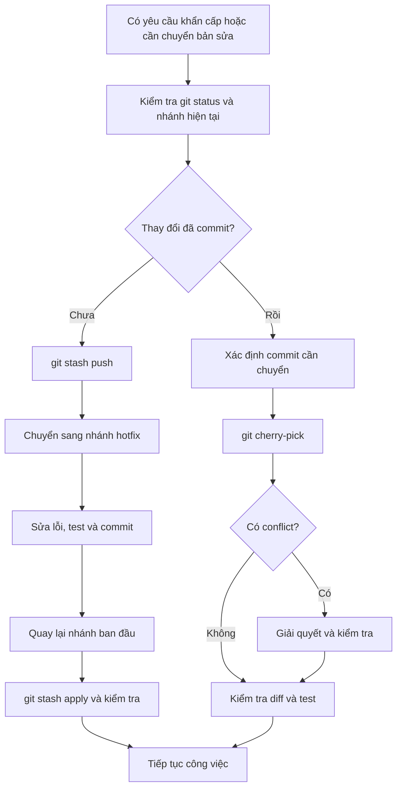

# Xử lý thay đổi khẩn cấp và chuyển bản sửa giữa các nhánh

Trong lúc phát triển tính năng, bạn có thể nhận được yêu cầu sửa lỗi khẩn cấp trên nhánh phát hành. Công việc hiện tại có thể chưa hoàn tất, hoặc bản sửa đã được commit nhầm vào một nhánh khác. Nếu không quản lý rõ trạng thái working tree và lịch sử commit, bạn dễ trộn thay đổi không liên quan, bỏ sót bản sửa hoặc tạo commit trùng lặp.

Git có hai công cụ hữu ích cho các tình huống này: **stash** để tạm cất thay đổi chưa commit và **cherry-pick** để áp dụng một commit đã có sang nhánh khác. Bài học thuộc module `SOURCE_CONTROL_GIT`, nơi bạn thực hành working tree, staging area, commit, branch, merge, rebase, remote và tag. Mục tiêu là chọn đúng cách chuyển thay đổi theo trạng thái hiện tại của công việc.

## 1. Chọn công cụ theo trạng thái thay đổi

Trước khi chuyển nhánh, hãy xác định thay đổi đang ở đâu:

| Trạng thái | Cách xử lý phù hợp | Lý do |
| --- | --- | --- |
| Thay đổi chưa commit trong working tree hoặc staging area | `git stash` | Tạm cất công việc để working tree sạch, sau đó khôi phục lại |
| Bản sửa đã được commit thành một commit riêng | `git cherry-pick` | Áp dụng thay đổi của commit đó lên nhánh đích |
| Nhiều commit đã được tích hợp trên một nhánh và cần đưa cả lịch sử sang nhánh khác | Merge hoặc rebase theo quy trình nhóm | Giữ quan hệ lịch sử giữa các nhánh thay vì sao chép từng commit riêng lẻ |

`stash` và `cherry-pick` giải quyết hai bài toán khác nhau. Stash lưu tạm thay đổi chưa commit trong repository local; cherry-pick lấy nội dung của commit đã tồn tại và tạo commit mới trên nhánh hiện tại. Không dùng stash như một cơ chế chia sẻ công việc giữa các thành viên và cũng không dùng cherry-pick để thay thế merge một nhánh tính năng đã hoàn chỉnh.

Trước mọi thao tác, xem trạng thái:

```bash
git status
git branch --show-current
git diff
git diff --cached
```

Hai lệnh diff giúp phân biệt thay đổi chưa stage và đã stage. Ghi nhớ nhánh hiện tại để sau khi xử lý yêu cầu khẩn cấp có thể quay lại đúng nơi.

## 2. Tạm cất công việc chưa commit bằng git stash

Giả sử bạn đang ở nhánh `feature/customer-search`, đã sửa một số tệp nhưng chưa hoàn tất. Nhóm phát hiện lỗi nghiêm trọng trên `main` và yêu cầu sửa ngay. Bạn chưa muốn tạo commit tạm chỉ để chuyển nhánh.

### Lưu thay đổi vào stash

Kiểm tra trạng thái và lưu thay đổi có mô tả:

```bash
git status
git stash push -m "WIP: customer search"
```

`git stash push` lưu thay đổi tracked trong working tree và index vào một mục stash, sau đó đưa các tệp đó về trạng thái sạch theo commit hiện tại. Tên mô tả giúp bạn nhận ra mục stash khi có nhiều công việc đang tạm cất.

Mặc định, tệp chưa được Git theo dõi (untracked) không được đưa vào stash. Nếu công việc có tệp mới chưa `git add`, dùng `-u`:

```bash
git stash push -u -m "WIP: customer search"
```

`-u` bao gồm các tệp untracked. Tùy chọn `-a` còn bao gồm cả tệp bị ignore; chỉ dùng khi bạn thực sự muốn cất cả các tệp đó, vì có thể tạo stash rất lớn hoặc chứa dữ liệu cục bộ không cần thiết.

Kiểm tra mục vừa lưu và nội dung của nó:

```bash
git stash list
git stash show --include-untracked --stat stash@{0}
git stash show --include-untracked -p stash@{0}
git status
```

Stash thường được đánh số từ `stash@{0}` cho mục mới nhất. Mỗi lần tạo stash mới, chỉ số có thể thay đổi; hãy đọc `git stash list` trước khi thao tác với một mục cụ thể. Sau khi cất thành công, xác nhận working tree sạch trước khi chuyển nhánh.

### Chuyển sang nhánh xử lý khẩn cấp

Cập nhật thông tin từ remote rồi tạo nhánh hotfix từ phiên bản `main` mới nhất:

```bash
git fetch origin
git switch -c hotfix/search-crash origin/main
```

Lệnh đầu cập nhật remote-tracking ref. Lệnh thứ hai tạo và chuyển sang nhánh `hotfix/search-crash` bắt đầu từ `origin/main`. Nếu nhóm dùng nhánh phát hành khác, hãy thay `origin/main` bằng đúng nhánh đích đã thống nhất.

Sửa lỗi, chạy kiểm tra phù hợp, rồi commit riêng bản sửa:

```bash
git status
git diff
git add -- path/to/fixed-file
git diff --cached
git commit -m "Fix customer search crash"
```

Nếu quy trình nhóm yêu cầu đẩy nhánh để tạo pull request:

```bash
git push -u origin hotfix/search-crash
```

Sau khi hotfix được review và tích hợp vào nhánh đích, có thể chuyển bản sửa về nhánh tính năng theo quy trình ở phần cherry-pick bên dưới. Nếu nhóm tự động xóa nhánh hotfix sau khi merge, commit vẫn có thể tìm được qua lịch sử nhánh đích.

### Quay lại công việc đang làm

Sau khi hoàn thành phần khẩn cấp, chuyển lại nhánh tính năng và áp dụng stash:

```bash
git switch feature/customer-search
git stash apply --index stash@{0}
```

`apply` áp dụng thay đổi đã cất nhưng giữ nguyên mục stash. Tùy chọn `--index` yêu cầu Git khôi phục cả trạng thái staged khi có thể. Kiểm tra lại:

```bash
git status
git diff
git diff --cached
```

Nếu thay đổi đã trở lại đầy đủ và bạn xác nhận không cần stash đó nữa, xóa đúng mục đã dùng:

```bash
git stash drop stash@{0}
```

Không xóa stash chỉ vì lệnh `apply` chạy xong; hãy xác minh các tệp, kể cả tệp untracked, đã được khôi phục đúng. Nếu chưa chắc, giữ stash để có thể thử lại hoặc đối chiếu.

## 3. Xử lý conflict khi áp dụng stash

Stash được tạo từ một trạng thái repository cụ thể. Nếu nhánh hiện tại đã thay đổi cùng vùng mã, `git stash apply` có thể gây conflict. Git sẽ để các tệp xung đột trong working tree và yêu cầu bạn giải quyết.

```bash
git status
git diff
```

Mở từng tệp, so sánh thay đổi trong stash với nội dung hiện tại, rồi chỉnh sửa thành kết quả đúng. Sau đó stage các tệp đã giải quyết và chạy kiểm tra phù hợp:

```bash
git add -- path/to/conflicted-file
git diff --cached
git status
```

Khi áp dụng stash bằng `apply`, mục stash vẫn được giữ lại kể cả khi có conflict. Điều này cho phép bạn sửa tiếp hoặc thử lại sau khi phục hồi working tree. Nếu dùng `git stash pop`, Git chỉ xóa mục stash khi áp dụng thành công; khi có conflict, mục stash thường vẫn được giữ. Để kiểm soát rõ hơn, quy trình an toàn là `apply`, xác minh, rồi `drop` thủ công.

Nếu không muốn tiếp tục giải quyết phần thay đổi vừa áp dụng, hãy cẩn thận trước khi khôi phục hoặc xóa tệp. Đối chiếu nội dung với stash bằng `git stash show --include-untracked -p stash@{0}` để không làm mất công việc cần giữ.

## 4. Chuyển một bản sửa đã commit bằng cherry-pick

Giả sử lỗi khẩn cấp đã được sửa và commit trên nhánh `hotfix/search-crash`. Nhánh `feature/customer-search` cũng cần bản sửa đó, nhưng không cần toàn bộ nhánh hotfix. Đây là trường hợp phù hợp với `cherry-pick`.

Trước tiên, xác định commit cần chuyển:

```bash
git log --oneline --decorate hotfix/search-crash
```

Ví dụ:

```text
8ac41d2 Fix customer search crash
5f2b6a0 Add crash reproduction test
```

Nếu chỉ commit `8ac41d2` chứa bản sửa cần đưa sang nhánh tính năng, chuyển nhánh và áp dụng:

```bash
git switch feature/customer-search
git cherry-pick -x 8ac41d2
```

`git cherry-pick` lấy thay đổi được giới thiệu bởi commit chỉ định và tạo một commit mới trên nhánh hiện tại. Commit mới có nội dung thay đổi tương ứng nhưng thường có hash khác vì cha commit và metadata lịch sử khác. Tùy chọn `-x` thêm dòng tham chiếu commit nguồn vào thông điệp commit; điều này hữu ích khi chia sẻ bản sửa giữa nhiều nhánh để người review truy nguyên nguồn gốc.

Kiểm tra kết quả sau khi áp dụng:

```bash
git show --stat --oneline HEAD
git show --format=fuller --no-ext-diff HEAD
git status
```

Chạy test phù hợp với lỗi đã sửa. Nếu nhánh đích cần push, dùng quy trình review thông thường:

```bash
git push origin feature/customer-search
```

Không cherry-pick một commit chỉ vì thông điệp của nó nghe có vẻ liên quan. Đọc diff của commit nguồn để xác định nó có chứa thay đổi phụ thuộc, sửa cấu hình hoặc cập nhật test nào cần đi cùng hay không.

## 5. Chuyển nhiều commit có thứ tự

Nếu một bản sửa gồm nhiều commit phụ thuộc nhau, hãy áp dụng theo thứ tự từ commit cũ đến commit mới để giữ quan hệ phụ thuộc.

Ví dụ, lịch sử nguồn có:

```text
a1b2c3d Add regression test
e4f5a6b Fix search null handling
9a8b7c6 Improve error response
```

Nếu cả ba commit đều cần thiết, có thể cherry-pick từng commit theo thứ tự:

```bash
git cherry-pick -x a1b2c3d
git cherry-pick -x e4f5a6b
git cherry-pick -x 9a8b7c6
```

Hoặc dùng một dải commit liên tiếp:

```bash
git cherry-pick -x a1b2c3d^..9a8b7c6
```

Trong cú pháp dải, `A..B` lấy các commit có thể truy cập từ `B` nhưng không có trong `A`; dấu `^` ở `A^` khiến commit đầu tiên `A` được đưa vào dải. Trước khi dùng dải, hãy kiểm tra `git log --oneline A^..B` để chắc chắn không đưa thêm commit không liên quan. Nếu lịch sử có merge commit, cần xem xét cách xử lý riêng thay vì giả định dải commit đơn giản luôn phù hợp.

Không cần cherry-pick cả nhánh nếu mục tiêu chỉ là chuyển một bản sửa độc lập. Nếu tất cả thay đổi của nhánh nguồn đều cần thiết và hai nhánh có quan hệ phát triển lâu dài, hãy trao đổi với nhóm để dùng merge hoặc rebase theo quy ước chung.

## 6. Giải quyết conflict trong cherry-pick

Cherry-pick có thể conflict khi nhánh đích đã thay đổi cùng vùng mã với commit nguồn. Khi đó Git tạm dừng và cho biết các tệp cần giải quyết:

```bash
git status
git diff --name-only --diff-filter=U
```

Mở tệp, so sánh thay đổi từ commit đang được áp dụng với phiên bản hiện tại, rồi chỉnh sửa để giữ đúng logic của cả hai phía. Sau khi giải quyết:

```bash
git add -- path/to/conflicted-file
git diff --cached
git cherry-pick --continue
```

Nếu không còn muốn áp dụng commit đó và muốn quay lại trạng thái trước khi bắt đầu cherry-pick hiện tại:

```bash
git cherry-pick --abort
```

Nếu commit hiện tại không cần thiết trong chuỗi cherry-pick và bạn đã xác nhận có thể bỏ qua nó, có thể dùng:

```bash
git cherry-pick --skip
```

`--skip` bỏ qua commit đang gây conflict và tiếp tục các commit còn lại trong chuỗi. Chỉ dùng khi hiểu tác động của việc bỏ commit; một commit sau có thể phụ thuộc vào thay đổi của commit đã bỏ qua.

## 7. Khi bản sửa đã nằm trên nhánh đích

Sau khi hotfix đã được merge vào `main`, nhóm thường cần đưa nó đến các nhánh bảo trì hoặc nhánh phát triển đang hoạt động. Có hai cách phổ biến:

- **Cherry-pick commit hotfix** khi chỉ cần bản sửa độc lập trên một nhánh cụ thể, hoặc nhóm yêu cầu truy vết commit nguồn bằng `-x`.
- **Merge nhánh đích vào nhánh đang phát triển** khi nhánh đó cần nhận toàn bộ thay đổi mới từ `main`, không chỉ một commit sửa lỗi.

Ví dụ, nếu nhánh tính năng chỉ cần một commit hotfix cụ thể:

```bash
git fetch origin
git switch feature/customer-search
git log --oneline origin/main -n 20
git cherry-pick -x <hotfix-commit>
```

Thay `<hotfix-commit>` bằng hash thực tế đã xác định từ lịch sử nhánh đích. Nếu nhóm sẽ merge `main` vào nhánh tính năng ngay sau đó, hãy kiểm tra kế hoạch trước khi cherry-pick; bản sửa có thể được đưa vào qua merge và không cần sao chép riêng. Cherry-pick tạo commit mới có hash khác, nên về sau cùng một thay đổi có thể xuất hiện dưới hai commit trong lịch sử. Điều đó không nhất thiết làm mã bị áp dụng hai lần, nhưng có thể gây khó hiểu khi review hoặc tiếp tục tích hợp.

## 8. Những lỗi thường gặp

- **Chuyển nhánh khi working tree còn thay đổi chưa được quản lý**: Git có thể từ chối chuyển nhánh hoặc thay đổi có thể đi theo bạn nếu không xung đột. Kiểm tra `git status` và quyết định commit, stash hay loại bỏ từng thay đổi trước.
- **Quên tệp untracked khi stash**: tệp mới không được đưa vào stash mặc định; dùng `git stash push -u` nếu chúng thuộc công việc cần giữ.
- **Dùng `stash pop` rồi xóa nhầm dữ liệu khi có conflict**: dùng `apply` trước, kiểm tra kết quả, rồi mới `drop`.
- **Cherry-pick nhầm commit phụ thuộc**: đọc diff và lịch sử nguồn, xác định các commit cần đi cùng.
- **Cherry-pick lại bản sửa đã có qua merge**: kiểm tra lịch sử nhánh đích trước để tránh commit trùng và conflict không cần thiết.
- **Dùng `cherry-pick --skip` để né conflict mà chưa xem phụ thuộc**: commit bị bỏ có thể chứa thay đổi mà các commit sau cần.
- **Nhầm cherry-pick với merge**: cherry-pick tạo commit mới trên nhánh đích; merge tích hợp lịch sử của nhánh nguồn vào nhánh hiện tại.

## 9. Quy trình ra quyết định



Trước khi hoàn tất, hãy tự xác nhận:

1. Tôi đã xác định thay đổi đang nằm trong working tree, staging area hay một commit chưa?
2. Nếu dùng stash, tôi đã kiểm tra danh sách và khôi phục đúng mục chưa?
3. Nếu dùng cherry-pick, tôi đã chọn đúng commit và kiểm tra các phụ thuộc chưa?
4. Tôi đã giải quyết mọi conflict, xem staged diff và chạy test phù hợp chưa?
5. Bản sửa khẩn cấp đã được đưa đến các nhánh cần thiết theo quy trình của nhóm chưa?

Khi biết thay đổi đang ở trạng thái nào, bạn có thể chọn cách chuyển phù hợp: stash để tạm cất công việc chưa commit, cherry-pick để chuyển commit đã hoàn tất, hoặc merge/rebase khi cần tích hợp lịch sử giữa các nhánh. Ghi nhận rõ nguồn gốc và kiểm tra kết quả sau mỗi lần chuyển giúp cả nhóm theo dõi bản sửa mà không làm thất lạc công việc đang thực hiện.

## Tài liệu tham khảo

- [Git documentation: git-stash](https://git-scm.com/docs/git-stash) — lưu, xem, áp dụng và xóa các mục stash.
- [Git documentation: git-cherry-pick](https://git-scm.com/docs/git-cherry-pick) — áp dụng commit, tiếp tục hoặc hủy khi có conflict.
- [Git documentation: git-switch](https://git-scm.com/docs/git-switch) — chuyển nhánh và tạo nhánh mới.
- [Pro Git: Stashing and Cleaning](https://git-scm.com/book/en/v2/Git-Tools-Stashing-and-Cleaning) — tình huống tạm cất công việc trong quá trình phát triển.
