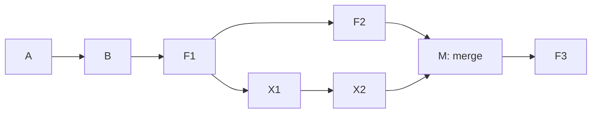
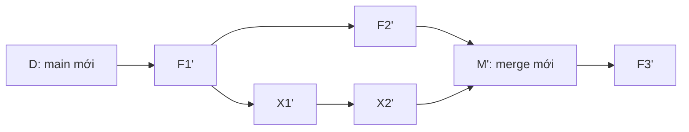

# Giữ cấu trúc hợp nhất với `--rebase-merges` và các giới hạn

Khi cập nhật một nhánh tính năng dựa trên `main` mới hơn, ta thường dùng `git rebase`. Rebase thông thường phát lại các commit của nhánh tính năng lên commit nền mới và tạo một lịch sử tuyến tính. Cách này dễ đọc, nhưng các merge commit nằm trong phạm vi rebase thường bị loại khỏi danh sách và cấu trúc phân nhánh được làm phẳng.

Trong một số dự án, các merge commit thể hiện những mốc tích hợp quan trọng: một nhánh con đã được hợp nhất vào nhánh tính năng, một nhánh thử nghiệm đã được đưa vào nhánh phát hành, hoặc nhóm muốn giữ lại cấu trúc của quá trình phát triển. Tùy chọn **`git rebase --rebase-merges`** yêu cầu Git cố gắng tái tạo cấu trúc phân nhánh và các merge commit trong phạm vi được rebase.

Tùy chọn này vẫn viết lại lịch sử. Git tạo các commit mới và tái tạo merge commit, chứ không di chuyển nguyên vẹn các đối tượng commit cũ. Vì vậy, cần hiểu cách nó hoạt động, những gì được giữ lại và những gì phải kiểm tra hoặc xử lý lại thủ công.

## 1. Vì sao cần giữ cấu trúc merge?

### 1.1. Merge commit ghi lại quan hệ giữa các nhánh

Một commit thông thường (không phải root commit) có một commit cha; root commit không có cha. Một merge commit có từ hai commit cha trở lên; hai cha là trường hợp phổ biến khi hợp nhất hai nhánh. Quan hệ cha này ghi lại rằng hai dòng lịch sử đã gặp nhau tại một điểm.

Ví dụ, nhánh `topic` có một nhánh con `experiment` được phát triển song song rồi hợp nhất trở lại:



Merge commit `M` có hai cha: `F2` trên nhánh `topic` và `X2` trên nhánh `experiment`. Nhờ vậy, lịch sử cho biết các commit `X1`, `X2` đã được tích hợp vào `topic` tại một mốc cụ thể.

Thông tin này có thể hữu ích khi:

- Nhánh tính năng được chia thành nhiều nhánh con do nhiều người hoặc nhiều nhóm phụ trách.
- Nhóm muốn giữ dấu mốc tích hợp của từng phần công việc.
- Một nhánh phát triển thường xuyên merge thay đổi từ nhánh nền vào để xử lý xung đột theo từng đợt.
- Cấu trúc lịch sử giúp truy tìm thời điểm một nhánh con được đưa vào hoặc điều tra một hồi quy.

### 1.2. Rebase thông thường xử lý merge commit ra sao?

Với lệnh:

```bash
git rebase origin/main
```

Git thường bỏ các merge commit khỏi danh sách thao tác và phát lại các commit cần thiết thành một chuỗi tuyến tính. Các commit nội dung có thể vẫn xuất hiện, nhưng mối quan hệ hợp nhất được biểu diễn bởi merge commit không còn được giữ nguyên trong lịch sử mới.

Điều này thường phù hợp khi nhánh chỉ có một chuỗi commit đơn giản. Tuy nhiên, nếu merge commit biểu diễn một lần tích hợp có ý nghĩa, làm phẳng lịch sử có thể khiến người đọc khó nhận ra các nhánh con đã được kết hợp ở đâu.

### 1.3. `--rebase-merges` làm gì?

Lệnh:

```bash
git rebase --rebase-merges origin/main
```

yêu cầu Git tái tạo cấu trúc phân nhánh trong phạm vi commit được rebase, bao gồm các merge commit cần thiết. Git phát lại các commit thường và tạo merge commit mới với các quan hệ cha tương ứng trong lịch sử mới.

Tùy chọn viết tắt là `-r`:

```bash
git rebase -r origin/main
```

Kết quả là một đồ thị commit vẫn có các nhánh và điểm hợp nhất, nhưng các commit được phát lại có mã định danh mới vì commit phụ thuộc vào nội dung, cha và metadata của nó.

## 2. Ví dụ trước và sau khi rebase

Giả sử `main` đã tiến thêm một commit `D`, trong khi `topic` có một nhánh con được merge vào:

```text
Trước khi rebase:

A---B---C---D                 main
     \
      F1---F2-------M---F3    topic
       \            /
        X1---X2----/          experiment
```

`M` là merge commit hợp nhất nhánh `experiment` vào `topic`. Ta muốn cập nhật `topic` dựa trên `main` mới nhất là `D`.

### 2.1. Rebase thông thường

```bash
git switch topic
git rebase main
```

Git phát lại các commit cần thiết lên nền `D` theo một chuỗi tuyến tính. Merge commit `M` không được tái tạo như một merge commit, nên quan hệ hợp nhất giữa hai nhánh không còn được biểu diễn bằng điểm hợp nhất trong lịch sử mới.

### 2.2. Rebase giữ cấu trúc merge

```bash
git switch topic
git rebase --rebase-merges main
```

Git tái tạo các nhánh và merge commit trong phạm vi được xử lý. Sơ đồ khái niệm sau rebase:



Các commit mới có dấu `'` để phân biệt với commit cũ. `M'` là merge commit mới có hai cha trong đồ thị mới. Sơ đồ chỉ mô tả cấu trúc; mã hash thực tế và cách sắp xếp phụ thuộc lịch sử cùng phạm vi rebase cụ thể.

## 3. Quy trình sử dụng an toàn

Trước khi rebase, hãy xác định đúng branch đang làm việc, commit nền mới và phạm vi lịch sử sẽ viết lại.

### Bước 1: Kiểm tra trạng thái và đồ thị commit

```bash
git status
git branch --show-current
git log --graph --oneline --decorate --all
```

Nếu working tree hoặc staging area có thay đổi chưa được commit, hãy quyết định lưu chúng bằng commit hoặc stash trước. Rebase cần một trạng thái làm việc phù hợp; không nên để các thay đổi chưa rõ nguồn gốc lẫn vào quá trình viết lại lịch sử.

Để xem các cha của một merge commit cụ thể:

```bash
git show --no-patch --pretty=raw <merge-commit>
```

Hoặc xem trực tiếp object ID của commit và các cha:

```bash
git rev-list --parents -n 1 <merge-commit>
```

Các lệnh này giúp xác nhận merge commit thực sự kết nối những nhánh nào.

### Bước 2: Lấy nền mới nhất

```bash
git fetch origin
```

Fetch cập nhật remote-tracking ref như `origin/main`; nó không tự merge thay đổi vào branch local. Nếu muốn rebase dựa trên trạng thái mới nhất của `main` trên remote, dùng `origin/main` làm upstream.

### Bước 3: Tạo mốc quay lại trước khi viết lại lịch sử

Nếu nhánh có cấu trúc phức tạp hoặc đã được chia sẻ, có thể tạo một branch dự phòng:

```bash
git branch backup/topic-before-rebase
```

Branch dự phòng giữ lại ref trỏ tới lịch sử trước rebase để ta có thể đối chiếu hoặc khôi phục nếu kết quả không đúng dự kiến. Do lịch sử cũ thường không còn là tổ tiên của branch đã rebase, `git branch -d` có thể từ chối xóa. Chỉ sau khi đã kiểm tra và chắc chắn không cần backup nữa, có thể xóa bằng `git branch -D backup/topic-before-rebase`.

### Bước 4: Chạy rebase với cấu trúc merge

```bash
git switch topic
git rebase --rebase-merges origin/main
```

Nếu muốn xem và chỉnh sửa danh sách thao tác trước khi Git thực hiện, dùng chế độ interactive:

```bash
git rebase -i --rebase-merges origin/main
```

### Bước 5: Kiểm tra kết quả

```bash
git status
git log --graph --oneline --decorate --all
```

So sánh đồ thị trước và sau để xác nhận các nhánh con và merge commit cần giữ vẫn xuất hiện. Kiểm tra diff, chạy test và xem lại các phần từng có conflict resolution thủ công.

## 4. Danh sách thao tác interactive của `--rebase-merges`

Rebase giữ cấu trúc merge cần mô tả việc di chuyển giữa các nhánh và tạo lại merge commit. Vì thế, danh sách thao tác (todo list) có thể chứa các lệnh bổ sung bên cạnh `pick`.

| Lệnh trong todo | Ý nghĩa |
|---|---|
| `pick <commit>` | Phát lại một commit thường. |
| `label <name>` | Gắn nhãn cho vị trí HEAD hiện tại để tham chiếu về sau. |
| `reset <name>` | Chuyển HEAD tới nhãn hoặc vị trí được chỉ định trong todo. |
| `merge -C <commit> <label>` | Tạo merge commit với nhánh được gắn nhãn và dùng lại thông điệp của merge commit cũ. |
| `merge -c <commit> <label>` | Tương tự `-C`, nhưng mở trình soạn thảo để chỉnh thông điệp merge commit. |
| `reword <commit>` | Phát lại commit và chỉnh thông điệp commit. |
| `edit <commit>` | Tạm dừng để sửa commit trong quá trình rebase. |
| `exec <command>` | Chạy lệnh shell tại vị trí đó trong todo. |

Ví dụ dưới đây chỉ minh họa ý tưởng của todo list, không phải nội dung cố định mà Git luôn sinh ra:

```text
label onto
reset onto
pick <F1>
label topic-side-base
pick <F2>
label topic-tip
reset topic-side-base
pick <X1>
pick <X2>
label experiment-tip
reset topic-tip
merge -C <M> experiment-tip
pick <F3>
```

Git dùng `label` để ghi nhớ các điểm trên đồ thị, `reset` để quay lại một nhánh đã ghi nhớ và `merge` để tái tạo điểm hợp nhất. Nếu chỉnh todo list, cần giữ đúng thứ tự và quan hệ nhãn; xóa hoặc di chuyển nhầm lệnh có thể làm thay đổi cấu trúc kết quả.

`--rebase-merges` có thể dùng cùng `-i` để người dùng chỉnh todo. Khi không cần chỉnh thủ công, chỉ cần dùng `git rebase --rebase-merges <upstream>`.

## 5. Hai chế độ xử lý các nhánh “cousin”

Tùy chọn `--rebase-merges` có hai chế độ:

- `no-rebase-cousins` (mặc định): các commit không phải hậu duệ của điểm phân nhánh ban đầu sẽ giữ điểm nền ban đầu của chúng.
- `rebase-cousins`: các commit dạng cousin đó cũng được chuyển sang nền mới, tức upstream hoặc đích được chỉ định bằng `--onto`.

“Cousin” ở đây mô tả các commit nằm trên một nhánh phụ có điểm phân nhánh cũ nằm ngoài đường tổ tiên của nhánh đang rebase. Chúng có thể được merge vào nhánh đang làm việc, nhưng bản thân chúng không nằm trên cùng đường phát triển bắt đầu từ điểm phân nhánh ban đầu.

Chọn chế độ mặc định:

```bash
git rebase --rebase-merges=no-rebase-cousins origin/main
```

Hoặc chuyển cả các nhánh cousin sang nền mới:

```bash
git rebase --rebase-merges=rebase-cousins origin/main
```

Ví dụ về khác biệt:

- Dùng `no-rebase-cousins`, một nhánh phụ bắt đầu từ commit cũ có thể tiếp tục giữ commit nền cũ, còn phần nhánh chính đang rebase được chuyển lên `origin/main`.
- Dùng `rebase-cousins`, nhánh phụ đó cũng được phát lại trên nền mới.

Không có chế độ nào luôn đúng. Nếu nhánh phụ cần giữ quan hệ với một nền phát hành hoặc một nhánh bảo trì riêng, mặc định có thể phù hợp hơn. Nếu toàn bộ nhóm nhánh cần cùng chuyển sang một nền mới, `rebase-cousins` có thể là lựa chọn phù hợp. Hãy kiểm tra đồ thị và phạm vi commit trước khi chọn.

### 5.1. Kết hợp với `--onto`

`--onto` cho phép chỉ định commit nền mới và điểm bắt đầu của phạm vi cần rebase:

```bash
git rebase --rebase-merges --onto origin/release <old-base> topic
```

Lệnh này yêu cầu Git lấy các commit thuộc phạm vi `topic` sau `<old-base>` và tái tạo chúng trên `origin/release`, đồng thời cố gắng giữ cấu trúc merge trong phạm vi đó. Cần xác định `<old-base>` chính xác; chọn sai điểm bắt đầu có thể bỏ sót hoặc đưa thêm commit vào lịch sử mới.

## 6. Xử lý conflict trong quá trình tái tạo merge

Conflict có thể xảy ra khi Git phát lại commit thường hoặc khi tái tạo merge commit. Quy trình xử lý về cơ bản giống merge/rebase thông thường, nhưng với `--rebase-merges`, một merge commit cũ có thể phải giải quyết conflict lần nữa.

### 6.1. Các bước xử lý

Khi Git tạm dừng:

```bash
git status
```

Mở các tệp đang conflict, xem nội dung hai phía, kết hợp phần thay đổi đúng và xóa các dấu đánh dấu conflict. Sau đó:

```bash
git add <file-da-giai-quyet>
git rebase --continue
```

Nếu có thêm conflict ở commit hoặc merge commit tiếp theo, lặp lại các bước này. Có thể xem diff để kiểm tra:

```bash
git diff
git diff --cached
```

Nếu nhận ra mình chọn sai nền hoặc không muốn tiếp tục quá trình đang dở:

```bash
git rebase --abort
```

Lệnh này hủy phiên rebase đang chạy và đưa branch trở lại trạng thái trước khi rebase bắt đầu. Nếu muốn bỏ qua commit đang áp dụng, `git rebase --skip` có thể dùng trong một số trường hợp, nhưng chỉ nên thực hiện khi đã xác định nội dung của commit đó không còn cần thiết.

### 6.2. Vì sao phải giải quyết lại conflict của merge cũ?

Khi merge hai nhánh trước đây, người phát triển có thể đã sửa thủ công kết quả để dung hòa hai cách triển khai. Các chỉnh sửa đó có thể chỉ tồn tại trong nội dung merge commit, không tồn tại dưới dạng commit độc lập ở một trong hai nhánh cha.

Khi `--rebase-merges` tạo merge commit mới, Git thực hiện lại việc hợp nhất dựa trên các commit cha mới. Git không thể luôn suy ra chính xác mọi quyết định thủ công đã được thực hiện trong lần merge cũ. Vì vậy, conflict có thể xuất hiện lại và các chỉnh sửa đặc biệt cần được áp dụng lại.

Sau khi xử lý, hãy kiểm tra kết quả hợp nhất bằng test và review diff. Việc Git báo rebase hoàn tất không chứng minh rằng logic của lần merge cũ đã được giữ nguyên.

## 7. Những giới hạn quan trọng

### 7.1. Cấu trúc được tái tạo, commit cũ không được giữ nguyên

`--rebase-merges` tạo commit mới. Dù thông điệp và quan hệ phân nhánh được giữ lại, mã hash của commit thường và merge commit thay đổi do cha hoặc nội dung có thể thay đổi. Đây không phải thao tác sao chép nguyên trạng merge commit cũ.

Vì commit mới là đối tượng mới, chữ ký GPG/SSH gắn với commit cũ không còn xác thực cho commit mới. Nếu quy trình yêu cầu ký commit, cần ký lại các commit được tạo trong lịch sử mới theo cấu hình phù hợp.

### 7.2. Conflict resolution và chỉnh sửa thủ công không được bảo toàn tự động

Các chỉnh sửa được thực hiện trực tiếp trong kết quả merge cũ có thể không được Git phát lại tự động. Người thực hiện phải kiểm tra và áp dụng lại khi tạo merge mới. Đây là giới hạn quan trọng nhất khi rebase một nhánh có nhiều merge commit đã giải quyết conflict phức tạp.

### 7.3. Chỉ giữ topology trong phạm vi được rebase

`--rebase-merges` cố gắng bảo toàn cấu trúc phân nhánh của các commit thuộc phạm vi rebase. Nó không tái tạo mọi branch, tag hoặc ref trong toàn bộ repository. Những ref bên ngoài phạm vi có thể vẫn trỏ tới lịch sử cũ. Các commit đã có trong nền mới hoặc trở thành rỗng cũng có thể được xử lý theo quy tắc của rebase, nên đồ thị sau cùng không nhất thiết giống hệt đồ thị cũ.

Vì vậy, hãy xác định upstream, điểm bắt đầu và branch đích rõ ràng. Khi dùng `--onto`, đặc biệt cần xác nhận commit nền cũ để không đưa nhầm commit vào phạm vi.

### 7.4. Merge strategy và tùy chọn merge có thể cần chỉ định lại

Khi tái tạo merge, Git phải thực hiện lại thao tác hợp nhất. Chiến lược merge mặc định thường được dùng là `ort`; nếu dự án cần chiến lược khác hoặc tùy chọn merge riêng, cần xem xét `--strategy` và `--strategy-option` khi chạy rebase.

Ví dụ về hình thức chỉ định:

```bash
git rebase --rebase-merges --strategy=ort --strategy-option=<option> origin/main
```

Tên strategy và option hợp lệ phụ thuộc phiên bản Git và tình huống. Không sao chép tùy chọn merge từ một lệnh cũ mà không kiểm tra nó có phù hợp với merge đang được tái tạo hay không.

### 7.5. Không phù hợp để viết lại branch dùng chung mà không phối hợp

Rebase thay đổi mã hash commit. Nếu branch đã được push và người khác đang dựa vào các commit cũ, rebase có thể khiến lịch sử của họ phân kỳ và buộc họ phải điều chỉnh branch local.

Không tự ý rebase branch dùng chung hoặc branch chính đã công bố. Nếu nhóm đồng ý viết lại branch đã push, cần thông báo cho người cộng tác và cập nhật remote có kiểm soát. Với branch cá nhân đã được push, khi cần cập nhật cưỡng bức sau rebase, ưu tiên:

```bash
git push --force-with-lease origin topic
```

`--force-with-lease` kiểm tra trạng thái ref remote mà local kỳ vọng trước khi cập nhật cưỡng bức, giúp giảm nguy cơ ghi đè commit mới của người khác. Nó vẫn có thể viết lại lịch sử trên remote và không thay thế việc phối hợp với nhóm.

### 7.6. Tag và ref khác có thể vẫn trỏ tới lịch sử cũ

Tag là ref trỏ tới một đối tượng Git. Rebase không tự động di chuyển mọi tag hoặc ref khác sang commit mới. Sau khi rebase, hãy kiểm tra tag và branch liên quan nếu chúng được dùng làm mốc phát hành hoặc mốc tích hợp. Không di chuyển tag phát hành đã công bố nếu chưa có quyết định rõ ràng từ nhóm.

### 7.7. Không phải nhánh nào cũng cần giữ merge commit

Nếu nhánh chỉ có một chuỗi commit tuyến tính, `--rebase-merges` không đem lại nhiều lợi ích. Nếu nhóm muốn lịch sử gọn, dễ đọc và không cần lưu mốc tích hợp của nhánh con, rebase thông thường có thể phù hợp hơn.

Giữ topology có thể làm lịch sử dài và phức tạp hơn. Chỉ nên chọn khi cấu trúc merge mang thông tin hữu ích cho bảo trì, review hoặc truy vết.

## 8. Kiểm tra lịch sử sau rebase

Sau khi hoàn tất, không chỉ kiểm tra trạng thái working tree. Hãy kiểm tra đồ thị và nội dung các merge commit được tạo lại.

```bash
# Xem đồ thị commit
git log --graph --oneline --decorate --all

# Kiểm tra trạng thái branch
git status -sb

# Xem commit và các cha của merge commit mới
git show --no-patch --pretty=raw <new-merge-commit>

# Xem thay đổi của một merge commit
git show --stat <new-merge-commit>
```

Với merge commit, có thể xem diff so với từng cha bằng:

```bash
git diff <new-merge-commit>^1 <new-merge-commit>
git diff <new-merge-commit>^2 <new-merge-commit>
```

Hai diff giúp kiểm tra phần kết quả hợp nhất so với từng nhánh cha. Cần kết hợp với test và review logic vì diff không tự xác nhận hành vi chương trình đúng.

Nếu muốn đối chiếu lịch sử cũ, giữ branch backup trước rebase cho tới khi xác nhận xong. Có thể so sánh đồ thị cũ và mới bằng `git log --graph` trên hai ref tương ứng.

## 9. Khi nào nên và không nên dùng `--rebase-merges`?

| Tình huống | Gợi ý |
|---|---|
| Nhánh có nhiều nhánh con được merge vào và cần giữ mốc tích hợp | Cân nhắc `--rebase-merges` |
| Nhánh chỉ có chuỗi commit tuyến tính | Rebase thông thường thường đơn giản hơn |
| Merge commit cũ có nhiều chỉnh sửa conflict thủ công | Chỉ rebase khi có thời gian tái áp dụng và kiểm thử các chỉnh sửa đó |
| Branch đã được nhiều người cùng sử dụng | Tránh viết lại lịch sử nếu chưa có phối hợp rõ ràng |
| Muốn chuyển cả các nhánh phụ cousin sang nền mới | Cân nhắc `--rebase-merges=rebase-cousins` |
| Muốn các nhánh cousin giữ điểm nền ban đầu | Dùng chế độ mặc định `no-rebase-cousins` |
| Muốn kiểm soát từng bước tái tạo merge | Dùng `git rebase -i --rebase-merges` và xem kỹ todo list |

## 10. Quy trình thực hành hoàn chỉnh

Giả sử `topic` có một nhánh con đã được merge vào và `origin/main` vừa có commit mới. Mục tiêu là cập nhật `topic` lên nền mới, giữ lại merge topology và xác minh kết quả.

**Bước 1: Kiểm tra và lấy dữ liệu mới**

```bash
git status
git log --graph --oneline --decorate --all
git fetch origin
```

**Bước 2: Tạo mốc dự phòng và chuyển tới branch cần rebase**

```bash
git branch backup/topic-before-rebase
git switch topic
```

**Bước 3: Tái tạo cấu trúc merge trên nền mới**

```bash
git rebase --rebase-merges origin/main
```

Nếu cần xem và điều chỉnh các thao tác tái tạo:

```bash
git rebase -i --rebase-merges origin/main
```

**Bước 4: Giải quyết conflict nếu có**

```bash
git status
# sửa các tệp conflict
git add <file-da-giai-quyet>
git rebase --continue
```

Lặp lại đến khi rebase hoàn tất. Nếu quyết định dừng:

```bash
git rebase --abort
```

**Bước 5: Kiểm tra topology và nội dung**

```bash
git log --graph --oneline --decorate --all
git status
```

Xác nhận merge commit cần giữ đã được tạo lại, kiểm tra diff và chạy toàn bộ test cần thiết. Đặc biệt xem lại những merge cũ từng có chỉnh sửa thủ công.

**Bước 6: Cập nhật remote nếu branch đã được chia sẻ**

Nếu đây là branch cá nhân đã push và nhóm đã thống nhất việc viết lại lịch sử:

```bash
git push --force-with-lease origin topic
```

Nếu branch là branch dùng chung, hãy phối hợp với các thành viên đang sử dụng nó trước khi cập nhật remote.

**Bước 7: Dọn mốc dự phòng sau khi xác nhận**

```bash
git branch -D backup/topic-before-rebase
```

Chỉ xóa backup sau khi đã xác nhận lịch sử mới và các kiểm tra đều đạt. `-D` bỏ qua kiểm tra branch đã được merge; vì vậy hãy chắc chắn backup không còn là bản duy nhất giữ lại commit cần khôi phục.

## 11. Ghi nhớ

- Rebase thông thường thường bỏ merge commit trong phạm vi xử lý và phát lại commit thành lịch sử tuyến tính.
- `git rebase --rebase-merges` (hoặc `git rebase -r`) cố gắng tái tạo cấu trúc phân nhánh và merge commit.
- Merge commit mới có mã hash mới; đây là tái tạo topology, không phải giữ nguyên đối tượng commit cũ.
- Các chỉnh sửa thủ công trong lần giải quyết conflict của merge cũ có thể phải áp dụng lại.
- `no-rebase-cousins` là chế độ mặc định; `rebase-cousins` chuyển cả các nhánh cousin sang nền mới.
- Todo list có thể dùng `label`, `reset`, `merge -C` và `merge -c` để tái tạo các nhánh và merge.
- Rebase viết lại lịch sử; không tự ý rebase branch dùng chung hoặc branch đã công bố.
- Sau rebase, kiểm tra đồ thị, merge commit, diff và test; nếu cập nhật branch cá nhân đã push, cân nhắc `--force-with-lease` sau khi phối hợp.

Hãy dùng `--rebase-merges` khi cấu trúc hợp nhất mang thông tin mà nhóm cần giữ. Trước khi chạy, xác định đúng phạm vi và nền mới; sau khi chạy, xác minh từng merge quan trọng và tái áp dụng các chỉnh sửa thủ công nếu cần.
