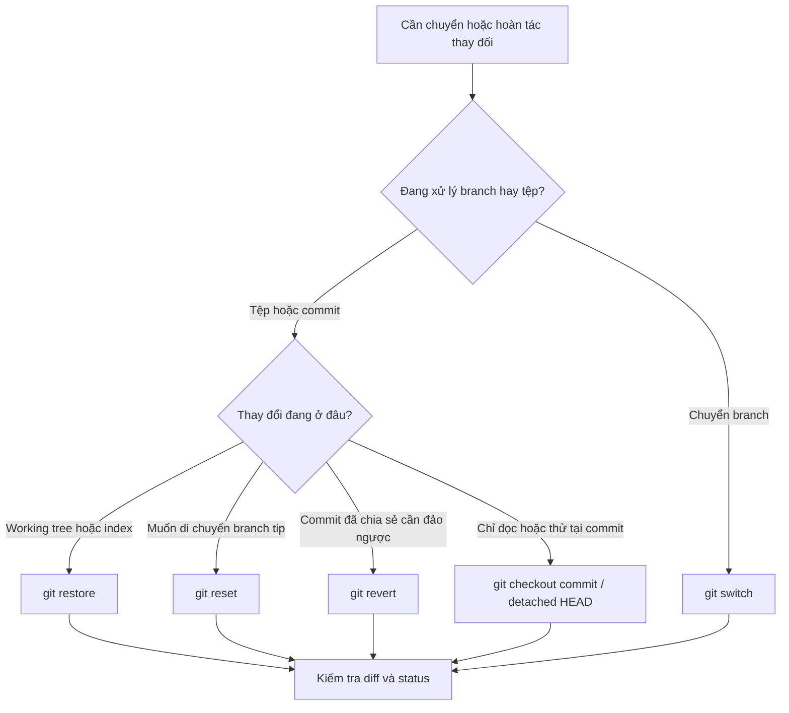

# Phân biệt restore, reset, revert và checkout theo vùng tác động

Khi thao tác Git, một thay đổi có thể nằm trong working tree, staging area hoặc đã được ghi thành commit. Vì vậy, câu hỏi “hoàn tác thay đổi” chưa đủ để chọn lệnh: bạn cần biết muốn thay đổi vùng nào và có muốn viết lại lịch sử commit hay không. Dùng nhầm lệnh có thể làm mất phần việc chưa commit hoặc thay đổi lịch sử mà đồng đội đang dựa vào.

Bài học này thuộc chương **Chuyển và hoàn tác** của module `SOURCE_CONTROL_GIT`. Module hướng dẫn bạn từ working tree, staging area, commit và lịch sử đến branch, merge, rebase, remote và tag; mục tiêu là cộng tác theo nhánh, xử lý thay đổi và khôi phục thao tác sai mà vẫn bảo toàn lịch sử quan trọng.

## 1. Bốn vùng và khái niệm cần phân biệt

Trước khi chọn lệnh, hãy hình dung bốn đối tượng Git thường tác động đến:

- **Working tree**: các tệp đang hiện diện trong thư mục làm việc. Đây là nơi bạn chỉnh sửa mã và tài liệu.
- **Index (staging area)**: bản nội dung đã chọn để đưa vào commit tiếp theo. `git add` cập nhật index.
- **HEAD**: tham chiếu đến commit hiện tại. Khi đang ở một branch bình thường, HEAD trỏ đến branch đó và branch trỏ đến commit mới nhất.
- **Lịch sử commit**: chuỗi commit đã được tạo. Di chuyển branch tip có thể khiến một commit không còn nằm trên lịch sử của branch đó; tạo commit revert thì giữ commit cũ và thêm commit mới đảo ngược thay đổi.

Xem trạng thái và khác biệt giữa các vùng:

```bash
git status
git diff
git diff --cached
git log --oneline --decorate -5
```

`git diff` so sánh working tree với index; `git diff --cached` so sánh index với HEAD. Hai lệnh này giúp bạn xác định thay đổi nào đã stage và thay đổi nào chưa stage trước khi hoàn tác.

## 2. Bảng chọn nhanh

| Lệnh | Tác động chính | Lịch sử commit | Khi nào dùng |
| --- | --- | --- | --- |
| `git restore` | Khôi phục nội dung working tree và/hoặc index từ một nguồn | Không di chuyển HEAD, không tạo commit | Bỏ sửa trong tệp hoặc đưa tệp ra khỏi staging |
| `git reset` | Di chuyển branch/HEAD và tùy chế độ có thể cập nhật index, working tree; dạng path chỉ cập nhật index | Có thể di chuyển branch tip, không tạo commit mới | Chỉnh lại commit local hoặc bỏ stage một tệp |
| `git revert` | Tạo commit mới đảo ngược thay đổi của commit cũ | Giữ lịch sử cũ và thêm commit mới | Hoàn tác commit đã chia sẻ hoặc đã push |
| `git checkout` | Lệnh cũ có nhiều chế độ: chuyển branch/HEAD hoặc khôi phục tệp vào index và working tree | Tùy cú pháp; có thể chuyển branch hoặc detached HEAD | Đọc hiểu repository cũ; dùng `switch`/`restore` cho thao tác mới |

Không có lệnh nào luôn “an toàn nhất” trong mọi tình huống. Hãy chọn theo mục tiêu: sửa nội dung tệp, sửa staging area, di chuyển branch tip hay tạo commit đảo ngược.

## 3. git restore: khôi phục nội dung tệp

`git restore` được thiết kế để khôi phục đường dẫn trong working tree hoặc index từ một nguồn. Lệnh này không di chuyển HEAD và không tạo commit.

### Bỏ thay đổi chưa stage trong working tree

Giả sử bạn sửa `src/search.java` nhưng muốn bỏ phần sửa chưa stage và quay lại nội dung đang có trong index:

```bash
git restore -- src/search.java
```

Khi không chỉ định `--source`, `git restore` lấy nội dung từ index để cập nhật working tree. Thay đổi chưa stage của đường dẫn đó sẽ bị ghi đè. Nếu cần giữ phần sửa, hãy sao lưu hoặc commit/stash trước khi chạy.

### Bỏ stage nhưng giữ nội dung đã sửa

Nếu đã chạy `git add src/search.java` nhưng đổi ý và muốn đưa tệp ra khỏi staging area:

```bash
git restore --staged -- src/search.java
```

Với `--staged` mà không chỉ định `--source`, nguồn mặc định là HEAD. Git cập nhật index về nội dung của HEAD nhưng giữ nguyên working tree. Vì vậy, phần sửa vẫn còn trong tệp và xuất hiện trong `git diff` thay vì `git diff --cached`.

### Khôi phục cả index và working tree từ một commit

Để lấy một tệp từ commit trước đó và đặt cùng nội dung vào cả index lẫn working tree:

```bash
git restore --source=HEAD~1 --staged --worktree -- src/search.java
```

`--source=HEAD~1` chọn commit cha của HEAD làm nguồn. `--staged` cập nhật index và `--worktree` cập nhật working tree. Lệnh không chuyển branch về commit đó; chỉ đường dẫn được chỉ định được khôi phục theo nội dung nguồn.

Bạn cũng có thể lấy tệp từ branch khác, ví dụ:

```bash
git restore --source=origin/main --worktree -- config/application.yml
```

Lệnh trên đưa nội dung từ `origin/main` vào working tree, còn index giữ nguyên. Muốn cập nhật cả index, thêm `--staged`.

### Lưu ý với tệp chưa được theo dõi

`git restore` làm việc với các đường dẫn Git quản lý trong index. Tệp untracked không có phiên bản trong index để khôi phục theo cách này. Nếu muốn xóa tệp untracked, đó là bài toán khác; hãy xem trước bằng `git clean -n` và chỉ dùng lệnh xóa khi đã xác nhận đúng phạm vi.

## 4. git reset: bỏ stage hoặc di chuyển branch tip

`git reset` có hai nhóm cách dùng cần phân biệt: dạng có pathspec chỉ cập nhật index; dạng có commit chỉ định sẽ di chuyển HEAD/branch và tùy chế độ có thể cập nhật thêm index, working tree.

### Dạng path: bỏ stage một tệp

```bash
git reset HEAD -- src/search.java
```

Lệnh này chép nội dung từ HEAD vào index cho đường dẫn được chỉ định. Nó bỏ stage phần thay đổi của tệp nhưng giữ nguyên nội dung trong working tree. Tác động tương tự `git restore --staged -- src/search.java`.

Ở dạng pathspec, `git reset` không di chuyển HEAD hoặc branch tip. Cú pháp này thường hữu ích khi bạn muốn bỏ chọn một tệp khỏi commit kế tiếp mà không mất phần sửa.

### Dạng commit: chọn mức độ reset

Khi chạy `git reset <commit>`, Git di chuyển branch hiện tại (và HEAD theo branch đó) về commit được chỉ định. Chế độ quyết định index và working tree có được cập nhật hay không.

| Chế độ | Branch/HEAD | Index | Working tree |
| --- | --- | --- | --- |
| `--soft` | Di chuyển về commit đích | Giữ nguyên | Giữ nguyên |
| `--mixed` (mặc định) | Di chuyển về commit đích | Khôi phục theo commit đích | Giữ nguyên |
| `--hard` | Di chuyển về commit đích | Khôi phục theo commit đích | Khôi phục theo commit đích |

Ví dụ bạn vừa tạo một commit local nhưng muốn bỏ commit đó và giữ tất cả thay đổi ở trạng thái staged:

```bash
git reset --soft HEAD~1
```

Branch tip lùi về commit cha, còn index và working tree vẫn giữ nội dung đã commit trước đó. `git status` thường cho thấy các thay đổi đang staged để bạn có thể chỉnh sửa hoặc tạo commit mới.

Nếu muốn bỏ commit nhưng giữ nội dung sửa trong working tree ở trạng thái chưa stage:

```bash
git reset --mixed HEAD~1
```

Đây cũng là hành vi mặc định khi dùng `git reset HEAD~1` không ghi chế độ. HEAD/branch di chuyển về commit cha, index được đặt lại theo commit đó, còn working tree giữ nội dung đã sửa. Vì index không còn chứa phần sửa, các thay đổi sẽ xuất hiện trong `git diff`.

Nếu muốn bỏ commit và loại bỏ cả thay đổi staged lẫn unstaged để working tree khớp hoàn toàn với commit đích:

```bash
git reset --hard HEAD~1
```

Lệnh này có thể làm mất dữ liệu chưa được commit. Ngoài việc thay thế thay đổi tracked, Git có thể xóa tệp hoặc thư mục untracked nếu chúng nằm chắn đường dẫn cần ghi lại từ commit đích. Chỉ dùng sau khi đã kiểm tra `git status`, lưu phần việc cần giữ và chắc chắn commit đích đúng.

### Reset không phải cách hoàn tác commit đã chia sẻ

Reset di chuyển branch tip. Nếu commit đã được push và đồng đội đã dựa vào nó, reset rồi force-push có thể viết lại lịch sử mà người khác đang sử dụng. Với nhánh dùng chung, thường nên dùng `git revert` để tạo commit đảo ngược. Chỉ viết lại lịch sử remote khi nhóm đã thống nhất và hiểu rõ ảnh hưởng đến các bản clone khác.

## 5. git revert: đảo ngược commit bằng một commit mới

`git revert` tạo một commit mới áp dụng phần thay đổi ngược lại với commit được chỉ định. Commit cũ vẫn còn trong lịch sử. Đây thường là lựa chọn phù hợp khi cần hoàn tác một thay đổi đã push lên nhánh dùng chung.

Ví dụ, commit `a1b2c3d` đã đưa một thay đổi gây lỗi vào nhánh `main`. Sau khi xác nhận cần hoàn tác:

```bash
git switch main
git pull --ff-only
git revert a1b2c3d
```

Git mở trình soạn thảo để xác nhận thông điệp commit revert (trừ khi bạn dùng tùy chọn thông điệp khác). Sau khi hoàn tất, lịch sử có thêm commit mới mô tả việc đảo ngược `a1b2c3d`. Nội dung mã trở về trạng thái phù hợp với việc đảo ngược đó, nhưng commit gốc không bị xóa.

Nếu muốn xem trước thay đổi và tự tạo commit sau:

```bash
git revert --no-commit a1b2c3d
git diff
git diff --cached
```

`--no-commit` áp dụng thay đổi đảo ngược vào index và working tree mà không tự tạo commit. Bạn có thể kiểm tra, kết hợp các điều chỉnh liên quan rồi commit theo quy trình nhóm.

### Revert có thể phát sinh conflict

Nếu các commit sau đã chỉnh sửa cùng vùng mã, Git có thể không áp dụng được thay đổi ngược một cách tự động. Khi đó:

```bash
git status
```

Giải quyết từng tệp theo logic hiện tại, stage kết quả và tiếp tục:

```bash
git add -- path/to/conflicted-file
git revert --continue
```

Nếu muốn hủy toàn bộ thao tác revert đang dở:

```bash
git revert --abort
```

### Revert merge commit

Merge commit có nhiều parent, nên khi revert phải chỉ định parent chính bằng `-m`:

```bash
git revert -m 1 <merge-commit>
```

`-m 1` chọn parent thứ nhất làm mainline, thường là nhánh đã đứng trước khi merge. Hãy xem `git show --no-patch --pretty=raw <merge-commit>` hoặc `git log --graph` để xác định thứ tự parent trước khi dùng. Chọn sai parent có thể đảo ngược phần thay đổi không mong muốn. Revert một merge commit cũng ảnh hưởng cách Git xử lý các lần merge sau; nếu cần tích hợp lại phần thay đổi đã revert, hãy lập kế hoạch merge riêng thay vì chỉ lặp lại thao tác merge cũ.

## 6. git checkout: lệnh cũ có nhiều vai trò

`git checkout` là lệnh lịch sử kết hợp hai nhóm chức năng: chuyển branch/commit và khôi phục đường dẫn. Vì một từ khóa có thể tác động đến HEAD, index hoặc working tree tùy cú pháp, người mới dễ nhầm.

### Checkout một branch

```bash
git checkout main
```

Lệnh chuyển HEAD sang branch `main` và cập nhật index, working tree theo branch đó. Nếu có thay đổi chưa commit có thể bị ghi đè, Git thường từ chối chuyển branch; hãy kiểm tra và commit/stash trước.

Trong Git hiện đại, nên viết rõ ý định bằng:

```bash
git switch main
```

### Checkout một commit cụ thể

```bash
git checkout a1b2c3d
```

Lệnh chuyển HEAD đến commit đó ở trạng thái detached HEAD. Bạn có thể đọc hoặc thử nghiệm tại commit này, nhưng commit mới tạo ra sẽ không tự động thuộc một branch. Nếu muốn giữ công việc phát sinh, hãy tạo branch:

```bash
git switch -c experiment/from-a1b2c3d
```

### Checkout một tệp từ index

```bash
git checkout -- src/search.java
```

Trong dạng path, `checkout` khôi phục working tree của tệp từ index, tương tự `git restore -- src/search.java`. Thay đổi chưa stage của tệp sẽ bị ghi đè.

### Checkout một tệp từ commit hoặc branch khác

```bash
git checkout origin/main -- config/application.yml
```

Trong dạng có tree-ish và path, Git lấy nội dung đường dẫn từ nguồn chỉ định và cập nhật cả index lẫn working tree. HEAD không chuyển sang `origin/main`; bạn vẫn ở branch hiện tại. Cú pháp mới, dễ đọc hơn là:

```bash
git restore --source=origin/main --staged --worktree -- config/application.yml
```

Vì vậy, không thể kết luận `checkout` luôn chuyển branch hoặc luôn khôi phục tệp. Phải nhìn vào cú pháp đầy đủ để xác định vùng tác động.

## 7. Cùng một mục tiêu, lệnh khác nhau

Các ví dụ sau minh họa cách chọn lệnh theo trạng thái cần thay đổi:

| Mục tiêu | Lệnh nên dùng | Kết quả |
| --- | --- | --- |
| Bỏ stage một tệp nhưng giữ nội dung sửa | `git restore --staged -- file` | Index trở về HEAD; working tree giữ sửa đổi |
| Bỏ phần sửa chưa stage của một tệp | `git restore -- file` | Working tree lấy lại nội dung từ index |
| Bỏ commit local cuối, giữ nội dung staged | `git reset --soft HEAD~1` | Branch lùi một commit; index và working tree giữ nội dung |
| Bỏ commit local cuối, giữ nội dung nhưng bỏ stage | `git reset --mixed HEAD~1` | Branch và index lùi; working tree giữ nội dung |
| Bỏ commit local cuối và loại thay đổi tracked | `git reset --hard HEAD~1` | Branch, index và working tree cùng lùi; có nguy cơ mất dữ liệu |
| Hoàn tác commit đã chia sẻ | `git revert <commit>` | Tạo commit mới đảo ngược thay đổi |
| Chuyển sang branch khác | `git switch <branch>` | Thay đổi branch/HEAD và cập nhật working tree |
| Lấy một tệp từ branch khác | `git restore --source=<branch> --staged --worktree -- file` | Chỉ cập nhật tệp trong index và working tree |

## 8. Quy trình kiểm tra trước và sau khi hoàn tác

Trước khi chạy lệnh có thể ghi đè dữ liệu hoặc di chuyển branch tip, hãy kiểm tra trạng thái và lịch sử:

```bash
git status
git diff
git diff --cached
git log --oneline --decorate --graph -8
```

Nếu đang định reset một commit local, hãy xác nhận branch hiện tại và commit đích. Có thể tạo một branch tham chiếu để giữ lại điểm hiện tại trước khi viết lại lịch sử:

```bash
git branch backup/before-reset
```

Sau thao tác, kiểm tra lại:

```bash
git status
git diff
git diff --cached
git log --oneline --decorate -8
```

Với `restore`, xác nhận đúng tệp và đúng nguồn. Với `reset`, xác nhận branch tip, index và working tree đã ở trạng thái mong muốn. Với `revert`, xác nhận commit mới đã đảo ngược đúng thay đổi và không còn conflict. Với `checkout` cũ, xác nhận bạn có đang chuyển HEAD hay chỉ cập nhật một đường dẫn.

## 9. Những lỗi thường gặp

- **Dùng `git restore -- file` khi chỉ muốn bỏ stage**: lệnh này ghi đè working tree từ index và có thể làm mất phần sửa chưa stage. Dùng `git restore --staged -- file` để giữ nội dung.
- **Dùng `git reset --hard` như lệnh dọn thông thường**: thay đổi tracked trong index và working tree có thể mất. Kiểm tra và sao lưu trước.
- **Dùng `git reset` để hoàn tác commit trên branch dùng chung**: branch tip bị di chuyển và có thể khiến lịch sử remote lệch với các bản clone. Cân nhắc `git revert`.
- **Nghĩ `git revert` xóa commit cũ**: revert thêm commit mới đảo ngược nội dung; lịch sử cũ vẫn còn.
- **Quên `-m` khi revert merge commit**: Git cần biết parent nào là mainline để xác định phần thay đổi cần đảo ngược.
- **Dùng `git checkout -- file` mà quên dấu `--`**: tên tệp có thể bị hiểu như tên branch hoặc tree-ish. Dùng `git restore` cho thao tác tệp mới.
- **Checkout commit rồi tạo thay đổi mà không tạo branch**: detached HEAD không gắn commit mới với branch; tạo branch nếu muốn giữ công việc.

## 10. Sơ đồ chọn lệnh



Trước khi kết thúc, hãy tự trả lời:

1. Tôi muốn thay đổi working tree, index, HEAD hay lịch sử commit?
2. Lệnh sắp chạy có ghi đè nội dung hoặc di chuyển branch tip không?
3. Commit cần hoàn tác đã được chia sẻ với người khác chưa?
4. Tôi đã kiểm tra `git status`, `git diff` và `git diff --cached` trước và sau thao tác chưa?
5. Nếu thao tác không như dự kiến, tôi có branch backup hoặc bản sao phần việc cần giữ không?

`restore` phù hợp để khôi phục nội dung tệp, `reset` để điều chỉnh index hoặc di chuyển branch tip, `revert` để đảo ngược commit bằng một commit mới, còn `checkout` là lệnh cũ cần đọc đúng cú pháp để hiểu tác động. Khi phân biệt rõ working tree, index, HEAD và lịch sử, bạn sẽ chọn được cách hoàn tác phù hợp và giữ repository nhất quán trong quá trình cộng tác.

## Tài liệu tham khảo

- [Git documentation: git-restore](https://git-scm.com/docs/git-restore) — khôi phục nội dung trong working tree và index.
- [Git documentation: git-reset](https://git-scm.com/docs/git-reset) — các chế độ soft, mixed, hard và reset theo pathspec.
- [Git documentation: git-revert](https://git-scm.com/docs/git-revert) — tạo commit đảo ngược và xử lý revert merge commit.
- [Git documentation: git-checkout](https://git-scm.com/docs/git-checkout) — cú pháp checkout branch, commit và đường dẫn.
- [Git documentation: git-switch](https://git-scm.com/docs/git-switch) — chuyển branch tách biệt với khôi phục tệp.
