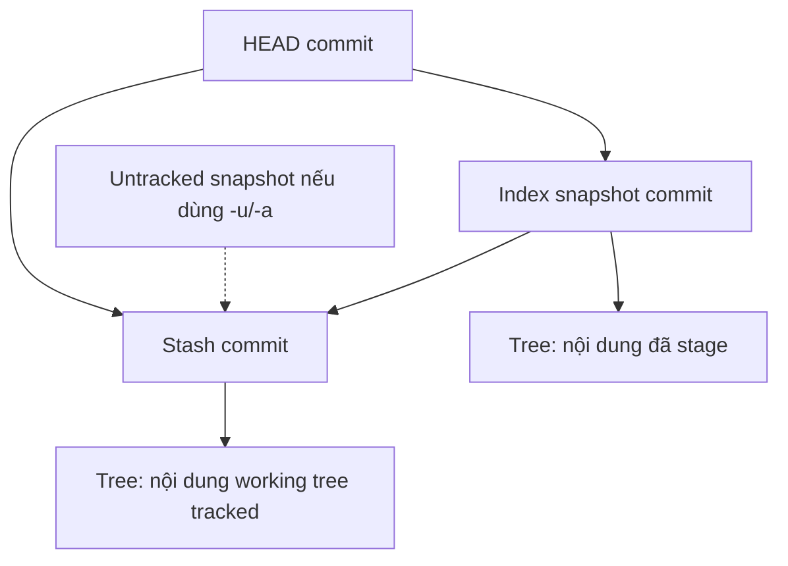
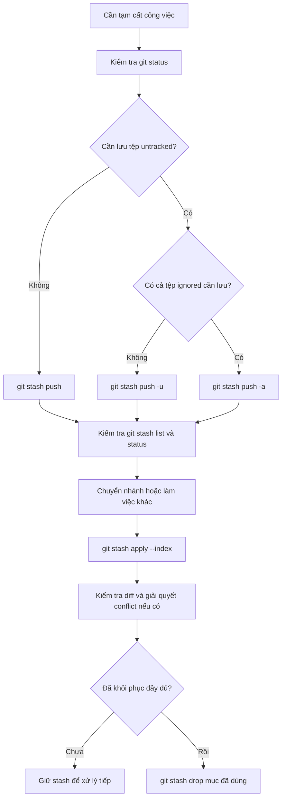

# Stash lưu tạm thay đổi nào và liên hệ với chỉ mục

Khi đang làm một tính năng, bạn có thể cần chuyển sang nhánh khác để xử lý lỗi khẩn cấp hoặc kiểm tra một thay đổi mà chưa muốn tạo commit. Nếu working tree còn sửa đổi, việc chuyển nhánh có thể bị Git từ chối hoặc làm các thay đổi đi theo sang nhánh khác. `git stash` giúp tạm cất công việc hiện tại để bạn quay lại sau.

Điều quan trọng là hiểu stash lưu những loại thay đổi nào và giữ trạng thái staging ra sao. Git phân biệt nội dung trong **working tree** với nội dung trong **index (staging area)**. Mặc định, stash ghi nhận cả thay đổi đã stage lẫn chưa stage của các tệp được Git theo dõi. Tệp untracked và ignored cần tùy chọn riêng. Bài học thuộc module `SOURCE_CONTROL_GIT`, nơi bạn học working tree, staging area, commit, branch, merge, rebase, remote và tag để cộng tác và khôi phục công việc an toàn.

## 1. Working tree, index và HEAD

Trước khi dùng stash, hãy phân biệt ba trạng thái:

- **HEAD**: commit hiện tại mà branch đang trỏ đến.
- **Index (staging area)**: nội dung bạn đã chọn bằng `git add` để đưa vào commit tiếp theo.
- **Working tree**: nội dung tệp hiện có trong thư mục làm việc; có thể chứa phần sửa đã stage và những sửa đổi mới hơn chưa stage.

Ví dụ, một tệp `src/search.java` có nội dung trong commit là `timeout = 30`. Bạn sửa thành `timeout = 45` rồi chạy `git add`, sau đó tiếp tục sửa thành `timeout = 60` mà chưa stage lần nữa. Lúc này:

| Vùng | Nội dung |
| --- | --- |
| HEAD | `timeout = 30` |
| Index | `timeout = 45` |
| Working tree | `timeout = 60` |

Hai lệnh sau cho thấy sự khác biệt giữa các vùng:

```bash
git diff -- src/search.java
git diff --cached -- src/search.java
```

`git diff` so sánh working tree với index, nên hiển thị phần thay đổi từ `45` thành `60`. `git diff --cached` so sánh index với HEAD, nên hiển thị phần thay đổi từ `30` thành `45`.

## 2. Mặc định stash lưu những thay đổi nào?

Lệnh cơ bản:

```bash
git stash push -m "WIP: search timeout"
```

Mặc định, Git lưu các thay đổi của tệp tracked ở cả hai nơi:

- Những thay đổi đã stage trong index.
- Những thay đổi chưa stage trong working tree so với index.

Sau khi lưu thành công, Git đưa các thay đổi tracked đó ra khỏi working tree và index để trở về trạng thái sạch theo HEAD. Vì vậy, nếu bạn đã stage một phần và tiếp tục sửa phần còn lại, stash vẫn ghi nhận cả hai trạng thái để có thể khôi phục sau.

Với ví dụ `timeout` ở trên, stash ghi nhận nội dung index là `45` và nội dung working tree là `60`. Sau khi stash thông thường hoàn tất, cả index và working tree trở lại nội dung `30` của HEAD.

### Những tệp không được lưu mặc định

| Loại tệp | Mặc định | Tùy chọn |
| --- | --- | --- |
| Tệp tracked đã sửa, đã stage hoặc chưa stage | Được lưu | Không cần tùy chọn thêm |
| Tệp mới chưa được theo dõi (untracked) | Không được lưu | `-u` hoặc `--include-untracked` |
| Tệp bị bỏ qua bởi `.gitignore` (ignored) | Không được lưu | `-a` hoặc `--all` |

Nếu công việc có tệp mới chưa được Git theo dõi, dùng:

```bash
git stash push -u -m "WIP: search feature with new test"
```

`-u` lưu cả tệp untracked, đồng thời dọn chúng khỏi working tree sau khi stash thành công. Nếu bạn cũng muốn lưu các tệp ignored, dùng:

```bash
git stash push -a -m "WIP: local build changes"
```

`-a` bao gồm cả tệp untracked và ignored. Hãy kiểm tra trước vì các tệp ignored có thể gồm thư mục build lớn, cache, file sinh tự động hoặc dữ liệu môi trường riêng. Không cần đưa chúng vào stash nếu mục tiêu chỉ là giữ phần sửa mã nguồn.

### Chỉ stash phần đã stage

Ở các phiên bản Git hỗ trợ tùy chọn `--staged`, bạn có thể chỉ cất thay đổi hiện đang nằm trong index:

```bash
git stash push --staged -m "Staged patch only"
```

Phần sửa chưa stage vẫn ở working tree. Điều này hữu ích khi bạn muốn tạm cất phần đã chọn cho commit nhưng tiếp tục làm việc với phần sửa khác. Nếu Git báo không nhận tùy chọn, hãy kiểm tra phiên bản Git đang dùng và tài liệu lệnh tương ứng.

### Giữ phần đã stage trong working tree

Tùy chọn `--keep-index` yêu cầu Git giữ nguyên các thay đổi đã stage trong index sau khi tạo stash:

```bash
git stash push --keep-index -m "Stash unstaged work"
```

Đây là cách hữu ích khi bạn đã stage phần muốn commit và muốn tạm cất phần chưa stage để kiểm thử đúng nội dung sẽ được commit. Khác với `--staged`, `--keep-index` điều khiển trạng thái index sau thao tác stash; nó không có nghĩa là stash chỉ ghi nhận các thay đổi staged.

## 3. Stash liên hệ với index như thế nào?

Stash không chỉ là một bản vá duy nhất của working tree. Về mặt cấu trúc Git, một stash thông thường là một commit đặc biệt ghi nhận trạng thái làm việc:

- Parent thứ nhất trỏ đến commit HEAD tại thời điểm tạo stash.
- Parent thứ hai là một commit phụ ghi lại nội dung index (staging area).
- Tree của commit stash ghi lại nội dung working tree của các tệp tracked tại thời điểm đó.
- Khi dùng `-u` hoặc `-a`, stash có thể có thêm một parent chứa snapshot các tệp untracked (và ignored nếu dùng `-a`).

Có thể minh họa quan hệ này như sau:



Trong sơ đồ, commit stash lưu tree của working tree, còn parent thứ hai lưu tree của index. Nhờ có cả hai snapshot, Git có thể phân biệt phần sửa đã stage với phần sửa chưa stage khi khôi phục đúng cách.

Bạn có thể kiểm tra cấu trúc stash mới nhất bằng:

```bash
git cat-file -p stash@{0}
```

Kết quả hiển thị các dòng `parent`. Parent đầu tiên là HEAD gốc, parent thứ hai là snapshot index. Xem nội dung của commit index:

```bash
git show --stat stash@{0}^2
```

Với repository có stash bao gồm untracked, có thể có parent thứ ba. Không nên phụ thuộc vào hash hoặc số parent cố định trong script nếu không kiểm tra loại stash trước.

### So sánh phần staged và unstaged đã được lưu

Giả sử `stash@{0}` là stash vừa tạo. Có thể xem phần staged tại thời điểm stash bằng cách so sánh HEAD gốc với snapshot index:

```bash
git diff stash@{0}^1 stash@{0}^2
```

Phần sửa tracked chưa stage được xem bằng cách so sánh snapshot index với tree của stash:

```bash
git diff stash@{0}^2 stash@{0}
```

Hai phép so sánh này làm rõ vì sao stash cần lưu riêng trạng thái index. Chúng hữu ích khi muốn kiểm tra chính xác phần nào đã được chọn vào staging area trước khi tạm cất.

## 4. Xem và quản lý các mục stash

Các mục stash được quản lý như một danh sách có thứ tự, thường hiển thị mục mới nhất ở đầu:

```bash
git stash list
```

Ví dụ:

```text
stash@{0}: On feature/search: WIP: search timeout
stash@{1}: On main: WIP: update deployment config
```

Xem tóm tắt thay đổi của mục mới nhất:

```bash
git stash show --stat stash@{0}
```

Xem patch:

```bash
git stash show -p stash@{0}
```

Nếu stash chứa untracked và bạn muốn xem cả chúng, dùng `--include-untracked`:

```bash
git stash show --include-untracked -p stash@{0}
```

Chỉ số `stash@{0}` có thể thay đổi khi bạn tạo hoặc xóa mục khác. Hãy chạy `git stash list` để xác nhận đúng mục trước khi apply, pop hoặc drop.

## 5. Khôi phục stash và phục hồi trạng thái index

Có hai lệnh thường dùng để áp dụng stash:

```bash
git stash apply stash@{0}
git stash pop stash@{0}
```

- `apply` áp dụng thay đổi vào working tree nhưng giữ mục stash trong danh sách.
- `pop` áp dụng thay đổi và xóa mục stash nếu áp dụng thành công. Nếu có conflict, Git thường giữ mục stash để bạn có thể xử lý.

Mặc định, khi áp dụng stash, Git không cố gắng phục hồi trạng thái staged ban đầu. Nếu muốn khôi phục cả trạng thái index, dùng `--index`:

```bash
git stash apply --index stash@{0}
```

Hoặc:

```bash
git stash pop --index stash@{0}
```

`--index` yêu cầu Git phục hồi cả thay đổi trong index và working tree như lúc stash được tạo. Việc này có thể thất bại nếu các thay đổi hiện tại hoặc conflict khiến Git không thể khôi phục index chính xác. Khi đó, giải quyết conflict, xem diff rồi stage thủ công những phần cần thiết.

Ví dụ quy trình có kiểm soát:

```bash
git stash list
git stash show -p stash@{0}
git stash apply --index stash@{0}
git status
git diff
git diff --cached
```

Sau khi xác nhận các thay đổi đã trở lại đúng nơi và không còn cần mục stash, mới xóa mục đó:

```bash
git stash drop stash@{0}
```

Nếu muốn xóa tất cả stash, lệnh là:

```bash
git stash clear
```

`clear` xóa toàn bộ tham chiếu stash của repository và có thể khiến các snapshot khó hoặc không thể tìm lại sau khi Git dọn object không còn được tham chiếu. Chỉ dùng khi bạn chắc chắn không cần bất kỳ mục stash nào.

## 6. Tình huống thực tế: stage một phần rồi tiếp tục sửa

Giả sử bạn đang phát triển tính năng tìm kiếm và muốn commit phần xử lý đầu vào trước, nhưng chưa muốn đưa phần log thử nghiệm vào commit.

Trạng thái ban đầu:

```bash
git status
```

Bạn stage tệp xử lý đầu vào, sau đó sửa thêm tệp log:

```bash
git add src/search.java
# Tiếp tục sửa src/search.java hoặc tệp khác sau khi stage
```

Kiểm tra hai vùng:

```bash
git diff --cached
git diff
```

Nếu cần tạm dừng và chuyển sang nhánh khác, stash cả hai trạng thái:

```bash
git stash push -u -m "WIP: search input and logging"
```

Sau khi xử lý công việc khác, quay lại nhánh ban đầu và khôi phục:

```bash
git switch feature/search
git stash apply --index stash@{0}
```

Kiểm tra lại:

```bash
git status
git diff --cached
git diff
```

Nếu khôi phục thành công, phần đã stage trước đó vẫn nằm trong index, phần sửa tiếp theo vẫn ở working tree. Bạn có thể tiếp tục hoàn thiện rồi commit theo từng phần.

## 7. Conflict và các giới hạn cần lưu ý

Stash được tạo từ một trạng thái cụ thể của repository. Nếu nhánh hiện tại đã thay đổi cùng dòng hoặc cùng vùng mã, việc apply có thể conflict. Khi đó:

```bash
git status
git diff
```

Mở từng tệp conflict, so sánh phần thay đổi trong stash với nội dung hiện tại, chỉnh sửa kết quả mong muốn rồi stage:

```bash
git add -- path/to/resolved-file
git diff --cached
```

Mục stash vẫn được giữ khi dùng `apply`, vì vậy bạn có thể đối chiếu hoặc thử lại sau khi đã xử lý. Đừng drop stash trước khi xác minh toàn bộ tệp tracked và untracked cần khôi phục.

Một số điểm cần nhớ:

- Stash nằm trong repository local và không tự được push lên remote như branch. Muốn chia sẻ công việc, hãy tạo branch và commit theo quy trình nhóm.
- Stash không thay thế backup dài hạn. Nếu thay đổi quan trọng, hãy commit trên một branch riêng để lưu lịch sử rõ ràng.
- Tệp untracked chỉ được lưu khi dùng `-u` hoặc `-a`; tệp ignored cần `-a`.
- `--index` cố gắng phục hồi trạng thái staging, nhưng có thể không thành công nếu có conflict hoặc index hiện tại không phù hợp.
- Nếu có nhiều mục stash, luôn kiểm tra danh sách và nội dung trước khi thao tác theo số thứ tự.

## 8. Quy trình chọn và dùng stash



Trước khi hoàn tất, hãy tự kiểm tra:

1. Tôi đã phân biệt thay đổi staged và unstaged chưa?
2. Công việc có tệp untracked hoặc ignored cần đưa vào stash không?
3. Tôi có cần giữ index như ban đầu khi apply bằng `--index` không?
4. Tôi đã xem đúng mục stash trước khi apply/pop/drop chưa?
5. Tôi đã xác minh working tree, index và các tệp cần khôi phục trước khi xóa stash chưa?

Stash ghi nhận trạng thái làm việc tạm thời, trong đó index có snapshot riêng để Git phân biệt phần đã stage với phần chưa stage. Khi hiểu đúng mối quan hệ này, bạn có thể tạm dừng công việc, chuyển ngữ cảnh và khôi phục lại trạng thái cần thiết mà không phải tạo commit chỉ để cất tạm thay đổi.

## Tài liệu tham khảo

- [Git documentation: git-stash](https://git-scm.com/docs/git-stash) — cách lưu, xem, áp dụng và quản lý stash.
- [Git documentation: git-diff](https://git-scm.com/docs/git-diff) — so sánh working tree, index và commit.
- [Pro Git: Stashing and Cleaning](https://git-scm.com/book/en/v2/Git-Tools-Stashing-and-Cleaning) — ví dụ sử dụng stash trong quá trình phát triển.
