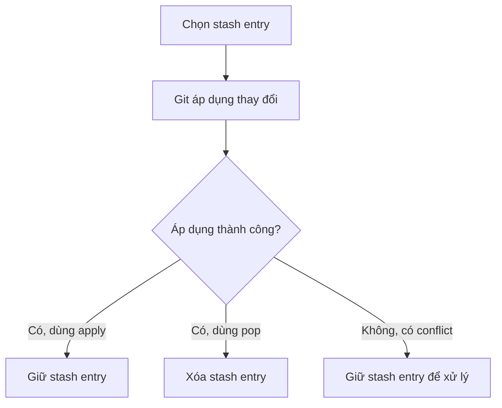

# Phân biệt `git stash apply` với `git stash pop`

Khi đang làm một việc dở dang nhưng cần chuyển sang branch khác, ta có thể dùng `git stash` để cất tạm các thay đổi trong working tree. Sau đó, Git cung cấp hai cách đưa thay đổi đã cất trở lại: **`git stash apply`** và **`git stash pop`**.

Hai lệnh đều áp dụng nội dung của một stash vào working tree hiện tại. Khác biệt quan trọng nằm ở cách xử lý stash entry sau khi áp dụng thành công: `apply` giữ entry trong danh sách stash để dùng lại; `pop` tự động xóa entry đó khỏi danh sách nếu việc áp dụng thành công. Nếu xảy ra conflict, `pop` không xóa entry, vì vậy ta vẫn còn bản stash để xử lý hoặc thử lại.

Hiểu rõ khác biệt này giúp tránh mất dấu thay đổi, đặc biệt khi đang chuyển branch, xử lý conflict hoặc cần áp dụng cùng một bộ thay đổi ở nhiều nơi.

## 1. Stash là gì và lưu những thay đổi nào?

**Stash** là cơ chế của Git để lưu tạm thay đổi chưa được commit, thường gồm thay đổi trong các tệp đã được Git theo dõi. Sau khi stash thành công, Git đưa working tree về trạng thái sạch theo commit hiện tại để ta có thể chuyển branch hoặc thực hiện công việc khác.

Ví dụ, ta đang sửa một tính năng nhưng chưa muốn tạo commit:

```bash
git status
git stash push -m "WIP: search form"
git status
```

Lệnh đầu tiên giúp kiểm tra thay đổi. Lệnh thứ hai lưu chúng vào stash với thông điệp mô tả. Sau khi stash thành công, các thay đổi được lưu tạm và working tree thường trở về trạng thái sạch.

### 1.1. Mặc định stash những gì?

Mặc định, `git stash push` lưu thay đổi của các tệp đã được Git theo dõi, bao gồm:

- Thay đổi chưa stage trong working tree.
- Thay đổi đã stage trong staging area.

Các tệp mới chưa được theo dõi (untracked) không được đưa vào stash mặc định. Nếu muốn lưu cả chúng, dùng `-u` hoặc `--include-untracked`:

```bash
git stash push -u -m "WIP: include new test files"
```

Nếu cần lưu cả tệp bị ignore, dùng `-a` hoặc `--all`:

```bash
git stash push -a -m "WIP: include ignored build output"
```

Hãy thận trọng với `-a`, vì nó có thể đưa cả tệp build, cache hoặc dữ liệu lớn vào stash. Stash không thay thế backup lâu dài và không tự đồng bộ các thay đổi lên remote.

### 1.2. Stash entry và danh sách stash

Mỗi lần stash thành công, Git tạo một stash entry mới. Có thể xem danh sách bằng:

```bash
git stash list
```

Ví dụ:

```text
stash@{0}: On feature/search: WIP: search form
stash@{1}: On main: WIP: update documentation
stash@{2}: On bugfix/login: WIP: reproduce timeout
```

`stash@{0}` là entry mới nhất; `stash@{1}` là entry trước đó. Số thứ tự có thể thay đổi khi thêm hoặc xóa entry. Vì vậy, hãy xem lại `git stash list` trước khi áp dụng hoặc xóa một entry cụ thể.

## 2. `git stash apply` hoạt động như thế nào?

`git stash apply` đưa thay đổi từ stash vào working tree hiện tại nhưng **giữ nguyên stash entry trong danh sách**.

Cú pháp cơ bản:

```bash
git stash apply
```

Nếu không chỉ định entry, Git áp dụng stash mới nhất, thường là `stash@{0}`. Có thể chỉ rõ entry:

```bash
git stash apply 'stash@{1}'
```

Sau khi áp dụng thành công:

- Thay đổi từ stash xuất hiện trong working tree hiện tại.
- Các thay đổi được áp dụng vào working tree; mặc định Git không khôi phục chính xác phần nào đã staged trước khi stash.
- Stash entry vẫn còn trong `git stash list`.
- Ta có thể áp dụng lại entry đó sau này, hoặc tự xóa khi chắc chắn không cần nữa.

Ví dụ:

```bash
git stash list
git stash apply 'stash@{0}'
git status
git stash list
```

Lệnh `git stash list` cuối vẫn hiển thị entry vừa áp dụng. Đây là điểm hữu ích khi muốn thử áp dụng thay đổi, kiểm tra kết quả rồi quyết định có giữ stash hay không.

### 2.1. Khi nào nên dùng `apply`?

Dùng `apply` khi:

- Muốn giữ một bản stash dự phòng trong lúc kiểm tra thay đổi.
- Cần áp dụng cùng một bộ thay đổi ở nhiều branch hoặc nhiều worktree.
- Muốn áp dụng trước, review và test, sau đó mới quyết định xóa stash.
- Đang xử lý một tình huống phức tạp và muốn có thể thử lại từ entry gốc.

Ví dụ, ta muốn thử đưa một bản sửa giao diện vào branch `feature/new-layout`, nhưng vẫn muốn giữ stash để có thể áp dụng lại trên branch khác:

```bash
git switch feature/new-layout
git stash apply 'stash@{0}'
```

Sau khi kiểm tra, có thể commit thay đổi. Stash gốc vẫn còn, nên ta cần tự quyết định khi nào xóa nó.

## 3. `git stash pop` hoạt động như thế nào?

`git stash pop` áp dụng thay đổi từ stash vào working tree hiện tại và **xóa stash entry khỏi danh sách nếu việc áp dụng thành công**.

Cú pháp:

```bash
git stash pop
```

Hoặc chỉ định entry:

```bash
git stash pop 'stash@{1}'
```

Có thể hiểu `pop` là thao tác kết hợp hai bước:

1. Áp dụng nội dung của stash vào working tree hiện tại.
2. Nếu áp dụng thành công, xóa entry đó khỏi stash list.

Ví dụ:

```bash
git stash list
git stash pop 'stash@{0}'
git status
git stash list
```

Nếu lệnh áp dụng thành công, entry vừa pop không còn trong danh sách. Những entry khác vẫn còn; số thứ tự của chúng có thể thay đổi do entry đã bị xóa.

### 3.1. Khi nào nên dùng `pop`?

Dùng `pop` khi:

- Chỉ cần lấy lại thay đổi một lần.
- Đã xác định đúng stash entry.
- Đang ở đúng branch hoặc trạng thái làm việc để nhận thay đổi.
- Không cần giữ entry đó làm bản dự phòng trong stash list sau khi áp dụng thành công.

Ví dụ, sau khi hoàn tất công việc khẩn cấp và quay lại branch ban đầu:

```bash
git switch feature/search
git stash list
git stash pop 'stash@{0}'
```

Sau khi lấy lại thay đổi, ta tiếp tục chỉnh sửa và commit như bình thường.

## 4. So sánh trực tiếp `apply` và `pop`

| Tiêu chí | `git stash apply` | `git stash pop` |
|---|---|---|
| Áp dụng thay đổi từ stash | Có | Có |
| Xóa entry sau khi áp dụng thành công | Không | Có |
| Có thể áp dụng lại cùng entry sau khi thành công | Có, vì entry còn trong danh sách | Không còn entry trong danh sách để pop/apply trực tiếp |
| Nếu áp dụng bị conflict | Entry vẫn còn | Entry cũng vẫn còn, không bị xóa |
| Phù hợp khi | Muốn giữ bản stash để kiểm tra hoặc dùng lại | Muốn lấy thay đổi ra và dọn entry ngay khi thành công |

Có thể hình dung luồng xử lý:



Điểm quan trọng: `pop` không có nghĩa là xóa stash trước rồi mới áp dụng. Git chỉ xóa entry sau khi áp dụng thành công. Nếu có conflict, entry vẫn còn để người dùng giải quyết.

## 5. `--index`: khôi phục cả trạng thái staged

Khi tạo stash, có thể một phần thay đổi đã được stage và phần khác vẫn chưa stage. Mặc định, khi áp dụng stash, Git không cố gắng khôi phục chính xác phần nào đã staged trước đó.

Nếu muốn Git cố gắng khôi phục cả trạng thái staging ban đầu, dùng `--index`:

```bash
git stash apply --index
```

Hoặc:

```bash
git stash pop --index
```

Có thể chỉ định entry cụ thể:

```bash
git stash apply --index 'stash@{1}'
```

Ví dụ ban đầu:

```bash
git add src/search.js
# tiếp tục sửa README.md nhưng chưa stage
git stash push -m "WIP: search and docs"
```

Stash lưu cả thay đổi đã stage trong `src/search.js` và thay đổi chưa stage trong `README.md`. Khi lấy lại:

```bash
git stash apply --index
git status
```

Git cố gắng đưa `src/search.js` trở lại staging area và `README.md` trở lại phần thay đổi chưa stage. Việc khôi phục index có thể thất bại nếu trạng thái hiện tại không tương thích hoặc xảy ra conflict; khi đó cần kiểm tra `git status` và giải quyết theo trạng thái Git báo.

`--index` không có nghĩa là tự commit thay đổi. Nó chỉ cố gắng khôi phục cách phân chia staged/unstaged đã được lưu trong stash.

## 6. Điều gì xảy ra khi `pop` gặp conflict?

Giả sử stash được tạo khi đang ở branch `feature/search`. Sau đó ta chuyển sang branch khác và có những thay đổi mới trong cùng tệp. Khi chạy:

```bash
git stash pop
```

Git có thể không tự kết hợp được các thay đổi và báo conflict.

Khi đó:

- Một hoặc nhiều tệp có thể ở trạng thái unmerged.
- Working tree có thể chứa các dấu đánh dấu conflict như `<<<<<<<`, `=======`, `>>>>>>>`.
- Stash entry vẫn được giữ trong danh sách vì thao tác pop chưa áp dụng thành công hoàn toàn.
- Ta cần giải quyết conflict, kiểm tra kết quả và quyết định giữ hoặc xóa stash entry sau đó.

### 6.1. Các bước giải quyết

**Bước 1: Kiểm tra trạng thái**

```bash
git status
git stash list
```

Xác định các tệp đang conflict và ghi nhớ stash entry cần giữ. Đừng giả định stash đã bị xóa chỉ vì đã chạy `pop`.

**Bước 2: Giải quyết nội dung**

Mở từng tệp conflict, kết hợp nội dung đúng theo mục tiêu công việc và xóa các dấu đánh dấu conflict. Không chọn toàn bộ một phía một cách máy móc nếu hai phía đều có thay đổi cần giữ.

**Bước 3: Đánh dấu đã giải quyết và kiểm tra**

```bash
git add <file-da-giai-quyet>
git diff --cached
git status
```

Chạy test phù hợp để chắc chắn nội dung cuối cùng hoạt động đúng. Nếu có tệp cần giữ ở trạng thái chưa stage, hãy kiểm tra staging area và điều chỉnh lại sau khi giải quyết conflict.

**Bước 4: Quyết định xử lý stash entry**

Vì `pop` gặp conflict nên entry vẫn còn. Nếu muốn giữ để tham khảo hoặc thử lại, không cần làm gì với entry. Nếu đã xác nhận nội dung được khôi phục đầy đủ và không cần bản stash nữa, xem danh sách rồi xóa đúng entry:

```bash
git stash list
git stash drop 'stash@{0}'
```

Hãy kiểm tra lại số thứ tự ngay trước khi drop. Nếu có stash mới được tạo trong lúc xử lý, entry cần xóa có thể không còn là `stash@{0}`.

### 6.2. Không áp dụng lặp lại khi chưa kiểm tra trạng thái

Sau conflict, không nên chạy `git stash apply` hoặc `git stash pop` thêm lần nữa một cách vội vàng. Một phần thay đổi từ stash có thể đã được đưa vào working tree, nên áp dụng lại có thể gây trùng lặp hoặc tạo thêm conflict.

Trước tiên, giải quyết trạng thái hiện tại. Nếu muốn bắt đầu lại từ trạng thái trước lần áp dụng, cần xác định rõ những thay đổi nào thuộc stash, những thay đổi nào đã có sẵn và cách hoàn nguyên an toàn. Không dùng `git reset --hard` hoặc `git clean` chỉ để làm working tree trống nếu chưa xác nhận chúng không xóa công việc khác.

## 7. Chọn đúng stash entry

Khi có nhiều stash, nên xem nội dung trước khi apply hoặc pop:

```bash
git stash list
git stash show --stat 'stash@{1}'
git stash show -p 'stash@{1}'
```

- `git stash list` hiển thị các entry và thông điệp.
- `git stash show --stat` hiển thị tóm tắt tệp thay đổi.
- `git stash show -p` hiển thị patch chi tiết.

Sau khi xác định đúng entry, chỉ định rõ trong lệnh:

```bash
git stash apply 'stash@{1}'
```

Hoặc:

```bash
git stash pop 'stash@{1}'
```

Việc đặt `stash@{n}` trong dấu nháy đơn giúp tránh một số shell diễn giải dấu ngoặc nhọn như cú pháp riêng. Có thể dùng cách viết này trong PowerShell và các shell phổ biến.

## 8. Xóa stash entry khi nào và bằng cách nào?

`apply` giữ stash entry, nên sau khi kiểm tra và commit thay đổi, ta có thể xóa entry nếu không còn cần:

```bash
git stash list
git stash drop 'stash@{0}'
```

`git stash drop` xóa một entry cụ thể. Nếu không chỉ định entry, Git xóa entry mới nhất (`stash@{0}`). Hãy chỉ rõ entry nếu danh sách có nhiều mục.

`git stash clear` xóa toàn bộ stash entry:

```bash
git stash clear
```

Đây là thao tác rộng và khó khôi phục hơn nhiều so với `drop`; chỉ dùng khi thực sự muốn xóa toàn bộ danh sách stash. Không dùng `clear` như cách dọn dẹp mặc định sau mỗi lần apply/pop.

Một quy trình kiểm soát rõ ràng với `apply` là:

```bash
git stash apply 'stash@{0}'
# kiểm tra, chạy test và commit nếu phù hợp
git status
git stash list
git stash drop 'stash@{0}'
```

Lưu ý: nếu tạo hoặc xóa stash khác trong lúc làm, số thứ tự có thể đổi. Hãy xem lại danh sách trước lệnh `drop`.

## 9. Dùng `git stash branch` khi branch hiện tại không còn phù hợp

Đôi khi stash được tạo từ một branch cũ, nhưng branch hiện tại đã thay đổi quá nhiều nên apply/pop gây conflict. Git có lệnh:

```bash
git stash branch recover-search 'stash@{0}'
```

Lệnh này tạo branch mới từ commit mà stash được tạo ra, chuyển sang branch đó và áp dụng thay đổi của stash. Nếu áp dụng thành công, entry được xóa khỏi stash list. Cách này hữu ích khi muốn khôi phục thay đổi trong bối cảnh gần với lúc stash được tạo.

Nếu `git stash branch` gặp lỗi khi áp dụng, kiểm tra trạng thái và danh sách stash trước khi làm tiếp. Không xóa entry thủ công cho đến khi xác nhận các thay đổi đã được khôi phục.

## 10. Ví dụ quy trình thực tế

Giả sử đang phát triển tính năng tìm kiếm nhưng phải chuyển sang branch `hotfix/payment` để sửa lỗi khẩn cấp.

### Bước 1: Cất công việc hiện tại

```bash
git status
git stash push -u -m "WIP: search filters"
```

`-u` giúp lưu cả tệp mới chưa được theo dõi, ví dụ tệp test vừa tạo.

### Bước 2: Chuyển sang branch khẩn cấp

```bash
git switch hotfix/payment
# sửa lỗi thanh toán
git add src/payment.js
git commit -m "fix: handle payment timeout"
```

### Bước 3: Quay lại branch tính năng

```bash
git switch feature/search
git stash list
git stash show --stat 'stash@{0}'
```

Kiểm tra đúng stash `WIP: search filters`.

### Bước 4: Chọn cách khôi phục

Nếu muốn giữ stash để có thể dùng lại hoặc kiểm tra trước:

```bash
git stash apply 'stash@{0}'
```

Nếu muốn khôi phục một lần và xóa entry khi thành công:

```bash
git stash pop 'stash@{0}'
```

Sau khi khôi phục, kiểm tra:

```bash
git status
git diff
```

Nếu có conflict, giải quyết và kiểm thử. Nếu dùng `pop`, stash entry vẫn còn cho đến khi việc áp dụng thành công. Nếu dùng `apply`, entry vẫn còn dù áp dụng thành công; ta tự drop khi không cần nữa.

## 11. Các hiểu lầm thường gặp

### “`apply` và `pop` đều xóa stash sau khi khôi phục”

Chỉ `pop` tự xóa entry khi áp dụng thành công. `apply` luôn giữ entry trong stash list.

### “`pop` xóa stash trước khi áp dụng”

Không. Git áp dụng trước và chỉ xóa entry nếu thành công. Nếu có conflict, entry vẫn còn.

### “Áp dụng thành công nghĩa là thay đổi đã được commit”

Không. Cả `apply` và `pop` chỉ đưa thay đổi trở lại working tree/staging area theo cách được chọn. Người dùng vẫn phải review, test và commit nếu muốn lưu thành commit mới.

### “Stash mặc định chứa mọi tệp mới”

Không. Tệp untracked cần `-u`; tệp ignored cần `-a`. Hãy chọn tùy chọn đúng với nội dung cần cất.

### “`--index` là tạo commit”

Không. `--index` yêu cầu khôi phục trạng thái staged ban đầu khi áp dụng stash. Nó không tạo commit.

### “Có thể apply lại sau conflict mà không cần kiểm tra”

Không nên. Working tree có thể đã nhận một phần thay đổi. Hãy giải quyết hoặc khôi phục trạng thái hiện tại trước khi thử lại.

## 12. Ghi nhớ

- `git stash apply` áp dụng thay đổi và giữ stash entry.
- `git stash pop` áp dụng thay đổi rồi xóa entry nếu áp dụng thành công.
- Nếu `pop` gặp conflict, entry vẫn còn; kiểm tra `git stash list` để xác nhận.
- `--index` yêu cầu Git cố gắng khôi phục trạng thái staged/unstaged ban đầu.
- Mặc định stash lưu thay đổi của tệp tracked; dùng `-u` cho untracked và `-a` cho cả ignored.
- Dùng `git stash show -p` để xem patch trước khi khôi phục.
- `git stash drop` xóa một entry; `git stash clear` xóa toàn bộ danh sách.
- `git stash branch` có thể hữu ích khi cần khôi phục stash trên branch bắt đầu từ commit gốc của nó.

Hãy chọn `apply` khi muốn giữ lại bản stash để kiểm tra hoặc tái sử dụng; chọn `pop` khi đã sẵn sàng lấy thay đổi ra và dọn entry sau khi áp dụng thành công. Dù chọn lệnh nào, hãy kiểm tra working tree và giải quyết conflict cẩn thận trước khi commit.
