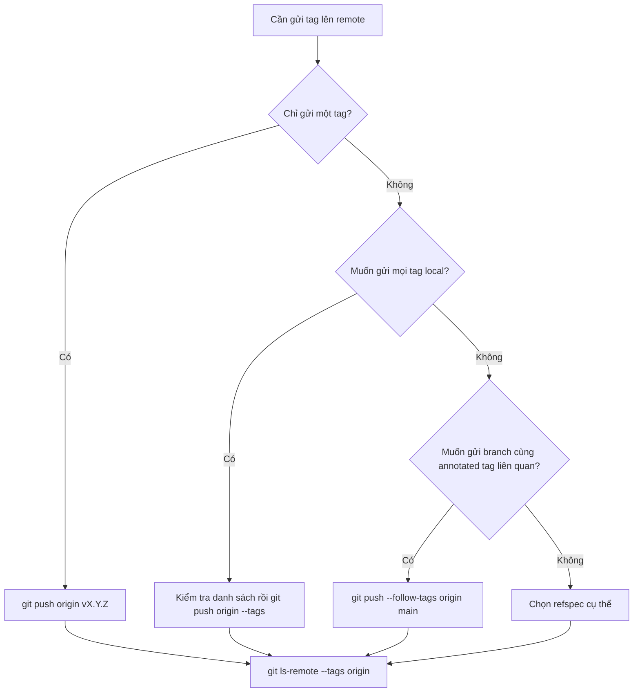

# Đẩy từng tag, --tags và --follow-tags

Tag đánh dấu một đối tượng cụ thể trong lịch sử Git, thường là commit đại diện cho một bản phát hành. Tạo tag trong repository local chưa làm tag xuất hiện trên máy chủ. Muốn đồng đội hoặc hệ thống CI/CD nhìn thấy mốc phiên bản đó, bạn cần push tag lên remote.

Git hỗ trợ nhiều cách đẩy tag: chỉ định một tag cụ thể, dùng `--tags` để đẩy toàn bộ tag local, hoặc dùng `--follow-tags` để đẩy các annotated tag liên quan đến những ref đang được push. Chọn đúng cách giúp phát hành đúng phiên bản và tránh đưa nhầm tag thử nghiệm lên repository dùng chung.

Bài học thuộc chương **Tag và mốc phiên bản** của module `SOURCE_CONTROL_GIT`. Module hướng dẫn từ working tree, staging area, commit và lịch sử đến branch, merge, rebase, remote và tag; tag giúp nhóm đánh dấu mốc quan trọng và phối hợp phát hành có thể truy vết.

## 1. Tag là gì và vì sao phải push?

Tag là một ref có tên, thường nằm trong `refs/tags/`, trỏ đến một đối tượng Git. Trong quy trình phát hành, tag thường trỏ đến commit đã được kiểm tra và chọn làm phiên bản, ví dụ `v1.4.0`.

Tag được tạo trong repository local. Các lệnh `git tag` và `git show` cho phép quản lý, xem tag trên máy của bạn, nhưng chúng không tự gửi tag lên remote. Vì vậy, sau khi tạo tag, bạn cần push tag nếu muốn remote, đồng đội hoặc pipeline phát hành sử dụng được mốc đó.

Xem tag local:

```bash
git tag --list
git tag --list "v1.*"
git show v1.4.0
```

Tag không tự di chuyển theo branch. Nếu branch `main` có commit mới, tag `v1.4.0` vẫn trỏ đến đối tượng đã được đánh dấu ban đầu. Đây là đặc điểm giúp tag dùng làm mốc phiên bản ổn định.

## 2. Phân biệt annotated tag và lightweight tag

Git có hai kiểu tag thường gặp:

| Kiểu | Cách tạo | Đặc điểm |
| --- | --- | --- |
| Lightweight | `git tag v1.4.0` | Một ref đơn giản trỏ trực tiếp đến đối tượng được đánh dấu, không có tag object riêng |
| Annotated | `git tag -a v1.4.0 -m "Release v1.4.0"` | Tạo tag object chứa tagger, thời gian, thông điệp và có thể có chữ ký |

Với mốc phát hành, annotated tag thường phù hợp hơn vì lưu được người tạo, thời điểm và thông điệp. Nếu dự án yêu cầu xác thực nguồn gốc phát hành, có thể dùng tag có chữ ký như `git tag -s` và xác minh chữ ký theo chính sách của nhóm.

Ví dụ tạo annotated tag cho commit hiện tại:

```bash
git tag -a v1.4.0 -m "Release v1.4.0"
```

Hoặc chỉ định rõ commit cần đánh dấu:

```bash
git tag -a v1.4.0 8ac41d2 -m "Release v1.4.0"
```

Trước khi push, kiểm tra tag đang trỏ đến đâu:

```bash
git show --no-patch v1.4.0
git cat-file -t v1.4.0
```

Với annotated tag, `git cat-file -t` thường trả về `tag` vì tên tag trỏ đến một tag object. Với lightweight tag trỏ trực tiếp đến commit, lệnh thường trả về `commit`. `git show` giúp xem commit đích và thông tin chú giải của annotated tag.

## 3. Push một tag cụ thể

Đây là cách có phạm vi rõ ràng nhất khi bạn chỉ muốn công bố một mốc phiên bản:

```bash
git push origin v1.4.0
```

Lệnh gửi tag `v1.4.0` từ local lên remote `origin`. Bạn cũng có thể viết refspec đầy đủ:

```bash
git push origin refs/tags/v1.4.0:refs/tags/v1.4.0
```

Phần trước dấu `:` là ref nguồn ở local; phần sau là ref đích trên remote. Cách viết đầy đủ hữu ích trong script vì nêu rõ namespace `refs/tags/` và tránh nhầm tên tag với branch.

Nếu một tag chưa được push, lệnh trên tạo tag tương ứng trên remote. Nếu remote đã có tag cùng tên nhưng trỏ đến đối tượng khác, Git thường từ chối cập nhật tag. Hãy kiểm tra tag local và remote trước khi quyết định cách xử lý; tag phát hành đã công bố thường nên được xem là bất biến.

Kiểm tra tag trên remote:

```bash
git ls-remote --tags origin
```

Với annotated tag, kết quả thường có hai dòng: một dòng cho tag object và một dòng có hậu tố `^{}` cho đối tượng mà tag trỏ đến sau khi peel. Nếu chỉ muốn liệt kê tag ref mà không hiển thị dòng peeled:

```bash
git ls-remote --tags --refs origin
```

Bạn cũng có thể xem các tag local đã có:

```bash
git tag --list
```

## 4. Dùng --tags để push toàn bộ tag local

Khi cần gửi tất cả tag local lên một remote, dùng:

```bash
git push origin --tags
```

`--tags` yêu cầu Git push tất cả ref trong namespace `refs/tags/` lên remote. Phạm vi này bao gồm cả annotated tag và lightweight tag. Tùy chọn này có thể gửi nhiều tag hơn bạn dự định, chẳng hạn tag thử nghiệm, tag nội bộ hoặc mốc của nhánh chưa phát hành.

Trước khi dùng, hãy kiểm tra danh sách tag:

```bash
git tag --list
git tag --list "v*"
```

Nếu repository chứa nhiều loại tag, hãy cân nhắc push từng tag phát hành thay vì dùng `--tags` một cách máy móc. Điều này đặc biệt quan trọng trong CI/CD, nơi một tag mới có thể kích hoạt pipeline build hoặc deploy.

`--tags` bổ sung việc push tất cả tag vào thao tác push. Ví dụ:

```bash
git push --tags origin main
```

Lệnh này push branch `main` theo refspec đã nêu và đồng thời push các tag local. Nếu chỉ muốn gửi tag, không cần chỉ định branch:

```bash
git push origin --tags
```

## 5. Dùng --follow-tags để push tag liên quan

Trong quy trình thường ngày, bạn có thể push branch sau khi merge commit phát hành và muốn gửi kèm các annotated tag liên quan đến lịch sử vừa push. Dùng:

```bash
git push --follow-tags origin main
```

`--follow-tags` yêu cầu Git push các **annotated tag** trong `refs/tags/` mà đối tượng được tag có thể truy cập từ các ref đang được push và tag đó chưa có trên remote. Tùy chọn này không đẩy tất cả tag local; nó chỉ theo các tag liên quan đến ref được push.

Điểm cần nhớ:

- `--follow-tags` chỉ tự theo kèm annotated tag.
- Lightweight tag không được đẩy bằng cơ chế follow-tags.
- Tag phải liên quan đến lịch sử của ref đang được push và chưa tồn tại trên remote.
- Branch/ref được chỉ định vẫn được push theo quy tắc bình thường.

Nếu muốn `git push` mặc định sử dụng hành vi này, có thể bật cấu hình:

```bash
git config --global push.followTags true
```

Hoặc chỉ bật trong repository hiện tại:

```bash
git config --local push.followTags true
```

Kiểm tra giá trị cấu hình:

```bash
git config --show-origin --get push.followTags
```

Khi bật cấu hình, bạn vẫn nên biết ref nào đang được push và tag nào sẽ được theo kèm. Đối với thao tác phát hành cần tính xác định cao, push rõ tên tag cụ thể vẫn dễ review nhất.

## 6. So sánh ba cách push tag

| Cách push | Phạm vi tag được gửi | Kiểu tag | Trường hợp phù hợp |
| --- | --- | --- | --- |
| `git push origin v1.4.0` | Chỉ tag được chỉ định | Annotated hoặc lightweight | Công bố một phiên bản cụ thể |
| `git push origin --tags` | Tất cả tag local | Annotated và lightweight | Đồng bộ toàn bộ tag khi đã kiểm tra danh sách |
| `git push --follow-tags origin main` | Tag liên quan đến ref đang push và chưa có trên remote | Chỉ annotated | Push branch kèm các mốc annotated tag liên quan |

Không nên coi ba cách này là tương đương. Chọn theo phạm vi bạn muốn công bố, kiểu tag dự án sử dụng và quy trình phát hành của nhóm.

## 7. Quy trình phát hành với một tag cụ thể

Giả sử nhóm chuẩn bị phát hành phiên bản `v2.3.0` từ commit đã được review và tích hợp vào `main`.

Trước hết cập nhật branch và kiểm tra trạng thái:

```bash
git switch main
git pull --ff-only origin main
git status
git log --oneline --decorate -5
```

Đảm bảo working tree sạch và commit phát hành đúng là HEAD hoặc chỉ định chính xác commit đã được duyệt. Tạo annotated tag:

```bash
git tag -a v2.3.0 -m "Release v2.3.0"
```

Kiểm tra trước khi công bố:

```bash
git show v2.3.0
git cat-file -t v2.3.0
git tag --list "v2.3.0"
```

Push branch nếu commit chưa có trên remote, rồi push tag cụ thể:

```bash
git push origin main
git push origin v2.3.0
```

Nếu commit đã có trên remote, bạn có thể chỉ cần push tag. Cuối cùng xác minh remote đã nhận tag:

```bash
git ls-remote --tags --refs origin
```

Trong môi trường CI/CD, pipeline có thể bắt đầu ngay khi tag được push. Hãy xác nhận tag trỏ đúng commit, thông điệp và quy ước đặt tên trước khi gửi.

## 8. Xử lý tag đã tồn tại hoặc cần xóa

Git không cho phép push một tag mới ghi đè tag đã tồn tại trên remote theo cách thông thường. Nếu tag local và remote cùng tên nhưng khác đích, trước tiên kiểm tra cả hai:

```bash
git show v2.3.0
git ls-remote --tags origin "refs/tags/v2.3.0*"
```

Với tag phát hành đã công bố, nên giữ nguyên mốc cũ và tạo tag phiên bản mới nếu cần phát hành lại. Việc di chuyển tag đã phát hành có thể làm đồng đội và pipeline hiểu cùng một tên phiên bản theo hai commit khác nhau. Không dùng `--force` để cập nhật tag dùng chung nếu chưa có quyết định rõ ràng từ người quản lý phát hành.

Nếu nhóm xác nhận tag bị tạo nhầm và chính sách cho phép xóa, cần xóa riêng ở local và remote:

```bash
git tag -d v2.3.0
git push origin --delete v2.3.0
```

Lệnh đầu xóa tag local. Lệnh thứ hai xóa `refs/tags/v2.3.0` trên remote. Xóa ở một nơi không tự xóa ở nơi còn lại. Sau đó kiểm tra lại bằng `git tag --list` và `git ls-remote --tags origin`.

## 9. Những lỗi thường gặp

- **Tạo tag local rồi cho rằng đồng đội đã thấy tag**: tag chỉ có trên máy bạn cho đến khi push.
- **Dùng `--tags` khi chỉ muốn công bố một phiên bản**: lệnh có thể gửi cả tag thử nghiệm hoặc tag nội bộ.
- **Nghĩ `--follow-tags` gửi mọi tag**: tùy chọn này chỉ theo kèm annotated tag liên quan đến ref đang push.
- **Dùng lightweight tag rồi mong `--follow-tags` gửi kèm**: lightweight tag không được follow-tags tự động đẩy.
- **Push tag trước khi xác nhận commit đích**: tag có thể đánh dấu nhầm commit và kích hoạt pipeline sai phiên bản.
- **Di chuyển tag phát hành đã công bố**: có thể làm lịch sử phiên bản giữa các bản clone và hệ thống triển khai không nhất quán.
- **Xóa tag local nhưng quên tag remote**: tag trên máy chủ vẫn còn và người khác tiếp tục fetch được.
- **Quên kiểm tra tag remote**: `git tag --list` chỉ hiển thị tag local; dùng `git ls-remote --tags` để xem tag mà remote đang quảng bá.

## 10. Sơ đồ chọn cách push



Trước khi push, hãy tự kiểm tra:

1. Tag đã trỏ đến đúng commit phát hành chưa?
2. Tag là annotated hay lightweight?
3. Tôi chỉ cần push một tag, tất cả tag local hay tag annotated liên quan đến branch đang push?
4. Remote đã có tag cùng tên chưa và có trỏ đến cùng đối tượng không?
5. Tôi đã xác minh tag xuất hiện trên remote sau khi push chưa?

Tag là mốc tham chiếu quan trọng trong lịch sử phát hành. Push từng tag phù hợp khi cần kiểm soát chính xác một phiên bản; `--tags` hữu ích khi cần đồng bộ mọi tag; `--follow-tags` phù hợp khi muốn gửi branch cùng annotated tag liên quan. Kiểm tra tag và commit đích trước khi push giúp nhóm phát hành đúng mốc và giữ lịch sử phiên bản nhất quán.

## Tài liệu tham khảo

- [Git documentation: git-push](https://git-scm.com/docs/git-push) — các tùy chọn `--tags` và `--follow-tags`.
- [Git documentation: git-tag](https://git-scm.com/docs/git-tag) — tạo, xem, xóa annotated và lightweight tag.
- [Git documentation: git-ls-remote](https://git-scm.com/docs/git-ls-remote) — kiểm tra ref và tag mà remote quảng bá.
- [Pro Git: Tagging](https://git-scm.com/book/en/v2/Git-Basics-Tagging) — cách sử dụng tag để đánh dấu phiên bản.
