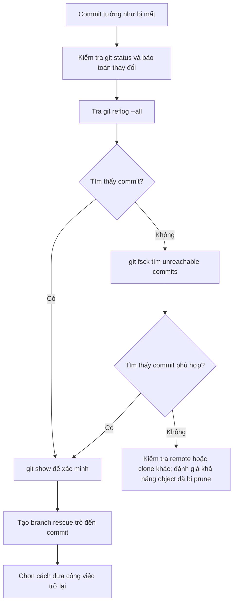

# Tìm commit bị mất sau reset, xóa nhánh hoặc rebase

Đôi khi một thao tác Git khiến commit tưởng như biến mất: bạn chạy `git reset` nhầm đích, xóa branch đã chứa công việc, hoặc hoàn tất một lần rebase rồi nhận ra lịch sử mới không đúng mong muốn. Trong nhiều trường hợp, commit vẫn còn trong cơ sở dữ liệu Git nhưng không còn được branch hay tag nào tham chiếu. Bạn có thể tìm lại chúng bằng **reflog**; nếu reflog không còn dấu vết, `git fsck` có thể giúp tìm các commit không còn được tham chiếu.

Điều quan trọng đầu tiên là ngừng các thao tác có thể làm mất dấu dữ liệu, kiểm tra trạng thái hiện tại và giữ lại mã commit tìm được bằng một branch cứu hộ. Đừng vội chạy thêm reset, garbage collection hoặc prune khi chưa xác định được commit cần phục hồi.

## 1. Vì sao commit có thể trông như bị mất?

Git lưu commit dưới dạng object. Branch và tag là các tham chiếu trỏ đến object đó. Khi một branch bị di chuyển hoặc bị xóa, commit cũ có thể không còn được tham chiếu bởi tên branch quen thuộc, nhưng object của commit chưa nhất thiết bị xóa ngay.

Một số tình huống phổ biến:

- **Reset nhầm:** `git reset --hard HEAD~2` di chuyển branch về commit cũ hơn; các commit vừa rời khỏi đầu branch không còn được branch đó tham chiếu.
- **Xóa branch:** `git branch -D feature/payment` xóa tên branch local. Các commit chỉ được giữ bởi branch đó có thể trở thành unreachable.
- **Rebase:** Git tạo lại commit trên base mới với mã commit khác. Các commit trước rebase có thể không còn nằm trên lịch sử branch mới.
- **Amend hoặc squash:** `git commit --amend` hay squash tạo commit mới thay thế commit cũ trên branch; commit cũ có thể vẫn còn trong reflog một thời gian.
- **Checkout hoặc reset nhiều lần:** các lần di chuyển HEAD khiến vị trí cũ khó nhận ra nếu chỉ nhìn `git log` hiện tại.

Một commit được gọi là *unreachable* khi không thể đi tới nó từ các ref hoặc root được Git xét trong phép kiểm tra tương ứng. Điều đó không có nghĩa object đã bị xóa khỏi database ngay lập tức. Reflog ghi lại các lần cập nhật ref để bạn có thể lần lại những vị trí trước đó.

## 2. Bảo toàn trạng thái trước khi tìm commit

Khi nhận ra commit bị mất, hãy dừng các thao tác thay đổi lịch sử và bắt đầu bằng việc xem trạng thái:

```bash
git status
git branch --all --verbose
git log --oneline --decorate --graph --all -20
```

Các lệnh này cho biết working tree có thay đổi chưa commit hay không, những branch/ref nào còn tồn tại và lịch sử hiện tại đang trỏ đến đâu.

Nếu có thay đổi local chưa được lưu mà bạn cần giữ, hãy sao lưu working tree hoặc commit/stash theo tình huống trước khi thử chuyển branch hay khôi phục. Nếu nghi ngờ dữ liệu quan trọng sắp bị garbage collection loại bỏ, có thể tạo bản sao repository trước khi tiếp tục. Không chạy `git gc`, `git prune`, `git reflog expire` hoặc các lệnh dọn object để “sửa” tình trạng này.

## 3. Tìm commit cũ bằng git reflog

**Reflog** là nhật ký cục bộ ghi lại các lần một ref được cập nhật. Nó thường lưu lại những vị trí HEAD hoặc branch từng trỏ tới, bao gồm cả các lần commit, reset, rebase và checkout.

Để xem lịch sử di chuyển của HEAD:

```bash
git reflog
```

Để xem rõ thời gian:

```bash
git reflog --date=iso
```

Để tìm trong các reflog của nhiều ref trong repository:

```bash
git reflog --all --date=iso
```

Ví dụ output:

```text
9ab12cd HEAD@{0}: reset: moving to HEAD~2
6de34fa HEAD@{1}: commit: add payment validation
3bc45de HEAD@{2}: commit: add payment endpoint
```

Trong ví dụ này, branch hiện tại đã reset về vị trí cũ hơn. Hai dòng phía sau cho thấy các commit từng là HEAD trước thao tác reset. Mã object ở đầu mỗi dòng là điều cần ghi lại để kiểm tra tiếp.

Có thể xem reflog của một branch cụ thể nếu branch đó vẫn tồn tại:

```bash
git reflog show main --date=iso
```

`git reflog` không phải nhật ký tập trung trên remote. Đây là dữ liệu local của repository hiện tại; một máy clone khác có thể có reflog khác. Reflog cũng có thời hạn lưu và có thể bị dọn theo cấu hình, nên không đảm bảo giữ mọi commit vô thời hạn.

## 4. Xác định đúng commit trước khi phục hồi

Không nên tạo branch cứu hộ chỉ dựa vào một mã commit nhìn thấy trong reflog mà chưa kiểm tra nội dung. Dùng `git show` để xem thông tin và thay đổi của commit:

```bash
git show --stat --oneline 6de34fa
git show 6de34fa
```

Để xem lịch sử từ commit đó:

```bash
git log --oneline --decorate --graph -10 6de34fa
```

Hãy xác minh:

- Commit message có đúng với công việc bạn đang tìm không?
- Tác giả và thời gian có phù hợp với lần làm việc bị mất không?
- Danh sách tệp thay đổi có chứa phần code hoặc tài liệu cần phục hồi không?
- Commit cha và các commit liên quan có đúng thứ tự mong muốn không?

Nếu cần xem nội dung một tệp tại commit đó:

```bash
git show 6de34fa:src/payment/PaymentService.java
```

Lệnh này đọc nội dung tệp tại commit được chỉ định mà không thay đổi working tree.

## 5. Tạo branch cứu hộ để giữ commit tìm được

Khi đã xác định đúng commit, cách an toàn và dễ kiểm tra là tạo một branch mới trỏ đến commit đó:

```bash
git branch rescue/payment-work 6de34fa
```

Lệnh này tạo ref `rescue/payment-work` tại commit `6de34fa`; nó không chuyển branch hiện tại và không ghi đè nội dung working tree. Xác nhận branch đã tồn tại:

```bash
git branch --list "rescue/*"
git log --oneline --decorate -5 rescue/payment-work
```

Sau khi có branch cứu hộ, commit được giữ bởi một ref rõ ràng và không còn chỉ phụ thuộc vào thời hạn của reflog. Bạn có thể chuyển sang branch cứu hộ để tiếp tục kiểm tra khi working tree phù hợp:

```bash
git switch rescue/payment-work
```

Nếu đang có thay đổi chưa commit, hãy xử lý hoặc sao lưu chúng trước khi switch. Nếu tên branch cứu hộ đã tồn tại, chọn tên khác thay vì ghi đè một ref có thể đang giữ công việc khác.

## 6. Phục hồi sau khi chạy git reset nhầm

Giả sử lịch sử ban đầu là:

```text
A---B---C---D  (HEAD -> feature/payment)
```

Bạn vô tình chạy:

```bash
git reset --hard HEAD~2
```

Branch hiện trỏ về `B`; `C` và `D` không còn nằm trên đầu branch. Nếu reflog còn ghi lại vị trí cũ, hãy tìm mã commit `D`:

```bash
git reflog --date=iso
```

Sau khi xác minh đúng mã commit, giữ lại bằng branch cứu hộ:

```bash
git branch rescue/payment-before-reset <commit-D>
```

Giờ bạn có thể xem lại nội dung của `D` hoặc chuyển sang branch cứu hộ. Nếu mục tiêu là đưa branch `feature/payment` trở lại vị trí `D`, hãy xác nhận working tree đã được bảo toàn và branch hiện tại đúng là branch cần di chuyển. Sau đó mới cân nhắc reset branch đó đến commit đã cứu hộ. Việc tạo branch cứu hộ trước giúp giữ một tham chiếu đến commit cũ ngay cả khi bạn tiếp tục thử nghiệm.

Lưu ý rằng nếu lệnh ban đầu là `--hard`, thay đổi chưa commit trong working tree có thể đã bị ghi đè. Reflog giúp tìm commit, nhưng không tự khôi phục những nội dung chưa từng được commit hoặc lưu ở nơi khác.

## 7. Phục hồi branch đã bị xóa

Giả sử bạn xóa nhầm branch local:

```bash
git branch -D feature/payment
```

Nếu branch chỉ tồn tại local, tên branch đã bị xóa có thể không còn trong `git branch`. Hãy tìm commit cuối cùng của branch qua reflog:

```bash
git reflog --all --date=iso
git reflog show HEAD --date=iso
```

Tìm dòng ghi nhận lần cuối bạn commit trên `feature/payment` hoặc lần checkout rời khỏi branch đó. Xác minh commit cuối cùng bằng `git show`, rồi tạo lại branch:

```bash
git branch feature/payment <last-commit-of-feature>
```

Nếu muốn giữ cả bản cứu hộ và khôi phục tên branch ban đầu, có thể tạo branch cứu hộ trước:

```bash
git branch rescue/payment-deleted <last-commit-of-feature>
```

Việc xóa branch thường cũng xóa reflog riêng của branch đó, vì vậy không nên chỉ dựa vào `git reflog show feature/payment`. HEAD reflog hoặc reflog của các ref khác có thể còn lưu commit cần tìm. Nếu branch từng được push, kiểm tra repository remote hoặc một clone khác; branch remote có thể vẫn còn ngay cả khi branch local đã bị xóa.

## 8. Phục hồi sau khi rebase

Rebase tạo các commit mới khi phát lại thay đổi trên base khác. Ví dụ trước rebase:

```text
          C---D  (feature/payment)
         /
A---B---E---F  (main)
```

Sau khi rebase `feature/payment` lên `main`, lịch sử có thể thành:

```text
A---B---E---F  (main)
             \
              C'---D'  (feature/payment)
```

`C'` và `D'` có mã commit mới. Các commit cũ `C` và `D` có thể vẫn tìm được qua reflog nếu chưa bị dọn.

### Nếu rebase vẫn đang chạy

Nếu Git đang dừng giữa quá trình rebase do conflict và bạn muốn hủy toàn bộ thao tác đang diễn ra, dùng:

```bash
git rebase --abort
```

Lệnh này yêu cầu Git quay lại trạng thái branch trước khi rebase bắt đầu. Đây là cách xử lý khi rebase còn ở trạng thái đang chạy; không dùng `--abort` sau khi rebase đã hoàn tất.

### Nếu rebase đã hoàn tất

Kiểm tra `ORIG_HEAD`, thường lưu vị trí tip trước rebase:

```bash
git show --stat --oneline ORIG_HEAD
```

`ORIG_HEAD` là một gợi ý hữu ích nhưng có thể bị các thao tác khác ghi đè. Vì vậy, hãy kiểm tra reflog của branch và HEAD:

```bash
git reflog show feature/payment --date=iso
git reflog show HEAD --date=iso
```

Tìm entry trước khi rebase bắt đầu, xác minh commit cũ bằng `git show`, rồi tạo branch cứu hộ:

```bash
git branch rescue/payment-before-rebase <old-tip>
```

Bạn có thể so sánh chuỗi commit cũ và mới bằng `git range-diff` nếu xác định được hai khoảng commit tương ứng:

```bash
git range-diff <old-base>..<old-tip> <new-base>..feature/payment
```

Lệnh này giúp xem các commit được ánh xạ hoặc thay đổi thế nào sau rebase. Hãy dùng đúng base và tip đã xác định từ lịch sử thực tế; các tên trong ví dụ chỉ là placeholder.

## 9. Khi reflog không còn commit cần tìm: dùng git fsck

Nếu reflog không còn entry phù hợp, commit có thể vẫn tồn tại dưới dạng object chưa được ref nào tham chiếu. `git fsck` kiểm tra tính toàn vẹn và khả năng truy cập của object database.

Để tìm object unreachable mà không tính reflog như một root tham chiếu:

```bash
git fsck --full --no-reflogs --unreachable
```

Ví dụ output:

```text
unreachable commit 6de34fa...
dangling commit 3bc45de...
unreachable tree 7ef89ab...
```

Tập trung vào các dòng `unreachable commit` hoặc `dangling commit`. Một commit dangling là một dạng object unreachable không được object khác tham chiếu theo cách Git kiểm tra. Không phải mọi object unreachable đều là commit cần khôi phục; một số có thể là object trung gian hoặc dữ liệu không liên quan.

Có thể yêu cầu Git ghi các object tìm thấy vào thư mục `.git/lost-found`:

```bash
git fsck --full --no-reflogs --lost-found
```

Tùy chọn `--lost-found` tạo các tệp tham chiếu trong metadata của repository để hỗ trợ kiểm tra. Nó không tự khôi phục branch hoặc đưa nội dung vào working tree.

Với mỗi mã commit tìm được, xem nội dung:

```bash
git show --stat --oneline <commit-id>
git show <commit-id>
```

Nếu đúng commit cần giữ, tạo branch cứu hộ:

```bash
git branch rescue/found-by-fsck <commit-id>
```

Nếu chỉ tìm thấy blob hoặc tree mà không có commit, việc phục hồi phức tạp hơn vì Git không còn commit chứa quan hệ lịch sử hoàn chỉnh. Khi đó cần xác định object, đường dẫn và nội dung liên quan trước khi tái tạo tệp.

## 10. Những giới hạn cần biết

- **Reflog chỉ có ở local:** clone khác có thể có lịch sử reflog riêng; server không tự cung cấp reflog của máy bạn.
- **Reflog có thời hạn:** entry có thể hết hạn theo cấu hình và bị dọn trong quá trình maintenance/garbage collection.
- **Object unreachable có thể bị prune:** nếu object đã bị xóa vật lý khỏi object database, `reflog` và `fsck` không thể tái tạo nó.
- **Reset --hard có thể làm mất thay đổi chưa commit:** tìm lại commit không đồng nghĩa lấy lại nội dung chưa từng được lưu thành commit.
- **Force-push có thể ảnh hưởng cộng tác:** nếu lịch sử đã được chia sẻ, hãy phối hợp với nhóm trước khi di chuyển branch remote về commit cũ.
- **ORIG_HEAD không phải bản ghi lâu dài:** hãy dùng nó như manh mối và xác minh bằng reflog cùng nội dung commit.

Nếu một commit đã được push trước khi branch bị xóa local, kiểm tra remote trước khi dùng `fsck`. Remote branch hoặc tag còn tồn tại có thể là nguồn tham chiếu trực tiếp và dễ xác minh hơn.

## 11. Quy trình phục hồi tổng quát

Khi nghi ngờ mất commit sau reset, xóa branch hoặc rebase, thực hiện theo thứ tự:

1. Dừng các thao tác reset, rebase, prune hoặc garbage collection tiếp theo.
2. Chạy `git status` và sao lưu các thay đổi local chưa commit cần giữ.
3. Xem `git reflog --all --date=iso` để tìm vị trí HEAD/branch cũ.
4. Nếu vừa rebase, kiểm tra thêm `ORIG_HEAD` và reflog của branch liên quan.
5. Dùng `git show --stat` và `git show` để xác minh commit.
6. Tạo branch cứu hộ bằng `git branch rescue/<name> <commit-id>`.
7. Nếu reflog không có kết quả, dùng `git fsck --full --no-reflogs --unreachable` để tìm commit unreachable.
8. Chỉ sau khi đã giữ được commit và xác định mục tiêu, mới quyết định checkout, reset, cherry-pick hoặc merge để đưa công việc trở lại branch chính.

Sơ đồ quyết định rút gọn:



## 12. Những hiểu nhầm thường gặp

| Hiểu nhầm | Cách hiểu đúng |
|---|---|
| Commit rời khỏi branch là bị xóa ngay | Object có thể còn trong database và tìm được qua reflog hoặc fsck |
| `git log --all` luôn tìm được mọi commit cũ | Lệnh này duyệt từ các ref hiện tại; commit không còn được ref nào giữ có thể không xuất hiện |
| Xóa branch là xóa toàn bộ commit ngay lập tức | Branch ref bị xóa; object commit có thể vẫn còn cho đến khi được dọn |
| Rebase chỉ đổi tên branch | Rebase tạo commit mới; commit cũ có thể còn trong reflog một thời gian |
| `ORIG_HEAD` luôn trỏ đúng trạng thái trước rebase | Giá trị này có thể bị ghi đè; cần xác minh bằng reflog |
| `git fsck` tự phục hồi branch | `fsck` tìm và báo object; bạn cần xác minh rồi tạo ref như branch cứu hộ |
| Reflog khôi phục được mọi dữ liệu chưa commit | Reflog lưu lịch sử cập nhật ref, không phải bản sao working tree hoặc index |

## 13. Ghi nhớ

Khi commit biến mất khỏi branch sau reset, xóa branch hoặc rebase, hãy tìm trong `git reflog` trước. Xác minh mã commit bằng `git show`, sau đó tạo một branch cứu hộ để giữ object. Nếu reflog không còn dấu vết, `git fsck --full --no-reflogs --unreachable` có thể tìm các commit chưa được tham chiếu.

Reflog và object database không phải nơi lưu trữ vĩnh viễn. Hãy phục hồi commit thành một ref có tên càng sớm càng tốt, bảo toàn thay đổi chưa commit và phối hợp trước khi viết lại lịch sử đã chia sẻ. Cách làm này giúp xử lý sự cố có kiểm soát và giữ lại lịch sử quan trọng của repository.
