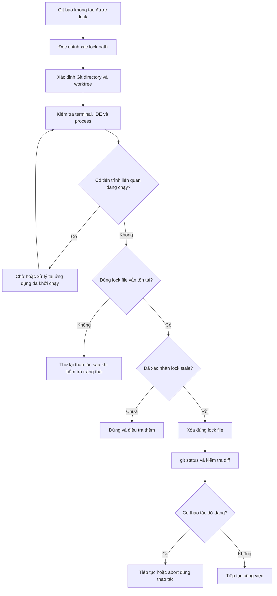

# Chẩn đoán tệp khóa còn sót và tránh can thiệp khi tiến trình Git đang chạy

Khi chạy một lệnh Git, bạn có thể gặp thông báo như `Unable to create '.git/index.lock': File exists` hoặc `Another git process seems to be running in this repository`. Thông báo này thường có nghĩa Git không thể lấy quyền cập nhật một vùng dữ liệu vì tệp khóa tương ứng đang tồn tại.

Tệp `.lock` có thể là dấu hiệu bình thường của một thao tác Git đang chạy. Nó cũng có thể còn sót sau khi tiến trình bị crash hoặc bị dừng đột ngột. Xóa nhầm lock khi Git vẫn đang ghi dữ liệu có thể làm hỏng index, ref hoặc trạng thái repository. Vì vậy, cần xác định đúng tệp khóa, kiểm tra tiến trình sở hữu thao tác và chỉ dọn khi đã chứng minh lock không còn được sử dụng.

Bài học thuộc chương **Tìm lỗi và phục hồi** của module `SOURCE_CONTROL_GIT`. Module hướng dẫn working tree, staging area, commit, lịch sử, branch, merge, rebase, remote và tag; phần này giúp bạn chẩn đoán sự cố khi Git cập nhật repository và bảo toàn dữ liệu trong lúc phục hồi.

## 1. Vì sao Git tạo tệp .lock?

Git thường cập nhật dữ liệu bằng cơ chế ghi vào một tệp khóa tạm trước, sau đó thay thế tệp đích bằng thao tác đổi tên (rename) khi nội dung đã sẵn sàng. Việc tạo lock thường dùng thao tác tạo tệp độc quyền để hai tiến trình không cùng ghi một vùng dữ liệu tại một thời điểm.

Ví dụ, khi cập nhật index, Git có thể:

1. Tạo `.git/index.lock`.
2. Ghi nội dung index mới vào tệp khóa.
3. Hoàn tất và đóng tệp.
4. Đổi tên `index.lock` thành `index` để thay thế index cũ.

Nếu một tiến trình khác cũng muốn cập nhật index trong lúc đó, nó sẽ thấy `index.lock` đang tồn tại và thường dừng với thông báo không thể tạo lock. Cơ chế này ngăn hai thao tác ghi đè dữ liệu của nhau.

Một số lock path thường gặp:

| Tệp khóa | Dữ liệu Git đang được cập nhật |
| --- | --- |
| `index.lock` | Index (staging area) của worktree hiện tại |
| `refs/heads/<branch>.lock` | Ref của một local branch |
| `refs/tags/<tag>.lock` | Ref của một tag |
| `packed-refs.lock` | Tệp chứa các ref đã được đóng gói |
| `config.lock` | Cấu hình repository |

Tên và vị trí cụ thể phụ thuộc thao tác, cấu hình repository và loại worktree. Không phải mọi lệnh Git đều tạo cùng một lock file.

## 2. Lock đang hoạt động và lock còn sót khác nhau thế nào?

**Lock đang hoạt động** được tạo bởi một tiến trình Git hoặc công cụ đang thực hiện thao tác cập nhật repository. Ví dụ:

- `git add` đang cập nhật index.
- `git commit` đang ghi commit và cập nhật branch ref.
- `git checkout`, `git switch`, `git reset` hoặc thao tác merge/rebase đang cập nhật index và trạng thái liên quan.
- IDE đang chạy một lệnh Git ở nền, chẳng hạn refresh trạng thái, stage tệp hoặc hoàn tất commit.
- Hook, Git LFS hoặc tiến trình con được gọi trong một thao tác Git vẫn đang chạy.

**Lock còn sót (stale lock)** có thể xuất hiện khi tiến trình tạo lock kết thúc bất thường trước khi hoàn tất hoặc dọn tệp tạm. Nguyên nhân có thể là:

- Terminal hoặc IDE bị đóng cưỡng bức.
- Máy tính mất điện hoặc khởi động lại giữa thao tác.
- Tiến trình Git bị crash hoặc bị hệ điều hành kết thúc.
- Một thao tác bị ngắt khi Git đang cập nhật dữ liệu.

Chỉ nhìn thấy tệp `.lock` chưa đủ để kết luận nó đã cũ. Thời gian sửa đổi của tệp cũng không chứng minh tiến trình đã kết thúc: một thao tác lâu có thể giữ lock trong thời gian dài mà không liên tục ghi vào tệp.

Nội dung của lock file cũng không phải thông tin PID đáng tin cậy. Chẳng hạn, `index.lock` có thể chứa dữ liệu index đang được ghi; không đọc hoặc sửa nội dung để đoán tiến trình nào sở hữu nó.

## 3. Đọc thông báo lỗi trước khi xử lý

Thông báo thường chỉ ra đường dẫn lock mà Git không tạo được. Ví dụ:

```text
fatal: Unable to create '.git/index.lock': File exists.
```

Hoặc:

```text
Another git process seems to be running in this repository,
e.g. an editor opened by 'git commit'. Please make sure all processes
are terminated then try again. If it still fails, a git process
may have crashed in this repository earlier:
remove the file manually to continue.
```

Hãy ghi lại đúng đường dẫn được nêu. Nếu thông báo đề cập `index.lock`, đó là lock của index. Nếu nó đề cập một ref lock hoặc `packed-refs.lock`, vùng dữ liệu liên quan khác. Không suy ra mọi lỗi lock đều có thể xử lý bằng cách xóa `.git/index.lock`.

Nếu lỗi xuất hiện khi `git commit`, hãy kiểm tra cả terminal đang chạy Git lẫn trình soạn thảo commit. Git có thể đang chờ bạn lưu hoặc đóng thông điệp commit. Nếu lỗi xuất hiện trong IDE, kiểm tra bảng Git/Source Control và các thao tác nền đang chạy.

## 4. Xác định đúng Git directory và đường dẫn lock

Không phải repository nào cũng có thư mục `.git` thông thường ngay trong thư mục dự án. Với linked worktree, tệp `.git` trong thư mục làm việc có thể chỉ chứa đường dẫn đến Git directory riêng; một số dữ liệu như refs được đặt trong common Git directory. Submodule cũng có cấu trúc Git directory riêng.

Vì vậy, không nên mặc định đường dẫn lock luôn là `.git/index.lock`. Trong repository, có thể yêu cầu Git trả về đường dẫn chính xác:

```bash
git rev-parse --git-dir
git rev-parse --git-path index.lock
```

Lệnh thứ nhất cho biết Git directory gắn với repository/worktree hiện tại. Lệnh thứ hai trả về vị trí mà Git sử dụng cho `index.lock`, có tính đến cấu trúc repository và cấu hình đường dẫn liên quan.

Nếu thông báo lỗi nêu lock của ref, có thể truy vấn đường dẫn tương ứng, ví dụ:

```bash
git rev-parse --git-path refs/heads/main.lock
git rev-parse --git-path packed-refs.lock
git rev-parse --git-path config.lock
```

Chạy các lệnh trong đúng repository và worktree đang báo lỗi. Nếu `git rev-parse` không xác định được repository hoặc trả về đường dẫn khác với thông báo, hãy dừng lại để kiểm tra thư mục làm việc trước khi thao tác trên filesystem.

## 5. Kiểm tra tiến trình Git trước khi đụng đến lock

Đây là bước quan trọng nhất. Hãy kiểm tra cả terminal, IDE và tiến trình hệ điều hành. Một tiến trình Git có thể không chạy trong cửa sổ terminal đang mở mà được khởi chạy bởi IDE hoặc công cụ khác.

### Trên Windows PowerShell

Liệt kê các tiến trình Git phổ biến:

```powershell
Get-CimInstance Win32_Process |
  Where-Object { $_.Name -in @('git.exe', 'git-remote-https.exe', 'git-remote-http.exe', 'git-lfs.exe') } |
  Select-Object ProcessId, ParentProcessId, Name, CommandLine
```

Kiểm tra cả cửa sổ terminal và IDE đang mở. Nếu có tiến trình Git, xem command line, PID, tiến trình cha và ứng dụng đã khởi chạy nó để hiểu thao tác đang thực hiện. Có thể dùng Task Manager hoặc Process Explorer để xem cây tiến trình.

### Trên Linux hoặc macOS

```bash
ps -ef | grep '[g]it'
```

Đọc PID, tiến trình cha và tham số lệnh. Kiểm tra các terminal, IDE và tiến trình con liên quan đến thao tác Git.

### Khi phát hiện tiến trình đang chạy

- Để tiến trình hoàn tất nếu nó vẫn đang hoạt động bình thường.
- Nếu Git đang chờ editor, credential prompt, hook hoặc thao tác xác nhận, hãy xử lý tại đúng cửa sổ/ứng dụng đó.
- Nếu thao tác có vẻ bị treo, tìm hiểu nguyên nhân như hook chờ input, xác thực remote, mạng, ổ đĩa hoặc tiến trình con.
- Nếu cần hủy, dùng cách dừng từ terminal/IDE đã khởi chạy thao tác và chờ tiến trình kết thúc. Sau đó kiểm tra trạng thái repository trước khi làm bước tiếp theo.

Không xóa lock khi tiến trình liên quan vẫn chạy. Không kết thúc một tiến trình chỉ vì tên của nó là `git.exe`; trước hết xác định nó thuộc repository nào và đang làm gì. Trên máy dùng chung, nếu bạn không đủ quyền xem toàn bộ tiến trình, hãy nhờ người quản trị xác nhận trước khi dọn lock.

## 6. Chỉ dọn lock khi đã xác nhận là stale

Chỉ xem lock là stale khi bạn đã xác nhận đồng thời:

1. Không còn tiến trình Git hoặc tiến trình con đang thực hiện thao tác trên repository/worktree đó.
2. IDE và terminal không còn tác vụ Git đang chờ hoàn tất.
3. Đúng lock path đã được xác định từ thông báo lỗi hoặc `git rev-parse --git-path`.
4. Tệp lock vẫn tồn tại sau khi tiến trình liên quan đã kết thúc.

Trên Windows, ví dụ kiểm tra `index.lock` trong PowerShell:

```powershell
$lockPath = git rev-parse --git-path index.lock
$lockPath
Test-Path -LiteralPath $lockPath
if (Test-Path -LiteralPath $lockPath) {
  Get-Item -LiteralPath $lockPath | Format-List FullName, Length, LastWriteTime
}
```

Sau khi đã xác nhận không còn tiến trình Git đang hoạt động và đường dẫn là lock stale đúng repository, mới xóa đúng tệp đó:

```powershell
Remove-Item -LiteralPath $lockPath
```

Trên Linux hoặc macOS, có thể lấy đường dẫn và kiểm tra:

```bash
lock_path=$(git rev-parse --git-path index.lock)
printf '%s\n' "$lock_path"
ls -l -- "$lock_path"
```

Sau khi xác nhận stale, xóa đúng đường dẫn:

```bash
rm -- "$lock_path"
```

Đối với lock khác, thay `index.lock` bằng đường dẫn chính xác mà thông báo lỗi nêu, ví dụ `refs/heads/main.lock`. Không xóa cả thư mục `.git`, không xóa hàng loạt `*.lock`, và không dùng script wildcard để dọn mọi lock file.

Nếu không thể chứng minh lock đã stale, hãy giữ nguyên nó và tiếp tục điều tra hoặc nhờ người quản trị hỗ trợ. Xóa nhầm lock đang hoạt động có thể khiến tiến trình ghi dữ liệu tiếp tục trong khi một tiến trình khác tạo lock mới, gây mất đồng bộ hoặc hỏng dữ liệu.

## 7. Kiểm tra repository sau khi dọn lock

Sau khi xóa đúng lock stale, chạy các lệnh kiểm tra trong đúng repository:

```bash
git status
git diff
git diff --cached
git log --oneline --decorate -5
```

Đọc kết quả để xác định thao tác trước đó đã hoàn tất hay bị gián đoạn. Nếu Git báo merge hoặc rebase đang dở, không tự động reset hoặc xóa metadata. Xác định trạng thái hiện tại rồi tiếp tục hoặc hủy bằng lệnh tương ứng:

```bash
git merge --continue
git merge --abort
git rebase --continue
git rebase --abort
```

Chỉ chạy lệnh phù hợp với thao tác thực tế và sau khi kiểm tra thay đổi đang có. Nếu thao tác trước đó là commit, hãy xem `git log` và `git status` để biết commit đã được tạo hay chưa. Đừng chạy lại lệnh commit một cách mù quáng vì có thể tạo commit ngoài dự kiến.

Nếu index có dấu hiệu không nhất quán hoặc Git tiếp tục báo lỗi đọc object, hãy lưu lại thông báo lỗi và xem xét kiểm tra repository sâu hơn. Không dùng `git reset --hard` hoặc `git clean -fd` chỉ để làm biến mất thông báo lock; chúng không phải công cụ sửa lock và có thể làm mất công việc.

## 8. Quy trình chẩn đoán theo tình huống

| Tình huống | Việc cần làm |
| --- | --- |
| IDE đang chạy Fetch, Pull, Commit hoặc Stage | Chờ hoàn tất và kiểm tra kết quả trong IDE |
| Git commit đang mở editor | Lưu/đóng editor để hoàn tất hoặc hủy commit từ đúng phiên terminal |
| Tiến trình Git còn sống nhưng có vẻ bị treo | Kiểm tra hook, prompt, xác thực, mạng và tiến trình con; chỉ hủy từ nơi khởi chạy sau khi hiểu trạng thái |
| Không còn tiến trình Git, lock path vẫn tồn tại | Xác minh đúng repository/worktree và đúng lock path rồi mới xóa tệp stale cụ thể |
| Không xác định được tiến trình hoặc repository | Không xóa lock; nhờ người có quyền kiểm tra tiến trình và đường dẫn |
| Sau khi dọn lock, merge/rebase vẫn đang dở | Dùng `git status`, sau đó tiếp tục hoặc abort đúng thao tác |



## 9. Những lỗi cần tránh

- **Xóa `.git/index.lock` ngay khi thấy lỗi**: có thể xóa lock của tiến trình vẫn đang ghi index.
- **Coi lock cũ theo thời gian là lock stale**: thời gian sửa đổi không chứng minh tiến trình đã kết thúc.
- **Tìm PID trong nội dung lock**: lock file thường chứa dữ liệu Git đang ghi, không phải metadata chủ sở hữu.
- **Giả định `.git` luôn là thư mục**: linked worktree có thể dùng tệp `.git` trỏ đến Git directory khác.
- **Xóa tất cả `*.lock`**: mỗi lock có thể bảo vệ một ref hoặc dữ liệu khác nhau; xóa hàng loạt có thể làm hỏng thao tác đang diễn ra.
- **Kill mọi tiến trình `git.exe`**: một tiến trình có thể đang fetch, commit, chạy hook hoặc cập nhật repository khác.
- **Dùng reset hard hoặc clean để xử lý lỗi lock**: các lệnh này có thể xóa thay đổi nhưng không giải quyết nguyên nhân lock.
- **Chạy lại commit hoặc merge mà không kiểm tra**: thao tác trước có thể đã hoàn tất một phần hoặc hoàn tất trước khi báo lỗi ở bước tiếp theo.

## Tự kiểm tra trước khi phục hồi

Trước khi dọn lock, hãy xác nhận:

1. Tôi đã đọc đúng lock path từ thông báo lỗi chưa?
2. Tôi đã xác định đúng Git directory và worktree chưa?
3. Tôi đã kiểm tra các terminal, IDE và tiến trình Git liên quan chưa?
4. Tôi có bằng chứng rằng tiến trình đã kết thúc và lock không còn được sử dụng không?
5. Tôi chỉ xóa đúng lock stale, không xóa hàng loạt tệp khóa chứ?
6. Sau khi dọn, tôi đã kiểm tra `git status`, diff và trạng thái merge/rebase chưa?

Tệp `.lock` là một phần của cơ chế bảo vệ dữ liệu khi Git cập nhật repository. Chỉ dọn nó sau khi đã xác minh tiến trình sở hữu thao tác kết thúc và lock còn sót đúng là stale. Làm theo trình tự này giúp tránh can thiệp vào thao tác đang chạy và giữ nguyên công việc của bạn cùng đồng đội.

## Tài liệu tham khảo

- [Git documentation: gitrepository-layout](https://git-scm.com/docs/gitrepository-layout) — cấu trúc Git directory, refs và index.
- [Git documentation: git-rev-parse](https://git-scm.com/docs/git-rev-parse) — xác định Git directory và đường dẫn nội bộ bằng `--git-dir`, `--git-path`.
- [Git source: lockfile API](https://github.com/git/git/blob/master/lockfile.h) — cơ chế lock file dùng để cập nhật dữ liệu Git an toàn.
