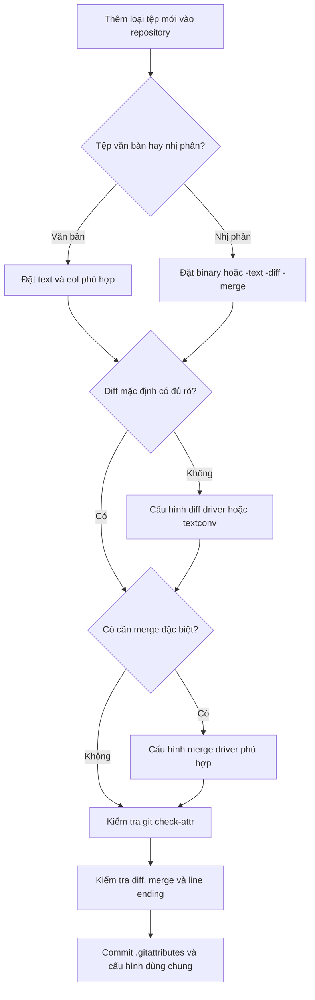

# Khai báo tệp văn bản, tệp nhị phân và bộ xử lý diff hoặc merge

Trong một repository, Git cần biết cách xử lý từng loại tệp khi lưu nội dung, tạo diff và hợp nhất thay đổi. Mã nguồn, ảnh, tài liệu văn phòng và tệp dữ liệu nhị phân không nên được xử lý giống nhau. Nếu Git hiểu sai loại tệp, diff có thể khó đọc, line ending có thể thay đổi giữa các hệ điều hành hoặc thao tác merge có thể tạo ra nội dung không hợp lệ.

File `.gitattributes` cho phép khai báo thuộc tính theo đường dẫn. Bạn có thể đánh dấu tệp văn bản hoặc nhị phân, chuẩn hóa line ending, chọn diff driver để hiển thị thay đổi dễ hiểu và chọn merge driver cho các định dạng đặc biệt. Bài học thuộc chương **Ignore và attributes** của module `SOURCE_CONTROL_GIT`, nơi bạn học cách quản lý nội dung repository và cộng tác ổn định giữa các môi trường phát triển.

## 1. .gitattributes dùng để làm gì?

`.gitattributes` là tệp cấu hình theo đường dẫn, thường được đặt ở thư mục gốc repository và commit cùng mã nguồn để các thành viên dùng chung. Mỗi dòng chỉ định một pattern và một hoặc nhiều thuộc tính:

```gitattributes
<pattern> <attribute> <attribute> ...
```

Ví dụ:

```gitattributes
*.java text eol=lf
*.png binary
```

Hai dòng trên yêu cầu Git xử lý tệp Java như văn bản với LF trong working tree, còn ảnh PNG được xem là tệp nhị phân.

Thuộc tính có thể ở một trong các dạng:

| Cách viết | Ý nghĩa |
| --- | --- |
| `text` | Bật thuộc tính `text` |
| `-text` | Tắt thuộc tính `text` |
| `text=auto` | Gán giá trị chuỗi `auto` cho thuộc tính |
| `!text` | Đặt thuộc tính về trạng thái không được chỉ định |

Git phân biệt trạng thái unset (`-attr`) với unspecified (`!attr`). Unset là một lựa chọn rõ ràng; unspecified nghĩa là thuộc tính không được gán giá trị và Git dùng hành vi mặc định tương ứng nếu không có giá trị hiệu lực khác.

## 2. Phân biệt .gitattributes và .gitignore

Hai tệp này cùng dùng pattern theo đường dẫn nhưng giải quyết hai vấn đề khác nhau:

| Tệp | Mục đích | Ảnh hưởng đến tệp đã tracked |
| --- | --- | --- |
| `.gitignore` | Ngăn tệp chưa được theo dõi xuất hiện như đề xuất để thêm vào Git | Không ngừng theo dõi tệp đã được commit hoặc stage trước đó |
| `.gitattributes` | Khai báo cách Git xử lý nội dung, diff, merge và chuyển đổi theo đường dẫn | Có hiệu lực với cả tệp tracked |

Ví dụ, `.gitignore` có thể bỏ qua thư mục build:

```gitignore
build/
```

Trong khi `.gitattributes` khai báo cách xử lý tệp trong repository:

```gitattributes
*.java text eol=lf
*.png binary
```

Không dùng `.gitignore` để điều khiển diff hoặc line ending. Cũng không dùng `.gitattributes` với mục đích ngăn Git phát hiện tệp chưa được theo dõi.

## 3. Khai báo văn bản và chuẩn hóa line ending

Các hệ điều hành có thể sử dụng line ending khác nhau. Linux và macOS thường dùng LF (`\n`), còn Windows thường dùng CRLF (`\r\n`). Nếu không có quy ước rõ ràng, cùng một tệp có thể tạo diff lớn chỉ vì chuyển đổi line ending.

Thuộc tính `text` điều khiển việc chuẩn hóa line ending khi nội dung được đưa vào index:

- `text`: xem tệp là văn bản và chuẩn hóa line ending trong index về LF.
- `text=auto`: để Git tự nhận diện tệp văn bản và chuẩn hóa những tệp được nhận diện là text.
- `-text`: không thực hiện chuyển đổi line ending; thường dùng cho tệp nhị phân.

Thuộc tính `eol` điều khiển line ending trong working tree:

- `eol=lf`: dùng LF trong working tree.
- `eol=crlf`: dùng CRLF trong working tree.

Ví dụ quy ước phổ biến:

```gitattributes
# Nhận diện văn bản và chuẩn hóa tự động
* text=auto

# Mã nguồn, script và tệp cấu hình dùng LF
*.java text eol=lf
*.js text eol=lf
*.ts text eol=lf
*.sh text eol=lf
*.yml text eol=lf
*.yaml text eol=lf

# Tệp batch Windows dùng CRLF trong working tree
*.bat text eol=crlf
*.cmd text eol=crlf

# Tệp ảnh không chuyển đổi line ending
*.png -text
*.jpg -text
```

Khi `eol` được đặt rõ ràng, Git xem đường dẫn đó là văn bản và áp dụng quy tắc chuyển đổi tương ứng. Vì vậy, `*.java text eol=lf` giữ nội dung trong index theo LF và checkout ra working tree với LF trên mọi hệ điều hành.

### Macro binary

Git cung cấp macro thuộc tính `binary`, tương đương:

```gitattributes
-text -diff -merge
```

Ví dụ:

```gitattributes
*.png binary
*.jpg binary
*.gif binary
*.pdf binary
*.zip binary
*.class binary
```

Khai báo `binary` giúp Git không chuẩn hóa line ending, không tạo diff văn bản thông thường và không cố tự động merge nội dung nhị phân theo kiểu văn bản. Với tệp nhị phân, khi hai nhánh cùng thay đổi, thành viên thường phải chọn phiên bản phù hợp hoặc dùng công cụ chuyên biệt.

## 4. Chọn cách hiển thị diff

Thuộc tính `diff` quyết định Git có xử lý đường dẫn như văn bản khi tạo diff hay không, hoặc sử dụng driver được đặt tên.

```gitattributes
*.png -diff
*.docx -diff
*.java diff
```

- `diff` bật cách hiển thị diff văn bản thông thường.
- `-diff` tắt diff văn bản; Git thường hiển thị thông báo rằng tệp nhị phân đã thay đổi.
- `diff=<driver>` chọn một diff driver có cấu hình tương ứng.

Với định dạng nhị phân có thể trích xuất nội dung thành văn bản, `textconv` giúp diff dễ đọc hơn. Ví dụ, nếu có công cụ `docx2txt` trên máy:

```gitattributes
*.docx diff=word
```

Cấu hình driver trong `.gitconfig`:

```ini
[diff "word"]
    textconv = docx2txt
    cachetextconv = true
```

Khi chạy `git diff`, Git gọi `docx2txt` để chuyển nội dung tài liệu thành văn bản rồi so sánh kết quả. `cachetextconv` cho phép Git lưu cache kết quả chuyển đổi để tránh chạy lại công cụ không cần thiết.

Một ví dụ khác là dùng công cụ chuyển PDF thành text:

```gitattributes
*.pdf diff=pdf
```

```ini
[diff "pdf"]
    textconv = pdftotext -layout
```

Câu lệnh thực tế phụ thuộc công cụ có sẵn và cách công cụ nhận đầu vào/đầu ra. Hãy kiểm tra driver trên máy trước khi đưa cấu hình dùng chung vào dự án; mỗi thành viên cần cài công cụ tương ứng để nhận được cùng trải nghiệm diff.

### External diff command và textconv

Git cũng cho phép cấu hình `diff.<driver>.command` để gọi một chương trình diff bên ngoài. `textconv` thường phù hợp khi chỉ cần chuyển một tệp thành văn bản dễ đọc trước khi so sánh; external diff command cho phép chương trình tự quyết định cách trình bày khác biệt.

Các driver có thể được khai báo trong `.gitattributes`, còn lệnh cụ thể thường nằm trong cấu hình Git local hoặc global. Nhờ đó repository có thể chia sẻ tên driver trong khi từng máy tự cấu hình đường dẫn công cụ.

## 5. Chọn cách merge

Thuộc tính `merge` cho phép Git chọn bộ xử lý khi hai nhánh cùng thay đổi một đường dẫn.

Các giá trị thường gặp:

| Thuộc tính | Cách xử lý |
| --- | --- |
| `merge` | Dùng bộ xử lý merge văn bản ba phía thông thường |
| `-merge` | Không tự động hợp nhất nội dung theo cách text merge; để đường dẫn ở trạng thái cần giải quyết thủ công |
| `merge=union` | Dùng union merge driver có sẵn, kết hợp các dòng từ hai phía thay vì tạo conflict marker theo cách thông thường |
| `merge=<driver>` | Dùng custom merge driver đã được cấu hình |

Với tệp nhị phân, macro `binary` đã tắt merge tự động. Với một số tệp văn bản có thể kết hợp dòng độc lập, `merge=union` có thể hữu ích, nhưng cần kiểm tra kết quả vì thứ tự hoặc nội dung trùng lặp có thể không phù hợp với định dạng.

Ví dụ:

```gitattributes
*.png binary
*.pdf binary
CHANGELOG.txt merge=union
```

`merge=union` không hiểu ngữ nghĩa của nội dung. Nó chỉ kết hợp các dòng từ hai phiên bản. Không dùng nó cho JSON, YAML hoặc tệp cấu hình nếu việc ghép dòng có thể tạo khóa trùng, cấu trúc sai hoặc dữ liệu không hợp lệ.

### Custom merge driver

Với định dạng đặc biệt, bạn có thể khai báo tên driver trong `.gitattributes`:

```gitattributes
*.generated merge=keep-current
```

Sau đó cấu hình driver trong Git config:

```ini
[merge "keep-current"]
    name = Keep current version
    driver = true
```

Ví dụ trên minh họa driver giữ nguyên nội dung phía hiện tại bằng cách không sửa tệp kết quả `%A` và trả về thành công. Lệnh `true` là ví dụ theo shell kiểu POSIX; môi trường Windows hoặc quy trình dự án nên dùng chương trình/script tương ứng đã được kiểm thử.

Một custom merge driver nhận các placeholder phổ biến:

| Placeholder | Nội dung |
| --- | --- |
| `%O` | Phiên bản base chung (ancestor) |
| `%A` | Phiên bản phía hiện tại; driver cần ghi kết quả merge vào tệp này |
| `%B` | Phiên bản phía còn lại |
| `%L` | Độ dài conflict marker |
| `%P` | Đường dẫn của tệp đang được merge |

Driver thường trả mã thoát `0` khi merge thành công, `1` khi có conflict cần người dùng giải quyết và giá trị lớn hơn `1` khi xảy ra lỗi. Cấu hình merge driver thường là cấu hình local hoặc global, không được chia sẻ tự động chỉ bằng `.gitattributes`; mọi máy cần cài đặt chương trình và cấu hình driver tương ứng.

**Cẩn trọng với driver giữ một phía:** cấu hình kiểu `keep-current` có thể âm thầm bỏ nội dung từ phía còn lại. Chỉ dùng khi chính sách dự án đã xác định rõ phía nào luôn được ưu tiên, chẳng hạn tệp sinh tự động có nguồn chuẩn riêng.

## 6. Thứ tự ưu tiên của thuộc tính

Git có thể đọc thuộc tính từ nhiều nơi. Thứ tự ưu tiên từ cao xuống thấp:

1. `$GIT_DIR/info/attributes` của repository/worktree hiện tại.
2. Các tệp `.gitattributes` trong thư mục chứa tệp và các thư mục cha; tệp gần đường dẫn nhất có ưu tiên cao hơn tệp ở thư mục cha.
3. Tệp attributes toàn cục được chỉ định bởi `core.attributesFile`.

Trong cùng một tệp `.gitattributes`, dòng khớp sau có thể ghi đè giá trị thuộc tính đã được đặt ở dòng trước. Các thuộc tính được xử lý độc lập, nên một dòng sau chỉ thay đổi thuộc tính mà nó nêu.

Ví dụ ở thư mục gốc:

```gitattributes
* text=auto
*.dat binary
```

Trong thư mục con `data/`, có thể đặt `.gitattributes` riêng:

```gitattributes
*.dat text eol=lf
```

Tệp `data/report.dat` nhận quy tắc gần nhất từ `data/.gitattributes`. Nếu cần ngoại lệ chỉ trên máy cá nhân mà không commit vào repository, có thể dùng `$GIT_DIR/info/attributes`. Đây là nơi có ưu tiên cao nhất, nên cần nhớ nó có thể làm kết quả kiểm tra trên máy bạn khác với đồng đội.

## 7. Kiểm tra thuộc tính đang áp dụng

Để xem thuộc tính của một đường dẫn, dùng `git check-attr`:

```bash
git check-attr text eol diff merge -- src/Main.java
git check-attr --all -- assets/logo.png
```

Lệnh đầu kiểm tra các thuộc tính cụ thể; lệnh thứ hai liệt kê mọi thuộc tính được áp dụng cho tệp. Kết quả có thể hiển thị `unspecified` nếu thuộc tính không được khai báo.

Để xem Git lấy thuộc tính từ đâu trong quá trình debug, kiểm tra từng tệp `.gitattributes`, `info/attributes` và cấu hình attributes toàn cục. Có thể xem đường dẫn file attributes toàn cục bằng:

```bash
git config --show-origin --get core.attributesFile
```

Nếu cần kiểm tra nội dung đang được Git xử lý, dùng:

```bash
git diff -- src/Main.java
git diff -- assets/logo.png
git status
```

Sau khi chỉnh `.gitattributes`, hãy kiểm tra các tệp bị ảnh hưởng trên nhiều hệ điều hành nếu dự án có thành viên dùng Windows, Linux và macOS.

## 8. Áp dụng thay đổi line ending cho tệp đã tracked

Thêm hoặc sửa thuộc tính `text`/`eol` không tự động viết lại index của tất cả tệp tracked ngay lập tức. Nếu repository đã có nội dung với line ending không nhất quán, sau khi thống nhất quy tắc, bạn có thể chuẩn hóa lại các tệp tracked bằng:

```bash
git add --renormalize .
```

Lệnh này áp dụng lại quy trình clean conversion cho các tệp tracked để cập nhật index theo thuộc tính mới. Trước khi commit, xem kỹ thay đổi:

```bash
git status
git diff --cached --stat
git diff --cached
```

Nếu diff thay đổi quá nhiều hoặc có nội dung không mong muốn, hãy kiểm tra lại pattern và thuộc tính trước khi commit. Nên thực hiện thay đổi chuẩn hóa line ending trong một commit riêng để review dễ hơn.

## 9. Ví dụ cấu hình .gitattributes cho dự án

Một cấu hình cơ bản cho dự án có mã nguồn, script, tài liệu và tài nguyên nhị phân:

```gitattributes
# Mặc định tự nhận diện văn bản
* text=auto

# Mã nguồn và cấu hình dùng LF
*.java text eol=lf
*.kt text eol=lf
*.js text eol=lf
*.ts text eol=lf
*.json text eol=lf
*.yml text eol=lf
*.yaml text eol=lf
*.xml text eol=lf
*.md text eol=lf
*.sh text eol=lf

# Script Windows dùng CRLF
*.bat text eol=crlf
*.cmd text eol=crlf

# Tài nguyên nhị phân
*.png binary
*.jpg binary
*.jpeg binary
*.gif binary
*.pdf binary
*.zip binary
*.jar binary
*.class binary

# Ví dụ diff driver cho tài liệu Word
*.docx diff=word

# Ví dụ merge driver cho changelog dạng dòng
CHANGELOG.txt merge=union
```

Đây chỉ là điểm bắt đầu. Hãy điều chỉnh danh sách phần mở rộng theo loại tệp thực tế của dự án. Đừng đánh dấu mọi tệp có phần mở rộng lạ là text hoặc binary nếu chưa xác định định dạng.

## 10. Những lỗi thường gặp

- **Nhầm `.gitattributes` với `.gitignore`**: attributes điều khiển cách Git xử lý nội dung; ignore điều khiển việc phát hiện tệp chưa tracked.
- **Không khai báo tệp nhị phân**: Git có thể cố tạo diff hoặc merge như văn bản, làm kết quả khó hiểu.
- **Chỉ đặt `eol=lf` mà không kiểm tra quy tắc áp dụng**: kiểm tra bằng `git check-attr` và diff để xác nhận Git đã nhận đúng thuộc tính.
- **Nghĩ `diff=word` tự cài công cụ diff**: tên driver chỉ liên kết thuộc tính với cấu hình; từng máy vẫn cần cấu hình lệnh và cài công cụ.
- **Nghĩ custom merge driver được chia sẻ đầy đủ qua `.gitattributes`**: tên driver có thể được commit, nhưng cấu hình lệnh và chương trình thực thi phải được thiết lập ở từng môi trường.
- **Dùng union merge cho dữ liệu có cấu trúc**: ghép dòng không bảo đảm JSON/YAML hay cấu hình vẫn hợp lệ.
- **Dùng driver giữ một phía cho tệp chứa thay đổi thủ công**: có thể âm thầm làm mất thay đổi từ phía kia.
- **Sửa attributes rồi không renormalize**: index có thể vẫn giữ nội dung cũ cho đến khi tệp được đưa qua clean conversion; kiểm tra và dùng `git add --renormalize` khi cần.
- **Quên attributes cục bộ ghi đè quy tắc repository**: `info/attributes` có ưu tiên cao, nên kiểm tra nó khi hành vi trên máy cá nhân khác đồng đội.

## 11. Quy trình chọn thuộc tính



Trước khi hoàn tất, hãy tự xác nhận:

1. Tôi đã phân loại đúng tệp văn bản và nhị phân chưa?
2. Line ending trong index và working tree có theo quy ước dự án không?
3. Diff driver có công cụ chuyển đổi hoặc lệnh thực thi đã được cài đặt chưa?
4. Merge driver có xử lý đúng định dạng và không âm thầm bỏ dữ liệu không?
5. Tôi đã kiểm tra thứ tự ưu tiên và kết quả `git check-attr` chưa?
6. Nếu thay đổi line ending, tôi đã xem staged diff sau `git add --renormalize` chưa?

`.gitattributes` giúp Git hiểu cách xử lý từng loại tệp trong toàn bộ vòng đời cộng tác: chuẩn hóa nội dung, trình bày diff và hợp nhất thay đổi. Khai báo rõ ràng, kiểm tra driver trên môi trường thực tế và review kết quả trước khi commit giúp repository hoạt động nhất quán giữa các thành viên.

## Tài liệu tham khảo

- [Git documentation: gitattributes](https://git-scm.com/docs/gitattributes) — thuộc tính text, eol, diff, merge và thứ tự ưu tiên.
- [Git documentation: git-check-attr](https://git-scm.com/docs/git-check-attr) — kiểm tra thuộc tính áp dụng cho đường dẫn.
- [Git documentation: git-add](https://git-scm.com/docs/git-add) — chuẩn hóa lại tệp tracked bằng `--renormalize`.
- [Pro Git: Customizing Git - Git Attributes](https://git-scm.com/book/en/v2/Customizing-Git-Git-Attributes) — ví dụ khai báo loại tệp và driver.
