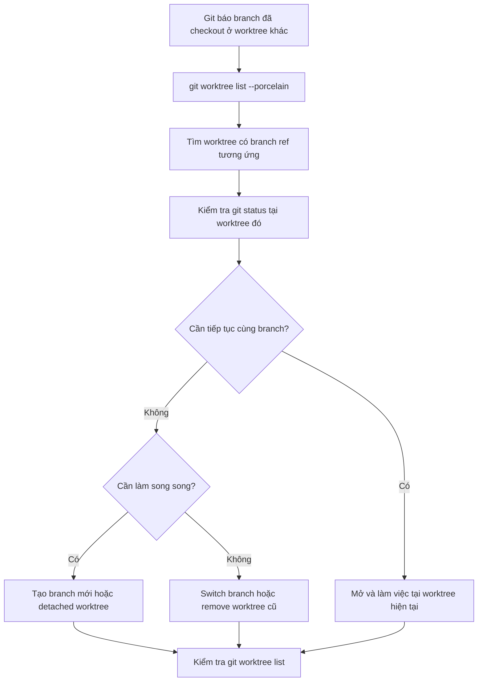

# Ràng buộc khi một nhánh đã được dùng trong worktree khác

Git worktree cho phép một repository có nhiều thư mục làm việc cùng lúc. Bạn có thể mở một nhánh tính năng trong một thư mục, đồng thời mở `main` trong thư mục khác để review, chạy test hoặc xử lý hotfix. Tuy nhiên, Git có một quy tắc quan trọng: theo mặc định, một local branch chỉ được checkout trong một worktree tại một thời điểm.

Nếu bạn cố mở cùng branch trong worktree thứ hai, Git thường từ chối và cho biết branch đang được dùng ở một worktree khác. Đây là cơ chế bảo vệ vì các worktree có working tree và index riêng, nhưng cùng chia sẻ branch ref. Bài học thuộc chương **Nhiều thư mục làm việc** của module `SOURCE_CONTROL_GIT`, nơi bạn học cách cộng tác qua branch, merge, rebase, remote và quản lý lịch sử mà không làm lẫn trạng thái làm việc.

## 1. Vì sao Git giới hạn một branch trong một worktree?

Một linked worktree có thư mục làm việc, index và `HEAD` riêng. Tuy nhiên, các worktree thuộc cùng repository dùng chung object database và phần lớn refs, trong đó có ref của local branch.

Ví dụ, branch `feature/payment` là ref `refs/heads/feature/payment`. Nếu branch đó được checkout trong worktree `repo-payment`, `HEAD` của worktree này trỏ đến branch ref nói trên. Khi một commit mới được tạo, Git cập nhật ref chung.

Nếu một worktree thứ hai cũng checkout cùng branch, cả hai thư mục sẽ có index và tệp làm việc độc lập nhưng cùng dựa vào một branch pointer. Một nơi có thể tạo commit làm di chuyển branch ref trong khi nơi kia vẫn đang giữ nội dung working tree cũ. Việc tiếp tục sửa, stage hoặc commit từ cả hai nơi dễ gây nhầm lẫn về trạng thái và làm mất công việc khi các thao tác chồng lấn.

Vì vậy, Git mặc định áp dụng quy tắc **một branch — một worktree**. Quy tắc này áp dụng cho local branch đang được checkout. Bạn vẫn có thể xem commit, fetch remote, hoặc tham chiếu branch từ worktree khác mà không checkout branch đó.

## 2. Nhận biết branch đang được worktree nào sử dụng

Dùng lệnh:

```bash
git worktree list
```

Ví dụ kết quả:

```text
D:/projects/payment       4a1b2c3 [main]
D:/projects/payment-hotfix 8d9e0f1 [feature/payment]
D:/projects/payment-test  4a1b2c3 (detached HEAD)
```

Mỗi dòng cho biết đường dẫn worktree, commit hiện tại và branch đang checkout (hoặc trạng thái detached HEAD). Trong ví dụ, `feature/payment` đang được dùng ở `D:/projects/payment-hotfix`.

Để có kết quả dễ đọc bằng script:

```bash
git worktree list --porcelain
```

Đầu ra dạng porcelain gồm các trường như `worktree`, `HEAD`, `branch`, `detached`, `locked` hoặc `prunable`. Khi cần xác định branch đang ở đâu, tìm dòng `branch refs/heads/<ten-branch>` và đọc đường dẫn `worktree` ngay phía trên.

Bạn cũng có thể kiểm tra trạng thái của worktree đó mà không cần chuyển cửa sổ terminal:

```bash
git -C D:/projects/payment-hotfix status
git -C D:/projects/payment-hotfix branch --show-current
```

`-C` yêu cầu Git chạy như thể lệnh được thực hiện từ thư mục được chỉ định. Hãy dùng đúng đường dẫn được `git worktree list` trả về.

## 3. Khi add worktree với branch đã được checkout

Giả sử bạn đã tạo worktree đầu tiên:

```bash
git worktree add ../payment-hotfix -b feature/payment origin/main
```

Lệnh tạo branch `feature/payment` từ `origin/main` và checkout nó trong thư mục `../payment-hotfix`.

Nếu tiếp tục chạy:

```bash
git worktree add ../payment-review feature/payment
```

Git từ chối vì `feature/payment` đang được checkout ở `../payment-hotfix`. Bạn không thể dùng cùng branch trong worktree thứ hai theo cách mặc định.

Thông báo có thể tương tự:

```text
fatal: 'feature/payment' is already checked out at '.../payment-hotfix'
```

Khi gặp thông báo này, đừng vội xóa branch hoặc tạo lại repository. Trước hết dùng `git worktree list` để tìm worktree đang giữ branch và chọn cách làm phù hợp với mục tiêu.

## 4. Cách xử lý phù hợp

### Cách A: Tiếp tục làm việc trong worktree đang giữ branch

Nếu bạn cần tiếp tục công việc trên chính branch đó, hãy mở terminal hoặc IDE tại worktree đang checkout branch:

```bash
cd ../payment-hotfix
git status
git branch --show-current
```

Bạn có thể dùng `git -C` từ vị trí hiện tại để kiểm tra hoặc chạy lệnh mà không phải đổi thư mục:

```bash
git -C ../payment-hotfix log --oneline -5
git -C ../payment-hotfix status
```

Đây thường là lựa chọn đơn giản nhất khi branch đã có một nơi làm việc hợp lệ.

### Cách B: Tạo branch mới cho worktree mới

Nếu bạn cần làm song song hai nhiệm vụ, hãy tạo branch riêng cho worktree thứ hai. Có thể tạo từ branch đang được dùng:

```bash
git worktree add -b feature/payment-review ../payment-review feature/payment
```

Lệnh tạo branch `feature/payment-review` từ commit hiện tại của `feature/payment`, rồi checkout branch mới trong worktree `../payment-review`. Hai worktree giờ có branch ref riêng nên có thể phát triển độc lập.

Nếu muốn bắt đầu từ `main` hoặc remote-tracking branch:

```bash
git fetch origin
git worktree add -b fix/payment-timeout ../payment-timeout origin/main
```

Branch mới có thể được tích hợp sau bằng merge, rebase hoặc cherry-pick theo quy ước của nhóm.

### Cách C: Mở worktree detached để xem hoặc thử nghiệm

Nếu chỉ cần kiểm tra một commit, chạy benchmark hoặc xem nội dung lịch sử mà không cần di chuyển branch pointer, dùng detached HEAD:

```bash
git worktree add --detach ../payment-inspect 8d9e0f1
```

Worktree mới checkout commit `8d9e0f1` mà không gắn với local branch. Điều này tránh chiếm branch đang được sử dụng ở worktree khác.

Nếu tạo commit trong detached HEAD và muốn giữ lại, hãy tạo branch trước khi rời worktree:

```bash
git switch -c experiment/payment-inspect
```

Nếu không tạo branch hoặc ref khác giữ commit, commit mới có thể trở nên khó tìm sau khi worktree bị xóa và Git dọn object không còn được tham chiếu.

### Cách D: Chuyển branch khỏi worktree cũ

Nếu worktree cũ không cần branch đó nữa, chuyển nó sang branch khác:

```bash
git -C ../payment-hotfix switch main
```

Sau khi `feature/payment` không còn được checkout ở worktree cũ, bạn có thể thêm worktree mới cho branch đó:

```bash
git worktree add ../payment-review feature/payment
```

Trước khi chuyển branch, kiểm tra `git -C <path> status`. Nếu có thay đổi chưa commit, hãy commit, stash hoặc xử lý chúng trước để không mất công việc.

### Cách E: Gỡ worktree cũ khi không còn cần

Nếu worktree cũ đã hoàn tất và không còn cần thư mục làm việc đó, kiểm tra trạng thái rồi gỡ:

```bash
git -C ../payment-hotfix status
git worktree remove ../payment-hotfix
```

`git worktree remove` gỡ worktree được chỉ định và metadata quản lý tương ứng. Git thường từ chối gỡ worktree còn thay đổi chưa commit; hãy xử lý hoặc sao lưu các thay đổi trước khi gỡ.

Sau khi gỡ, branch `feature/payment` không còn bị worktree đó giữ và có thể được checkout trong worktree khác nếu không có worktree nào khác đang dùng.

## 5. Vì sao không nên dùng force để checkout cùng branch?

Git có tùy chọn bỏ qua ràng buộc:

```bash
git worktree add --force ../payment-review feature/payment
```

Hoặc khi chuyển branch trong worktree:

```bash
git switch --ignore-other-worktrees feature/payment
```

Các tùy chọn này bỏ qua kiểm tra branch đã được checkout ở worktree khác. Chúng không tạo ra một bản sao branch độc lập. Cả hai worktree vẫn chia sẻ cùng branch ref, nên một commit ở worktree này sẽ di chuyển branch pointer mà worktree kia cũng tham chiếu.

Hệ quả là trạng thái working tree và index ở hai nơi có thể không còn phản ánh cùng một commit. Các thao tác tiếp theo có thể bị từ chối, tạo lịch sử khó hiểu hoặc làm mất thay đổi nếu bạn cố đồng bộ thủ công. Chỉ dùng tùy chọn force trong tình huống đặc biệt khi bạn hiểu rõ cách Git chia sẻ ref và có quy trình tránh ghi đồng thời. Với phát triển song song thông thường, hãy tạo branch riêng.

## 6. Branch đang được dùng cũng ảnh hưởng đến thao tác quản lý branch

Git bảo vệ branch đang được checkout ở worktree khác khỏi các thao tác làm thay đổi hoặc xóa ref theo cách có thể phá trạng thái làm việc. Ví dụ, việc xóa branch đang được checkout thường bị từ chối:

```bash
git branch -d feature/payment
```

Nếu Git báo branch đang được dùng ở worktree khác, hãy tìm vị trí bằng:

```bash
git worktree list --porcelain
```

Sau đó chuyển worktree đó sang branch khác hoặc gỡ worktree nếu không còn cần. Khi branch đã được giải phóng, kiểm tra trạng thái merge rồi mới xóa:

```bash
git branch --merged main
git branch -d feature/payment
```

`-D` ép xóa branch chưa được merge, nhưng không nên xem đây là cách xử lý ràng buộc worktree. Trước khi xóa, hãy chắc chắn commit riêng trên branch không còn cần thiết và không có worktree nào đang dựa vào branch đó.

## 7. Xử lý metadata worktree cũ

Đôi khi thư mục worktree bị xóa thủ công bên ngoài Git hoặc ổ đĩa không còn kết nối. Git có thể vẫn giữ metadata và hiển thị worktree là `prunable`. Trường hợp này khác với worktree đang hoạt động ở một đường dẫn khác.

Xem danh sách chi tiết:

```bash
git worktree list --porcelain
```

Nếu một worktree đã thực sự không còn tồn tại, xem trước metadata sẽ được dọn:

```bash
git worktree prune --dry-run --verbose
```

Chỉ khi xác nhận đường dẫn đó không còn là worktree cần dùng, mới dọn metadata:

```bash
git worktree prune --verbose
```

`git worktree prune` dọn metadata quản lý worktree đã mất; lệnh này không thay thế cho `git worktree remove` khi thư mục làm việc vẫn tồn tại. Nếu thư mục worktree đã được di chuyển sang vị trí khác, hãy dùng `git worktree repair` để sửa liên kết quản lý thay vì prune metadata:

```bash
git worktree repair ../payment-moved
```

Chỉ chạy `repair` với đường dẫn worktree thực tế đã được di chuyển. Sau đó kiểm tra lại `git worktree list`.

## 8. Quy trình chẩn đoán khi Git báo branch đã được checkout

Giả sử bạn muốn mở `feature/payment` ở `../payment-review` nhưng Git báo branch đang được sử dụng.

```bash
# Xem các worktree và branch đang checkout
git worktree list --porcelain

# Kiểm tra worktree đang giữ branch
git -C ../payment-hotfix status
git -C ../payment-hotfix branch --show-current

# Nếu cần làm song song, tạo branch riêng từ branch hiện tại
git worktree add -b feature/payment-review ../payment-review feature/payment
```

Quy trình này giúp bạn biết branch đang được giữ ở đâu, xác nhận trạng thái thay đổi tại worktree đó và tạo không gian làm việc riêng cho nhiệm vụ mới.



## 9. Những lỗi thường gặp

- **Tạo worktree thứ hai với cùng branch**: Git từ chối theo mặc định vì branch đã được checkout ở worktree khác.
- **Nghĩ mỗi worktree có branch pointer riêng**: working tree, index và HEAD riêng, nhưng local branch ref được chia sẻ.
- **Dùng `--force` để tạo bản sao branch**: force chỉ bỏ qua kiểm tra; nó không nhân đôi branch ref.
- **Xóa branch khi vẫn đang được checkout ở worktree khác**: giải phóng branch bằng cách switch hoặc remove worktree trước.
- **Xóa thư mục worktree bằng Explorer/File Manager**: metadata có thể còn sót; dùng `git worktree remove` khi thư mục vẫn tồn tại.
- **Dùng prune để xóa một worktree còn hoạt động**: prune chỉ dọn metadata của worktree không còn tồn tại và đủ điều kiện hết hạn.
- **Quên giữ commit tạo trong detached HEAD**: tạo branch nếu muốn tiếp tục phát triển hoặc bảo toàn commit.
- **Chuyển branch khi worktree còn sửa đổi**: kiểm tra status và commit/stash trước để tránh mất thay đổi.

## Tự kiểm tra

Trước khi xử lý xung đột worktree, hãy xác nhận:

1. Tôi đã tìm được worktree đang checkout branch bằng `git worktree list` chưa?
2. Tôi đã kiểm tra thay đổi chưa commit ở worktree đó chưa?
3. Nhiệm vụ mới có cần cùng branch hay có thể dùng branch riêng?
4. Nếu dùng detached HEAD, tôi đã tạo branch để giữ commit cần thiết chưa?
5. Nếu dọn worktree, tôi đã phân biệt `remove`, `prune` và `repair` đúng trường hợp chưa?
6. Tôi có hiểu `--force` và `--ignore-other-worktrees` bỏ qua bảo vệ nhưng vẫn dùng chung branch ref không?

Ràng buộc một branch trong một worktree giúp mỗi thư mục có trạng thái làm việc riêng mà vẫn giữ branch pointer nhất quán. Khi cần làm song song, tạo branch riêng cho từng worktree là cách rõ ràng nhất; khi cần tiếp tục branch cũ, hãy quay lại worktree đang giữ nó và kiểm tra trạng thái trước khi thao tác.

## Tài liệu tham khảo

- [Git documentation: git-worktree](https://git-scm.com/docs/git-worktree) — thêm, liệt kê, gỡ, sửa và prune worktree.
- [Git documentation: git-switch](https://git-scm.com/docs/git-switch) — chuyển branch và tùy chọn `--ignore-other-worktrees`.
- [Git documentation: git-branch](https://git-scm.com/docs/git-branch) — quản lý branch và giới hạn với branch đang được checkout.
- [Pro Git: Git Tools - Advanced Merging / Multiple Worktrees](https://git-scm.com/docs/git-worktree) — tham khảo lệnh quản lý nhiều worktree.
