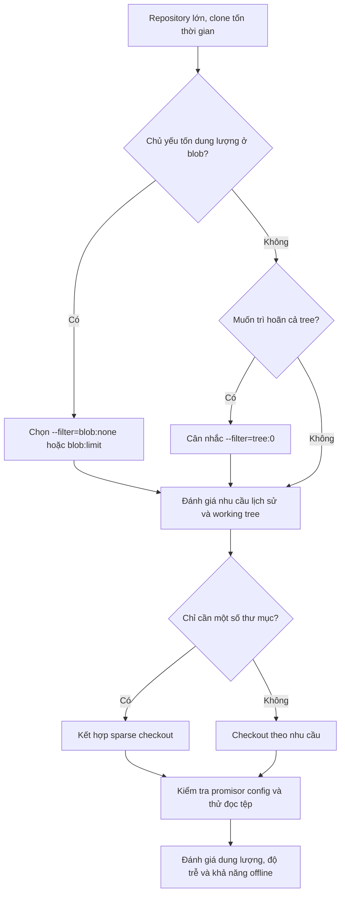

# Partial clone với --filter và cơ chế tải đối tượng khi cần

Trong repository lớn, phần lớn dung lượng có thể nằm ở nội dung tệp (blob), chẳng hạn ảnh, dữ liệu mẫu, tài liệu hoặc các tài nguyên chỉ một số nhóm sử dụng. Nếu mỗi lần clone đều tải tất cả blob, thời gian và băng thông có thể tăng đáng kể dù công việc hiện tại chỉ cần một phần nhỏ.

Partial clone cho phép client yêu cầu server bỏ qua một số object trong lần tải ban đầu. Git ghi nhận remote có trách nhiệm cung cấp các object bị trì hoãn và tự lấy chúng khi thao tác sau này cần đến. Cơ chế này thường được gọi là **lazy fetch** hoặc tải object theo nhu cầu.

Bài học thuộc chương **Kho mã chọn lọc** của module `SOURCE_CONTROL_GIT`. Module hướng dẫn từ working tree, staging area, commit và lịch sử đến branch, merge, rebase, remote và tag; partial clone giúp quản lý repository lớn bằng cách giảm lượng object phải tải ngay từ đầu.

## 1. Git lưu repository bằng những object nào?

Git lưu lịch sử và nội dung dưới dạng các object chính:

| Object | Lưu gì? | Ví dụ sử dụng |
| --- | --- | --- |
| Commit | Thông tin commit, tree gốc và quan hệ cha | Lịch sử commit, branch tip |
| Tree | Cấu trúc thư mục, tên đường dẫn và tham chiếu đến object con | Duyệt cấu trúc repository |
| Blob | Nội dung thực tế của một tệp | Mã nguồn, ảnh, tài liệu, dữ liệu |
| Tag | Metadata của annotated tag và object được đánh dấu | Mốc phiên bản có thông điệp hoặc chữ ký |

Trong clone thông thường, Git tải các object cần thiết để có repository đầy đủ cho những ref được lấy và checkout. Với partial clone, client có thể yêu cầu bỏ qua một số loại object. Ví dụ, khi dùng `blob:none`, commit và tree vẫn có thể được tải để Git biết lịch sử và cấu trúc thư mục, trong khi nội dung blob được lấy sau.

Partial clone không xóa object khỏi repository nguồn. Nó chỉ điều khiển object nào được gửi xuống client ngay lúc đầu.

## 2. Filter là gì?

Tùy chọn `--filter=<filter-spec>` trong `git clone` cho Git biết loại object nào có thể được trì hoãn. Một số filter thường dùng:

| Filter | Ý nghĩa |
| --- | --- |
| `blob:none` | Không tải blob trong lần lấy ban đầu; blob được lấy khi cần |
| `blob:limit=<size>` | Bỏ qua blob có kích thước từ ngưỡng chỉ định trở lên |
| `tree:0` | Treeless clone: bỏ qua tree và blob ban đầu, chỉ lấy cấu trúc commit cần thiết |
| `tree:1` | Giữ tree gốc ở mức commit nhưng trì hoãn tree sâu hơn và blob bên dưới |

Các filter có thể được chọn theo đặc điểm repository và công việc. Với đa số dự án, `blob:none` là điểm bắt đầu dễ hiểu vì Git vẫn có thể duyệt commit và cấu trúc cây, còn nội dung tệp được lấy theo nhu cầu.

## 3. Clone với blob:none

Giả sử repository có nhiều tệp lớn nhưng bạn muốn lấy lịch sử và cấu trúc trước, chưa tải toàn bộ nội dung blob:

```bash
git clone --filter=blob:none https://example.com/team/large-app.git
```

Git yêu cầu remote gửi các object không bị filter, đồng thời ghi nhận cấu hình partial clone trong repository local. Khi checkout nhánh mặc định, Git vẫn cần nội dung các tệp thuộc working tree; vì vậy nó có thể lazy-fetch blob cho các tệp được checkout ngay trong quá trình clone.

Điểm này rất quan trọng: `blob:none` không có nghĩa là Git sẽ không tải bất kỳ blob nào. Nó có nghĩa Git không tải tất cả blob chỉ vì chúng có thể truy cập từ lịch sử; blob nào cần cho checkout hoặc lệnh tiếp theo sẽ được lấy.

Nếu checkout mặc định chứa gần như toàn bộ repository, lượng blob được tải ngay có thể vẫn lớn. Để giảm thêm lượng nội dung cần lấy, hãy kết hợp partial clone với sparse checkout ở phần 7.

## 4. Lọc blob theo kích thước

Nếu các tệp nhỏ cần sẵn ngay nhưng tài nguyên lớn chỉ cần trong một số trường hợp, dùng filter theo kích thước:

```bash
git clone --filter=blob:limit=1m https://example.com/team/large-app.git
```

Filter `blob:limit=1m` trì hoãn blob có kích thước bằng hoặc lớn hơn ngưỡng 1 MiB; blob nhỏ hơn ngưỡng vẫn được tải theo quy tắc bình thường. Git hỗ trợ hậu tố kích thước như `k`, `m` và `g`.

Ví dụ, repository có mã nguồn nhỏ và bộ dữ liệu kiểm thử lớn. Filter này có thể tải phần lớn mã nguồn trước, còn blob dữ liệu lớn được lấy khi test hoặc công cụ thực sự cần đọc chúng.

Chọn ngưỡng theo dung lượng và cách sử dụng thực tế. Nếu phần lớn blob đều nhỏ hơn ngưỡng, mức tiết kiệm có thể thấp. Nếu ngưỡng quá thấp, Git có thể phải fetch nhiều object bổ sung trong quá trình làm việc.

## 5. Treeless clone với tree:0

Tree object mô tả cấu trúc thư mục và tham chiếu đến blob hoặc tree con. Với repository có cấu trúc lớn và nhiều commit, có thể trì hoãn cả tree:

```bash
git clone --filter=tree:0 https://example.com/team/large-app.git
```

Đây thường được gọi là **treeless clone**. Ban đầu, Git lấy commit cần thiết nhưng không lấy tree và blob theo cách thông thường. Khi một lệnh cần duyệt cây thư mục hoặc đọc nội dung, Git fetch tree/blob tương ứng từ promisor remote.

Treeless clone có thể giảm dữ liệu ban đầu mạnh hơn blobless clone, nhưng đổi lại có thể tạo nhiều lượt fetch khi công cụ cần duyệt nhiều phần lịch sử hoặc cấu trúc. Độ trễ mạng có thể ảnh hưởng đến các thao tác như log cần hiển thị đường dẫn, checkout hoặc diff.

Với đa số người phát triển thường xuyên duyệt và chỉnh sửa mã nguồn, `blob:none` thường dễ dự đoán hơn. Treeless clone phù hợp với một số pipeline hoặc công cụ chỉ cần commit metadata trước, sau đó truy xuất phần cây cần dùng.

## 6. Promisor remote và lazy fetch hoạt động ra sao?

Khi clone bằng filter, Git cần ghi nhớ rằng một số object chưa có local nhưng có thể lấy từ remote. Remote cung cấp các object đó được gọi là **promisor remote**.

Quá trình có thể diễn ra như sau:

1. Client gửi yêu cầu clone kèm filter, ví dụ `blob:none`.
2. Server gửi commit, tree và các object không bị filter.
3. Client lưu cấu hình promisor remote và filter đã dùng.
4. Một lệnh Git cần blob chưa có, chẳng hạn checkout hoặc hiển thị nội dung tệp.
5. Git yêu cầu promisor remote cung cấp object còn thiếu.
6. Object được lưu vào object database local và lệnh ban đầu tiếp tục.

Việc Git tự tải object thiếu khi cần được gọi là **lazy fetch**. Người dùng thường không cần tự tìm hash và tải từng blob.

Ví dụ, sau khi clone bằng `blob:none`, bạn có thể xem lịch sử commit:

```bash
git log --oneline --decorate -10
```

Lệnh này thường chỉ cần commit metadata. Khi yêu cầu xem nội dung một tệp:

```bash
git show HEAD:src/payment/InvoiceService.java
```

Nếu blob chưa có local, Git có thể kết nối promisor remote để tải blob rồi hiển thị nội dung. Từ lần sau, object đã có local nên Git không cần tải lại object đó.

Lazy fetch phụ thuộc kết nối mạng, quyền truy cập và khả năng phục vụ object của remote. Nếu đang offline và object cần thiết chưa được tải, lệnh có thể thất bại.

## 7. Kết hợp partial clone với sparse checkout

Partial clone giảm object được tải; sparse checkout giảm đường dẫn được đưa vào working tree. Kết hợp hai cơ chế đặc biệt hữu ích trong monorepo.

Ví dụ, bạn chỉ phát triển dịch vụ `services/billing` và thư viện `libraries/common`:

```bash
git clone --filter=blob:none --sparse https://example.com/team/monorepo.git
cd monorepo
git sparse-checkout set services/billing libraries/common
```

Tùy chọn `--sparse` khởi tạo working tree ở chế độ chọn lọc. Lệnh `sparse-checkout set` chọn những thư mục cần làm việc. Git lấy blob cần thiết cho các tệp trong phạm vi checkout; blob của những vùng chưa checkout có thể vẫn chưa được tải.

Nếu chỉ dùng `--filter=blob:none` nhưng checkout toàn bộ repository, Git sẽ cần lấy blob của hầu hết tệp trong working tree. Kết hợp sparse checkout giúp giữ phần working tree nhỏ và giảm số blob cần tải ban đầu.

Khi cần thêm thư mục:

```bash
git sparse-checkout add docs/api
```

Khi tắt sparse checkout:

```bash
git sparse-checkout disable
```

Git sẽ mở rộng working tree; trong partial clone, thao tác đó có thể kích hoạt lazy fetch cho nhiều blob chưa có.

## 8. Kết hợp partial clone với shallow clone

Partial clone và shallow clone tối ưu hai khía cạnh độc lập:

- Partial clone lọc object theo loại hoặc kích thước.
- Shallow clone giới hạn độ sâu lịch sử commit.

Ví dụ, job CI chỉ cần commit mới nhất và blob của các tệp cần build:

```bash
git clone --depth 1 --filter=blob:none --sparse https://example.com/team/monorepo.git
cd monorepo
git sparse-checkout set services/billing libraries/common
```

Trong ví dụ này:

- `--depth 1` giới hạn lịch sử.
- `--filter=blob:none` trì hoãn tải blob.
- `--sparse` và `sparse-checkout set` giới hạn working tree.

Nếu job cần `git blame`, bisect hoặc so sánh với commit xa hơn, shallow depth 1 có thể không đủ. Khi đó tăng depth hoặc bỏ `--depth` để giữ lịch sử đầy đủ.

## 9. Kiểm tra cấu hình partial clone

### Kiểm tra promisor remote và filter

Với remote tên `origin`, dùng:

```bash
git config --get remote.origin.promisor
git config --get remote.origin.partialclonefilter
git config --get extensions.partialClone
```

Thông thường, partial clone sẽ có cấu hình cho biết remote là promisor và filter đã sử dụng. Nếu repository dùng remote khác, thay `origin` bằng tên remote đó. Một số khóa có thể không được thiết lập tùy phiên bản Git và cách tạo repository.

### Kiểm tra shallow state

```bash
git rev-parse --is-shallow-repository
```

Kết quả `true` cho biết repository còn shallow boundary. Partial clone không nhất thiết là shallow; lệnh này giúp phân biệt hai trạng thái.

### Kiểm tra sparse checkout

```bash
git sparse-checkout list
```

Lệnh liệt kê các thư mục hoặc pattern đang được chọn. Nếu sparse checkout chưa bật, lệnh có thể báo chưa được khởi tạo.

### Xem thống kê object

```bash
git count-objects -vH
```

Lệnh hiển thị số object loose và dung lượng pack để bạn so sánh kích thước object database. Đây là số liệu tổng quan, không cho biết trực tiếp số blob đang thiếu hoặc dung lượng sẽ được lazy-fetch sau này.

## 10. Server phải hỗ trợ filter

Partial clone cần server hỗ trợ object filtering trong giao thức fetch. Với Git server tự quản lý, quản trị viên cần bật khả năng phục vụ filter theo cấu hình upload-pack, thường là:

```ini
[uploadpack]
    allowFilter = true
```

Trên dịch vụ Git được quản lý, khả năng này phụ thuộc nhà cung cấp và cấu hình repository. Nếu server không hỗ trợ filter, Git có thể báo cảnh báo, từ chối yêu cầu hoặc không tạo được mức tiết kiệm như mong đợi. Hãy xem thông báo clone và kiểm tra cấu hình promisor/filter sau khi clone thay vì mặc định cho rằng filter đã được áp dụng.

## 11. Ảnh hưởng đến công việc hàng ngày

**Lệnh chỉ cần commit metadata:** nhiều thao tác xem lịch sử cơ bản có thể hoạt động mà không cần tải blob. Đây là lợi thế khi repository có lịch sử lớn nhưng bạn chủ yếu kiểm tra commit.

**Lệnh cần nội dung tệp:** checkout, show, diff, grep hoặc công cụ build có thể cần blob và kích hoạt lazy fetch. Lần đầu có thể chậm do mạng; lần sau thường nhanh hơn vì object đã lưu local.

**Làm việc offline:** các object đã tải vẫn dùng được. Object bị trì hoãn chưa có local sẽ không thể lấy từ promisor remote khi mất mạng. Nếu chuẩn bị đi offline, hãy mở hoặc fetch trước những vùng dữ liệu cần thiết.

**Nhiều remote:** partial clone ghi nhận promisor remote chịu trách nhiệm cung cấp object. Nếu đổi URL, mất quyền truy cập hoặc remote bị xóa, lệnh cần object còn thiếu có thể không hoàn tất. Kiểm tra remote và quyền truy cập khi gặp lỗi lazy fetch.

**Git LFS:** Git LFS dùng pointer blob trong Git và lưu nội dung tệp lớn trên LFS server. Đây là cơ chế riêng; partial clone filter không thay thế quy trình tải LFS object.

## 12. Sự cố thường gặp và cách chẩn đoán

| Triệu chứng | Nguyên nhân có thể | Cách kiểm tra hoặc xử lý |
| --- | --- | --- |
| Clone không tiết kiệm dung lượng như dự kiến | Checkout mặc định cần blob của gần như mọi tệp | Kết hợp sparse checkout hoặc dùng `--no-checkout` khi quy trình cho phép |
| Lệnh xem tệp chậm lần đầu | Git đang lazy-fetch blob chưa có | Kiểm tra mạng, quyền truy cập remote và chờ fetch hoàn tất |
| Lệnh cần nội dung thất bại khi offline | Object cần thiết chưa được tải local | Kết nối mạng hoặc chuẩn bị trước object/tệp cần dùng |
| Clone báo filter không được hỗ trợ | Server chưa bật hoặc không hỗ trợ filtering | Kiểm tra khả năng partial clone của server |
| Đổi remote rồi lazy fetch thất bại | Promisor remote không còn truy cập được hoặc URL/quyền sai | Kiểm tra `git remote -v` và cấu hình promisor |
| Repository vừa partial vừa shallow gây thiếu lịch sử | Filter object và shallow boundary cùng có hiệu lực | Kiểm tra `--is-shallow-repository`, deepen/unshallow nếu cần |

Không nên tự tạo file blob hoặc sửa object database để khắc phục lỗi object thiếu. Hãy xác định object có phải object được promisor remote hứa cung cấp hay không, sau đó khôi phục kết nối và quyền truy cập đúng remote.

## 13. Quy trình chọn filter



Trước khi áp dụng vào dự án, hãy tự xác nhận:

1. Dung lượng lớn chủ yếu đến từ blob, tree hay lịch sử commit?
2. Filter đã chọn có phù hợp với kiểu lệnh và dữ liệu mà nhóm thường dùng không?
3. Server có hỗ trợ filter và client có quyền lazy-fetch object không?
4. Nếu dùng sparse checkout, working tree có chứa đủ thư mục để build/test không?
5. Pipeline có cần chạy offline hoặc cần đầy đủ lịch sử để blame/bisect không?
6. Tôi đã kiểm tra cấu hình promisor remote và thử một lệnh cần blob chưa tải chưa?

Partial clone với `--filter` giúp trì hoãn tải object cho đến khi thực sự cần. `blob:none` thường là lựa chọn dễ bắt đầu; filter theo kích thước phù hợp khi chỉ muốn trì hoãn tài nguyên lớn; `tree:0` có thể giảm dữ liệu ban đầu mạnh hơn nhưng làm tăng nhu cầu fetch cấu trúc. Kết hợp với sparse checkout hoặc shallow clone khi cần tối ưu thêm working tree hoặc lịch sử, và luôn tính đến kết nối mạng trong quá trình làm việc.

## Tài liệu tham khảo

- [Git documentation: partial clone](https://git-scm.com/docs/partial-clone) — kiến trúc partial clone, promisor remote và lazy fetch.
- [Git documentation: git-clone](https://git-scm.com/docs/git-clone) — tùy chọn `--filter` và các filter spec.
- [Git documentation: git-fetch](https://git-scm.com/docs/git-fetch) — tải object và cập nhật dữ liệu từ remote.
- [Git documentation: git-sparse-checkout](https://git-scm.com/docs/git-sparse-checkout) — kết hợp sparse checkout để giới hạn working tree.
