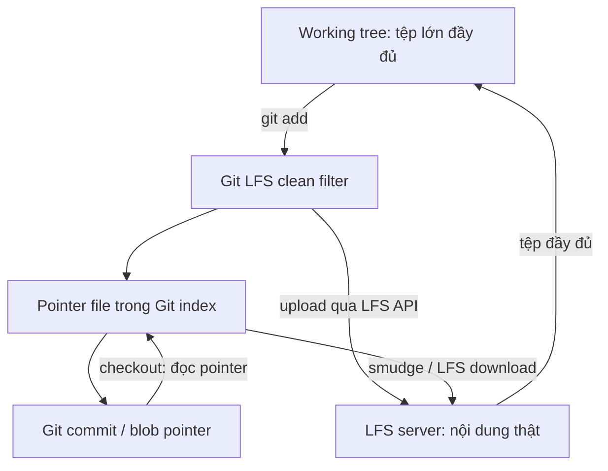

# Xử lý thiếu đối tượng LFS, quyền truy cập và hạn mức lưu trữ

Git LFS (Large File Storage) giúp quản lý tệp lớn mà không đưa toàn bộ nội dung nhị phân vào Git object database thông thường. Git lưu một **pointer file** nhỏ trong commit; nội dung thật được lưu trên LFS server và được nhận diện bằng mã SHA-256 cùng kích thước. Khi checkout, clone hoặc tải branch, Git LFS cần lấy đúng object từ máy chủ để tạo lại tệp đầy đủ trong working tree.

Vì vậy, một repository có thể clone và hiển thị lịch sử Git bình thường nhưng vẫn thiếu nội dung tệp LFS. Nguyên nhân có thể là object chưa từng được upload, server không còn object, tài khoản không có quyền, thông tin xác thực hết hạn, endpoint sai hoặc tổ chức đã chạm hạn mức lưu trữ/truyền tải.

Để xử lý đúng, trước tiên phải xác định pointer đang yêu cầu object nào, máy local có bản sao object hay không, Git LFS đang kết nối tới endpoint nào và máy chủ trả lỗi gì. Chỉ sau khi phân biệt được lỗi dữ liệu, lỗi quyền và lỗi hạn mức mới chọn cách khôi phục phù hợp.

## 1. Git LFS lưu gì trong repository?

### 1.1. Pointer file và nội dung thật

Khi một đường dẫn được Git LFS quản lý, Git thường lưu một tệp văn bản nhỏ có định dạng pointer, ví dụ:

```text
version https://git-lfs.github.com/spec/v1
oid sha256:4cac196befb3726d6fc6b0a8f8f4f9d5f3a1d9e7b7c8a2f4d6e8a0b1c2d3e4f5
size 104857600
```

Đây là ví dụ minh họa cấu trúc; mã OID phải là SHA-256 thực tế của nội dung tệp và dòng `size` phải đúng số byte. Pointer thường có ba thông tin:

- `version`: phiên bản đặc tả pointer.
- `oid sha256:...`: mã định danh nội dung LFS object.
- `size`: kích thước nội dung thật tính bằng byte.

Nội dung nhị phân đầy đủ không nằm trong Git commit như một blob thông thường. Git commit chỉ tham chiếu tới blob pointer. LFS server lưu object có OID tương ứng.



Khi `git add` và push tệp LFS, Git LFS tạo pointer và upload nội dung thật lên LFS server. Khi checkout, Git đọc pointer rồi tải object theo OID để ghi tệp đầy đủ vào working tree.

### 1.2. Git commit và LFS object là hai lớp dữ liệu khác nhau

Một commit có thể tồn tại đầy đủ trên Git remote trong khi LFS object mà pointer tham chiếu không tồn tại trên LFS server. Khi đó:

- `git log` vẫn hiển thị commit.
- `git show <commit>:path/to/file` có thể hiển thị pointer.
- Checkout tệp có thể báo lỗi tải object hoặc để lại pointer tùy cấu hình và cách thao tác.
- Build hoặc công cụ mở tệp có thể thất bại vì đang nhận pointer thay cho nội dung thật.

Do đó, việc Git push thành công hoặc branch đã xuất hiện trên remote không tự chứng minh tất cả LFS object đã sẵn sàng cho người khác tải. Cần kiểm tra cả hai lớp: Git refs/commits và LFS object store.

## 2. Nhận diện triệu chứng thiếu LFS object

Một số biểu hiện thường gặp:

- Clone hoặc checkout báo `batch response: ...`, `Object does not exist on the server` hoặc lỗi tải object.
- Git LFS báo HTTP `404`, `403`, `401`, `429` hoặc lỗi kết nối.
- Tệp trong working tree chỉ chứa ba dòng pointer thay vì nội dung nhị phân mong đợi.
- CI checkout repository thành công nhưng bước build/test báo tệp không đúng định dạng.
- Một thành viên tải được tệp nhưng thành viên khác hoặc CI không tải được.
- `git push` bị từ chối khi Git LFS không upload được object trước khi cập nhật branch.

Không nên suy luận ngay rằng object đã bị xóa chỉ từ mã HTTP. Một số nền tảng cố ý trả `404` khi người dùng không có quyền xem tài nguyên; `403` có thể do quyền, chính sách hoặc hạn mức; `401` thường liên quan xác thực. Cần đọc thông báo đầy đủ, endpoint và log phía nền tảng nếu có.

### 2.1. Kiểm tra tệp có phải pointer không

Xem nội dung tệp:

```bash
git show HEAD:path/to/large-file.bin
```

Nếu kết quả có các dòng `version`, `oid sha256` và `size`, đó là pointer được lưu trong Git. Nếu muốn kiểm tra working tree, dùng lệnh phù hợp với hệ điều hành để xem vài dòng đầu hoặc mở tệp bằng trình soạn thảo văn bản. Không mở tệp nhị phân lớn bằng công cụ có thể ghi lại nội dung.

Liệt kê các tệp LFS:

```bash
git lfs ls-files
git lfs ls-files --all
```

`git lfs ls-files` giúp xem các đường dẫn LFS được nhận diện trong phạm vi mặc định; `--all` mở rộng kiểm tra qua các ref mà Git LFS có thể xét. Kết quả cho biết OID rút gọn và đường dẫn, hữu ích để xác định tệp cần điều tra.

### 2.2. Kiểm tra trạng thái và môi trường Git LFS

```bash
git status --short --branch
git lfs version
git lfs env
git remote -v
git lfs logs last
```

- `git status` cho biết branch và thay đổi hiện tại.
- `git lfs version` xác nhận Git LFS đã được cài và cho biết phiên bản.
- `git lfs env` hiển thị endpoint, thư mục lưu object local và thông tin môi trường LFS.
- `git remote -v` cho biết URL Git remote.
- `git lfs logs last` hiển thị log Git LFS gần nhất để tìm lỗi batch API, upload hoặc download.

Đầu ra `git lfs env`, `git remote -v` và log có thể chứa URL nội bộ hoặc thông tin nhạy cảm. Hãy che token, header, tên máy chủ riêng và dữ liệu xác thực trước khi chia sẻ log.

### 2.3. Kiểm tra pointer và object local

Để xác định OID và kích thước mà pointer yêu cầu, xem pointer trong commit:

```bash
git show HEAD:path/to/large-file.bin
```

Git LFS lưu cache object local trong thư mục `.git/lfs/objects` (đường dẫn thực tế có thể thay đổi theo cấu hình). Có thể xem thư mục lưu trữ bằng:

```bash
git lfs env
```

Không sửa tên hoặc nội dung file trong cache thủ công. OID được tính từ nội dung, nên thay đổi byte sẽ khiến object không còn khớp pointer.

## 3. Chẩn đoán object thiếu bằng `git lfs fsck`

`git lfs fsck` kiểm tra tính toàn vẹn của LFS object local và đối chiếu với pointer. Lệnh này hữu ích để tìm object bị thiếu hoặc sai nội dung trong cache local.

```bash
git lfs fsck
```

Có thể chỉ định revision hoặc phạm vi phù hợp với phiên bản Git LFS đang dùng. Xem hướng dẫn lệnh trên máy:

```bash
git lfs fsck --help
```

Một số phiên bản có tùy chọn kiểm tra riêng pointer hoặc object; hãy dùng `--help` để xác nhận cú pháp được hỗ trợ.

Điểm cần phân biệt:

- `git lfs fsck` kiểm tra dữ liệu local và pointer trong phạm vi nó xét.
- Nó không phải phép kiểm tra quyền truy cập trên server.
- Nó không tự upload object bị thiếu.
- Nó không chứng minh rằng mọi object của mọi branch và tag trên remote đều có sẵn.

Nếu local cache có object hợp lệ, có thể dùng nó để upload lại lên LFS server sau khi xác nhận đúng endpoint, quyền và hạn mức.

## 4. Kiểm tra endpoint và xác thực

### 4.1. Git remote và LFS endpoint có thể khác nhau

Git remote thường dùng URL để fetch/push commit và refs. LFS endpoint có thể được suy ra từ remote URL, được khai báo qua `.lfsconfig` hoặc được cấu hình riêng trên máy.

Xem môi trường:

```bash
git lfs env
```

Tìm dòng endpoint như `Endpoint=...` và kiểm tra nó có thuộc repository/server mong muốn không. Nếu tổ chức dùng LFS server riêng hoặc proxy, endpoint có thể không giống URL Git remote.

File `.lfsconfig` có thể chứa các thiết lập như:

```ini
[lfs]
    url = https://lfs.example.com/team/project
```

`.lfsconfig` thường được commit để các clone biết endpoint LFS của dự án. Không đưa mật khẩu, token hoặc thông tin xác thực vào file này. Credential phải được cung cấp qua credential helper, cơ chế đăng nhập của nền tảng hoặc quy trình bảo mật của tổ chức.

### 4.2. Xác thực khi dùng HTTPS

Với HTTPS, Git LFS thường gọi batch API và cần credential hợp lệ. Nếu Git remote fetch được nhưng LFS download bị `401`, điều đó có thể cho thấy credential Git và credential LFS không đồng bộ hoặc credential helper chưa cấp thông tin phù hợp cho endpoint LFS.

Kiểm tra:

```bash
git config --show-origin --get-regexp '^credential\.'
git lfs env
```

Không in hoặc gửi credential thô. Nếu token hết hạn, đăng nhập lại hoặc cập nhật token qua credential manager theo hướng dẫn của nền tảng. Tránh nhúng token trực tiếp vào URL, script hoặc command history.

### 4.3. Xác thực khi Git remote dùng SSH

Một số nền tảng cho phép Git remote dùng SSH nhưng LFS truyền dữ liệu qua HTTPS. Git LFS có thể dùng SSH để hỏi nền tảng cấp endpoint và credential tạm thời, sau đó dùng HTTPS cho batch API và upload/download.

Vì vậy, SSH clone thành công không đảm bảo LFS transfer cũng thành công. Cần kiểm tra:

- SSH key có quyền truy cập repository không.
- Tài khoản có quyền truy cập LFS object của repository không.
- Cơ chế endpoint discovery và credential tạm thời có hoạt động không.
- HTTPS endpoint có thể truy cập từ máy hoặc runner không.

Nếu Git LFS báo lỗi xác thực, xem log và cấu hình endpoint; không mặc định đổi Git remote từ SSH sang HTTPS sẽ giải quyết được nguyên nhân.

## 5. Phân biệt lỗi quyền và lỗi hạn mức

### 5.1. Quyền đọc và quyền ghi LFS

Khả năng đọc repository Git không nhất thiết đồng nghĩa mọi thao tác LFS đều được phép. Tùy nền tảng và cách tổ chức, quyền có thể được kiểm tra riêng cho:

- Đọc repository và clone commit.
- Download LFS object.
- Upload LFS object.
- Truy cập repository fork hoặc object thuộc repository gốc.
- Chạy pipeline hoặc CI bằng token/service account.

Một người có thể fetch commit nhưng không tải được LFS object nếu token hoặc tài khoản không có quyền LFS phù hợp. Ngược lại, download có thể hoạt động nhưng push LFS thất bại do không có quyền upload.

### 5.2. Ý nghĩa thường gặp của mã HTTP

| Mã/trạng thái | Nguyên nhân có thể | Cách kiểm tra tiếp |
|---|---|---|
| `401 Unauthorized` | Chưa đăng nhập, token hết hạn, credential helper không cung cấp credential. | Đăng nhập lại, kiểm tra credential helper và endpoint. |
| `403 Forbidden` | Không đủ quyền, chính sách tổ chức chặn, token thiếu scope hoặc quota/policy từ chối. | Kiểm tra quyền repository/LFS, scope token và trang usage của nền tảng. |
| `404 Not Found` | Object hoặc endpoint không tồn tại; cũng có thể server che giấu tài nguyên mà người dùng không có quyền truy cập. | Xác nhận OID/size, endpoint, repository và quyền. |
| `429 Too Many Requests` | Rate limit hoặc giới hạn số yêu cầu trong một khoảng thời gian. | Kiểm tra retry guidance, rate limit và log server. |
| Timeout / DNS / TLS | Mạng, proxy, DNS, chứng chỉ hoặc endpoint không truy cập được. | Kiểm tra kết nối, proxy, TLS và thử lại khi dịch vụ ổn định. |
| Thông báo quota/storage | Hạn mức dung lượng hoặc băng thông đã chạm ngưỡng theo chính sách nền tảng. | Kiểm tra dashboard billing/usage và chính sách tổ chức. |

Đây là cách định hướng, không phải quy tắc tuyệt đối cho mọi nhà cung cấp. Nền tảng có thể dùng mã HTTP khác nhau hoặc trả thông báo chung. Luôn đối chiếu tài liệu và trang quản trị của dịch vụ đang dùng.

### 5.3. Kiểm tra quyền theo đúng danh tính

Nếu máy cá nhân tải được nhưng CI không tải được, so sánh danh tính đang dùng:

- Người dùng cá nhân hay service account.
- Token có quyền đọc LFS hay chỉ quyền đọc Git repository.
- Token có bị giới hạn theo repository, organization hoặc project không.
- Pipeline chạy từ repository gốc, fork hay pull request từ fork.
- Credential được cấp trong job có được truyền tới LFS endpoint không.

Không chia sẻ token giữa các thành viên để xử lý nhanh. Hãy cấp credential riêng theo vai trò và thời hạn, sử dụng secret store của CI hoặc credential manager.

## 6. Hạn mức lưu trữ và băng thông LFS

LFS thường có các giới hạn khác nhau, tùy nhà cung cấp và gói dịch vụ:

- **Storage quota:** tổng dung lượng object LFS được lưu.
- **Bandwidth/data transfer quota:** lượng dữ liệu được download hoặc truyền trong chu kỳ tính phí.
- **File size limit:** kích thước tối đa của một object hoặc một lần upload.
- **Request/rate limit:** số lần gọi API hoặc tốc độ yêu cầu trong một khoảng thời gian.
- **Billing/seat policy:** quyền sử dụng có thể phụ thuộc gói, tổ chức hoặc phương thức thanh toán.

Không nên gộp tất cả thành “hết dung lượng”. Một tổ chức có thể còn storage nhưng đã hết bandwidth; cũng có thể băng thông còn nhưng một tệp vượt giới hạn kích thước cho phép.

### 6.1. Cách xác minh quota

Kiểm tra dashboard hoặc trang quản trị usage/billing của nền tảng LFS. Tìm các thông tin:

- Storage đang dùng và hạn mức.
- Bandwidth đã dùng trong chu kỳ hiện tại.
- Thời điểm reset quota (nếu có).
- Repository hoặc project tạo ra phần sử dụng lớn.
- Tệp lớn nhất và các bản sao lịch sử đang giữ.
- Gói dịch vụ, phương thức thanh toán và cảnh báo vượt hạn mức.

Git CLI thường không cung cấp một lệnh chung có thể đọc quota từ mọi LFS provider. `git lfs env` chỉ cho biết môi trường và endpoint, không phải dashboard quota. Cần dùng giao diện quản trị hoặc API được nhà cung cấp hỗ trợ.

### 6.2. Điều gì xảy ra khi chạm quota?

Tùy chính sách dịch vụ, upload mới có thể bị từ chối, download có thể bị giới hạn, pipeline có thể không lấy được object hoặc quản trị viên nhận cảnh báo. Không có một hành vi chung cho mọi nền tảng.

Nếu upload thất bại do quota, Git branch có thể chưa được cập nhật vì hook LFS cần upload object trước khi Git push hoàn tất. Nếu download bị chặn, pointer vẫn có thể hiện diện trong commit nhưng nội dung thật không được ghi ra working tree.

### 6.3. Cách xử lý khi hết quota

1. Xác nhận chính xác loại quota đã chạm: storage, bandwidth, file size hay request limit.
2. Xem dashboard và thông báo của provider để xác định chu kỳ reset hoặc điều kiện thanh toán.
3. Nếu cần tiếp tục ngay, yêu cầu quản trị viên nâng hạn mức hoặc kích hoạt gói phù hợp theo quy trình tổ chức.
4. Giảm việc tải lặp lại không cần thiết; tránh clone/fetch LFS toàn bộ nhiều lần nếu công việc chỉ cần một nhóm tệp.
5. Xem xét chính sách lưu trữ và retention với các object không còn cần thiết; không tự ý xóa lịch sử hoặc LFS data dùng chung.
6. Sau khi quota được giải quyết, chạy lại thao tác LFS cần thiết và xác minh object đã tải/upload thành công.

Xóa một commit hoặc branch trong Git không nhất thiết làm giảm LFS storage đã tính phí. Nhiều nền tảng giữ object trong một khoảng thời gian hoặc cho tới khi có quy trình garbage collection riêng. Không giả định `git push --delete` sẽ xóa object LFS hoặc giải phóng quota.

## 7. Quy trình khôi phục khi object thiếu

### 7.1. Bước 1: Xác định đúng repository, branch và pointer

```bash
git status -sb
git branch --show-current
git remote -v
git lfs ls-files --all
git show HEAD:path/to/large-file.bin
```

Ghi lại branch, commit, đường dẫn, OID SHA-256 và kích thước trong pointer. Kiểm tra `.gitattributes` để xác nhận đường dẫn thực sự được cấu hình dùng LFS.

### 7.2. Bước 2: Xác định endpoint và trạng thái LFS

```bash
git lfs version
git lfs env
git config --show-origin --get-regexp '^lfs\.'
```

Xác nhận endpoint là server của repository đang làm việc. Kiểm tra `.lfsconfig` nếu dự án có dùng, cùng cấu hình local/global có thể ghi đè. Che thông tin nhạy cảm khi lưu hoặc chia sẻ đầu ra.

### 7.3. Bước 3: Thử tải object cần thiết

Nếu pointer thuộc branch hiện tại, có thể dùng:

```bash
git lfs pull origin
```

`git lfs pull` tải LFS object cho ref/checkout hiện tại theo cơ chế fetch của Git LFS rồi cập nhật nội dung working tree. Nếu chỉ muốn tải object mà chưa cập nhật tệp trong working tree, dùng:

```bash
git lfs fetch origin
```

Có thể chỉ rõ branch hoặc ref tùy nhu cầu:

```bash
git lfs fetch origin main
```

Kiểm tra cú pháp chính xác bằng `git lfs fetch --help` nếu phiên bản đang dùng khác. `fetch` tải object vào cache local; `pull` còn áp dụng nội dung về working tree.

### 7.4. Bước 4: Xác minh object sau khi tải

```bash
git lfs fsck
git lfs status
git status --short
```

Mở tệp bằng công cụ phù hợp và xác nhận kích thước/nội dung đúng. Nếu file vẫn là pointer, kiểm tra smudge/filter, `GIT_LFS_SKIP_SMUDGE`, endpoint và log tải.

### 7.5. Bước 5: Nếu object vẫn thiếu

Nếu server báo object không tồn tại:

- Xác minh pointer có đúng OID và size không.
- Kiểm tra commit/branch nào đã tạo pointer đó.
- Hỏi người tạo commit hoặc đồng đội có clone nào còn LFS object local không.
- Kiểm tra backup, artifact storage hoặc bản lưu khác của tệp gốc.
- Nếu có object hợp lệ ở một máy khác, dùng quy trình upload lại sau khi xác nhận quyền và quota.

Nếu không có bản sao object ở local, backup hoặc server, pointer không đủ để tái tạo nội dung. Pointer chỉ lưu OID và kích thước, không chứa nội dung nhị phân. Khi đó cần khôi phục từ nguồn dữ liệu gốc hoặc backup của dự án.

## 8. Upload lại LFS object khi local còn bản hợp lệ

Nếu server thiếu object nhưng một clone đáng tin cậy vẫn còn object local, có thể upload lại. Trước tiên, kiểm tra object bằng `git lfs fsck` và xác nhận endpoint, quyền ghi, quota.

Để upload các LFS object được tham chiếu bởi branch cụ thể:

```bash
git lfs push origin main
```

Để upload các object được tham chiếu bởi toàn bộ refs local:

```bash
git lfs push --all origin
```

`--all` có thể truyền lượng dữ liệu lớn. Chỉ dùng khi đã xác định phạm vi cần khôi phục, dung lượng và quyền truy cập. Với repository có nhiều branch/tag, upload toàn bộ có thể tiêu tốn đáng kể bandwidth và storage.

Sau upload, xác minh từ một clone khác hoặc môi trường CI có quyền đọc:

```bash
git lfs fetch origin main
git lfs fsck
```

Nếu server từ chối do 403/quota, upload lại nhiều lần không giải quyết được. Cần xử lý quyền hoặc hạn mức trước.

## 9. Xử lý khi chỉ thấy pointer trong working tree

Một số môi trường đặt biến:

```bash
GIT_LFS_SKIP_SMUDGE=1
```

để bỏ qua tải LFS object tự động trong lúc clone/checkout. Điều này hữu ích khi muốn clone nhanh hoặc chỉ tải các tệp cần thiết sau đó. Nhưng working tree sẽ có thể chứa pointer thay cho tệp đầy đủ.

Sau khi đã sẵn sàng tải object:

```bash
git lfs pull origin
```

Kiểm tra biến môi trường và filter:

```bash
git lfs env
git config --show-origin --get-regexp '^filter\.lfs\.'
```

Nếu `GIT_LFS_SKIP_SMUDGE` vẫn bật, thao tác checkout có thể tiếp tục để pointer. Hãy bỏ biến đó trong terminal/job phù hợp rồi chạy `git lfs pull`.

PowerShell:

```powershell
Remove-Item Env:GIT_LFS_SKIP_SMUDGE -ErrorAction SilentlyContinue
git lfs pull origin
```

Không xóa hoặc sửa pointer thủ công để giả lập nội dung thật. Hãy tải object đúng OID từ LFS server.

## 10. Các tình huống đặc biệt: CI, fork và clone mới

### 10.1. CI tải được Git nhưng không tải được LFS

CI có thể dùng token chỉ đủ clone repository nhưng không đủ quyền download LFS. Kiểm tra:

- Token của job có quyền đọc LFS object.
- Pull request đến từ fork có được phép tải LFS của repository gốc không.
- Secret có được cung cấp trong ngữ cảnh pipeline hiện tại không; nhiều nền tảng hạn chế secret cho fork hoặc pipeline từ nguồn không tin cậy.
- Runner có cài Git LFS và hook/filter cần thiết không.
- Endpoint LFS có được truy cập qua proxy/firewall của runner không.

Không bật secret ghi quyền rộng cho pipeline từ fork không tin cậy chỉ để làm LFS hoạt động. Dùng credential read-only và quy trình bảo mật phù hợp với nền tảng.

### 10.2. Fork có pointer nhưng thiếu object

Fork có thể chứa commit và pointer được sao chép từ repository gốc nhưng LFS object không được sao chép tự động theo cách người dùng mong đợi. Hành vi phụ thuộc nền tảng. Người đóng góp có thể đọc được Git history nhưng không tải được tệp lớn.

Kiểm tra LFS endpoint và quyền truy cập repository nguồn. Nếu chính sách dự án cho phép, maintainer cần bảo đảm LFS object được lưu ở nơi các fork/CI hợp lệ có thể tải, hoặc cung cấp quy trình chia sẻ artifact riêng.

### 10.3. Clone mới không tải được object đã có trong clone cũ

Clone cũ có thể vẫn giữ LFS cache local dù object đã bị xóa khỏi server hoặc quota đã thay đổi. Vì vậy, clone cũ mở tệp được nhưng clone mới thất bại. Nếu clone cũ là bản duy nhất còn object, hãy sao lưu và xác minh object trước khi dọn cache hoặc xóa máy.

## 11. Bảo trì cache local và LFS server

Git LFS giữ cache object local để tránh tải lặp lại. Có thể xem dung lượng thư mục lưu trữ qua `git lfs env` và kiểm tra trạng thái bằng các lệnh LFS tương ứng.

Lệnh:

```bash
git lfs prune
```

có thể dọn object local không còn cần thiết theo quy tắc retention của Git LFS. Đây là thao tác trên cache local, không phải lệnh xóa object trên LFS server và không giải phóng quota storage của dịch vụ từ xa.

Trước khi prune, cần bảo đảm:

- Object cần cho branch chưa push hoặc công việc offline đã được upload/backup.
- Không còn cần cache làm nguồn khôi phục duy nhất.
- Các worktree và branch đang dùng không phụ thuộc object local sắp bị dọn.

Không xóa thủ công `.git/lfs/objects` để xử lý quota server. Làm vậy chỉ xóa cache local, có thể khiến máy phải tải lại object và tăng bandwidth.

## 12. Phòng ngừa lỗi LFS

### 12.1. Thiết lập Git LFS nhất quán

Trong môi trường mới:

```bash
git lfs version
git lfs install
```

`git lfs install` thiết lập các hook/filter cần thiết cho người dùng hiện tại hoặc repository theo tùy chọn. Thực hiện trong quy trình onboarding để các máy không vô tình commit pointer hoặc bỏ qua upload.

Kiểm tra `.gitattributes` có pattern đúng:

```gitattributes
*.psd filter=lfs diff=lfs merge=lfs -text
*.zip filter=lfs diff=lfs merge=lfs -text
```

Chỉ đưa các loại tệp phù hợp vào LFS. Không nên thêm mọi tệp văn bản hoặc tệp nhỏ vào LFS nếu không có lý do.

### 12.2. Xác minh upload trước khi thông báo hoàn tất

Sau khi commit tệp LFS:

```bash
git lfs status
git push origin feature/large-assets
```

Theo dõi cả log Git và LFS. Đảm bảo pre-push hook upload object thành công và branch đã được cập nhật. Nếu hook bị bỏ qua bằng `--no-verify` hoặc bị tắt, có thể đẩy pointer mà object chưa có trên server; tránh làm vậy trừ khi có quy trình upload thay thế đã được kiểm chứng.

### 12.3. Kiểm tra bằng clone sạch hoặc CI

Một clone local có thể đang dùng cache cũ nên không phát hiện object trên server bị thiếu. Với tệp quan trọng, kiểm tra bằng clone mới hoặc runner sạch có quyền tương đương người dùng thực tế. Điều này xác nhận object có thể được tải từ LFS server, thay vì chỉ có sẵn trong cache của tác giả.

### 12.4. Theo dõi quota

Quản trị viên nên theo dõi storage và bandwidth theo chu kỳ, thiết lập cảnh báo và quy định ai được upload tệp lớn. Trước đợt phát hành hoặc import tài sản lớn, ước tính dung lượng và lưu lượng tải để tránh làm pipeline hoặc nhóm phát triển bị gián đoạn.

## 13. Bảng chẩn đoán nhanh

| Triệu chứng | Nguyên nhân cần kiểm tra | Hành động phù hợp |
|---|---|---|
| Tệp hiển thị pointer | Smudge bị bỏ qua, Git LFS chưa cài hoặc object chưa tải | Kiểm tra `git lfs env`, biến skip-smudge và chạy `git lfs pull`. |
| `401` khi download | Credential thiếu/hết hạn | Đăng nhập lại, kiểm tra credential helper và token read scope. |
| `403` khi upload | Thiếu quyền ghi, policy hoặc quota | Kiểm tra quyền upload, policy và dashboard usage. |
| `404` object | OID không tồn tại hoặc server che giấu do quyền | Đối chiếu pointer, endpoint, repository và quyền đọc. |
| Clone cũ dùng được, clone mới lỗi | Object còn trong cache cũ nhưng thiếu trên server | Sao lưu cache cũ, xác minh và upload lại nếu hợp lệ. |
| CI lỗi nhưng máy cá nhân chạy được | Service token, fork policy, runner hoặc endpoint khác | So sánh danh tính, secret scope, Git LFS version và network. |
| Upload bị từ chối do storage | Storage quota hoặc file size limit | Kiểm tra dashboard, tăng hạn mức hoặc điều chỉnh chính sách lưu trữ. |
| Download bị giới hạn dù storage còn | Bandwidth/rate quota | Kiểm tra chu kỳ transfer và giảm tải lặp lại. |

## 14. Quy trình xử lý một sự cố thực tế

Giả sử thành viên clone repository thành công nhưng `models/model.bin` chỉ là pointer; CI cũng báo không tải được object.

**Bước 1: Xác nhận pointer và OID**

```bash
git show HEAD:models/model.bin
git lfs ls-files --all
```

Ghi lại OID SHA-256 và kích thước.

**Bước 2: Xác nhận Git LFS và endpoint**

```bash
git lfs version
git lfs env
git remote -v
```

Kiểm tra endpoint, cấu hình `.lfsconfig` và biến skip-smudge.

**Bước 3: Thử fetch object**

```bash
git lfs fetch origin main
```

Nếu lỗi, lưu mã HTTP và thông báo; không lặp lại liên tục nếu lỗi cho thấy quyền hoặc quota.

**Bước 4: Phân loại nguyên nhân**

- `401`: kiểm tra đăng nhập và credential.
- `403`: kiểm tra quyền LFS, scope token, policy và quota.
- `404`: xác minh object có tồn tại và endpoint/repository đúng.
- `429`: kiểm tra rate limit hoặc bandwidth policy.
- Timeout/TLS: kiểm tra mạng, proxy và chứng chỉ.

**Bước 5: Tìm nguồn object hợp lệ**

Nếu server thật sự thiếu object, hỏi người tạo commit hoặc máy clone cũ. Sao lưu và kiểm tra cache bằng `git lfs fsck` trước khi upload lại.

**Bước 6: Khôi phục và xác minh**

Sau khi quyền/quota được giải quyết hoặc object được upload lại:

```bash
git lfs pull origin
git lfs fsck
```

Kiểm tra kích thước/nội dung tệp, chạy build/test và thử từ clone sạch hoặc CI để xác nhận mọi người có thể tải object.

## 15. Ghi nhớ

- Git commit lưu pointer; LFS server lưu nội dung thật theo OID SHA-256 và kích thước.
- Git history có thể đầy đủ trong khi LFS object bị thiếu.
- `git lfs ls-files`, `git lfs env`, `git lfs fsck` giúp xác định tệp, endpoint và tính toàn vẹn local.
- `git lfs fetch` tải object vào cache; `git lfs pull` tải và cập nhật nội dung working tree.
- Git remote dùng SSH không đảm bảo LFS transfer không cần HTTPS hoặc credential riêng.
- `401`, `403`, `404`, `429` là dấu hiệu để phân loại; mã cụ thể phụ thuộc provider và không tự chứng minh một nguyên nhân duy nhất.
- Storage, bandwidth, file size và rate limit là các loại hạn mức khác nhau.
- `git lfs push --all` có thể upload nhiều dữ liệu; chỉ dùng khi đã kiểm tra phạm vi, quyền và quota.
- `git lfs prune` dọn cache local, không xóa LFS object trên server và không giải phóng quota từ xa.
- Pointer không thể tái tạo nội dung nhị phân nếu object đã mất ở mọi bản sao; cần tìm nguồn gốc hoặc backup.
- Clone sạch/CI giúp xác minh object thật sự có thể tải từ server, không chỉ tồn tại trong cache của một máy.

Khi LFS gặp lỗi, hãy bắt đầu từ pointer và OID, sau đó kiểm tra endpoint, danh tính, quyền, quota và cache local. Chỉ khi biết object còn ở đâu và server từ chối vì lý do gì mới có thể khôi phục mà không làm tăng thêm rủi ro hoặc tiêu tốn quota không cần thiết.
