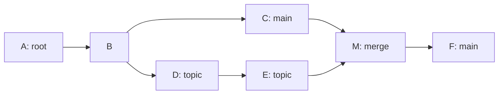
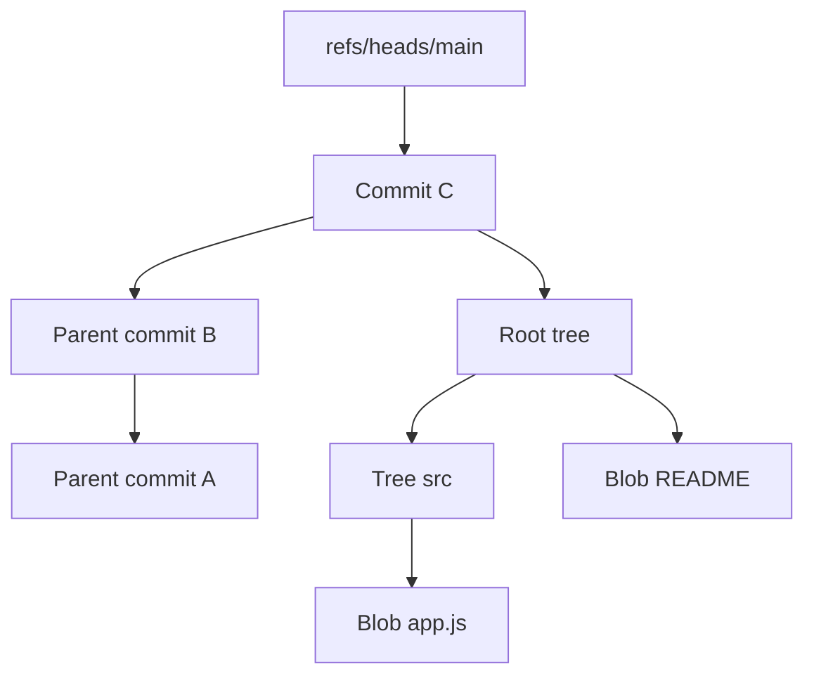

# Đồ thị commit, quan hệ cha và khả năng truy cập đối tượng

Git lưu lịch sử dưới dạng các đối tượng bất biến được nối với nhau bằng những tham chiếu. Mỗi commit trỏ tới một snapshot của cây thư mục và một hoặc nhiều commit cha. Các quan hệ cha tạo thành **đồ thị có hướng không chu trình (DAG)**. Branch và tag là các ref giúp Git tìm thấy những đối tượng này; chúng không phải bản sao của lịch sử.

Hiểu đồ thị commit và khả năng truy cập đối tượng giúp giải thích vì sao merge commit có nhiều cha, vì sao rebase tạo commit mới, vì sao một branch bị xóa vẫn có thể khôi phục, và vì sao một object có thể còn trong `.git/objects` nhưng không còn được branch nào tham chiếu.

Trong module SOURCE_CONTROL_GIT, kiến thức này nối các thao tác branch, merge, rebase, tag và recovery với cấu trúc dữ liệu thật mà Git quản lý. Ta sẽ đi từ cấu trúc commit đến cách lần theo quan hệ tổ tiên và kiểm tra object còn truy cập được hay không.

## 1. Git lưu lịch sử bằng các object

Git không lưu lịch sử như một chuỗi bản vá tuần tự. Nó lưu object theo nội dung, sau đó dùng các object tham chiếu lẫn nhau để mô tả snapshot và lịch sử.

Các loại object cơ bản:

| Object | Nội dung | Vai trò |
|---|---|---|
| `blob` | Byte của nội dung tệp | Lưu nội dung tệp, không tự lưu tên hoặc đường dẫn. |
| `tree` | Danh sách entry gồm mode, tên và object ID | Mô tả thư mục; entry có thể trỏ tới blob hoặc tree con. |
| `commit` | Tree, danh sách parent, author, committer và message | Ghi nhận một snapshot cùng vị trí của nó trong lịch sử. |
| `tag` | Đối tượng đích, loại đích, tên tag, tagger và message | Tạo annotated tag; có thể kèm chữ ký. |

Một tệp có tên `src/app.js` không được lưu trong blob với tên đó. Blob chỉ chứa byte nội dung. Tên `app.js` và quan hệ với thư mục `src` nằm trong tree object. Điều này cho phép cùng một blob được tham chiếu từ nhiều tree mà không phải lưu lại nội dung trùng lặp.

### 1.1. Object ID và tính bất biến

Mỗi object được định danh bằng một mã băm nội dung (object ID hoặc OID). Git tính mã từ phần biểu diễn object gồm loại, kích thước và nội dung; vì vậy thay đổi nội dung hoặc metadata của commit sẽ tạo object ID khác.

Repository phổ biến lâu nay dùng SHA-1; Git cũng hỗ trợ định dạng repository SHA-256. Không nên giả định mọi OID luôn có 40 ký tự. Dùng lệnh Git để lấy OID thay vì tự cắt chuỗi theo độ dài cố định:

```bash
git rev-parse HEAD
git rev-parse --show-object-format
```

Object được xem là bất biến: Git không sửa một commit hoặc blob đã tồn tại tại chỗ. Khi tạo nội dung mới, Git tạo object mới với OID mới. Đây là nền tảng để commit có thể chia sẻ và kiểm chứng qua OID.

### 1.2. Xem nội dung object

Với một OID đã biết:

```bash
git cat-file -t <object-id>
git cat-file -s <object-id>
git cat-file -p <object-id>
```

- `-t` cho biết loại object.
- `-s` cho biết kích thước nội dung object.
- `-p` hiển thị nội dung theo cách phù hợp với loại object.

Ví dụ xem commit hiện tại:

```bash
git cat-file -p HEAD
```

Kết quả thường có dạng:

```text
tree 8a4f... 
parent 31bc...
author An Nguyen <an@example.com> 1731500000 +0700
committer An Nguyen <an@example.com> 1731500000 +0700

feat: add invoice search
```

Các OID trong ví dụ đã rút gọn. Một commit thông thường có một dòng `parent`; root commit không có dòng `parent`; merge commit có từ hai dòng `parent` trở lên.

## 2. Cấu trúc của commit object

Commit object mô tả một snapshot và mối quan hệ của snapshot đó với lịch sử trước nó.

Các trường quan trọng:

- `tree`: OID của tree ở thư mục gốc snapshot.
- `parent`: OID của commit cha; có thể có nhiều dòng.
- `author`: người tạo thay đổi về mặt tác giả và thời điểm author.
- `committer`: người tạo commit object và thời điểm committer.
- Message: nội dung mô tả commit.
- Các header tùy chọn: encoding, chữ ký (`gpgsig` hoặc header liên quan) và metadata khác.

### 2.1. Root commit

Commit đầu tiên trong một lịch sử không có commit cha. Nó được gọi là root commit:

```text
A
```

Root commit vẫn có `tree`, author, committer và message; chỉ có điều không có parent. Một repository có thể có nhiều root commit nếu các lịch sử độc lập được tạo riêng rồi cùng xuất hiện trong một repository mà không được nối bằng merge.

### 2.2. Commit thông thường

Một commit thông thường có đúng một parent:

```text
A---B---C
```

Commit `B` có parent là `A`; commit `C` có parent là `B`. Quan hệ parent đi từ commit mới về commit cũ. Trong sơ đồ lịch sử, ta thường vẽ mũi tên thời gian từ trái sang phải, nhưng trường `parent` trong object lại trỏ ngược về commit trước.

### 2.3. Merge commit

Merge commit có nhiều parent, phổ biến nhất là hai:

```text
      D---E
     /     \
A---B-------M---F
```

Ở đây `M` có hai parent: commit trước merge trên nhánh hiện tại (`B`) và tip nhánh được merge (`E`). Parent thứ nhất thường là nhánh đang đứng khi chạy merge; parent thứ hai là nhánh được đưa vào. Thứ tự parent là một phần của commit và có ý nghĩa đối với các lệnh như `M^1`, `M^2`, `--first-parent`.

Git cũng hỗ trợ octopus merge với ba parent trở lên, thường dùng khi hợp nhất nhiều nhánh đơn giản cùng lúc. Các conflict phức tạp thường được giải quyết bằng những lần merge hai nhánh riêng biệt thay vì một octopus merge.

## 3. Commit graph là một DAG

DAG là viết tắt của *directed acyclic graph*: đồ thị có hướng và không có chu trình. Trong commit graph:

- Mỗi đỉnh là một commit.
- Mỗi quan hệ parent là một cạnh có hướng từ commit con về commit cha.
- Không có đường đi nào quay lại chính commit ban đầu, vì commit mới chỉ có thể trỏ tới object đã tồn tại.
- Một commit có thể có một parent, nhiều parent hoặc không có parent.

Khi minh họa lịch sử, ta thường đặt commit cũ ở bên trái và commit mới ở bên phải:



Các mũi tên trong sơ đồ này biểu diễn hướng phát triển từ cha sang con để dễ đọc. Trong commit object, mỗi commit mới lưu OID của cha, tức quan hệ tham chiếu được ghi từ con về cha.

### 3.1. Lịch sử không nhất thiết là một đường thẳng

Nếu chỉ có commit thông thường, lịch sử trông như một chuỗi. Khi tạo branch và phát triển song song, đồ thị phân nhánh. Khi merge, nhiều dòng lịch sử gặp nhau tại một commit có nhiều parent.

Vì vậy, `git log --oneline` có thể không thể hiện rõ cấu trúc phân nhánh. Để xem đồ thị:

```bash
git log --graph --oneline --decorate --all
```

`--graph` vẽ quan hệ phân nhánh; `--decorate` hiển thị refs đang trỏ tới commit; `--all` yêu cầu xét các ref được Git liệt kê, thay vì chỉ lịch sử của HEAD.

### 3.2. Thời gian commit không quyết định quan hệ cha

Đồ thị được xác định bởi parent OID, không phải bằng cách sắp xếp timestamp. Author date và committer date có thể khác nhau; rebase có thể giữ author date nhưng tạo committer date mới. Đồng hồ máy cũng có thể sai.

Do đó, không suy luận một commit là cha của commit khác chỉ vì timestamp nhỏ hơn. Hãy dùng quan hệ ancestry hoặc đọc trường `parent`.

### 3.3. Commit DAG và file `commit-graph` là hai khái niệm liên quan

Trong tài liệu Git, `commit graph` thường chỉ DAG được tạo bởi các commit và quan hệ parent. Git còn có một tính năng lưu dữ liệu tăng tốc trong file **commit-graph** (thường nằm dưới `.git/objects/info/commit-graph` hoặc trong commit-graph chain). File này lưu thông tin đã tính trước như parent và generation number để các thao tác duyệt lịch sử nhanh hơn.

Commit-graph file là dữ liệu tối ưu hiệu năng; nó không thay thế commit object, branch ref hoặc quan hệ parent thật. Nếu file tối ưu bị thiếu, Git vẫn có thể đọc commit object và dựng lại quan hệ, dù một số thao tác có thể chậm hơn.

Có thể kiểm tra hoặc tạo dữ liệu tối ưu bằng các lệnh chuyên dụng:

```bash
git commit-graph verify
git commit-graph write --reachable
```

`verify` kiểm tra commit-graph file hiện có; `write --reachable` tạo/cập nhật dữ liệu commit-graph cho các commit reachable. Đây là thao tác bảo trì hiệu năng, không phải bước cần thiết để hiểu hoặc sửa commit history.

## 4. Branch, tag và HEAD là các ref tới object

Ref là tên có thể phân giải thành OID. Branch không chứa toàn bộ lịch sử; nó thường là một con trỏ có thể di chuyển tới commit tip.

### 4.1. Branch ref

Ví dụ:

```text
refs/heads/main       -> commit C
refs/heads/feature    -> commit E
```

Hai branch có thể cùng trỏ tới một commit, hoặc trỏ tới hai tip khác nhau trong cùng DAG. Khi tạo commit trên branch đang checkout, Git cập nhật ref branch đó để trỏ tới commit mới.

Xem branch và OID:

```bash
git branch -avv
git show-ref --heads
```

### 4.2. Remote-tracking ref

Remote-tracking branch như `origin/main` là ref local ghi nhận tip mà lần fetch gần nhất đã quan sát từ remote:

```text
refs/remotes/origin/main -> commit C
```

Nó không tự động cập nhật theo server trong thời gian thực. Cần `git fetch` để cập nhật thông tin từ remote.

### 4.3. Lightweight tag và annotated tag

Lightweight tag thường là ref trỏ trực tiếp tới một object, thường là commit:

```text
refs/tags/v1.0 -> commit C
```

Annotated tag tạo thêm tag object chứa tên tag, tagger, message và có thể có chữ ký; ref tag trỏ tới tag object, object đó lại trỏ tới commit hoặc object đích khác.

Kiểm tra tag:

```bash
git show-ref --tags
git cat-file -t v1.0
git cat-file -p v1.0
```

`git cat-file -t v1.0` có thể trả `tag` với annotated tag hoặc `commit` với lightweight tag.

### 4.4. HEAD: vị trí làm việc hiện tại

Thông thường `HEAD` là symbolic ref trỏ tới branch hiện tại:

```text
HEAD -> refs/heads/main -> commit C
```

Khi checkout một commit cụ thể thay vì branch, HEAD có thể trỏ trực tiếp tới OID; trạng thái này gọi là detached HEAD:

```text
HEAD -> commit C
```

Kiểm tra:

```bash
git symbolic-ref -q HEAD
git rev-parse HEAD
```

`git symbolic-ref -q HEAD` trả tên ref nếu HEAD đang symbolic; trong detached HEAD, lệnh không trả symbolic ref. `git rev-parse HEAD` vẫn trả OID commit hiện tại.

## 5. Quan hệ tổ tiên và khả năng truy cập commit

Một commit `A` là tổ tiên của commit `B` nếu có thể lần theo một hoặc nhiều parent từ `B` để tới `A`. `B` là hậu duệ của `A`.

Ví dụ:

```text
A---B---C---D
     \
      E---F
```

- `A` là tổ tiên của `D` và `F`.
- `B` là tổ tiên của `C`, `D`, `E`, `F`.
- `C` không phải tổ tiên của `F`.
- `E` không phải tổ tiên của `D`.
- `D` và `F` không phải tổ tiên của nhau.

Kiểm tra một quan hệ:

```bash
git merge-base --is-ancestor A D
echo $?
```

Exit status `0` nghĩa là `A` là tổ tiên của `D`; `1` nghĩa là không phải; các mã khác có thể chỉ ra lỗi hoặc đối tượng không thể phân giải. Trong PowerShell, đọc `$LASTEXITCODE` ngay sau lệnh Git.

### 5.1. Fast-forward là di chuyển ref dọc theo quan hệ tổ tiên

Giả sử branch `main` trỏ tới `B`, còn `feature` trỏ tới `D`:

```text
A---B---C---D   feature
    ^
    main
```

Vì `B` là tổ tiên của `D`, merge `feature` vào `main` có thể fast-forward: Git chỉ di chuyển ref `main` từ `B` tới `D`, không cần tạo merge commit.

Nếu hai branch đã phân kỳ:

```text
      C---D   main
     /
A---B
     \
      E---F   feature
```

Không thể fast-forward `main` tới `feature` mà vẫn giữ commit `D` trên lịch sử `main`. Git cần tạo merge commit hoặc người dùng chủ động rebase/reset theo quy trình phù hợp.

### 5.2. Merge base là tổ tiên chung tốt nhất

Merge base là một hoặc nhiều tổ tiên chung tốt nhất của hai commit, tức không có tổ tiên chung nào khác nằm sau chúng trong đồ thị. Trong lịch sử thông thường, merge base thường là điểm phân nhánh gần nhất.

Xem:

```bash
git merge-base main feature
git merge-base --all main feature
```

Một số đồ thị phức tạp có thể có nhiều merge base tốt nhất. Thuật toán merge của Git có thể cần xử lý các trường hợp này; đừng mặc định mọi cặp branch luôn có đúng một merge base.

## 6. Khả năng truy cập đối tượng (object reachability)

Một object được gọi là reachable khi có thể đi tới nó từ một tập điểm bắt đầu (root) bằng cách lần theo các liên kết object. Trong công việc hàng ngày, các refs như branch, tag và một số refs khác là những điểm bắt đầu quan trọng.

Từ một branch tip, Git có thể lần theo:

1. Commit và các parent commit của nó.
2. Tree mà commit tham chiếu.
3. Tree con và blob mà các tree tham chiếu.
4. Các object khác được tham chiếu qua tag object hoặc cấu trúc liên quan.

Ví dụ:



Nếu branch `main` trỏ tới commit `C`, các commit cha và các tree/blob được những commit đó tham chiếu đều có thể truy cập từ ref này.

### 6.1. Ref giữ object có thể tìm thấy

Branch hoặc tag là tên ổn định giúp người dùng tìm lại object. Khi branch di chuyển, ref cũ không còn giữ commit trước đó bằng tên branch nữa. Nếu không còn ref hoặc nguồn giữ nào khác, commit cũ có thể trở thành unreachable.

Xem các ref:

```bash
git show-ref
git for-each-ref --format='%(refname) %(objectname)'
```

Không nên nhầm tên branch với object ID. Branch có thể di chuyển theo commit mới; object commit cũ vẫn bất biến.

### 6.2. Reflog có thể giữ dấu vết của ref cũ

Reflog ghi lại các lần HEAD hoặc ref thay đổi, ví dụ sau commit, reset, rebase hoặc checkout. Nó có thể giúp tìm commit mà branch từng trỏ tới:

```bash
git reflog --all --date=iso
```

Reflog là dữ liệu local, không tự được push lên remote như branch. Nó có thời hạn lưu và có thể bị expire. Vì vậy, reflog là nguồn phục hồi hữu ích nhưng không phải backup lâu dài.

Git garbage collection thường giữ object còn được tham chiếu và có thể giữ một số object unreachable trong thời gian grace period để tránh xóa ngay các object vừa bị bỏ tham chiếu. Thời hạn cụ thể phụ thuộc cấu hình và lệnh bảo trì. Sau khi reflog hết hạn và object bị prune, khả năng phục hồi từ repository local có thể mất.

### 6.3. Reachable, unreachable và dangling không đồng nghĩa

- **Reachable:** có thể lần theo từ các root đang được xét.
- **Unreachable:** không thể lần theo từ các root đó, nhưng object có thể vẫn còn trong object database.
- **Dangling:** thuật ngữ `fsck` dùng cho object không được object khác tham chiếu trực tiếp; nhiều trường hợp dangling cũng là unreachable và có thể là đầu mối phục hồi.

Phạm vi root được xét có thể khác nhau giữa lệnh và tùy chọn. Refs, reflogs, index và promisor objects có thể ảnh hưởng cách Git kiểm tra. Vì vậy, khi điều tra cần đọc đúng tùy chọn `fsck` thay vì hiểu một kết quả là danh sách tuyệt đối mọi object trong mọi hoàn cảnh.

## 7. Kiểm tra object reachable và unreachable

### 7.1. Liệt kê commit reachable từ các ref

```bash
git rev-list --all
```

Lệnh liệt kê commit có thể đi tới từ các ref mà `--all` xét. Muốn thấy đồ thị:

```bash
git log --graph --oneline --decorate --all
```

### 7.2. Liệt kê object reachable

```bash
git rev-list --objects --all
```

Kết quả gồm OID của object reachable và có thể kèm đường dẫn cho blob/tree được duyệt. Đây là cách xem object mà lịch sử/ref hiện tại giữ lại.

Muốn giới hạn theo một commit:

```bash
git rev-list --objects <commit-id>
```

Lệnh lần theo object được commit đó và tổ tiên của nó tham chiếu.

### 7.3. Tìm object không reachable

Sau khi đã hiểu trạng thái repository, có thể chạy:

```bash
git fsck --full --unreachable
```

Để xem thêm dangling object:

```bash
git fsck --full --dangling
```

`git fsck` kiểm tra tính hợp lệ và kết nối của object database. Các object unreachable không nhất thiết là dữ liệu hỏng; chúng có thể là commit bị bỏ khỏi branch sau reset/rebase hoặc object còn sót lại sau khi xóa ref.

Nếu cần bỏ qua reflog để tìm object không còn được ref/reflog giữ:

```bash
git fsck --full --no-reflogs --unreachable
```

Đây là bước điều tra hữu ích sau khi backup. Không chạy `git gc`, `git prune` hoặc xóa object directory trong lúc đang tìm dữ liệu phục hồi.

### 7.4. Kiểm tra một object tìm được

Khi `fsck` in ra OID, xác định loại và nội dung:

```bash
git cat-file -t <object-id>
git cat-file -p <object-id>
```

Nếu là commit, xem snapshot và parent. Nếu đó là commit cần giữ lại, tạo một ref cứu hộ:

```bash
git branch rescue/recovered <commit-id>
```

Từ lúc có branch cứu hộ, commit trở nên reachable từ ref đó. Hãy xác minh nội dung trước khi đặt tên hoặc chia sẻ branch.

## 8. Đọc quan hệ cha bằng revision syntax

Git cung cấp cú pháp ngắn để đi từ một commit tới parent hoặc tổ tiên.

| Cú pháp | Ý nghĩa |
|---|---|
| `HEAD^` | Parent thứ nhất của HEAD, tương đương `HEAD^1`. |
| `HEAD^2` | Parent thứ hai của HEAD; thường dùng với merge commit. |
| `HEAD~1` | Parent thứ nhất của HEAD. |
| `HEAD~2` | Đi theo parent thứ nhất hai lần. |
| `HEAD~3` | Đi theo parent thứ nhất ba lần. |
| `main^1` | Parent thứ nhất của tip branch `main`. |
| `main^2` | Parent thứ hai nếu tip `main` là merge commit có ít nhất hai parent. |

Ví dụ:

```bash
git show --no-patch --pretty=raw HEAD
git show --no-patch HEAD^1
git show --no-patch HEAD^2
```

`~n` luôn đi theo chuỗi parent thứ nhất; `^n` chọn parent thứ n tại một commit. Vì vậy `HEAD~2` và `HEAD^2` không giống nhau.

### 8.1. Phân biệt `A..B` và `A...B`

```bash
git log A..B
git log A...B
```

- `A..B`: commit reachable từ `B` nhưng không reachable từ `A`.
- `A...B`: tập commit đối xứng, tức commit chỉ reachable từ một trong hai phía sau khi loại phần chung theo merge base.

Các cú pháp này hữu ích để xem branch nào có commit riêng trước khi merge hoặc rebase. Với `git diff`, dấu ba chấm có ý nghĩa riêng: `git diff A...B` thường so sánh merge base của A/B với B, không phải hiển thị tập commit đối xứng như `git log A...B`.

## 9. Quan hệ cha giải thích merge, rebase và reset

### 9.1. Merge giữ lại hai dòng lịch sử

Khi hai branch phân kỳ, merge thường tạo commit có hai parent. Commit mới ghi nhận cả hai dòng lịch sử đã được tích hợp.

```text
      C---D  main
     /     \
A---B       M---E  main
     \     /
      X---Y  feature
```

Merge commit `M` có parent là `D` và `Y` (theo thứ tự thực tế được ghi trong commit). Các commit cũ không bị thay đổi.

### 9.2. Rebase tạo commit mới với parent mới

Rebase phát lại commit của branch lên nền khác. Vì parent thay đổi, OID của commit được phát lại cũng thay đổi:

```text
Trước:
A---B---C  main
     \
      D---E  feature

Sau rebase:
A---B---C---D'---E'  feature
```

`D'` và `E'` có nội dung/metadata dựa trên các commit được phát lại nhưng parent khác, nên chúng là object commit mới. Commit cũ có thể còn được tìm qua reflog hoặc backup trong một thời gian.

### 9.3. Reset di chuyển ref và có thể làm commit trở thành unreachable

Ví dụ:

```bash
git reset --hard HEAD~1
```

Lệnh di chuyển branch/HEAD về parent thứ nhất và cập nhật index, working tree theo commit đó. Commit tip cũ không còn được branch hiện tại tham chiếu; nếu không có ref khác, nó có thể chỉ còn được giữ bởi reflog hoặc trở thành unreachable.

Đây là lý do cần hiểu reachability trước khi chạy thao tác viết lại lịch sử hoặc dọn object. Commit không nhất thiết bị xóa ngay khi branch di chuyển, nhưng không nên dựa vào việc object sẽ tồn tại mãi.

## 10. Những tình huống thường gây nhầm lẫn

### 10.1. Xóa branch không đồng nghĩa xóa commit ngay

Khi xóa branch:

```bash
git branch -d feature/old
```

Git xóa ref branch. Nếu commit của branch vẫn được branch khác, tag hoặc ref khác tham chiếu, chúng vẫn reachable. Nếu không còn root nào giữ, commit có thể trở thành unreachable nhưng thường chưa bị prune ngay.

### 10.2. Một blob có thể còn reachable dù tệp đã bị xóa khỏi snapshot mới

Nếu commit cũ chứa `notes.txt`, còn commit mới xóa tệp đó, blob cũ vẫn reachable qua commit cũ miễn commit cũ còn trong lịch sử của một ref.

```text
A (có notes.txt)---B (xóa notes.txt)---C
```

Khi `main` trỏ tới `C`, `A` vẫn là tổ tiên và tree của `A` vẫn tham chiếu blob `notes.txt`. Vì vậy, xóa tệp trong commit mới không xóa nội dung khỏi toàn bộ lịch sử.

### 10.3. Tag có thể giữ một commit cũ

Nếu branch bị xóa nhưng tag vẫn trỏ tới commit cũ, commit đó vẫn reachable. Trước khi kết luận một object đã mất, kiểm tra cả tag và các ref khác:

```bash
git show-ref --tags
git for-each-ref --format='%(refname) %(objectname)'
```

### 10.4. Remote không tự giữ reflog local

Reflog của một clone không được đồng bộ như branch. Máy A có thể tìm lại commit cũ trong reflog, trong khi máy B không có entry đó. Nếu cần bảo vệ commit khỏi bị mất dấu, tạo branch/tag cứu hộ và push theo chính sách dự án.

### 10.5. Object thiếu khác với object unreachable

Unreachable object vẫn tồn tại trong object database nhưng không được tìm thấy từ các root đang xét. Object thiếu là object được tham chiếu nhưng dữ liệu không có sẵn ở nơi Git đang kiểm tra; nguyên nhân có thể là repository hỏng, fetch chưa đủ hoặc partial clone đang trì hoãn object.

Trong partial clone, một số object được promisor remote hứa cung cấp và có thể được tải khi cần. Không kết luận repository hỏng chỉ từ một object chưa có local; kiểm tra cấu hình promisor và khả năng truy cập remote.

## 11. Quy trình điều tra một commit bị mất khỏi branch

Giả sử branch `feature/report` vừa bị reset nhầm và commit cuối cùng không còn xuất hiện trong `git log` của branch.

**Bước 1: Kiểm tra refs và trạng thái hiện tại**

```bash
git status -sb
git branch -avv
git show-ref
git log --graph --oneline --decorate --all
```

**Bước 2: Xem reflog**

```bash
git reflog show feature/report --date=iso
git reflog --all --date=iso
```

Tìm entry trước lần reset, lấy OID commit cần phục hồi.

**Bước 3: Kiểm tra commit**

```bash
git cat-file -t <commit-id>
git show --stat --oneline <commit-id>
git log --graph --oneline -n 20 <commit-id>
```

Xác nhận đúng commit và nội dung cần giữ.

**Bước 4: Tạo branch cứu hộ**

```bash
git branch rescue/report-before-reset <commit-id>
```

Branch này giữ commit reachable ngay cả khi reflog sau này hết hạn.

**Bước 5: Tiếp tục công việc từ branch cứu hộ**

Có thể checkout branch cứu hộ để kiểm tra, so sánh hoặc cherry-pick commit cần thiết vào branch đúng. Không di chuyển branch chính cho tới khi hiểu rõ lịch sử mong muốn.

Nếu reflog không còn entry phù hợp, sau khi đã sao lưu repository, kiểm tra object unreachable:

```bash
git fsck --full --no-reflogs --unreachable
```

Tìm object kiểu commit, kiểm tra bằng `git show`, rồi tạo ref cứu hộ nếu đó là commit cần giữ.

## 12. Các lệnh quan trọng để đọc commit graph và reachability

| Mục tiêu | Lệnh |
|---|---|
| Xem đồ thị commit | `git log --graph --oneline --decorate --all` |
| Xem raw commit headers | `git cat-file -p <commit>` hoặc `git show --pretty=raw --no-patch <commit>` |
| Liệt kê parent của commit | `git rev-list --parents -n 1 <commit>` |
| Lấy OID hiện tại | `git rev-parse HEAD` |
| Xem object format | `git rev-parse --show-object-format` |
| Liệt kê branch/ref | `git show-ref`, `git for-each-ref` |
| Liệt kê commit reachable | `git rev-list --all` |
| Liệt kê object reachable | `git rev-list --objects --all` |
| Kiểm tra ancestry | `git merge-base --is-ancestor A B` |
| Tìm merge base | `git merge-base A B` |
| Xem reflog | `git reflog --all --date=iso` |
| Tìm object unreachable | `git fsck --full --unreachable` |
| Kiểm tra loại object | `git cat-file -t <object>` |

## 13. Ghi nhớ

- Git lưu blob, tree, commit và tag object; tên tệp nằm trong tree, không nằm trong blob.
- Commit chứa tree và danh sách parent; root commit không có parent, merge commit có từ hai parent trở lên.
- Quan hệ parent tạo commit DAG; nó không được xác định bằng cách so sánh timestamp.
- Branch và tag là ref tới object; HEAD thường trỏ symbolic tới branch hoặc trỏ trực tiếp tới commit trong detached HEAD.
- Một commit reachable nếu có thể lần theo từ root/ref qua parent và các liên kết object.
- Merge tạo commit mới có nhiều parent; rebase tạo commit mới với parent mới; reset di chuyển ref và có thể làm commit cũ unreachable.
- Xóa branch không xóa commit ngay nếu commit còn được ref khác, reflog hoặc nguồn giữ khác bảo vệ.
- `git fsck` giúp tìm object unreachable/dangling; object đó có thể phục hồi nếu vẫn còn trong object database.
- Reflog local hữu ích nhưng có thể hết hạn; tạo ref cứu hộ khi đã xác định commit cần giữ.
- Object unreachable khác object thiếu; partial clone có thể cố ý chưa tải một số object từ promisor remote.

Khi cần hiểu một commit đang ở đâu hoặc vì sao nó có thể phục hồi, hãy lần theo hai lớp: **commit graph** cho biết quan hệ cha và tổ tiên; **object reachability** cho biết những ref và object nào còn giữ được dữ liệu. Hai lớp này giải thích phần lớn hành vi của branch, merge, rebase, reset và recovery.
