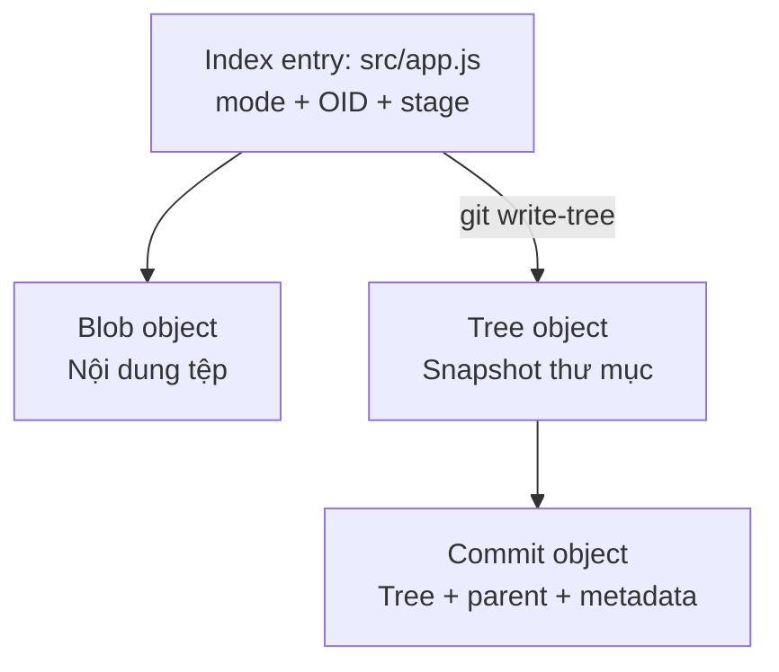

# Vai trò của chỉ mục trong việc chọn nội dung cho commit

Trong Git, một commit không tự động ghi lại mọi thứ đang có trong thư mục làm việc. Git tạo commit từ nội dung đã được chọn vào **index** (còn gọi là *staging area*). Index là nơi chuẩn bị snapshot tiếp theo: bạn có thể stage một số tệp, stage một phần thay đổi trong tệp, xem lại chính xác những gì sắp commit rồi mới tạo commit.

Hiểu index là chìa khóa để kiểm soát lịch sử dự án. Nếu working tree chứa cả sửa lỗi và thử nghiệm chưa hoàn tất, bạn có thể chỉ đưa phần sửa lỗi vào commit. Nếu vô tình stage quá nhiều, bạn có thể bỏ stage hoặc chọn lại từng phần mà vẫn giữ nội dung đang chỉnh sửa.

Bài này thuộc chương **Tệp và chỉ mục** của SOURCE_CONTROL_GIT. Nội dung tập trung vào vai trò của index trong việc chọn nội dung cho commit, cách Git so sánh ba trạng thái, cách stage/unstage và quy trình kiểm tra trước khi lưu lịch sử.

## 1. Ba khu vực quan trọng trong quy trình Git

Khi làm việc với Git, cần phân biệt ba nơi lưu trạng thái:

1. **Working tree:** các tệp và thư mục đang hiển thị trong thư mục dự án; đây là nơi bạn mở editor và chỉnh sửa.
2. **Index (staging area):** snapshot đã chọn để đưa vào commit tiếp theo.
3. **Repository:** các commit và object đã được lưu trong lịch sử Git.

Luồng cơ bản:


`git add` chép nội dung hiện tại của đường dẫn vào index. `git commit` tạo commit từ index tại thời điểm commit. Git không lấy mọi thay đổi trong working tree vào commit một cách tự động.

### 1.1. Ví dụ về ba trạng thái

Giả sử `app.js` đang có nội dung đã commit là phiên bản A. Bạn sửa tệp thành phiên bản B và chạy:

```bash
git add app.js
```

Index lúc này giữ phiên bản B. Sau đó bạn tiếp tục sửa working tree thành phiên bản C nhưng chưa chạy `git add` lần nữa.

Kết quả:

- Repository (HEAD): phiên bản A.
- Index: phiên bản B.
- Working tree: phiên bản C.

Nếu chạy `git commit`, Git tạo commit chứa phiên bản B. Phần thay đổi từ B sang C vẫn nằm trong working tree và chưa được commit.

Đây là lý do index thường được gọi là **snapshot tiếp theo**: nó có thể khác cả commit hiện tại lẫn tệp đang mở trong editor.

## 2. Index lưu những gì?

Index không đơn giản là một danh sách tên tệp. Mỗi entry thường mô tả một đường dẫn cùng thông tin cần thiết để tạo tree object:

- Đường dẫn tương đối từ gốc repository.
- File mode, ví dụ tệp thường, executable, symbolic link hoặc gitlink của submodule.
- Object ID (OID) của nội dung được stage.
- Stage number, thường là `0` khi không có conflict.
- Một số cờ nội bộ phục vụ hiệu năng và cách xử lý đường dẫn.

Nội dung tệp được lưu thành blob object; index entry tham chiếu tới blob đó bằng OID. Khi commit, Git xây dựng tree object từ các entry trong index, rồi commit object tham chiếu tới tree đó.



Index được lưu trong Git directory, thường là `.git/index` ở repository thông thường. Với linked worktree, vị trí Git directory có thể khác; không nên giả định `.git` luôn là một thư mục vật lý. Dùng lệnh sau để xem đường dẫn index thực tế:

```bash
git rev-parse --git-path index
```

Không chỉnh sửa trực tiếp file index bằng trình soạn thảo. Hãy dùng các lệnh Git như `add`, `restore --staged`, `reset` và `rm` để cập nhật index đúng cách.

## 3. Index quyết định commit chứa những gì

Giả sử repository có ba tệp:

```text
src/login.js
src/payment.js
README.md
```

Bạn sửa cả ba tệp nhưng chỉ muốn commit phần đăng nhập. Có thể stage riêng:

```bash
git add src/login.js
```

Sau đó:

```bash
git diff --cached
git status --short
```

`git diff --cached` hiển thị thay đổi đã chọn trong index so với commit hiện tại. `git status` cho biết tệp nào staged và tệp nào còn thay đổi chưa stage.

Khi chạy:

```bash
git commit -m "fix: handle login timeout"
```

Commit mới chứa phần đang có trong index. Những sửa đổi chưa stage ở `src/payment.js` và `README.md` vẫn còn trong working tree.

### 3.1. Commit là snapshot của index

Git tạo tree object từ index, sau đó tạo commit object trỏ tới tree đó cùng parent và metadata. Vì thế, hai lần commit có thể chứa các snapshot khác nhau dù working tree không thay đổi giữa chúng, nếu index được cập nhật khác nhau.

Bạn có thể kiểm tra snapshot đã commit:

```bash
git show --stat --oneline HEAD
git show HEAD:src/login.js
```

Lệnh thứ hai hiển thị nội dung `src/login.js` trong commit HEAD, không nhất thiết giống nội dung đang có trên đĩa.

### 3.2. Thay đổi sau khi stage không tự đi vào index

Một tình huống phổ biến:

```bash
git add src/login.js
# tiếp tục sửa src/login.js trong editor
git status --short
```

Git có thể hiển thị `MM` cho tệp đó: một thay đổi đã staged và một thay đổi khác chưa staged. Chữ thứ nhất mô tả trạng thái index so với HEAD; chữ thứ hai mô tả working tree so với index.

Muốn đưa phần sửa mới vào commit, chạy `git add src/login.js` lần nữa. Muốn giữ phần sửa mới cho commit sau, chỉ commit phần đã stage.

## 4. Đọc trạng thái staged và unstaged

Các lệnh diff giúp so sánh từng cặp trạng thái:

| Lệnh | So sánh | Câu hỏi được trả lời |
|---|---|---|
| `git diff` | Working tree so với index | Tôi còn sửa gì chưa stage? |
| `git diff --cached` | Index so với HEAD | Commit tiếp theo sẽ chứa thay đổi nào? |
| `git diff --staged` | Tương đương `git diff --cached` | Nội dung đã stage hiện tại là gì? |
| `git diff HEAD` | Nội dung tracked trong working tree so với HEAD, bao gồm khác biệt đã stage và chưa stage | Tổng thay đổi tracked hiện tại so với commit gần nhất là gì? |

Ví dụ quy trình kiểm tra:

```bash
# Xem phần chưa stage
git diff

# Xem phần sẽ vào commit
git diff --cached

# Xem danh sách trạng thái ngắn
git status --short
```

Đừng chỉ nhìn `git diff` rồi kết luận commit sẽ chứa nội dung đó. Nếu phần thay đổi đã được stage, `git diff` có thể trống trong khi `git diff --cached` vẫn có nội dung.

Các lệnh diff thông thường không hiển thị tệp untracked vì chúng chưa thuộc index hoặc commit. Dùng `git status --short` để nhận diện chúng; sau khi stage bằng `git add`, nội dung mới xuất hiện trong `git diff --cached`.

### 4.1. Đọc hai cột trong `git status --short`

Git status dạng ngắn dùng hai vị trí trạng thái:

- Ký tự thứ nhất: trạng thái của index so với HEAD.
- Ký tự thứ hai: trạng thái của working tree so với index.

Một số ký hiệu thường gặp:

| Ký hiệu | Ý nghĩa khái quát |
|---|---|
| ` M` | Tệp tracked đã sửa trong working tree, chưa stage. |
| `M ` | Thay đổi đã được stage trong index. |
| `MM` | Có thay đổi staged và tiếp tục sửa thêm sau khi stage. |
| `A ` | Tệp mới đã được stage. |
| `??` | Tệp chưa được Git theo dõi (untracked). |
| ` D` | Tệp tracked bị xóa trong working tree, chưa stage việc xóa. |
| `D ` | Việc xóa đã được stage. |
| `R ` | Git nhận diện một thay đổi staged là rename; rename được suy ra khi so sánh snapshot. |

Với rename/copy, status có thể hiển thị thêm điểm tương đồng hoặc đường dẫn cũ/mới tùy định dạng. Dùng `git status --porcelain=v1` nếu cần output ổn định hơn cho script.

## 5. Stage nội dung bằng `git add`

`git add` cập nhật index bằng nội dung được đọc từ working tree tại thời điểm lệnh chạy.

### 5.1. Stage một tệp

```bash
git add src/login.js
```

Đây là lựa chọn rõ ràng khi chỉ muốn đưa một tệp vào commit.

### 5.2. Stage nhiều tệp cụ thể

```bash
git add src/login.js src/session.js
```

Có thể dùng đường dẫn thư mục:

```bash
git add src/auth/
```

Git stage những thay đổi phù hợp trong phạm vi đường dẫn đó. Hãy kiểm tra lại `git diff --cached` trước commit.

### 5.3. Stage mọi thay đổi

```bash
git add -A
```

`-A` cập nhật index với mọi thay đổi trong phạm vi pathspec: tệp mới, tệp sửa và tệp bị xóa. Khi chạy không kèm pathspec trong repository, lệnh xét toàn bộ working tree.

### 5.4. Chỉ stage thay đổi của tệp đã tracked

```bash
git add -u
```

`-u` cập nhật thay đổi và việc xóa của các tệp đã được theo dõi; nó không thêm tệp untracked mới vào index.

### 5.5. Stage thư mục hiện tại

```bash
git add .
```

Lệnh này stage thay đổi trong thư mục hiện tại và các thư mục con theo pathspec `.`. Nếu đang đứng ở thư mục con, phạm vi có thể hẹp hơn toàn repository. Khi muốn cập nhật tất cả thay đổi trong repository, `git add -A` từ gốc repository thường rõ ý hơn.

### 5.6. Tệp bị ignore

Tệp khớp quy tắc `.gitignore` thường không được `git add` thông thường thêm vào index. Nếu thực sự cần quản lý một tệp bị ignore, có thể dùng:

```bash
git add -f path/to/file
```

Chỉ force-add khi hiểu lý do tệp bị ignore. Đặc biệt, không stage secret, credential, file build hoặc dữ liệu cá nhân chỉ để làm mất cảnh báo untracked.

## 6. Chọn một phần thay đổi để stage

Index cho phép chọn từng phần thay đổi trong cùng một tệp. Điều này hữu ích khi một tệp có nhiều sửa đổi thuộc các mục tiêu commit khác nhau.

### 6.1. Dùng `git add -p`

```bash
git add -p src/payment.js
```

Git chia diff thành các đoạn gọi là *hunk* và hỏi bạn có muốn stage từng đoạn không. Một số phím thường dùng:

| Phím | Tác dụng |
|---|---|
| `y` | Stage hunk hiện tại. |
| `n` | Bỏ qua hunk hiện tại. |
| `s` | Chia hunk thành các phần nhỏ hơn nếu có thể. |
| `e` | Chỉnh patch thủ công cho hunk hiện tại. |
| `q` | Dừng phiên tương tác. |
| `?` | Xem trợ giúp các phím. |

Ví dụ tệp `payment.js` có hai thay đổi: sửa lỗi tính thuế và thêm log thử nghiệm. Bạn có thể stage hunk sửa thuế, bỏ qua hunk log, rồi commit riêng phần sửa lỗi.

Sau khi kết thúc:

```bash
git diff --cached
git diff
```

Lệnh đầu xác nhận phần đã chọn; lệnh sau cho biết phần còn lại chưa stage.

### 6.2. Dùng `git add -i`

```bash
git add -i
```

Chế độ tương tác cho phép xem danh sách tệp, chọn tệp, cập nhật patch hoặc thực hiện các thao tác stage khác. Đây là lựa chọn hữu ích khi cần rà soát nhiều tệp trước khi tạo snapshot.

### 6.3. Chỉnh patch thủ công

Với `git add -p`, tùy chọn `e` cho phép sửa patch. Cách này linh hoạt nhưng cần hiểu cấu trúc unified diff. Patch không hợp lệ hoặc chỉnh sai ngữ cảnh có thể không được áp dụng như mong muốn.

Sau khi chỉnh patch, luôn xem lại `git diff --cached` và `git diff` để xác nhận index và working tree đang chứa đúng hai phần nội dung mong muốn.

## 7. Bỏ stage nhưng giữ nội dung đang sửa

Nếu stage nhầm tệp hoặc hunk, bạn có thể đưa index trở về nội dung từ HEAD mà vẫn giữ working tree.

### 7.1. Bỏ stage một tệp

```bash
git restore --staged src/payment.js
```

Lệnh này cập nhật index của tệp theo HEAD (mặc định) và không khôi phục nội dung working tree. Phần sửa vẫn còn trên đĩa để bạn chọn lại sau.

Lệnh tương đương thường dùng trong các phiên bản Git cũ:

```bash
git reset HEAD -- src/payment.js
```

### 7.2. Bỏ stage toàn bộ

```bash
git restore --staged .
```

Lệnh này bỏ stage các thay đổi trong phạm vi thư mục hiện tại. Nếu muốn bỏ stage toàn repository, chạy từ gốc repository với pathspec phù hợp:

```bash
git restore --staged :/
```

Sau đó kiểm tra `git status --short` để chắc chắn chỉ thay đổi index như mong muốn.

### 7.3. Bỏ stage một phần

Có thể chọn hunk để bỏ stage:

```bash
git restore --staged -p src/payment.js
```

Git hỏi từng hunk đang staged có muốn bỏ khỏi index không. Cách này phù hợp khi một phần thay đổi đã stage đúng nhưng phần khác cần chuyển về trạng thái chưa stage.

### 7.4. Phân biệt bỏ stage và bỏ sửa đổi

Hai thao tác sau có tác động khác nhau:

```bash
# Chỉ bỏ stage, giữ thay đổi trong working tree
git restore --staged src/payment.js

# Khôi phục working tree từ index, có thể bỏ thay đổi chưa stage
git restore src/payment.js
```

Lệnh thứ hai có thể làm mất phần sửa chưa stage. Trước khi dùng, hãy xem `git diff` và bảo toàn patch cần giữ. Nếu mục tiêu chỉ là bỏ stage, dùng `--staged`.

## 8. Xóa, đổi tên và thêm tệp trong index

Index ghi nhận trạng thái snapshot, không chỉ nội dung tệp.

### 8.1. Stage việc xóa tệp

Nếu xóa tệp bằng hệ điều hành hoặc editor:

```bash
git add -u
```

hoặc:

```bash
git add path/to/deleted-file
```

Git cập nhật index để tệp không còn xuất hiện trong snapshot tiếp theo.

Có thể dùng:

```bash
git rm path/to/file
```

Lệnh này xóa tệp khỏi working tree và stage việc xóa trong index. Nếu chỉ muốn bỏ tệp khỏi index nhưng giữ bản local:

```bash
git rm --cached path/to/file
```

### 8.2. Đổi tên tệp

```bash
git mv old-name.js new-name.js
```

`git mv` đổi tên trong working tree và cập nhật index. Git không lưu một loại object riêng có tên “rename”; khi so sánh các snapshot, Git phát hiện rename dựa trên độ tương đồng nội dung.

Bạn cũng có thể đổi tên bằng file manager rồi stage việc xóa đường dẫn cũ và thêm đường dẫn mới. Kết quả commit vẫn có thể được Git hiển thị là rename khi phát hiện phù hợp.

### 8.3. Tệp mới và intent-to-add

Tệp mới chỉ nằm trong working tree là untracked, chưa thuộc snapshot. Để đánh dấu đường dẫn và hỗ trợ xem diff trước khi stage nội dung đầy đủ, có thể dùng:

```bash
git add -N path/to/new-file.js
```

`-N` (intent-to-add) tạo entry đặc biệt trong index để Git có thể hiển thị diff của tệp mới, nhưng chưa stage toàn bộ nội dung theo cách `git add` thông thường. Trước khi commit, cần stage nội dung thật bằng `git add path/to/new-file.js`.

## 9. Index và nội dung đã được chuẩn hóa

Nội dung trong index không phải lúc nào cũng là bản sao byte-for-byte của tệp trong working tree. Khi `git add`, Git có thể áp dụng các quy tắc chuyển đổi theo attributes và cấu hình, chẳng hạn:

- Chuẩn hóa line ending qua thuộc tính `text` và `eol`.
- Chạy clean filter được khai báo trong `.gitattributes`.
- Chuyển encoding theo `working-tree-encoding`.
- Dùng Git LFS để thay nội dung lớn bằng pointer trong Git repository.

Do đó, index giữ nội dung canonical mà Git sẽ lưu vào object database. Khi checkout, các cơ chế smudge hoặc chuyển đổi ngược có thể tạo dạng working tree phù hợp.

Nếu diff sau stage trông khác nội dung bạn mong đợi, hãy kiểm tra `.gitattributes`, filter và cấu hình Git liên quan trước khi commit.

## 10. Index trong lúc merge có conflict

Khi merge phát sinh conflict, index có thể chứa nhiều phiên bản của cùng một đường dẫn thay vì một entry stage `0` duy nhất.

Các stage thường gặp:

| Stage | Ý nghĩa |
|---|---|
| `1` | Merge base (phiên bản chung trước khi hai nhánh phân kỳ). |
| `2` | Ours (phiên bản từ nhánh hiện tại). |
| `3` | Theirs (phiên bản từ nhánh được merge vào). |
| `0` | Kết quả đã được resolve và stage bình thường. |

Kiểm tra entry chưa hợp nhất:

```bash
git ls-files -u
```

Sau khi chỉnh tệp để giải quyết conflict, stage kết quả:

```bash
git add path/to/conflicted-file
```

Thao tác này thay các entry stage 1/2/3 bằng entry stage 0 cho đường dẫn đó. Khi tất cả conflict đã được giải quyết và stage, tiếp tục merge hoặc rebase theo hướng dẫn Git.

Trong giai đoạn conflict, không nên xem index như một snapshot commit bình thường cho tới khi các đường dẫn chưa hợp nhất được xử lý xong.

## 11. Các lệnh kiểm tra index hữu ích

### 11.1. Xem danh sách tệp trong index

```bash
git ls-files
```

Xem thêm mode và OID:

```bash
git ls-files --stage
```

Ví dụ output:

```text
100644 9f2a... 0       README.md
100755 7bc1... 0       scripts/build.sh
```

Các mode cho biết loại entry và quyền thực thi được Git quản lý; stage `0` là entry bình thường đã resolve.

### 11.2. Xem nội dung sẽ commit

```bash
git diff --cached
git diff --cached --stat
git diff --cached --name-status
```

Đây là bước review quan trọng nhất trước khi commit. Nếu dùng công cụ review hoặc CI, hãy lấy dữ liệu từ index/commit thay vì quét toàn bộ working tree rồi cho rằng tất cả sẽ được commit.

### 11.3. Xem object của một đường dẫn trong index

```bash
git ls-files --stage -- src/login.js
```

Lấy OID rồi xem blob:

```bash
git cat-file -p <blob-oid>
```

Điều này cho phép kiểm tra nội dung thực sự được stage, ngay cả khi working tree đã tiếp tục thay đổi.

## 12. Quy trình chọn nội dung cho một commit rõ ràng

Giả sử bạn đang làm hai việc trong cùng một branch: sửa lỗi đăng nhập và thử nghiệm giao diện thanh toán. Hãy tạo commit chỉ cho phần đăng nhập:

**Bước 1: Xem mọi thay đổi**

```bash
git status --short
git diff
```

**Bước 2: Chọn tệp hoặc hunk liên quan**

```bash
git add -p src/login.js
```

Stage từng hunk thuộc sửa lỗi đăng nhập. Không stage phần thử nghiệm giao diện.

**Bước 3: Review snapshot trong index**

```bash
git diff --cached
git diff --cached --stat
```

Đảm bảo chỉ có thay đổi đăng nhập.

**Bước 4: Review phần còn lại**

```bash
git diff
git status --short
```

Xác nhận thử nghiệm giao diện vẫn nằm trong working tree và chưa được stage.

**Bước 5: Commit**

```bash
git commit -m "fix: handle login timeout"
```

Commit mới chỉ ghi snapshot đang có trong index. Sau đó, tiếp tục hoàn thiện phần giao diện và stage cho commit riêng.

## 13. Những hiểu lầm thường gặp

### “Git commit tất cả tệp đã sửa”

Không. `git commit` thông thường tạo commit từ index. Các thay đổi chưa stage vẫn ở working tree.

### “Đã stage tệp thì mọi sửa đổi tiếp theo cũng tự stage”

Không. `git add` ghi nhận nội dung tại thời điểm chạy. Sửa tiếp sau đó tạo khác biệt giữa index và working tree.

### “`git diff` cho biết chính xác nội dung sẽ commit”

Không. `git diff` so sánh working tree với index. Dùng `git diff --cached` để xem nội dung đã stage so với HEAD.

### “Unstage sẽ xóa phần sửa trong tệp”

`git restore --staged` chỉ cập nhật index; nó giữ nội dung working tree. `git restore <path>` không có `--staged` có thể khôi phục working tree và làm mất phần sửa chưa stage.

### “Git lưu rename như một object riêng”

Không. Git lưu snapshot tree; rename được phát hiện khi so sánh các snapshot.

### “Thư mục là một entry thông thường trong index”

Git lưu các tệp và tree con; thư mục rỗng không được quản lý như một entry riêng. Một thư mục chỉ xuất hiện trong snapshot thông qua các đường dẫn con có nội dung được theo dõi.

## 14. Ghi nhớ

- Index là snapshot chuẩn bị cho commit tiếp theo.
- `git add` cập nhật index từ nội dung working tree tại thời điểm chạy.
- `git commit` thông thường tạo commit từ index, không lấy mọi sửa đổi chưa stage.
- `git diff` xem unstaged; `git diff --cached` xem staged so với HEAD.
- `git add -p` và `git add -i` cho phép chọn từng phần thay đổi.
- `git add -A` cập nhật thêm/sửa/xóa; `git add -u` chỉ cập nhật tệp tracked; `git add .` giới hạn theo thư mục hiện tại.
- `git restore --staged` bỏ stage nhưng giữ thay đổi trong working tree.
- `git rm --cached` bỏ tệp khỏi index nhưng giữ bản local.
- Index entry lưu path, mode, OID và stage; conflict có thể tạo các entry stage 1/2/3.
- Git có thể chuẩn hóa nội dung qua attributes và filter trước khi lưu vào index.
- Review `git diff --cached` trước commit để biết chính xác snapshot sắp được ghi vào lịch sử.

Index cho phép bạn quyết định từng phần nội dung nào trở thành một commit độc lập. Khi tách việc chọn nội dung khỏi việc chỉnh sửa tệp, lịch sử Git sẽ rõ ràng hơn, commit dễ review hơn và các thay đổi đang làm dở được giữ lại an toàn cho bước tiếp theo.
