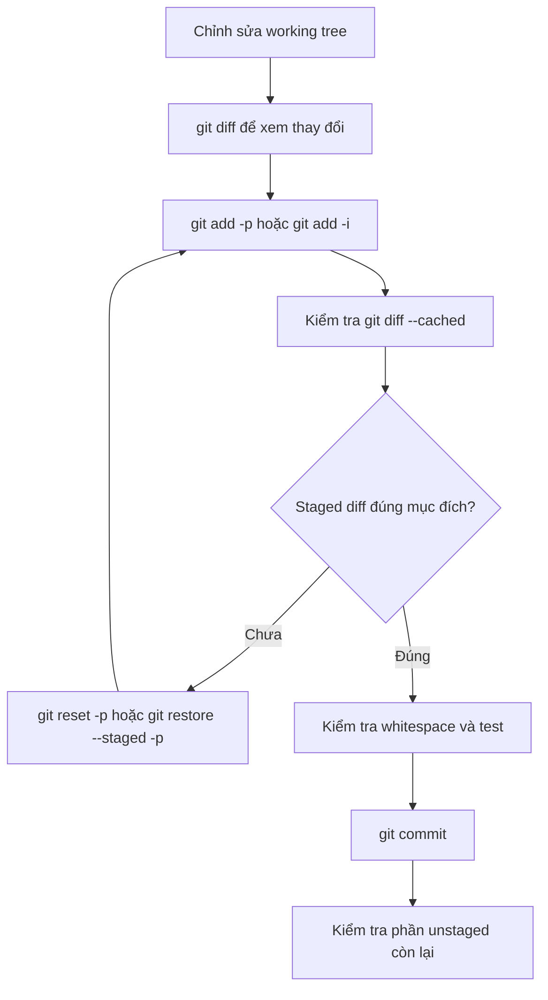

# Chọn từng phần thay đổi bằng git add -p và git add -i

Trong một lần làm việc, bạn có thể sửa nhiều phần của cùng một tệp: vừa sửa lỗi, vừa đổi tên biến, vừa thêm log để debug. Nếu stage toàn bộ tệp bằng `git add <file>`, tất cả thay đổi sẽ đi vào cùng một commit. Git cho phép chọn từng phần thay đổi để staging, nhờ đó bạn có thể tạo commit nhỏ, tập trung và dễ review hơn.

Hai cách thường dùng là `git add -p` và `git add -i`. `git add -p` đưa từng đoạn thay đổi (*hunk*) ra để bạn quyết định stage hay bỏ qua. `git add -i` mở giao diện tương tác có thể xem trạng thái, stage cả tệp, thêm tệp mới, chọn hunk hoặc bỏ stage. Cả hai đều thao tác trên index (staging area), không tự tạo commit.

## 1. Hiểu đúng working tree, index và commit

Git quản lý nội dung qua ba trạng thái quan trọng:

- **HEAD/commit hiện tại:** snapshot đã được ghi vào lịch sử.
- **Index (staging area):** snapshot sẽ được dùng để tạo commit tiếp theo.
- **Working tree:** các tệp bạn đang sửa trong thư mục làm việc.

`git add` cập nhật index từ nội dung working tree. Khi chọn từng phần bằng patch mode, Git chỉ áp dụng phần patch đã chọn vào index. Những thay đổi chưa chọn vẫn nằm trong working tree.

Có thể hình dung:

```text
HEAD (commit gần nhất)
       |
       | git add -p: chọn một số hunk
       v
Index (staging area)  <--- snapshot sẽ commit
       ^
       | phần thay đổi chưa stage vẫn ở đây
       |
Working tree          <--- toàn bộ nội dung bạn đang sửa
```

Git commit lưu snapshot từ index. Vì vậy, một tệp có thể đồng thời chứa phần đã stage và phần chưa stage. Đây là hành vi bình thường khi bạn cố ý chia một lần sửa thành nhiều commit.

## 2. Xem thay đổi trước khi staging

Trước khi chọn hunk, hãy kiểm tra trạng thái:

```bash
git status --short
```

Hai lệnh diff quan trọng:

```bash
# Thay đổi trong working tree so với index (chưa stage).
git diff

# Thay đổi trong index so với HEAD (đã stage).
git diff --cached
```

Nếu bạn chưa stage gì, `git diff` thường hiển thị toàn bộ thay đổi của tệp tracked. Sau khi stage một vài hunk, `git diff --cached` hiển thị phần đã chọn, còn `git diff` hiển thị phần còn lại.

Có thể xem riêng một tệp:

```bash
git diff -- src/PaymentService.java
git diff --cached -- src/PaymentService.java
```

Đừng chỉ dựa vào màu sắc trong terminal. Hãy đọc nội dung từng diff để xác nhận đúng phần sẽ vào commit.

## 3. Dùng git add -p để chọn từng hunk

Lệnh cơ bản:

```bash
git add -p
```

Git hiển thị từng hunk trong diff giữa working tree và index, sau đó hỏi bạn có muốn stage hunk đó không. Ví dụ:

```text
diff --git a/src/PaymentService.java b/src/PaymentService.java
@@ -10,6 +10,7 @@
 public PaymentResult pay(Order order) {
+    validateCurrency(order);
     return gateway.charge(order);
 }

Stage this hunk [y,n,q,a,d,s,e,?]?
```

Hunk là một đoạn thay đổi gồm các dòng thêm, xóa và một số dòng ngữ cảnh. Git gom những thay đổi gần nhau thành một hunk để bạn xử lý cùng lúc.

Bạn cũng có thể giới hạn một tệp:

```bash
git add -p -- src/PaymentService.java
```

Dấu `--` kết thúc phần tùy chọn, giúp Git hiểu đối số tiếp theo là đường dẫn, kể cả khi tên tệp bắt đầu bằng dấu gạch ngang.

## 4. Ý nghĩa các lựa chọn trong patch prompt

Prompt thường có dạng:

```text
Stage this hunk [y,n,q,a,d,s,e,?]?
```

Các lựa chọn chính:

| Phím | Ý nghĩa |
|---|---|
| `y` | Stage hunk hiện tại vào index |
| `n` | Bỏ qua hunk hiện tại, giữ nó trong working tree |
| `q` | Thoát patch mode; những hunk đã chọn trước đó vẫn được stage |
| `a` | Stage hunk hiện tại và tất cả hunk còn lại của tệp đang xử lý |
| `d` | Bỏ qua hunk hiện tại và tất cả hunk còn lại của tệp đang xử lý |
| `s` | Tách hunk hiện tại thành các hunk nhỏ hơn nếu có thể |
| `e` | Mở patch để chỉnh sửa thủ công trước khi áp dụng vào index |
| `?` | Hiển thị trợ giúp các lựa chọn |

`a` và `d` áp dụng cho các hunk còn lại của tệp hiện tại trong lượt xử lý, không có nghĩa là stage hoặc bỏ qua mọi tệp trong repository.

Nếu chỉ muốn chọn một phần, thường dùng `y` cho hunk cần stage và `n` cho hunk chưa muốn đưa vào commit. Nếu một hunk chứa nhiều thay đổi độc lập, thử `s` trước khi quyết định.

## 5. Tách hunk bằng phím s

Git có thể gom các thay đổi gần nhau vào cùng một hunk. Khi hunk chứa hai mục đích khác nhau, nhập `s` để yêu cầu Git tách nhỏ.

Ví dụ một hunk gồm:

```diff
@@ -20,8 +20,10 @@
 public void process() {
-    logger.info("Start");
+    logger.debug("Start");
     validate();
+    retryPolicy.check();
     execute();
 }
```

Nếu Git tách được, bạn có thể stage riêng thay đổi mức log hoặc phần kiểm tra retry. Khi các dòng thay đổi nằm quá sát nhau hoặc phần ngữ cảnh không cho phép tách an toàn, Git có thể báo không thể split hunk. Khi đó, cân nhắc chỉnh context hoặc dùng `e` để sửa patch thủ công.

Không phải mọi hunk đều tách được. Hãy kiểm tra diff sau khi chọn để bảo đảm phần đã stage vẫn tạo ra trạng thái mã nguồn hợp lệ và có ý nghĩa.

## 6. Chỉnh patch thủ công bằng phím e

Khi `s` không thể chia hunk theo cách bạn muốn, nhập `e`. Git mở nội dung patch trong editor để bạn chỉnh phần sẽ được áp dụng vào index.

Trong patch:

- Dòng bắt đầu bằng `+` là nội dung được thêm.
- Dòng bắt đầu bằng `-` là nội dung bị xóa.
- Dòng bắt đầu bằng dấu cách là ngữ cảnh để Git xác định vị trí áp dụng.

Ví dụ patch:

```diff
@@ -1,3 +1,4 @@
 timeout = 30
-retries = 2
+retries = 3
+log_level = "debug"
```

Nếu chỉ muốn stage thay đổi `retries`, có thể loại dòng thêm `log_level` khỏi patch trước khi lưu. Nếu chỉ muốn stage việc thêm `log_level` mà chưa muốn stage thay đổi `retries`, cần chỉnh patch sao cho phần xóa/thêm tương ứng không được áp dụng vào index. Các dòng ngữ cảnh phải giữ đúng để patch có thể áp dụng.

Chỉnh patch thủ công cần cẩn thận: patch sai cấu trúc hoặc không còn khớp với nội dung có thể bị từ chối. Sau khi editor đóng, Git có thể báo không áp dụng được patch. Khi đó, working tree vẫn là nơi chứa nội dung làm việc; hãy xem lại `git diff` và `git diff --cached` trước khi thử lại.

## 7. Dùng git add -i để thao tác trong giao diện tương tác

Mở interactive mode:

```bash
git add -i
```

Git hiển thị menu tương tác. Tên và số thứ tự mục có thể thay đổi theo phiên bản hoặc cấu hình, nhưng các nhóm thao tác thường gồm:

| Lệnh trong menu | Công dụng |
|---|---|
| `status` | Xem trạng thái giữa HEAD, index và working tree |
| `update` | Stage toàn bộ thay đổi của các tệp được chọn |
| `revert` | Bỏ stage thay đổi trong index, đưa index về nội dung HEAD cho tệp được chọn; không xóa sửa đổi trong working tree |
| `add untracked` | Stage các tệp chưa được Git theo dõi |
| `patch` | Chọn từng hunk để stage |
| `diff` | Xem diff để kiểm tra thay đổi |
| `quit` | Thoát giao diện tương tác |
| `help` | Xem hướng dẫn thao tác |

Ví dụ menu có thể trông như sau:

```text
*** Commands ***
  1: status       2: update       3: revert
  4: add untracked 5: patch       6: diff
  7: quit         8: help
```

Trong menu, chọn `patch` để stage từng hunk; chọn `update` khi muốn stage cả tệp; chọn `add untracked` để thêm tệp mới. `git add -i` phù hợp khi bạn muốn xử lý nhiều tệp trong một phiên làm việc và cần xem tổng quan trước khi chọn.

## 8. Phân biệt update, revert và add untracked trong interactive mode

Các mục trong `git add -i` có tác động khác nhau:

- **update:** đưa thay đổi của tệp tracked được chọn từ working tree vào index. Đây là thao tác stage ở mức tệp.
- **revert:** bỏ thay đổi đã stage của tệp được chọn bằng cách khôi phục index về trạng thái HEAD. Nội dung trong working tree vẫn còn, nên bạn có thể stage lại sau.
- **add untracked:** thêm tệp mới vào index. Thông thường thao tác này stage toàn bộ nội dung tệp được chọn.
- **patch:** chọn từng phần thay đổi thay vì đưa cả tệp vào index.
- **diff:** xem nội dung thay đổi trước khi quyết định.

Hãy đọc prompt của giao diện trước khi xác nhận. Một số thao tác có thể hỏi số thứ tự tệp hoặc phạm vi lựa chọn; nhập `?`/`help` nếu chưa chắc.

## 9. Stage từng phần của một tệp và kiểm tra kết quả

Giả sử bạn sửa cùng một tệp theo hai mục đích:

1. Sửa lỗi tính tổng tiền.
2. Đổi format log để dễ đọc.

Bạn muốn commit sửa lỗi trước, còn thay đổi log để commit sau.

Chạy:

```bash
git status --short
git diff -- src/PaymentService.java
git add -p -- src/PaymentService.java
```

Chọn `y` cho hunk sửa lỗi và `n` cho hunk đổi log. Sau khi kết thúc, kiểm tra cả hai phía:

```bash
# Phần sẽ vào commit tiếp theo.
git diff --cached -- src/PaymentService.java

# Phần vẫn còn trong working tree.
git diff -- src/PaymentService.java

# Trạng thái tệp.
git status --short
```

Nếu cùng một tệp có cả thay đổi staged và unstaged, `git status --short` có thể hiển thị `MM` ở cột trạng thái: cột thứ nhất biểu thị thay đổi trong index, cột thứ hai biểu thị thay đổi chưa stage trong working tree. Điều này không có nghĩa Git tạo hai bản tệp độc lập; index và working tree chỉ đang chứa hai trạng thái khác nhau.

Khi đã xác nhận staged diff chỉ chứa phần sửa lỗi, tạo commit:

```bash
git diff --cached --check
git diff --cached
git commit -m "fix: correct payment total calculation"
```

Sau commit, phần log chưa stage vẫn còn trong working tree. Bạn có thể tiếp tục chỉnh sửa, stage và commit riêng.

## 10. Xử lý tệp mới chưa được theo dõi

`git add -p` làm việc trên diff giữa working tree và index. Một tệp untracked chưa có entry trong index nên thường không xuất hiện trong danh sách hunk.

Nếu muốn stage toàn bộ tệp mới, dùng:

```bash
git add -- src/NewService.java
```

Hoặc dùng mục `add untracked` trong `git add -i`.

Nếu muốn chọn từng phần của tệp mới, có thể đánh dấu intent-to-add trước:

```bash
git add -N -- src/NewService.java
git add -p -- src/NewService.java
```

`git add -N` ghi nhận ý định thêm đường dẫn trong index nhưng chưa stage toàn bộ nội dung. Sau đó patch mode có thể hiển thị nội dung như một diff để chọn phần cần stage. Hãy kiểm tra kỹ bằng `git status`, `git diff` và `git diff --cached`; hành vi chi tiết có thể phụ thuộc phiên bản Git và trạng thái tệp.

Một lựa chọn khác là tách nội dung thành các tệp nhỏ hơn hoặc stage toàn bộ tệp nếu nội dung của nó thuộc cùng một đơn vị thay đổi. Không cần cố chia một tệp mới thành nhiều phần nếu điều đó khiến commit khó hiểu hoặc tạo trạng thái không hợp lệ.

## 11. Bỏ stage một phần nếu chọn nhầm

Nếu bạn đã stage một số hunk nhưng nhận ra một phần không nên nằm trong commit, có thể dùng patch mode của `git reset`:

```bash
git reset -p
```

Lệnh này cho phép chọn các hunk trong khác biệt giữa HEAD và index để bỏ stage. Nó cập nhật index về phía HEAD cho phần được chọn; nội dung working tree không bị xóa.

Có thể giới hạn theo tệp:

```bash
git reset -p -- src/PaymentService.java
```

Hoặc dùng `git restore`:

```bash
git restore --staged -p -- src/PaymentService.java
```

Hai cách trên giúp điều chỉnh index. Sau đó kiểm tra:

```bash
git diff --cached
git diff
git status --short
```

Nếu tệp mới đã được stage, không có phiên bản trong HEAD để chọn hunk khôi phục theo cách thông thường. Khi muốn bỏ stage toàn bộ tệp mới nhưng giữ file trên đĩa, dùng:

```bash
git restore --staged -- src/NewService.java
```

Lệnh bỏ entry khỏi index nhưng giữ nội dung trong working tree. Trước khi thao tác, kiểm tra trạng thái để chắc chắn không nhầm với việc xóa nội dung.

## 12. Phân biệt add -p, add -i và các lệnh liên quan

| Lệnh | Tác động |
|---|---|
| `git add <path>` | Stage toàn bộ thay đổi của đường dẫn |
| `git add -p` | Stage từng hunk tương tác |
| `git add -i` | Mở menu tương tác để stage theo tệp, tệp mới hoặc hunk |
| `git add -e <path>` | Chỉnh patch diff thủ công rồi áp dụng vào index |
| `git reset -p` | Bỏ stage từng hunk từ index về HEAD |
| `git restore --staged -p` | Chọn phần cần khôi phục trong index từ nguồn mặc định (thường là HEAD) |
| `git diff` | Xem thay đổi chưa stage |
| `git diff --cached` | Xem thay đổi đã stage |

`git add -p` là cách nhanh nhất khi bạn chỉ cần chọn hunk. `git add -i` phù hợp khi cần quản lý nhiều tệp và dùng nhiều thao tác trong cùng phiên. `git add -e` dành cho trường hợp muốn tự điều chỉnh patch mà không qua từng prompt hunk.

## 13. Những trường hợp không phù hợp với staging theo hunk

Không phải loại thay đổi nào cũng có thể chia nhỏ theo dòng:

- **Tệp nhị phân:** Git không thể hiển thị diff dạng dòng thông thường để stage một phần nội dung nhị phân; thường phải stage cả tệp.
- **Đổi quyền hoặc mode file:** thay đổi executable bit thường được quản lý ở mức đường dẫn, không phải hunk văn bản.
- **Rename/move:** Git phát hiện rename khi so sánh snapshot; thao tác stage có thể liên quan nhiều đường dẫn và không phải lúc nào cũng chia được như nội dung văn bản.
- **Thay đổi phụ thuộc lẫn nhau:** hai hunk có thể cần đi cùng nhau để mã nguồn biên dịch hoặc test được. Stage tách rời có thể tạo commit trung gian không hợp lệ.
- **Hunk liền kề:** Git có thể không split được nếu phần thay đổi quá gần hoặc thiếu ngữ cảnh.

Trong các trường hợp đó, cân nhắc stage toàn tệp, chia thay đổi thành các bước nhỏ hơn, hoặc dùng patch editor với hiểu biết rõ về nội dung. Mục tiêu là tạo commit có ý nghĩa và có thể kiểm tra, không phải chia nhỏ bằng mọi giá.

## 14. Quy trình staging chọn lọc trước commit

Một quy trình thực tế có thể áp dụng cho mỗi lần commit:

1. Xem trạng thái bằng `git status --short`.
2. Đọc thay đổi chưa stage bằng `git diff`.
3. Chọn hunk bằng `git add -p` hoặc mở `git add -i`.
4. Kiểm tra staged diff bằng `git diff --cached`.
5. Kiểm tra phần còn lại bằng `git diff`.
6. Chạy `git diff --cached --check` để phát hiện whitespace errors.
7. Chạy test phù hợp với phần staged; nếu cần, bảo đảm working tree không làm test sử dụng nhầm phần chưa stage.
8. Commit với thông điệp mô tả đúng mục đích của staged changes.
9. Kiểm tra lại `git status` để biết phần chưa stage còn lại.

Sơ đồ luồng:



## 15. Những hiểu nhầm thường gặp

| Hiểu nhầm | Cách hiểu đúng |
|---|---|
| `git add -p` tạo commit ngay | Nó chỉ cập nhật index; cần chạy `git commit` riêng |
| Stage một hunk sẽ thay đổi working tree | Nội dung working tree vẫn giữ nguyên; chỉ index được cập nhật |
| Một tệp chỉ có thể staged hoặc unstaged | Một tệp có thể chứa cả phần staged và unstaged cùng lúc |
| `git diff` hiển thị mọi thay đổi | Nó hiển thị phần working tree so với index; dùng `git diff --cached` cho phần đã stage |
| `a` trong patch mode stage mọi tệp | Nó stage hunk hiện tại và các hunk còn lại của tệp đang xử lý |
| `revert` trong `git add -i` xóa sửa đổi khỏi ổ đĩa | Nó bỏ stage trong index; working tree vẫn giữ nội dung |
| Tệp untracked luôn xuất hiện trong `git add -p` | Thường cần `git add -N` trước hoặc dùng `add untracked` để stage cả tệp |
| Mọi tệp đều có thể stage từng phần | Tệp nhị phân và thay đổi mode/rename thường cần xử lý ở mức tệp |

## 16. Ghi nhớ

`git add -p` cho phép stage từng hunk trong diff giữa working tree và index. Dùng `y` để stage, `n` để bỏ qua, `s` để tách hunk, `e` để chỉnh patch, `q` để thoát và `?` để xem trợ giúp. `git add -i` cung cấp menu rộng hơn để xem trạng thái, stage cả tệp, thêm tệp mới, chọn hunk hoặc bỏ stage.

Sau khi staging chọn lọc, luôn xem cả `git diff --cached` và `git diff`: một bên là nội dung sẽ commit, bên kia là phần còn lại trong working tree. Nếu chọn nhầm, dùng `git reset -p` hoặc `git restore --staged -p` để điều chỉnh index mà không làm mất nội dung đang sửa. Hãy dùng staging theo hunk để tạo commit tập trung, dễ review và phản ánh đúng một mục đích thay đổi.
