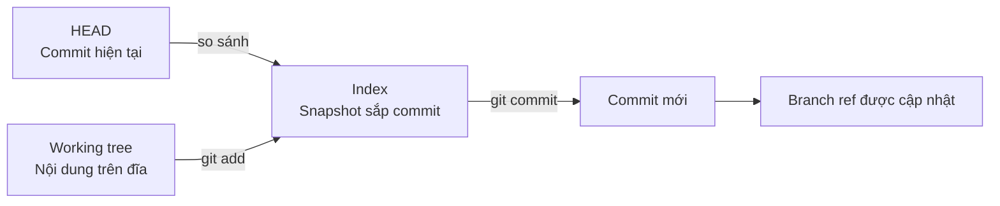

# Tạo commit từ chỉ mục và kiểm tra nội dung trước khi ghi

Trong Git, `git commit` tạo một mốc lịch sử mới từ nội dung đã được chọn trong **index** (staging area). Trước khi ghi commit, bạn nên xem lại chính xác snapshot đang stage, kiểm tra lỗi định dạng, xác nhận danh tính tác giả và viết message mô tả thay đổi. Sau khi commit, cần kiểm tra commit mới và trạng thái còn lại của working tree.

Quy trình này giúp mỗi commit thể hiện một thay đổi có chủ đích, dễ review, dễ truy tìm và dễ hoàn tác. Một commit tốt thường tập trung vào một mục tiêu, có message giải thích lý do thay đổi và không vô tình chứa tệp thử nghiệm, secret hoặc phần việc chưa hoàn tất.

Bài này thuộc chương **Tạo commit** của SOURCE_CONTROL_GIT. Nội dung đi qua toàn bộ vòng đời tạo commit: chuẩn bị index, review snapshot, ghi commit, xác minh kết quả, xử lý hook và chỉnh sửa commit gần nhất khi cần.

## 1. Commit lấy nội dung từ index

Git có ba vùng trạng thái quan trọng:

- **HEAD/repository:** commit hiện tại mà branch đang trỏ tới.
- **Index:** snapshot được chuẩn bị cho commit tiếp theo.
- **Working tree:** các tệp đang có trên đĩa và được chỉnh sửa trong editor.

Khi chạy `git commit`, Git tạo commit từ index tại thời điểm đó. Các sửa đổi chỉ có trong working tree nhưng chưa stage không tự động được đưa vào commit.



Ví dụ, `src/login.js` đã được stage, sau đó bạn tiếp tục sửa thêm tệp trong editor. Index vẫn giữ nội dung tại thời điểm `git add` trước đó; phần sửa mới chỉ ở working tree. Commit sẽ chứa phiên bản trong index, còn phần sửa mới tiếp tục nằm trong working tree.

### 1.1. Kiểm tra trạng thái trước khi commit

Bắt đầu bằng:

```bash
git status --short --branch
```

Lệnh cho biết branch hiện tại và các tệp staged, unstaged hoặc untracked. Sau đó xem nội dung đã chọn:

```bash
git diff --cached
git diff --cached --stat
git diff --cached --name-status
```

`git diff --cached` là bước review chính: nó hiển thị thay đổi trong index so với HEAD, tức nội dung sẽ được ghi vào commit thông thường tiếp theo.

### 1.2. Kiểm tra phần chưa stage

```bash
git diff
```

Lệnh này giúp phát hiện sửa đổi còn nằm ngoài index. Nếu bạn dự định commit tất cả phần việc, hãy quyết định rõ có cần stage thêm hay không. Nếu muốn commit một phần, xác nhận những sửa đổi còn lại được giữ lại cho công việc tiếp theo.

### 1.3. Kiểm tra whitespace và lỗi patch

```bash
git diff --cached --check
```

Lệnh kiểm tra các vấn đề whitespace trong phần staged, ví dụ trailing whitespace hoặc dấu cách trước tab theo quy tắc Git. Nếu lệnh báo lỗi, đọc vị trí được chỉ ra, sửa tệp rồi stage lại phần sửa và chạy kiểm tra lần nữa.

`git diff --cached --check` không thay thế test, lint hoặc review logic. Nó chỉ kiểm tra một nhóm vấn đề định dạng.

## 2. Chọn nội dung cho commit

### 2.1. Stage tệp cụ thể

Nếu chỉ muốn commit một vài tệp:

```bash
git add -- src/login.js src/session.js
```

Sau đó kiểm tra:

```bash
git diff --cached --name-status
git diff --cached
```

Đừng dựa vào trí nhớ về những tệp đã stage. Hãy xem index ngay trước khi commit.

### 2.2. Stage mọi thay đổi có chủ đích

```bash
git add -A
```

Lệnh này cập nhật index cho các tệp mới, đã sửa và đã xóa trong phạm vi repository. Sau đó vẫn cần review `git diff --cached`; `git add -A` không có nghĩa mọi tệp đều phù hợp để commit.

### 2.3. Dùng `git commit -a` cho tệp đã tracked

Git có tùy chọn `-a` (hoặc `--all`):

```bash
git commit -am "fix: handle login timeout"
```

Tùy chọn này tự stage các thay đổi và việc xóa của những tệp đã được Git theo dõi, rồi tạo commit. Nó **không** tự thêm tệp untracked mới. Đây là cách viết nhanh khi mọi sửa đổi trên các tệp tracked đều thuộc cùng commit.

Không dùng `-a` nếu cần chọn một phần thay đổi hoặc đang có sửa đổi chưa hoàn tất trên tệp tracked. Với workflow cần kiểm soát snapshot, hãy stage rõ bằng `git add` rồi review `git diff --cached` trước khi commit.

### 2.4. Stage từng phần

Khi một tệp chứa nhiều mục tiêu thay đổi:

```bash
git add -p src/payment.js
```

Chọn các hunk liên quan tới cùng một mục tiêu commit. Sau đó kiểm tra cả hai phía:

```bash
git diff --cached
git diff
```

Điều này giúp tránh gộp một sửa lỗi đã hoàn tất với phần thử nghiệm chưa xong trong cùng commit.

### 2.5. Bỏ stage phần chọn nhầm

Nếu phát hiện stage nhầm:

```bash
git restore --staged -- path/to/file
```

Lệnh này cập nhật index theo HEAD và giữ nội dung working tree. Sau đó stage lại đúng phần cần commit. Đừng nhầm với `git restore path/to/file` không có `--staged`, vì lệnh đó có thể ghi đè thay đổi chưa stage trong working tree.

## 3. Review snapshot trước khi ghi

Trước khi gọi `git commit`, thực hiện một lượt kiểm tra có hệ thống:

```bash
git status --short --branch
git diff --cached --check
git diff --cached --stat
git diff --cached
```

Hãy tự trả lời:

- Những tệp nào sẽ được commit?
- Mỗi thay đổi có phục vụ cùng một mục tiêu không?
- Có file log, file build, cache, file cá nhân hoặc secret nào bị stage nhầm không?
- Có sửa đổi nào chỉ nằm trong working tree mà bạn tưởng đã stage không?
- Nội dung staged có đúng với kết quả mong muốn sau khi chuẩn hóa line ending, clean filter hoặc Git LFS không?
- Có cần chạy test, lint, formatter hoặc kiểm tra bảo mật trước commit không?

### 3.1. Xem nội dung staged trong một tệp

```bash
git diff --cached -- src/login.js
```

Giới hạn theo pathspec giúp tập trung review một tệp hoặc một nhóm tệp. Nếu đường dẫn bắt đầu bằng dấu `-`, dùng `--` trước pathspec:

```bash
git diff --cached -- -draft.txt
```

### 3.2. Kiểm tra secret và dữ liệu không nên commit

Git không tự biết mọi giá trị nào là bí mật. Trước khi commit, chú ý các tệp như:

- `.env` có token hoặc mật khẩu thật.
- Private key, credential hoặc file cấu hình local.
- Dump cơ sở dữ liệu hoặc dữ liệu khách hàng.
- Log chứa thông tin cá nhân.
- Tệp build hoặc binary được sinh tự động mà dự án không quản lý trong Git.

Nếu phát hiện secret trong index, bỏ stage và xử lý nguồn tệp trước khi commit. Nếu secret đã được commit hoặc push, xóa nó trong commit mới không làm secret biến mất khỏi lịch sử cũ; cần thu hồi/rotate credential và thực hiện quy trình xử lý lịch sử phù hợp.

## 4. Tạo commit bằng `git commit`

### 4.1. Mở editor để viết message

```bash
git commit
```

Git mở editor được cấu hình để bạn viết commit message. Nếu chưa có cấu hình editor, Git sẽ dùng editor mặc định của môi trường.

Có thể xem cấu hình:

```bash
git config --show-origin --get core.editor
```

Đặt editor cho người dùng, ví dụ:

```bash
git config --global core.editor "code --wait"
```

Lệnh trên là ví dụ cho Visual Studio Code đã có trong PATH. Tùy editor, có thể cần tham số để tiến trình chờ đến khi cửa sổ message đóng.

### 4.2. Truyền message bằng `-m`

Với commit đơn giản:

```bash
git commit -m "fix: handle login timeout"
```

`-m` truyền message trực tiếp, không cần mở editor. Có thể dùng nhiều `-m` để tạo subject và body:

```bash
git commit \
  -m "fix: handle login timeout" \
  -m "Keep the session active while the refresh request is pending."
```

Các đoạn message được ngăn cách bằng một dòng trống. Trong PowerShell, có thể viết lệnh trên một dòng hoặc dùng dấu backtick để nối dòng; dấu `\` nối dòng là cú pháp của shell Unix.

### 4.3. Đọc message từ file

```bash
git commit -F commit-message.txt
```

`-F` (hoặc `--file`) đọc toàn bộ message từ file. Cách này hữu ích trong script hoặc khi message có nhiều dòng. File phải được chuẩn bị đúng nội dung và encoding mà môi trường Git hỗ trợ.

### 4.4. Dùng message từ commit cũ

```bash
git commit -C HEAD
```

`-C` dùng lại message và thông tin tác giả từ commit được chỉ định. `-c` cũng lấy message cũ nhưng mở editor để chỉnh:

```bash
git commit -c HEAD
```

Đây là tùy chọn nâng cao; hãy kiểm tra message sau khi dùng để tránh sao chép nội dung không còn phù hợp.

## 5. Viết commit message dễ đọc

Commit message là tài liệu ngắn về thay đổi. Người đọc có thể gặp nó trong `git log`, pull request, release note hoặc khi điều tra một regression nhiều tháng sau.

Một định dạng thường dùng:

```text
fix: handle login timeout

Keep the session active while the refresh request is pending.
Avoid redirecting users to the sign-in page for a temporary timeout.
```

### 5.1. Subject line

Subject là dòng đầu tiên, nên:

- Mô tả thay đổi chính bằng câu ngắn và cụ thể.
- Dùng động từ rõ ràng, ví dụ `fix`, `add`, `remove`, `update`.
- Tránh các message mơ hồ như `update`, `changes`, `fix bug`.
- Giữ độ dài gọn; nhiều nhóm chọn khoảng 50–72 ký tự, nhưng đây là quy ước nhóm chứ không phải giới hạn bắt buộc của Git.

Ví dụ tốt hơn:

```text
fix: preserve session during token refresh
```

thay vì:

```text
update code
```

### 5.2. Body

Body trả lời các câu hỏi mà subject không đủ chỗ giải thích:

- Vì sao cần thay đổi?
- Vấn đề trước đây là gì?
- Cách sửa giải quyết vấn đề ra sao?
- Có giới hạn hoặc hệ quả nào cần người review biết không?

Không cần lặp lại toàn bộ diff. Hãy giải thích bối cảnh và lý do để người đọc hiểu ý định của commit.

### 5.3. Footer

Footer có thể chứa mã issue, thông tin review hoặc chỉ thị liên kết commit tùy quy ước dự án:

```text
Refs: APP-248
Reviewed-by: Example Reviewer
```

Một số dự án dùng trailer có cấu trúc:

```bash
git interpret-trailers --parse < commit-message.txt
```

Git không bắt buộc mọi dự án dùng cùng một convention. Hãy tuân theo quy ước của repository và CI.

### 5.4. Message cần mô tả mục tiêu, không chỉ liệt kê tệp

Message như `update login.js` nói tệp nào thay đổi nhưng không giải thích vì sao. Message như `fix: preserve session during token refresh` nói được mục tiêu và giúp tìm kiếm lịch sử theo hành vi.

## 6. Danh tính và metadata của commit

Một commit lưu ít nhất hai danh tính:

- **Author:** người tạo ra thay đổi về mặt tác giả.
- **Committer:** người tạo commit object hiện tại.

Hai danh tính có thể giống nhau, nhưng không bắt buộc. Khi cherry-pick hoặc rebase, author có thể được giữ lại trong khi committer là người thực hiện thao tác mới.

### 6.1. Kiểm tra user.name và user.email

```bash
git config --show-origin --show-scope --get user.name
git config --show-origin --show-scope --get user.email
```

Đặt danh tính global:

```bash
git config --global user.name "An Nguyen"
git config --global user.email "an@example.com"
```

Đặt riêng cho repository hiện tại:

```bash
git config --local user.name "An Nguyen"
git config --local user.email "an@company.example"
```

Local config có thể ghi đè global config. Nếu commit đang dùng sai email dù global đã đúng, kiểm tra cấu hình local, include và biến môi trường.

### 6.2. Xem danh tính Git sẽ sử dụng

```bash
git var GIT_AUTHOR_IDENT
git var GIT_COMMITTER_IDENT
```

Hai lệnh giúp xem author/committer identity đã được Git phân giải trong môi trường hiện tại. Các biến như `GIT_AUTHOR_NAME`, `GIT_AUTHOR_EMAIL`, `GIT_COMMITTER_NAME` và `GIT_COMMITTER_EMAIL` cũng có thể ảnh hưởng giá trị.

### 6.3. Ghi đè author cho một commit

```bash
git commit --author="An Nguyen <an@example.com>" -m "docs: clarify setup steps"
```

`--author` thay thông tin author của commit. Committer vẫn là danh tính đang thực hiện lệnh. Chỉ dùng khi thực sự cần ghi nhận tác giả khác và tuân thủ chính sách dự án.

### 6.4. Thời gian author và committer

Commit lưu author date và committer date. Khi xem:

```bash
git log -1 --format=fuller
```

Git hiển thị cả hai mốc. Rebase hoặc amend thường tạo committer date mới. Timestamp không quyết định quan hệ cha giữa các commit; quan hệ đó được xác định bằng parent OID.

## 7. Git thực hiện những gì khi tạo commit?

Ở mức khái niệm, quy trình commit diễn ra như sau:

1. Git xác định index hiện tại và kiểm tra trạng thái repository.
2. Các hook trước commit có thể chạy để kiểm tra hoặc chuẩn bị message.
3. Git ghi tree object đại diện snapshot từ index.
4. Git tạo commit object tham chiếu tree, parent hiện tại và metadata.
5. Branch hiện tại được cập nhật để trỏ tới commit mới.
6. Reflog ghi nhận thay đổi ref; hook sau commit có thể chạy.

Nếu index không có thay đổi so với HEAD, Git thường báo không có gì để commit. Git không tạo commit rỗng theo mặc định.

### 7.1. Commit object chứa những gì?

Commit object tham chiếu:

- Tree object: snapshot của repository.
- Parent commit: thường là HEAD trước khi commit.
- Author và committer cùng timestamp.
- Commit message.
- Metadata bổ sung, ví dụ chữ ký nếu commit được ký.

Có thể xem raw commit:

```bash
git cat-file -p HEAD
```

### 7.2. Vì sao cùng nội dung nhưng OID commit có thể khác?

Commit OID được tính từ toàn bộ commit object. Chỉ cần thay đổi parent, author, committer, timestamp, message hoặc chữ ký, object commit sẽ có OID khác dù tree snapshot giống nhau.

Đây là lý do amend và rebase tạo commit mới thay vì sửa commit cũ tại chỗ.

## 8. Hooks có thể kiểm tra hoặc từ chối commit

Git có một số client-side hook liên quan đến commit:

| Hook | Thời điểm | Vai trò |
|---|---|---|
| `pre-commit` | Trước khi tạo commit | Chạy lint/test hoặc kiểm tra nội dung staged; trả khác `0` sẽ hủy commit. |
| `prepare-commit-msg` | Sau khi Git chuẩn bị message, trước khi mở editor | Có thể tự chuẩn bị hoặc chỉnh message. |
| `commit-msg` | Sau khi message được chuẩn bị | Kiểm tra message; trả khác `0` sẽ hủy commit. |
| `post-commit` | Sau khi commit thành công | Gửi thông báo hoặc ghi nhận sự kiện; không thể hủy commit đã tạo. |

Hook có thể làm commit chậm, thay đổi message hoặc từ chối thao tác. Nếu commit thất bại, đọc thông báo hook và chạy lại đúng lệnh kiểm tra thay vì lập tức bỏ qua hook.

### 8.1. `--no-verify`

```bash
git commit --no-verify -m "fix: handle timeout"
```

Tùy chọn này bỏ qua `pre-commit` và `commit-msg`. Nó không bỏ qua `prepare-commit-msg`. Không dùng `--no-verify` như cách sửa lỗi thường xuyên; nếu phải bỏ qua trong tình huống khẩn cấp, hãy chạy kiểm tra thay thế và ghi nhận lý do theo quy trình nhóm.

### 8.2. Hook local không phải lớp bảo vệ duy nhất

Hook local có thể chưa được cài hoặc bị bỏ qua bằng tùy chọn phù hợp. Những quy tắc quan trọng nên được xác minh thêm trong CI hoặc server-side hook để không phụ thuộc hoàn toàn vào môi trường của từng lập trình viên.

## 9. Ký commit

Một số dự án yêu cầu commit có chữ ký để xác minh danh tính người tạo. Tùy cấu hình, Git có thể dùng GPG hoặc SSH signing.

Ký một commit:

```bash
git commit -S -m "feat: add invoice export"
```

Kiểm tra chữ ký:

```bash
git log --show-signature -1
```

Có thể cấu hình kiểu ký và key theo tài liệu Git và chính sách của tổ chức. Commit signing xác thực chữ ký theo key và trust configuration; nó không tự chứng minh nội dung code an toàn hoặc đã được review.

Nếu signing bắt buộc nhưng key chưa cấu hình, commit có thể thất bại. Hãy cấu hình key và agent phù hợp thay vì tắt yêu cầu ký trái quy định.

## 10. Xác minh sau khi commit

Sau khi `git commit` thành công, không nên chỉ dựa vào dòng thông báo terminal. Hãy kiểm tra commit thực tế.

### 10.1. Xem commit mới nhất

```bash
git log -1 --oneline --decorate
git show --stat --oneline HEAD
```

Lệnh đầu cho biết commit mới nhất và ref đang trỏ tới nó. Lệnh thứ hai tóm tắt các tệp và số dòng thay đổi.

### 10.2. Xem metadata

```bash
git show --format=fuller --no-patch HEAD
```

Kiểm tra author, committer, ngày giờ và message. Nếu cần kiểm tra raw header:

```bash
git cat-file -p HEAD
```

### 10.3. Xem danh sách đường dẫn trong commit

```bash
git diff-tree --no-commit-id --name-status -r HEAD
```

Với root commit, có thể thêm `--root` để so sánh với trạng thái rỗng:

```bash
git diff-tree --root --no-commit-id --name-status -r HEAD
```

### 10.4. Xem diff của commit

Với commit không phải root:

```bash
git diff HEAD^ HEAD
```

Nếu commit là merge commit, `HEAD^` mặc định là parent thứ nhất; diff này chỉ so sánh với parent thứ nhất. Để xem khác biệt với parent thứ hai:

```bash
git diff HEAD^2 HEAD
```

Để xem cách Git trình bày thay đổi của merge, có thể dùng `git show --cc HEAD` hoặc các tùy chọn diff phù hợp.

### 10.5. Kiểm tra phần còn lại trong working tree

```bash
git status --short --branch
```

Nếu còn thay đổi, chúng có thể là phần chưa stage trước commit hoặc thay đổi được tạo bởi hook/tool. Đừng mặc định commit đã lấy hết mọi sửa đổi.

## 11. Commit không có thay đổi và `--allow-empty`

Nếu index không khác HEAD, Git thường từ chối tạo commit và báo không có gì để commit. Đây là hành vi bình thường.

Trong một số workflow, cần một commit không thay đổi tree, ví dụ kích hoạt pipeline, đánh dấu một sự kiện hoặc kiểm thử hệ thống:

```bash
git commit --allow-empty -m "chore: trigger deployment pipeline"
```

Commit này có tree giống commit cha nhưng vẫn là commit object mới với parent, metadata và message riêng. Chỉ dùng khi workflow thực sự cần; commit rỗng không thay thế cho việc sửa code.

## 12. Sửa commit gần nhất bằng `--amend`

Nếu commit vừa tạo có message sai hoặc thiếu một thay đổi nhỏ, có thể tạo commit thay thế bằng:

```bash
git commit --amend
```

Git tạo một commit mới thay cho tip hiện tại của branch. Commit cũ không bị sửa tại chỗ; OID mới thường khác vì metadata, message hoặc tree thay đổi.

### 12.1. Chỉ sửa message

```bash
git commit --amend -m "fix: preserve session during token refresh"
```

### 12.2. Bổ sung nội dung đã quên

```bash
git add -- src/session.js
git commit --amend --no-edit
```

`--no-edit` giữ message cũ. Snapshot mới được tạo từ index hiện tại, nên hãy kiểm tra staged diff trước khi amend để tránh đưa thêm nội dung không liên quan.

### 12.3. Reset author khi cần

Mặc định, amend thường giữ author của commit cũ và cập nhật committer. Nếu muốn đặt author theo danh tính hiện tại:

```bash
git commit --amend --reset-author
```

Chỉ dùng khi ý định là thay đổi author metadata. Nếu cần giữ author ban đầu, không thêm `--reset-author`.

### 12.4. Không amend commit đã chia sẻ nếu chưa phối hợp

Amend thay đổi OID commit và viết lại tip branch. Nếu commit đã push hoặc người khác đã dựa trên nó, amend có thể buộc phải force push và làm lịch sử của đồng đội phân kỳ.

Chỉ amend commit chưa chia sẻ, hoặc phối hợp với nhóm theo chính sách viết lại lịch sử. Nếu commit đã được dùng chung, tạo commit mới thường an toàn và dễ phối hợp hơn.

## 13. `git commit --dry-run`

Có thể xem Git dự kiến sẽ commit những gì mà không tạo commit:

```bash
git commit --dry-run
```

Dry-run hữu ích để xem danh sách thay đổi dự kiến và phát hiện tình trạng chưa sẵn sàng. Tuy nhiên, nó không thay thế `git diff --cached` khi cần review chi tiết từng dòng, cũng không đảm bảo mọi hook hoặc tác vụ phụ sẽ có hành vi giống hệt một lần commit thật.

## 14. Quy trình tạo commit mẫu

Giả sử bạn vừa sửa lỗi timeout trong đăng nhập và muốn tạo một commit độc lập.

**Bước 1: Xem trạng thái**

```bash
git status --short --branch
```

**Bước 2: Stage đúng tệp**

```bash
git add -- src/login.js src/session.js
```

**Bước 3: Review snapshot**

```bash
git diff --cached --check
git diff --cached --stat
git diff --cached
```

**Bước 4: Chạy test liên quan**

```bash
npm test -- --runInBand
```

Đây chỉ là ví dụ cho dự án Node có script test phù hợp; hãy dùng lệnh test thật của repository.

**Bước 5: Tạo commit**

```bash
git commit -m "fix: handle login timeout" \
  -m "Keep the session active while the refresh request is pending."
```

**Bước 6: Xác minh commit**

```bash
git show --stat --oneline HEAD
git show --format=fuller --no-patch HEAD
git status --short --branch
```

Nếu còn thay đổi chưa stage, tiếp tục công việc hoặc stage cho commit riêng. Nếu commit thất bại do hook hoặc signing, đọc nguyên nhân và xử lý đúng cấu hình.

## 15. Các lỗi thường gặp

### 15.1. `nothing to commit`

Index không có thay đổi so với HEAD, hoặc các thay đổi bạn muốn ghi chưa được stage. Kiểm tra:

```bash
git status --short
git diff
git diff --cached
```

Nếu muốn commit nội dung working tree, stage đúng tệp trước. Nếu thực sự cần commit rỗng, dùng `--allow-empty` với message giải thích mục đích.

### 15.2. Commit chứa tệp không mong muốn

Nguyên nhân thường là stage quá rộng bằng `git add .` hoặc `git add -A` mà không review. Dùng `git show --stat HEAD` để xác định nội dung đã ghi. Nếu commit chưa chia sẻ, có thể amend sau khi chuẩn bị index đúng; nếu đã chia sẻ, cân nhắc commit sửa tiếp theo hoặc quy trình viết lại lịch sử được nhóm chấp thuận.

### 15.3. Commit thiếu phần sửa vừa thực hiện

Bạn có thể đã sửa tệp sau lần `git add` cuối. Kiểm tra `git diff` và `git diff --cached`. Nếu phần sửa cần nằm trong commit hiện tại và commit chưa chia sẻ, stage phần đó rồi amend; nếu không, tạo commit tiếp theo.

### 15.4. Git không biết danh tính

Kiểm tra `user.name`, `user.email`, include và biến môi trường. Đặt danh tính phù hợp ở global hoặc local scope. Không dùng thông tin giả để vượt qua lỗi; commit metadata cần phản ánh đúng người thực hiện theo quy định nhóm.

### 15.5. Hook từ chối commit

Đọc thông báo hook, chạy lại lệnh kiểm tra và sửa dữ liệu hoặc cấu hình. Không dùng `--no-verify` để che lỗi thường xuyên.

### 15.6. Chữ ký commit thất bại

Kiểm tra signing key, agent, pinentry và cấu hình `gpg.format`/`user.signingkey` nếu dùng GPG hoặc SSH signing. Nếu dự án yêu cầu chữ ký, cần khôi phục signing environment thay vì bỏ yêu cầu.

## 16. Ghi nhớ

- `git commit` thông thường tạo commit từ index, không tự lấy mọi thay đổi trong working tree.
- Review `git diff --cached` và chạy `git diff --cached --check` trước khi ghi.
- Dùng `git commit -m` cho message ngắn, `-F` cho message từ file, `-c`/`-C` khi tái sử dụng message.
- Commit message nên có subject cụ thể; body giải thích lý do và bối cảnh; footer tuân theo quy ước dự án.
- Author và committer là hai metadata khác nhau; kiểm tra bằng `git var` và `git log --format=fuller`.
- Hook có thể kiểm tra, sửa message hoặc từ chối commit; hook sau commit không thể hủy commit đã tạo.
- `git commit -S` ký commit khi signing được cấu hình.
- Xác minh sau commit bằng `git show`, `git diff-tree` và `git status`.
- `--allow-empty` tạo commit không đổi tree khi workflow có lý do rõ ràng.
- `--amend` tạo commit thay thế với OID mới; cẩn thận khi commit đã được chia sẻ.
- `--dry-run` giúp xem trước nhưng không thay thế review chi tiết staged diff.

Một commit đáng tin cậy bắt đầu từ index được chọn có chủ đích, đi qua bước review rõ ràng, mang message và metadata chính xác, rồi được xác minh sau khi tạo. Khi duy trì quy trình này, lịch sử Git sẽ dễ hiểu và các thay đổi có thể được truy tìm, review hoặc phục hồi với ít bất ngờ hơn.
