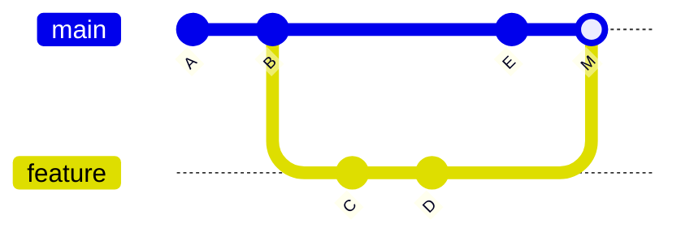
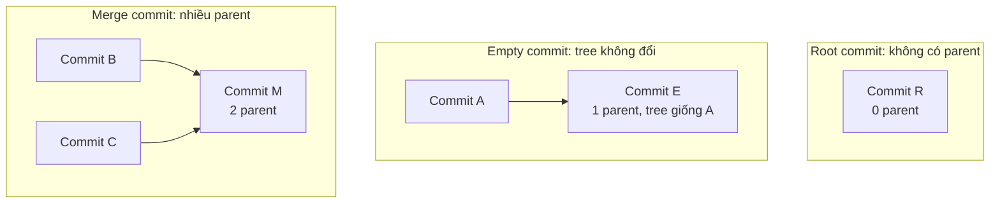

# Commit rỗng, commit hợp nhất và commit gốc

Không phải mọi commit đều đại diện cho một thay đổi nội dung thông thường. Git còn hỗ trợ **commit rỗng** để ghi nhận một sự kiện mà không thay đổi snapshot, **merge commit** để nối nhiều dòng lịch sử và **root commit** để bắt đầu một lịch sử chưa có commit cha.

Ba loại commit này có cấu trúc và mục đích khác nhau. Commit rỗng vẫn có thể có parent nhưng tree giống parent; merge commit có từ hai parent trở lên; root commit không có parent. Hiểu sự khác biệt giúp bạn chọn đúng lệnh khi khởi tạo repository, tích hợp branch, đánh dấu sự kiện hoặc kết hợp hai lịch sử độc lập.

Bài này thuộc chương **Tạo commit** của SOURCE_CONTROL_GIT. Nội dung tập trung vào cấu trúc commit object, cách tạo từng loại commit, cách xác minh parent/tree và những tình huống cần tránh khi dùng chúng trong quy trình cộng tác.

## 1. Nhìn commit qua tree và parent

Một commit object thường chứa:

- OID của một tree đại diện snapshot repository.
- Không, một hoặc nhiều dòng `parent` trỏ tới commit trước đó.
- Author và committer cùng thông tin thời gian.
- Commit message và metadata bổ sung, ví dụ chữ ký.

Có thể xem cấu trúc commit hiện tại:

```bash
git cat-file -p HEAD
```

Ví dụ commit thông thường:

```text
tree 7a31...
parent 2f10...
author An Nguyen <an@example.com> 1731500000 +0700
committer An Nguyen <an@example.com> 1731500000 +0700

fix: handle login timeout
```

Trường `tree` xác định nội dung snapshot. Các dòng `parent` xác định quan hệ lịch sử. Vì vậy, muốn phân biệt commit rỗng, merge commit và root commit, hãy xem cả tree lẫn số lượng parent.

| Loại commit | Số parent thường có | Quan hệ tree |
|---|---:|---|
| Commit thông thường | 1 | Thường khác tree của parent. |
| Commit rỗng | 1 (hoặc 0 nếu là root rỗng) | Giống tree của parent; không có thay đổi snapshot. |
| Merge commit | 2 trở lên | Tree là kết quả hợp nhất; có thể khác hoặc giống tree của parent thứ nhất. |
| Root commit | 0 | Snapshot đầu tiên của một dòng lịch sử; có thể chứa tệp hoặc rỗng. |

Một commit vừa là merge commit vừa có tree giống parent thứ nhất vẫn là merge commit. Một root commit có thể đồng thời là commit rỗng nếu repository được khởi tạo bằng một commit không chứa tệp.

## 2. Commit rỗng là gì?

Commit rỗng (*empty commit*) là commit có tree giống tree của parent, nghĩa là snapshot không có thay đổi nội dung so với commit cha. Tuy vậy, commit object vẫn mới vì có parent, metadata, timestamp hoặc message riêng.

Git mặc định không tạo commit thông thường nếu index không có thay đổi so với HEAD. Điều này tránh tạo các mốc lịch sử không có nội dung một cách vô ý. Khi workflow thực sự cần một commit chỉ để ghi nhận sự kiện, bạn có thể yêu cầu rõ bằng `--allow-empty`.

### 2.1. Tạo commit rỗng

```bash
git commit --allow-empty -m "chore: trigger deployment pipeline"
```

Lệnh này tạo commit mới dù index không có thay đổi so với HEAD. Commit có tree giống parent nhưng OID khác vì commit object chứa parent, author/committer, timestamp và message.

Ví dụ lịch sử trước và sau:

```text
Trước:
A---B  main

Sau:
A---B---E  main
```

`E` không thêm hoặc xóa tệp nào so với `B`, nhưng nó là commit riêng và có thể được CI, release automation hoặc quy trình audit nhận diện.

### 2.2. Khi nào nên dùng commit rỗng?

Một số tình huống có thể hợp lý:

- Kích hoạt pipeline hoặc deployment được cấu hình chạy theo commit mới.
- Đánh dấu một sự kiện vận hành không làm thay đổi source code.
- Tạo mốc kiểm thử cho quy trình CI/CD.
- Ghi nhận một bước phối hợp hoặc checkpoint theo quy ước của nhóm.
- Kiểm tra hook, signing hoặc quy trình phát hành mà không cần sửa tệp.

Commit rỗng nên có message giải thích mục đích. Nếu hệ thống có cách kích hoạt pipeline khác, hãy cân nhắc cách ít tạo nhiễu lịch sử hơn. Không tạo commit rỗng liên tục chỉ để làm pipeline chạy lại mà không có lý do hoặc quy ước rõ ràng.

### 2.3. Commit rỗng khác commit có message rỗng

Hai khái niệm này độc lập:

- `--allow-empty`: cho phép tạo commit khi snapshot không thay đổi.
- `--allow-empty-message`: cho phép commit có message rỗng.

Ví dụ commit rỗng về nội dung nhưng có message:

```bash
git commit --allow-empty -m "chore: mark maintenance window"
```

Ví dụ cho phép message rỗng:

```bash
git commit --allow-empty-message -m ""
```

Ví dụ cho phép cả hai điều kiện:

```bash
git commit --allow-empty --allow-empty-message -m ""
```

Commit message rỗng thường làm lịch sử khó đọc và tìm kiếm. Chỉ sử dụng nếu công cụ hoặc quy trình bắt buộc; trong công việc nhóm, nên giữ message có ý nghĩa.

### 2.4. Kiểm tra commit rỗng

Xem commit và parent:

```bash
git show --no-patch --format=raw HEAD
git rev-parse HEAD^{tree}
git rev-parse HEAD^1^{tree}
```

Nếu đây là commit không phải root, hai tree OID giống nhau cho thấy snapshot của commit mới giống parent thứ nhất. Có thể kiểm tra diff:

```bash
git diff HEAD^1 HEAD
```

Không có output diff là dấu hiệu tree không khác parent thứ nhất. Với root commit, không có `HEAD^1`; cần so sánh với empty tree hoặc dùng `git show --root` để xem snapshot đầu tiên.

## 3. Merge commit là gì?

Merge commit (*commit hợp nhất*) là commit có từ hai parent trở lên. Nó ghi nhận rằng các dòng lịch sử độc lập đã được kết hợp tại một điểm.

Ví dụ hai branch phát triển song song:



Merge commit `M` có hai parent:

1. Parent thứ nhất: tip của branch đang checkout trước khi merge (`main`, ví dụ `E`).
2. Parent thứ hai: tip của branch được merge vào (`feature`, ví dụ `D`).

Thứ tự parent được lưu trong commit object và có ý nghĩa khi dùng `M^1`, `M^2`, `--first-parent` hoặc so sánh merge với từng parent.

### 3.1. Tạo merge commit thông thường

Giả sử đang ở branch `main` và muốn tích hợp `feature/login`:

```bash
git switch main
git merge feature/login
```

Nếu hai branch đã phân kỳ, Git thường tạo merge commit sau khi kết hợp nội dung. Nếu có conflict, Git dừng lại để bạn giải quyết; sau khi stage các tệp đã xử lý, hoàn tất merge bằng:

```bash
git add -- path/to/resolved-file
git commit
```

Trong nhiều trường hợp, lệnh `git merge` tự tạo merge commit khi merge thành công và không cần gọi `git commit` riêng. Bạn chỉ tự chạy `git commit` sau khi merge bị dừng có chủ đích hoặc cần hoàn tất sau khi giải quyết conflict.

### 3.2. Fast-forward không tạo merge commit

Nếu tip branch hiện tại là tổ tiên của branch được merge, Git có thể chỉ di chuyển branch hiện tại tới commit mới nhất:

```text
A---B---C  feature/login
    ^
    main
```

Chạy:

```bash
git switch main
git merge feature/login
```

Git có thể fast-forward `main` từ `B` tới `C`. Không có commit mới được tạo; ref `main` chỉ di chuyển.

Fast-forward giữ lịch sử tuyến tính và thường là hành vi mặc định khi có thể. Nếu muốn luôn ghi nhận một mốc tích hợp riêng, kể cả khi fast-forward có thể xảy ra, dùng `--no-ff`.

### 3.3. Buộc tạo merge commit bằng `--no-ff`

```bash
git merge --no-ff feature/login
```

`--no-ff` yêu cầu tạo merge commit ngay cả khi Git có thể fast-forward. Cách này giúp lịch sử thể hiện rõ một nhánh tính năng đã được tích hợp:

```text
      C---D  feature/login
     /     \
A---B-------M  main
```

Merge commit `M` giữ quan hệ với cả `B` và `D`. Điều này có thể hữu ích khi nhóm muốn xem ranh giới feature branch, dùng `--first-parent` để đọc lịch sử tích hợp hoặc revert một lần tích hợp theo chính sách phù hợp.

`--no-ff` không tạo merge commit nếu nhánh đã được tích hợp và Git báo “Already up to date”; nó chỉ ngăn fast-forward trong trường hợp có thể tiến tới tip của nhánh kia.

### 3.4. Chuẩn bị merge nhưng chưa commit

```bash
git merge --no-commit --no-ff feature/login
```

Tổ hợp này yêu cầu Git thực hiện merge và dừng trước khi tạo commit, để bạn review tree kết quả, chạy test hoặc chỉnh sửa thêm. `--no-commit` riêng lẻ không thể dừng một fast-forward vì fast-forward không tạo merge commit; kết hợp `--no-ff` để buộc Git tạo merge commit rồi dừng trước bước ghi commit.

Sau khi kiểm tra:

```bash
git status
git diff --cached
git diff
```

Nếu kết quả đạt yêu cầu, tạo merge commit:

```bash
git commit
```

Nếu muốn hủy merge đang dừng:

```bash
git merge --abort
```

Hãy bảo toàn thay đổi local trước khi merge; khả năng abort khôi phục chính xác trạng thái ban đầu có thể bị ảnh hưởng nếu repository đã có thay đổi chưa commit trước lúc bắt đầu.

## 4. Merge commit có thể không tạo thay đổi nội dung

Một merge commit có thể có tree giống parent thứ nhất nhưng vẫn có ý nghĩa lịch sử vì nó ghi nhận thêm parent thứ hai. Đây là trường hợp thường gọi là *empty merge commit* hoặc merge commit không có diff so với first parent.

### 4.1. Chiến lược `ours`

Có thể tạo merge commit giữ nguyên tree của branch hiện tại nhưng ghi nhận branch kia là đã được hợp nhất:

```bash
git switch main
git merge --no-ff -s ours feature/legacy
```

Chiến lược `ours` dùng tree của branch hiện tại làm kết quả merge, bỏ qua nội dung tree của branch được merge. `--no-ff` bảo đảm Git tạo merge commit thay vì chỉ fast-forward nếu hai tip có quan hệ tổ tiên. Commit kết quả có hai parent và lịch sử ghi nhận `feature/legacy` đã được hợp nhất vào `main`.

Điều này có hệ quả quan trọng: các lần merge sau sẽ xem commit của `feature/legacy` là đã nằm trong lịch sử của `main`. Những thay đổi bị bỏ qua trong lần merge `ours` sẽ không tự xuất hiện trong lần merge thông thường sau đó.

Chỉ dùng `-s ours` khi chủ đích là đánh dấu một dòng lịch sử đã được xử lý hoặc loại bỏ về mặt nội dung theo quyết định rõ ràng. Đây không phải cách giải quyết conflict thông thường.

### 4.2. Phân biệt `-s ours` và `-X ours`

Hai cú pháp có ý nghĩa khác nhau:

```bash
# Chiến lược ours: dùng nguyên tree của nhánh hiện tại
git merge --no-ff -s ours feature

# Tùy chọn ours: chỉ ưu tiên nội dung nhánh hiện tại tại các vùng conflict
git merge -X ours feature
```

- `-s ours` bỏ qua toàn bộ thay đổi tree của branch được merge, nhưng vẫn ghi nhận parent của nó.
- `-X ours` vẫn tích hợp các thay đổi không conflict từ branch kia; chỉ các vùng conflict được ưu tiên phiên bản của nhánh hiện tại.

Nhầm hai tùy chọn có thể làm mất hàng loạt thay đổi nội dung khỏi kết quả merge.

### 4.3. Xác minh merge commit không có diff với parent thứ nhất

```bash
git show --no-patch --format=raw HEAD
git diff HEAD^1 HEAD
git diff HEAD^2 HEAD
```

Nếu diff với parent thứ nhất trống nhưng commit có hai dòng parent, đây là merge commit không có thay đổi tree so với nhánh hiện tại trước merge. Diff với parent thứ hai có thể cho thấy nội dung khác biệt giữa hai dòng lịch sử.

## 5. Squash merge không phải merge commit

`git merge --squash` lấy kết quả nội dung của branch được merge và chuẩn bị trong index/working tree, nhưng không ghi nhận quan hệ parent của branch đó vào commit tiếp theo.

Ví dụ:

```bash
git switch main
git merge --squash feature/login
git status
git diff --cached
git commit -m "feat: add login flow"
```

Commit được tạo sau squash merge thường có một parent là tip hiện tại của `main`, giống commit thông thường. Các commit riêng trên `feature/login` không trở thành parent của commit này.

So sánh:

| Cách tích hợp | Nội dung thay đổi | Parent của commit kết quả |
|---|---|---|
| Merge commit | Kết quả hợp nhất hai branch | Hai parent trở lên. |
| Fast-forward | Tip branch hiện tại tiến tới commit có sẵn | Không tạo commit mới. |
| Squash merge | Gộp thay đổi thành snapshot để commit mới | Thường chỉ một parent là HEAD trước squash. |
| Rebase rồi fast-forward | Phát lại commit trên nền mới, sau đó di chuyển ref | Các commit được phát lại có parent tuyến tính mới; merge không tạo commit riêng. |

Squash merge hữu ích khi muốn lịch sử chính chỉ có một commit đại diện feature. Đổi lại, Git không có merge parent để nhận diện các commit feature cũ đã được tích hợp. Nếu tiếp tục làm việc trên branch cũ, cần hiểu quy trình đồng bộ để tránh tích hợp lại thay đổi hoặc tạo lịch sử khó hiểu.

## 6. Root commit là gì?

Root commit (*commit gốc*) là commit không có parent. Nó bắt đầu một dòng lịch sử mới. Trong raw commit object, root commit có trường `tree` nhưng không có dòng `parent`.

Ví dụ:

```text
tree 91ac...
author An Nguyen <an@example.com> 1731500000 +0700
committer An Nguyen <an@example.com> 1731500000 +0700

Initial project snapshot
```

Không có `parent` nên đây là root commit. Snapshot của root commit có thể chứa nhiều tệp hoặc không chứa tệp nào.

### 6.1. Tạo root commit đầu tiên

Khởi tạo repository:

```bash
mkdir demo-project
cd demo-project
git init
```

Tạo một tệp và stage:

```bash
printf '# Demo project\n' > README.md
git add README.md
git commit -m "chore: initialize project"
```

Commit đầu tiên không có parent. Git branch ban đầu là một *unborn branch* trước khi commit đầu tiên được tạo; HEAD có thể trỏ symbolic tới tên branch nhưng ref branch chưa có OID.

### 6.2. Root commit rỗng

Có thể tạo root commit không có tệp:

```bash
git init empty-project
cd empty-project
git commit --allow-empty -m "chore: initialize empty repository"
```

Đây vừa là root commit (không có parent) vừa là commit rỗng (tree rỗng). Sau khi tạo, branch có một tip dù snapshot chưa chứa tệp nào.

### 6.3. Kiểm tra root commit

Xem raw object:

```bash
git cat-file -p HEAD
```

Liệt kê root commit trong tất cả refs:

```bash
git rev-list --max-parents=0 --all
```

Nếu repository có nhiều lịch sử độc lập, lệnh có thể trả nhiều root commit. Xem lịch sử cùng thay đổi của root:

```bash
git log --root --oneline --all
```

Hoặc xem snapshot của root hiện tại so với trạng thái rỗng:

```bash
git show --root --stat HEAD
git diff-tree --root --no-commit-id --name-status -r HEAD
```

## 7. Tạo một lịch sử độc lập bằng orphan branch

Đôi khi cần một branch có lịch sử riêng, không có quan hệ cha với branch hiện tại, ví dụ branch triển khai tài liệu tĩnh hoặc xuất bản nội dung đã biên dịch.

Có thể tạo branch mới chưa có parent bằng:

```bash
git switch --orphan docs-site
```

Branch mới là unborn branch; commit đầu tiên tạo trên branch này sẽ trở thành root commit của dòng lịch sử riêng. Git chuẩn bị index và working tree theo start point mặc định, vì vậy hãy kiểm tra trạng thái trước khi stage hoặc xóa nội dung:

```bash
git status --short
git ls-files --stage
```

Chọn nội dung muốn đưa vào lịch sử mới, stage và commit:

```bash
git add -A
git diff --cached
git commit -m "chore: publish documentation snapshot"
```

Lệnh `git switch --orphan` không tự xóa các tệp hiện có. Nếu mục tiêu là tạo snapshot chỉ chứa một nhóm tệp riêng, cần chuẩn bị working tree/index cẩn thận và kiểm tra diff trước khi commit; không chạy lệnh xóa hàng loạt nếu chưa sao lưu nội dung cần giữ.

## 8. Hợp nhất hai lịch sử không có tổ tiên chung

Hai repository độc lập có thể được phát triển riêng và mỗi bên đã có root commit. Khi thêm remote của repository còn lại rồi merge, Git có thể từ chối vì không tìm được common ancestor.

Ví dụ:

```text
Repository A:  A1---A2

Repository B:  B1---B2
```

Không có commit nào là tổ tiên chung của cả hai lịch sử. Nếu chủ đích là kết hợp chúng, dùng:

```bash
git switch main
git merge --allow-unrelated-histories other/main
```

Git cho phép tạo merge giữa hai lịch sử không liên quan. Kết quả thường là merge commit có hai parent: tip của lịch sử hiện tại và tip của lịch sử được merge. Nếu hai bên có cùng đường dẫn với nội dung khác nhau, có thể phát sinh conflict cần giải quyết.

### 8.1. Khi nào hợp nhất unrelated histories?

Một số trường hợp:

- Một dự án local đã có commit, sau đó cần nối với repository remote được khởi tạo riêng.
- Import một repository độc lập vào lịch sử dự án hiện tại.
- Kết hợp hai dòng lịch sử được quản lý riêng sau khi nhóm thống nhất cách tích hợp.

Không dùng `--allow-unrelated-histories` chỉ để bỏ qua một lỗi merge chưa hiểu rõ. Trước tiên kiểm tra remote, branch và lịch sử:

```bash
git remote -v
git log --graph --oneline --decorate --all
git merge-base HEAD other/main
```

Nếu `git merge-base` không trả common ancestor, xác nhận đây thật sự là hai lịch sử cần nối. Sau đó bảo đảm working tree sạch và có backup trước khi merge.

### 8.2. Xác minh merge giữa hai root

Sau khi merge thành công:

```bash
git cat-file -p HEAD
git log --graph --oneline --decorate --all
git rev-list --parents -n 1 HEAD
```

Raw commit cho thấy hai parent. Đồ thị cho thấy hai dòng lịch sử gặp nhau tại merge commit mới.

## 9. Commit gốc, commit rỗng và merge commit trong đồ thị

Ba khái niệm này mô tả các thuộc tính khác nhau của commit:



| Câu hỏi | Thuộc tính cần xem |
|---|---|
| Đây có phải commit gốc không? | Không có dòng `parent`. |
| Đây có phải commit rỗng so với parent thứ nhất không? | Tree OID giống tree của parent thứ nhất. |
| Đây có phải merge commit không? | Có từ hai dòng `parent` trở lên. |
| Đây có phải root commit rỗng không? | Không có parent và tree là empty tree. |
| Đây có phải merge commit không có diff với first parent không? | Có nhiều parent và tree giống tree của parent thứ nhất. |

Không thể xác định loại commit chỉ bằng message. Message có chữ `merge` không làm commit trở thành merge commit; số lượng parent mới là căn cứ cấu trúc.

## 10. Kiểm tra commit bằng các lệnh Git

### 10.1. Xem số parent

```bash
git rev-list --parents -n 1 HEAD
```

Kết quả bắt đầu bằng OID của commit, sau đó là các OID parent. Không có OID nào sau commit nghĩa là root commit.

### 10.2. Xem tree OID

```bash
git rev-parse HEAD^{tree}
```

Với commit có parent:

```bash
git rev-parse HEAD^1^{tree}
```

Nếu hai OID giống nhau, snapshot commit giống parent thứ nhất. Đối với root commit, không có `HEAD^1`; có thể xem tree rỗng bằng:

```bash
git hash-object -t tree --stdin < /dev/null
```

Lệnh trên tính OID của empty tree theo object format hiện tại mà Git sử dụng; không nên hardcode OID SHA-1 vì repository có thể dùng SHA-256.

### 10.3. Xem diff với từng parent

```bash
git diff HEAD^1 HEAD
git diff HEAD^2 HEAD
```

Lệnh đầu so sánh kết quả merge với nhánh hiện tại trước merge. Lệnh thứ hai so sánh với branch được merge vào. Với commit chỉ có một parent, `HEAD^2` không tồn tại.

### 10.4. Xem commit theo first-parent history

```bash
git log --first-parent --oneline --decorate
```

`--first-parent` đi theo parent thứ nhất của merge commit. Nó hữu ích để đọc lịch sử tích hợp trên branch chính mà không đi sâu vào từng commit của feature branch.

### 10.5. Xem các merge commit

```bash
git log --merges --oneline --decorate
```

Lệnh lọc các merge commit trong lịch sử được xét. Đây là cách kiểm tra những mốc tích hợp branch đã được ghi nhận.

## 11. Chọn loại commit phù hợp với tình huống

| Nhu cầu | Cách phù hợp | Điều cần nhớ |
|---|---|---|
| Bắt đầu repository mới | Root commit thông thường | Commit đầu tiên không có parent. |
| Khởi tạo repo nhưng chưa có tệp | `git commit --allow-empty` | Tạo root commit có tree rỗng. |
| Kích hoạt workflow bằng mốc lịch sử | `git commit --allow-empty -m ...` | Tạo commit mới nhưng không đổi snapshot. |
| Tích hợp branch và giữ lịch sử hai phía | `git merge` | Khi phân kỳ, thường tạo merge commit. |
| Luôn ghi mốc tích hợp dù fast-forward được | `git merge --no-ff` | Tạo merge commit nếu branch chưa được tích hợp. |
| Review kết quả trước khi ghi merge | `git merge --no-commit --no-ff` | Kiểm tra index và working tree rồi commit. |
| Gộp thay đổi thành một commit tuyến tính | `git merge --squash` rồi `git commit` | Commit kết quả không có parent của feature branch. |
| Ghi nhận branch đã xử lý nhưng bỏ nội dung của nó | `git merge -s ours` | Tác động tới các lần merge sau; chỉ dùng có chủ đích. |
| Kết hợp hai lịch sử độc lập | `git merge --allow-unrelated-histories` | Kiểm tra kỹ nguồn và conflict trước khi nối. |

## 12. Quy trình thực hành tổng hợp

Giả sử một nhóm có repository `app` và một repository tài liệu được khởi tạo riêng. Nhóm muốn nối lịch sử tài liệu vào branch `main` của `app`, sau đó ghi một mốc tích hợp rõ ràng.

**Bước 1: Xem lịch sử hiện tại**

```bash
git log --graph --oneline --decorate --all
git status --short --branch
```

**Bước 2: Fetch lịch sử tài liệu**

```bash
git remote add docs https://example.com/team/docs.git
git fetch docs
```

**Bước 3: Xác nhận không có common ancestor**

```bash
git merge-base main docs/main
```

Nếu không tìm được merge base và đây đúng là hai repository độc lập, tiếp tục theo kế hoạch tích hợp.

**Bước 4: Merge hai lịch sử**

```bash
git switch main
git merge --allow-unrelated-histories --no-ff --no-commit docs/main
```

**Bước 5: Review kết quả**

```bash
git status
git diff --cached --stat
git diff --cached
```

Giải quyết conflict nếu có, stage tệp đã xử lý và chạy test liên quan.

**Bước 6: Tạo merge commit**

```bash
git commit -m "merge: integrate documentation history"
```

**Bước 7: Xác minh cấu trúc commit**

```bash
git rev-list --parents -n 1 HEAD
git cat-file -p HEAD
git log --graph --oneline --decorate --all
```

Kết quả cho thấy commit mới có hai parent và hai dòng lịch sử đã được nối. Nếu merge không có thay đổi tree với parent thứ nhất, điều đó không làm mất ý nghĩa của parent thứ hai; commit vẫn ghi nhận quan hệ lịch sử.

## 13. Các lỗi thường gặp

### 13.1. Git từ chối commit dù muốn tạo mốc mới

Nếu index không thay đổi so với HEAD, dùng `--allow-empty` khi thật sự cần commit rỗng. Đừng thêm một tệp vô nghĩa chỉ để ép Git tạo commit.

### 13.2. Nghĩ rằng commit rỗng là commit message rỗng

`--allow-empty` và `--allow-empty-message` giải quyết hai điều kiện khác nhau. Hãy chọn đúng tùy chọn và vẫn viết message có ý nghĩa.

### 13.3. Merge không tạo merge commit

Nếu Git fast-forward, không có commit hợp nhất mới. Dùng `--no-ff` nếu chính sách nhóm yêu cầu giữ mốc tích hợp riêng.

### 13.4. `--no-commit` không dừng merge

Nếu merge có thể fast-forward, `--no-commit` không có commit nào để dừng trước. Kết hợp `--no-ff --no-commit` khi cần review kết quả trước khi ghi merge commit.

### 13.5. Dùng `-s ours` để xử lý conflict thông thường

`-s ours` bỏ toàn bộ nội dung branch kia khỏi tree kết quả nhưng ghi nhận branch đó đã được merge. Nếu chỉ muốn ưu tiên ours tại vùng conflict, xem xét `-X ours` và review kỹ diff.

### 13.6. Nhầm squash merge với merge commit

Squash merge tạo nội dung staged để commit thông thường; commit mới không có parent trỏ tới tip branch được squash. Nếu cần lưu quan hệ hai dòng lịch sử, dùng merge commit.

### 13.7. Merge unrelated histories mà chưa kiểm tra nguồn

Trước khi dùng `--allow-unrelated-histories`, xác nhận remote và branch đúng. Nếu không, có thể nối nhầm hai dự án hoặc đưa một lịch sử không mong muốn vào repository.

## 14. Ghi nhớ

- Commit object chứa tree và danh sách parent; số lượng parent quyết định cấu trúc lịch sử.
- Commit rỗng có tree giống parent; dùng `git commit --allow-empty` để tạo có chủ đích.
- `--allow-empty-message` cho phép message rỗng và độc lập với `--allow-empty`.
- Merge commit có từ hai parent trở lên; parent thứ nhất thường là branch hiện tại trước merge.
- Fast-forward chỉ di chuyển ref và không tạo merge commit.
- `--no-ff` buộc tạo merge commit khi fast-forward có thể xảy ra; `--no-commit` kết hợp `--no-ff` để dừng trước commit.
- `-s ours` giữ nguyên tree của branch hiện tại nhưng ghi nhận branch kia là parent; `-X ours` chỉ ưu tiên ours ở vùng conflict.
- Squash merge không lưu parent của branch được squash.
- Root commit không có parent; repository có thể có nhiều root nếu có nhiều lịch sử độc lập.
- `git switch --orphan` tạo branch có lịch sử mới; kiểm tra index/working tree trước khi commit.
- `--allow-unrelated-histories` cho phép nối hai lịch sử không có common ancestor.
- Dùng `git cat-file`, `git rev-list --parents`, `git rev-parse <commit>^{tree}` và `git log --graph` để xác minh cấu trúc.

Hãy chọn commit theo mục tiêu lịch sử cần ghi lại: commit rỗng đánh dấu một sự kiện, merge commit ghi nhận việc tích hợp nhiều dòng phát triển, còn root commit mở đầu một dòng lịch sử mới. Khi kiểm tra tree và parent thay vì chỉ nhìn message, bạn có thể xác định chính xác Git đã ghi lại điều gì.
