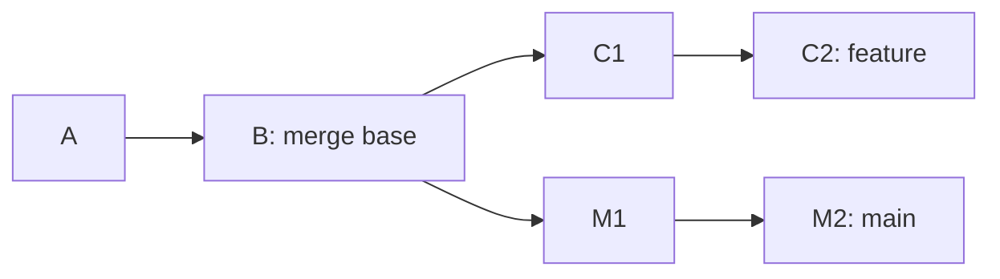

# Phân biệt cú pháp `A..B` và `A...B` khi dùng `git diff`

Trong Git, `git diff A..B` và `git diff A...B` đều nhận hai commit nhưng trả lời hai câu hỏi khác nhau. Dạng hai chấm so sánh **snapshot tại A với snapshot tại B**. Dạng ba chấm tìm **merge base chung của A và B**, rồi so sánh snapshot đó với B. Vì vậy, `A...B` thường hữu ích khi review những thay đổi riêng của một branch kể từ lúc nó tách ra; `A..B` hữu ích khi muốn biết hai tip hiện tại khác nhau thế nào.

Điểm dễ nhầm là cú pháp ba chấm trong `git diff` không có nghĩa “tập hợp mọi commit chỉ có ở một trong hai branch”. Đó là cách hiểu thường gặp với `git log A...B`, nhưng `git diff` so sánh nội dung tree và có quy tắc riêng. Muốn đọc pull request, review branch hoặc tìm khác biệt giữa hai phiên bản, cần chọn đúng dạng so sánh và đúng chiều A/B.

Bài này thuộc chương **So sánh thay đổi** của SOURCE_CONTROL_GIT. Nội dung đi từ ý nghĩa endpoint và merge base, ví dụ lịch sử phân nhánh, cách chọn chiều diff, tới các tùy chọn hiển thị và những tình huống khiến kết quả khác kỳ vọng.

## 1. `git diff` so sánh nội dung snapshot

Git có thể so sánh working tree, index và commit. Khi truyền hai commit, `git diff` so sánh tree của chúng để tìm khác biệt về tệp và nội dung.

```bash
# Working tree so với index
git diff

# Index so với HEAD
git diff --cached

# Working tree so với HEAD
git diff HEAD

# Snapshot của hai commit
git diff A B
```

Lệnh `git diff A B` cho biết cần thay đổi gì để biến snapshot A thành snapshot B. Dòng thêm/xóa trong patch được định hướng theo thứ tự đó: A là phía cũ, B là phía mới.

Các dạng `A..B` và `A...B` là cách viết tiện lợi dành cho đối số commit của `git diff`; chúng không biến `git diff` thành lệnh liệt kê commit. Lệnh vẫn tạo diff giữa hai tree được chọn.

## 2. `A..B`: so sánh hai endpoint

Với `git diff A..B`, Git so sánh trực tiếp snapshot của A và B. Trong ngữ cảnh `git diff`, cách viết này tương đương:

```bash
git diff A B
```

Ví dụ:

```bash
git diff main..feature
```

Lệnh so sánh tree tại tip hiện tại của `main` với tree tại tip hiện tại của `feature`. Kết quả bao gồm mọi khác biệt giữa hai snapshot, bất kể thay đổi đến từ branch nào.

### 2.1. Ví dụ hai branch đã phân kỳ

Giả sử lịch sử như sau:

```text
             C1---C2  feature
            /
A---B------+
     \
      M1---M2  main
```

`B` là merge base chung. Sau khi tách nhánh:

- `feature` có các commit `C1`, `C2`.
- `main` có các commit `M1`, `M2`.

Chạy:

```bash
git diff main..feature
```

Git so sánh snapshot ở `M2` với snapshot ở `C2`. Kết quả trả lời câu hỏi: **hai branch hiện khác nhau về nội dung gì?**

Nếu `main` sửa một dòng và `feature` cũng sửa cùng dòng theo cách khác, diff endpoint sẽ thể hiện khác biệt giữa hai kết quả cuối cùng. Nó không nói riêng thay đổi nào được thực hiện trên `feature` kể từ lúc tách nhánh.

### 2.2. Chiều so sánh có ý nghĩa

Hai lệnh sau không tạo cùng chiều patch:

```bash
git diff main..feature
git diff feature..main
```

Lệnh đầu dùng `main` làm phía cũ và `feature` làm phía mới. Lệnh sau đảo lại. Chúng thể hiện cùng một khoảng cách nội dung nhưng các dòng thêm/xóa bị đảo chiều.

Khi đọc output, hãy luôn xác định rõ commit nào là phía trước và commit nào là phía sau. Đừng diễn giải `+` là “được thêm trên branch feature” nếu lệnh thực tế có thứ tự ngược lại.

## 3. `A...B`: so sánh merge base với B

Với `git diff A...B`, Git tìm merge base của A và B, sau đó so sánh merge base đó với B. Có thể hiểu tương đương:

```bash
git diff "$(git merge-base A B)" B
```

Trên PowerShell:

```powershell
$base = git merge-base A B
git diff $base B
```

Ví dụ:

```bash
git diff main...feature
```

Git tìm commit chung tốt nhất của `main` và `feature` (trong lịch sử đơn giản ở trên là `B`), rồi so sánh snapshot `B` với tip `feature` (`C2`). Kết quả trả lời câu hỏi: **feature đã tạo ra khác biệt nội dung ròng nào kể từ điểm phân nhánh chung?**

### 3.1. Hình dung bằng đồ thị



Hai lệnh sau có cùng merge base nhưng endpoint khác nhau:

```bash
# Thay đổi ròng trên feature kể từ B
git diff main...feature

# Thay đổi ròng trên main kể từ B
git diff feature...main
```

Đối số bên trái xác định lịch sử dùng để tìm merge base; đối số bên phải là snapshot cuối cùng được so sánh với merge base. Vì vậy, đổi chỗ A và B có thể làm kết quả thay đổi hoàn toàn.

### 3.2. Ví dụ cụ thể về nội dung

Giả sử tại merge base `B`, file `config.yml` có:

```yaml
timeout: 30
retry: false
```

Sau khi phân nhánh:

- `main` đổi `timeout` thành `60`.
- `feature` giữ `timeout: 30` và đổi `retry` thành `true`.

Với diff endpoint:

```bash
git diff main..feature -- config.yml
```

Git cho thấy khác biệt giữa hai snapshot tip: `timeout` đổi từ `60` về `30`, đồng thời `retry` đổi từ `false` sang `true`.

Với diff ba chấm:

```bash
git diff main...feature -- config.yml
```

Git so sánh `B` với `feature`. Vì `feature` không thay đổi `timeout` so với base, phần `timeout` không xuất hiện. Diff chỉ thể hiện `retry` được đổi từ `false` thành `true`.

Đây là lý do `A...B` thường phù hợp để xem phần việc riêng của branch B khi chuẩn bị merge hoặc pull request: nó loại khỏi diff những thay đổi chỉ xuất hiện trên branch A.

## 4. Bảng so sánh nhanh

| Cú pháp | Điểm bắt đầu | Điểm kết thúc | Câu hỏi chính |
|---|---|---|---|
| `git diff A B` | Tree của A | Tree của B | Hai snapshot hiện khác nhau thế nào? |
| `git diff A..B` | Tree của A | Tree của B | Tương đương `git diff A B`. |
| `git diff A...B` | Tree của merge base(A, B) | Tree của B | B đã thay đổi gì kể từ điểm chung? |
| `git diff B...A` | Tree của merge base(A, B) | Tree của A | A đã thay đổi gì kể từ điểm chung? |

Hãy nhớ: `A..B` là so sánh hai đầu mút; `A...B` là so sánh từ merge base tới đầu mút thứ hai.

## 5. Đừng nhầm `git diff A...B` với `git log A...B`

Ký hiệu hai chấm và ba chấm cũng xuất hiện trong lệnh duyệt lịch sử, nhưng ý nghĩa kết quả khác nhau.

| Lệnh | Ý nghĩa |
|---|---|
| `git diff A..B` | So sánh tree A với tree B. |
| `git diff A...B` | So sánh tree merge base(A, B) với tree B. |
| `git log A..B` | Liệt kê commit reachable từ B nhưng không reachable từ A. |
| `git log A...B` | Liệt kê commit chỉ reachable từ một trong hai phía (đối xứng), sau khi loại phần chung. |

Ví dụ:

```bash
# Các commit có trên feature mà chưa có trên main
git log --oneline main..feature

# Các commit riêng của cả hai phía
git log --oneline --left-right main...feature

# Nội dung feature thay đổi kể từ merge base
git diff main...feature
```

`git log A...B` có thể liệt kê commit ở cả A và B. `git diff A...B` chỉ tạo một patch từ merge base tới B. Không dùng kết quả của lệnh này để suy ra lệnh kia đã chọn những commit nào.

## 6. Chọn lệnh theo mục tiêu review

### 6.1. Review thay đổi của feature branch trước khi merge

Nếu đang ở `main` và muốn xem nội dung riêng của `feature` kể từ điểm phân nhánh:

```bash
git diff main...feature
```

Đây là cách dùng phổ biến trong review pull request. Nếu nền tảng review dùng merge base của target và source branch, kết quả thường tương ứng với dạng này.

### 6.2. Xem branch hiện tại khác remote-tracking branch thế nào

```bash
git fetch origin
git diff origin/main..HEAD
```

Lệnh so sánh hai snapshot: `origin/main` mà lần fetch gần nhất cập nhật và `HEAD` local. Nó hiển thị khác biệt giữa kết quả hiện tại của hai đầu mút.

Nếu muốn chỉ xem phần riêng của branch hiện tại kể từ khi tách khỏi `origin/main`:

```bash
git diff origin/main...HEAD
```

`origin/main` là remote-tracking ref local, không tự cập nhật khi remote thay đổi. Chạy `git fetch origin` trước khi review để tránh so sánh với thông tin cũ.

### 6.3. Xem branch nền có thay đổi gì so với feature

Đổi chiều đối số:

```bash
git diff feature...main
```

Lệnh này cho thấy phần thay đổi ròng của `main` kể từ merge base. Nó hữu ích khi muốn xem branch feature đang thiếu những thay đổi nào từ branch nền, dù việc tích hợp thực tế còn phụ thuộc merge/rebase và conflict.

### 6.4. Chỉ xem một tệp hoặc một thư mục

Có thể thêm pathspec sau `--`:

```bash
git diff main..feature -- src/payment.js
git diff main...feature -- src/
```

`--` phân tách revision với pathspec. Nếu tên tệp bắt đầu bằng dấu `-` hoặc chứa wildcard, quote và dùng `--` để tránh Git hoặc shell hiểu sai đối số.

## 7. Các tùy chọn hữu ích khi xem diff

Hai cú pháp chọn điểm so sánh; các tùy chọn sau điều khiển cách hiển thị kết quả.

### 7.1. Xem tóm tắt thay đổi

```bash
git diff --stat main...feature
git diff --shortstat main..feature
```

`--stat` hiển thị số dòng thêm/xóa theo tệp; `--shortstat` chỉ hiển thị dòng tổng kết.

### 7.2. Chỉ xem tên tệp và trạng thái

```bash
git diff --name-status main...feature
```

Kết quả giúp biết tệp nào được thêm, sửa, xóa hoặc được Git nhận diện là rename. Dùng `--name-only` nếu chỉ cần đường dẫn.

### 7.3. Kiểm tra whitespace

```bash
git diff --check main...feature
```

Lệnh tìm một số lỗi whitespace trong diff. Nó không thay thế lint hoặc test.

### 7.4. Xem thay đổi theo từng từ

```bash
git diff --word-diff main...feature
```

`--word-diff` làm nổi bật thay đổi theo đơn vị từ thay vì nguyên dòng, hữu ích với tài liệu hoặc dòng cấu hình dài.

### 7.5. So sánh chỉ số dòng hoặc bỏ qua whitespace

```bash
git diff --ignore-space-change main..feature
git diff --ignore-all-space main...feature
```

Các tùy chọn này thay đổi cách Git xét whitespace. Hãy dùng đúng mục đích; bỏ qua whitespace có thể che mất thay đổi có ý nghĩa trong một số ngôn ngữ hoặc định dạng.

### 7.6. Lưu patch để review hoặc áp dụng

```bash
git diff main...feature > feature-review.patch
```

Patch này chứa thay đổi từ merge base tới `feature`. Có thể đọc bằng editor hoặc áp dụng trong một working tree phù hợp bằng `git apply`, sau khi kiểm tra nguồn và phạm vi.

## 8. Tìm merge base và xác minh điểm bắt đầu

Để hiểu chính xác kết quả ba chấm, hãy xem merge base mà Git tìm được:

```bash
git merge-base main feature
```

Sau đó so sánh tương đương một cách tường minh:

```bash
base=$(git merge-base main feature)
git diff "$base" feature
```

Trong PowerShell:

```powershell
$base = git merge-base main feature
git diff $base feature
```

Nếu `git merge-base` không trả về OID, có thể hai lịch sử không có tổ tiên chung, repository thiếu lịch sử cần thiết hoặc refs không đúng. Khi đó `git diff A...B` không thể thực hiện theo cách mong muốn.

### 8.1. Có thể có nhiều merge base tốt nhất

Trong đồ thị phức tạp, ví dụ lịch sử criss-cross, hai commit có thể có nhiều merge base tốt nhất. Kiểm tra tất cả bằng:

```bash
git merge-base --all main feature
```

Lệnh `git merge-base main feature` không có `--all` trả về một merge base tốt nhất; nếu có nhiều kết quả, lựa chọn một kết quả không được xác định cụ thể. Vì `git diff A...B` tương đương với việc dùng một kết quả từ `git merge-base A B`, kết quả có thể cần được kiểm tra kỹ trong trường hợp nhiều merge base.

Không nhầm việc này với thuật toán merge có thể kết hợp nhiều merge base để tạo virtual merge base. `git diff A...B` không phải lệnh thực hiện merge và không tạo snapshot hợp nhất trung gian.

### 8.2. Shallow clone có thể làm thiếu ancestry

Nếu repository là shallow clone, lịch sử commit có thể bị cắt ở một ranh giới. Git có thể không nhìn thấy merge base thực sự giữa hai branch hoặc có thể báo không tìm được common ancestor.

Kiểm tra:

```bash
git rev-parse --is-shallow-repository
```

Nếu cần thêm lịch sử, fetch sâu hơn hoặc bỏ shallow boundary theo chính sách repository:

```bash
git fetch --deepen=100 origin
```

Sau đó chạy lại `git merge-base` và xác nhận kết quả. Đừng diễn giải một diff ba chấm khi clone thiếu lịch sử như thể đó chắc chắn là toàn bộ thay đổi kể từ điểm phân nhánh thật.

## 9. Những lỗi thường gặp

### 9.1. Nghĩ `A..B` chỉ liệt kê thay đổi riêng của B

Trong `git diff`, `A..B` so sánh hai tree endpoint. Nó có thể thể hiện cả khác biệt do A và B cùng phát triển sau khi phân nhánh. Muốn xem thay đổi của B từ merge base, dùng `A...B`.

### 9.2. Nghĩ `A...B` là diff đối xứng của cả hai branch

Không. `git diff A...B` so sánh merge base với B. Muốn xem phần riêng của A, đảo chiều thành `git diff B...A`. Muốn liệt kê commit riêng của cả hai phía, dùng `git log A...B`.

### 9.3. Đổi chỗ A và B nhưng quên chiều patch

`git diff A B` và `git diff B A` có các dấu thêm/xóa đảo chiều. Với ba chấm, đổi chỗ còn thay đổi endpoint được so sánh với merge base. Hãy đọc thứ tự revision trước khi kết luận.

### 9.4. Dùng remote-tracking ref cũ

`origin/main` chỉ phản ánh lần fetch gần nhất. Chạy `git fetch origin` trước khi so sánh với trạng thái mới nhất của remote.

### 9.5. Không có merge base

Hai lịch sử độc lập hoặc shallow history có thể không có common ancestor local. Kiểm tra `git merge-base`, trạng thái shallow và đúng tên branch trước khi tiếp tục.

### 9.6. Nghĩ `git diff` bao gồm thay đổi chưa commit khi đã truyền hai commit

Khi truyền hai commit, Git so sánh tree của hai commit đó. Thay đổi chưa stage hoặc đã stage trong working tree hiện tại không tự được cộng vào diff. Dùng `git diff`, `git diff --cached` hoặc `git diff HEAD` cho các vùng trạng thái tương ứng.

## 10. Quy trình review branch trước khi merge

Giả sử bạn đang chuẩn bị tích hợp `feature/payment-timeout` vào `main`.

**Bước 1: Cập nhật thông tin remote**

```bash
git fetch origin
```

**Bước 2: Xem đồ thị và xác định hai tip**

```bash
git log --graph --oneline --decorate --all
```

**Bước 3: Kiểm tra merge base**

```bash
git merge-base origin/main feature/payment-timeout
```

**Bước 4: Review thay đổi riêng của feature**

```bash
git diff --stat origin/main...feature/payment-timeout
git diff --check origin/main...feature/payment-timeout
git diff origin/main...feature/payment-timeout
```

**Bước 5: So sánh hai snapshot cuối nếu cần**

```bash
git diff origin/main..feature/payment-timeout
```

Lệnh này giúp hiểu feature và main hiện khác nhau ở trạng thái cuối như thế nào. Nó có thể bao gồm khác biệt từ cả hai phía.

**Bước 6: Review commit riêng của feature**

```bash
git log --oneline origin/main..feature/payment-timeout
```

Đây là danh sách commit có trên feature mà chưa reachable từ main; nó là câu hỏi về lịch sử commit, khác với diff nội dung.

**Bước 7: Kiểm tra trạng thái working tree**

```bash
git status --short --branch
```

Đảm bảo diff đang review đúng là diff giữa hai ref đã chọn và không nhầm với các sửa đổi local chưa commit.

## 11. Ghi nhớ

- `git diff A..B` tương đương `git diff A B`: so sánh tree của A với tree của B.
- `git diff A...B` tương đương `git diff $(git merge-base A B) B`: so sánh merge base với B.
- Trong `A...B`, endpoint bên phải B quyết định phần thay đổi được hiển thị; đảo A/B sẽ đổi endpoint.
- `git diff A B` có chiều: A là phía cũ, B là phía mới; đảo thứ tự sẽ đảo dấu thêm/xóa.
- `git diff A...B` không phải diff đối xứng của cả hai branch.
- `git log A...B` mới là cú pháp liệt kê commit đối xứng chỉ có ở một trong hai phía.
- Dùng `git merge-base --all` để phát hiện trường hợp có nhiều merge base tốt nhất.
- Fetch remote trước khi so sánh với `origin/main`; remote-tracking ref có thể cũ.
- Shallow clone có thể thiếu ancestry và làm merge base không đầy đủ.
- Khi truyền hai commit, `git diff` so sánh snapshot commit; dùng các dạng diff khác để xem working tree và index.
- Dùng `--` để tách revision với pathspec khi giới hạn diff theo tệp hoặc thư mục.

Chọn `A..B` khi câu hỏi là hai snapshot hiện tại khác nhau thế nào. Chọn `A...B` khi câu hỏi là endpoint B đã thay đổi gì kể từ merge base chung với A. Nếu cần biết commit nào riêng của từng branch, chuyển sang `git log` với commit range tương ứng thay vì suy ra từ patch.
