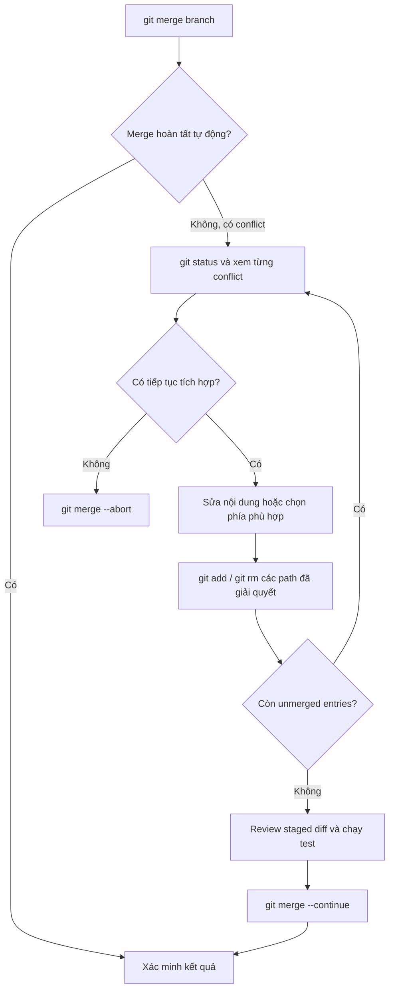

# Hoàn tất hoặc hủy hợp nhất bằng git merge --continue, --abort

Khi `git merge` gặp xung đột, Git dừng lại giữa chừng để bạn quyết định nội dung cuối cùng. Lúc này, branch hiện tại chưa có merge commit mới; index có thể chứa các mục chưa hợp nhất và working tree có thể chứa conflict markers. Sau khi giải quyết xong, bạn dùng `git merge --continue` để hoàn tất merge. Nếu quyết định bỏ lần hợp nhất đang diễn ra, dùng `git merge --abort` để yêu cầu Git quay về trạng thái trước khi bắt đầu merge.

Hai lệnh này xử lý hai hướng khác nhau của cùng một trạng thái merge đang dở. `--continue` cần tất cả xung đột được giải quyết và kết quả được stage; `--abort` hủy tiến trình merge và khôi phục trạng thái trước merge trong phạm vi Git có thể tái tạo. Hiểu index, working tree, `MERGE_HEAD` và các giới hạn khôi phục giúp tránh mất thay đổi khi xử lý conflict.

## 1. Merge đang diễn ra có những trạng thái nào?

Giả sử bạn đang ở branch `main` và muốn hợp nhất `feature/payment`:

```bash
git switch main
git merge feature/payment
```

Nếu Git tự hợp nhất được, lệnh có thể hoàn tất ngay bằng fast-forward hoặc tạo merge commit. Nếu có xung đột, Git dừng và báo các đường dẫn cần xử lý. Branch `main` vẫn trỏ đến commit trước merge cho đến khi merge commit được tạo; Git lưu trạng thái merge đang diễn ra để bạn có thể tiếp tục hoặc hủy.

Một merge có conflict thường đi qua các bước:

1. Git xác định merge base và so sánh các thay đổi ở hai phía.
2. Git tự kết hợp các phần không xung đột.
3. Với phần không thể tự kết hợp, Git ghi các mục unmerged vào index và có thể chèn conflict markers vào working tree.
4. Người dùng sửa nội dung, chọn kết quả cuối cùng và stage từng đường dẫn đã giải quyết.
5. Khi không còn mục unmerged, `git merge --continue` tạo merge commit và kết thúc merge.

Nếu không muốn giữ kết quả đang xử lý, `git merge --abort` hủy merge đang dở. Lệnh này không phải công cụ hoàn tác một merge commit đã được tạo.

## 2. Nhận biết merge đang dở

Lệnh đầu tiên nên chạy sau khi thấy thông báo conflict là:

```bash
git status
```

Git thường hiển thị trạng thái như:

```text
On branch main
You have unmerged paths.
  (fix conflicts and run "git commit")

Unmerged paths:
  both modified:   src/PaymentService.java
```

Thông báo có thể khác theo phiên bản và loại conflict. Phần `Unmerged paths` cho biết các đường dẫn index chưa có kết quả hợp nhất cuối cùng.

Có thể liệt kê riêng những đường dẫn đang conflict:

```bash
git diff --name-only --diff-filter=U
```

Xem các entry chưa hợp nhất trong index:

```bash
git ls-files -u
```

Kiểm tra Git có đang giữ trạng thái merge:

```bash
git rev-parse -q --verify MERGE_HEAD
```

Khi merge đang dở, `MERGE_HEAD` thường chứa OID của commit được merge vào. Nếu lệnh không tìm thấy `MERGE_HEAD`, có thể không có merge đang diễn ra; hãy đọc `git status` để xác định Git đang ở trạng thái nào. Một thao tác khác như rebase hoặc cherry-pick có marker trạng thái riêng và cần lệnh tiếp tục/hủy tương ứng.

## 3. Hiểu index trong lúc có conflict

Trong merge conflict, một đường dẫn chưa được giải quyết có thể có nhiều stage trong index:

| Stage | Ý nghĩa trong merge |
|---|---|
| `1` | Phiên bản từ merge base (common ancestor), nếu tồn tại |
| `2` | Phiên bản của nhánh hiện tại, thường gọi là *ours* |
| `3` | Phiên bản của nhánh được merge vào, thường gọi là *theirs* |

Khi conflict được giải quyết và bạn chạy `git add <path>`, Git đưa kết quả cuối cùng vào stage `0` của index. Những stage chưa hợp nhất của đường dẫn đó được thay thế.

Xem nội dung từng stage:

```bash
git show :1:src/PaymentService.java
git show :2:src/PaymentService.java
git show :3:src/PaymentService.java
```

Một số loại conflict không có đủ cả ba stage. Ví dụ, khi cả hai nhánh cùng thêm một đường dẫn, không có phiên bản stage `1`; khi một phía xóa và phía kia sửa, một trong hai stage `2` hoặc `3` có thể không tồn tại. Vì vậy, nếu `git show :1:<path>` không tìm thấy object, điều đó không nhất thiết là repository bị hỏng.

Trong một merge thông thường, *ours* là nội dung từ branch đang checkout và *theirs* là nội dung từ branch được merge vào. Cách gọi này phụ thuộc hướng merge. Nếu bạn đổi vị trí branch trong lệnh merge, vai trò ours/theirs cũng đổi theo.

## 4. Xem và phân tích conflict trước khi sửa

Đừng vội chọn một phía cho tất cả tệp. Trước tiên, xem trạng thái và diff:

```bash
git status
git diff
git diff --cc
```

`git diff` hiển thị các xung đột chưa giải quyết theo dạng diff phù hợp; `git diff --cc` hiển thị combined diff để thấy các dòng liên quan đến nhiều phía. Có thể xem riêng từng phía so với working tree:

```bash
git diff --ours -- src/PaymentService.java
git diff --theirs -- src/PaymentService.java
```

Các lệnh trên giúp so sánh nội dung hiện tại với phiên bản ours hoặc theirs. Để xem rõ từng snapshot ở index, dùng `git show :2:<path>` và `git show :3:<path>` như phần trước.

Khi Git chèn conflict markers vào tệp văn bản, nội dung thường có dạng:

```text
<<<<<<< HEAD
// Nội dung từ branch hiện tại (ours)
=======
// Nội dung từ branch được merge vào (theirs)
>>>>>>> feature/payment
```

Phần giữa `<<<<<<<` và `=======` là nội dung ours; phần giữa `=======` và `>>>>>>>` là nội dung theirs. Nhãn sau `>>>>>>>` thường cho biết phía còn lại, nhưng có thể thay đổi theo cách merge được gọi.

Nếu cấu hình conflict style là `diff3` hoặc `zdiff3`, Git còn hiển thị phần base giữa `|||||||` và `=======`. Phần này hữu ích để hiểu hai nhánh đã thay đổi khác nhau từ nội dung chung như thế nào.

## 5. Giải quyết conflict bằng cách chỉnh nội dung

Đây là cách thường dùng nhất khi cả hai phía đều có thay đổi cần giữ.

1. Mở tệp bị conflict trong editor.
2. Đọc nội dung ours, theirs và base nếu có.
3. Kết hợp logic cần thiết thành một phiên bản cuối cùng.
4. Xóa toàn bộ conflict markers còn sót.
5. Lưu tệp.
6. Stage kết quả để đánh dấu đường dẫn đã được giải quyết.

Ví dụ, hai branch cùng sửa cách tính phí:

```text
<<<<<<< HEAD
return amount.add(serviceFee);
=======
return amount.multiply(rate);
>>>>>>> feature/payment
```

Kết quả đúng có thể cần kết hợp cả hai ý tưởng hoặc chọn một cách tính theo nghiệp vụ. Không nên chỉ xóa marker rồi giữ tùy tiện một dòng. Sau khi sửa, kiểm tra nội dung và chạy test liên quan.

Stage tệp đã giải quyết:

```bash
git add -- src/PaymentService.java
```

Với đường dẫn được giải quyết bằng cách xóa tệp:

```bash
git rm -- src/LegacyPayment.java
```

`git add` hoặc `git rm` báo cho Git biết kết quả cuối cùng đã sẵn sàng. Chỉnh nội dung trên đĩa nhưng chưa stage thì đường dẫn vẫn còn ở trạng thái unmerged.

## 6. Chọn toàn bộ một phía khi thật sự phù hợp

Nếu nghiệp vụ yêu cầu lấy nguyên tệp từ một phía, có thể dùng `git restore`:

```bash
# Lấy nội dung từ branch hiện tại (ours) vào working tree.
git restore --ours --worktree -- src/PaymentService.java

# Hoặc lấy nội dung từ branch được merge vào (theirs).
git restore --theirs --worktree -- src/PaymentService.java
```

Sau đó stage kết quả:

```bash
git add -- src/PaymentService.java
```

Cú pháp cũ tương đương thường gặp:

```bash
git checkout --ours -- src/PaymentService.java
git checkout --theirs -- src/PaymentService.java
```

`--ours` và `--theirs` chọn nguyên phiên bản một phía cho đường dẫn. Chúng không tự kết hợp logic của hai bên. Chỉ dùng khi bạn đã kiểm tra rằng bỏ phần thay đổi ở phía kia là đúng.

## 7. Xử lý các loại conflict khác nhau

Không phải mọi conflict đều có hai đoạn marker trong một tệp.

| Loại conflict | Dấu hiệu thường thấy | Cách xử lý |
|---|---|---|
| Both modified | Hai phía sửa cùng một tệp | Chỉnh nội dung cuối cùng hoặc chọn một phía có chủ đích, sau đó `git add` |
| Both added | Hai phía cùng thêm một đường dẫn | Kết hợp nội dung hoặc đổi tên một phía theo thiết kế, sau đó stage kết quả |
| Delete/modify | Một phía xóa, phía kia sửa | Quyết định giữ bản sửa hay giữ việc xóa; dùng `git add` hoặc `git rm` tương ứng |
| Rename/rename | Hai phía đổi tên cùng một tệp theo hai hướng khác nhau | Xác định đường dẫn đích mong muốn, xử lý các bản còn lại và stage/xóa đúng path |
| Rename/delete | Một phía đổi tên, phía kia xóa | Quyết định tệp có còn tồn tại không và ở đường dẫn nào |
| Binary conflict | Nội dung nhị phân không thể hợp nhất theo dòng | Tạo artifact cuối cùng bằng công cụ phù hợp hoặc chọn một phía, rồi stage tệp |
| File/directory conflict | Một phía dùng tên làm tệp, phía kia dùng làm thư mục | Chọn cấu trúc cuối cùng, di chuyển hoặc xóa các path xung đột, rồi stage kết quả |

Với rename hoặc file/directory conflict, hãy đọc toàn bộ danh sách `git status` và `git ls-files -u`. Có thể có nhiều đường dẫn liên quan; chỉ giải quyết một path mà bỏ sót path còn lại sẽ khiến merge chưa thể tiếp tục.

## 8. Kiểm tra tất cả conflict đã được giải quyết

Sau khi xử lý từng tệp, kiểm tra:

```bash
git status
git diff --name-only --diff-filter=U
git ls-files -u
```

Nếu `git diff --name-only --diff-filter=U` và `git ls-files -u` không còn đường dẫn, index không còn entry unmerged. Tuy vậy, vẫn cần review staged diff:

```bash
git diff --cached
git diff --cached --check
```

`git diff --cached` cho thấy snapshot sẽ được ghi vào merge commit. `git diff --cached --check` giúp phát hiện whitespace errors. Chạy test phù hợp để kiểm tra logic kết hợp từ hai nhánh.

Đặc biệt, không chỉ nhìn trạng thái `All conflicts fixed` rồi commit ngay. Một conflict có thể được giải quyết về mặt cú pháp nhưng vẫn sai nghiệp vụ, thiếu xử lý hoặc làm mất thay đổi hợp lệ của một phía.

## 9. Hoàn tất merge bằng git merge --continue

Khi mọi conflict đã được giải quyết và stage, tiếp tục merge:

```bash
git merge --continue
```

Git sử dụng trạng thái merge đang lưu để hoàn tất thao tác và tạo merge commit. Trình soạn thảo commit message có thể mở ra để bạn xác nhận hoặc chỉnh thông điệp. Nếu dự án có hook `commit-msg`, chữ ký commit hoặc quy tắc commit khác, các bước đó cũng có thể được thực thi.

Trước khi tiếp tục, nên kiểm tra:

```bash
git status
git diff --cached
git diff --cached --check
```

Sau khi lệnh thành công, xác minh merge commit:

```bash
git status
git log --oneline --graph --decorate -10
git show -s --format="commit: %H%nparents: %P%nsubject: %s" HEAD
```

Merge commit thông thường có hai parent: parent thứ nhất là commit tip của branch đang đứng trước merge, parent thứ hai là commit tip được merge vào. Nếu thao tác ban đầu là fast-forward, Git không tạo merge commit; khi đó không có merge conflict đang chờ `--continue`.

### Có thể dùng git commit thay cho --continue không?

Trong nhiều trường hợp merge đã được giải quyết, `git commit` cũng hoàn tất merge bằng cách tạo commit từ index và trạng thái merge hiện có. Tuy nhiên, `git merge --continue` diễn đạt rõ ý định tiếp tục thao tác merge đang dở và là lựa chọn dễ hiểu trong quy trình xử lý conflict.

Nếu Git báo vẫn còn unmerged paths, hãy quay lại kiểm tra stage và giải quyết các path còn thiếu. Nếu commit bị chặn bởi hook, chữ ký hoặc commit message, đọc lỗi được báo và xử lý điều kiện đó; trạng thái merge có thể vẫn còn để bạn thử tiếp tục.

## 10. Hủy merge đang dở bằng git merge --abort

Nếu bạn quyết định không tiếp tục tích hợp branch, chạy:

```bash
git merge --abort
```

Git cố gắng khôi phục index và working tree về trạng thái trước khi merge bắt đầu. Branch hiện tại trở lại commit tip trước merge; merge state như `MERGE_HEAD` được loại bỏ.

Sau khi abort, kiểm tra:

```bash
git status
git log --oneline --decorate -5
git rev-parse HEAD
```

Nếu branch đang ở commit cũ và không còn trạng thái merge, thao tác abort đã kết thúc. Những thay đổi chưa commit có từ trước merge cần được kiểm tra cẩn thận vì khả năng khôi phục phụ thuộc trạng thái ban đầu và các thao tác đã thực hiện trong lúc merge.

### Khi nào nên abort?

- Bạn nhận ra đang merge nhầm branch hoặc nhầm commit.
- Phạm vi conflict quá lớn và muốn cập nhật branch trước khi thử lại.
- Cần trao đổi với người sở hữu thay đổi trước khi quyết định cách kết hợp.
- Bạn muốn quay về trạng thái trước merge để tạo backup hoặc kiểm tra lại.
- Kết quả hợp nhất hiện tại không thể đáp ứng yêu cầu và cần bắt đầu lại theo kế hoạch khác.

Abort không xóa commit đã tồn tại trên branch được merge vào; nó chỉ hủy lần merge đang thực hiện trong repository hiện tại.

## 11. Giới hạn khôi phục và thay đổi chưa commit trước merge

`git merge --abort` cố gắng tái tạo trạng thái trước khi merge, nhưng có giới hạn. Nếu working tree đã có thay đổi chưa commit trước khi bắt đầu merge, Git có thể không khôi phục chính xác mọi thay đổi trong một số tình huống. Vì vậy, tài liệu Git khuyến nghị commit hoặc stash thay đổi trước khi chạy merge.

Trước khi merge, nên kiểm tra:

```bash
git status --short --branch
git diff
git diff --cached
```

Nếu có thay đổi cần giữ, commit chúng hoặc stash có chủ đích:

```bash
git stash push -u -m "before merging feature/payment"
```

`-u` đưa cả tệp untracked vào stash. Nếu cần giữ tệp ignored, cân nhắc `-a` và hiểu rõ phạm vi trước khi dùng. Sau khi merge hoàn tất hoặc abort, có thể khôi phục stash:

```bash
git stash list
git stash apply stash@{0}
```

Hãy kiểm tra trạng thái trước khi `stash pop`, vì áp dụng stash sau merge cũng có thể phát sinh conflict mới.

Nếu đã sửa conflict và muốn giữ lại phần giải quyết thủ công trước khi abort, hãy sao lưu nội dung cần thiết ra ngoài working tree hoặc tạo patch phù hợp trước khi hủy. Đừng giả định `--abort` sẽ giữ mọi chỉnh sửa được tạo trong lúc xử lý conflict.

### Khi merge dùng autostash

Nếu merge được chạy với `--autostash` hoặc cấu hình tương ứng, Git tạo stash tạm cho thay đổi local trước merge. Khi abort, Git cố gắng áp dụng lại autostash vào working tree. Việc áp dụng lại có thể phát sinh conflict riêng; hãy kiểm tra `git status` và nội dung sau thao tác.

## 12. Phân biệt --abort với --quit

Git còn có `git merge --quit`, nhưng mục đích khác với abort:

| Lệnh | Hành vi |
|---|---|
| `git merge --continue` | Hoàn tất merge đang dở sau khi conflict đã được giải quyết và stage |
| `git merge --abort` | Hủy merge và cố gắng khôi phục trạng thái trước khi merge |
| `git merge --quit` | Xóa thông tin trạng thái merge đang dở nhưng giữ nguyên index và working tree hiện tại |

`--quit` không phải cách an toàn để quay lại trước merge. Nó có thể để lại kết quả đang xử lý trong working tree/index nhưng không còn merge state để tiếp tục theo luồng thông thường. Chỉ dùng khi bạn hiểu rõ vì sao cần quên trạng thái merge mà vẫn giữ nội dung hiện tại.

## 13. Phân biệt merge conflict với rebase hoặc cherry-pick conflict

Nhiều thao tác Git có thể dừng lại vì conflict, nhưng mỗi thao tác có trạng thái và lệnh tiếp tục/hủy riêng:

| Thao tác đang dở | Tiếp tục | Hủy |
|---|---|---|
| Merge | `git merge --continue` | `git merge --abort` |
| Rebase | `git rebase --continue` | `git rebase --abort` |
| Cherry-pick | `git cherry-pick --continue` | `git cherry-pick --abort` |
| Revert | `git revert --continue` | `git revert --abort` |

Luôn xem `git status` trước khi chạy lệnh. Không dùng `git merge --continue` để tiếp tục một rebase hoặc cherry-pick chỉ vì chúng đều hiển thị conflict markers. Nếu lệnh không nhận ra trạng thái tương ứng, kiểm tra operation marker và dùng đúng lệnh của thao tác đó.

## 14. Trường hợp merge đã hoàn tất thì sao?

`git merge --abort` chỉ áp dụng khi merge vẫn đang diễn ra. Nếu merge commit đã được tạo, lệnh abort không thể xóa commit đó hoặc đưa branch về trạng thái trước merge.

Nếu merge commit đã được chia sẻ và cần hoàn tác nội dung, thường dùng `git revert` với mainline parent phù hợp:

```bash
git revert -m 1 <merge-commit>
```

`-m 1` chọn parent thứ nhất làm mainline trong ví dụ merge branch tính năng vào `main`. Chọn sai parent có thể đảo ngược nội dung không mong muốn. Hãy xem parent bằng:

```bash
git show -s --format="%H%n%P%n%s" <merge-commit>
```

Nếu merge commit chưa chia sẻ và bạn có chủ đích di chuyển branch về commit trước, cần đánh giá `git reset` và backup trước khi thực hiện. Không dùng `merge --abort` như lệnh hoàn tác chung cho mọi merge đã hoàn tất.

## 15. Quy trình hoàn tất merge an toàn

Một quy trình có thể áp dụng trong nhóm:

1. **Kiểm tra trước merge:** `git status --short --branch`; commit hoặc stash thay đổi local cần giữ.
2. **Bắt đầu merge:** `git merge <branch>` và đọc thông báo Git.
3. **Liệt kê conflict:** `git status`, `git diff --name-only --diff-filter=U`.
4. **Hiểu từng phía:** xem `git diff --ours`, `git diff --theirs` hoặc stage `:1:`, `:2:`, `:3:` khi cần.
5. **Giải quyết:** chỉnh nội dung, xử lý rename/delete/binary conflict và stage từng path.
6. **Kiểm tra index:** `git ls-files -u` phải không còn mục chưa hợp nhất.
7. **Review:** `git diff --cached`, `git diff --cached --check` và chạy test.
8. **Hoàn tất:** `git merge --continue`.
9. **Xác minh:** xem `git status`, `git log --graph` và parent của merge commit.

Nếu ở bước 4 hoặc 5 nhận ra không nên tiếp tục, sao lưu chỉnh sửa cần giữ rồi dùng `git merge --abort`. Sau đó cập nhật branch hoặc trao đổi với nhóm trước khi thử lại.

Sơ đồ luồng:



## 16. Ví dụ thực hành trên repository thử nghiệm

Tạo một repository nhỏ để quan sát trạng thái merge. Các lệnh dưới đây dùng Bash hoặc Git Bash:

```bash
mkdir merge-continue-lab
cd merge-continue-lab
git init -b main
git config user.name "Git Practice"
git config user.email "git-practice@example.com"

printf 'payment mode: standard\n' > settings.txt
git add settings.txt
git commit -m "chore: add payment settings"

git switch -c feature/payment
printf 'payment mode: fast\n' > settings.txt
git commit -am "feat: use fast payment mode"

git switch main
printf 'payment mode: secure\n' > settings.txt
git commit -am "feat: use secure payment mode"
```

Tạo conflict:

```bash
git merge feature/payment
git status
git diff --name-only --diff-filter=U
```

Mở `settings.txt`, quyết định nội dung cuối cùng. Ví dụ chọn chế độ secure nhưng thêm chú thích giải thích:

```text
payment mode: secure
# verified before charge
```

Stage và tiếp tục:

```bash
git add settings.txt
git diff --cached
git ls-files -u
git merge --continue
```

Kiểm tra kết quả:

```bash
git status
git log --oneline --graph --decorate --all
git show -s --format="%H%n%P%n%s" HEAD
```

Để thực hành abort, tạo lại lab từ đầu hoặc dùng một bản sao khác. Bắt đầu merge gây conflict như trên, rồi chạy:

```bash
git merge --abort
git status
git log --oneline --graph --decorate --all
```

Branch `main` phải trở về commit trước merge và merge state không còn. Dùng repository lab để thử cả hai hướng; không thực hành abort hoặc reset trên repository đang có thay đổi quan trọng.

## 17. Các lỗi thường gặp khi continue hoặc abort

| Hiện tượng | Nguyên nhân có thể | Cách xử lý |
|---|---|---|
| `git merge --continue` báo còn unmerged paths | Một hoặc nhiều đường dẫn chưa được stage sau khi giải quyết | Chạy `git status`, `git ls-files -u`, xử lý từng path rồi `git add`/`git rm` |
| Sửa file nhưng Git vẫn báo conflict | Nội dung đã sửa nhưng index chưa được cập nhật | Stage đúng đường dẫn bằng `git add` hoặc `git rm` |
| Không tìm thấy `MERGE_HEAD` | Không có merge đang dở hoặc thao tác hiện tại là rebase/cherry-pick | Đọc `git status` và dùng lệnh continue/abort đúng loại |
| `git merge --abort` không khôi phục như mong đợi | Có thay đổi chưa commit trước merge hoặc chỉnh sửa phát sinh trong lúc conflict | Kiểm tra backup/stash, reflog và bản sao nội dung; lần sau commit/stash trước merge |
| `git merge --abort` báo không có merge để hủy | Merge đã hoàn tất hoặc không có merge state | Nếu cần hoàn tác merge đã chia sẻ, xem xét `git revert -m` với đúng mainline |
| Commit tiếp tục merge bị hook từ chối | Hook hoặc quy tắc commit message không đạt | Sửa điều kiện được báo, kiểm tra staged diff và chạy `git merge --continue` lại |
| Chữ ký commit thất bại | Khóa ký hoặc cấu hình signer không sẵn sàng | Kiểm tra cấu hình ký và thông tin lỗi; merge state có thể vẫn chờ hoàn tất |
| Sau abort vẫn còn tệp untracked | Tệp được tạo trong lúc giải quyết hoặc bởi công cụ ngoài | Kiểm tra từng tệp và chỉ xóa khi chắc chắn không cần giữ |
| Chạy nhầm `git rebase --continue` | Trạng thái hiện tại là merge | Dùng `git status`; chọn đúng `git merge --continue` hoặc lệnh của operation đang dở |

Khi gặp lỗi, không chạy liên tiếp `reset --hard`, `clean -fd` hoặc xóa `.git/MERGE_*` để ép Git thoát trạng thái. Các thao tác đó có thể làm mất dữ liệu hoặc khiến repository không còn trạng thái nhất quán.

## 18. Những hiểu nhầm thường gặp

| Hiểu nhầm | Cách hiểu đúng |
|---|---|
| Chỉ cần sửa conflict markers là merge đã hoàn tất | Cần stage kết quả để index không còn unmerged entries, rồi tiếp tục merge |
| `git merge --continue` tự giải quyết conflict | Nó hoàn tất merge sau khi người dùng đã giải quyết và stage mọi đường dẫn |
| `git merge --abort` xóa branch được merge vào | Nó chỉ hủy merge đang diễn ra trong repository hiện tại |
| Abort luôn khôi phục tuyệt đối mọi thay đổi local | Thay đổi chưa commit trước merge có thể không khôi phục đầy đủ trong một số tình huống |
| Ours luôn là branch main | Ours là branch hiện tại tại thời điểm gọi merge |
| Theirs luôn là branch feature | Theirs là branch được merge vào, phụ thuộc hướng merge |
| `git merge --quit` giống `--abort` | Quit quên merge state nhưng giữ index/working tree hiện tại; abort cố khôi phục trạng thái trước merge |
| Có thể dùng merge continue cho rebase conflict | Mỗi operation có lệnh tiếp tục/hủy riêng |
| Abort có thể hoàn tác merge commit đã tạo | Merge đã hoàn tất cần quy trình revert hoặc khôi phục ref phù hợp |

## 19. Ghi nhớ

Khi merge dừng vì conflict, bắt đầu bằng `git status`, `git diff --name-only --diff-filter=U` và `git ls-files -u`. Hiểu stage `1` là base, stage `2` là ours và stage `3` là theirs; chỉnh nội dung hoặc chọn phía phù hợp, sau đó `git add`/`git rm` để ghi kết quả vào index.

Khi không còn unmerged entries, review `git diff --cached`, chạy kiểm tra và dùng `git merge --continue` để tạo merge commit. Nếu quyết định bỏ merge đang dở, dùng `git merge --abort`; lệnh cố gắng khôi phục trạng thái trước merge nhưng không bảo đảm giữ mọi thay đổi chưa commit trong mọi tình huống. Hãy commit hoặc stash công việc trước merge, sao lưu phần chỉnh sửa conflict cần giữ và luôn kiểm tra `git status` sau continue hoặc abort.
