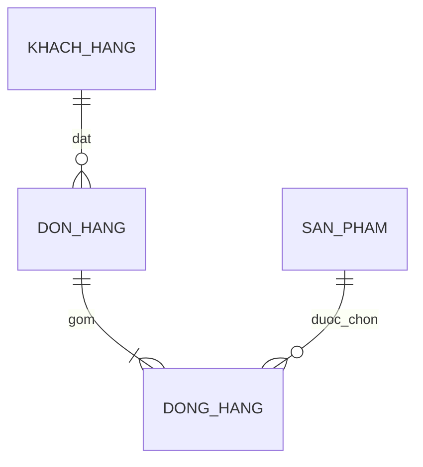

# Ba mức mô hình: khái niệm, logic và vật lý

Khi thiết kế dữ liệu, nhóm phát triển thường phải trả lời ba câu hỏi khác nhau: **nghiệp vụ đang nói về những đối tượng nào**, **các đối tượng và quy tắc đó được biểu diễn thành cấu trúc dữ liệu ra sao**, và **cấu trúc ấy được triển khai cụ thể trên hệ quản trị cơ sở dữ liệu như thế nào**. Nếu cố trả lời cả ba câu hỏi trong cùng một sơ đồ hoặc một tập lệnh SQL, nhóm dễ trộn lẫn ngôn ngữ nghiệp vụ với quyết định kỹ thuật, bỏ sót quy tắc quan trọng hoặc tối ưu quá sớm.

Mô hình dữ liệu thường được phát triển qua ba mức: **khái niệm (conceptual)**, **logic (logical)** và **vật lý (physical)**. Mỗi mức mô tả cùng một miền nghiệp vụ với độ chi tiết khác nhau, phục vụ những người đọc và quyết định khác nhau. Ba mức liên kết với nhau: mô hình khái niệm xác định phạm vi và ý nghĩa, mô hình logic làm rõ cấu trúc và ràng buộc, còn mô hình vật lý biến cấu trúc đó thành thiết kế có thể triển khai và vận hành.

Trong phạm vi **DATABASE_DATA_MODELING**, cách tiếp cận này giúp chuyển yêu cầu nghiệp vụ thành mô hình dữ liệu rõ ràng, có thể kiểm chứng và dễ tiến hóa. Nó cũng tạo điểm tựa để lựa chọn cách tổ chức phù hợp cho cơ sở dữ liệu quan hệ, document, đồ thị hoặc phân tích.

## Mục tiêu học tập

Sau bài học, bạn có thể:

- Phân biệt mục đích, nội dung và người sử dụng của mô hình khái niệm, logic và vật lý.
- Chuyển một yêu cầu nghiệp vụ thành các thực thể, quan hệ, thuộc tính, khóa và ràng buộc ở mức phù hợp.
- Giải thích cách một mô hình logic có thể được triển khai theo nhiều kiểu lưu trữ khác nhau.
- Đánh giá các quyết định vật lý như kiểu dữ liệu, chỉ mục và phân vùng dựa trên truy vấn, quy mô và yêu cầu vận hành.
- Kiểm tra tính nhất quán giữa yêu cầu, mô hình và lược đồ triển khai.

## 1. Vì sao cần ba mức mô hình?

Hãy xét yêu cầu: “Khách hàng có thể đặt hàng; mỗi đơn hàng gồm một hoặc nhiều dòng hàng; mỗi dòng hàng tham chiếu một sản phẩm và lưu số lượng cùng giá tại thời điểm mua”.

Yêu cầu này có nhiều lớp thông tin:

- **Ý nghĩa nghiệp vụ:** khách hàng, đơn hàng, sản phẩm và dòng hàng là những khái niệm nào; quan hệ giữa chúng là gì.
- **Cấu trúc dữ liệu:** mỗi khái niệm có những thuộc tính nào; đối tượng nào định danh đối tượng nào; quan hệ được biểu diễn bằng khóa nào; điều kiện hợp lệ là gì.
- **Triển khai:** dùng kiểu dữ liệu nào, tạo bảng và chỉ mục nào, đặt ràng buộc ở đâu, và thiết kế ra sao để đáp ứng truy vấn thực tế.

Ba mức mô hình giúp tách các quyết định này thành những bước có thể thảo luận và kiểm tra. Chúng không phải ba bản sao độc lập. Khi một yêu cầu thay đổi, nhóm cần truy vết thay đổi đó qua các mức để biết mô hình logic và lược đồ vật lý có cần cập nhật hay không.

| Mức mô hình | Trả lời câu hỏi | Người đọc chính | Đặc điểm |
|---|---|---|---|
| Khái niệm | Nghiệp vụ có những khái niệm và quan hệ nào? | Chủ sản phẩm, chuyên gia nghiệp vụ, kiến trúc sư | Tổng quát, dùng ngôn ngữ nghiệp vụ, ít chi tiết kỹ thuật |
| Logic | Dữ liệu được cấu trúc và ràng buộc như thế nào? | Nhà phân tích dữ liệu, kiến trúc sư dữ liệu, nhà phát triển | Chi tiết về thuộc tính, định danh, quan hệ và quy tắc; thường chưa phụ thuộc một DBMS cụ thể |
| Vật lý | Cấu trúc được triển khai và vận hành trên nền tảng nào? | Kỹ sư cơ sở dữ liệu, nhà phát triển, đội vận hành | Gắn với DBMS, kiểu dữ liệu, chỉ mục, phân vùng và cấu hình lưu trữ |

## 2. Mô hình khái niệm (Conceptual Data Model)

Mô hình khái niệm mô tả **những gì nghiệp vụ cần ghi nhận** và **các khái niệm liên hệ với nhau ra sao**. Đây là bức tranh cấp cao của miền dữ liệu, giúp các bên thống nhất phạm vi trước khi chọn cách lưu trữ.

### 2.1. Thành phần chính

- **Thực thể hoặc khái niệm nghiệp vụ:** một loại đối tượng cần theo dõi, chẳng hạn Khách hàng, Đơn hàng, Sản phẩm.
- **Quan hệ:** cách các khái niệm liên kết, chẳng hạn Khách hàng đặt Đơn hàng; Đơn hàng bao gồm Dòng hàng.
- **Bội số (cardinality):** số lượng đối tượng có thể tham gia quan hệ, thường được diễn đạt bằng một-một, một-nhiều hoặc nhiều-nhiều.
- **Quy tắc nghiệp vụ cấp cao:** điều kiện có ý nghĩa với nghiệp vụ, chẳng hạn đơn hàng phải có ít nhất một dòng hàng.

Ở mức này, nhóm nên ưu tiên thuật ngữ mà người dùng nghiệp vụ hiểu được. Chưa cần quyết định `BIGINT`, `VARCHAR`, tên chỉ mục, phân vùng hay tablespace. Nếu một khái niệm chưa được các bên thống nhất, hãy ghi nhận điểm chưa rõ thay vì tự biến giả định thành cấu trúc dữ liệu.

### 2.2. Ví dụ miền đặt hàng

Một mô hình khái niệm có thể gồm bốn khái niệm:

- **Khách hàng:** người thực hiện giao dịch.
- **Đơn hàng:** giao dịch mua hàng do một khách hàng tạo.
- **Dòng hàng:** một mục hàng cụ thể trong đơn hàng, mang số lượng và giá đã chốt.
- **Sản phẩm:** mặt hàng được bán.

Quan hệ và bội số:

- Một khách hàng có thể chưa có đơn hàng hoặc có nhiều đơn hàng; mỗi đơn hàng thuộc về đúng một khách hàng.
- Một đơn hàng có một hoặc nhiều dòng hàng; mỗi dòng hàng thuộc về đúng một đơn hàng.
- Mỗi dòng hàng chỉ đến một sản phẩm; một sản phẩm có thể xuất hiện trong nhiều dòng hàng hoặc chưa xuất hiện lần nào.



Sơ đồ giúp nhóm kiểm tra ngôn ngữ và quan hệ với nghiệp vụ. Ví dụ, nếu nghiệp vụ cho phép đơn hàng nháp chưa có dòng hàng, quy tắc “một hoặc nhiều dòng hàng” có thể chỉ áp dụng khi đơn hàng được xác nhận. Cần làm rõ thời điểm kiểm tra quy tắc này trước khi chuyển sang mức logic.

### 2.3. Kết quả mong đợi

Mô hình khái niệm tốt cần có:

1. Danh sách khái niệm có định nghĩa ngắn gọn và không chồng lấn.
2. Các quan hệ được đặt tên bằng động từ có nghĩa.
3. Bội số và quy tắc nghiệp vụ đã được xác nhận hoặc đánh dấu cần làm rõ.
4. Phạm vi dữ liệu được thống nhất với các bên liên quan.

**Dấu hiệu mô hình khái niệm chưa tốt:** sơ đồ có quá nhiều cột kỹ thuật, tên khái niệm khó hiểu với nghiệp vụ, quan hệ không có bội số, hoặc cùng một khái niệm được gọi bằng nhiều tên mà chưa giải thích.

## 3. Mô hình logic (Logical Data Model)

Mô hình logic chuyển bức tranh nghiệp vụ thành cấu trúc dữ liệu đủ chi tiết để kiểm tra tính nhất quán. Nó xác định **đối tượng được mô tả bằng thuộc tính nào, được định danh ra sao, liên kết thế nào và dữ liệu hợp lệ phải thỏa điều kiện gì**.

Mô hình logic thường độc lập với một sản phẩm DBMS cụ thể. Tuy vậy, nó có thể chịu ảnh hưởng của kiểu mô hình lưu trữ đã chọn, ví dụ quan hệ, document, đồ thị hoặc phân tích. Vì vậy, “logic” không đồng nghĩa với “luôn luôn là các bảng quan hệ”.

### 3.1. Thành phần chính

- **Thực thể và thuộc tính:** mô tả dữ liệu cần lưu, với tên, ý nghĩa, miền giá trị và tính bắt buộc.
- **Định danh:** khóa chính, khóa thay thế hoặc định danh nghiệp vụ; xác định điều gì làm một bản ghi khác biệt với bản ghi khác.
- **Quan hệ và tham chiếu:** mô tả cách đối tượng liên kết, bao gồm khóa ngoại nếu dùng mô hình quan hệ.
- **Ràng buộc:** tính duy nhất, bắt buộc, miền giá trị, điều kiện liên bản ghi và các quy tắc nghiệp vụ cần bảo vệ.
- **Phụ thuộc hàm và chuẩn hóa:** nhận diện dữ liệu lặp, phụ thuộc không phù hợp và nguy cơ bất thường khi thêm, sửa hoặc xóa.

### 3.2. Chuyển ví dụ sang mô hình logic quan hệ

Một cách biểu diễn quan hệ có thể gồm các quan hệ sau:

| Quan hệ | Thuộc tính | Khóa và ràng buộc đáng chú ý |
|---|---|---|
| KHACH_HANG | ma_khach_hang, email, ho_ten | `ma_khach_hang` định danh; email duy nhất và bắt buộc |
| SAN_PHAM | ma_san_pham, sku, ten, gia_hien_tai | `ma_san_pham` định danh; SKU duy nhất; giá không âm |
| DON_HANG | ma_don_hang, ma_khach_hang, thoi_diem_dat, trang_thai | `ma_don_hang` định danh; tham chiếu một khách hàng |
| DONG_HANG | ma_don_hang, so_dong, ma_san_pham, so_luong, don_gia_tai_thoi_diem_mua | Khóa ghép `(ma_don_hang, so_dong)`; tham chiếu đơn hàng và sản phẩm; số lượng dương, giá không âm |

Ở đây, `DONG_HANG` là thực thể liên kết giữa Đơn hàng và Sản phẩm. Nó cần tồn tại vì quan hệ này có dữ liệu riêng như số lượng và đơn giá tại thời điểm mua. Nếu chỉ lưu danh sách mã sản phẩm trong một trường của đơn hàng, nhóm sẽ khó kiểm tra từng dòng, truy vấn theo sản phẩm và bảo đảm tính toàn vẹn.

Một số quyết định logic quan trọng:

- **Giá tại thời điểm mua là dữ liệu của dòng hàng.** Giá hiện tại của sản phẩm có thể thay đổi, nhưng giá đã chốt của giao dịch cũ phải được giữ nguyên theo quy tắc nghiệp vụ.
- **Dòng hàng có định danh trong phạm vi đơn hàng.** Khóa ghép `(ma_don_hang, so_dong)` thể hiện số thứ tự dòng chỉ cần duy nhất bên trong một đơn hàng.
- **Email và SKU có quy tắc duy nhất.** Cần thống nhất email có phân biệt chữ hoa/chữ thường hay không; quy tắc so sánh ảnh hưởng đến cách triển khai ràng buộc.
- **Số lượng và giá có miền giá trị.** Không chấp nhận số lượng bằng không hoặc âm, cũng không chấp nhận giá âm nếu nghiệp vụ không cho phép.
- **Trạng thái đơn hàng có tập giá trị hợp lệ và quy tắc chuyển trạng thái.** Danh sách trạng thái có thể biểu diễn bằng miền giá trị, bảng tham chiếu hoặc cấu trúc tương ứng với nền tảng triển khai.

### 3.3. Chuẩn hóa và tính toàn vẹn

Chuẩn hóa giúp giảm lặp dữ liệu và tránh các bất thường cập nhật. Với mô hình quan hệ, ba mức đầu thường được dùng để đánh giá:

- **Dạng chuẩn thứ nhất (1NF):** mỗi thuộc tính chứa giá trị nguyên tố theo miền dữ liệu đã chọn; không nhồi danh sách nhiều giá trị không có cấu trúc vào một ô khi cần quản lý từng phần tử.
- **Dạng chuẩn thứ hai (2NF):** quan hệ đã ở 1NF và mọi thuộc tính không khóa phụ thuộc đầy đủ vào toàn bộ khóa ứng viên; điều này đặc biệt cần chú ý khi dùng khóa ghép.
- **Dạng chuẩn thứ ba (3NF):** quan hệ đã ở 2NF và thuộc tính không khóa không phụ thuộc bắc cầu vào khóa thông qua một thuộc tính không khóa khác.

Ví dụ, nếu bảng `DON_HANG` lưu cả email và họ tên khách hàng, các thông tin này phụ thuộc vào khách hàng chứ không phụ thuộc trực tiếp vào đơn hàng. Khi khách hàng đổi email, nhiều đơn hàng có thể phải cập nhật; nếu bỏ sót, dữ liệu sẽ mâu thuẫn. Tách `KHACH_HANG` và tham chiếu bằng `ma_khach_hang` loại bỏ phần lặp đó.

Chuẩn hóa là công cụ phân tích, không phải mục tiêu máy móc. Một mô hình có thể chủ động lưu bản chụp tên sản phẩm hoặc địa chỉ giao hàng tại thời điểm mua vì đó là dữ liệu lịch sử của giao dịch, không phải bản sao vô tình của thông tin hiện tại. Với kho dữ liệu phân tích, mô hình sao thường phi chuẩn hóa có chủ đích để đơn giản hóa truy vấn. Mọi ngoại lệ cần có lý do nghiệp vụ hoặc hiệu năng và cách duy trì tính nhất quán.

### 3.4. Mô hình logic theo các kiểu lưu trữ

Cùng một mô hình khái niệm có thể được biểu diễn theo nhiều cách logic:

| Kiểu mô hình | Cách biểu diễn ví dụ đặt hàng | Khi phù hợp |
|---|---|---|
| Quan hệ | Các quan hệ Khách hàng, Đơn hàng, Dòng hàng, Sản phẩm; liên kết bằng khóa | Cần giao dịch nhất quán, ràng buộc rõ và truy vấn kết hợp linh hoạt |
| Document | Một document Đơn hàng có thể chứa các dòng hàng; khách hàng và sản phẩm có thể được tham chiếu hoặc lưu bản chụp cần thiết | Dữ liệu thường được đọc/ghi theo aggregate; cấu trúc có thể thay đổi theo từng loại document |
| Đồ thị | Các node Khách hàng, Đơn hàng, Sản phẩm; edge `DAT`, `GOM`, `CHON_SAN_PHAM` biểu diễn quan hệ | Trọng tâm là duyệt nhiều bước quan hệ, đường đi hoặc mạng liên kết |
| Phân tích | Fact dòng bán hàng liên kết với dimension khách hàng, sản phẩm và thời gian | Trọng tâm là tổng hợp, đo lường và phân tích theo nhiều chiều |

Lựa chọn cấu trúc logic cần dựa trên cách truy cập, ranh giới giao dịch, quy mô, tính linh hoạt của dữ liệu và yêu cầu nhất quán. Không nên chọn document chỉ vì dữ liệu “trông giống JSON”, hoặc chọn đồ thị chỉ vì nghiệp vụ có nhiều quan hệ. Hãy xác định truy vấn và thao tác cốt lõi trước.

## 4. Mô hình vật lý (Physical Data Model)

Mô hình vật lý biến cấu trúc logic thành thiết kế cụ thể trên một nền tảng. Nó trả lời **lưu ở đâu, dùng kiểu dữ liệu gì, áp dụng ràng buộc nào, tạo chỉ mục ra sao và tổ chức dữ liệu thế nào để vận hành**.

Khác với mô hình logic, mô hình vật lý phụ thuộc DBMS và phiên bản cụ thể. Cùng một mô hình logic có thể có DDL, kiểu dữ liệu, chỉ mục và chiến lược phân vùng khác nhau trên PostgreSQL, MySQL, SQL Server hoặc một hệ document.

### 4.1. Thành phần chính

- **Đối tượng lưu trữ:** bảng, cột, collection, document, node, edge, view hoặc bảng fact/dimension.
- **Kiểu dữ liệu cụ thể:** số nguyên, chuỗi, ngày giờ, số thập phân, kiểu JSON hoặc kiểu riêng của DBMS.
- **Ràng buộc triển khai:** `PRIMARY KEY`, `FOREIGN KEY`, `UNIQUE`, `NOT NULL`, `CHECK`, giá trị mặc định và các cơ chế tương ứng.
- **Chỉ mục:** cấu trúc phục vụ các mẫu truy vấn thực tế, có chi phí lưu trữ và cập nhật.
- **Tổ chức dữ liệu:** phân vùng, clustering, nén, tablespace hoặc chiến lược lưu trữ tùy hệ thống.
- **Vận hành và thay đổi:** migration, backup, phục hồi, phân quyền, giám sát và kế hoạch tăng trưởng.

### 4.2. Ví dụ DDL trên PostgreSQL

Đoạn DDL dưới đây minh họa một cách triển khai quan hệ cho ví dụ đặt hàng. Đây là lựa chọn vật lý cụ thể, không phải định nghĩa duy nhất của mô hình logic.

```sql
CREATE TABLE customer (
    customer_id BIGINT GENERATED BY DEFAULT AS IDENTITY PRIMARY KEY,
    email       VARCHAR(320) NOT NULL UNIQUE,
    full_name   VARCHAR(200) NOT NULL,
    created_at  TIMESTAMPTZ NOT NULL DEFAULT now()
);

CREATE TABLE product (
    product_id    BIGINT GENERATED BY DEFAULT AS IDENTITY PRIMARY KEY,
    sku           VARCHAR(64) NOT NULL UNIQUE,
    name          VARCHAR(250) NOT NULL,
    current_price NUMERIC(12, 2) NOT NULL CHECK (current_price >= 0)
);

CREATE TABLE sales_order (
    order_id    BIGINT GENERATED BY DEFAULT AS IDENTITY PRIMARY KEY,
    customer_id BIGINT NOT NULL REFERENCES customer(customer_id),
    placed_at   TIMESTAMPTZ NOT NULL DEFAULT now(),
    status      VARCHAR(20) NOT NULL DEFAULT 'PENDING'
                CHECK (status IN ('PENDING', 'CONFIRMED', 'SHIPPED', 'CANCELLED'))
);

CREATE TABLE order_item (
    order_id               BIGINT NOT NULL REFERENCES sales_order(order_id),
    line_no                INTEGER NOT NULL CHECK (line_no > 0),
    product_id             BIGINT NOT NULL REFERENCES product(product_id),
    quantity               INTEGER NOT NULL CHECK (quantity > 0),
    unit_price_at_purchase NUMERIC(12, 2) NOT NULL
                           CHECK (unit_price_at_purchase >= 0),
    PRIMARY KEY (order_id, line_no)
);

CREATE INDEX sales_order_customer_placed_idx
    ON sales_order (customer_id, placed_at DESC);

CREATE INDEX order_item_product_idx
    ON order_item (product_id);
```

Các quyết định vật lý trong ví dụ:

- `BIGINT ... IDENTITY` tạo định danh số tăng tự động theo cơ chế PostgreSQL. Hệ thống khác có thể dùng cú pháp hoặc cơ chế sinh khóa khác.
- `TIMESTAMPTZ` lưu thời điểm có ngữ nghĩa múi giờ; ứng dụng vẫn cần thống nhất cách chuẩn hóa và hiển thị thời gian.
- `NUMERIC(12, 2)` phù hợp với số tiền cần độ chính xác thập phân cố định. Không nên dùng số dấu phẩy động nhị phân cho phép tính tiền cần chính xác.
- `CHECK`, `NOT NULL`, `UNIQUE` và khóa ngoại chuyển một phần quy tắc logic thành ràng buộc do cơ sở dữ liệu bảo vệ.
- Chỉ mục ghép trên `(customer_id, placed_at DESC)` hỗ trợ mẫu truy vấn lấy đơn hàng gần đây của một khách hàng. Chỉ mục trên `order_item(product_id)` hỗ trợ truy vấn các dòng hàng theo sản phẩm.

PostgreSQL tự tạo chỉ mục cho khóa chính và ràng buộc duy nhất, nhưng không tự động tạo chỉ mục cho mọi cột khóa ngoại. Vì vậy, cần xem xét các truy vấn join, xóa/cập nhật bản ghi được tham chiếu và kế hoạch thực thi trước khi bổ sung chỉ mục. Tạo chỉ mục trên mọi cột có thể làm tăng dung lượng và khiến thao tác ghi chậm hơn.

### 4.3. Đánh đổi khi thiết kế vật lý

Một thiết kế vật lý tốt cân bằng nhiều mục tiêu:

- **Đọc và ghi:** chỉ mục giúp đọc nhanh một số truy vấn nhưng cần cập nhật khi dữ liệu thay đổi.
- **Tính nhất quán và tốc độ:** ràng buộc ở DBMS bảo vệ dữ liệu kể cả khi có nhiều ứng dụng ghi, nhưng có thể tăng chi phí ghi hoặc làm lộ rõ các giao dịch chưa được thiết kế đúng.
- **Lưu trữ và truy vấn:** phân vùng có thể hỗ trợ quản lý dữ liệu lớn theo thời gian hoặc phạm vi; nó cũng làm tăng độ phức tạp vận hành và không tự động làm mọi truy vấn nhanh hơn.
- **Linh hoạt và kiểm soát:** kiểu JSON/document linh hoạt với cấu trúc thay đổi, nhưng cần xác định trường nào phải được kiểm tra, lập chỉ mục và quản lý phiên bản.
- **Hiệu năng và khả năng tiến hóa:** phi chuẩn hóa hoặc tạo dữ liệu dẫn xuất có thể tăng tốc đọc, nhưng cần quy trình đồng bộ và kiểm tra sai lệch.

Chỉ mục nên xuất phát từ mẫu truy vấn đã biết hoặc số liệu quan sát được. Với PostgreSQL, có thể kiểm tra kế hoạch bằng `EXPLAIN (ANALYZE, BUFFERS)` trên truy vấn đại diện trong môi trường an toàn. Không nên thêm chỉ mục, phân vùng hoặc cache chỉ vì chúng thường được xem là kỹ thuật tối ưu.

## 5. Theo dõi một quyết định qua cả ba mức

Một yêu cầu cần được truy vết xuyên suốt để tránh tình trạng sơ đồ nghiệp vụ nói một điều nhưng cơ sở dữ liệu cho phép điều khác.

| Yêu cầu nghiệp vụ | Mô hình khái niệm | Mô hình logic | Mô hình vật lý minh họa |
|---|---|---|---|
| Mỗi đơn hàng thuộc một khách hàng | Khách hàng — đặt — Đơn hàng, phía đơn hàng là đúng một khách hàng | `DON_HANG.ma_khach_hang` tham chiếu `KHACH_HANG.ma_khach_hang`, không được rỗng | `sales_order.customer_id BIGINT NOT NULL REFERENCES customer(customer_id)` |
| Một đơn hàng có các dòng hàng được đánh số | Đơn hàng — gồm — Dòng hàng | Khóa của dòng hàng gồm mã đơn hàng và số dòng | `PRIMARY KEY (order_id, line_no)` |
| Giá đã mua không đổi khi giá sản phẩm đổi | Dòng hàng ghi nhận giá của giao dịch | Thuộc tính `don_gia_tai_thoi_diem_mua` thuộc Dòng hàng | `unit_price_at_purchase NUMERIC(12, 2) NOT NULL CHECK (...)` |
| Người dùng xem đơn gần đây của một khách hàng | Quan hệ Khách hàng — Đơn hàng | Truy vấn lọc theo khách hàng và sắp xếp theo thời điểm đặt | Chỉ mục `(customer_id, placed_at DESC)` |

Bảng truy vết này giúp kiểm tra hai chiều:

1. Từ yêu cầu đi xuống: mỗi quy tắc quan trọng có được biểu diễn trong mô hình và được bảo vệ ở tầng phù hợp không?
2. Từ triển khai đi lên: mỗi cột, ràng buộc và chỉ mục có phục vụ một yêu cầu, truy vấn hoặc mục tiêu vận hành đã xác định không?

Không phải mọi quy tắc nghiệp vụ đều có thể được thể hiện bằng một `CHECK` đơn giản. Ví dụ “đơn hàng đã xác nhận phải có ít nhất một dòng hàng” có thể cần transaction, trigger, quy trình xác nhận hoặc cơ chế kiểm tra ở ứng dụng, tùy DBMS và cách ghi dữ liệu. Điều quan trọng là quy tắc phải được chỉ rõ nơi kiểm soát, cách xử lý đồng thời và cách kiểm thử.

## 6. Quy trình xây dựng và kiểm chứng ba mức

Có thể triển khai quy trình theo các bước sau:

1. **Thu thập yêu cầu và thuật ngữ:** xác định mục tiêu nghiệp vụ, tác nhân, sự kiện, dữ liệu đầu vào/đầu ra, quy tắc và truy vấn chính. Làm rõ từ ngữ mơ hồ với người có thẩm quyền nghiệp vụ.
2. **Dựng mô hình khái niệm:** liệt kê khái niệm, mô tả ý nghĩa, quan hệ, bội số và quy tắc cấp cao. Xác nhận sơ đồ với các bên liên quan.
3. **Phát triển mô hình logic:** bổ sung thuộc tính, định danh, miền giá trị, tính bắt buộc, quan hệ, khóa và ràng buộc. Đánh giá phụ thuộc hàm, chuẩn hóa và các trường hợp dữ liệu lịch sử.
4. **Chọn kiểu mô hình logic:** quyết định cấu trúc quan hệ, document, đồ thị hay phân tích dựa trên truy vấn, giao dịch, quan hệ, quy mô và nhu cầu tiến hóa.
5. **Thiết kế mô hình vật lý:** chọn DBMS và phiên bản; ánh xạ kiểu dữ liệu; xác định ràng buộc, chỉ mục, phân vùng và cấu hình cần thiết.
6. **Kiểm thử bằng dữ liệu và truy vấn đại diện:** kiểm tra dữ liệu hợp lệ/không hợp lệ, thao tác đồng thời, kế hoạch truy vấn, khối lượng ghi và tình huống phục hồi.
7. **Quản lý thay đổi:** version hóa mô hình và migration; xác định thứ tự triển khai tương thích giữa ứng dụng và schema; kiểm tra khả năng rollback hoặc phục hồi.

### 6.1. Cổng kiểm tra theo từng mức

**Trước khi chốt mô hình khái niệm:**

- Tên và định nghĩa khái niệm có thống nhất với nghiệp vụ không?
- Quan hệ và bội số có phản ánh đúng trường hợp thực tế không?
- Quy tắc nào còn là giả định hoặc cần xác nhận?

**Trước khi chốt mô hình logic:**

- Mỗi thực thể có cách định danh rõ ràng không?
- Thuộc tính có miền giá trị và tính bắt buộc phù hợp không?
- Quan hệ, khóa và ràng buộc có bảo đảm toàn vẹn không?
- Có lặp dữ liệu gây bất thường cập nhật không? Nếu phi chuẩn hóa, lý do và cơ chế đồng bộ là gì?
- Cấu trúc có hỗ trợ các thao tác và truy vấn nghiệp vụ quan trọng không?

**Trước khi chốt mô hình vật lý:**

- Kiểu dữ liệu có đủ miền biểu diễn và độ chính xác không?
- Quy tắc nào được bảo vệ bằng ràng buộc DBMS, quy tắc nào được kiểm soát ở transaction hoặc ứng dụng?
- Chỉ mục có căn cứ từ truy vấn và số liệu không?
- Phân vùng, nén hoặc lưu trữ đặc biệt có lợi ích đo được không?
- Migration, backup, phục hồi và giám sát đã được tính đến chưa?

## 7. Những nhầm lẫn thường gặp

| Nhầm lẫn | Hệ quả | Cách xử lý |
|---|---|---|
| Đưa kiểu dữ liệu và chỉ mục vào sơ đồ khái niệm | Người nghiệp vụ khó xác nhận mô hình; quyết định kỹ thuật xuất hiện quá sớm | Giữ mức khái niệm tập trung vào ý nghĩa, quan hệ và quy tắc |
| Xem mô hình logic là bản DDL chưa chạy | Bỏ qua ý nghĩa thuộc tính, định danh, phụ thuộc và ràng buộc | Mô tả logic độc lập với cú pháp của DBMS; chỉ ánh xạ kiểu vật lý khi triển khai |
| Nghĩ mọi mô hình logic đều phải là bảng quan hệ | Ép document, đồ thị hoặc phân tích vào cấu trúc không phù hợp | Chọn kiểu biểu diễn theo mẫu truy cập và yêu cầu dữ liệu |
| Chuẩn hóa mọi thứ mà không xét mục đích | Truy vấn phân tích hoặc đọc aggregate có thể phức tạp không cần thiết | Chuẩn hóa để kiểm soát phụ thuộc; phi chuẩn hóa khi có lý do và cơ chế nhất quán |
| Tạo chỉ mục theo cảm tính | Tăng dung lượng và chi phí ghi mà không cải thiện truy vấn cần thiết | Dựa trên truy vấn đại diện, thống kê và kế hoạch thực thi |
| Chỉ cập nhật schema mà không truy vết mô hình | Tài liệu, ứng dụng và cơ sở dữ liệu dần lệch nhau | Quản lý mô hình, migration và kiểm tra tương thích như một chuỗi thay đổi |

## 8. Tóm tắt

Ba mức mô hình tạo thành một chuỗi làm rõ quyết định dữ liệu:

- **Khái niệm:** thống nhất nghiệp vụ đang quản lý đối tượng nào, quan hệ và quy tắc nào.
- **Logic:** xác định thuộc tính, định danh, liên kết, miền giá trị và ràng buộc để cấu trúc dữ liệu nhất quán.
- **Vật lý:** chọn cách triển khai cụ thể trên DBMS, bao gồm kiểu dữ liệu, constraint, chỉ mục, phân vùng và cơ chế vận hành.

Chất lượng của mô hình không nằm ở số lượng bảng hay chỉ mục. Mô hình tốt giúp người đọc hiểu đúng dữ liệu, giúp hệ thống bảo vệ quy tắc quan trọng và giúp nhóm thay đổi cấu trúc có kiểm soát khi nghiệp vụ phát triển.

## Thuật ngữ cần nhớ

| Thuật ngữ | Ý nghĩa |
|---|---|
| Conceptual Data Model | Mô hình cấp cao mô tả khái niệm nghiệp vụ và quan hệ |
| Logical Data Model | Mô hình chi tiết về thuộc tính, định danh, quan hệ và ràng buộc |
| Physical Data Model | Thiết kế triển khai gắn với DBMS và cách lưu trữ cụ thể |
| Cardinality | Bội số, số lượng phần tử có thể tham gia một quan hệ |
| Primary Key | Khóa chính dùng để định danh duy nhất một bản ghi |
| Foreign Key | Khóa ngoại biểu diễn tham chiếu và hỗ trợ toàn vẹn tham chiếu |
| Normalization | Chuẩn hóa nhằm giảm lặp dữ liệu và bất thường cập nhật |
| Index | Cấu trúc phụ trợ giúp truy vấn theo một số mẫu truy cập nhanh hơn, có chi phí ghi và lưu trữ |
| Migration | Thay đổi schema có phiên bản, được triển khai theo quy trình kiểm soát |
