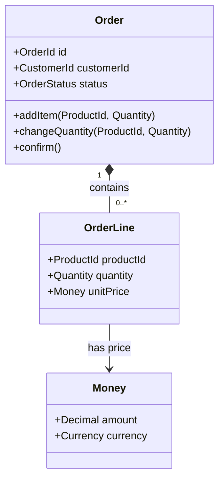
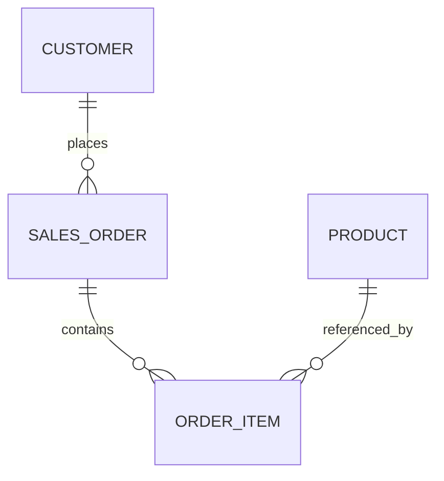
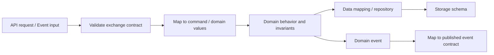

# Phân biệt mô hình dữ liệu, mô hình miền, lược đồ lưu trữ và hợp đồng trao đổi

Trong một hệ thống phần mềm, cùng một khái niệm nghiệp vụ có thể xuất hiện trong nhiều tài liệu và thành phần: mô hình miền mô tả cách nghiệp vụ vận hành, mô hình dữ liệu tổ chức các thông tin cần quản lý, lược đồ lưu trữ quy định cách ghi dữ liệu vào nền tảng cụ thể, còn hợp đồng trao đổi quy định dữ liệu đi qua API hoặc thông điệp như thế nào. Các artefact này liên quan chặt chẽ nhưng phục vụ những câu hỏi khác nhau.

Nếu xem chúng là một, nhóm dễ để lộ cấu trúc cơ sở dữ liệu ra API, ép mô hình đối tượng phải giống bảng, hoặc thay đổi bảng lưu trữ khiến mọi consumer phải sửa theo. Ngược lại, nếu không xác định quan hệ giữa chúng, dữ liệu có thể mất ý nghĩa khi chuyển từ nghiệp vụ sang lưu trữ hoặc truyền qua hệ thống khác.

Bài học dùng ví dụ đặt hàng để phân biệt bốn khái niệm, chỉ ra cách chuyển đổi giữa chúng và cách kiểm chứng tính nhất quán trong phạm vi **DATABASE_DATA_MODELING**.

## Mục tiêu học tập

Sau bài học, bạn có thể:

- Giải thích mục đích và phạm vi của domain model, data model, storage schema và exchange contract.
- Nhận biết phần thông tin nào thuộc nghiệp vụ, phần nào thuộc cấu trúc dữ liệu, phần nào thuộc triển khai và phần nào thuộc giao tiếp.
- Ánh xạ một khái niệm qua các artefact mà vẫn giữ đúng ý nghĩa và quy tắc.
- Phân biệt thay đổi nội bộ với thay đổi có ảnh hưởng đến consumer hoặc dữ liệu đã lưu.
- Thiết kế kiểm tra phù hợp cho quy tắc miền, tính toàn vẹn dữ liệu, migration và tương thích hợp đồng.

## 1. Bốn artefact trả lời bốn nhóm câu hỏi

Giả sử một cửa hàng trực tuyến cần cho khách hàng tạo đơn hàng. Đơn hàng có các dòng hàng, mỗi dòng tham chiếu một sản phẩm, có số lượng và đơn giá được chốt tại thời điểm mua. Khi đơn hàng được xác nhận, hệ thống phát thông báo để kho hàng xử lý.

Một cách nhìn tổng quát:

| Artefact | Câu hỏi chính | Nội dung điển hình | Người sử dụng chính |
|---|---|---|---|
| **Mô hình miền (Domain Model)** | Nghiệp vụ có khái niệm, hành vi và quy tắc nào? | Entity, value object, aggregate, trạng thái, hành vi, invariant và domain event | Chuyên gia nghiệp vụ, phân tích viên, kiến trúc sư, lập trình viên nghiệp vụ |
| **Mô hình dữ liệu (Data Model)** | Cần biểu diễn và quản lý những dữ kiện nào, chúng liên hệ ra sao? | Thực thể, thuộc tính, định danh, quan hệ, miền giá trị, khóa và ràng buộc dữ liệu | Nhà phân tích dữ liệu, kiến trúc sư dữ liệu, nhóm phát triển và báo cáo |
| **Lược đồ lưu trữ (Storage Schema)** | Dữ liệu được tổ chức và lưu cụ thể trên nền tảng nào? | Bảng/cột hoặc collection/document, kiểu dữ liệu, constraint, index, partition và cấu hình lưu trữ | Kỹ sư cơ sở dữ liệu, lập trình viên, đội vận hành |
| **Hợp đồng trao đổi (Exchange Contract)** | Hai thành phần giao tiếp phải gửi, nhận và hiểu dữ liệu theo quy tắc nào? | Request/response, event/message, field, kiểu, ý nghĩa, validation, lỗi và version | Nhóm cung cấp API, consumer, đối tác tích hợp và QA |

**Mô hình dữ liệu** là cách mô tả có cấu trúc về dữ liệu. Nó có thể được thể hiện ở mức khái niệm, logic hoặc vật lý. **Lược đồ lưu trữ** là cấu trúc triển khai thực tế của một nền tảng lưu trữ; nó là một phần cụ thể trong chuỗi mô hình hóa dữ liệu, thường gần với mức vật lý.

Domain model và data model có vùng giao nhau vì cả hai đều có thể nhắc đến Khách hàng, Đơn hàng và Sản phẩm. Tuy nhiên, domain model quan tâm đến ý nghĩa, hành vi và quy tắc nghiệp vụ; data model quan tâm đến cách biểu diễn và quản lý thông tin. Exchange contract có thể dùng một schema JSON hoặc Avro, nhưng hợp đồng còn bao gồm ngữ nghĩa, điều kiện sử dụng và quy tắc tương thích mà một file schema đơn lẻ chưa chắc mô tả hết.

## 2. Mô hình miền: nghiệp vụ có ý nghĩa và hành vi gì?

Mô hình miền biểu diễn những khái niệm quan trọng trong một miền nghiệp vụ và cách chúng tương tác. Trong cách tiếp cận Domain-Driven Design (DDD), mô hình thường thể hiện entity, value object, aggregate, domain service, domain event và invariant. Không phải dự án nào cũng cần áp dụng đầy đủ thuật ngữ DDD; điểm cốt lõi là mô tả được quy tắc nghiệp vụ bằng ngôn ngữ chung.

### 2.1. Các thành phần thường gặp

- **Entity:** đối tượng có danh tính ổn định trong vòng đời nghiệp vụ. Hai entity có cùng thuộc tính vẫn có thể là hai đối tượng khác nhau vì ID khác nhau.
- **Value Object:** giá trị được xác định bởi các thành phần của nó, thường bất biến. Ví dụ `Money(amount, currency)` hoặc `ProductId`.
- **Aggregate:** nhóm đối tượng được thay đổi như một đơn vị nhất quán. Aggregate root là cổng truy cập để thực hiện thay đổi tuân thủ invariant.
- **Invariant:** quy tắc phải luôn đúng tại ranh giới mà mô hình bảo vệ. Ví dụ số lượng dòng hàng phải lớn hơn 0; chỉ đơn hàng ở trạng thái phù hợp mới được xác nhận.
- **Domain Event:** sự kiện nghiệp vụ đã xảy ra, chẳng hạn `OrderConfirmed`, có thể được thành phần khác xử lý.

### 2.2. Ví dụ domain model cho đặt hàng

Trong ví dụ, `Order` là aggregate root. Nó quản lý các `OrderLine` và chỉ cho phép thay đổi thông qua các hành vi có kiểm soát.



Một số quy tắc miền có thể là:

1. Đơn hàng phải có ít nhất một dòng hợp lệ trước khi xác nhận.
2. Số lượng của mỗi dòng phải là số nguyên dương.
3. Đơn hàng đã xác nhận không được sửa trực tiếp các dòng hàng; nếu cần thay đổi, phải đi qua quy trình nghiệp vụ riêng.
4. Đơn giá được chốt khi dòng hàng được thêm vào đơn. Thay đổi giá niêm yết của sản phẩm sau đó không làm đổi giá giao dịch đã chốt.
5. Tổng tiền được tính từ các dòng hàng theo cùng loại tiền và quy tắc làm tròn đã thống nhất.

Phương thức `confirm()` là hành vi miền; nó không nhất thiết tương ứng với một cột trong cơ sở dữ liệu. `Money` có thể là value object gồm số tiền và đơn vị tiền tệ, nhưng trong schema quan hệ có thể được lưu thành hai cột. Một aggregate có thể được lưu bằng nhiều bảng hoặc document; ranh giới đối tượng trong bộ nhớ không bắt buộc trùng với ranh giới bảng.

### 2.3. Phạm vi miền và bounded context

Một tổ chức có thể có nhiều mô hình miền cho cùng từ “Đơn hàng”. Trong Bán hàng, đơn hàng mô tả cam kết mua bán và giá đã chốt. Trong Vận chuyển, đối tượng cần quan tâm có thể là kiện hàng, địa chỉ nhận và trạng thái giao. Trong Kế toán, dữ liệu cần thiết có thể là khoản phải thu và chứng từ.

Vì vậy, cần xác định bounded context và quyền sở hữu dữ liệu. Không nên ép mọi bộ phận dùng một mô hình đối tượng duy nhất chỉ vì họ cùng nói về một đơn hàng. Khi dữ liệu đi qua ranh giới context, hãy xác định rõ ai cung cấp ý nghĩa chuẩn và thành phần nhận sẽ ánh xạ sang mô hình của mình như thế nào.

## 3. Mô hình dữ liệu: thông tin nào cần quản lý?

Mô hình dữ liệu mô tả dữ liệu cần có, ý nghĩa, cấu trúc và quan hệ giữa các phần dữ liệu. Tùy mục tiêu, mô hình có thể là mô hình dữ liệu nghiệp vụ cấp cao, mô hình logic chi tiết hoặc mô hình vật lý gắn với công nghệ.

Với ví dụ đặt hàng, một mô hình logic quan hệ có thể xác định các thực thể sau:

| Thực thể dữ liệu | Thuộc tính chính | Quan hệ và quy tắc dữ liệu |
|---|---|---|
| CUSTOMER | customer_id, email, full_name | Mỗi đơn hàng tham chiếu một khách hàng; email duy nhất theo quy tắc chuẩn hóa đã thống nhất |
| SALES_ORDER | order_id, customer_id, placed_at, status | Mỗi đơn hàng thuộc một khách hàng; trạng thái thuộc tập giá trị hợp lệ |
| ORDER_ITEM | order_id, line_no, product_id, quantity, unit_price, currency | Dòng hàng thuộc một đơn; số lượng dương; đơn giá là giá tại thời điểm mua |
| PRODUCT | product_id, sku, name, current_price, current_currency | SKU duy nhất; giá hiện tại không âm và có đơn vị tiền tệ |



Mô hình dữ liệu làm rõ những điểm có thể bị bỏ qua khi chỉ nhìn domain object:

- `ORDER_ITEM` có khóa và thuộc tính nào để định danh từng dòng?
- Một đơn hàng có được lưu khi chưa có dòng hàng không, và điều kiện này thay đổi theo trạng thái nào?
- Đơn giá được lưu theo dòng hàng để giữ lịch sử hay luôn tra từ giá hiện tại của sản phẩm?
- Email được so sánh theo chữ hoa/chữ thường và khoảng trắng như thế nào?
- Có cần lưu thời điểm, nguồn tạo đơn hoặc trạng thái đồng bộ để phục vụ kiểm toán và vận hành không?

Mô hình dữ liệu không nhất thiết mô tả mọi phương thức như `confirm()` hoặc `changeQuantity()`. Nó cũng có thể phục vụ mục tiêu khác domain model, ví dụ mô hình phân tích với fact bán hàng và các dimension thời gian, sản phẩm, khách hàng. Trong trường hợp đó, cấu trúc dữ liệu được thiết kế cho đo lường và truy vấn phân tích, không phải để thực hiện hành vi của aggregate bán hàng.

### 3.1. Ràng buộc dữ liệu và invariant miền

Một số invariant miền có thể ánh xạ trực tiếp thành ràng buộc dữ liệu, ví dụ `quantity > 0`, `email NOT NULL` hoặc khóa ngoại. Một số quy tắc khác cần logic giao dịch hoặc quy trình nghiệp vụ, ví dụ “đơn hàng phải có ít nhất một dòng trước khi xác nhận”.

Do đó, không nên giả định rằng mọi invariant đều được giải quyết chỉ bằng schema. Hãy ghi rõ quy tắc được bảo vệ ở đâu: trong aggregate, transaction, constraint, trigger, workflow hoặc một tổ hợp các cơ chế. Nếu có nhiều đường ghi dữ liệu, cần xác định cơ chế nào là hàng rào cuối cùng để tránh mỗi ứng dụng áp dụng quy tắc khác nhau.

## 4. Lược đồ lưu trữ: dữ liệu được ghi cụ thể ra sao?

Lược đồ lưu trữ là cấu trúc mà hệ thống lưu trữ thực sự hiểu. Với cơ sở dữ liệu quan hệ, nó gồm bảng, cột, kiểu dữ liệu, khóa, constraint và index. Với document database, nó có thể gồm collection, hình dạng document, validator và index. Với hệ đồ thị, nó có thể gồm label, relationship type, property và constraint.

Một phần mô hình logic quan hệ ở trên có thể được triển khai trên PostgreSQL như sau:

```sql
CREATE TABLE customer (
    customer_id BIGINT GENERATED BY DEFAULT AS IDENTITY PRIMARY KEY,
    email       VARCHAR(320) NOT NULL UNIQUE,
    full_name   VARCHAR(200) NOT NULL
);

CREATE TABLE product (
    product_id   BIGINT GENERATED BY DEFAULT AS IDENTITY PRIMARY KEY,
    sku          VARCHAR(64) NOT NULL UNIQUE,
    name         VARCHAR(250) NOT NULL,
    current_price NUMERIC(14, 2) NOT NULL CHECK (current_price >= 0),
    current_currency CHAR(3) NOT NULL
);

CREATE TABLE sales_order (
    order_id    BIGINT GENERATED BY DEFAULT AS IDENTITY PRIMARY KEY,
    customer_id BIGINT NOT NULL REFERENCES customer(customer_id),
    placed_at   TIMESTAMPTZ NOT NULL,
    status      VARCHAR(20) NOT NULL
                CHECK (status IN ('DRAFT', 'PENDING', 'CONFIRMED', 'CANCELLED'))
);

CREATE TABLE order_item (
    order_id   BIGINT NOT NULL REFERENCES sales_order(order_id),
    line_no    INTEGER NOT NULL CHECK (line_no > 0),
    product_id BIGINT NOT NULL REFERENCES product(product_id),
    quantity   INTEGER NOT NULL CHECK (quantity > 0),
    unit_price NUMERIC(14, 2) NOT NULL CHECK (unit_price >= 0),
    currency   CHAR(3) NOT NULL,
    PRIMARY KEY (order_id, line_no)
);

CREATE INDEX sales_order_customer_time_idx
    ON sales_order (customer_id, placed_at DESC);
```

Đây là một cách triển khai, không phải bản sao bắt buộc của domain model:

- Aggregate `Order` được lưu thành `sales_order` và nhiều dòng trong `order_item`.
- `OrderLine` nằm trong vòng đời của `Order`, nhưng được lưu thành các hàng riêng để truy vấn và ràng buộc thuận tiện.
- `Money` được trải thành `unit_price` và `currency`; một kiểu value object trong mã nguồn trở thành hai cột.
- Giá hiện tại của sản phẩm cũng đi kèm mã tiền tệ; khi tạo dòng hàng, hệ thống chốt cả số tiền và đơn vị tiền tệ vào dữ liệu giao dịch.
- `order_id` dùng khóa số do PostgreSQL cấp, dù domain có thể gọi nó là `OrderId` và không phụ thuộc cách sinh ID.
- `placed_at` là dữ liệu phục vụ lịch sử và truy vấn; domain có thể biểu diễn nó bằng một kiểu thời gian có ngữ nghĩa rõ hơn.

Một schema thực tế có thể có thêm `created_at`, `updated_at`, `row_version`, cột phục vụ partition hoặc metadata vận hành. Các trường này không nhất thiết là khái niệm nghiệp vụ. Ngược lại, domain có thể có hành vi và đối tượng tạm thời không cần lưu thành cột.

### 4.1. Vì sao schema không phải là mô hình miền?

Schema được tối ưu theo khả năng của DBMS, cách truy cập và yêu cầu vận hành. Ví dụ, có thể tạo index ghép để phục vụ truy vấn đơn hàng mới nhất theo khách hàng. Chỉ mục đó không phải một quy tắc nghiệp vụ. Có thể lưu `total_amount` để tránh tính lại thường xuyên, nhưng khi đó phải có cách bảo đảm tổng tiền nhất quán với các dòng hàng.

Schema cũng có thể thay đổi vì lý do kỹ thuật: đổi kiểu cột, thêm index, chia partition hoặc chuyển từ một bảng sang nhiều bảng. Nếu ý nghĩa miền và hợp đồng bên ngoài không đổi, các thay đổi này thường không nên buộc consumer API thay đổi.

## 5. Hợp đồng trao đổi: hai thành phần hiểu dữ liệu giống nhau thế nào?

Hợp đồng trao đổi định nghĩa dữ liệu được truyền qua một ranh giới thành phần. Ranh giới có thể là HTTP API, message broker, webhook, file import/export hoặc tích hợp với đối tác.

Một hợp đồng đầy đủ cần làm rõ:

- Tên và mục đích operation hoặc event.
- Field, kiểu dữ liệu, đơn vị đo, định dạng và ý nghĩa.
- Field bắt buộc, tùy chọn, nullable hay có giá trị mặc định.
- Quy tắc validation và giới hạn dữ liệu.
- Ngữ nghĩa thời gian, tiền tệ, ID và trạng thái.
- Cách biểu diễn lỗi, retry, idempotency và thứ tự xử lý nếu liên quan.
- Version và chính sách tương thích khi producer hoặc consumer thay đổi.

### 5.1. Hợp đồng API tạo đơn hàng

API nhận yêu cầu tạo đơn hàng có thể nhận mã khách hàng và danh sách sản phẩm cùng số lượng. Client không gửi đơn giá để hệ thống bán hàng tự lấy giá hợp lệ tại thời điểm tạo đơn.

Ví dụ request:

```json
{
  "customerId": "cst_8421",
  "items": [
    {
      "productId": "prd_105",
      "quantity": 2
    },
    {
      "productId": "prd_208",
      "quantity": 1
    }
  ]
}
```

Một phần JSON Schema minh họa cho request:

```json
{
  "$schema": "https://json-schema.org/draft/2020-12/schema",
  "type": "object",
  "additionalProperties": false,
  "required": ["customerId", "items"],
  "properties": {
    "customerId": {
      "type": "string",
      "minLength": 1,
      "description": "Mã khách hàng trong hệ thống bán hàng"
    },
    "items": {
      "type": "array",
      "minItems": 1,
      "items": {
        "type": "object",
        "additionalProperties": false,
        "required": ["productId", "quantity"],
        "properties": {
          "productId": { "type": "string", "minLength": 1 },
          "quantity": { "type": "integer", "minimum": 1 }
        }
      }
    }
  }
}
```

JSON Schema kiểm tra hình dạng và một số điều kiện cục bộ. Nó không thể tự xác nhận khách hàng có tồn tại, sản phẩm còn được bán hay giá có hiệu lực; các kiểm tra này cần xử lý nghiệp vụ và dữ liệu tham chiếu. Hợp đồng cũng phải mô tả ý nghĩa phản hồi, mã lỗi, xác thực, quyền truy cập và idempotency nếu client có thể gửi lại request sau timeout.

Response có thể trả về `orderId`, `status`, `currency`, `totalAmount` và thời điểm tạo. Đó là cách biểu diễn công khai cho consumer, có thể khác tên cột hoặc kiểu nội bộ. Ví dụ, API có thể dùng `orderId` dạng chuỗi để tránh phụ thuộc khóa số nội bộ.

### 5.2. Hợp đồng sự kiện OrderConfirmed

Khi đơn hàng được xác nhận, hệ thống có thể phát một event để kho hàng tiếp nhận. Event mô tả sự việc đã xảy ra; consumer không nên hiểu nó như một lệnh yêu cầu xác nhận đơn.

```json
{
  "eventId": "evt_9017",
  "eventType": "OrderConfirmed",
  "schemaVersion": 1,
  "occurredAt": "2026-11-21T10:30:00Z",
  "order": {
    "orderId": "ord_7305",
    "customerId": "cst_8421",
    "currency": "VND",
    "items": [
      {
        "productId": "prd_105",
        "quantity": 2,
        "unitPrice": "125000.00"
      }
    ],
    "totalAmount": "250000.00"
  }
}
```

Trong ví dụ này:

- `eventId` giúp nhận diện một event và hỗ trợ consumer chống xử lý trùng.
- `eventType` phân biệt loại sự kiện; `schemaVersion` cho biết phiên bản cấu trúc.
- `occurredAt` là thời điểm sự kiện nghiệp vụ xảy ra, được biểu diễn theo ISO 8601 và UTC.
- `unitPrice` và `totalAmount` được truyền dưới dạng chuỗi thập phân để tránh consumer diễn giải tiền bằng số dấu phẩy động nhị phân.
- Event chứa bản chụp dữ liệu cần thiết cho consumer. Consumer không nên phải truy vấn ngược một bảng nội bộ chỉ để hiểu event đã phát.

Hợp đồng event cần xác định rõ event được phát sau khi transaction lưu đơn thành công như thế nào, consumer xử lý trùng ra sao, thứ tự event có được bảo đảm không và khi xử lý lỗi thì retry hoặc đưa vào dead-letter queue theo chính sách nào. Các điều kiện này là một phần của cách hai hệ thống trao đổi đáng tin cậy.

## 6. Ánh xạ giữa bốn artefact

Không có quy tắc một-một giữa domain object, data entity, storage table và exchange field. Việc ánh xạ phụ thuộc mục đích và ranh giới của từng thành phần.

| Khái niệm hoặc dữ liệu | Mô hình miền | Mô hình dữ liệu | Lược đồ lưu trữ | Hợp đồng trao đổi |
|---|---|---|---|---|
| Đơn hàng | Aggregate `Order`, có hành vi `confirm()` | Thực thể `SALES_ORDER` cùng quan hệ đến dòng hàng | Bảng `sales_order` | `orderId`, `status` trong response/event |
| Dòng hàng | Entity `OrderLine` thuộc aggregate `Order` | Thực thể phụ thuộc `ORDER_ITEM` | Các hàng trong `order_item` | Phần tử trong mảng `items` |
| Tiền | Value object `Money` gồm amount và currency | Thuộc tính số tiền và đơn vị tiền tệ | `NUMERIC` và `CHAR(3)` hoặc kiểu tương ứng | Chuỗi thập phân và mã tiền tệ theo contract |
| Định danh | Kiểu `OrderId` có ý nghĩa trong domain | Khóa định danh đơn hàng | `BIGINT`, UUID hoặc kiểu khác | Chuỗi opaque như `ord_7305` |
| Quy tắc xác nhận | Hành vi `confirm()` kiểm tra invariant | Ràng buộc nghiệp vụ liên quan đến trạng thái và dòng hàng | Một phần là `CHECK`, phần khác ở transaction/service | Mô tả điều kiện operation và lỗi trả về |

Một số khác biệt có chủ đích:

- Domain model có phương thức và hành vi; data model thường biểu diễn trạng thái và quan hệ.
- Một aggregate có thể được lưu bằng nhiều bảng; một bảng cũng có thể lưu dữ liệu tổng hợp từ nhiều khái niệm.
- Storage schema có metadata và index phục vụ vận hành mà consumer không cần biết.
- Exchange contract có thể đổi tên field, gộp hoặc tách cấu trúc, che giấu ID nội bộ và chỉ công bố dữ liệu consumer cần.
- Một event có thể chứa bản chụp lịch sử để consumer xử lý độc lập, dù một số trường được tính từ nhiều bảng lưu trữ.

### 6.1. Nguyên tắc thiết kế ranh giới

1. **Giữ ý nghĩa nghiệp vụ ổn định:** cùng một thuật ngữ phải có định nghĩa rõ trong từng bounded context. Nếu hai context dùng từ giống nhau nhưng ý nghĩa khác, hãy thể hiện sự khác biệt trong mô hình và mapping.
2. **Không để schema nội bộ trở thành API mặc định:** tạo request/response DTO hoặc event schema có mục đích rõ. Nhờ đó, thay đổi bảng hoặc cách lưu không tự động phá consumer.
3. **Không biến DTO thành domain entity:** dữ liệu từ client phải được xác thực và chuyển thành command/value object phù hợp trước khi gọi hành vi miền. Không để payload tùy ý sửa trạng thái nội bộ.
4. **Lưu đúng dữ liệu cần tái hiện lịch sử:** giá, địa chỉ hoặc mô tả tại thời điểm giao dịch có thể cần bản chụp. Hãy phân biệt dữ liệu lịch sử có ý nghĩa nghiệp vụ với dữ liệu sao chép để tăng tốc.
5. **Ghi rõ nguồn sự thật:** xác định hệ thống hoặc bounded context nào sở hữu dữ liệu gốc. Các bản sao, read model và event projection phải có cách cập nhật và xử lý sai lệch.

## 7. Tiến hóa và tương thích khi thay đổi

Bốn artefact có nhịp thay đổi khác nhau. Một thay đổi nghiệp vụ có thể kéo theo cập nhật domain model, data model, storage schema và exchange contract. Nhưng một thay đổi vật lý như thêm index thường chỉ ảnh hưởng storage schema. Một thay đổi hợp đồng API có thể không yêu cầu thay đổi bảng nếu chỉ đổi cách trình bày dữ liệu.

| Thay đổi | Artefact cần xem xét | Tác động và cách xử lý |
|---|---|---|
| Đơn hàng cần lưu địa chỉ giao hàng tại thời điểm mua | Domain model, data model, storage schema; API/event nếu cần trao đổi | Xác định đây là snapshot lịch sử; bổ sung thuộc tính miền, trường dữ liệu và migration có backfill rõ ràng |
| Tối ưu truy vấn đơn hàng gần đây | Storage schema | Có thể thêm index; kiểm tra bằng kế hoạch truy vấn và số liệu, không cần đổi domain hay API nếu ngữ nghĩa không đổi |
| API đổi `customerId` từ số sang chuỗi | Exchange contract và adapter; có thể ảnh hưởng consumer | Đánh giá breaking change, cung cấp version hoặc giai đoạn chuyển tiếp; không nhất thiết đổi khóa lưu trữ ngay |
| Thêm trạng thái `RETURN_REQUESTED` | Domain model, data model, storage schema và các contract có công bố status | Cập nhật quy tắc chuyển trạng thái, validation, schema constraint, tài liệu API/event và consumer |
| Chuyển từ một bảng sang hai bảng để tách dữ liệu lớn | Storage schema và lớp mapping/repository | Dùng migration theo giai đoạn, giữ hành vi và hợp đồng bên ngoài ổn định nếu có thể |

### 7.1. Tương thích hợp đồng

Khi thay đổi API hoặc event, cần đánh giá producer và consumer có thể triển khai lệch thời điểm hay không.

- Thêm một field tùy chọn thường dễ tương thích hơn thêm field bắt buộc mà consumer cũ không gửi.
- Xóa hoặc đổi tên field, đổi đơn vị đo, đổi ý nghĩa, thu hẹp miền giá trị hoặc đổi kiểu dữ liệu có thể phá consumer.
- Một field mới có thể là tùy chọn về cú pháp nhưng vẫn làm thay đổi ý nghĩa nghiệp vụ nếu consumer cần nó để xử lý đúng.
- Với event đã phát, không thể sửa lại thông điệp cũ mà consumer đã nhận. Hãy giữ khả năng đọc phiên bản cũ hoặc công bố event/version mới theo chính sách.
- Thêm `schemaVersion` hữu ích khi có nhiều cấu trúc cùng tồn tại, nhưng bản thân số version không thay thế quy tắc tương thích và kế hoạch triển khai.

### 7.2. Migration lưu trữ và thay đổi contract là hai việc khác nhau

Ví dụ thêm `shipping_address` vào bảng đơn hàng cần kế hoạch migration: thêm cột, quyết định nullable/default, backfill dữ liệu cũ nếu có nguồn đáng tin, cập nhật ứng dụng đọc/ghi và chỉ đặt `NOT NULL` sau khi dữ liệu đáp ứng điều kiện. API có thể công bố địa chỉ giao hàng trong một version riêng hoặc chỉ thêm field tùy chọn.

Không nên triển khai một migration phá hủy dữ liệu chỉ vì contract được nâng version. Cũng không nên giả định migration database sẽ tự làm consumer hiểu field mới. Hai quá trình có liên hệ nhưng có cổng kiểm chứng riêng.

## 8. Kiểm chứng từng artefact và các điểm nối

Mỗi loại artefact cần loại kiểm tra khác nhau:

| Đối tượng kiểm tra | Câu hỏi xác minh | Cách kiểm tra phù hợp |
|---|---|---|
| Domain model | Quy tắc và hành vi có đúng với nghiệp vụ không? | Unit test cho invariant, state transition và domain service; review với chuyên gia nghiệp vụ |
| Data model | Thực thể, thuộc tính, quan hệ và ràng buộc có đủ và nhất quán không? | Review mô hình, kiểm tra khóa/quan hệ, phân tích phụ thuộc và đối chiếu yêu cầu |
| Storage schema | DBMS có thực thi đúng cấu trúc và bảo vệ dữ liệu không? | Migration test, constraint test, integration test, kiểm tra index và kế hoạch truy vấn |
| Exchange contract | Producer và consumer có hiểu payload giống nhau không? | Schema validation, contract test, consumer-driven test, test lỗi và kiểm tra tương thích version |

Các điểm nối cũng cần được kiểm thử:

1. **Domain → data:** mọi trạng thái hoặc dữ kiện cần duy trì có được biểu diễn không? Có field lưu trữ nào làm lộ chi tiết nội bộ vào mô hình nghiệp vụ không?
2. **Data → storage:** mọi khóa và ràng buộc quan trọng có được ánh xạ sang DBMS hoặc có nơi kiểm soát thay thế được ghi rõ không?
3. **Domain/data → contract:** payload có giữ đúng ý nghĩa, đơn vị, múi giờ, quy tắc nullable và trạng thái không?
4. **Storage → domain:** dữ liệu đọc lại có tái tạo được trạng thái miền cần thiết không? Có trường hợp null, dữ liệu cũ hoặc version cũ khiến mapping sai không?
5. **Contract → consumer:** consumer có thể xử lý field không biết, event trùng, event đến trễ và phiên bản cũ theo chính sách không?

Một kiểm tra hữu ích là theo dõi một tình huống xuyên suốt: khách hàng gửi request tạo đơn; adapter kiểm tra contract và chuyển payload thành command; domain model xác thực và tạo đơn; repository lưu aggregate qua storage schema; sau khi transaction thành công, hệ thống phát event theo exchange contract. Mỗi bước có trách nhiệm rõ và có thể kiểm tra độc lập.



## 9. Những nhầm lẫn thường gặp

| Nhầm lẫn | Vì sao gây vấn đề | Cách hiểu đúng |
|---|---|---|
| Domain entity phải tương ứng một bảng | Ép cấu trúc đối tượng và persistence vào cùng một ranh giới | Một entity/aggregate có thể trải trên nhiều bảng hoặc document; mapping phụ thuộc mục tiêu lưu trữ |
| Data model chỉ là schema database | Bỏ qua mô hình khái niệm, logic và mô hình phục vụ phân tích | Data model mô tả dữ liệu ở nhiều mức; schema là một cách triển khai cụ thể |
| Tên cột chính là tên field API | Làm consumer phụ thuộc vào chi tiết nội bộ và gây khó khi refactor | Contract dùng tên và cấu trúc phù hợp với consumer; adapter chịu trách nhiệm ánh xạ |
| JSON Schema là toàn bộ hợp đồng | Chỉ kiểm tra được một phần cấu trúc và validation | Hợp đồng còn cần ngữ nghĩa, lỗi, bảo mật, idempotency, retry và version |
| Có khóa ngoại là đã bảo vệ mọi quy tắc nghiệp vụ | Một số quy tắc phụ thuộc nhiều hàng, trạng thái hoặc quy trình | Chỉ rõ nơi kiểm soát từng invariant và kiểm thử ở đúng tầng |
| Thêm field luôn là thay đổi tương thích | Consumer có thể dựa vào strict validation hoặc ngữ nghĩa đầy đủ của payload | Kiểm tra chính sách consumer, schema compatibility và hành vi thực tế trước khi phát hành |

## 10. Quy trình thực hành

Khi thiết kế một chức năng mới hoặc thay đổi dữ liệu hiện có, có thể đi theo trình tự sau:

1. **Xác định miền và ranh giới:** ai sở hữu nghiệp vụ, từ ngữ nào cần thống nhất, thành phần nào là producer và consumer.
2. **Mô tả domain model:** xác định entity, value object, aggregate, hành vi, trạng thái và invariant liên quan.
3. **Mô hình hóa dữ liệu:** xác định thông tin cần lưu hoặc phân tích, định danh, thuộc tính, quan hệ, miền giá trị và ràng buộc.
4. **Thiết kế storage schema:** chọn nền tảng, ánh xạ kiểu dữ liệu, constraint, index và migration theo workload.
5. **Định nghĩa exchange contract:** thiết kế request/response hoặc event theo nhu cầu consumer, mô tả semantics, validation, lỗi và version.
6. **Viết mapping tường minh:** ghi rõ domain property ↔ data attribute ↔ storage field ↔ exchange field; nêu các trường hợp biến đổi, tổng hợp hoặc không ánh xạ.
7. **Kiểm thử từng artefact và điểm nối:** unit, integration, migration, schema validation và contract test.
8. **Lập kế hoạch tiến hóa:** xác định thứ tự triển khai, tương thích ngược, backfill, thời gian hỗ trợ phiên bản cũ và cách quan sát lỗi sau phát hành.

## 11. Checklist trước khi hoàn tất thiết kế

- [ ] Domain model diễn đạt đúng thuật ngữ, hành vi và invariant nghiệp vụ.
- [ ] Data model có đủ thực thể, thuộc tính, định danh, quan hệ và ràng buộc.
- [ ] Mỗi quy tắc quan trọng có nơi kiểm soát và cách kiểm thử rõ ràng.
- [ ] Storage schema phản ánh mô hình dữ liệu và phù hợp workload; index có căn cứ.
- [ ] Migration xử lý dữ liệu hiện có, giá trị mặc định, backfill và khả năng triển khai theo giai đoạn.
- [ ] Exchange contract mô tả field, ý nghĩa, đơn vị, format, required/optional, lỗi và version.
- [ ] Consumer không phải phụ thuộc trực tiếp vào bảng hoặc tên cột nội bộ.
- [ ] Mapping giữa các artefact có thể truy vết và có test cho các điểm biến đổi quan trọng.
- [ ] Quyền sở hữu dữ liệu và nguồn sự thật được xác định giữa các bounded context.

## Tóm tắt

Domain model diễn đạt nghiệp vụ và hành vi; data model mô tả dữ liệu cần quản lý cùng cấu trúc và ràng buộc; storage schema triển khai dữ liệu trên nền tảng lưu trữ; exchange contract quy định cách thành phần trao đổi và diễn giải payload. Chúng cần nhất quán về ý nghĩa nhưng không cần có cấu trúc giống nhau.

Khi thay đổi, hãy xác định thay đổi thuộc lớp nào, artefact nào bị ảnh hưởng và consumer nào cần được bảo vệ. Mapping rõ ràng, nguồn dữ liệu có chủ sở hữu và kiểm thử đúng tại từng ranh giới sẽ giúp hệ thống dễ tiến hóa mà không làm mất ý nghĩa dữ liệu.

## Thuật ngữ cần nhớ

| Thuật ngữ | Ý nghĩa |
|---|---|
| Domain Model | Mô hình khái niệm nghiệp vụ, hành vi và quy tắc của một miền |
| Data Model | Cách mô tả dữ liệu, thuộc tính, định danh, quan hệ và ràng buộc |
| Storage Schema | Cấu trúc dữ liệu được triển khai trên một hệ lưu trữ cụ thể |
| Exchange Contract | Quy tắc và cấu trúc trao đổi dữ liệu giữa producer và consumer |
| Entity | Đối tượng được phân biệt bằng danh tính ổn định |
| Value Object | Đối tượng được xác định bởi giá trị các thành phần của nó |
| Aggregate Root | Điểm truy cập chính để thay đổi một aggregate và bảo vệ invariant |
| Invariant | Điều kiện nghiệp vụ phải luôn đúng trong phạm vi được bảo vệ |
| Bounded Context | Ranh giới trong đó mô hình và thuật ngữ miền có ý nghĩa nhất quán |
| Contract Test | Kiểm thử xác nhận producer và consumer tuân thủ hợp đồng trao đổi |
