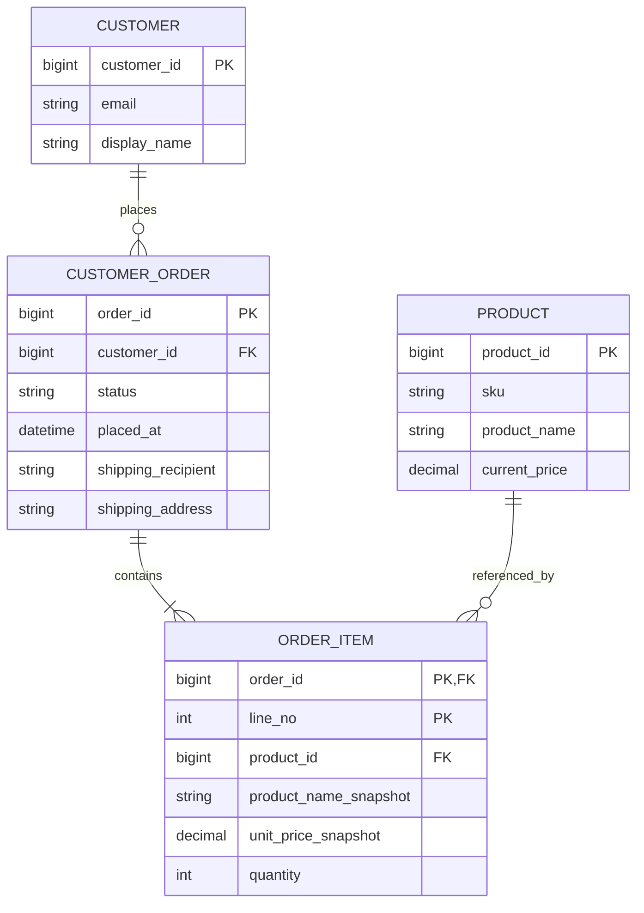

# Lộ trình học và tiêu chí đánh giá một mô hình dữ liệu tốt

Trong chương **Nền tảng** của module **DATABASE_DATA_MODELING**, người học rèn kỹ năng chuyển yêu cầu nghiệp vụ thành mô hình dữ liệu rõ ràng: xác định thực thể, thuộc tính, quan hệ và quy tắc; chuyển mô hình khái niệm thành lược đồ logic và vật lý; lựa chọn khóa, ràng buộc, chuẩn hóa và chỉ mục; đồng thời cân nhắc mô hình quan hệ, document, đồ thị và phân tích. Mục tiêu cuối cùng là tạo ra cấu trúc dữ liệu phản ánh đúng nghiệp vụ, phục vụ được cách hệ thống truy cập dữ liệu, có thể kiểm chứng và tiến hóa an toàn.

Một mô hình dữ liệu tốt không chỉ là sơ đồ ERD đẹp hoặc tập hợp bảng có khóa ngoại. Nó là một tập quyết định có căn cứ: dữ liệu nào cần tồn tại, ý nghĩa của từng thuộc tính là gì, quy tắc nào phải luôn đúng, truy vấn quan trọng diễn ra như thế nào và hệ thống sẽ thay đổi ra sao trong tương lai. Vì vậy, lộ trình học nên đi từ nghiệp vụ đến mô hình, rồi đến triển khai và kiểm chứng.

## 1. Kết quả cần đạt

Sau bài học, người học có thể:

- Phân rã một yêu cầu nghiệp vụ thành dữ liệu cần lưu, quy tắc cần bảo vệ và luồng sử dụng dữ liệu.
- Xác định thực thể, đối tượng giá trị, thuộc tính, định danh, quan hệ, bội số và tính bắt buộc.
- Chuyển mô hình khái niệm thành lược đồ logic; chọn khóa chính, khóa ngoại, khóa ứng viên và ràng buộc phù hợp.
- Giải thích mục đích của chuẩn hóa, nhận biết dư thừa và chọn thời điểm phi chuẩn hóa có kiểm soát.
- Chọn mô hình quan hệ, document, đồ thị hoặc phân tích theo cấu trúc dữ liệu và kiểu truy vấn thực tế.
- Đề xuất kiểu dữ liệu, chỉ mục và chiến lược thay đổi lược đồ dựa trên tải công việc.
- Kiểm tra mô hình bằng ví dụ, truy vấn, ràng buộc, dữ liệu biên và kịch bản migration.

## 2. Lộ trình học từ yêu cầu đến mô hình có thể triển khai

Nên học theo thứ tự dưới đây. Mỗi chặng tạo ra một sản phẩm có thể được người khác đọc và phản biện; không chuyển sang chặng tiếp theo khi các quyết định quan trọng của chặng trước còn mơ hồ.

| Chặng | Nội dung trọng tâm | Sản phẩm cần có | Điều kiện hoàn thành |
|---|---|---|---|
| 1. Hiểu nghiệp vụ | Vai trò, quy trình, danh từ, hành động, trạng thái, quy tắc và báo cáo | Từ điển thuật ngữ, danh sách yêu cầu dữ liệu, quy tắc nghiệp vụ | Hai người đọc có thể hiểu cùng một thuật ngữ và cùng diễn giải quy tắc |
| 2. Mô hình khái niệm | Thực thể, đối tượng giá trị, thuộc tính, quan hệ, bội số và tính tùy chọn | ERD khái niệm hoặc sơ đồ miền | Mỗi quan hệ có ý nghĩa; mỗi thực thể có định danh; quy tắc quan trọng được ghi rõ |
| 3. Mô hình logic | Khóa, phụ thuộc dữ liệu, chuẩn hóa, bảng liên kết và ràng buộc | Lược đồ logic độc lập với hệ quản trị cụ thể | Không có phụ thuộc hoặc quan hệ mơ hồ; các quy tắc có thể ánh xạ thành ràng buộc hoặc kiểm tra |
| 4. Chọn họ mô hình | Quan hệ, document, đồ thị và mô hình phân tích | Bảng quyết định và mô hình được chọn cho từng luồng dữ liệu | Lựa chọn giải thích được bằng truy vấn, giao dịch, tính nhất quán và quy mô |
| 5. Thiết kế vật lý | Kiểu dữ liệu, nullability, chỉ mục, phân vùng và đặc điểm hệ quản trị | DDL, danh sách truy vấn chính và kế hoạch chỉ mục ban đầu | Kiểu dữ liệu đủ miền giá trị; truy vấn quan trọng có thể kiểm tra hiệu năng |
| 6. Kiểm chứng | Dữ liệu mẫu, ràng buộc, truy vấn kiểm tra, kiểm tra tải và migration thử | Bộ ca kiểm tra mô hình và báo cáo kết quả | Quy tắc trọng yếu được kiểm tra; thay đổi lược đồ có thể diễn tập |
| 7. Tiến hóa | Thay đổi nghiệp vụ, tương thích phiên bản, backfill và loại bỏ cấu trúc cũ | Kế hoạch migration và tài liệu quyết định | Ứng dụng và dữ liệu có thể chuyển đổi mà không làm mất ý nghĩa hoặc phá vỡ luồng đang chạy |

### Chặng 1: Bắt đầu bằng câu hỏi nghiệp vụ

Không nên bắt đầu bằng câu hỏi “cần tạo những bảng nào?”. Hãy xác định trước:

1. Ai tạo, đọc, cập nhật và xóa dữ liệu?
2. Sự kiện nghiệp vụ nào làm dữ liệu thay đổi?
3. Đối tượng nào có vòng đời riêng và cần được định danh?
4. Quy tắc nào phải đúng ở mọi thời điểm?
5. Dữ liệu nào cần giữ lại để kiểm toán, đối soát hoặc giải thích lịch sử?
6. Truy vấn nào quan trọng nhất theo tần suất, độ trễ và khối lượng?

Phân biệt **dữ kiện nghiệp vụ** với **giả định kỹ thuật**. Ví dụ, “một đơn hàng phải có ít nhất một dòng hàng” là quy tắc nghiệp vụ. “Dòng hàng được lưu trong một bảng riêng” là quyết định thiết kế. Nếu trộn hai loại này, nhóm phát triển có thể nhầm một lựa chọn triển khai thành quy tắc không thể thay đổi.

Tạo từ điển thuật ngữ ngắn. Nếu “khách hàng”, “người nhận hàng” và “người thanh toán” là ba vai trò khác nhau, tài liệu phải nói rõ chúng có thể là cùng một người hay không. Một thuộc tính như “trạng thái” cũng cần định nghĩa các giá trị hợp lệ, ý nghĩa và điều kiện chuyển trạng thái.

### Chặng 2: Dựng mô hình khái niệm

Mô hình khái niệm mô tả miền nghiệp vụ mà chưa phụ thuộc vào bảng, kiểu dữ liệu hay sản phẩm cơ sở dữ liệu.

- **Thực thể** có danh tính và vòng đời riêng, ví dụ Khách hàng, Đơn hàng hoặc Sản phẩm.
- **Đối tượng giá trị** được nhận diện bằng giá trị và thường thuộc về một thực thể, ví dụ Khoảng thời gian hoặc Địa chỉ được chụp tại thời điểm giao hàng.
- **Thuộc tính** mô tả đặc điểm của một đối tượng; cần xác định kiểu ý nghĩa, tính bắt buộc, miền giá trị và nguồn tạo ra.
- **Quan hệ** diễn đạt ý nghĩa nghiệp vụ giữa các đối tượng, không chỉ là một đường nối trên sơ đồ.
- **Bội số** mô tả một-một, một-nhiều hoặc nhiều-nhiều; **tính tùy chọn** cho biết quan hệ có thể chưa tồn tại hay không.

Với mỗi quan hệ, hãy viết thành câu. Ví dụ: “Một khách hàng có thể đặt nhiều đơn hàng; mỗi đơn hàng thuộc về đúng một khách hàng”. Câu này làm rõ hai phía của quan hệ và giúp phát hiện trường hợp chưa được mô hình hóa.

Các quy tắc như “đơn hàng phải có ít nhất một dòng hàng” hoặc “số lượng đặt mua phải lớn hơn không” cần được ghi riêng. Sơ đồ ERD thông thường không thể diễn đạt đầy đủ mọi quy tắc liên dòng hoặc quy trình chuyển trạng thái.

### Chặng 3: Chuyển sang mô hình logic

Khi miền nghiệp vụ đã rõ, mới quyết định cách biểu diễn bằng cấu trúc dữ liệu.

Với mô hình quan hệ, một thực thể thường trở thành một bảng; một quan hệ một-nhiều thường được biểu diễn bằng khóa ngoại ở phía nhiều; quan hệ nhiều-nhiều thường cần bảng liên kết. Thuộc tính đa trị thường cần được tách thành cấu trúc riêng nếu cần truy vấn, ràng buộc hoặc cập nhật từng giá trị.

Cần phân biệt các loại khóa:

- **Khóa chính (primary key)** định danh duy nhất một hàng và không được null.
- **Khóa ứng viên (candidate key)** là tập thuộc tính tối thiểu có thể định danh duy nhất một hàng.
- **Khóa tự nhiên (natural key)** xuất phát từ nghiệp vụ, như mã SKU; nó có ý nghĩa nghiệp vụ nhưng có thể thay đổi.
- **Khóa thay thế (surrogate key)** là định danh kỹ thuật, thường ổn định và ít mang ý nghĩa nghiệp vụ.
- **Khóa ngoại (foreign key)** bảo vệ quan hệ tham chiếu giữa các bảng.

Một bảng có thể dùng khóa thay thế làm khóa chính nhưng vẫn cần ràng buộc UNIQUE trên mã nghiệp vụ. Nếu chỉ dựa vào khóa thay thế, hệ thống có thể lưu hai khách hàng có cùng email hoặc hai sản phẩm có cùng SKU dù nghiệp vụ cấm điều đó.

#### Chuẩn hóa và kiểm soát dư thừa

Chuẩn hóa giúp giảm bất thường khi thêm, sửa hoặc xóa dữ liệu:

- **Dạng chuẩn thứ nhất (1NF):** mỗi ô chứa một giá trị theo miền đã xác định; không dùng một chuỗi phân cách để nhét danh sách giá trị cần truy vấn độc lập.
- **Dạng chuẩn thứ hai (2NF):** bảng đạt 1NF và mọi thuộc tính không khóa phụ thuộc đầy đủ vào toàn bộ khóa ứng viên, không chỉ một phần của khóa ghép.
- **Dạng chuẩn thứ ba (3NF):** bảng đạt 2NF và thuộc tính không khóa không phụ thuộc bắc cầu vào khóa thông qua một thuộc tính không khóa khác.
- **BCNF:** với mọi phụ thuộc hàm không tầm thường, vế xác định phải là siêu khóa.

Không cần áp dụng máy móc một dạng chuẩn cho mọi hệ thống. Hãy dùng chuẩn hóa làm điểm xuất phát để giữ dữ liệu nhất quán, sau đó chỉ phi chuẩn hóa khi có truy vấn hoặc yêu cầu vận hành cụ thể chứng minh lợi ích. Mọi bản sao dữ liệu cần có nguồn chuẩn và quy tắc đồng bộ.

### Chặng 4: Chọn mô hình theo hình dạng dữ liệu và cách truy cập

Không có một họ mô hình phù hợp cho mọi bài toán. Có thể dùng nhiều mô hình trong cùng một hệ thống nếu mỗi mô hình phục vụ một mục đích rõ ràng và có cơ chế đồng bộ được kiểm soát.

| Họ mô hình | Phù hợp khi | Điểm cần cân nhắc |
|---|---|---|
| Quan hệ | Dữ liệu có cấu trúc rõ; quan hệ và ràng buộc quan trọng; cần giao dịch nhiều bản ghi và truy vấn kết hợp | Cần thiết kế lược đồ, join và chỉ mục; thay đổi cấu trúc phải được quản lý |
| Document | Dữ liệu thường được đọc hoặc cập nhật theo một aggregate; các thuộc tính con thay đổi cùng vòng đời; cấu trúc có thể linh hoạt | Nhúng dữ liệu có thể tạo bản sao; document quá lớn hoặc cập nhật độc lập nhiều phần sẽ khó quản lý |
| Đồ thị | Trọng tâm là kết nối và truy vấn nhiều bước như đường đi, quan hệ phụ thuộc hoặc gợi ý | Cần định nghĩa rõ loại node, edge và hướng quan hệ; truy vấn và ràng buộc có đặc điểm riêng |
| Phân tích | Cần tổng hợp lịch sử trên khối lượng lớn, báo cáo theo thời gian hoặc nhiều chiều | Cần xác định grain của fact, quy tắc lịch sử và độ trễ đồng bộ; cấu trúc thường tối ưu cho đọc và tổng hợp |

Ví dụ, hệ thống bán hàng có thể dùng cơ sở dữ liệu quan hệ làm nguồn giao dịch chính, lưu bản chụp đơn hàng theo document để phục vụ một số luồng đọc, dùng đồ thị cho quan hệ gợi ý và đưa sự kiện sang kho phân tích để lập báo cáo. Đây là lựa chọn kiến trúc có chi phí: phải xác định nguồn dữ liệu chuẩn, độ trễ chấp nhận được, cách xử lý sự kiện trùng và cách đối soát khi đồng bộ thất bại.

Khi chọn mô hình, hãy so sánh ít nhất năm yếu tố: hình dạng quan hệ, kiểu truy vấn, ranh giới giao dịch, yêu cầu nhất quán và cách tiến hóa. Đừng chọn chỉ vì một công nghệ đang phổ biến hoặc vì một truy vấn đơn lẻ có vẻ dễ viết hơn.

### Chặng 5: Thiết kế vật lý theo workload

Mô hình vật lý biến lược đồ logic thành cấu trúc có thể triển khai trên hệ quản trị cụ thể.

- Chọn kiểu dữ liệu theo miền giá trị và độ chính xác. Tiền tệ thường cần kiểu thập phân chính xác thay vì số dấu phẩy động nhị phân.
- Quyết định nullability theo ý nghĩa nghiệp vụ. Null không nên bị dùng thay cho chuỗi rỗng, số không hoặc một trạng thái chưa xác định nếu các trường hợp đó có ý nghĩa khác nhau.
- Dùng CHECK, UNIQUE, NOT NULL và FOREIGN KEY để đưa quy tắc phù hợp xuống tầng lưu trữ.
- Tạo chỉ mục dựa trên truy vấn thực tế: điều kiện lọc, phép nối, thứ tự sắp xếp và độ chọn lọc.
- Cân nhắc phân vùng, lưu trữ lịch sử hoặc chiến lược lưu trữ lạnh khi quy mô và cách truy cập chứng minh nhu cầu.
- Kiểm tra kế hoạch thực thi và số liệu trên dữ liệu đại diện; tên chỉ mục hợp lý không tự chứng minh truy vấn nhanh.

Mỗi chỉ mục giúp một số truy vấn nhưng cũng tiêu tốn dung lượng và làm tăng chi phí ghi, cập nhật, xóa. Vì vậy, lập danh sách truy vấn quan trọng trước, rồi mới thiết kế chỉ mục.

## 3. Ví dụ xuyên suốt: mô hình dữ liệu cho đơn hàng

Giả sử một cửa hàng trực tuyến cần quản lý khách hàng, sản phẩm và đơn hàng. Các quy tắc đã xác nhận gồm:

- Một khách hàng có thể đặt nhiều đơn hàng; mỗi đơn hàng thuộc về một khách hàng.
- Một đơn hàng có ít nhất một dòng hàng; mỗi dòng hàng thuộc về một sản phẩm.
- Số lượng phải là số nguyên dương; đơn giá tại thời điểm mua không âm.
- Tên sản phẩm và đơn giá trên dòng hàng phải phản ánh thời điểm đặt mua, kể cả khi thông tin sản phẩm hiện tại thay đổi.
- Đơn hàng cần lưu thông tin người nhận và địa chỉ giao hàng tại thời điểm đặt.

Mô hình khái niệm ban đầu:



Một lược đồ quan hệ minh họa có thể viết như sau. Cú pháp kiểu dữ liệu và CHECK cần được điều chỉnh theo hệ quản trị được chọn.

```sql
CREATE TABLE customer (
    customer_id BIGINT PRIMARY KEY,
    email VARCHAR(320) NOT NULL,
    display_name VARCHAR(160) NOT NULL,
    CONSTRAINT uq_customer_email UNIQUE (email)
);

CREATE TABLE product (
    product_id BIGINT PRIMARY KEY,
    sku VARCHAR(80) NOT NULL,
    product_name VARCHAR(200) NOT NULL,
    current_price DECIMAL(12, 2) NOT NULL,
    CONSTRAINT uq_product_sku UNIQUE (sku),
    CONSTRAINT ck_product_price_nonnegative
        CHECK (current_price >= 0)
);

CREATE TABLE customer_order (
    order_id BIGINT PRIMARY KEY,
    customer_id BIGINT NOT NULL,
    status VARCHAR(20) NOT NULL,
    placed_at TIMESTAMP NOT NULL,
    shipping_recipient VARCHAR(160) NOT NULL,
    shipping_address VARCHAR(500) NOT NULL,
    CONSTRAINT fk_order_customer
        FOREIGN KEY (customer_id) REFERENCES customer(customer_id),
    CONSTRAINT ck_order_status
        CHECK (status IN ('PENDING', 'PAID', 'SHIPPED', 'CANCELLED'))
);

CREATE TABLE order_item (
    order_id BIGINT NOT NULL,
    line_no INTEGER NOT NULL,
    product_id BIGINT NOT NULL,
    product_name_snapshot VARCHAR(200) NOT NULL,
    unit_price_snapshot DECIMAL(12, 2) NOT NULL,
    quantity INTEGER NOT NULL,
    CONSTRAINT pk_order_item PRIMARY KEY (order_id, line_no),
    CONSTRAINT fk_item_order
        FOREIGN KEY (order_id) REFERENCES customer_order(order_id),
    CONSTRAINT fk_item_product
        FOREIGN KEY (product_id) REFERENCES product(product_id),
    CONSTRAINT ck_item_quantity_positive CHECK (quantity > 0),
    CONSTRAINT ck_item_price_nonnegative
        CHECK (unit_price_snapshot >= 0)
);
```

Thiết kế trên thể hiện một số quyết định quan trọng:

- Bảng order_item dùng khóa ghép (order_id, line_no), vì số thứ tự dòng chỉ có ý nghĩa trong phạm vi một đơn hàng.
- product_id giữ liên kết đến sản phẩm chuẩn; product_name_snapshot và unit_price_snapshot giữ lại ý nghĩa giao dịch tại thời điểm mua.
- Khóa ngoại đến product cũng đặt ra chính sách vòng đời: sản phẩm đã được tham chiếu trong giao dịch thường cần được lưu trữ hoặc ngừng kinh doanh thay vì xóa vật lý.
- Thông tin giao hàng được lưu trên đơn hàng như một bản chụp. Nếu chỉ tham chiếu địa chỉ hiện tại của khách hàng, việc khách hàng đổi địa chỉ có thể làm sai lịch sử đơn cũ.
- CHECK bảo vệ các điều kiện trên từng hàng. Quy tắc “một đơn hàng phải có ít nhất một dòng hàng” liên quan đến nhiều hàng, nên cần được bảo vệ trong luồng giao dịch, bằng cơ chế phù hợp của hệ quản trị hoặc bằng bước kiểm tra trước khi xác nhận đơn.
- CHECK trên status chỉ giới hạn tập giá trị hợp lệ; quy tắc chuyển từ trạng thái này sang trạng thái khác vẫn cần được kiểm tra theo luồng nghiệp vụ.

Một số chỉ mục ban đầu có thể xuất phát từ truy vấn “xem đơn hàng gần đây của khách hàng” và “tìm các dòng hàng theo sản phẩm”:

```sql
CREATE INDEX idx_order_customer_placed
    ON customer_order (customer_id, placed_at);

CREATE INDEX idx_order_item_product
    ON order_item (product_id);
```

Đây chỉ là giả thuyết thiết kế. Cần kiểm tra truy vấn thật, dữ liệu có phân bố gần thực tế và kế hoạch thực thi trước khi quyết định giữ chỉ mục. Nếu truy vấn chủ yếu lọc theo trạng thái và khoảng thời gian, chỉ mục có thể cần cấu trúc khác; không nên tạo chỉ mục cho mọi cột.

### Nếu dùng document cho đơn hàng

Một document đơn hàng có thể chứa thông tin người nhận và danh sách dòng hàng bên trong cùng một aggregate. Cách này phù hợp khi đơn hàng thường được đọc và cập nhật như một đơn vị, các dòng hàng có vòng đời gắn với đơn hàng và giới hạn kích thước document được kiểm soát.

Cần quyết định có nhúng toàn bộ thông tin sản phẩm hay chỉ lưu product_id cùng các trường snapshot. Nhúng dữ liệu giúp đọc nhanh trong một lần, nhưng có thể làm tăng bản sao và yêu cầu đồng bộ khi dữ liệu dùng chung thay đổi. Với dữ liệu lịch sử đơn hàng, snapshot là có chủ đích; với thông tin mô tả sản phẩm hiện tại, bản sao có thể gây lệch nếu không có chính sách cập nhật.

### Nếu dùng đồ thị cho miền bán hàng

Đồ thị có thể mô tả khách hàng, sản phẩm, danh mục và các quan hệ như đã mua, cùng xem, thuộc danh mục hoặc được gợi ý cùng. Truy vấn nhiều bước như “tìm sản phẩm được mua bởi những khách hàng từng mua sản phẩm này” có thể phù hợp với cách biểu diễn node và edge.

Cần định nghĩa ý nghĩa, hướng, thuộc tính và thời hạn của từng edge. Ví dụ, quan hệ “đã mua” nên có thời điểm và mã đơn hàng để phân biệt một lần mua với quan hệ chung chung. Nếu đồ thị được dựng từ dữ liệu giao dịch, cần nêu rõ độ trễ đồng bộ và cách xử lý khi đơn hàng bị hủy.

### Nếu xây mô hình phân tích

Để phân tích doanh thu, có thể xây fact table với grain (mức chi tiết của mỗi dòng fact) được xác định rõ, chẳng hạn **một dòng cho mỗi dòng hàng trong một đơn hàng**. Các dimension có thể gồm thời gian, sản phẩm, khách hàng và khu vực giao hàng. Giá trị đo như số lượng, doanh thu dòng hàng cần có định nghĩa thống nhất.

Grain phải được xác định trước khi thêm cột hoặc kết hợp fact. Nếu một bảng trộn dữ liệu ở mức đơn hàng và mức dòng hàng, phép nối có thể nhân bản số tiền và làm báo cáo sai. Mô hình phân tích thường chấp nhận một mức phi chuẩn hóa để tối ưu tổng hợp, nhưng phải giữ quy tắc lịch sử và nguồn số liệu rõ ràng.

## 4. Tiêu chí đánh giá một mô hình dữ liệu tốt

Đánh giá mô hình trong bối cảnh mục tiêu của hệ thống. Một mô hình cho giao dịch tài chính có thể ưu tiên tính toàn vẹn và khả năng kiểm toán; mô hình phục vụ khám phá quan hệ có thể ưu tiên truy vấn nhiều bước. Có thể dùng rubric dưới đây làm thang đánh giá ban đầu, sau đó điều chỉnh trọng số theo rủi ro và workload.

| Tiêu chí | Trọng số gợi ý | Câu hỏi đánh giá |
|---|---:|---|
| Đúng ngữ nghĩa nghiệp vụ | 20% | Thực thể, thuộc tính, quan hệ và trạng thái có phản ánh đúng cách nghiệp vụ vận hành không? |
| Toàn vẹn dữ liệu | 20% | Khóa, ràng buộc và quy trình có ngăn được dữ liệu mồ côi, trùng hoặc ngoài miền hợp lệ không? |
| Nhất quán và kiểm soát dư thừa | 15% | Có phụ thuộc sai, cập nhật nhiều nơi hoặc bản sao không có nguồn chuẩn không? |
| Phù hợp tải truy vấn | 15% | Mô hình hỗ trợ các truy vấn, giao dịch và khối lượng quan trọng với chi phí chấp nhận được không? |
| Khả năng tiến hóa | 10% | Có thể thêm thuộc tính, trạng thái và quy tắc bằng migration có kiểm soát không? |
| Bảo mật và quản trị dữ liệu | 10% | Có thu thập tối thiểu, phân quyền, lưu giữ và xóa dữ liệu theo chính sách không? |
| Dễ hiểu và kiểm chứng | 10% | Tên gọi, tài liệu, dữ liệu mẫu và kiểm tra có giúp người khác xác minh quyết định không? |

Chấm từng tiêu chí từ 0 đến 4:

- **0 — Chưa có:** không được xem xét hoặc không có bằng chứng.
- **1 — Yếu:** có quyết định nhưng mơ hồ, thiếu quy tắc hoặc không kiểm tra được.
- **2 — Đạt cơ bản:** xử lý trường hợp thông thường; còn một số giả định hoặc giới hạn chưa được làm rõ.
- **3 — Tốt:** quyết định rõ, có căn cứ, có ràng buộc và kiểm tra phù hợp.
- **4 — Vững:** có bằng chứng trên dữ liệu và workload đại diện; rủi ro, trade-off và phương án tiến hóa được ghi nhận.

Điểm tổng có thể tính bằng tổng của (điểm tiêu chí / 4) nhân với trọng số tiêu chí. Có thể dùng mốc 85/100 để nhận diện mô hình tốt, 70–84 để yêu cầu cải thiện và dưới 70 để xem xét thiết kế lại. Các mốc này chỉ là quy ước đánh giá nội bộ; với dữ liệu có rủi ro cao, một tiêu chí trọng yếu ở mức 0 hoặc 1 vẫn có thể chặn phê duyệt dù điểm tổng cao.

### Những dấu hiệu cần xem xét lại

- Một thuộc tính có nhiều ý nghĩa hoặc một trạng thái không có định nghĩa rõ.
- Dữ liệu quan trọng được lưu dưới dạng chuỗi tự do dù cần lọc, ràng buộc hoặc nối.
- Không có ràng buộc duy nhất cho định danh nghiệp vụ.
- Một thay đổi nghiệp vụ buộc phải cập nhật nhiều bản sao nhưng không có nguồn chuẩn.
- Khóa ngoại hoặc quy tắc xóa có thể làm mất lịch sử giao dịch.
- Chỉ mục được tạo theo cảm tính, không gắn với truy vấn cần phục vụ.
- Bảng phân tích không xác định grain, dẫn đến đếm trùng hoặc cộng trùng.
- Migration cần khóa bảng lâu nhưng chưa có kế hoạch triển khai và rollback/forward-fix.
- Mô hình chứa dữ liệu cá nhân không cần thiết hoặc không có chính sách lưu giữ.

## 5. Kiểm chứng mô hình trước khi đưa vào sử dụng

Một sơ đồ hợp lý chưa đủ chứng minh mô hình hoạt động đúng. Hãy kiểm chứng ở nhiều mức:

1. **Kiểm tra ngữ nghĩa:** nhờ người hiểu nghiệp vụ diễn giải lại từng thực thể, quan hệ, trạng thái và quy tắc. Nếu có hai cách hiểu, sửa thuật ngữ hoặc bổ sung ví dụ.
2. **Kiểm tra cấu trúc:** rà soát khóa chính, khóa ứng viên, khóa ngoại, nullability, kiểu dữ liệu, CHECK và UNIQUE.
3. **Kiểm tra dữ liệu biên:** thử giá trị rỗng, trùng, cực đại, cực tiểu, chuyển trạng thái không hợp lệ và thao tác đồng thời.
4. **Kiểm tra truy vấn:** chạy các truy vấn quan trọng với dữ liệu có quy mô và phân bố gần thực tế; xem kế hoạch thực thi và độ trễ.
5. **Kiểm tra quy tắc liên hàng:** xác minh các điều kiện như đơn hàng phải có dòng hàng, tổng tiền phải khớp chi tiết hoặc một trạng thái chỉ được chuyển theo luồng hợp lệ.
6. **Kiểm tra migration:** dựng dữ liệu cũ, chạy migration, đối chiếu số lượng và ý nghĩa dữ liệu, rồi thử ứng dụng ở cả giai đoạn chuyển tiếp.
7. **Kiểm tra quyền và vòng đời:** xác minh ai được đọc/sửa dữ liệu, dữ liệu được giữ bao lâu và cách xóa hoặc ẩn danh theo chính sách.

Ví dụ, có thể dùng truy vấn kiểm tra để tìm đơn hàng chưa có dòng hàng trong một tập dữ liệu đã nhập:

```sql
SELECT co.order_id
FROM customer_order co
LEFT JOIN order_item oi ON oi.order_id = co.order_id
WHERE oi.order_id IS NULL
  AND co.status IN ('PAID', 'SHIPPED');
```

Nếu quy tắc nghiệp vụ yêu cầu mọi đơn hàng đã xác nhận phải có ít nhất một dòng, kết quả truy vấn cần rỗng đối với các đơn hàng thuộc trạng thái đã xác nhận. Truy vấn này hữu ích cho kiểm tra và đối soát; nó không thay thế cơ chế bảo vệ quy tắc trong giao dịch tạo hoặc xác nhận đơn.

## 6. Thiết kế để mô hình có thể tiến hóa

Yêu cầu nghiệp vụ sẽ thay đổi. Một mô hình tốt cần cho phép thay đổi có kiểm soát và giữ được khả năng đọc dữ liệu cũ.

Với thay đổi quan hệ, có thể dùng quy trình **mở rộng – chuyển đổi – thu hẹp**:

1. Thêm cột hoặc bảng mới theo cách tương thích với phiên bản ứng dụng đang chạy.
2. Triển khai ứng dụng có thể đọc cấu trúc cũ và mới khi cần.
3. Backfill dữ liệu cũ theo lô, có thể chạy lại an toàn và có số liệu đối soát.
4. Chuyển luồng đọc/ghi sang cấu trúc mới; theo dõi lỗi và chênh lệch.
5. Khi mọi phiên bản ứng dụng đã ngừng dùng cấu trúc cũ, mới loại bỏ cột hoặc bảng cũ.

Đổi tên hoặc xóa cột trực tiếp có thể làm hỏng phiên bản ứng dụng chưa được cập nhật. Với document, cần quy ước phiên bản schema, cách đọc trường thiếu và cách xử lý document cũ. Với đồ thị, thay đổi ý nghĩa của edge cần có bước chuyển đổi và kiểm tra các truy vấn phụ thuộc. Với mô hình phân tích, thay đổi grain hoặc định nghĩa chỉ số cần được công bố vì có thể làm thay đổi lịch sử báo cáo.

Mỗi migration nên có mục đích, phạm vi dữ liệu, điều kiện trước/sau, cách đo kết quả và phương án khôi phục hoặc sửa tiến về phía trước. Kiểm tra migration trên bản sao dữ liệu có quy mô gần thực tế để phát hiện thời gian chạy, khóa và dung lượng cần thiết.

## 7. Kế hoạch thực hành đề xuất

Có thể chia việc học thành sáu buổi, mỗi buổi tạo một đầu ra cụ thể:

| Buổi | Bài tập | Đầu ra để tự đánh giá |
|---|---|---|
| 1 | Chọn một quy trình như đặt hàng, đặt lịch hoặc quản lý khóa học; phỏng vấn giả định người dùng và viết quy tắc | Từ điển thuật ngữ, danh sách actor, sự kiện và quy tắc |
| 2 | Dựng mô hình khái niệm và diễn giải từng quan hệ thành câu | ERD có bội số, tính tùy chọn và ghi chú quy tắc |
| 3 | Chuyển thành lược đồ quan hệ; xác định khóa và chuẩn hóa | DDL, khóa, ràng buộc và giải thích các quyết định tách bảng |
| 4 | Thiết kế lại cùng miền dưới dạng document hoặc đồ thị; so sánh với quan hệ | Hai phương án, truy vấn mẫu và bảng trade-off |
| 5 | Chọn truy vấn quan trọng, thiết kế chỉ mục và tạo dữ liệu biên | Bộ truy vấn, chỉ mục dự kiến và kết quả kiểm tra |
| 6 | Thêm một yêu cầu mới, viết và diễn tập migration | Migration, đối soát dữ liệu, kiểm tra tương thích và rubric cuối |

Đề bài capstone: thiết kế dữ liệu cho một hệ thống đặt chỗ có người dùng, tài nguyên, khung giờ, đặt chỗ và thanh toán. Người học phải làm rõ trường hợp hai người đặt cùng một khung giờ, hủy đặt chỗ, hoàn tiền, thay đổi giá và lưu lịch sử. Bài làm đạt yêu cầu khi có mô hình khái niệm, lược đồ logic, một phương án vật lý, so sánh ít nhất hai họ mô hình, các ràng buộc trọng yếu, truy vấn kiểm chứng và kế hoạch migration cho một thay đổi nghiệp vụ.

## 8. Checklist trước khi xem xét phê duyệt mô hình

- [ ] Thuật ngữ và định nghĩa dữ liệu thống nhất với nghiệp vụ.
- [ ] Mỗi thực thể có định danh; khóa ứng viên và khóa nghiệp vụ được xác định.
- [ ] Quan hệ có bội số, tính tùy chọn và quy tắc xóa/cập nhật rõ ràng.
- [ ] Các quy tắc quan trọng được bảo vệ bằng ràng buộc hoặc quy trình có kiểm tra.
- [ ] Dư thừa dữ liệu có chủ đích, có nguồn chuẩn và cách đồng bộ.
- [ ] Họ mô hình được chọn dựa trên truy vấn, giao dịch, nhất quán và quy mô.
- [ ] Kiểu dữ liệu, nullability và chỉ mục có lý do cụ thể.
- [ ] Có dữ liệu mẫu và ca kiểm tra cho trường hợp thường gặp lẫn dữ liệu biên.
- [ ] Có kế hoạch migration, backfill, đối soát và xử lý lỗi.
- [ ] Quyền truy cập, dữ liệu nhạy cảm và thời hạn lưu giữ được xem xét.

Một mô hình được xem là tốt khi người đọc có thể giải thích dữ liệu đại diện cho điều gì, hệ thống bảo vệ quy tắc nào, truy vấn quan trọng được hỗ trợ ra sao và thay đổi trong tương lai sẽ được triển khai như thế nào. Lộ trình từ nghiệp vụ đến kiểm chứng giúp các quyết định đó có thể trao đổi, đánh giá và cải thiện bằng bằng chứng.

