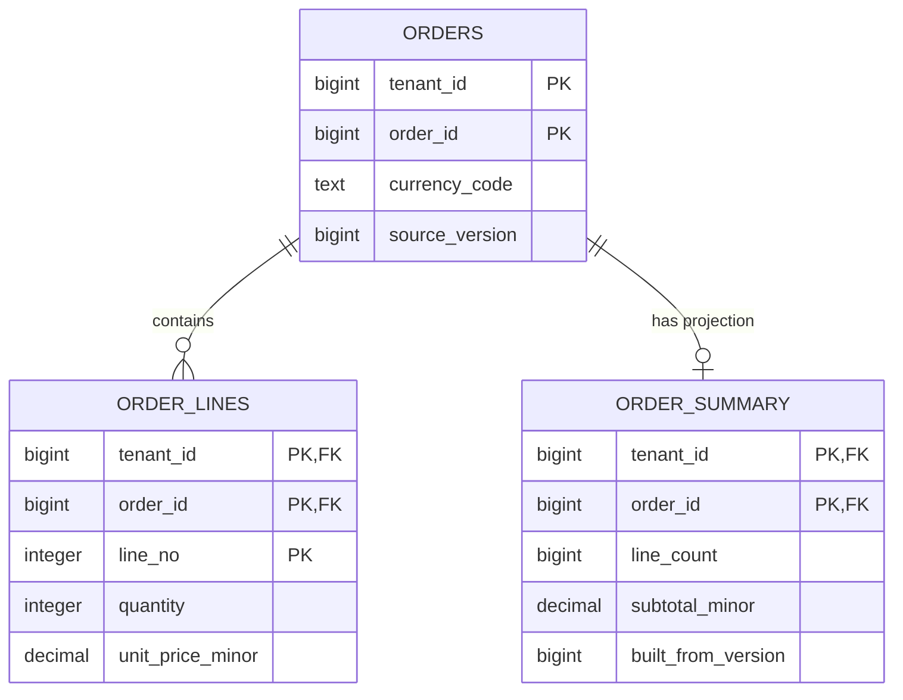
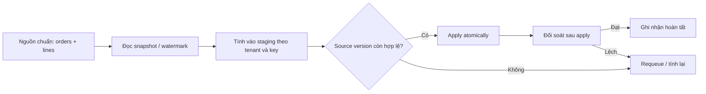
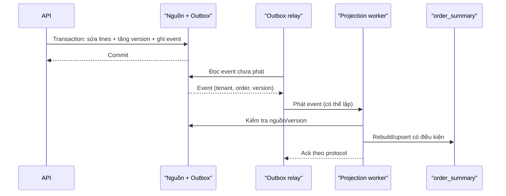

# Tái tạo dữ liệu dẫn xuất, đối soát và xử lý sai lệch

**Phi chuẩn hóa** (*denormalization*) có thể giảm số phép nối bảng, giảm công tính toán lặp lại và làm màn hình báo cáo nhanh hơn. Nhưng khi cùng một thông tin được lưu ở hai dạng, ta có thêm một trách nhiệm: **làm sao chứng minh dữ liệu dẫn xuất vẫn phản ánh đúng dữ liệu nguồn, và nếu sai thì phục hồi bằng cách nào?**

Giả sử hệ thống bán hàng lưu các dòng đơn hàng trong `order_lines`, đồng thời lưu `order_summary.subtotal_minor` để mở trang danh sách đơn mà không phải cộng hàng nghìn dòng mỗi lần. Một thao tác sửa số lượng đã ghi thành công vào `order_lines`, nhưng tác vụ cập nhật bảng tổng hợp bị lỗi. Cả hai bảng vẫn có dữ liệu có vẻ hợp lệ; chỉ **quan hệ giữa chúng** là sai. Không một `FOREIGN KEY` đơn giản nào khẳng định tổng tiền trong bảng tóm tắt bằng tổng thành tiền của mọi dòng.

Bài học thuộc chương **Phi chuẩn hóa** của **DATABASE_DATA_MODELING**. Trọng tâm là chuyển yêu cầu nghiệp vụ thành mô hình nguồn–dữ liệu dẫn xuất có khóa và bất biến rõ ràng; tổ chức **tái tạo (rebuild)**, **đối soát (reconciliation)** và **xử lý sai lệch (remediation)** theo cách có thể kiểm chứng. Cùng một nguyên tắc áp dụng cho bảng tổng hợp quan hệ, materialized view, cache, document tìm kiếm, cạnh đồ thị được tạo từ dữ liệu nguồn và fact/dimension phục vụ phân tích.

## 1. Phân biệt dữ liệu nguồn với dữ liệu dẫn xuất

Trong một hệ thống, cùng một con số có thể xuất hiện ở nhiều nơi, nhưng **không nên mặc định mọi bản sao có quyền sửa ngang nhau**.

| Thành phần | Ví dụ | Vai trò | Cách khôi phục |
|---|---|---|---|
| **Nguồn chân lý** (*source of truth*) | `orders`, `order_lines` và dữ liệu giá đã chốt | Ghi nhận sự kiện/quyết định nghiệp vụ mà hệ thống cam kết | Phục hồi từ backup, transaction log hoặc nguồn nghiệp vụ có thẩm quyền |
| **Dữ liệu dẫn xuất** (*derived data*) | `order_summary`: số dòng, tổng tiền | Kết quả của một hàm tính từ dữ liệu nguồn | Tính lại từ nguồn theo đúng phiên bản quy tắc |
| **Bản sao phục vụ đọc** (*read model/projection*) | Document tìm kiếm, danh sách đơn có nhiều thuộc tính ghép | Dữ liệu tổ chức lại cho một kiểu truy vấn | Rebuild hoặc replay từ nguồn/sự kiện chuẩn |
| **Cache** | Redis key chứa tổng tiền của một đơn | Bản sao có thể mất và nạp lại | Xóa/nạp lại từ nguồn hoặc read model |
| **Dữ liệu lịch sử đã chốt** | `unit_price_minor` tại lúc đặt hàng, tên in trên hóa đơn | Có thể là dữ liệu **nguồn** của một sự kiện lịch sử | Không được tự thay bằng giá/tên hiện tại |

Điều cuối rất quan trọng: **dữ liệu trùng lặp không đồng nghĩa tất cả đều là dữ liệu suy ra có thể xóa**. Đơn giá đã thỏa thuận tại thời điểm đặt là một sự thật giao dịch. Nếu thay nó bằng giá sản phẩm hiện tại khi rebuild, hệ thống sẽ làm sai lịch sử.

### Xác định công thức trước khi thiết kế đồng bộ

Với mỗi dữ liệu dẫn xuất, viết rõ:

\[
D = f(S, V, P)
\]

Trong đó:

- \(D\): dữ liệu dẫn xuất cần tái tạo.
- \(S\): tập dữ liệu nguồn có thẩm quyền.
- \(V\): **phiên bản quy tắc biến đổi**, ví dụ công thức tính tiền v2.
- \(P\): tham số miền nghiệp vụ, ví dụ tenant, thời điểm báo cáo hoặc đơn vị tiền.

Một mô hình “tính lại từ `orders`” là chưa đủ: cần biết **tính từ cột nào, phạm vi nào, xử lý trạng thái nào và làm tròn ra sao**. Nếu công thức đổi nhưng nhãn phiên bản không đổi, hai bản tổng hợp có thể khác nhau mà không phải lỗi đồng bộ kỹ thuật.

## 2. Ví dụ xuyên suốt: tổng hợp đơn hàng

Giả sử một tenant quản lý đơn hàng. Một đơn có nhiều dòng; mỗi dòng lưu số lượng nguyên dương và đơn giá đã chốt ở **đơn vị tiền nhỏ nhất** (*minor unit*: xu, cent, hoặc đơn vị nhỏ nhất được quy ước cho đồng tiền đó).

Yêu cầu nghiệp vụ của ví dụ:

1. Một dòng có `line_no` duy nhất trong đơn, số lượng dương và đơn giá không âm.
2. `orders.currency_code` xác định đơn vị tiền của mọi dòng thuộc đơn; ở ví dụ này không cho trộn tiền tệ trong một đơn.
3. **Tổng phụ** bằng tổng `quantity × unit_price_minor` của **tất cả dòng còn tồn tại trong đơn**, kể cả khi đơn vẫn là `DRAFT` hoặc đã `CANCELLED`. Nếu cần báo cáo doanh thu, phải có một định nghĩa riêng về đơn được tính doanh thu.
4. **Số dòng** là số dòng hàng, không phải tổng số đơn vị sản phẩm.
5. Bảng `order_summary` là **dữ liệu dẫn xuất**, có thể tái tạo; không cho người dùng chỉnh tổng tiền trực tiếp.
6. Mọi thay đổi ảnh hưởng đến hai chỉ số của một đơn đều phải tăng `orders.source_version` theo thứ tự tăng đơn điệu trong cùng transaction.

Ta chọn công thức:

\[
\begin{aligned}
line\_count(o) &= \operatorname{COUNT}\{l \mid l.order\_id=o.id\},\\
subtotal\_minor(o) &= \sum_{l\in lines(o)}
  quantity(l)\times unit\_price\_minor(l).
\end{aligned}
\]

Với đơn chưa có dòng, `line_count = 0` và `subtotal_minor = 0`. Giá trị `NULL` của `SUM` trên tập rỗng cần được thay bằng 0 trong truy vấn. Nếu nghiệp vụ cho phép số lượng thập phân, thuế, giảm giá hoặc nhiều loại tiền, công thức này cần được mở rộng và **đổi phiên bản quy tắc**, không được lén thêm toán hạng.

### Ví dụ số liệu

| Dòng | Sản phẩm | Số lượng | Đơn giá nhỏ nhất | Thành tiền nhỏ nhất |
|---:|---|---:|---:|---:|
| 1 | Bút | 3 | 2.500 | 7.500 |
| 2 | Sổ tay | 2 | 15.000 | 30.000 |
| **Tổng** | | **5 sản phẩm** | | **37.500** |

Bảng dẫn xuất đúng phải lưu **`line_count = 2`** và **`subtotal_minor = 37500`**, không phải số dòng = 5. Phân biệt các phép đếm và đơn vị tính là một phần của **đặc tả mô hình dữ liệu**, không chỉ là chi tiết SQL.

## 3. Lược đồ quan hệ: tách dữ liệu gốc và bản tổng hợp

Ví dụ dưới đây dùng **PostgreSQL 15+**. Đây là bộ bảng tối giản phục vụ bài học; hệ thống thật còn có bảng tenant, sản phẩm, quyền truy cập, thuế và những ràng buộc giao dịch khác.



```sql
CREATE TABLE orders (
    tenant_id BIGINT NOT NULL,
    order_id BIGINT NOT NULL,
    currency_code CHAR(3) NOT NULL,
    order_status TEXT NOT NULL DEFAULT 'DRAFT',
    source_version BIGINT NOT NULL DEFAULT 0,

    CONSTRAINT pk_orders PRIMARY KEY (tenant_id, order_id),
    CONSTRAINT ck_orders_currency
        CHECK (currency_code ~ '^[A-Z]{3}$'),
    CONSTRAINT ck_orders_status
        CHECK (order_status IN ('DRAFT', 'CONFIRMED', 'CANCELLED')),
    CONSTRAINT ck_orders_version
        CHECK (source_version >= 0)
);

CREATE TABLE order_lines (
    tenant_id BIGINT NOT NULL,
    order_id BIGINT NOT NULL,
    line_no INTEGER NOT NULL,
    quantity INTEGER NOT NULL,
    unit_price_minor NUMERIC(20, 0) NOT NULL,

    CONSTRAINT pk_order_lines
        PRIMARY KEY (tenant_id, order_id, line_no),
    CONSTRAINT fk_lines_order
        FOREIGN KEY (tenant_id, order_id)
        REFERENCES orders (tenant_id, order_id)
        ON DELETE RESTRICT,
    CONSTRAINT ck_line_no CHECK (line_no > 0),
    CONSTRAINT ck_quantity CHECK (quantity > 0),
    CONSTRAINT ck_unit_price_minor
        CHECK (unit_price_minor >= 0)
);

CREATE TABLE order_summary (
    tenant_id BIGINT NOT NULL,
    order_id BIGINT NOT NULL,
    line_count BIGINT NOT NULL,
    subtotal_minor NUMERIC(28, 0) NOT NULL,
    built_from_version BIGINT NOT NULL,
    refreshed_at TIMESTAMPTZ NOT NULL,

    CONSTRAINT pk_order_summary
        PRIMARY KEY (tenant_id, order_id),
    CONSTRAINT fk_summary_order
        FOREIGN KEY (tenant_id, order_id)
        REFERENCES orders (tenant_id, order_id)
        ON DELETE RESTRICT,
    CONSTRAINT ck_summary_line_count
        CHECK (line_count >= 0),
    CONSTRAINT ck_summary_subtotal
        CHECK (subtotal_minor >= 0),
    CONSTRAINT ck_summary_version
        CHECK (built_from_version >= 0)
);
```

### Những bất biến đang được bảo vệ

- `order_lines` không thể trỏ tới đơn không tồn tại hoặc sai tenant nhờ **FK ghép**.
- Mỗi đơn có tối đa một dòng mang cùng `line_no`.
- Số lượng và đơn giá tuân theo miền giá trị đã phát biểu.
- `order_summary` có tối đa một bản tóm tắt cho mỗi đơn, không mồ côi và không có giá trị âm.
- `orders.source_version` là số không âm, phục vụ kiểm tra mức cập nhật của nguồn.

### Những bất biến **chưa** được FK và CHECK bảo vệ

- Không có constraint trong ví dụ tự chứng minh `order_summary.subtotal_minor = SUM(order_lines.quantity × unit_price_minor)`.
- `built_from_version` có thể được ghi sai nếu một đường ghi bỏ qua quy tắc tính và tăng version.
- `refreshed_at` là thời điểm tác vụ ghi bản dẫn xuất, không chứng minh dữ liệu được cập nhật đầy đủ.
- Giá trị cùng tiền tệ là **quy tắc thiết kế**: mọi dòng dùng đơn vị nhỏ nhất của đồng tiền ở `orders.currency_code`; trong bảng dòng không lưu mã tiền để chống mâu thuẫn. Nếu cho phép đổi mã tiền của đơn đã có dòng, phải đặt chính sách chuyển đổi dữ liệu/không cho đổi riêng.

**Kết luận:** khóa và ràng buộc cục bộ giúp giữ cấu trúc đúng, còn **sự tương đương giữa dữ liệu gốc và dữ liệu dẫn xuất** là một bất biến xuyên dòng/xuyên bảng cần quy trình cập nhật, đối soát và sửa lỗi.

## 4. Định nghĩa nguồn chân lý và hợp đồng xây dựng

Trước khi triển khai projection, cần lập một **hợp đồng dẫn xuất** (*projection contract*) có thể đọc và kiểm thử.

| Trường | Giá trị trong ví dụ | Tại sao cần |
|---|---|---|
| `projection_name` | `order_summary` | Phân biệt với những projection khác |
| `source_tables` | `orders`, `order_lines` | Biết dữ liệu chuẩn để xây lại |
| `identity_key` | `(tenant_id, order_id)` | Không gộp đơn của tenant khác |
| `rule_version` | `order-subtotal-v1` | Gắn công thức với một phiên bản có ý nghĩa |
| `line_count` | Đếm dòng `order_lines` | Không nhầm với tổng quantity |
| `subtotal_minor` | Tổng `quantity × unit_price_minor` | Tính bằng decimal chính xác ở đơn vị nhỏ nhất |
| `empty_source` | Hai chỉ số = 0 | Không để khác biệt giữa rebuild và cập nhật online |
| `freshness_version` | `orders.source_version` | Giúp thấy projection đã xử lý tới phiên bản nào |
| `update_trigger` | Tạo/sửa/xóa dòng hàng | Xác định mọi biến cố làm projection thay đổi |
| `reconciliation_policy` | So cả version **và** giá trị | Version bằng nhau chưa chứng minh tính đúng |
| `rebuild_policy` | Từ nguồn chuẩn, có kiểm tra version | Không lấy projection lỗi làm đầu vào |
| `owner` | Đội sở hữu miền đơn hàng | Xác định ai được sửa công thức và xử lý sai lệch |

Nên giữ version của **quy tắc tính** tách biệt version của **dữ liệu nguồn**. `source_version = 14` nghĩa là đơn đã trải qua 14 lần thay đổi có liên quan theo quy ước; `rule_version = 'order-subtotal-v1'` nghĩa là dùng công thức v1. Hai đơn có source_version giống nhau không nhất thiết có cùng dữ liệu; một đơn có source_version không đổi vẫn có thể cần rebuild khi công thức chuyển từ v1 sang v2.

### Idempotence là yêu cầu thiết kế

Một phép rebuild là **idempotent** khi chạy lại trên cùng nguồn và cùng công thức vẫn cho kết quả giống nhau:

\[
f(S,V,P)=f(S,V,P).
\]

Điều này hiển nhiên về mặt toán học nhưng **không tự đúng trong triển khai** nếu công thức vô tình phụ thuộc giờ hiện tại, thứ tự các dòng không ổn định, dữ liệu ngoài không có snapshot hoặc thao tác ghi cộng dồn lên projection cũ.

Ví dụ, rebuild theo cách `SET subtotal = subtotal + delta` sẽ cộng lặp nếu chạy lại. Rebuild **thay thế bằng tổng tính lại từ nguồn** thường dễ idempotent hơn: `SET subtotal = computed_total`.

## 5. Ba mô hình cập nhật dữ liệu dẫn xuất

| Mô hình | Cách làm | Độ nhất quán và đánh đổi |
|---|---|---|
| **Cùng transaction** | Ghi nguồn và projection trong một giao dịch DB | Mạnh về nhất quán nếu mọi đường ghi tuân thủ; tăng chi phí transaction và tranh chấp |
| **Không đồng bộ bằng sự kiện/CDC** | Ghi nguồn; worker cập nhật projection sau commit | Giảm phụ thuộc giữa đường ghi và đọc; có độ trễ, lặp/sai thứ tự, cần idempotence và replay |
| **Rebuild định kỳ/on-demand** | Quét nguồn theo lô và thay giá trị projection | Dễ khôi phục bản sao, phát hiện drift; có chi phí đọc lớn và cửa sổ stale giữa các lần chạy |

Các cách trên **không loại trừ nhau**. Một hệ thống có thể cập nhật projection bằng sự kiện để nhanh, đối soát mỗi giờ và rebuild những key sai vào ban đêm. Lựa chọn xuất phát từ SLA về **độ tươi (freshness)**, độ chính xác, tần suất ghi và chi phí vận hành.

### 5.1. Cùng transaction: cập nhật đồng bộ

Một giao dịch có thể khóa đơn, sửa dòng, tăng `source_version` rồi tính lại projection trước khi commit. Khi đó người đọc transaction khác sẽ thấy trạng thái trước hoặc sau commit theo mức cô lập, không thấy một nửa thao tác.

Cần bảo đảm **tất cả đường ghi ảnh hưởng tới tổng tiền** đều đi qua một cổng có kiểm soát: API, import, script sửa lỗi, thao tác quản trị và retry. Một tác vụ chạy trực tiếp `UPDATE order_lines` mà không tăng version/refresh projection phá vỡ hợp đồng.

Với đơn có rất nhiều dòng hoặc ghi quá thường xuyên, việc quét lại toàn bộ dòng mỗi lần thêm sản phẩm có thể đắt. Có thể cân nhắc delta update nguyên tử nhưng phải kiểm soát chính xác retry, xóa/sửa, xung đột và logic tiền tệ.

### 5.2. Không đồng bộ: dữ liệu có thể tạm cũ nhưng phải hội tụ

Ví dụ transaction nguồn commit `source_version=15`; sự kiện cập nhật projection được xử lý sau, trong thời gian đó `order_summary.built_from_version=14`. Đây có thể là một trạng thái **eventual consistency hợp lệ** nếu hệ thống công bố SLA rõ ràng.

Tuy nhiên, nếu worker ngừng hoặc sự kiện mất, stale có thể kéo dài vô hạn. Cần kiểm tra lag, retry, dead-letter, replay, watermark, cảnh báo và đối soát từ nguồn. **Eventual consistency là một hợp đồng hội tụ có điều kiện**, không phải giấy phép để các bản sao sai mãi.

### 5.3. Rebuild từ nguồn thay vì sửa tay bản tổng hợp

Khi tổng tiền sai, không nên “sửa `subtotal_minor` thành giá trị có vẻ đúng” từ ảnh chụp màn hình. Nếu không biết công thức nào đã được dùng và nguồn nào là chuẩn, sai lệch sẽ trở lại sau lần đồng bộ tiếp theo.

Một phép rebuild đúng phải:

1. Xác định nguồn và phiên bản quy tắc.
2. Đọc một tập dữ liệu nhất quán hoặc có cách phát hiện thay đổi trong lúc đọc.
3. Tính lại kết quả **theo khóa và cùng đơn vị**.
4. Ghi kết quả dưới điều kiện tránh đè bản mới bằng bản cũ.
5. Đối soát lại, ghi log và đưa hệ thống về trạng thái bình thường.

## 6. Tạo dữ liệu mẫu và tính kết quả kỳ vọng

Ta tạo đơn trong tenant 42 và hai dòng đã biết:

```sql
INSERT INTO orders
    (tenant_id, order_id, currency_code, order_status, source_version)
VALUES
    (42, 9001, 'VND', 'CONFIRMED', 1),
    (42, 9002, 'VND', 'DRAFT', 0);

INSERT INTO order_lines
    (tenant_id, order_id, line_no, quantity, unit_price_minor)
VALUES
    (42, 9001, 1, 3, 2500),
    (42, 9001, 2, 2, 15000);
```

Đây là **seed dữ liệu** phục vụ ví dụ: phiên bản nguồn của đơn 9001 được đặt là 1 vì việc nạp dữ liệu mô phỏng một thay đổi nghiệp vụ đã hoàn tất. Trong production, version phải tăng theo chính sách qua transaction ghi chuẩn, không nhập tay tùy ý.

Truy vấn nguồn tính **toàn bộ các đơn**, kể cả đơn chưa có dòng:

```sql
SELECT
    o.tenant_id,
    o.order_id,
    o.source_version,
    COUNT(l.line_no)::BIGINT AS expected_line_count,
    COALESCE(
        SUM(l.quantity::NUMERIC * l.unit_price_minor),
        0
    )::NUMERIC(28, 0) AS expected_subtotal_minor
FROM orders AS o
LEFT JOIN order_lines AS l
  ON l.tenant_id = o.tenant_id
 AND l.order_id = o.order_id
WHERE o.tenant_id = 42
GROUP BY o.tenant_id, o.order_id, o.source_version
ORDER BY o.order_id;
```

Kết quả dự kiến:

| `order_id` | `source_version` | `expected_line_count` | `expected_subtotal_minor` |
|---:|---:|---:|---:|
| 9001 | 1 | 2 | 37500 |
| 9002 | 0 | 0 | 0 |

Tại đây `COUNT(l.line_no)` trả 0 cho đơn không có dòng vì `LEFT JOIN` sinh một dòng với cột `l` là `NULL`. **`COUNT(*)` không thay thế được**: trên đơn không có dòng, nó có thể trả 1. `COALESCE` bảo đảm tổng của tập rỗng là 0.

### Cẩn trọng về tiền và làm tròn

Ví dụ dùng số lượng nguyên và `unit_price_minor NUMERIC(20,0)` để phép cộng **không cần làm tròn trung gian**. Không dùng `FLOAT` cho giá trị tiền cần đối soát chính xác. Nếu dùng thuế, phần trăm giảm hoặc số lượng thập phân, phải chốt thời điểm làm tròn: làm tròn ở từng dòng hay sau tổng, quy tắc half-up/banker's rounding và đồng tiền cụ thể. Hai hàm tính dùng thứ tự làm tròn khác nhau có thể tạo lệch 1 đơn vị nhỏ nhất dù đều “trông hợp lý”.

## 7. Rebuild một đơn trong transaction có kiểm soát

Đây là cách đơn giản để làm mới **một khóa `(tenant_id, order_id)`** từ dữ liệu chuẩn. Giả định quan trọng: **mọi transaction làm thay đổi dòng đơn đều khóa dòng `orders` của cùng đơn trước khi sửa và tăng `source_version` trong cùng transaction**.

```sql
BEGIN;

-- Chặn writer của cùng đơn, theo quy ước khóa chung.
SELECT source_version
FROM orders
WHERE tenant_id = 42 AND order_id = 9001
FOR UPDATE;

-- Ứng dụng phải xác nhận SELECT trả về đúng một đơn.
WITH exact AS (
    SELECT
        COUNT(l.line_no)::BIGINT AS line_count,
        COALESCE(
            SUM(l.quantity::NUMERIC * l.unit_price_minor),
            0
        )::NUMERIC(28, 0) AS subtotal_minor
    FROM order_lines AS l
    WHERE l.tenant_id = 42
      AND l.order_id = 9001
)
INSERT INTO order_summary
    (tenant_id, order_id, line_count, subtotal_minor,
     built_from_version, refreshed_at)
SELECT
    o.tenant_id, o.order_id,
    e.line_count, e.subtotal_minor,
    o.source_version, CURRENT_TIMESTAMP
FROM orders AS o
CROSS JOIN exact AS e
WHERE o.tenant_id = 42
  AND o.order_id = 9001
ON CONFLICT (tenant_id, order_id)
DO UPDATE SET
    line_count = EXCLUDED.line_count,
    subtotal_minor = EXCLUDED.subtotal_minor,
    built_from_version = EXCLUDED.built_from_version,
    refreshed_at = EXCLUDED.refreshed_at;

COMMIT;
```

Vì hàng `orders` đã bị khóa trước khi quét dòng, một writer **cùng tuân thủ quy ước khóa** không thể thay đổi dòng trong lúc rebuild. Nếu writer khác bỏ qua khóa, truy vấn vẫn có thể thấy một trạng thái không phù hợp với version gắn kèm. Đây là lý do **transaction đúng chưa đủ nếu đường ghi không thống nhất**.

`INSERT ... ON CONFLICT DO UPDATE` thay thế giá trị bằng kết quả tính từ nguồn, không cộng thêm vào giá trị cũ. Chạy lại trên cùng dữ liệu cho cùng **giá trị nghiệp vụ**; `refreshed_at` sẽ đổi, nên idempotence ở đây áp dụng cho hai chỉ số và version, không phải từng byte metadata.

Nếu muốn hỗ trợ rebuild không làm chậm writer, có thể đọc theo snapshot rồi **chỉ áp dụng khi version nguồn vẫn khớp**; nhưng phải xử lý race giữa bước so version và bước ghi. Một `WHERE orders.source_version = saved_version` đơn giản trong câu lệnh chạy đồng thời **không tự thay thế** chiến lược khóa/cô lập hoặc compare-and-swap phù hợp.

### Giao dịch ghi chuẩn và version nguồn

Một giao dịch sửa số lượng có thể theo thứ tự:

```sql
BEGIN;

-- Mọi thao tác sửa dòng của cùng đơn lấy khóa này trước.
SELECT source_version
FROM orders
WHERE tenant_id = 42 AND order_id = 9001
FOR UPDATE;

UPDATE order_lines
SET quantity = 4
WHERE tenant_id = 42
  AND order_id = 9001
  AND line_no = 1;

-- Chỉ tăng version khi thay đổi nghiệp vụ được xác nhận.
UPDATE orders
SET source_version = source_version + 1
WHERE tenant_id = 42 AND order_id = 9001;

-- Nếu chọn nhất quán đồng bộ:
-- tính lại order_summary trong cùng transaction trước COMMIT.
-- Nếu chọn async:
-- ghi outbox event trong transaction, worker sẽ dựng projection sau.

COMMIT;
```

Đoạn trên **cố ý minh họa phần ghi nguồn**. Với yêu cầu nhất quán mạnh, phải thêm thao tác cập nhật `order_summary` **trước commit**, không được thực thi nguyên đoạn rồi tuyên bố hai bảng luôn bằng nhau. Cần kiểm tra số dòng `UPDATE order_lines` trả về; nếu là 0, không tự tăng version như thể đã sửa thành công.

## 8. Rebuild hàng loạt: snapshot, staging và áp dụng có điều kiện

Nếu cần sửa hàng triệu dòng `order_summary`, khóa lần lượt từng đơn có thể mất nhiều thời gian. Một quy trình an toàn hơn phải phân tách **tính toán**, **áp dụng** và **kiểm chứng**, đồng thời xử lý dữ liệu nguồn tiếp tục thay đổi.



### Bước 1 — Xác định phạm vi và watermark

Ghi `run_id`, tenant, dải key, thời điểm bắt đầu, `rule_version` và mốc đọc nguồn. Nếu dùng PostgreSQL, một transaction `REPEATABLE READ` cho các truy vấn kiểm kê có thể tạo **ảnh chụp nhất quán** của dữ liệu trong transaction ấy. Nhưng giữ một transaction snapshot lớn trong thời gian dài có thể gây áp lực tài nguyên và cản quá trình dọn phiên bản dữ liệu cũ; phải chia lô và lựa chọn nhất quán theo SLA.

Nếu dùng CDC/event sequence, một watermark giúp xác định **đã xử lý hết sự kiện tới vị trí nào**. Watermark không phải đồng hồ `updated_at` bất kỳ; phải gắn với thứ tự/định danh nguồn dữ liệu hoặc log được định nghĩa.

### Bước 2 — Tính vào staging và lưu bằng chứng

Một bảng staging kết quả rebuild có thể chứa `run_id`, `tenant_id`, `order_id`, `source_version`, `line_count`, `subtotal_minor` và `rule_version`. Giữ thông tin run để tái hiện cách một giá trị được tạo ra.

Có thể đối soát staging trước khi áp dụng: không có key trùng, số đơn nguồn bằng số kết quả, tiền không âm, version/rule hợp lệ. Nếu một đơn đã thay đổi sau snapshot, **đưa vào hàng tính lại** thay vì gán kết quả cũ với version mới.

### Bước 3 — Áp dụng mà không làm cũ hóa projection

Với từng key, cần bảo đảm:

- Kết quả tính từ snapshot được gắn **đúng phiên bản** đã đọc.
- Nếu nguồn đã có version mới, không ghi đè bản mới bằng số liệu cũ.
- Nếu worker khác đã ghi projection ở version cao hơn, không hạ `built_from_version`.
- Các cột dẫn xuất của một key được thay **cùng nhau** trong một transaction.
- Retry cùng `run_id`/key không cộng tiền hoặc nhân đôi số dòng.

Một chiến lược đơn giản và chặt chẽ là: **khóa dòng nguồn → so version → đọc/tính lại nếu cần → ghi projection → commit**, dùng lô đủ nhỏ. Chiến lược ít khóa hơn có thể dùng kiểm tra version có điều kiện và cơ chế snapshot phù hợp, nhưng phải chứng minh không có cửa sổ race.

### Bước 4 — Xử lý thêm, sửa, xóa

Rebuild không chỉ là cập nhật những đơn đang có dòng:

- **Đơn mới:** phải có projection mới hoặc truy vấn đọc có fallback rõ ràng.
- **Đơn không có dòng:** vẫn phải có tổng 0 nếu hợp đồng yêu cầu mọi đơn có một dòng summary.
- **Dòng bị xóa:** tổng và số dòng phải giảm theo **nguồn hiện tại**.
- **Đơn bị xóa vật lý:** phải xóa/đóng projection cũ theo chính sách FK và lịch sử; bảng summary không được giữ bản ghi mồ côi.
- **Đổi tenant/đơn vị tiền:** thường là sự kiện đặc biệt, không được âm thầm chuyển khóa hoặc cộng tổng giữa hai đơn vị.
- **Đơn bị hủy:** ví dụ này vẫn giữ tổng số dòng gốc; báo cáo doanh thu phải lọc/định nghĩa riêng, không tự cho tổng của đơn hủy bằng 0.

**Điểm dễ bỏ sót:** nếu chỉ quét các dòng nguồn `order_lines`, các đơn **không có dòng** sẽ biến mất khỏi kết quả. Nên bắt đầu từ `orders` rồi `LEFT JOIN` để giữ tập key đầy đủ.

## 9. Đối soát dữ liệu dẫn xuất bằng phép tính độc lập

**Đối soát** không phải “hàng ngày xem bảng có số dòng tăng đều”. Nó là phép so sánh có thể lặp giữa **kết quả kỳ vọng từ nguồn chuẩn** và **bản dẫn xuất quan sát được**, ở cùng grain và phiên bản quy tắc.

### 9.1. Truy vấn tìm bản thiếu, version cũ và số liệu khác nhau

```sql
BEGIN TRANSACTION ISOLATION LEVEL REPEATABLE READ READ ONLY;

WITH expected AS (
    SELECT
        o.tenant_id,
        o.order_id,
        o.source_version,
        COUNT(l.line_no)::BIGINT AS expected_line_count,
        COALESCE(
            SUM(l.quantity::NUMERIC * l.unit_price_minor), 0
        )::NUMERIC(28, 0) AS expected_subtotal_minor
    FROM orders AS o
    LEFT JOIN order_lines AS l
      ON l.tenant_id = o.tenant_id
     AND l.order_id = o.order_id
    WHERE o.tenant_id = 42
    GROUP BY o.tenant_id, o.order_id, o.source_version
)
SELECT
    e.tenant_id,
    e.order_id,
    e.source_version,
    s.built_from_version,
    e.expected_line_count,
    s.line_count AS actual_line_count,
    e.expected_subtotal_minor,
    s.subtotal_minor AS actual_subtotal_minor,
    CASE
        WHEN s.order_id IS NULL THEN 'MISSING_PROJECTION'
        WHEN s.built_from_version IS DISTINCT FROM e.source_version
            THEN 'STALE_OR_INCONSISTENT_VERSION'
        WHEN s.line_count IS DISTINCT FROM e.expected_line_count
          OR s.subtotal_minor IS DISTINCT FROM e.expected_subtotal_minor
            THEN 'VALUE_MISMATCH'
        ELSE 'MATCH'
    END AS reconciliation_status
FROM expected AS e
LEFT JOIN order_summary AS s
  ON s.tenant_id = e.tenant_id
 AND s.order_id = e.order_id
ORDER BY e.order_id;

COMMIT;
```

Trong PostgreSQL, `IS DISTINCT FROM` thực hiện so sánh an toàn với `NULL`, giúp phân biệt rõ giá trị bị thiếu với giá trị bằng nhau. Truy vấn trả cả `MATCH` để kiểm tra toàn bộ trạng thái; khi vận hành có thể lọc chỉ những hàng lệch và ghi kết quả theo `run_id`.

**Lưu ý về thứ tự phân loại:** nếu version lệch và giá trị cũng lệch, truy vấn phân loại là `STALE_OR_INCONSISTENT_VERSION` trước. Nó không chứng minh giá trị chắc chắn sẽ đúng khi worker xử lý hết sự kiện. Hệ thống nên ghi **cả các cờ sai version và sai giá trị**, hoặc ít nhất giữ các cột so sánh để xử lý sâu hơn.

### 9.2. Vì sao cần snapshot nhất quán?

Nếu đọc `orders` ở thời điểm A, `order_lines` ở B và `order_summary` ở C trong các transaction độc lập, một thao tác mua hàng hợp lệ ở giữa có thể tạo ra **sai lệch giả**. Cùng một truy vấn snapshot như trên tránh so sánh ba phiên bản dữ liệu không cùng thời điểm đối với các bảng trong cùng PostgreSQL database.

Với nguồn phân tán qua nhiều hệ thống, một transaction snapshot đơn DB không đủ. Cần watermark/offset và giao thức xuất snapshot nhất quán, hoặc chấp nhận vùng sai lệch có giới hạn và kiểm tra lại trước khi sửa.

### 9.3. Chỉ có version giống nhau vẫn chưa đủ

Một bug trong công thức cập nhật projection có thể ghi `built_from_version = 17` nhưng tính tiền thiếu một dòng. Khi đó so version cho kết quả bình thường nhưng **giá trị sai**. Vì vậy đối soát định kỳ phải **tự tính lại từ nguồn chuẩn**, không chỉ kiểm tra lag.

Ngược lại, nếu giá trị tình cờ bằng nhau nhưng version cũ, projection có thể chưa áp dụng một số biến cố bù trừ. Tùy hợp đồng, vẫn cần đánh dấu bản chưa theo kịp để điều tra hoặc cập nhật watermark.

### 9.4. Dùng hash khi dữ liệu lớn

Với document tìm kiếm hoặc kết quả nhiều thuộc tính, có thể so:

- Khóa tồn tại/thiếu/thừa.
- Count và sum các thuộc tính định lượng.
- Hash của dữ liệu đã **chuẩn hóa thứ tự, định dạng, encoding, NULL và precision**.
- Kiểm tra sâu từng thuộc tính khi hash không khớp.

Hash giúp giảm lượng dữ liệu phải truyền nhưng **không chứng minh tuyệt đối hai tập bằng nhau** vì va chạm hash có thể xảy ra. Nếu dùng phép so hash, phải có chiến lược drill-down và chọn thuật toán theo mức rủi ro.

## 10. Phân loại sai lệch để chọn hướng xử lý

Không phải mọi `MISMATCH` đều là lỗi dữ liệu nguồn.

| Loại | Dấu hiệu | Câu hỏi chẩn đoán | Hướng xử lý ban đầu |
|---|---|---|---|
| **Projection missing** | Có đơn nguồn nhưng không có summary | Chưa xây, mất hàng hay job bỏ sót? | Rebuild key thiếu |
| **Lag hợp lệ** | `built_from_version` thấp hơn nhưng nằm trong SLA | Worker còn đang xử lý hay backlog tăng? | Theo dõi độ trễ; chưa cần sự cố nếu trong ngưỡng |
| **Lag quá hạn** | Version cũ kéo dài | Consumer dừng, event lỗi, dead-letter? | Khôi phục luồng, replay/rebuild |
| **Value mismatch** | Version giống nhưng count/sum khác | Bug công thức, race, sửa tay? | Cách ly kết quả, tính từ nguồn, điều tra |
| **Projection ahead** | Version dẫn xuất lớn hơn version nguồn | Replay sai key, phục hồi source lùi phiên bản? | Ưu tiên điều tra, không tự giảm version tùy ý |
| **Orphan projection** | Summary có key không còn ở source | Xóa nguồn, lỗi FK, dữ liệu hệ khác? | Kiểm tra chính sách xóa/lịch sử |
| **Duplicate processing** | Delta cộng lặp, tổng lớn bất thường | Event at-least-once có bị xử lý hai lần? | Idempotency, dedupe, rebuild |
| **Out-of-order events** | Version 12 đến trước 11 | Có kiểm tra gap và version không? | Buffer/replay hoặc thay bằng full recompute |
| **Rule drift** | Công thức thay đổi giữa worker/batch | Các hệ thống có cùng `rule_version`? | Chốt version, rebuild đồng bộ |
| **Nguồn sai** | Dữ liệu giá/số lượng nguồn bị sửa sai | Đâu là sự kiện/ghi nhận nghiệp vụ chuẩn? | Điều tra và sửa **nguồn** theo nghiệp vụ, rồi rebuild |

“Projection ahead” không nên bị chẩn đoán như một dạng lag bình thường: nó có thể là dấu hiệu source rollback, nhầm tenant, ghi version không theo quy tắc hoặc lỗi replay nghiêm trọng. Không tự sửa bằng `UPDATE orders SET source_version = ...` chỉ để hai bảng có số bằng nhau.

### Đo độ nghiêm trọng theo tác động

Sự sai khác giữa hai bản xem trước giỏ hàng có thể chấp nhận một thời gian ngắn. Sai tổng tiền đã thanh toán, báo cáo thuế hoặc số lượng tồn kho khả dụng có thể ảnh hưởng quyết định tài chính hay giao hàng.

Hãy đánh giá: **đối tượng bị ảnh hưởng, tuổi sai lệch, số tiền/hàng, người dùng nhìn thấy, hành động nào đã thực hiện dựa trên dữ liệu sai, khả năng phục hồi và yêu cầu kiểm toán**. Đặt ngưỡng cảnh báo theo mức rủi ro thực sự, không chỉ theo số hàng khác nhau.

## 11. Hàng đợi sự kiện, outbox và xử lý lặp

Nếu hệ thống dùng cập nhật không đồng bộ, cần xử lý thực tế rằng một message broker thường vận hành theo mô hình có thể **giao lại thông điệp**, consumer có thể chết giữa hai bước, và các message giữa nhiều partition có thể đến **không theo thứ tự mong muốn**.

### 11.1. Transactional outbox

Ghi thay đổi nguồn và một **outbox event** trong cùng transaction. Sau commit, publisher đọc outbox để gửi sự kiện tới worker.



Một bảng outbox đơn giản:

```sql
CREATE TABLE order_outbox (
    event_id UUID PRIMARY KEY,
    tenant_id BIGINT NOT NULL,
    order_id BIGINT NOT NULL,
    source_version BIGINT NOT NULL,
    event_kind TEXT NOT NULL,
    occurred_at TIMESTAMPTZ NOT NULL DEFAULT CURRENT_TIMESTAMP,
    published_at TIMESTAMPTZ,

    CONSTRAINT fk_outbox_order
        FOREIGN KEY (tenant_id, order_id)
        REFERENCES orders (tenant_id, order_id)
        ON DELETE RESTRICT,
    CONSTRAINT uq_order_event_version
        UNIQUE (tenant_id, order_id, source_version),
    CONSTRAINT ck_outbox_version CHECK (source_version > 0),
    CONSTRAINT ck_outbox_kind
        CHECK (event_kind IN ('ORDER_LINES_CHANGED'))
);
```

Trong ví dụ, **mỗi phiên bản nguồn có đúng một sự kiện đổi dòng** và `event_id` do nhà sản xuất cung cấp. Hệ thống thực có thể có nhiều loại sự kiện trong cùng phiên bản; lúc ấy phải thiết kế khóa duy nhất khác. Bảng FK ở trên cũng đồng nghĩa không được xóa vật lý đơn đang còn event; cần chính sách giữ lịch sử và lưu trữ/outbox tương ứng.

Tạo outbox **sau** khi ghi nguồn trong một transaction khác tạo cửa sổ: nguồn đã commit nhưng không có event. Transactional outbox loại bỏ cửa sổ này trong **một cơ sở dữ liệu giao dịch**, nhưng không đảm bảo relay chỉ phát một lần. Vì vậy consumer vẫn cần xử lý lặp.

### 11.2. Idempotent consumer

Có hai chiến lược phổ biến:

- **Full-state projection:** event chỉ báo “đơn 9001 đã thay đổi”; worker đọc nguồn hiện tại rồi tính lại toàn bộ `order_summary`. Nếu event 12 đến sau event 13, worker vẫn dựng từ nguồn mới nhất với version mới nhất. Phải bảo đảm không có worker khác ghi bản cũ lên bản mới.
- **Delta projection:** event chứa thay đổi như `+2500` hoặc `-1 line`, worker cộng/trừ vào tổng. Chi phí tính nhỏ, nhưng **mỗi event phải được áp dụng đúng một lần theo hiệu ứng**, xử lý thứ tự, rollback và tính toán bù trừ rất chặt chẽ.

Với delta, chỉ đánh dấu `event_id` là đã xử lý **không đủ** nếu việc ghi dấu và cập nhật summary không nguyên tử. Trong cùng một database, có thể thực hiện hai bước trong một transaction; ở các kho khác nhau cần giao thức idempotency/recovery cụ thể.

Ví dụ bảng chống trùng sự kiện ở một consumer dùng cùng PostgreSQL:

```sql
CREATE TABLE projection_applied_events (
    event_id UUID PRIMARY KEY,
    applied_at TIMESTAMPTZ NOT NULL DEFAULT CURRENT_TIMESTAMP
);
```

Consumer thử chèn `event_id`; chỉ khi **thực sự chèn thành công** mới áp dụng delta và commit hai thao tác cùng nhau. Nếu `ON CONFLICT DO NOTHING` không chèn dòng, phải **bỏ qua delta**, nếu không bảng dấu sự kiện không có tác dụng.

### 11.3. Thứ tự và lỗ hổng phiên bản

Một worker nhận version 15 khi summary mới ở 13. Nếu sự kiện là **delta**, không được đánh dấu đã xử lý 15 rồi bỏ qua 14: tổng sẽ thiếu. Cần buffer, replay 14 hoặc rebuild full-state từ nguồn và đặt version phù hợp.

Một worker nhận version 14 khi summary đã ở 15 không được **ghi đè** summary bằng bản cũ. Với full-state recompute từ nguồn mới nhất, event cũ có thể được dùng như tín hiệu thức dậy; đó không còn là phép chiếu trạng thái ở version 14.

**Quy tắc:** gắn event với `tenant_id`, `order_id`, `source_version` và `rule_version` hoặc metadata tương ứng; kiểm tra thứ tự áp dụng theo **từng aggregate key**, không giả định timestamp toàn hệ thống là thứ tự chính xác.

## 12. Xử lý sự cố: tìm đúng dữ liệu sai trước khi sửa

Giả sử lúc 09:00, hệ thống phát hiện đơn 9001 có summary 35.000, nhưng từ nguồn tính lại được 37.500. Hướng xử lý phải tránh “sửa nhanh” làm mất chứng cứ.

### Bước 1 — Khoanh vùng và dừng lan truyền tác động

Xác định key/tenant, số lượng đơn ảnh hưởng, công thức hiện hành, thời điểm bắt đầu sai và những dịch vụ đã đọc summary. Nếu projection đang dùng để quyết định thanh toán hoặc xuất hóa đơn, cân nhắc **chặn quyết định dựa trên dữ liệu nghi ngờ hoặc đọc trực tiếp nguồn** cho đến khi khôi phục.

Không nhất thiết dừng toàn bộ hệ thống nếu chỉ một tenant hoặc một bảng cache bị ảnh hưởng; cách ly đúng phạm vi giúp giảm tác động.

### Bước 2 — Chụp bằng chứng

Ghi `incident_id`, `run_id`, key, expected/actual, source_version, built_from_version, rule_version, snapshot/watermark, event IDs và lỗi worker. Nếu chính sách cho phép, lưu hash hoặc số liệu tóm tắt thay vì sao chép thông tin nhạy cảm không cần thiết.

Không ghi trực tiếp `UPDATE order_summary SET subtotal_minor = 37500` trước khi biết **nguồn và công thức**. Nếu người vận hành tự sửa bản tổng hợp, một replay sau đó có thể làm lệch lần nữa.

### Bước 3 — Phân loại nguyên nhân

Kiểm tra outbox/backlog, retry, lỗi dead-letter, đường ghi bỏ tăng version, delta bị xử lý lặp, thay đổi công thức, hành vi xóa dòng hoặc transaction dài. Một sai lệch quan sát được trong cửa sổ đồng bộ hợp lệ cần được phân biệt với **projection hỏng không hội tụ**.

### Bước 4 — Chọn biện pháp khắc phục

| Tình huống | Biện pháp hợp lý |
|---|---|
| Event bị kẹt nhưng đầy đủ | Khôi phục consumer, retry có idempotence; sau đó đối soát |
| Mất/không đáng tin event nhưng nguồn vẫn đúng | Rebuild từ nguồn chuẩn theo key/phạm vi |
| Công thức sai ở nhiều worker | Sửa và version hóa công thức; rebuild các projection bị ảnh hưởng |
| Nguồn nghiệp vụ sai | Sửa nguồn bằng quy trình có bằng chứng/ủy quyền, rồi rebuild mọi projection phụ thuộc |
| Một bản sao cache bị bẩn | Invalidate cache và nạp lại từ nguồn hoặc projection đã kiểm chứng |
| Tập dữ liệu rất lớn và đang ghi liên tục | Chia lô theo tenant/key, snapshot/watermark, version guard và kiểm chứng sau từng lô |

### Bước 5 — Kiểm chứng sau phục hồi

Đối soát lại **cùng grain** và theo phiên bản quy tắc đã sửa. Kiểm tra số key thiếu/thừa, số tiền chênh, lag, event đã áp dụng và số dòng cần xử lý lại. Khi có dữ liệu mới tiếp tục được ghi trong lúc phục hồi, kết quả “0 sai lệch” tại snapshot cũ không khẳng định thời điểm hiện tại đã hội tụ; cần kiểm tra watermark và lô gần nhất.

### Bước 6 — Đóng sự cố và phòng tái diễn

Đặt test hồi quy đúng tình huống đã gây sai lệch, thêm metric cảnh báo, xử lý quyền ghi bypass và cập nhật runbook. Ghi nhận **nguyên nhân gốc** (ví dụ worker xử lý lặp delta sau timeout) chứ không chỉ “đã backfill thành công”.

## 13. Đối soát theo lô, ngưỡng cảnh báo và chỉ số vận hành

Rebuild và reconcile sẽ bền vững hơn nếu có phép đo hệ thống thay vì chỉ kiểm tra khi người dùng phàn nàn.

| Chỉ số | Cách diễn giải | Ghi chú |
|---|---|---|
| `projection_missing_count` | Số key nguồn thiếu bản dẫn xuất | Phải định nghĩa chính sách với key vừa tạo |
| `orphan_projection_count` | Số key dẫn xuất không có nguồn | Có thể liên quan xóa nguồn hoặc lịch sử |
| `value_mismatch_count` | Số key có giá trị khác công thức chuẩn | Phân biệt với lag hợp lệ |
| `absolute_amount_diff_minor` | Tổng trị tuyệt đối chênh tiền | Không để chênh dương và âm bù nhau |
| `stale_version_count` | Số key summary chưa theo kịp source_version | Đo cả tuổi và phạm vi |
| `oldest_unprocessed_event_age` | Tuổi sự kiện chưa xử lý lâu nhất | Giúp phát hiện worker tắc |
| `rebuild_duration` / `rebuild_rows_per_sec` | Tốc độ và chi phí phục hồi | Theo tenant, run, rule version |
| `retry_count` / `dead_letter_count` | Độ tin cậy đường event | Tăng đột biến cần điều tra |
| `post_rebuild_mismatch_count` | Số key vẫn sai sau rebuild | Quan trọng hơn việc job chỉ kết thúc thành công |

### Không cộng chênh lệch có dấu rồi kết luận bằng 0

Giả sử đơn A bị thiếu 1.000, đơn B thừa 1.000. Tổng chênh có dấu bằng 0, nhưng **hai đơn đều sai**. Vì vậy dùng cả `COUNT` sai lệch và tổng **giá trị tuyệt đối** chênh:

\[
\text{total\_absolute\_diff} =
\sum_o \left| expected(o)-actual(o) \right|.
\]

Nếu chênh tiền là dữ liệu tài chính, cần so sánh theo **cùng đơn vị tiền** và cùng kỳ; không cộng các minor unit của VND với USD như thể cùng một thước đo. Trong ví dụ, tất cả đơn hiển thị cùng VND, còn hệ đa tiền tệ phải nhóm theo `currency_code` hoặc chuyển đổi bằng tỷ giá/thời điểm đã được xác định.

### Chọn kiểm tra toàn phần hay lấy mẫu

- **Đối soát toàn phần** phù hợp với tập nhỏ, dữ liệu rủi ro cao, hoặc cửa sổ batch.
- **Đối soát tăng dần** ưu tiên key vừa thay đổi theo version/event, giảm tải.
- **Lấy mẫu ngẫu nhiên và mẫu rủi ro** giúp phát hiện bug ở các nhánh ít truy cập, nhưng không chứng minh toàn bộ dữ liệu đúng.
- **Kiểm kê định kỳ toàn phần** vẫn hữu ích để phát hiện drift do đường ghi không phát event hoặc lỗi lâu ngày.

Một chiến lược tốt thường kết hợp kiểm tra tăng dần liên tục với đối soát rộng hơn theo kỳ, điều chỉnh theo rủi ro và chi phí.

## 14. Khi nào có thể đọc projection, khi nào phải đọc nguồn?

Lược đồ dữ liệu cần ghi rõ **hợp đồng nhất quán của từng API**.

| Use case | Mức nhất quán gợi ý | Lý do |
|---|---|---|
| Trang danh sách đơn xem nhanh | Có thể chấp nhận summary trễ vài giây nếu hiển thị rõ | Tối ưu tốc độ và chi phí |
| Xác nhận thanh toán/hoàn tiền | Đọc dữ liệu nghiệp vụ chính xác theo transaction và quy tắc tiền | Không quyết định tài chính dựa trên tổng stale không có kiểm tra |
| Báo cáo điều hành theo giờ | Snapshot/watermark đã chốt, có độ trễ công bố | Tránh một phần dữ liệu cũ một phần mới |
| Cache giao diện | Eventual consistency, TTL và invalidation | Cache có thể mất và phục hồi |
| Kiểm toán lịch sử | Nguồn lịch sử có chứng cứ và phiên bản quy tắc | Truy cứu được giá trị đã chốt vào thời điểm T |

Nếu UI cho phép người dùng vừa sửa đơn xong và mong ngay lập tức thấy tổng mới, hệ thống async cần **read-your-writes**: chờ projection bắt kịp version, tính trực tiếp từ nguồn cho lần đọc đó hoặc hiển thị trạng thái “đang cập nhật”. Không nên hứa “cập nhật tức thì” khi pipeline có thể lag.

Một lựa chọn thiết kế hữu ích là trả về `source_version` hoặc `built_from_version` trong API nội bộ để đo độ tươi. Nhưng các version này phải được gắn với đúng khóa và đúng quy tắc; **so version không thay phép đối soát giá trị**.

## 15. Phi chuẩn hóa trong document, graph và kho phân tích

Bài toán nguồn–dẫn xuất–đối soát không giới hạn ở bảng tổng hợp SQL.

### 15.1. Document và chỉ mục tìm kiếm

Một document tìm kiếm của sản phẩm có thể chứa tên thương hiệu, nhóm hàng, tồn kho khả dụng và số lượt bán, mặc dù những dữ liệu này đến từ nhiều bảng/giao dịch.

Khi tên nhóm hàng đổi, **tất cả document sản phẩm** chứa nhãn cũ có thể cần cập nhật. Rebuild phải tính từ nguồn và cùng rule version; đối soát nên kiểm tra số document thiếu/thừa, key trùng, những thuộc tính quan trọng và watermark ingest. Cần phân biệt **bản chụp tên theo lịch sử** với nhãn hiện tại để không sửa sai dữ liệu chốt.

Trong hệ document, dữ liệu dẫn xuất có thể được nhúng cùng document nguồn để đọc nhanh; điều này chỉ an toàn nếu cơ chế update/transaction của engine và giới hạn kích thước document phù hợp.

### 15.2. Graph và cạnh dẫn xuất

Graph có thể lưu cạnh `RELATED_TO` dựa trên hành vi mua chung, hoặc chỉ số độ phổ biến của node được tính từ các giao dịch nguồn. Những cạnh/thuộc tính này là **kết quả phân tích**, không phải quan hệ nghiệp vụ được xác nhận trực tiếp.

Khi thuật toán gợi ý đổi, cần biết `model_version` hoặc `rule_version`, tái tạo tập cạnh đúng với dữ liệu đầu vào và phân biệt cạnh đã hết hiệu lực với cạnh bị thiếu do pipeline lỗi. Nếu graph database không có ràng buộc tham chiếu tương đương SQL FK, cần kiểm tra tồn tại node và tính duy nhất của cạnh theo engine.

### 15.3. Phân tích: fact, aggregate và materialized view

Kho phân tích thường lưu fact gốc theo **grain** (ví dụ một dòng đơn), đồng thời tạo bảng tổng theo ngày, tenant hoặc nhóm sản phẩm. Khi nguồn có backfill hay sửa giao dịch cũ, tổng cũ có thể không tự đúng. Cần lưu watermark theo partition/kỳ, version transform, dấu vết run và chiến lược tái tính những partition bị ảnh hưởng.

**Bẫy fan-out:** nếu fact đơn hàng bị join qua quan hệ N:M (ví dụ một sản phẩm ở ba nhóm) rồi cộng doanh thu, giá trị có thể bị nhân ba. Rebuild chạy “đúng SQL” nhưng sai **grain nghiệp vụ** vẫn tạo dữ liệu dẫn xuất không hợp lệ. Trước khi kết luận drift do pipeline, phải so lại định nghĩa grain và cách phân bổ chỉ tiêu.

Trong PostgreSQL, materialized view có thể được làm mới bằng `REFRESH MATERIALIZED VIEW`; tùy phiên bản và điều kiện, `CONCURRENTLY` yêu cầu những điều kiện cụ thể, chẳng hạn unique index phù hợp và view đã được populate. Nhưng cơ chế refresh không tự quyết định **thời điểm dữ liệu được coi là đủ mới** hay cách so với nguồn khi có nhiều dịch vụ.

## 16. Những lỗi thiết kế dễ gặp và cách tránh

| Sai lầm | Hậu quả | Thay bằng |
|---|---|---|
| Không có nguồn chân lý rõ | Không biết sửa bên nào khi lệch | Ghi owner, source tables và quyền ghi |
| Tính lại từ cache/projection cũ | Lỗi bị nhân và truyền sang bản mới | Rebuild từ nguồn có thẩm quyền |
| Dùng delta cộng dồn không idempotent | Retry làm tổng tăng nhiều lần | Dedupe nguyên tử hoặc full recompute |
| Ghi version bằng timestamp tùy ý | Đồng hồ khác nhau, thứ tự sai | Version theo aggregate/offset đáng tin |
| Không phân biệt rule version | Đổi công thức bị coi như lỗi dữ liệu | Ghi version của biến đổi và chạy migration |
| Bỏ qua đơn không có dòng | Thiếu projection cho tập rỗng | Quét từ bảng cha với `LEFT JOIN` |
| Rebuild từ snapshot cũ đè bản mới | Dữ liệu “đi lùi” | So version kèm đồng bộ/khóa và retry |
| Chỉ kiểm tra tổng chênh có dấu | Sai lệch bù trừ che nhau | Đếm key sai và tổng trị tuyệt đối |
| Tuyên bố không còn lỗi vì job exit 0 | Job có thể bỏ sót key/lỗi logic | Đối soát sau apply và theo watermark |
| So số tiền khác đồng tiền | Chỉ số tổng vô nghĩa | Nhóm theo currency và quy tắc chuyển đổi |
| “Sửa” dữ liệu nguồn cho khớp cache | Làm mất sự thật nghiệp vụ | Điều tra nguồn riêng; dùng quy trình hiệu chỉnh có chứng cứ |
| Không lưu run và nguyên nhân | Không tái hiện được sự cố | Runbook, audit log, metrics và RCA |

### Bảo vệ bất biến khi nhiều transaction cùng cập nhật

Bất kể chọn kỹ thuật nào, phải phân biệt rõ **hai loại an toàn**:

- **An toàn cấu trúc:** FK, PK, kiểu dữ liệu, check, unique ngăn nhiều dạng dữ liệu lỗi ngay khi ghi.
- **An toàn tương đương:** kết quả dẫn xuất thực sự bằng phép tính chuẩn từ nguồn, theo version/snapshot đã chọn.

Một transaction có đầy đủ FK vẫn có thể khiến summary bị stale nếu không cập nhật projection; một worker async có version đúng vẫn có thể tính sai công thức. Vì vậy giải pháp phải có **cả cập nhật và đối soát độc lập**.

## 17. Bộ kiểm thử để bảo vệ tính tái tạo và khôi phục

| Tình huống | Kết quả mong đợi |
|---|---|
| Đơn chưa có dòng | `line_count=0`, `subtotal_minor=0` |
| Đơn có 2 dòng, quantity lần lượt 3 và 2 | `line_count=2`, không phải 5 |
| Thêm/sửa/xóa dòng qua đường ghi chuẩn | `source_version` tăng và summary hội tụ theo hợp đồng |
| Cùng một event được giao hai lần | Không cộng delta hai lần hoặc full recompute cho cùng kết quả |
| Event version 15 đến trước 14 | Không áp dụng delta thiếu bước; buffer/replay hoặc rebuild |
| Worker version 14 đến sau version 15 | Không làm giảm `built_from_version` hoặc ghi giá trị cũ |
| Nguồn thay đổi trong lúc batch rebuild | Phát hiện version lệch, requeue; không công bố snapshot cũ như mới |
| Xóa dòng cuối cùng của đơn | Summary trở về 0; đơn vẫn có projection nếu hợp đồng yêu cầu |
| Summary mất một key | Reconciliation phát hiện `MISSING_PROJECTION`; rebuild key |
| Summary có version đúng nhưng tổng tiền sai | Đối soát giá trị vẫn phát hiện lỗi |
| Hai lỗi chênh +1000 và -1000 | Đếm 2 key sai, dù chênh có dấu tổng bằng 0 |
| Hệ thống có hai tenant dùng cùng order_id | Không trộn dữ liệu nhờ key ghép tenant |
| Thay rule version tính thuế/giảm giá | Có quy trình rebuild với công thức mới; không tái sử dụng nhãn rule cũ |
| Đổi giá niêm yết sản phẩm | Không tự sửa `unit_price_minor` đã chốt của dòng đơn |
| Consumer chết giữa cập nhật và ack | Retry an toàn, không mất hoặc nhân đôi hiệu ứng |
| Rebuild chạy lại hai lần không có thay đổi nguồn | Hai chỉ số và version giống nhau |
| Dữ liệu nguồn sai ngay từ đầu | Rebuild tái hiện nguồn; phải sửa nguồn bằng nghiệp vụ trước khi rebuild lại |

Khi kiểm thử concurrency, cần **hai transaction thật** và lịch thao tác được kiểm soát. Không thể chứng minh an toàn trước race condition chỉ bằng một loạt test chạy tuần tự. Với hệ thống quan trọng, nên có test mô phỏng replay, mất message, network retry và restart worker giữa transaction.

## 18. Bài tập thực hành: tổng tồn kho khả dụng

Một nền tảng quản lý nhiều kho. Nguồn chuẩn là sổ **biến động tồn kho** theo SKU, kho và tenant; mỗi biến động có ID duy nhất, loại nghiệp vụ, số lượng tăng/giảm, thời điểm và tham chiếu chứng từ. Để đáp ứng truy vấn nhanh, hệ thống lưu thêm bảng `inventory_balance` theo `(tenant_id, warehouse_id, sku_id)`.

Yêu cầu:

- Tồn kho hiện tại là tổng các biến động hợp lệ, nhưng tồn kho **khả dụng** còn phụ thuộc lượng đã đặt giữ chỗ.
- Một sự kiện nhập kho có thể được giao lại cho consumer; không được cộng nhập hai lần.
- Một số sự kiện được sửa/hủy bằng **bút toán điều chỉnh**, không xóa bản ghi gốc.
- Bảng `inventory_balance` có thể sai khi worker ngừng hoặc sự kiện đến sai thứ tự.
- Trước khi xác nhận đơn xuất kho, hệ thống không được bán vượt mức tồn khả dụng theo chính sách đã chốt.
- Báo cáo cuối tháng phải có thể tái tạo tồn kho tại một mốc thời gian quá khứ.

Hãy giải quyết:

1. **Xác định nguồn chân lý**: bảng biến động, bảng giữ chỗ, chính sách hủy/điều chỉnh và grain của mỗi dòng. Phân biệt dữ liệu gốc với balance dẫn xuất.
2. **Viết công thức** cho on-hand, reserved và available, nêu rõ trường hợp hàng trả, hàng hỏng, tồn âm được cho phép hay không.
3. **Thiết kế khóa và ràng buộc** cho event ID, cùng tenant, SKU, kho, quantity, phiên bản/hệ số chuyển đổi đơn vị.
4. **Chọn cơ chế đồng bộ**: cùng transaction, outbox và consumer, hay rebuild định kỳ. Định nghĩa SLA về độ tươi và điều kiện không được dùng cache để ra quyết định xuất kho.
5. **Lập kế hoạch rebuild**: snapshot, phạm vi theo tenant/kho, staging, watermark/version, idempotency, áp dụng khi có ghi đồng thời và xử lý sự kiện hủy.
6. **Thiết kế truy vấn đối soát**: balance kỳ vọng so với balance hiện tại, key missing/extra, số chênh và rule version.
7. **Đưa ra hướng sửa sai** cho ba tình huống: consumer xử lý lặp, sửa công thức tồn khả dụng, nguồn có biến động thiếu chứng từ.
8. **Lập bộ kiểm thử** với sự kiện trùng, sai thứ tự, hai đơn cùng tranh chỗ cuối, kho không có biến động và mốc chốt kỳ.
9. **So sánh cách biểu diễn** trong quan hệ, document, graph và data warehouse, đặc biệt khi có dữ liệu lịch sử.

**Tiêu chí đạt:** phân biệt **on-hand** với **available**, không sửa balance thủ công để che lỗi nguồn, phục hồi idempotent và chứng minh việc xuất kho dựa trên dữ liệu nhất quán theo yêu cầu nghiệp vụ.

## 19. Tổng kết

- Phi chuẩn hóa đổi hiệu năng đọc lấy chi phí **duy trì tính tương đương** giữa nguồn và bản dẫn xuất.
- Trước khi xây projection, phải định nghĩa **nguồn chân lý, grain, khóa, công thức, đơn vị, rule version và hợp đồng độ tươi**.
- **Rebuild** là tính lại từ nguồn có thẩm quyền; nên idempotent, có snapshot/version guard, ghi run và kiểm chứng sau áp dụng.
- **Đối soát** phải so giá trị từ nguồn với dữ liệu dẫn xuất trên cùng grain và snapshot; kiểm tra cả key thiếu/thừa, version và chênh lệch giá trị.
- **Sai lệch** có thể là lag hợp lệ, stale quá hạn, lỗi công thức, duplicate, out-of-order hoặc lỗi nguồn. Phân loại trước khi sửa.
- Outbox, consumer idempotent và watermark giúp xử lý pipeline bất đồng bộ; **không thay thế** phép đối soát độc lập.
- Với dữ liệu ảnh hưởng thanh toán, tồn kho hay báo cáo pháp lý, xác định rõ lúc nào phải đọc nguồn nhất quán thay vì một projection có thể trễ.
- Sửa lỗi phải đi cùng **bằng chứng, rollback/rebuild an toàn, kiểm thử hồi quy và điều tra nguyên nhân gốc**, không chỉ làm cho số trên màn hình khớp tạm thời.
