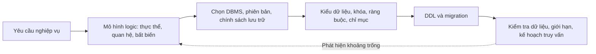

# Chuyển mô hình logic sang kiểu dữ liệu và giới hạn của hệ quản trị

## 1. Từ mô hình logic đến mô hình vật lý

Trong module `DATABASE_DATA_MODELING`, người học rèn kỹ năng biến yêu cầu nghiệp vụ thành mô hình dữ liệu có thể kiểm chứng: xác định thực thể, quan hệ, ràng buộc, chuẩn hóa, khóa, chỉ mục rồi triển khai thành lược đồ vật lý. Bước chuyển từ **mô hình logic** sang **mô hình vật lý** là lúc các khái niệm như “mã đơn hàng”, “số tiền”, “thời điểm đặt hàng” được gắn với kiểu dữ liệu, cú pháp ràng buộc và khả năng thực tế của một hệ quản trị cơ sở dữ liệu (DBMS).

- **Mô hình logic** trả lời: dữ liệu biểu diễn điều gì, quan hệ giữa các đối tượng ra sao, giá trị nào hợp lệ, quy tắc nghiệp vụ nào phải luôn đúng? Nó chưa phụ thuộc vào một sản phẩm DBMS cụ thể.
- **Mô hình vật lý** trả lời: tạo bảng/collection/nút/cạnh nào, dùng kiểu dữ liệu và độ dài bao nhiêu, thực thi khóa và ràng buộc thế nào, cần chỉ mục gì, lưu trữ và truy vấn có đáp ứng tải thực tế không?
- **Đặc tả triển khai** phải nêu rõ sản phẩm, phiên bản, engine lưu trữ, charset/collation, giả định về dữ liệu và chính sách mở rộng. Hai DBMS cùng hỗ trợ “SQL” vẫn có ngữ nghĩa kiểu dữ liệu khác nhau.



**Nguyên tắc:** kiểu vật lý phải giữ được *ý nghĩa* và *bất biến* đã định nghĩa ở mô hình logic. Chọn kiểu nhỏ hơn, bỏ ràng buộc hoặc biến một quan hệ thành chuỗi JSON vì tiện viết SQL có thể khiến hệ thống chấp nhận trạng thái sai.

## 2. Lập “hợp đồng dữ liệu” trước khi chọn kiểu

Giả sử hệ thống bán hàng có bốn thực thể logic:

| Thực thể | Thuộc tính và ý nghĩa | Quan hệ, bất biến |
|---|---|---|
| `Customer` | Mã khách hàng, email, tên hiển thị, thời điểm tạo | Email bắt buộc; có quy tắc duy nhất theo chính sách nghiệp vụ |
| `Product` | Mã sản phẩm, SKU, tên sản phẩm | SKU không được trùng |
| `PurchaseOrder` | Mã đơn, khách hàng, trạng thái, loại tiền, thời điểm tạo | Mỗi đơn thuộc đúng một khách hàng; trạng thái thuộc tập cho phép |
| `OrderLine` | Đơn hàng, số dòng, sản phẩm, số lượng, đơn giá tại thời điểm chốt | Một đơn có nhiều dòng; số dòng duy nhất **trong đơn**; số lượng dương; đơn giá không âm |

Đơn giá trên dòng đơn hàng là **ảnh chụp giá giao dịch**, không phải giá hiện tại trên danh mục sản phẩm. Giữ nó trong `OrderLine` là một quyết định nghiệp vụ: thay đổi giá sản phẩm về sau không được viết lại lịch sử mua hàng.

Với mỗi thuộc tính, nên ghi lại các thông tin sau trước khi viết DDL:

| Câu hỏi | Ví dụ quyết định cần ghi |
|---|---|
| Miền giá trị là gì? | `quantity` là số nguyên dương; `unit_price` không âm, có tối đa hai chữ số thập phân nếu chính sách tiền tệ cho phép |
| Có thể thiếu không? | `Customer.email` bắt buộc; `delivery_date` có thể chưa biết |
| Ràng buộc nằm ở đâu? | `order_status` theo tập trạng thái; `customer_id` phải tồn tại trong bảng khách hàng |
| Độ lớn hiện tại và dự kiến? | Số đơn trong 5 năm; số dòng tối đa mỗi đơn; độ dài SKU và tên |
| Quy tắc so sánh là gì? | SKU có phân biệt hoa/thường? Email có cần so sánh không phân biệt hoa/thường? |
| Đọc/ghi như thế nào? | Truy vấn 20 đơn mới nhất theo khách hàng; tìm dòng đơn theo sản phẩm; tỷ lệ ghi và cập nhật |
| Chính sách dữ liệu là gì? | Đơn đã xác nhận phải giữ lịch sử; thời điểm lưu theo một mốc thời gian thống nhất |

Độ dài, độ chính xác và khả năng cho phép `NULL` **không** nên là những con số được chọn tùy ý trong lúc viết lược đồ. Chúng phải đến từ hợp đồng dữ liệu, dữ liệu mẫu và dự báo tăng trưởng.

## 3. Ánh xạ thuộc tính logic sang kiểu vật lý

Bảng sau dùng **PostgreSQL 16** làm hệ quy chiếu để minh họa; tên và ngữ nghĩa kiểu cần được đánh giá lại nếu chọn DBMS khác.

| Loại dữ liệu logic | Kiểu PostgreSQL thường cân nhắc | Điều cần quyết định |
|---|---|---|
| Định danh số nguyên | `INTEGER`, `BIGINT`, `GENERATED ... AS IDENTITY` | Số lượng bản ghi tối đa; mã có mang ý nghĩa nghiệp vụ không; cách sinh ID khi phân tán |
| Định danh toàn cục | `UUID` | Cách sinh ID, dung lượng chỉ mục và độ phân mảnh do thứ tự chèn |
| Số lượng nguyên | `SMALLINT`, `INTEGER`, `BIGINT` | Có âm không; giới hạn trên; phép cộng/tổng có thể tràn không |
| Giá, số tiền, tỷ lệ cần chính xác thập phân | `NUMERIC(p,s)` / `DECIMAL(p,s)` | Tổng chữ số `p`, số chữ số thập phân `s`, chính sách làm tròn và đơn vị tiền |
| Số đo chấp nhận sai số biểu diễn | `REAL`, `DOUBLE PRECISION` | Mức sai số có thể chấp nhận; không dùng mặc định cho tiền |
| Chuỗi ngắn có giới hạn nghiệp vụ | `VARCHAR(n)` | Giới hạn ký tự, chuẩn hóa Unicode, collation và so sánh |
| Văn bản có độ dài linh hoạt | `TEXT` | Giới hạn nội dung ở tầng ứng dụng, giới hạn DBMS và nhu cầu tìm kiếm |
| Ngày lịch | `DATE` | Có gắn múi giờ hay không; ví dụ ngày sinh, ngày giao dự kiến |
| Thời điểm xảy ra sự kiện | `TIMESTAMPTZ` | Quy tắc đầu vào/đầu ra theo múi giờ; thời điểm không phải “giờ địa phương” |
| Giờ trên đồng hồ | `TIME` hoặc kiểu thời gian khác tùy ngữ nghĩa | Có cần ngày và múi giờ để xử lý DST hay không |
| Đúng/sai | `BOOLEAN` | Có thực sự hai trạng thái hay cần trạng thái “chưa biết” |
| Dữ liệu nhị phân | `BYTEA` | Giới hạn kích thước, lưu trong DB hay lưu object storage rồi giữ tham chiếu |
| Thuộc tính linh hoạt, có cấu trúc | `JSONB` | Có cần kiểm tra schema, tra cứu theo đường dẫn, ràng buộc với thực thể khác |

### 3.1. Độ rộng số nguyên và giá trị tăng trưởng

Trong PostgreSQL, `SMALLINT` có 2 byte, `INTEGER` có 4 byte, `BIGINT` có 8 byte; miền giá trị lần lượt khoảng ±3,2×10⁴, ±2,1×10⁹ và ±9,2×10¹⁸. Chọn `SMALLINT` cho số dòng đơn hàng chỉ hợp lý nếu nghiệp vụ bảo đảm không có đơn nào vượt 32.767 dòng. `BIGINT` phù hợp với ID tăng lâu dài nhưng chiếm thêm bộ nhớ và không tự giải quyết chuyện cấp ID giữa nhiều nguồn ghi.

Với ID dạng UUID, hãy quyết định chuẩn và cách sinh ở ứng dụng hay cơ sở dữ liệu. UUID được sinh ngẫu nhiên có thể làm vị trí chèn vào B-tree phân tán hơn ID tăng tuần tự; đổi lại nó thuận tiện khi nhiều hệ thống tạo ID độc lập. Đây là **đánh đổi theo khối lượng ghi và kiến trúc**, không có một loại ID tối ưu cho mọi hệ thống.

### 3.2. Số tiền: độ chính xác khác độ lớn

`NUMERIC(p,s)` dùng `p` chữ số có nghĩa, trong đó `s` chữ số ở phần thập phân. Chẳng hạn `NUMERIC(14,2)` cho phép tối đa 12 chữ số ở phần nguyên và 2 chữ số thập phân. Nếu giá tiền hoặc phép tính có phần lẻ vượt quá `s`, DBMS có thể thực hiện làm tròn theo quy tắc riêng; ứng dụng phải thống nhất chính sách làm tròn trước khi ghi.

Không dùng `FLOAT`/`DOUBLE` để biểu diễn trực tiếp các số tiền cần cộng trừ và đối soát chính xác theo đơn vị nhỏ nhất. Một lựa chọn khác là lưu số nguyên đơn vị nhỏ nhất (ví dụ cents), nhưng cách đó đòi hỏi quy định rõ số chữ số thập phân của từng loại tiền; không phải mọi đơn vị tiền đều có hai chữ số thập phân. Nếu hệ thống đa tiền tệ, lưu **mã tiền** cùng số tiền và không cộng các loại tiền khác nhau khi chưa quy đổi theo quy tắc xác định.

### 3.3. Chuỗi, Unicode và quy tắc duy nhất

`VARCHAR(50)` giới hạn chiều dài chuỗi theo quy tắc của DBMS, **không đồng nghĩa 50 byte trên đĩa**. Unicode có ký tự chiếm nhiều byte, và một ký tự hiển thị có thể bao gồm nhiều code point. Giới hạn dữ liệu, giới hạn độ dài khóa chỉ mục và cách so sánh phụ thuộc charset/collation.

Trên PostgreSQL, `TEXT` và `VARCHAR` không có lý do mặc định để chọn một bên vì “bên kia chắc nhanh hơn”; `VARCHAR(n)` hữu ích khi `n` thực sự là ràng buộc nghiệp vụ. `CHAR(n)` có thể thêm khoảng trắng đệm và gây ngạc nhiên khi so sánh; dùng nó chỉ khi biết rõ ngữ nghĩa cố định.

Đặc biệt, `UNIQUE(email)` thông thường **chưa bảo đảm** `A@example.com` và `a@example.com` bị coi là một. Phải chốt chính sách chuẩn hóa và collation, hoặc dùng cơ chế so sánh/khóa duy nhất không phân biệt hoa thường phù hợp DBMS. Điều tương tự áp dụng cho SKU có dấu, chữ hoa và khoảng trắng.

### 3.4. Ngày, giờ và múi giờ

- `DATE` biểu diễn một **ngày lịch**, phù hợp với ngày sinh hoặc ngày giao dự kiến; bản thân nó không phải thời điểm trên trục thời gian.
- PostgreSQL `TIMESTAMPTZ` biểu diễn một **thời điểm** và quy đổi cách hiển thị theo múi giờ phiên kết nối; nó không lưu riêng tên múi giờ đầu vào trên từng bản ghi. Muốn giữ múi giờ do người dùng chọn, lưu thêm định danh như `Asia/Ho_Chi_Minh`.
- `TIMESTAMP WITHOUT TIME ZONE` lưu ngày-giờ không kèm ngữ nghĩa múi giờ; dùng cho lịch hẹn địa phương khi nghiệp vụ hiểu rõ cách áp dụng vùng giờ, không tự coi đó là UTC.

Ngày giờ có tình huống giờ mùa hè (DST), khi một giờ địa phương có thể không tồn tại hoặc xuất hiện hai lần. Tránh tự cộng “24 giờ” để diễn đạt mọi phép cộng “một ngày lịch”. Thiết kế API cần nêu rõ giá trị đầu vào là thời điểm, ngày lịch hay giờ địa phương.

## 4. Ánh xạ quan hệ và bất biến thành khóa, ràng buộc

Chuyển thực thể thành bảng mới chỉ là phần đầu. Cần giữ *đúng quan hệ* và *đúng tập giá trị*:

| Mô hình logic | Cách thể hiện quan hệ điển hình |
|---|---|
| Một `Customer` có nhiều `PurchaseOrder` | `purchase_order.customer_id` là `NOT NULL` và `FOREIGN KEY` đến `customer.customer_id` |
| Một `PurchaseOrder` có nhiều `OrderLine` | `order_line.order_id` là khóa ngoại; cặp (`order_id`, `line_no`) là khóa chính |
| Một sản phẩm xuất hiện trên nhiều dòng đơn | `order_line.product_id` là khóa ngoại tới `product` |
| Quan hệ nhiều-nhiều thuần túy | Bảng trung gian chứa hai khóa ngoại, thường có khóa duy nhất trên cặp; thêm thuộc tính khi quan hệ có dữ liệu riêng |
| Quan hệ một-một thực sự | Khóa ngoại kết hợp `UNIQUE`, hoặc dùng khóa chính đồng thời là khóa ngoại |
| Thuộc tính bắt buộc / tập giá trị | `NOT NULL`, `CHECK`, khóa ngoại tới bảng danh mục, hoặc các cơ chế tương ứng |

**Khóa chính** định danh hàng; **khóa ứng viên/khóa duy nhất** bảo vệ tính duy nhất nghiệp vụ; **khóa ngoại** bảo vệ liên kết. Chúng phục vụ các mục tiêu khác nhau. Một `order_id` sinh tự động không thay thế quy tắc “số dòng không lặp trong cùng một đơn”.

Không nên mặc định `ON DELETE CASCADE` cho mọi quan hệ. Với lịch sử bán hàng, xóa khách hàng hoặc sản phẩm có thể không được phép xóa theo tất cả đơn hàng đã phát sinh. Chính sách xóa, ẩn danh, lưu trữ và retention phải được quyết định theo nghiệp vụ.

Lưu ý `CHECK` không thay thế `NOT NULL`: trong SQL, biểu thức kiểm tra trả về `UNKNOWN` do `NULL` có thể không bị xem là vi phạm. Cũng cần xét sự khác nhau giữa các DBMS khi dùng `UNIQUE` trên cột cho phép `NULL`.

## 5. Ví dụ DDL triển khai trên PostgreSQL 16

Ví dụ dùng khóa chính số nguyên 64 bit, đơn giá chính xác thập phân, trạng thái đơn hữu hạn và một chỉ mục dựa trên truy vấn phổ biến. Giả định đây là **lược đồ khởi đầu** cho bối cảnh bán hàng, chưa bao gồm thanh toán, địa chỉ giao hàng, thuế, khuyến mãi hay lịch sử chuyển trạng thái.

```sql
CREATE TABLE customer (
    customer_id BIGINT GENERATED ALWAYS AS IDENTITY PRIMARY KEY,
    email       VARCHAR(254) NOT NULL,
    display_name VARCHAR(120) NOT NULL,
    created_at  TIMESTAMPTZ NOT NULL DEFAULT CURRENT_TIMESTAMP,
    CONSTRAINT uq_customer_email UNIQUE (email)
);

CREATE TABLE product (
    product_id BIGINT GENERATED ALWAYS AS IDENTITY PRIMARY KEY,
    sku        VARCHAR(64) NOT NULL,
    name       VARCHAR(200) NOT NULL,
    CONSTRAINT uq_product_sku UNIQUE (sku)
);

CREATE TABLE purchase_order (
    order_id       BIGINT GENERATED ALWAYS AS IDENTITY PRIMARY KEY,
    customer_id    BIGINT NOT NULL,
    order_status   VARCHAR(16) NOT NULL DEFAULT 'DRAFT',
    currency_code  VARCHAR(3) NOT NULL,
    created_at     TIMESTAMPTZ NOT NULL DEFAULT CURRENT_TIMESTAMP,
    delivery_date  DATE,
    CONSTRAINT fk_order_customer
        FOREIGN KEY (customer_id) REFERENCES customer(customer_id),
    CONSTRAINT ck_order_status
        CHECK (order_status IN ('DRAFT', 'CONFIRMED', 'CANCELLED')),
    CONSTRAINT ck_order_currency_shape
        CHECK (currency_code ~ '^[A-Z]{3}$')
);

CREATE TABLE order_line (
    order_id    BIGINT NOT NULL,
    line_no     SMALLINT NOT NULL,
    product_id  BIGINT NOT NULL,
    quantity    INTEGER NOT NULL,
    unit_price  NUMERIC(14, 2) NOT NULL,
    CONSTRAINT pk_order_line PRIMARY KEY (order_id, line_no),
    CONSTRAINT fk_line_order
        FOREIGN KEY (order_id) REFERENCES purchase_order(order_id)
        ON DELETE RESTRICT,
    CONSTRAINT fk_line_product
        FOREIGN KEY (product_id) REFERENCES product(product_id),
    CONSTRAINT ck_line_no_positive CHECK (line_no > 0),
    CONSTRAINT ck_quantity_positive CHECK (quantity > 0),
    CONSTRAINT ck_unit_price_nonnegative CHECK (unit_price >= 0)
);

-- Hỗ trợ trang danh sách đơn hàng của một khách hàng theo thời gian.
CREATE INDEX idx_order_customer_created
    ON purchase_order (customer_id, created_at DESC);

-- Hỗ trợ truy vấn dòng đơn theo sản phẩm và kiểm tra liên kết khi xóa.
CREATE INDEX idx_line_product
    ON order_line (product_id);
```

Đọc lược đồ này theo ý nghĩa nghiệp vụ:

1. `customer_id`, `product_id` và `order_id` là khóa kỹ thuật. `email` và `sku` vẫn có ràng buộc duy nhất riêng, bởi ID kỹ thuật không ngăn hai khách hàng có cùng email hoặc hai sản phẩm có cùng SKU.
2. Khóa chính (`order_id`, `line_no`) làm cho `line_no = 1` có thể xuất hiện ở nhiều đơn, nhưng không thể xuất hiện hai lần **trong cùng đơn**. `SMALLINT` đặt giới hạn kỹ thuật lên số thứ tự dòng; nếu số dòng có thể vượt 32.767, cần chọn kiểu rộng hơn.
3. `NUMERIC(14,2)` diễn đạt chính sách hai chữ số thập phân của ví dụ. `unit_price` thuộc tiền tệ ghi ở `purchase_order.currency_code`; tính tiền đa tiền tệ phải làm rõ ngữ nghĩa trước khi triển khai. `CHECK` mã tiền ở đây chỉ xác minh **dạng ba chữ cái in hoa**, không chứng minh đó là mã ISO 4217 đang hợp lệ. Nếu cần xác thực danh sách mã tiền, dùng bảng tham chiếu và khóa ngoại hoặc cơ chế cập nhật danh mục tương đương.
4. `UNIQUE(email)` chưa định nghĩa chính sách so sánh không phân biệt hoa/thường. Cần thống nhất quy tắc lưu email trước khi đưa lược đồ vào sản xuất.
5. `FOREIGN KEY` ngăn ghi dòng đơn tham chiếu đến khách hàng, đơn hoặc sản phẩm không tồn tại. `ON DELETE RESTRICT` trên dòng đơn ngăn xóa đơn khi còn dòng liên quan. Những thao tác nghiệp vụ như chuyển trạng thái `DRAFT → CONFIRMED` vẫn cần logic ứng dụng hoặc ràng buộc bổ sung: `CHECK` trạng thái chỉ giới hạn **giá trị hiện tại**, không kiểm soát **thứ tự chuyển trạng thái**.

Nếu tổng tiền đơn hàng được tính từ các dòng, không nên thêm `total_amount` như một bản sao tùy tiện. Khi cần lưu tổng để truy vấn nhanh hoặc đáp ứng kế toán, phải xác định chính sách đồng bộ, làm tròn, thuế/giảm giá và nơi chịu trách nhiệm giữ bất biến tổng tiền.

## 6. Kiểm tra khả năng của DBMS: cùng ý tưởng, khác cú pháp và ngữ nghĩa

Không chuyển nguyên DDL giữa các sản phẩm chỉ bằng cách đổi tên kiểu dữ liệu. Bảng dưới đây là **định hướng so sánh**, không thay cho tài liệu của phiên bản/engine thật sự được triển khai:

| Nhu cầu | PostgreSQL 16 | MySQL 8.0, InnoDB | SQL Server 2022 |
|---|---|---|---|
| ID số tự sinh | `GENERATED ... AS IDENTITY` | `AUTO_INCREMENT` | `IDENTITY(1,1)` |
| Số thập phân chính xác | `NUMERIC(p,s)` / `DECIMAL(p,s)` | `DECIMAL(p,s)` | `DECIMAL(p,s)` |
| Chuỗi Unicode | `VARCHAR`/`TEXT` với mã hóa DB phù hợp | `VARCHAR`/`TEXT` với charset như `utf8mb4` | Thường dùng `NVARCHAR`, hoặc `VARCHAR` với collation UTF-8 phù hợp |
| Thời điểm có ngữ nghĩa múi giờ | `TIMESTAMPTZ` | Phải quy ước rõ `TIMESTAMP`, `DATETIME` và chuyển đổi theo phiên/ứng dụng | `DATETIMEOFFSET` |
| Kiểu đúng/sai | `BOOLEAN` | `BOOLEAN` là bí danh của `TINYINT(1)` | `BIT` |
| UUID | `UUID` | Thường `BINARY(16)` hoặc `CHAR(36)` theo quy ước | `UNIQUEIDENTIFIER` |
| JSON | `JSONB` hoặc `JSON` | `JSON` | SQL Server 2022 thường lưu JSON trong chuỗi và xử lý bằng hàm JSON |
| Biểu thức `CHECK` | Có | Được thực thi trên các bản 8.0.16 trở lên | Có |

Các khác biệt dễ gây lỗi:

- **Cú pháp ràng buộc:** `currency_code ~ '^[A-Z]{3}$'` là toán tử biểu thức chính quy của PostgreSQL, không phải SQL chung. Nếu chuyển sang MySQL hay SQL Server, phải viết lại hoặc dùng bảng mã tiền, rồi kiểm thử ràng buộc thật sự được thực thi.
- **Thời gian:** PostgreSQL `TIMESTAMPTZ`, MySQL `TIMESTAMP` và SQL Server `DATETIMEOFFSET` không tương đương hoàn toàn. Trong SQL Server, tên kiểu `TIMESTAMP` lịch sử là từ đồng nghĩa của `ROWVERSION`, **không phải** kiểu lưu ngày giờ.
- **Unicode và so sánh:** charset/collation có thể khiến hai chuỗi khác nhau được coi là bằng nhau, ảnh hưởng `UNIQUE`, `ORDER BY`, tra cứu và chỉ mục. MySQL `BOOLEAN` là kiểu số nhỏ nên ràng buộc giá trị 0/1 có thể cần kiểm soát riêng.
- **`NULL` và `UNIQUE`:** nhiều DBMS xử lý tính duy nhất của giá trị rỗng khác nhau. Một thiết kế “email tùy chọn nhưng duy nhất khi có giá trị” phải được kiểm chứng theo sản phẩm cụ thể.
- **Khóa ngoại và chỉ mục:** không phải mọi DBMS tự tạo chỉ mục trên cột khóa ngoại phía tham chiếu. Hãy xem kế hoạch truy vấn, thao tác xóa/cập nhật và đặc điểm engine thay vì giả định tất cả đều tự tối ưu.

### Giới hạn cần tra cứu theo phiên bản

Khi chọn kiểu và xây migration, cần kiểm tra tài liệu chính thức của đúng DBMS/phiên bản/engine đối với:

1. **Độ dài dữ liệu và kích thước hàng:** giới hạn cột, hàng, kích thước giá trị chuỗi/JSON/LOB, số cột và số hàng thực tế có thể phát sinh.
2. **Độ chính xác và miền số:** `DECIMAL/NUMERIC` tối đa bao nhiêu chữ số, cách làm tròn/chuyển kiểu, phạm vi ngày giờ, timezone và giá trị `NULL`.
3. **Giới hạn chỉ mục:** độ dài khóa tính theo byte, số cột, loại chỉ mục hỗ trợ, collation, các kiểu có thể đánh chỉ mục và chi phí cập nhật.
4. **Khả năng ràng buộc:** `CHECK` có được thực thi không, khóa ngoại trên engine nào, cột sinh tự động, ràng buộc trì hoãn, chỉ mục có điều kiện, khả năng thay đổi schema.
5. **Dung lượng vận hành:** kích thước bảng/chỉ mục, partition, giới hạn kết nối/giao dịch, tăng trưởng log và thời gian khóa khi migration.

Ví dụ, `VARCHAR(255)` nhìn nhỏ ở mức “số ký tự” nhưng độ dài khóa chỉ mục có thể trở thành vấn đề nếu charset dùng nhiều byte mỗi ký tự và DBMS áp dụng giới hạn chỉ mục theo byte. Vì các ngưỡng thay đổi theo phiên bản và cấu hình, cần đo với **cấu hình thật** thay vì ghi một giới hạn chung cho mọi hệ quản trị.

## 7. Chỉ mục và bố trí vật lý phải xuất phát từ truy vấn

Chỉ mục phục vụ một đường truy cập cụ thể; mỗi chỉ mục đều tăng chi phí lưu trữ và thao tác ghi. Bắt đầu bằng các câu truy vấn có tần suất và độ trễ quan trọng, ví dụ:

```sql
-- Mục tiêu: 20 đơn gần nhất của một khách hàng.
EXPLAIN
SELECT order_id, order_status, created_at
FROM purchase_order
WHERE customer_id = 1001
ORDER BY created_at DESC
LIMIT 20;
```

Chỉ mục `(customer_id, created_at DESC)` được đề xuất vì điều kiện lọc dùng `customer_id` và kết quả cần sắp theo `created_at` giảm dần. Tuy nhiên, không phải mọi lần chạy đều dùng chỉ mục: PostgreSQL chọn kế hoạch theo thống kê, số lượng hàng và độ chọn lọc. Dùng `EXPLAIN` để xem kế hoạch; chỉ chạy `EXPLAIN ANALYZE` trong môi trường kiểm thử phù hợp khi chấp nhận **thực sự thực thi** truy vấn và chi phí của nó.

Khóa chính (`order_id`, `line_no`) thường phục vụ tốt thao tác lấy các dòng trong một đơn; việc tìm *mọi dòng của một sản phẩm* theo `product_id` cần đường truy cập khác nên có `idx_line_product`. Không thêm chỉ mục cho mọi cột chỉ vì cột đó thường xuất hiện trong bảng dữ liệu.

Với bảng lớn, cân nhắc partition, nén, lưu trữ dữ liệu lịch sử và thay đổi cách tổ chức dữ liệu **sau khi** có bằng chứng về tải thực tế. Partition không thay thế thiết kế khóa hoặc ràng buộc. Một số DBMS có quy tắc riêng về khóa duy nhất, khóa ngoại và pruning trên bảng partition; phải kiểm tra trước khi áp dụng.

## 8. Kiểm chứng sau khi chuyển sang mô hình vật lý

Chuyển đổi chỉ hoàn tất khi schema thực tế bảo vệ những yêu cầu đã định nghĩa. Với PostgreSQL, trước hết có thể đọc lại metadata:

```sql
SELECT column_name,
       data_type,
       is_nullable,
       character_maximum_length,
       numeric_precision,
       numeric_scale
FROM information_schema.columns
WHERE table_schema = 'public'
  AND table_name = 'order_line'
ORDER BY ordinal_position;
```

Sau đó kiểm thử hành vi trong cơ sở dữ liệu thử nghiệm và trên dữ liệu có phân bố gần thực tế:

| Tình huống kiểm thử | Kỳ vọng |
|---|---|
| Chèn dòng có `quantity = 0` hoặc `unit_price < 0` | DBMS từ chối vì `CHECK` |
| Chèn dòng cho `order_id` hoặc `product_id` không tồn tại | DBMS từ chối vì `FOREIGN KEY` |
| Chèn hai dòng cùng (`order_id`, `line_no`) | DBMS từ chối vì khóa chính |
| Chèn đơn với `order_status = 'UNKNOWN'` | DBMS từ chối vì `CHECK` |
| Chèn số tiền vượt phạm vi `NUMERIC(14,2)` | DBMS từ chối hoặc có quy tắc làm tròn cần được xác minh rõ ở biên |
| Ghi/đọc thời điểm qua hai múi giờ phiên khác nhau | Cùng **thời điểm thực**, biểu diễn theo vùng giờ khác nhau |
| Chèn hai email chỉ khác chữ hoa/thường | Kiểm tra và thống nhất kết quả với chính sách so sánh đã quyết định |
| Truy vấn đơn mới nhất của khách hàng với dữ liệu lớn | Xem `EXPLAIN`, độ trễ, lượng đọc và chi phí ghi của chỉ mục |

**Kiểm thử biên** gồm chuỗi rỗng và Unicode, giá trị sát giới hạn số, dữ liệu `NULL`, ngày cuối tháng, thay đổi giờ DST, khóa ngoại không tồn tại và bản ghi trùng sau chuẩn hóa. **Kiểm thử migration** gồm việc chuyển dữ liệu cũ sang kiểu mới, truy vấn ứng dụng trước/sau, khả năng rollback và thời gian giữ khóa với bảng lớn.

Đối với chuyển kiểu ở hệ thống đang chạy, cần so sánh miền giá trị cũ/mới và tìm dữ liệu vi phạm trước khi áp dụng `ALTER TABLE`. Thu hẹp `VARCHAR`, giảm `NUMERIC` precision/scale hoặc đổi múi giờ ngầm có thể làm mất dữ liệu dù cú pháp DDL hợp lệ.

## 9. Khi không dùng cơ sở dữ liệu quan hệ

Mục tiêu của mô hình dữ liệu vẫn là bảo vệ ngữ nghĩa; cách hiện thực phụ thuộc nhu cầu truy vấn và giới hạn của hệ quản trị:

| Loại hệ thống | Cách chuyển logic sang vật lý | Rủi ro/giới hạn cần kiểm tra |
|---|---|---|
| **Document** | Một đơn hàng có thể là document gộp thông tin đơn và mảng dòng hàng; lưu giá giao dịch dưới dạng snapshot | Giới hạn kích thước document, độ sâu lồng nhau, cập nhật mảng, chỉ mục trên trường lồng, kiểm tra schema và tham chiếu tới khách hàng/sản phẩm |
| **Graph** | Khách hàng, đơn, sản phẩm là node; quan hệ mua hàng/chứa sản phẩm là edge với thuộc tính phù hợp | Kiểu thuộc tính, uniqueness và cardinality được hỗ trợ, chi phí duyệt node bậc cao, ranh giới giao dịch |
| **Phân tích/columnar** | Sự kiện bán hàng vào bảng fact, khách hàng/sản phẩm/ngày vào dimension với hạt dữ liệu (grain) đã công bố | Độ trễ nạp, trùng sự kiện, khóa dimension, thay đổi lịch sử (SCD), partition, mã hóa cột, precision của số liệu |

Ví dụ, `OrderLine` trong hệ OLTP quan hệ được thiết kế để kiểm soát giao dịch; trong kho phân tích nó có thể trở thành fact ở mức **một dòng hàng trên mỗi đơn**. Hạt dữ liệu, lịch sử giá và đồng tiền phải được bảo toàn. Sao chép cấu trúc bảng OLTP sang fact mà không định nghĩa grain và quy tắc biến đổi sẽ dễ dẫn đến đếm trùng doanh thu.

Document không tự động nhanh hơn quan hệ, graph không tự động phù hợp mọi quan hệ nhiều-nhiều, và lưu JSON không miễn trách nhiệm kiểm tra schema. Mỗi DBMS đều có ranh giới riêng về kích thước, giao dịch, chỉ mục, tính nhất quán và khả năng thay đổi mô hình.

## 10. Danh sách bàn giao mô hình vật lý

Một thiết kế sẵn sàng triển khai tối thiểu cần trả lời được các điểm sau:

- **Truy vết về logic:** mỗi bảng, cột, khóa và ràng buộc liên hệ được tới thực thể, thuộc tính hoặc quy tắc nghiệp vụ đã xác nhận.
- **Ngữ nghĩa kiểu:** mọi thuộc tính có kiểu, giới hạn, chính sách `NULL`, đơn vị đo/tiền, độ chính xác, timezone và quy tắc so sánh rõ ràng.
- **Tương thích hệ quản trị:** đã xác nhận phiên bản, engine, charset/collation và các giới hạn ảnh hưởng trực tiếp đến schema; DDL đã được kiểm tra trên đúng sản phẩm.
- **Toàn vẹn quan hệ:** khóa chính, khóa duy nhất, khóa ngoại, hành vi xóa/cập nhật và quy tắc lịch sử phù hợp nghiệp vụ.
- **Đường truy cập:** chỉ mục được giải thích bằng truy vấn cụ thể; đã đo kế hoạch, tải đọc/ghi và dung lượng.
- **Tiến hóa:** có migration, phương án xử lý dữ liệu cũ, kiểm thử biên và cơ chế quan sát khi dữ liệu tăng.

### Tự luyện

Giả sử sản phẩm ban đầu chỉ bán bằng VND, nhưng sau sáu tháng phải hỗ trợ JPY và USD, nhận đơn từ nhiều múi giờ và cho phép một đơn có hàng trăm nghìn dòng trong đợt bán sỉ.

1. Chỉ ra ba giả định trong DDL ví dụ cần đánh giá lại trước khi mở rộng: `NUMERIC(14,2)` và quy tắc tiền tệ, `SMALLINT` cho `line_no`, cùng cách diễn giải ngày giao hàng/giờ đặt hàng.
2. Phân biệt phần thay đổi do **yêu cầu nghiệp vụ** với phần thay đổi do **giới hạn kiểu dữ liệu/DBMS**. Ví dụ, JPY và USD có quy tắc đơn vị nhỏ nhất khác nhau là quyết định nghiệp vụ; phạm vi `SMALLINT` là giới hạn kiểu vật lý.
3. Đề xuất migration an toàn và các trường hợp kiểm thử biên tương ứng. Cân nhắc sự khác biệt giữa thời điểm `created_at` và ngày lịch `delivery_date`; không tự động đổi tất cả ngày thành timestamp.

Khi có thể giải thích *vì sao* từng kiểu dữ liệu, ràng buộc và chỉ mục được chọn, đồng thời chỉ ra điều gì sẽ xảy ra khi miền dữ liệu vượt giả định, mô hình vật lý mới thực sự là bản triển khai có kiểm chứng của mô hình logic.
