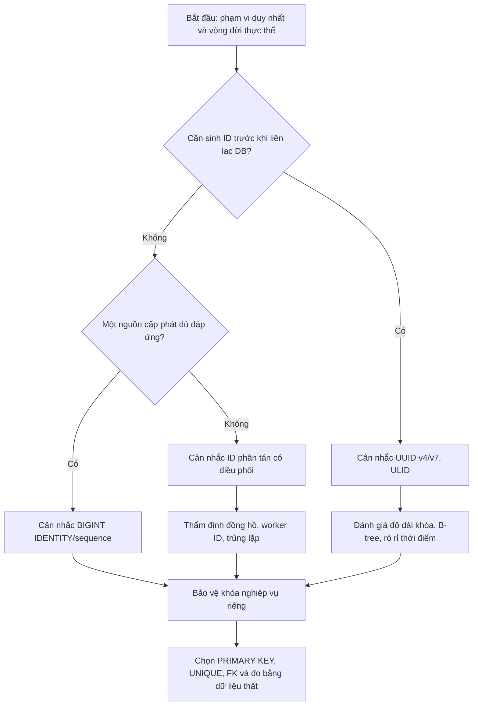

# Chọn khóa tuần tự, định danh phân tán hoặc khóa nghiệp vụ theo yêu cầu

## 1. Khóa định danh là một quyết định nghiệp vụ và vật lý

Trong module `DATABASE_DATA_MODELING`, việc chuyển yêu cầu nghiệp vụ thành mô hình dữ liệu có thể kiểm chứng bao gồm lựa chọn thực thể, quan hệ, chuẩn hóa, khóa, chỉ mục và lược đồ vật lý. Một quyết định quan trọng ở bước **mô hình vật lý** là chọn cách định danh bản ghi. Ba nhóm thường được cân nhắc:

- **Khóa tuần tự**: giá trị số nguyên tăng do hệ quản trị hoặc dịch vụ cấp phát, chẳng hạn `BIGINT GENERATED ... AS IDENTITY` trong PostgreSQL.
- **Định danh phân tán**: giá trị có thể tạo độc lập ở nhiều ứng dụng, thiết bị hoặc nút, chẳng hạn UUID v4/v7, ULID hoặc ID kiểu Snowflake.
- **Khóa nghiệp vụ** (*natural/business key*): thuộc tính hoặc tổ hợp thuộc tính đã có ý nghĩa trong miền nghiệp vụ, chẳng hạn cặp (`tenant_id`, `sku`) khi SKU chỉ duy nhất trong một doanh nghiệp.

Một bảng có thể cần **nhiều khóa ứng viên**, nhưng chỉ khai báo **một khóa chính** (`PRIMARY KEY`). Việc chọn khóa chính không làm mất nghĩa vụ bảo vệ các khóa nghiệp vụ khác bằng `UNIQUE` và quy tắc chuẩn hóa tương ứng.

Ví dụ: một dòng sản phẩm có thể được định danh nội bộ bằng `product_id`, còn quy tắc “trong một cửa hàng không được có hai sản phẩm cùng SKU” vẫn phải được kiểm tra trên (`store_id`, `sku`). Chỉ tạo `product_id` rồi bỏ kiểm tra SKU sẽ cho phép những bản ghi trùng về nghiệp vụ.

### Phân biệt các khái niệm

| Thuật ngữ | Ý nghĩa | Ví dụ |
|---|---|---|
| **Khóa chính** | Tập cột định danh duy nhất mỗi hàng, không cho phép `NULL` | `product_id` |
| **Khóa ứng viên** | Tập thuộc tính tối thiểu có thể định danh hàng | `product_id` hoặc (`tenant_id`, `sku`) khi được đảm bảo duy nhất |
| **Khóa thay thế** (*surrogate key*) | Khóa kỹ thuật được tạo riêng, không mô tả bản chất nghiệp vụ | `BIGINT IDENTITY`, UUID |
| **Khóa nghiệp vụ** | Thuộc tính thực tế mang ý nghĩa trong miền nghiệp vụ | Số hợp đồng, mã SKU theo nhà cung cấp |
| **Khóa ngoại** | Cột hoặc nhóm cột tham chiếu khóa được DBMS bảo đảm duy nhất ở nơi khác | `order_line.product_id → product.product_id` |
| **Khóa idempotency** | Mã gắn với **một yêu cầu/thao tác** nhằm tránh thực hiện lại khi gửi lặp | `(client_id, request_key)` cho API tạo đơn |

**Khóa idempotency không tự động là khóa của thực thể.** Một yêu cầu có thể thất bại hoặc tạo nhiều bản ghi, còn một thực thể có thể được sửa qua nhiều yêu cầu. Cần quản lý vòng đời và phạm vi duy nhất của hai loại khóa riêng biệt.

## 2. Từ yêu cầu sang tiêu chí chọn khóa

Không có kiểu khóa nào tối ưu trong mọi hoàn cảnh. Trước khi quyết định, hãy ghi thành **hợp đồng định danh**:

1. **Phạm vi duy nhất:** toàn hệ thống, mỗi tenant, mỗi nguồn tích hợp hay chỉ trong một bảng?
2. **Nơi tạo ID:** bắt buộc có cơ sở dữ liệu trung tâm hay ứng dụng/thiết bị có thể tạo khi ngoại tuyến?
3. **Vòng đời:** khóa có thay đổi sau khi sinh không, có bị tái sử dụng sau khi xóa hoặc sát nhập dữ liệu không?
4. **Quy mô:** dự báo bản ghi, tốc độ ghi, số nút phát sinh, số giao dịch mỗi giây và thời gian tồn tại hệ thống?
5. **Khả năng quan sát:** ID có hiển thị trong URL, tài liệu đối tác, log, báo cáo hay API công khai không?
6. **Đường truy cập:** tìm bằng ID, tìm theo mã nghiệp vụ, join nhiều bảng, ghi theo thời gian hay nhập lô?
7. **Chuyển dữ liệu:** có nhiều cơ sở dữ liệu cần hợp nhất, sao chép hai chiều, di chuyển sang mô hình document/graph hay kho phân tích không?
8. **Khả năng vận hành:** ai quản lý bộ cấp ID, sự cố đồng hồ, lỗi cấp phát, giới hạn miền giá trị và migration?

Đừng suy ra rằng “ID tăng” nghĩa là “đơn được tạo trước chắc chắn giao dịch sẽ commit trước”. Tương tự, “ID phân tán” không có nghĩa là mọi node được đảm bảo không đụng nhau **mà không cần** cơ chế tạo và kiểm tra duy nhất.



Lưu ý sơ đồ là **công cụ định hướng**, không phải công thức tuyệt đối. Nếu một mã nghiệp vụ thật sự bất biến, ngắn, duy nhất và được quy định ổn định, nó có thể là lựa chọn khóa chính ngay từ đầu.

## 3. Khóa tuần tự: `INTEGER`, `BIGINT`, identity và sequence

Trong một hệ thống ghi tập trung, khóa số nguyên tăng là lựa chọn đơn giản, dễ kiểm tra và thường thân thiện với chỉ mục B-tree. PostgreSQL 16 cho phép:

```sql
CREATE TABLE customer_account (
    account_id BIGINT GENERATED ALWAYS AS IDENTITY PRIMARY KEY,
    display_name VARCHAR(120) NOT NULL
);

INSERT INTO customer_account (display_name)
VALUES ('Lan Anh')
RETURNING account_id;
```

`GENERATED ALWAYS AS IDENTITY` yêu cầu DBMS sinh ID trong thao tác ghi thông thường. PostgreSQL hỗ trợ cơ chế nhập giá trị tường minh có kiểm soát khi cần khôi phục dữ liệu, nhưng không nên để nhiều nguồn tự tùy tiện chọn ID cho cùng một chuỗi cấp phát.

### Điểm mạnh

- **Kích thước rõ ràng:** PostgreSQL `INTEGER` là 4 byte, `BIGINT` là 8 byte; số nguyên 64 bit có khoảng giá trị dương rất lớn để dành cho tăng trưởng dài hạn.
- **Thứ tự tương đối thuận lợi cho B-tree:** ID tăng được chèn về phía cuối dải khóa, thường ít làm phân tán vị trí ghi vào các trang chỉ mục hơn UUID sinh hoàn toàn ngẫu nhiên.
- **Dễ thao tác:** truy vấn, log, join và truyền tham số đơn giản. Một bảng nhỏ hoặc hệ thống quản trị nội bộ thường không cần hạ tầng cấp ID phức tạp.
- **Không đặt ngữ nghĩa nghiệp vụ vào khóa:** đổi email, SKU hoặc tên khách hàng không buộc đổi khóa chính và các khóa ngoại.

### Giới hạn cần hiểu

**1. Không có cam kết liên tục hoặc không có khoảng trống.** Sequence có thể bị tiêu thụ bởi giao dịch rollback, lỗi chèn, cấp trước bộ đệm hoặc thay đổi vận hành. Hai ID lần lượt `101` và `103` là bình thường. Không dùng khóa tuần tự làm số hóa đơn pháp lý nếu nghiệp vụ yêu cầu chuỗi số phải đáp ứng quy tắc kiểm toán riêng.

**2. Giá trị ID không nói chính xác thời điểm commit.** Một giao dịch cấp ID `20` có thể hoàn thành sau giao dịch cấp ID `21`. Muốn sắp theo thời điểm tạo, cần cột thời gian có ngữ nghĩa rõ ràng; nếu yêu cầu thứ tự toàn phần theo commit, phải có cơ chế thiết kế riêng.

**3. Khó cấp phát tại nhiều nguồn không điều phối.** Hai database độc lập cùng tạo `order_id = 100` sẽ va chạm khi nhập chung. Có thể chia dải số, cấp ID qua một dịch vụ, hoặc chuyển sang định danh phân tán tùy yêu cầu.

**4. Có điểm giới hạn của kiểu.** `INTEGER` signed tối đa 2.147.483.647. Với tải lớn hoặc dữ liệu giữ lâu, chọn `BIGINT` sớm thường giảm nguy cơ migration từ 32 bit sau này, nhưng phải tính thêm kích thước khóa/chỉ mục và sự tương thích ứng dụng.

**5. Dễ suy đoán số lượng hoặc dò ID khi đưa trực tiếp ra công khai.** Đây không phải lỗi phân quyền của ID; API vẫn phải xác thực và kiểm soát quyền truy cập đối tượng. Có thể dùng thêm mã công khai khó dự đoán nếu yêu cầu bảo mật hoặc trải nghiệm cần.

Trên PostgreSQL, bảng thường lưu theo cấu trúc heap; tạo `PRIMARY KEY` không tự có nghĩa là dữ liệu bảng được lưu vật lý theo thứ tự khóa. Trên MySQL/InnoDB, khóa chính có vai trò trong cấu trúc clustered index; do đó kích thước khóa chính còn ảnh hưởng các chỉ mục phụ. Luôn so sánh theo DBMS và engine cụ thể.

## 4. Định danh phân tán: tạo ID trước khi ghi vào một nơi chung

Định danh phân tán có ích khi nhiều dịch vụ, thiết bị hoặc vùng địa lý phải tạo bản ghi độc lập; khi dữ liệu đến từ hàng đợi và cần gắn ID trước khi lưu; hoặc khi thường xuyên hợp nhất các cơ sở dữ liệu. Cần phân biệt **không cần hỏi trung tâm để cấp từng ID** với **bảo đảm tuyệt đối không trùng**: va chạm vẫn phải được hiểu về mặt xác suất hoặc được ngăn bằng điều phối, và `PRIMARY KEY/UNIQUE` là lớp bảo vệ cuối cùng.

### 4.1. UUID v4: ngẫu nhiên và dễ sinh độc lập

UUID có 128 bit. UUID phiên bản 4 sử dụng các bit ngẫu nhiên (122 bit ngẫu nhiên sau khi tính bit version/variant theo chuẩn), nên xác suất va chạm rất nhỏ nếu sử dụng bộ tạo số ngẫu nhiên mật mã có chất lượng.

Ví dụ dạng UUID: `dfaa0436-f4e9-4f5f-a062-6b34560847a2`.

**Ưu điểm:** không cần server cấp phát từng ID, thuận tiện cho ứng dụng ngoại tuyến, event, nhiều nguồn ghi và nhập lô dữ liệu. **Đánh đổi:** 16 byte cho giá trị UUID thay vì 8 byte của `BIGINT`; thứ tự ngẫu nhiên khiến chèn B-tree có xu hướng phân tán hơn, làm tăng khả năng phân trang, cache miss và chi phí ghi trong một số tải.

Trong PostgreSQL 16, có thể lưu UUID bằng kiểu `UUID` và dùng `gen_random_uuid()` để tạo UUID v4 ở DBMS:

```sql
CREATE TABLE sync_job (
    job_id UUID PRIMARY KEY DEFAULT gen_random_uuid(),
    job_name TEXT NOT NULL
);
```

Khi ứng dụng cần biết ID **trước** lúc gửi tới DB, nó phải tự sinh UUID an toàn ở phía ứng dụng thay vì chờ `DEFAULT` của DB. Việc cấp phát tại ứng dụng và cấp phát tại DB không nên trộn thiếu quy ước.

### 4.2. UUID v7: ID có thành phần thời gian

UUID v7, được đặc tả trong RFC 9562, có thành phần timestamp Unix tính theo mili giây ở các bit đầu, kết hợp các bit phục vụ phân biệt giá trị và điều khiển thứ tự trong cùng một khoảng thời gian. Nhờ đó, chuỗi khóa sinh gần thời gian thực có xu hướng dễ duy trì tính cục bộ hơn UUID v4 khi đánh chỉ mục.

Tuy nhiên:

- **Sắp xếp gần theo thời gian tạo không có nghĩa là thứ tự commit.** Các máy có đồng hồ khác nhau hoặc các ID sinh trong cùng mili giây vẫn có thể làm thứ tự quan sát khác nhau.
- **Không mặc định có một thứ tự toàn cục tuyệt đối.** Muốn đảm bảo thứ tự trong một mili giây phải hiểu bộ sinh có dùng bộ đếm/monotonic generator hay không.
- **ID có thể tiết lộ gần đúng thời điểm sinh.** Đây là điểm cần xét nếu ID xuất hiện công khai và thời gian tạo là thông tin cần bảo vệ.
- **Tương thích phiên bản:** kiểu `UUID` của PostgreSQL 16 lưu được v7, nhưng không nên mặc định PostgreSQL 16 đã có sẵn hàm sinh UUID v7 trong core. Có thể sinh ở ứng dụng hoặc dùng giải pháp bổ sung đã kiểm tra phiên bản.

Ưu thế về hiệu năng của v7 so với v4 phụ thuộc khối lượng ghi, fill factor, dung lượng chỉ mục, cache và cơ chế lưu trữ; hãy đo thay vì coi “có timestamp” là tự động nhanh.

### 4.3. ULID: mã 128 bit biểu diễn gọn bằng chuỗi

ULID thường gồm **48 bit timestamp mili giây** và **80 bit ngẫu nhiên**, mã hóa thành 26 ký tự Base32 theo quy tắc riêng. Nó có tính thuận tiện khi cần mã dễ đọc hơn UUID dạng gạch nối, đồng thời có xu hướng sắp theo thời gian sinh nếu biểu diễn và so sánh đúng chuẩn.

Những điều cần kiểm tra:

- Nếu lưu ULID ở dạng chuỗi, chi phí lưu trữ/chỉ mục và collation có thể khác khi lưu dạng nhị phân 16 byte.
- Sắp xếp chuỗi phụ thuộc cách mã hóa chuẩn, chữ hoa/thường và quy tắc so sánh; không phải mọi phép so sánh chuỗi mặc định đều giữ đúng thứ tự ULID.
- Việc bảo đảm tăng đơn điệu với nhiều ID trong cùng mili giây **phụ thuộc bộ sinh**; thông số ULID không tự biến mọi triển khai thành một chuỗi toàn cục.
- Cần quy ước canonical form và kiểm tra mã sai hoặc biến thể không hợp lệ khi nhập từ hệ thống ngoài.

### 4.4. Snowflake-like: số nguyên 64 bit gồm thời gian, nguồn và bộ đếm

Một bộ sinh ID kiểu Snowflake thường kết hợp timestamp, mã worker/node và số thứ tự trong một khoảng thời gian. Mô hình tổng quát:

```text
| Phần thời gian | Mã node/worker | Bộ đếm trong cùng mốc thời gian |
|---------------|----------------|---------------------------------|
               -> tạo thành một số nguyên có cấu trúc
```

**Ưu điểm:** thường cho ID ngắn hơn UUID 128 bit; có khả năng sinh trên nhiều node và xu hướng tăng theo thời gian. **Giới hạn:** phải cấp phát worker ID tránh trùng, xử lý đồng hồ bị chỉnh lùi, quy tắc chờ hoặc từ chối khi hết bộ đếm trong một mili giây, giới hạn tuổi thọ của dải timestamp và lịch triển khai khi mở rộng số node.

“Snowflake-like” mô tả một *họ thiết kế*, không phải một khuôn mẫu bit duy nhất. Không sao chép kích thước từng phần từ một thư viện rồi mặc định đáp ứng tốc độ và số node của hệ thống khác. Nếu bộ sinh hỏng hoặc hai node bị gán cùng worker ID, `UNIQUE` ở DBMS có thể chặn va chạm lúc ghi nhưng không sửa được nguyên nhân phát sinh ID trùng.

### 4.5. Bảng so sánh các định danh phân tán

| Kiểu | Kích thước logic | Khả năng tạo độc lập | Xu hướng thứ tự | Điều phải kiểm soát |
|---|---:|---|---|---|
| UUID v4 | 128 bit | Rất thuận tiện | Gần ngẫu nhiên | Nguồn ngẫu nhiên mật mã, xác suất va chạm, chi phí chỉ mục |
| UUID v7 | 128 bit | Thuận tiện với bộ sinh đúng chuẩn | Gần thời gian sinh | Đồng hồ, chính sách tạo trong cùng mili giây, rò rỉ timestamp |
| ULID | 128 bit | Thuận tiện | Gần thời gian sinh | Canonical encoding, collation, generator đơn điệu nếu cần |
| Snowflake-like | Thường trong số nguyên 64 bit | Cần điều phối cấu hình node | Thường tăng theo thời gian | Worker ID, clock rollback, ngưỡng tốc độ, thời hạn bit timestamp |

Không thể kết luận tốc độ truy vấn chỉ từ kích thước logic: cần xét kiểu cột thực tế, độ dài khóa trong chỉ mục, cơ chế clustering, phần mềm driver, độ rộng khóa ngoại và truy vấn ứng dụng.

## 5. Khóa nghiệp vụ: khi ý nghĩa miền dữ liệu có thể làm khóa

Khóa nghiệp vụ hấp dẫn vì người dùng đã biết mã, có thể dùng trực tiếp để tra cứu mà không cần ánh xạ ID kỹ thuật. Tuy nhiên, trước khi dùng làm `PRIMARY KEY` phải trả lời:

1. **Đúng phạm vi duy nhất chưa?** `sku` thường chỉ duy nhất trong một tenant, nhà cung cấp hoặc hệ thống nguồn, không chắc duy nhất trên toàn nền tảng.
2. **Có thật sự bất biến không?** Email, số điện thoại, tên đăng nhập, mã nhân sự hoặc SKU có thể bị sửa, chuyển nhượng, chuẩn hóa lại hoặc tái sử dụng.
3. **Đã xác định quy tắc so sánh chưa?** `'Abc'` và `'abc'` có được xem là cùng mã không? Unicode chuẩn hóa, dấu cách, collation và phiên bản DBMS tác động đến `UNIQUE`.
4. **Có chứa dữ liệu nhạy cảm không?** Dùng số giấy tờ tùy thân hoặc email làm khóa ngoại rộng rãi có thể làm lộ thông tin trong log, URL, bảng phân tích và bản sao dữ liệu.
5. **Có tổ hợp cột dài không?** Khóa gồm nhiều chuỗi dài làm tăng dung lượng khóa ngoại, chỉ mục và chi phí cập nhật khi có thay đổi.
6. **Ai quản lý tính duy nhất?** Đơn vị phát hành mã có thể thay đổi định dạng, tái sử dụng mã sau khi đóng hồ sơ hoặc cấp cùng mã cho nhiều nguồn độc lập.

### Khi nào khóa nghiệp vụ có thể là khóa chính?

Một bảng danh mục nhỏ, mã được quản lý tập trung, ổn định và không nhạy cảm có thể hợp lý:

```sql
CREATE TABLE workflow_state (
    state_code VARCHAR(16) PRIMARY KEY,
    display_name TEXT NOT NULL
);
```

Ở đây `state_code` là danh tính có ý nghĩa của một trạng thái được quản trị, với giả định mã không đổi tùy tiện. Nếu chính sách thay đổi mã thường xuyên hoặc cần versioning, khóa thay thế có thể tốt hơn.

### Khi nào nên có cả khóa kỹ thuật và khóa nghiệp vụ?

Trong hệ thống thương mại điện tử nhiều tenant, SKU có thể thay đổi khi nhập từ nhà cung cấp. Khóa kỹ thuật `product_id` ổn định giúp các dòng giao dịch giữ liên kết khi SKU đổi; nhưng vẫn cần:

```sql
CONSTRAINT uq_product_tenant_sku UNIQUE (tenant_id, sku)
```

Đây là **khóa ứng viên/khóa duy nhất có phạm vi**, không nhất thiết phải là `PRIMARY KEY`. Nếu nghiệp vụ cho phép hai nhà cung cấp trong cùng tenant dùng cùng SKU, phải thay phạm vi bằng (`tenant_id`, `supplier_id`, `sku`) thay vì bỏ ràng buộc.

**Chú ý `NULL`:** Với khóa ứng viên tùy chọn, quy tắc `UNIQUE` trên cột chứa `NULL` khác nhau giữa các DBMS. PostgreSQL thông thường cho phép nhiều `NULL` trong ràng buộc `UNIQUE`; các biến thể và tùy chọn `NULLS NOT DISTINCT` cần xem theo phiên bản. Nếu mã nghiệp vụ thực sự bắt buộc, khai báo `NOT NULL` tường minh.

## 6. Ví dụ PostgreSQL 16: ID nội bộ và duy nhất theo tenant

Giả sử một nền tảng có nhiều nhà bán hàng; mỗi nhà bán có thể tự quản lý SKU. Ứng dụng chạy trên một cơ sở dữ liệu PostgreSQL trung tâm, không có yêu cầu sinh ID ngoại tuyến. Ta chọn `BIGINT` làm khóa chính và giữ khóa nghiệp vụ (`tenant_id`, `sku`):

```sql
CREATE TABLE tenant (
    tenant_id   BIGINT GENERATED ALWAYS AS IDENTITY PRIMARY KEY,
    tenant_code VARCHAR(40) NOT NULL,
    CONSTRAINT uq_tenant_code UNIQUE (tenant_code)
);

CREATE TABLE product (
    product_id BIGINT GENERATED ALWAYS AS IDENTITY PRIMARY KEY,
    tenant_id  BIGINT NOT NULL,
    sku        VARCHAR(64) NOT NULL,
    name       VARCHAR(200) NOT NULL,
    CONSTRAINT fk_product_tenant
        FOREIGN KEY (tenant_id) REFERENCES tenant(tenant_id),
    CONSTRAINT uq_product_tenant_sku
        UNIQUE (tenant_id, sku),
    CONSTRAINT uq_product_tenant_product_id
        UNIQUE (tenant_id, product_id),
    CONSTRAINT ck_product_sku_nonblank
        CHECK (char_length(btrim(sku)) > 0)
);

CREATE TABLE inventory_movement (
    movement_id BIGINT GENERATED ALWAYS AS IDENTITY PRIMARY KEY,
    tenant_id   BIGINT NOT NULL,
    product_id  BIGINT NOT NULL,
    qty_delta   INTEGER NOT NULL,
    recorded_at TIMESTAMPTZ NOT NULL DEFAULT CURRENT_TIMESTAMP,
    CONSTRAINT fk_movement_same_tenant_product
        FOREIGN KEY (tenant_id, product_id)
        REFERENCES product (tenant_id, product_id),
    CONSTRAINT ck_movement_qty_nonzero
        CHECK (qty_delta <> 0)
);
```

**Vì sao có cả `UNIQUE (tenant_id, product_id)` khi `product_id` đã là khóa chính?** Trong PostgreSQL, một khóa ngoại ghép phải tham chiếu tập cột có ràng buộc duy nhất/khóa phù hợp, nên ví dụ khai báo thêm một `UNIQUE` cho cặp (`tenant_id`, `product_id`). Nhờ đó, bảng `inventory_movement` không thể gắn `tenant_id = 10` với `product_id` thực sự thuộc tenant 11. Ràng buộc bổ sung có chi phí lưu trữ và ghi; đây là chi phí có chủ đích để DBMS tự bảo vệ tính nhất quán giữa tenant và sản phẩm.

**Đặc điểm cần đánh giá:**

- `UNIQUE(tenant_id, sku)` bảo vệ SKU **trong tenant**. Việc phân biệt hoa/thường, chuẩn hóa Unicode và khoảng trắng phải được thống nhất. `btrim` ở đây chỉ cấm chuỗi trống sau khi loại dấu cách thông thường; nó không tự chuẩn hóa mọi ký tự Unicode.
- `product_id` ổn định khi đổi SKU, thuận lợi cho tham chiếu từ đơn hàng và sự kiện kho.
- `movement_id` tăng không nhất thiết tương ứng thứ tự nghiệp vụ hoặc commit. Muốn tra lịch sử phải có `recorded_at` và, nếu cần, quy tắc phá hòa xác định.
- Dùng `tenant_id` trong truy vấn và chính sách phân quyền để ngăn đọc chéo tenant. **Khóa chính hoặc UUID không thay thế kiểm tra quyền**; đặc biệt với ứng dụng multi-tenant, cần kiểm soát truy cập tại API và/hoặc DBMS.

Kiểm thử chính:

```sql
-- Hai tenant được phép có cùng SKU.
SELECT tenant_id, sku, COUNT(*)
FROM product
GROUP BY tenant_id, sku
HAVING COUNT(*) > 1;  -- Kết quả phải rỗng nếu UNIQUE được duy trì.

-- Đường truy cập phổ biến: tìm sản phẩm bằng khóa nghiệp vụ.
EXPLAIN
SELECT product_id, name
FROM product
WHERE tenant_id = 10 AND sku = 'SP-001';
```

Nếu chạy ví dụ `EXPLAIN` trên bảng mới rỗng, kế hoạch có thể chưa dùng chỉ mục vì chi phí bảng nhỏ; phải kiểm tra trên dữ liệu có phân bố và khối lượng gần thực tế. Duy nhất theo cặp không có nghĩa mọi truy vấn chỉ theo `sku` sẽ được tối ưu như truy vấn theo (`tenant_id`, `sku`).

## 7. Ví dụ phân tán: UUID làm khóa chính, mã đối tác vẫn duy nhất

Giả sử một đơn được tạo bởi nhiều dịch vụ độc lập trước khi đồng bộ về PostgreSQL. Ứng dụng có thể tự sinh UUID v7 bằng bộ sinh được kiểm tra; PostgreSQL 16 lưu được giá trị đó trong kiểu `UUID`. Quy ước ở đây là ứng dụng **phải cung cấp `order_id`**, vì DDL không có `DEFAULT`:

```sql
CREATE TABLE external_order (
    order_id            UUID PRIMARY KEY,
    tenant_id           BIGINT NOT NULL,
    source_system       VARCHAR(40) NOT NULL,
    source_order_ref    VARCHAR(100) NOT NULL,
    created_at          TIMESTAMPTZ NOT NULL DEFAULT CURRENT_TIMESTAMP,
    CONSTRAINT fk_external_order_tenant
        FOREIGN KEY (tenant_id) REFERENCES tenant(tenant_id),
    CONSTRAINT uq_external_order_source_ref
        UNIQUE (tenant_id, source_system, source_order_ref),
    CONSTRAINT ck_source_system_nonblank
        CHECK (char_length(btrim(source_system)) > 0),
    CONSTRAINT ck_source_ref_nonblank
        CHECK (char_length(btrim(source_order_ref)) > 0)
);
```

Cần hai quy tắc đồng thời:

1. **`order_id` duy nhất toàn bảng**, nhờ UUID được sinh đúng cách và ràng buộc khóa chính. DBMS có thể từ chối trùng nếu bộ sinh gặp lỗi hoặc hai nguồn dùng lại ID.
2. **`(tenant_id, source_system, source_order_ref)` duy nhất**, nếu hợp đồng tích hợp quy định mỗi nguồn phát hành một mã đơn duy nhất trong tenant. Điều này bảo vệ không tạo bản ghi trùng do việc đồng bộ lại với **UUID mới**.

Không nên dựa vào UUID để tự giải quyết idempotency. Với API “tạo đơn”, cần quy định nếu cùng một `request_key` được gửi lại thì hệ thống trả cùng kết quả hay báo xung đột; có thể cần bảng riêng lưu (`client_id`, `request_key`) và trạng thái xử lý trong giao dịch.

Nếu dùng UUID v4 thay v7, có thể tạo ở ứng dụng bằng bộ sinh chuẩn hoặc để PostgreSQL sinh bằng `gen_random_uuid()`; quyết định này phải thống nhất với yêu cầu “biết ID trước khi gửi” và chi phí chỉ mục. Không coi `created_at` là timestamp chắc chắn **trùng** thời điểm mã UUID v7 được sinh: một sự kiện có thể tạo ở thiết bị rồi đồng bộ nhiều giờ sau.

## 8. So sánh các phương án theo kiến trúc

| Bối cảnh | Phương án thường có cơ sở | Lý do và điều kiện |
|---|---|---|
| Ứng dụng CRUD tập trung, cần join nhiều, DBMS cấp ID | `BIGINT IDENTITY` + `UNIQUE` khóa nghiệp vụ | Dễ vận hành, khóa ngắn, số nút cấp phát ít |
| Ứng dụng offline-first, nhiều dịch vụ tạo thực thể độc lập | UUID v4/v7 hoặc ULID sinh ở ứng dụng | Không cần gọi DB mỗi lần phát ID; cần bộ sinh tốt và kiểm tra trùng |
| Cần ID dạng số, sinh đồng thời ở nhiều node với tải lớn | Snowflake-like hoặc dịch vụ cấp dải | Phải quản trị worker ID, đồng hồ, giới hạn tốc độ và sự cố |
| Danh mục mã nhỏ, ngắn, ổn định theo quy định | Khóa nghiệp vụ có thể là `PRIMARY KEY` | Chỉ khi mã không nhạy cảm, phạm vi và vòng đời đủ ổn định |
| Dữ liệu hợp nhất từ nhiều nguồn | Khóa kỹ thuật toàn cục + `UNIQUE` mã nguồn theo namespace | Tránh xung đột ID và phát hiện bản ghi cùng danh tính nghiệp vụ |
| Hệ multi-tenant với mã trùng giữa tenant | `product_id` toàn cục + `UNIQUE(tenant_id, sku)` hoặc PK ghép phù hợp | Tính duy nhất phải nêu rõ phạm vi; FK cần bảo vệ liên kết chéo tenant |
| ID công khai trong URL/API | ID bất kỳ kèm kiểm tra quyền; mã khó đoán nếu cần | Khóa không phải cơ chế phân quyền, nhưng không nên làm rò rỉ số liệu nhạy cảm |

Trong kiến trúc document, graph và phân tích, câu hỏi về **định danh ổn định và phạm vi duy nhất** vẫn giữ nguyên, dù cách lưu khác SQL:

- **Document database:** có thể gán ID tại client trước khi đồng bộ và lưu mã nghiệp vụ ở trường riêng có unique index nếu DBMS hỗ trợ. Một số ID mặc định có timestamp nhưng không nên dùng chúng như bằng chứng về thứ tự commit hoặc đảm bảo tính bất biến của mọi dữ liệu.
- **Graph database:** dùng định danh miền dữ liệu ổn định cho node/edge cần chia sẻ giữa hệ thống; không phụ thuộc vào ID lưu trữ nội bộ nếu DBMS có thể tái cấp hoặc thay đổi chúng khi di chuyển/khôi phục.
- **Kho phân tích:** phân biệt business key của dữ liệu nguồn với surrogate key dùng cho dimension; xử lý bản ghi đổi lịch sử (SCD) và ánh xạ fact theo đúng grain. Không mặc định một mã khách hàng nguồn luôn biểu diễn cùng một phiên bản dimension.

## 9. Ảnh hưởng đến chỉ mục, khóa ngoại và hiệu năng

Chi phí của một khóa không chỉ là số byte của chính cột đó. Nó còn xuất hiện trong chỉ mục, khóa ngoại, join, bộ nhớ cache, truyền dữ liệu và định dạng API.

| Yếu tố | Khóa số tăng | UUID phân tán | Khóa nghiệp vụ dạng chuỗi/ghép |
|---|---|---|---|
| Độ rộng thường gặp | 8 byte với `BIGINT` | 16 byte ở kiểu `UUID` | Tùy độ dài chuỗi và số cột |
| Tính cục bộ khi chèn B-tree | Thường thuận lợi vì gần tăng dần | v4 phân tán; v7 có xu hướng cục bộ hơn | Phụ thuộc miền mã và thứ tự ghi |
| Sửa khóa khi thuộc tính đổi | Hiếm khi cần | Hiếm khi cần | Có thể phải cập nhật nhiều FK hoặc cascade |
| Join/FK | Khóa gọn, dễ nhất quán | Khóa rộng hơn số 64 bit | Khóa ghép hoặc chuỗi có thể tăng chi phí |
| Hợp nhất nhiều nguồn | Cần điều phối/tránh trùng | Tạo độc lập thuận tiện | Cần namespace và giải quyết xung đột nghiệp vụ |
| Tìm trực tiếp theo mã hiển thị | Cần `UNIQUE` và tra cứu phụ | Thường cần trường tra cứu nghiệp vụ | Có thể trực tiếp nếu mã đã chuẩn hóa |

Trên PostgreSQL, `PRIMARY KEY` tạo chỉ mục duy nhất mặc định bằng B-tree, nhưng không tự tổ chức mọi trang heap theo thứ tự khóa. MySQL/InnoDB tổ chức bảng quanh clustered primary key; giá trị khóa chính được mang theo trong chỉ mục phụ, nên khóa chính lớn có thể tăng đáng kể tổng dung lượng chỉ mục phụ. SQL Server có lựa chọn clustered/nonclustered, với cấu hình mặc định và hành vi tùy thiết kế. Không đưa kết luận benchmark của một engine áp dụng nguyên xi sang engine khác.

**Chỉ mục bổ sung:** nếu tra cứu sản phẩm theo (`tenant_id`, `sku`) nhiều hơn theo `product_id`, ràng buộc `UNIQUE(tenant_id, sku)` đã cung cấp một đường truy cập phù hợp. Không cần tạo trùng một B-tree cùng cặp cột chỉ vì tên là “unique constraint” thay vì “index”.

**Đo thay vì đoán:** dùng dữ liệu gần phân bố thực tế, ghi nhận kích thước bảng/chỉ mục, tốc độ chèn, số page split/độ phân tán nếu DBMS cung cấp, độ trễ của join và tác động của cache. Với PostgreSQL, `EXPLAIN (ANALYZE, BUFFERS)` thực thi truy vấn thực tế; dùng trong môi trường thử nghiệm phù hợp để tránh chạy lệnh ghi tốn kém ngoài ý muốn.

## 10. Chuyển đổi khóa trong hệ thống đang hoạt động

Đổi khóa chính là migration rủi ro cao vì có thể liên quan hàng loạt FK, chỉ mục, cache, payload sự kiện, API và kho dữ liệu. Đặc biệt:

- **`INTEGER → BIGINT`:** phải kiểm tra kiểu ở mọi bảng con, cấu hình sequence/identity và dữ liệu ở API/ORM. Đổi kiểu có thể quét hoặc khóa bảng; cần đo khả năng nâng cấp theo phiên bản DBMS.
- **Số nguyên → UUID:** cần chiến lược tạo UUID cho hàng hiện có, lưu ánh xạ `old_id → new_id`, cập nhật tất cả FK và consumer bên ngoài. Không được thay ID rồi làm mất liên kết của sự kiện lịch sử.
- **Khóa nghiệp vụ → khóa thay thế:** thêm cột ID, backfill, giữ `UNIQUE` của khóa nghiệp vụ, chuyển FK theo giai đoạn. Đổi khóa chính mà bỏ mất quy tắc duy nhất cũ có thể khiến dữ liệu hợp lệ về mặt SQL nhưng sai nghiệp vụ.
- **Hợp nhất nhiều nguồn:** lập namespace cho mã từ nguồn, kiểm tra bản ghi trùng về nghiệp vụ trước khi gán ID mới; phân biệt “cùng mã” với “cùng thực thể”.

Một kế hoạch **expand–migrate–contract** thường gồm: thêm khóa mới và chỉ mục, backfill theo lô có thể tiếp tục sau lỗi, ghi đồng thời hoặc đồng bộ có kiểm soát, đối soát số lượng và liên kết, chuyển các đường đọc/ghi, rồi mới ngừng sử dụng khóa cũ. Cần thử rollback, thời gian khóa và vận hành khi có dữ liệu đến trong lúc chuyển đổi.

Không tự chọn hành vi `ON UPDATE CASCADE` như cách chữa việc khóa nghiệp vụ thường xuyên đổi. Cascade có chi phí ghi lớn và không giải quyết được tác động lên event, log, URL hoặc dữ liệu đã xuất sang hệ thống ngoài.

## 11. Bộ kiểm thử quyết định chọn khóa

Một thiết kế chỉ hoàn tất khi các giả định về tạo và sử dụng ID được kiểm chứng:

| Kiểm thử | Điều cần xác nhận |
|---|---|
| Hai tiến trình tạo bản ghi cùng lúc | Không mất bản ghi; DBMS bắt trùng; ứng dụng xử lý lỗi unique đúng cách |
| Giao dịch rollback sau khi lấy ID tuần tự | Không kỳ vọng ID liền mạch; chức năng không phụ thuộc ID không có khoảng trống |
| Hai node mất kết nối rồi đồng bộ lại | ID phân tán không đụng nhau trong bài thử tải; nếu đụng thì có cơ chế phát hiện/xử lý |
| Đồng hồ node bị chỉnh lùi | Bộ sinh ID theo timestamp xử lý theo tài liệu, không lặp hoặc treo vô hạn |
| Cấp hơn số ID tối đa mỗi mili giây | Bộ sinh giới hạn tốc độ an toàn, chờ hoặc báo lỗi theo thiết kế |
| Thay đổi email/SKU | FK vẫn trỏ đúng thực thể; unique key nghiệp vụ được kiểm soát theo chính sách |
| Hai tenant dùng cùng SKU | Cho phép nếu phạm vi duy nhất là theo tenant |
| Một tenant dùng trùng SKU | Bị từ chối bởi `UNIQUE(tenant_id, sku)` |
| Một bản ghi tham chiếu sai tenant | Bị ràng buộc FK ghép hoặc chiến lược kiểm soát nhất quán từ chối |
| Retry cùng yêu cầu tạo đơn | Không tạo bản ghi nghiệp vụ trùng nếu hợp đồng idempotency quy định như vậy |
| Nhập lô từ hai nguồn có cùng ID cũ | Có chiến lược ánh xạ namespace, không hợp nhất nhầm thực thể |
| API dùng ID khó đoán | Vẫn kiểm tra quyền truy cập trên từng đối tượng |

Đọc lại metadata khóa và chỉ mục trên PostgreSQL:

```sql
SELECT conname,
       contype,
       pg_get_constraintdef(oid) AS definition
FROM pg_constraint
WHERE conrelid = 'public.product'::regclass
ORDER BY conname;

SELECT indexname, indexdef
FROM pg_indexes
WHERE schemaname = 'public' AND tablename = 'product'
ORDER BY indexname;
```

Hai truy vấn này giúp xác nhận DBMS thực sự có `PRIMARY KEY`, `UNIQUE` và các FK được tạo theo DDL. Chúng chưa thay thế kiểm thử giao dịch đồng thời hoặc benchmark.

## 12. Bài luyện tập và tiêu chí bàn giao

**Tình huống A – một cửa hàng:** hệ thống duy nhất dùng PostgreSQL trung tâm, có 10 triệu sản phẩm lịch sử, mỗi sản phẩm mang SKU có thể thay đổi theo nhà cung cấp. Hãy đề xuất khóa chính cho `product`, khóa duy nhất cho SKU và cách giữ liên kết với `order_line` khi mã hàng đổi.

**Tình huống B – mạng lưới giao hàng ngoại tuyến:** nhiều thiết bị tạo biên nhận khi không có mạng, rồi đồng bộ ở các thời điểm khác nhau. Hãy so sánh UUID v4, UUID v7 và Snowflake-like theo khả năng sinh offline, đồng hồ, chi phí chỉ mục và rủi ro trùng. Giải thích vì sao thứ tự ID không đủ để khẳng định thứ tự giao hàng.

**Tình huống C – hệ nhiều tenant và nhiều đối tác:** hai đối tác dùng chung mã `INV-100` nhưng chỉ trong phạm vi đối tác của họ. Hãy xác định khóa nghiệp vụ đúng phạm vi, quyết định có dùng surrogate key không và thiết kế ràng buộc chống nhập cùng hóa đơn hai lần.

Khi nộp thiết kế vật lý, hãy cung cấp:

1. **Định nghĩa danh tính:** phạm vi unique, vòng đời và quy tắc đổi/tái sử dụng ID.
2. **Giải thích cách cấp phát:** bên sinh, thuật toán, kiểu cột và chiến lược lỗi/va chạm.
3. **DDL bảo vệ dữ liệu:** `PRIMARY KEY`, `NOT NULL`, `UNIQUE`, `FOREIGN KEY` và quy tắc chuẩn hóa mã nghiệp vụ.
4. **Bằng chứng vận hành:** kế hoạch chỉ mục, tải kiểm thử, giới hạn kiểu/DBMS, kịch bản nhiều node và migration.
5. **Ranh giới bảo mật và tích hợp:** quyền truy cập, khóa công khai, nguồn dữ liệu, xử lý trùng yêu cầu và tiêu chuẩn trao đổi ID.

Chọn khóa đúng là chọn **quy tắc nhận dạng ổn định và cách bảo vệ nó dưới tải thực tế**. Khóa tuần tự, UUID/ULID/Snowflake-like và khóa nghiệp vụ đều có vị trí phù hợp; nhiệm vụ của người thiết kế là làm rõ giả định, buộc DBMS bảo vệ tính duy nhất cần thiết và giữ được danh tính khi dữ liệu phát triển hoặc chuyển giữa các hệ thống.
