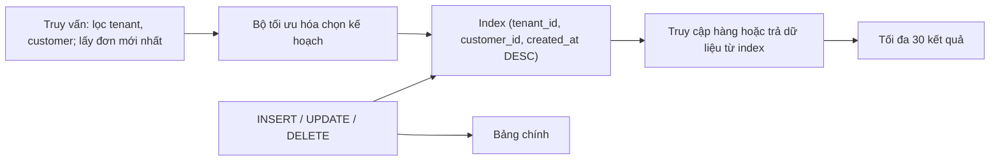

# Chỉ mục đơn, chỉ mục ghép và thứ tự cột theo mẫu truy cập

## 1. Từ mô hình logic đến quyết định tạo chỉ mục

Trong module `DATABASE_DATA_MODELING`, mục tiêu là chuyển yêu cầu nghiệp vụ thành mô hình dữ liệu rõ ràng, từ thực thể, quan hệ và ràng buộc đến chuẩn hóa, khóa, chỉ mục và lược đồ vật lý; đồng thời lựa chọn giữa cách biểu diễn quan hệ, document, đồ thị và phân tích theo khả năng kiểm chứng, mở rộng và tiến hóa. Ở chương **Mô hình vật lý**, chỉ mục (*index*) là quyết định triển khai quan trọng vì nó kết nối **cấu trúc dữ liệu** với **mẫu truy cập thực tế**.

Giả sử một nền tảng bán hàng có bảng đơn hàng chứa 10 triệu dòng. Truy vấn thường gặp là “liệt kê 30 đơn mới nhất của khách hàng trong một tenant”. Tạo chỉ mục riêng trên từng cột `tenant_id`, `customer_id` và `created_at` **không nhất thiết** hiệu quả bằng một chỉ mục ghép phù hợp với điều kiện lọc và cách sắp xếp. Nhưng tạo quá nhiều chỉ mục để “phòng khi cần” lại tốn dung lượng, tăng chi phí ghi và làm migration phức tạp hơn.

Sau bài này, người học cần có khả năng:

- Phân biệt **chỉ mục đơn cột** và **chỉ mục nhiều cột**, hiểu khóa chỉ mục được sắp theo thứ tự cột đã khai báo.
- Xuất phát từ `WHERE`, `JOIN`, `ORDER BY`, `LIMIT` và phân bố dữ liệu để chọn các cột, thứ tự cột và loại chỉ mục thích hợp.
- Giải thích khi nào một B-tree ghép dùng tốt tiền tố, khi nào thiếu cột đầu khiến truy vấn kém thuận lợi, và vì sao quy tắc “cột có độ chọn lọc cao nhất đứng trước” không đúng trong mọi trường hợp.
- Nhận diện chỉ mục tạo tự động do `PRIMARY KEY`/`UNIQUE`, từ đó tránh tạo chỉ mục trùng; cân nhắc `INCLUDE`, partial index hoặc expression index khi có căn cứ.
- Đọc `EXPLAIN`, kiểm tra thời gian thực thi bằng dữ liệu đại diện và cân bằng lợi ích đọc với chi phí ghi.

## 2. Bản chất của chỉ mục và đánh đổi cơ bản

Hãy hình dung bảng là tập bản ghi, còn chỉ mục là cấu trúc phụ giúp DBMS tìm vị trí dữ liệu theo một khóa tìm kiếm. B-tree là loại chỉ mục phổ biến trong các DBMS quan hệ. Một chỉ mục B-tree trên (`tenant_id`, `customer_id`, `created_at`) tổ chức các giá trị theo **thứ tự từ trái sang phải** của ba thành phần, kèm thông tin định vị hàng.



Chỉ mục có lợi ích rõ khi giúp giảm số trang phải đọc, giảm công sắp xếp, hỗ trợ join hoặc bảo vệ tính duy nhất. Tuy nhiên, nó có giá:

| Lợi ích | Chi phí và giới hạn |
|---|---|
| Tìm hàng theo điều kiện chọn lọc nhanh hơn | Chỉ mục chiếm dung lượng và cache; có thể phải đọc thêm bảng chính |
| Trả dữ liệu theo thứ tự khóa để giảm `Sort` | Thứ tự chỉ hiệu quả với một số mẫu lọc/sắp xếp cụ thể |
| Có thể hỗ trợ `LIMIT` hoặc phân trang | Không phải chỉ mục nào cũng phù hợp bộ lọc nhiều điều kiện |
| `UNIQUE` bảo vệ ràng buộc nghiệp vụ | Mỗi lần ghi phải duy trì cấu trúc chỉ mục và kiểm tra trùng |
| Hỗ trợ truy cập từ bảng con qua khóa ngoại | Khóa ngoại phía bảng con có thể vẫn cần index tự bổ sung tùy DBMS |

Trong PostgreSQL, bảng thường dùng lưu trữ *heap*; một B-tree index chứa khóa và tham chiếu đến hàng, vì vậy việc đọc dữ liệu ngoài index có thể phải chạm heap. Trên MySQL/InnoDB, dữ liệu được tổ chức theo clustered primary key và secondary index chứa giá trị khóa chính để định vị hàng. Trên SQL Server, cách định vị phụ thuộc clustered/nonclustered index. Những khác biệt này ảnh hưởng đến chi phí thực, nên không áp kết quả đo của một engine cho mọi sản phẩm.

**Không có chỉ mục nào bảo đảm DBMS sẽ sử dụng nó trong mọi lần chạy.** Optimizer so sánh chi phí dựa trên thống kê, kích thước bảng, độ chọn lọc, giá trị tham số, lượng dữ liệu cần trả và cơ chế lưu trữ. Quét tuần tự có thể hợp lý với bảng rất nhỏ hoặc truy vấn lấy phần lớn hàng.

## 3. Thu thập mẫu truy cập trước khi chọn chỉ mục

Trước khi viết `CREATE INDEX`, cần có một **bảng mẫu truy cập** mô tả truy vấn thực và mức độ quan trọng của chúng. Giả sử bảng `sales_order` có các cột:

`order_id`, `tenant_id`, `customer_id`, `order_status`, `created_at` và `total_amount`.

| Mẫu | Yêu cầu truy vấn | Tần suất / mục tiêu | Dữ liệu và điều kiện quan trọng |
|---|---|---|---|
| A | 50 đơn mới nhất của một tenant, trạng thái `PAID` | Rất thường xuyên, độ trễ thấp | `tenant_id = ?`, `order_status = 'PAID'`, `ORDER BY created_at DESC, order_id DESC` |
| B | 30 đơn mới nhất của một khách hàng trong tenant | Thường xuyên | `tenant_id = ?`, `customer_id = ?`, sắp theo thời gian |
| C | Đơn của tenant trong khoảng ngày, không giới hạn trạng thái | Thường xuyên ở màn hình đối soát | `tenant_id = ?`, `created_at >= ?`, `created_at < ?` |
| D | Báo cáo tổng doanh thu toàn hệ thống theo tháng | Chạy theo lô | Đọc khối lượng lớn, tổng hợp theo tháng; có thể cần bảng tổng hợp/kho phân tích |
| E | Đổi trạng thái một đơn bằng ID | Rất thường xuyên | `order_id = ?`, cập nhật đúng hàng, kiểm soát quyền tenant |

Để có quyết định đáng tin, còn phải ghi:

1. **Số hàng và phân bố:** mỗi tenant có bao nhiêu đơn; tỷ lệ `DRAFT`, `PAID`, `CANCELLED`; khách hàng có mức độ hoạt động chênh nhau không?
2. **Tỷ lệ đọc/ghi:** mỗi phút có bao nhiêu `INSERT`/`UPDATE`/`DELETE` so với truy vấn đọc?
3. **Tham số:** người dùng thường lọc đúng một trạng thái hay có thể chọn nhiều trạng thái; có trường hợp bỏ qua `tenant_id` không?
4. **Sắp xếp và giới hạn:** API có trả 20–50 bản ghi hay tải hàng triệu dòng một lần; có phân trang bằng offset hay cursor?
5. **Ràng buộc có sẵn:** `PRIMARY KEY`/`UNIQUE` đã tạo index nào; có index đặc thù do khóa ngoại hay tìm kiếm văn bản không?

Không nên thiết kế chỉ mục chỉ từ tên cột hoặc chỉ từ một truy vấn mẫu không có dữ liệu thực tế.

## 4. Chỉ mục đơn cột: phù hợp khi nào?

Chỉ mục đơn cột có một khóa tìm kiếm, ví dụ:

```sql
-- Minh họa: kiểu B-tree mặc định của PostgreSQL.
CREATE INDEX idx_order_created_at
    ON sales_order (created_at);
```

Nó có thể hữu ích khi hệ thống **thường xuyên truy vấn trực tiếp theo `created_at`** trên toàn bảng hoặc dùng nó để tìm một phạm vi thời gian có chọn lọc. Nhưng trong hệ nhiều tenant, truy vấn tiêu biểu có `WHERE tenant_id = ?`. Một index chỉ chứa `created_at` có thể buộc DBMS đi qua nhiều đơn của tenant khác rồi mới lọc.

### Độ chọn lọc và phân bố giá trị

Giả sử `order_status` có ba giá trị và 95% đơn là `PAID`. Index đơn trên `order_status` có thể kém hấp dẫn cho `WHERE order_status = 'PAID'` vì phải đọc phần lớn hàng. Ngược lại, nếu 0,2% đơn là `CANCELLED`, điều kiện này có thể có độ chọn lọc cao hơn.

**Độ chọn lọc** là mức mà điều kiện giảm được tập ứng viên, không phải chỉ là số giá trị khác nhau (*cardinality*) của cột. Một cột có ít giá trị nhưng phân bố cực lệch vẫn có thể phục vụ một điều kiện hiếm với hiệu quả tốt. Ngược lại, khóa có hàng triệu giá trị duy nhất cũng không giúp nhiều cho truy vấn phải đọc gần hết bảng.

Chỉ mục đơn thường hợp lý khi:

- Có đường tra cứu quan trọng chỉ theo cột đó, ví dụ khóa ngoài được truy vấn độc lập rất thường xuyên.
- Cột có giá trị đủ chọn lọc cho truy vấn thường gặp, hoặc index giúp trả thứ tự/giới hạn hiệu quả.
- Không có index ghép hiện tại với tiền tố phù hợp.
- Việc bổ sung một index có lợi ích đã đo vượt chi phí ghi và lưu trữ.

Chỉ mục đơn không phải mặc định cho mọi khóa ngoại. Với PostgreSQL, khóa ngoại bảng con không tự tạo index; ta đánh giá xem việc xóa/cập nhật bảng cha và các truy vấn join có cần đường truy cập đó không. Trong InnoDB, engine có quy tắc riêng về index hỗ trợ FK; phải kiểm tra DDL thực tế để tránh index trùng.

## 5. Chỉ mục ghép: sắp xếp từ cột thứ nhất đến cột cuối

Chỉ mục `(tenant_id, order_status, created_at DESC, order_id DESC)` tổ chức dữ liệu theo thứ tự:

1. `tenant_id`;
2. trong cùng `tenant_id`, theo `order_status`;
3. trong cùng tenant và trạng thái, theo `created_at` giảm dần;
4. nếu cùng thời điểm, theo `order_id` giảm dần để xác định thứ tự ổn định.

```text
tenant_id | order_status | created_at           | order_id
----------+--------------+----------------------+---------
10        | PAID         | 2027-05-05 10:00 UTC | 105
10        | PAID         | 2027-05-04 08:00 UTC | 104
10        | PAID         | 2027-05-03 16:00 UTC | 101
10        | DRAFT        | 2027-05-05 11:00 UTC | 106
20        | PAID         | 2027-05-05 09:00 UTC | 230

Ví dụ chỉ để hình dung: thứ tự trạng thái theo collation/kiểu lưu thực tế,
không cố thể hiện chính xác thứ tự từ điển của mọi DBMS.
```

Điều cốt lõi là **tiền tố trái** (*leftmost prefix*): trong B-tree nhiều cột, điều kiện trên một hoặc vài cột đầu thường giúp thu hẹp phạm vi scan tốt hơn điều kiện chỉ trên các cột phía sau.

| Bộ lọc / sắp xếp | Với index `(tenant_id, order_status, created_at DESC, order_id DESC)` |
|---|---|
| `tenant_id = 10` | Có điều kiện trên tiền tố đầu |
| `tenant_id = 10 AND order_status = 'PAID'` | Có hai điều kiện bằng trên hai cột đầu; thường hiệu quả |
| Hai điều kiện trên + `ORDER BY created_at DESC, order_id DESC LIMIT 50` | Rất phù hợp đường truy cập dự kiến |
| `tenant_id = 10 AND created_at >= ...`, không lọc trạng thái | Không thể dùng `created_at` như một dải liên tục trên toàn tenant vì bị chia thành từng trạng thái |
| `order_status = 'PAID'` nhưng không có `tenant_id` | Thiếu tiền tố đầu; thường kém thuận lợi cho tra cứu chọn lọc |
| `ORDER BY created_at DESC` toàn hệ thống | Thứ tự thời gian bị phân nhóm theo tenant và trạng thái, không khớp trực tiếp |

**Quy tắc tiền tố là định hướng thiết kế, không phải lệnh cấm tuyệt đối.** PostgreSQL có thể đọc cả index và áp điều kiện lên cột sau, chọn bitmap scan, hoặc dùng kế hoạch khác; tính năng optimizer thay đổi theo phiên bản. Cần xem liệu index có **giảm lượng dữ liệu phải đi qua** và chi phí truy vấn hay không, thay vì khẳng định cứ thiếu cột đầu thì “không dùng index”.

### Thứ tự cột: đẳng thức, khoảng và sắp xếp

Một heuristic hữu ích cho B-tree là ưu tiên các cột có điều kiện **bằng** thường xuyên, rồi xét cột phục vụ **khoảng** hoặc **sắp xếp**; cuối cùng xem điều kiện trên cột còn lại có giúp lọc/covering hay không. Nhưng không nên biến câu đó thành quy luật “mọi cột range đều đứng cuối”:

- `WHERE tenant_id = ? AND order_status = ? ORDER BY created_at DESC`: sau hai cột bằng, `created_at` phù hợp để lấy đơn mới nhất.
- `WHERE tenant_id = ? AND created_at >= ? AND created_at < ? ORDER BY created_at DESC`: chỉ mục `(tenant_id, created_at DESC)` có thể tốt hơn chỉ mục đặt `order_status` giữa hai cột nếu truy vấn **không lọc trạng thái**.
- `WHERE tenant_id = ? AND total_amount > ? ORDER BY created_at DESC`: index `(tenant_id, total_amount, created_at)` hỗ trợ lọc giá trị tiền, nhưng do đã quét dải `total_amount` nên thường không cho ra thứ tự `created_at` toàn dải; một index ưu tiên `created_at` có thể tốt hơn khi `LIMIT` nhỏ. Phải đo hai hướng nếu cả điều kiện giá và thứ tự đều quan trọng.
- `WHERE tenant_id = ? AND order_status IN ('DRAFT','PAID') ORDER BY created_at DESC`: nhiều trạng thái tạo nhiều nhóm có thứ tự thời gian riêng; DBMS có thể phải gộp/sắp xếp. Không mặc định index trạng thái ở trước thời gian sẽ loại bỏ bước sort.

**Không bắt buộc đặt cột có độ chọn lọc cao nhất lên đầu.** Ví dụ cả `tenant_id` và `customer_id` đều lọc bằng, thay đổi thứ tự có thể ít tác động cho truy vấn cụ thể; hãy chọn dựa thêm trên những truy vấn chỉ dùng tiền tố, thứ tự sắp xếp, phạm vi tenant và khả năng tái sử dụng index.

## 6. DDL hoàn chỉnh cho một tập truy vấn cụ thể

Ví dụ dưới đây dùng **PostgreSQL 16**. Nền tảng có nhiều tenant; một khách hàng thuộc một tenant; mỗi đơn thuộc đúng khách hàng của tenant đó. Khóa ngoại ghép được dùng để tránh liên kết sai tenant. Ví dụ chỉ phục vụ thiết kế chỉ mục, chưa trình bày đầy đủ hóa đơn, thuế, thanh toán hay quy tắc chuyển trạng thái.

```sql
CREATE TABLE tenant (
    tenant_id BIGINT GENERATED ALWAYS AS IDENTITY PRIMARY KEY,
    name      VARCHAR(120) NOT NULL
);

CREATE TABLE customer (
    customer_id   BIGINT GENERATED ALWAYS AS IDENTITY PRIMARY KEY,
    tenant_id     BIGINT NOT NULL REFERENCES tenant(tenant_id),
    customer_code VARCHAR(40) NOT NULL,
    full_name     VARCHAR(120) NOT NULL,
    CONSTRAINT uq_customer_tenant_code UNIQUE (tenant_id, customer_code),
    CONSTRAINT uq_customer_tenant_id UNIQUE (tenant_id, customer_id)
);

CREATE TABLE sales_order (
    order_id     BIGINT GENERATED ALWAYS AS IDENTITY PRIMARY KEY,
    tenant_id    BIGINT NOT NULL,
    customer_id  BIGINT NOT NULL,
    order_status VARCHAR(16) NOT NULL DEFAULT 'DRAFT',
    created_at   TIMESTAMPTZ NOT NULL DEFAULT CURRENT_TIMESTAMP,
    total_amount NUMERIC(14, 2) NOT NULL,
    CONSTRAINT fk_order_customer_in_tenant
        FOREIGN KEY (tenant_id, customer_id)
        REFERENCES customer (tenant_id, customer_id),
    CONSTRAINT ck_order_status
        CHECK (order_status IN ('DRAFT', 'PAID', 'CANCELLED')),
    CONSTRAINT ck_order_amount
        CHECK (total_amount >= 0)
);

-- A: 50 đơn mới nhất của một tenant theo trạng thái.
CREATE INDEX idx_order_tenant_status_recent
    ON sales_order (
        tenant_id, order_status, created_at DESC, order_id DESC
    ) INCLUDE (total_amount);

-- B: lịch sử đơn theo khách hàng trong tenant.
CREATE INDEX idx_order_tenant_customer_recent
    ON sales_order (
        tenant_id, customer_id, created_at DESC, order_id DESC
    );

-- C: tìm tất cả đơn của tenant theo thời gian, không lọc trạng thái.
-- Chỉ tạo khi workload chứng minh truy vấn C đủ quan trọng.
CREATE INDEX idx_order_tenant_recent
    ON sales_order (tenant_id, created_at DESC, order_id DESC);
```

Ba index phía dưới là **ba đường truy cập đã xác định theo mẫu A/B/C**. Trước khi triển khai thực, hãy xác nhận truy vấn C có đủ tải để giữ chỉ mục thứ ba. Chỉ mục trên `order_id` đã được tạo bởi `PRIMARY KEY`; không cần tạo thêm một index đơn trên cùng cột.

### 6.1. Mẫu A: lọc bằng rồi lấy những hàng mới nhất

```sql
EXPLAIN
SELECT order_id, created_at, total_amount
FROM sales_order
WHERE tenant_id = 10
  AND order_status = 'PAID'
ORDER BY created_at DESC, order_id DESC
LIMIT 50;
```

Với chỉ mục `idx_order_tenant_status_recent`, hai cột đầu có điều kiện bằng; hai cột tiếp theo khớp `ORDER BY`; `LIMIT 50` có thể giúp tránh phải xem tất cả đơn đã thanh toán của tenant. `total_amount` được đặt trong `INCLUDE` để index có thể cung cấp giá trị trả ra mà không cần truy cập mọi hàng heap trong điều kiện thích hợp.

**`INCLUDE` không làm `total_amount` trở thành cột tìm kiếm hay sắp xếp.** Nó là cột payload của index trong PostgreSQL; nếu truy vấn có thêm `WHERE total_amount > 1000000`, điều đó không đồng nghĩa DBMS có thể dùng `total_amount` như một thành phần khóa B-tree để thu hẹp dải scan.

### 6.2. Mẫu B: lịch sử của một khách hàng

```sql
EXPLAIN
SELECT order_id, order_status, created_at, total_amount
FROM sales_order
WHERE tenant_id = 10
  AND customer_id = 200
ORDER BY created_at DESC, order_id DESC
LIMIT 30;
```

Index `(tenant_id, customer_id, created_at DESC, order_id DESC)` phù hợp mẫu này. Index của mẫu A không thể thay thế trọn vẹn vì `customer_id` không nằm trong khóa tìm kiếm. Muốn trả thêm `order_status` và `total_amount`, DBMS có thể phải đọc heap; việc bổ sung các cột này vào `INCLUDE` chỉ đáng làm khi lợi ích index-only scan và độ trễ bù được chi phí kích thước/ghi.

### 6.3. Mẫu C: truy vấn khoảng thời gian

```sql
EXPLAIN
SELECT order_id, customer_id, order_status, created_at
FROM sales_order
WHERE tenant_id = 10
  AND created_at >= '2027-05-01 00:00:00+00'::TIMESTAMPTZ
  AND created_at <  '2027-06-01 00:00:00+00'::TIMESTAMPTZ
ORDER BY created_at DESC, order_id DESC
LIMIT 100;
```

Đặt `tenant_id` trước `created_at` hỗ trợ tìm dải thời gian trong từng tenant; `created_at DESC, order_id DESC` khớp cách lấy đơn mới nhất. Nên dùng khoảng **đầu bao gồm, cuối loại trừ** để tránh phải dựng “thời khắc cuối cùng của ngày” phụ thuộc độ chính xác timestamp; đối với ngày lịch của người dùng, cần quy đổi ranh giới từ múi giờ nghiệp vụ sang thời điểm trước khi lọc.

Nếu mẫu C rất hiếm hoặc thường xuất dữ liệu nhiều hàng, giữ riêng index C có thể không kinh tế. Việc thiết kế index phải theo mức độ quan trọng chứ không chỉ theo khả năng tạo một DDL hợp lệ.

### 6.4. Vì sao `created_at` và `order_id` xuất hiện cùng nhau?

Nhiều đơn có thể được tạo cùng thời điểm, đặc biệt khi độ chính xác thời gian hữu hạn. Chỉ `ORDER BY created_at DESC` sẽ không xác định thứ tự của các hàng bằng thời điểm. `order_id` là khóa phụ để tạo thứ tự xác định; cặp này cũng hỗ trợ **keyset pagination**:

```sql
-- Trang tiếp theo của màn hình "đơn PAID mới nhất trong tenant".
-- Cursor lấy từ created_at và order_id của hàng cuối trang trước.
SELECT order_id, created_at, total_amount
FROM sales_order
WHERE tenant_id = 10
  AND order_status = 'PAID'
  AND (created_at, order_id) <
      ('2027-05-05 10:00:00+00'::TIMESTAMPTZ, 12500)
ORDER BY created_at DESC, order_id DESC
LIMIT 50;
```

Với hai cột sắp **cùng hướng giảm dần**, điều kiện so sánh cặp `<` phù hợp để tiến tới các hàng cũ hơn. Nếu yêu cầu thứ tự pha trộn ASC/DESC, điều kiện cursor và chỉ mục phải được thiết kế lại. Keyset pagination giảm chi phí bỏ qua nhiều hàng so với `OFFSET` lớn, nhưng không tự tạo snapshot bất biến nếu có hàng được thêm, sửa thời gian hoặc đổi trạng thái giữa các lượt yêu cầu.

## 7. Chiều sắp xếp ASC/DESC và điều kiện phạm vi

PostgreSQL B-tree có thể quét xuôi hoặc ngược. Với index đơn cột, một khóa `created_at ASC` vẫn có thể hỗ trợ `ORDER BY created_at DESC` bằng quét ngược; không nhất thiết cần thêm một index chỉ đổi chiều.

Với **nhiều cột và thứ tự pha trộn**, chiều của từng cột quan trọng hơn. Ví dụ:

```sql
-- Khi tenant cố định, đơn theo ngày mới nhất và ID lớn nhất.
CREATE INDEX idx_order_tenant_time_desc
    ON sales_order (tenant_id, created_at DESC, order_id DESC);

-- Chỉ cân nhắc một index KHÁC khi cần kiểu sort hỗn hợp:
-- ORDER BY created_at DESC, order_id ASC
-- Index phù hợp cho mẫu đó có thể là:
-- (tenant_id, created_at DESC, order_id ASC)
```

Đoạn `CREATE INDEX` này là **minh họa độc lập**: nó có cùng khóa với `idx_order_tenant_recent` ở mục 6. Khi đã tạo chỉ mục mục 6, **không chạy thêm lệnh này trên cùng bảng** vì tạo trùng cấu trúc. Hướng ngược hoàn toàn có thể được hỗ trợ bằng quét ngược, nhưng hướng hỗn hợp cần kiểm tra index và query cụ thể.

Đối với truy vấn có nhiều bất đẳng thức, cần phân biệt:

- **Dùng cột để giới hạn dải quét:** điều kiện bằng trên tiền tố và điều kiện range trên cột tiếp theo thường đặc biệt có giá trị.
- **Dùng cột sau range để lọc trong index:** DBMS có thể kiểm tra điều kiện còn lại ngay khi đọc index, nhưng không nhất thiết giảm phạm vi các entry phải đọc theo cùng cách.
- **Dùng cột để trả thứ tự:** `ORDER BY` cần tương thích với thứ tự index sau khi xét các tiền tố bị ràng buộc bằng và chiều quét.

Không thể tối ưu đồng thời mọi tổ hợp `WHERE` và `ORDER BY` bằng một index ghép duy nhất. Hãy ưu tiên nhóm truy vấn thật sự quyết định chất lượng hệ thống.

## 8. Covering index, index-only scan và `INCLUDE`

Trong PostgreSQL, **covering index** là cách đặt thêm các cột mà truy vấn cần trả về vào index, thường qua `INCLUDE`, nhằm tạo điều kiện cho *index-only scan*. Ví dụ:

```sql
CREATE INDEX idx_order_tenant_status_cover
    ON sales_order (tenant_id, order_status, created_at DESC, order_id DESC)
    INCLUDE (total_amount);
```

Lệnh trên chỉ minh họa đúng cấu trúc của `idx_order_tenant_status_recent` đã tạo; **chỉ giữ một trong hai**, vì tạo cả hai sẽ dư thừa. Phân biệt rõ:

| Thành phần | Trong ví dụ | Vai trò |
|---|---|---|
| Khóa tìm kiếm/sắp xếp | `tenant_id`, `order_status`, `created_at`, `order_id` | Quyết định thứ tự B-tree và khả năng lọc/sort |
| Cột `INCLUDE` | `total_amount` | Có thể được đọc từ index khi cần trả kết quả; không dùng để định thứ tự khóa |

**Index-only scan không được bảo đảm chỉ vì các cột có trong index.** Với PostgreSQL, cơ chế MVCC cần xác nhận tính hiển thị của hàng; nếu trang heap chưa được đánh dấu *all-visible* trong visibility map, DBMS vẫn phải truy cập heap. Bảng được cập nhật thường xuyên có thể ít hưởng lợi hơn bảng tương đối ổn định. Ngoài ra, thêm `INCLUDE` làm index lớn hơn, tốn thêm công duy trì khi các cột được cập nhật.

Trên SQL Server cũng có cú pháp `INCLUDE` cho nonclustered index nhưng cấu trúc vật lý khác. MySQL/InnoDB không dùng cú pháp PostgreSQL `INCLUDE` tương đương trực tiếp; thông tin trả từ secondary index và PK cần được phân tích theo engine.

## 9. Partial index và expression index: chỉ khi mẫu truy vấn biện minh

### 9.1. Partial index cho tập hàng thường được truy vấn

Nếu hệ thống chỉ thường xuyên đọc **đơn đã thanh toán** và `PAID` chiếm một phần nhỏ, PostgreSQL hỗ trợ chỉ mục có điều kiện:

```sql
-- Phương án THAY THẾ khi phần lớn truy vấn chỉ tìm đơn PAID.
-- Không mặc định tạo cùng lúc với mọi index đầy đủ ở mục 6.
CREATE INDEX idx_order_paid_recent
    ON sales_order (tenant_id, created_at DESC, order_id DESC)
    WHERE order_status = 'PAID';
```

Index này nhỏ hơn index chứa mọi trạng thái nếu tỷ lệ `PAID` thấp; nó cũng không cần mang `order_status` làm khóa tìm kiếm vì mọi entry đã thỏa predicate. Nhưng có giới hạn:

- Không giúp trực tiếp cho truy vấn tìm `DRAFT` hoặc `CANCELLED`.
- Trình tối ưu hóa cần **chứng minh** điều kiện truy vấn kéo theo predicate của partial index. Một câu truy vấn được chuẩn bị với tham số trạng thái không xác định tại lúc chọn *generic plan* có thể không dùng được index này.
- Khi phân bố thay đổi, ví dụ `PAID` tăng từ 3% lên 95%, lợi ích về kích thước/độ chọn lọc cũng thay đổi.
- Tập chỉ mục đang có phải được đánh giá lại; đừng giữ cả index rộng và partial index gần tương đương nếu không còn mục tiêu cụ thể.

Partial index trên PostgreSQL cũng có thể giúp bảo vệ quy tắc duy nhất có điều kiện, ví dụ “mã đăng ký chỉ duy nhất khi bản ghi chưa được xóa mềm”. Nhưng khi dùng làm cơ chế toàn vẹn, phải làm rõ hành vi với `NULL`, khóa ngoại và chính sách xóa; một partial unique index không đương nhiên là đích FK tương đương unique constraint thông thường.

### 9.2. Expression index khi điều kiện áp dụng hàm lên cột

Giả sử nghiệp vụ tìm khách hàng bằng email **không phân biệt hoa/thường** theo quy tắc chuẩn hóa đã quyết định. Query `WHERE lower(email) = lower(?)` thường không thể khai thác index B-tree thông thường trên `email` như một tra cứu bằng trực tiếp. PostgreSQL cho phép expression index:

```sql
-- Ví dụ độc lập: bảng account_email có cột email TEXT NOT NULL.
CREATE INDEX idx_account_email_lower
    ON account_email (lower(email));

-- Truy vấn phải có biểu thức phù hợp.
SELECT account_id
FROM account_email
WHERE lower(email) = lower('User@Example.test');
```

Ví dụ giả định `account_email` đã tồn tại, **không phải** một bảng được tạo trong DDL mục 6. Với hệ thống thật, expression index còn phụ thuộc collation, Unicode và chính sách xác định email tương đương; `lower` đơn thuần chưa giải quyết mọi bài toán Unicode. Nếu tính duy nhất là quy tắc nghiệp vụ, cần **unique expression index** hoặc giải pháp chuẩn hóa/tương đương thích hợp, không chỉ index thường.

Một biểu thức như `DATE(created_at)` trong điều kiện lọc cũng có thể khiến đường truy cập theo timestamp kém hiệu quả. Với báo cáo ngày, thường nên viết khoảng timestamp theo ranh giới ngày nghiệp vụ để tận dụng index trên `created_at`, thay vì luôn thêm index biểu thức chỉ để thích ứng với một câu SQL.

## 10. Cột trong `WHERE` không đồng nghĩa luôn cần nằm trong index

Khi một câu SQL có nhiều điều kiện, cần chọn phần nào làm **đường truy cập chính**. Ví dụ:

```sql
SELECT order_id, total_amount
FROM sales_order
WHERE tenant_id = 10
  AND order_status = 'PAID'
  AND total_amount >= 1000000
ORDER BY created_at DESC, order_id DESC
LIMIT 20;
```

Hai chiến lược khác nhau:

1. Dùng index `(tenant_id, order_status, created_at DESC, order_id DESC)`, đi theo đơn mới nhất rồi lọc `total_amount` cho đến khi có đủ 20 dòng. Tốt khi điều kiện tiền không quá hiếm và `LIMIT` nhỏ.
2. Dùng index có `total_amount` ở vị trí phù hợp để chọn trước các đơn giá trị lớn, sau đó có thể phải sắp xếp theo thời gian. Tốt khi số đơn thỏa điều kiện tiền rất ít và việc sắp xếp tập nhỏ không tốn kém.

Không có câu trả lời đúng chỉ từ SQL. Cần thống kê về số tiền, trạng thái và tenant. Đôi khi DBMS có thể phối hợp nhiều chỉ mục qua bitmap operations, nhưng phối hợp như vậy không nhất thiết giữ được thứ tự đầu ra và có thể không thắng một composite index khớp đúng mẫu truy cập.

Một cột xuất hiện trong `SELECT` chỉ để trả về cũng không nhất thiết phải làm cột khóa. Có thể đọc từ heap hoặc cân nhắc `INCLUDE` nếu index-only scan có lợi. Quyết định phụ thuộc số hàng đọc, cache, tỷ lệ cập nhật và kích thước dữ liệu.

## 11. Kiểm chứng bằng `EXPLAIN` và số liệu vận hành

**Lược đồ chạy được không có nghĩa chỉ mục đang tạo lợi ích.** Trên PostgreSQL, xem kế hoạch ước lượng trước:

```sql
EXPLAIN
SELECT order_id, created_at, total_amount
FROM sales_order
WHERE tenant_id = 10
  AND order_status = 'PAID'
ORDER BY created_at DESC, order_id DESC
LIMIT 50;
```

Trong môi trường thử nghiệm có dữ liệu đại diện, đo thực thi:

```sql
EXPLAIN (ANALYZE, BUFFERS)
SELECT order_id, created_at, total_amount
FROM sales_order
WHERE tenant_id = 10
  AND order_status = 'PAID'
ORDER BY created_at DESC, order_id DESC
LIMIT 50;
```

`EXPLAIN ANALYZE` **thực sự chạy truy vấn**. Với lệnh ghi (`INSERT`, `UPDATE`, `DELETE`), chỉ chạy trong môi trường kiểm thử hoặc giao dịch kiểm soát được tác động. Đọc và so sánh:

| Tín hiệu | Ý nghĩa khi đánh giá |
|---|---|
| `Index Scan` / `Index Only Scan` / `Bitmap Heap Scan` / `Seq Scan` | Cách DBMS chọn truy cập; không có loại nào luôn đúng |
| `Index Cond` | Điều kiện được dùng để truy cập index |
| `Filter`, `Rows Removed by Filter` | Bao nhiêu hàng được lấy lên rồi bị loại bởi điều kiện còn lại |
| `Sort` và phương pháp sort | Có phải sắp xếp thêm dù đã có index |
| `actual rows`, `loops`, thời gian thực tế | Số hàng, số lần thực thi và độ trễ của từng phần kế hoạch |
| `Buffers: shared hit/read` | Trang được tìm trong cache hay cần đọc vào buffer theo số liệu PostgreSQL |
| `Heap Fetches` ở index-only scan | Có phải truy cập heap để kiểm tra visibility hoặc dữ liệu không |

Nên đo nhiều giá trị tenant: tenant nhỏ, tenant lớn, người dùng có rất nhiều đơn và khoảng thời gian có phân bố khác nhau. Một lần chạy trên bảng vừa tạo thường không đại diện. Sau khi nhập nhiều dữ liệu, đảm bảo thống kê được cập nhật (ví dụ dùng `ANALYZE`) rồi mới so kế hoạch.

### Truy vấn kiểm tra chỉ mục và kích thước

```sql
SELECT indexname, indexdef
FROM pg_indexes
WHERE schemaname = 'public'
  AND tablename = 'sales_order'
ORDER BY indexname;

SELECT
    indexrelname,
    idx_scan,
    idx_tup_read,
    idx_tup_fetch,
    pg_size_pretty(pg_relation_size(indexrelid)) AS index_size
FROM pg_stat_user_indexes
WHERE schemaname = 'public'
  AND relname = 'sales_order'
ORDER BY pg_relation_size(indexrelid) DESC;
```

`idx_scan` là bộ đếm tích lũy từ khi thống kê được đặt lại và tùy hành vi thu thập thống kê. Giá trị nhỏ **không đủ** để khẳng định một index thừa; nó có thể phục vụ truy vấn theo mùa, migration hoặc ràng buộc duy nhất. Ngược lại, index được sử dụng nhiều chưa chắc có hiệu quả nếu nó chỉ làm giảm rất ít dữ liệu phải đọc. Cần kết hợp log, mẫu truy vấn, kế hoạch và đo đạc thực tế.

## 12. Chi phí ghi, dung lượng và index trùng

Mỗi index bổ sung thường kéo theo chi phí khi thêm/xóa hàng; khi cập nhật cột được lập chỉ mục, DBMS cũng có thể phải cập nhật entry của index. Với PostgreSQL, việc thay đổi cột được index hoặc có trong `INCLUDE` có thể làm mất cơ hội *HOT update* vốn tránh sửa index trong một số trường hợp; kết quả cụ thể tùy cột và cách lưu hàng.

Tác động nên đo ở ít nhất các khía cạnh:

- **Dung lượng:** tổng index chiếm bao nhiêu so với heap; có chỉ mục chứa chuỗi hoặc nhiều cột lớn làm tăng số trang không?
- **Thông lượng ghi:** latency của `INSERT` và `UPDATE` trạng thái/tiền có tăng khi thêm index mới không?
- **Tải nền:** WAL, vacuum/autovacuum, bảo trì và thời gian xây lại index có ảnh hưởng vận hành không?
- **Bộ nhớ:** nhiều index tranh cache với dữ liệu được truy vấn thường xuyên.
- **Dư thừa:** ràng buộc `PRIMARY KEY` và `UNIQUE` thường đã tạo unique index thích hợp; index có cùng các cột, thứ tự và điều kiện không tự nhiên mang thêm lợi ích.

Ví dụ, `PRIMARY KEY(order_id)` của bảng `sales_order` đã đủ phục vụ tra đơn theo ID. Tạo thêm `CREATE INDEX ... ON sales_order(order_id)` thường lãng phí. Nhưng `UNIQUE(tenant_id, customer_code)` **không** thay thế index trên `(tenant_id, customer_id, created_at DESC)` của một bảng khác: chúng phục vụ quan hệ và mẫu truy vấn khác.

### Chỉ mục có tiền tố trùng nhau có luôn dư thừa?

Nếu có `(tenant_id, order_status, created_at)` thì index đơn `(tenant_id)` đôi khi có thể bỏ, vì B-tree ghép đã bắt đầu bằng `tenant_id`. Nhưng index đơn ngắn hơn có thể nhỏ hơn nhiều, và truy vấn chỉ theo tenant có thể hưởng lợi từ việc đọc ít trang. Quyết định loại bỏ cần so kích thước, kế hoạch, tần suất và chi phí ghi.

Ngược lại, hai chỉ mục `(tenant_id, order_status)` và `(order_status, tenant_id)` có thể phục vụ các đường truy vấn khác nhau, dù cả hai bảo vệ cùng tổ hợp giá trị nếu đặt `UNIQUE` trên cặp cột. Thứ tự cột ảnh hưởng truy cập, không làm thay đổi tập cặp trùng bị cấm khi cả hai cột không `NULL`.

### Tạo index trên bảng lớn

Việc thêm chỉ mục vào bảng đang phục vụ ghi có thể gây khóa và tốn tài nguyên. PostgreSQL hỗ trợ `CREATE INDEX CONCURRENTLY` để hạn chế chặn ghi trong nhiều tình huống, nhưng thao tác này có giới hạn và **không được chạy trong một transaction block**; nó còn cần nhiều pha quét, có thể thất bại và để lại index không hợp lệ phải xử lý. Với MySQL và SQL Server, khả năng online index operation tùy engine, phiên bản, phiên bản sản phẩm và loại thay đổi. Luôn kiểm tra hành vi đúng môi trường đích và chuẩn bị rollback/quan sát.

## 13. Khác biệt khi chuyển sang MySQL, SQL Server hoặc mô hình khác

| Chủ đề | PostgreSQL 16 | MySQL 8.0 / InnoDB | SQL Server 2022 |
|---|---|---|---|
| Index phổ biến cho điều kiện bằng/khoảng | B-tree | B-tree của InnoDB | Rowstore B-tree thường dùng |
| Khóa chính và lưu trữ hàng | Index riêng với heap | Clustered primary key; secondary index mang theo PK | Tùy clustered/nonclustered |
| Payload ngoài cột khóa | B-tree `INCLUDE` | Không có cú pháp `INCLUDE` tương đương PostgreSQL; phải xét covering theo engine | `INCLUDE` trên nonclustered index |
| Index có điều kiện | `CREATE INDEX ... WHERE ...` | Không có partial index giống cú pháp PostgreSQL; cần thiết kế tương đương khác nếu khả thi | Filtered index có điều kiện |
| Index trên biểu thức | Expression index | Functional index theo phiên bản, với các giới hạn riêng | Có thể dùng computed column và index nếu đáp ứng điều kiện |
| Chỉ mục cho FK phía bảng con | Không tự tạo chỉ vì `FOREIGN KEY` | InnoDB yêu cầu index hỗ trợ và có thể tự tạo khi thiếu | Không tự tạo index phía con chỉ vì FK |
| Quét ngược/chiều chỉ mục | B-tree có thể quét ngược | Hỗ trợ descending indexes ở MySQL 8.0 theo khả năng engine | Phụ thuộc định nghĩa index và kế hoạch |

Điểm cần kiểm tra trước khi chuyển DDL: giới hạn độ dài khóa theo byte, collation, cơ chế tạo index trên cột nullable, loại index và phiên bản hỗ trợ, các biểu thức có thể lập index, thống kê của optimizer và chi phí update trên storage engine.

Ở **document database**, thứ tự trường trong compound index cũng thường quan trọng, nhưng quy tắc tiền tố/đa khóa/mảng (*multikey*) và giới hạn document khác SQL; phải dựa vào cách truy vấn document và engine cụ thể. Với **graph database**, index thường giúp tìm node ban đầu theo thuộc tính, còn truy vấn traversal phụ thuộc cấu trúc cạnh, độ lớn bậc node và đặc điểm DBMS. Với **kho dữ liệu phân tích**, partition, clustering, sort key, zone map hoặc index kiểu columnar có thể quan trọng hơn một B-tree ghép theo mẫu OLTP. Không áp dụng máy móc một chỉ mục quan hệ lên mọi mô hình lưu trữ.

## 14. Quy trình quyết định có thể kiểm chứng

Quy trình ngắn gọn để thiết kế và rà soát chỉ mục:

1. **Nêu bài toán truy vấn**: xác định mẫu đọc/ghi quan trọng, mục tiêu độ trễ, lượng hàng, bộ lọc, thứ tự và phân trang.
2. **Đọc các ràng buộc đã có**: `PRIMARY KEY`/`UNIQUE`, index cho join/FK, index hiện có và cấu trúc vật lý của DBMS.
3. **Lập ứng viên ít nhất có thể**: ưu tiên tiền tố đẳng thức theo mẫu truy cập, tiếp theo là cột khoảng hoặc sắp xếp; xem xét chiều ASC/DESC và cột phá hòa.
4. **Kiểm tra khả năng tái sử dụng**: một composite index có đáp ứng nhiều mẫu không; index đơn hay partial index có thực sự cần riêng?
5. **Đo trên dữ liệu đại diện**: dùng `EXPLAIN`/`EXPLAIN ANALYZE`, đo thời gian, trang đọc, dung lượng, tốc độ ghi và nhiều giá trị tham số.
6. **Thử biến động**: tenant lớn, trạng thái phân bố lệch, số lượng hàng tăng, query phân trang sâu và các cập nhật thường xuyên.
7. **Đưa vào vận hành có kiểm soát**: xây index phù hợp khả năng online, giám sát sau triển khai, lưu lại lý do giữ/bỏ index để lần migration sau có cơ sở.

Đừng lấy “query có dùng index” làm tiêu chuẩn duy nhất. Mục đích cuối là đáp ứng truy vấn và toàn vẹn dữ liệu trong giới hạn tài nguyên, đồng thời giữ cho lược đồ dễ tiến hóa.

## 15. Bài thực hành: tối ưu truy cập lịch sử sự kiện

Một hệ thống đa tenant lưu 50 triệu bản ghi sự kiện vào bảng `audit_event` với:

`event_id BIGINT PRIMARY KEY`, `tenant_id BIGINT`, `actor_id BIGINT`, `event_type VARCHAR(30)`, `occurred_at TIMESTAMPTZ`, `payload JSONB`.

Ba mẫu truy vấn:

| Mẫu | Truy vấn | Tải giả định |
|---|---|---|
| Q1 | 100 sự kiện mới nhất của tenant với `event_type = 'LOGIN_FAILED'` | Rất thường xuyên; loại sự kiện này chiếm 1% |
| Q2 | 50 sự kiện mới nhất của một `actor_id` trong tenant | Thường xuyên |
| Q3 | Xuất toàn bộ sự kiện theo tháng để báo cáo | Hiếm nhưng có thể đọc hàng triệu dòng |

Hãy hoàn thành:

1. Đề xuất chỉ mục B-tree ghép cho Q1, Q2 với thứ tự cột phù hợp cho `WHERE`, `ORDER BY occurred_at DESC, event_id DESC` và `LIMIT`. Giải thích vì sao tạo ba index đơn trên `tenant_id`, `event_type` và `occurred_at` có thể không đáp ứng tốt như các chỉ mục ghép.
2. Cân nhắc **partial index** dành riêng cho `LOGIN_FAILED`. Khi nào nó nhỏ và hiệu quả hơn index chứa mọi `event_type`? Điều gì xảy ra nếu ứng dụng dùng một tham số `event_type` trong generic prepared plan?
3. Thảo luận có nên thêm `payload JSONB` vào `INCLUDE` hay không. Nêu tác động tới độ rộng index, ghi và khả năng index-only scan; giải thích vì sao dữ liệu JSON lớn không nên được đưa vào index chỉ để tránh đọc heap khi chưa đo.
4. Cho biết vì sao Q3 có thể cần chiến lược đọc/partition/sort hoặc kho phân tích thay vì tạo thêm một B-tree cho mọi điều kiện báo cáo.
5. Nêu các trường hợp kiểm chứng: tenant ít dữ liệu, tenant rất lớn, truy vấn trả phần lớn bảng, 1 triệu lượt chèn trong tải thử, `ORDER BY` có thời điểm trùng và phân trang sâu.

**Tiêu chí bàn giao:** với mỗi index được đề xuất, phải chỉ ra *mẫu truy cập nó phục vụ*, *vì sao thứ tự cột như vậy*, *mẫu nào nó không phục vụ tốt*, *chỉ mục/ràng buộc nào đã có* và *số liệu nào chứng minh lợi ích lớn hơn chi phí*.

Chỉ mục đơn, chỉ mục ghép và thứ tự cột đều là phương tiện để phục vụ **mẫu truy cập đã được xác định**. Khi bắt đầu từ truy vấn, hiểu giới hạn tiền tố và sắp xếp của B-tree, đồng thời đo ảnh hưởng lên cả đọc và ghi, người thiết kế có thể chọn số lượng chỉ mục vừa đủ để bảo vệ hiệu năng mà vẫn giữ mô hình dữ liệu gọn, đúng và dễ thay đổi.
