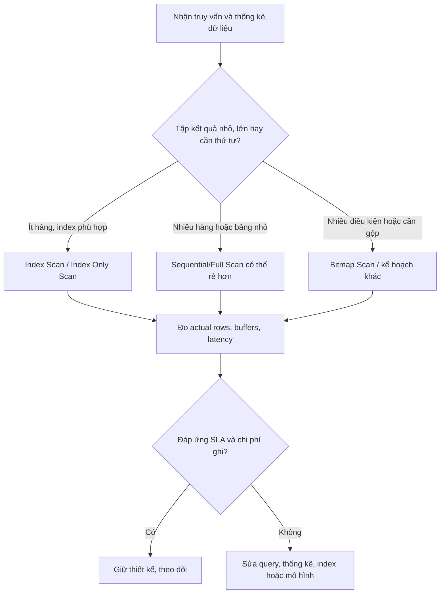

# Tính chọn lọc, chi phí ghi và giới hạn của việc thêm chỉ mục

## 1. Chỉ mục phải được đánh giá bằng cả lợi ích đọc lẫn chi phí ghi

Trong module `DATABASE_DATA_MODELING`, người học rèn kỹ năng chuyển yêu cầu nghiệp vụ thành mô hình dữ liệu rõ ràng: từ thực thể, quan hệ, ràng buộc, chuẩn hóa, khóa đến chỉ mục và lược đồ vật lý. Một lược đồ tốt phải đáp ứng truy vấn hiện tại nhưng cũng dễ tiến hóa khi dữ liệu và tải thay đổi. Vì vậy, **không nên tạo chỉ mục cho mọi cột xuất hiện trong `WHERE`**. Một chỉ mục có thể rút ngắn đáng kể thời gian đọc nhưng làm chậm mỗi thao tác ghi, chiếm bộ nhớ, tăng dung lượng lưu trữ và gây khó khăn khi triển khai migration.

Bài học tập trung vào ba câu hỏi gắn với quyết định vật lý:

1. **Tính chọn lọc:** điều kiện lọc thực sự giảm số hàng phải đọc được bao nhiêu, và có thay đổi theo tenant, trạng thái, thời gian hoặc tham số không?
2. **Chi phí ghi:** mỗi chỉ mục thêm vào làm phát sinh thao tác duy trì, log, trang dữ liệu và công bảo trì như thế nào?
3. **Giới hạn của việc thêm chỉ mục:** khi nào DBMS không dùng chỉ mục, khi nào chỉ mục trùng nhau, khi nào cần đổi truy vấn hoặc mô hình lưu trữ thay vì tiếp tục tạo index?

Mục tiêu không phải tối đa hóa số index hay ép mọi truy vấn dùng `Index Scan`, mà là **đảm bảo ràng buộc dữ liệu và đạt mục tiêu hiệu năng với chi phí vận hành hợp lý**.

## 2. Hiểu đúng tính chọn lọc: tỷ lệ khớp và số lượng giá trị khác nhau

Giả sử bảng `audit_event` có 20 triệu sự kiện. Với điều kiện `event_type = 'LOGIN_FAILED'`, nếu 200.000 hàng thỏa mãn thì **tỷ lệ khớp** (*matching fraction*) là:

\[
s = \frac{\text{số hàng thỏa điều kiện}}{\text{tổng số hàng}}
  = \frac{200\,000}{20\,000\,000}=0{,}01=1\%
\]

Theo cách nói phổ biến, điều kiện loại bỏ được 99% hàng là **có tính chọn lọc cao**. Ngược lại, điều kiện khớp 95% hàng có **tính chọn lọc thấp**. Để tránh nhầm thuật ngữ, trong bài này luôn ghi rõ *tỷ lệ khớp*: tỷ lệ càng nhỏ, điều kiện càng thu hẹp tập ứng viên.

**Cardinality** của cột là số lượng giá trị khác nhau, không phải tỷ lệ khớp của một giá trị cụ thể. Ví dụ:

| Thuộc tính | Số giá trị khác nhau | Phân bố ví dụ | Ý nghĩa |
|---|---:|---|---|
| `event_type` | 4 | `LOGIN_OK` 85%, `LOGIN_FAILED` 1%, `PURCHASE` 10%, `EXPORT` 4% | Ít giá trị khác nhau nhưng điều kiện `LOGIN_FAILED` vẫn hiếm |
| `tenant_id` | 5.000 | Tenant lớn nhất nắm 35% hàng; nhiều tenant dưới 0,01% | Một giá trị `tenant_id` có thể rất phổ biến hoặc rất hiếm |
| `actor_id` | 2 triệu | Một số actor có hàng trăm nghìn sự kiện | Không thể mặc định mọi actor đều có lượng dữ liệu giống nhau |
| `event_id` | 20 triệu | Mỗi ID duy nhất | Lọc bằng ID thường tìm rất ít hàng |

Từ bảng trên, **chỉ số distinct count không đủ** để quyết định tạo index trên `event_type` hay `tenant_id`. Cần quan sát tần suất của những giá trị cụ thể, kết hợp điều kiện khác và số hàng thật sự phải đọc.

### Tính chọn lọc thay đổi theo phạm vi lọc

Một truy vấn có thể đồng thời lọc:

```sql
WHERE tenant_id = 42 AND event_type = 'LOGIN_FAILED'
```

Không nên ước lượng số hàng bằng cách lấy tỷ lệ tenant nhân tỷ lệ `LOGIN_FAILED` toàn bảng nếu hai thuộc tính **có tương quan**. Ví dụ tenant 42 đang bị tấn công đăng nhập, 40% sự kiện của tenant là `LOGIN_FAILED`, còn tỷ lệ toàn hệ thống chỉ 1%. Giả định độc lập sẽ ước lượng sai nghiêm trọng và có thể khiến bộ tối ưu chọn kế hoạch kém.

Một điều kiện cũng có thể đổi tính chọn lọc theo **thời gian**. `processed_at IS NULL` rất hiếm vào giờ thấp điểm nhưng trở nên phổ biến khi hàng đợi xử lý bị nghẽn. Vì vậy thống kê và kế hoạch cần được kiểm tra theo nhiều thời điểm vận hành, không chỉ một lần khi vừa tạo bảng.

## 3. Tính chọn lọc ảnh hưởng đến kế hoạch truy cập ra sao?

Một B-tree thường giúp tìm phạm vi khóa một cách hiệu quả. Nhưng tổng chi phí truy vấn còn gồm đọc mục index, truy cập bản ghi ngoài index, kiểm tra tính hiển thị dữ liệu và trả kết quả. Nếu điều kiện khớp gần toàn bảng, đọc qua index rồi quay lại nhiều vị trí trên bảng có thể tốn hơn quét tuần tự.



Ví dụ với 20 triệu hàng:

- Điều kiện `event_id = 15000001` tìm đúng một hàng: khóa chính có chỉ mục là ứng viên rất tốt.
- Điều kiện `event_type = 'LOGIN_OK'` khớp 85% hàng và trả mọi cột: quét tuần tự có thể tốt hơn index đơn trên `event_type`.
- Điều kiện `event_type = 'LOGIN_OK' ORDER BY occurred_at DESC LIMIT 20` có thể hưởng lợi từ **một chỉ mục ghép phù hợp với thứ tự**, dù trạng thái có tính chọn lọc thấp: DBMS có thể dừng sau khi tìm đủ 20 hàng.
- Điều kiện chỉ lấy `COUNT(*)` hoặc vài cột có thể có kế hoạch khác với `SELECT *`, vì số cột trả về và khả năng đọc ngay trên index ảnh hưởng lượng I/O.

**Không có ngưỡng cố định** như “điều kiện khớp trên 10% thì không cần index” áp dụng cho mọi bảng. Ngưỡng thay đổi theo độ rộng hàng, phân bố dữ liệu, độ tương quan với thứ tự vật lý, cache, loại ổ đĩa, số hàng trả ra, loại index và DBMS.

### Khác biệt giữa selectivity và tính cục bộ vật lý

Hai điều kiện cùng khớp 1% hàng có thể có chi phí khác nhau. Nếu các hàng nằm gần nhau về vị trí lưu trữ, DBMS có thể đọc ít trang hơn. Nếu chúng rải rác trên nhiều trang, số lần truy cập ngẫu nhiên và cache miss có thể tăng. PostgreSQL có thống kê `correlation` mô tả mức tương quan giữa thứ tự giá trị cột và thứ tự vật lý của hàng, giúp optimizer ước lượng một số trường hợp; nhưng giá trị đó **không** thay thế việc đo truy vấn thật.

## 4. Chỉ mục đơn và chỉ mục ghép dưới góc nhìn độ chọn lọc

Với các truy vấn phổ biến, index ghép thường khác xa tổng của những index đơn. Giả sử cần:

```sql
SELECT event_id, occurred_at
FROM audit_event
WHERE tenant_id = 42 AND actor_id = 10021
ORDER BY occurred_at DESC, event_id DESC
LIMIT 30;
```

Hai index đơn `(tenant_id)` và `(actor_id)` có thể giúp lọc từng điều kiện; một số DBMS còn phối hợp nhiều index. Tuy nhiên, index ghép `(tenant_id, actor_id, occurred_at DESC, event_id DESC)` cho phép xác định phạm vi theo hai điều kiện bằng, rồi đọc theo thứ tự mong muốn và dừng sớm sau `LIMIT`.

Thứ tự cột B-tree tác động đến khả năng dùng **tiền tố trái**:

| Chỉ mục | Phù hợp | Hạn chế |
|---|---|---|
| `(tenant_id)` | Tìm mọi dữ liệu của một tenant | Có thể phải lọc actor và sort nhiều hàng |
| `(actor_id)` | Tìm một actor toàn hệ thống | Có thể không đủ nếu actor chỉ duy nhất trong tenant |
| `(tenant_id, actor_id)` | Lọc bằng tenant và actor | Chưa cung cấp trực tiếp thứ tự thời gian |
| `(tenant_id, actor_id, occurred_at DESC, event_id DESC)` | Lọc tenant + actor, lấy N sự kiện gần nhất | Không tốt như index thời gian riêng cho mọi truy vấn chỉ theo tenant |
| `(tenant_id, occurred_at DESC, event_id DESC)` | Lấy N sự kiện mới nhất của tenant bất kể actor | Không chọn lọc trực tiếp actor khi tìm lịch sử riêng |

Việc ưu tiên cột nào không chỉ dựa trên “cột có nhiều giá trị distinct nhất”. Nếu query luôn lọc bằng cả tenant và actor, hai điều kiện đều làm hẹp tập; chọn thứ tự còn phụ thuộc truy vấn dùng tiền tố, khả năng `ORDER BY` và các truy vấn lân cận.

### Sau một điều kiện khoảng, cột sau không luôn thu hẹp scan

Nếu dùng index `(tenant_id, occurred_at, event_type)` và truy vấn:

```sql
WHERE tenant_id = 42
  AND occurred_at >= '2027-01-01 00:00:00+00'
  AND occurred_at <  '2027-02-01 00:00:00+00'
  AND event_type = 'LOGIN_FAILED'
```

`tenant_id` cùng khoảng `occurred_at` thường quyết định dải khóa cần quét. `event_type` ở sau khoảng có thể được kiểm tra ngay trong index nhưng không nhất thiết thu hẹp dải scan theo cách tương đương một tiền tố bằng. Nếu truy vấn chủ yếu là tìm một loại sự kiện rồi lấy mới nhất, index `(tenant_id, event_type, occurred_at DESC)` có thể phù hợp hơn. Hai mẫu truy vấn khác nhau có thể cần hai cấu trúc hoặc phải chọn mẫu ưu tiên.

## 5. Chi phí ghi của mỗi chỉ mục đến từ đâu?

Một lệnh `INSERT` không chỉ ghi hàng mới vào bảng: DBMS phải duy trì các index liên quan, bao gồm index cho khóa chính và ràng buộc duy nhất. `UPDATE` có thể tạo thay đổi ở nhiều index; `DELETE` cần bảo đảm những entry cũ không tiếp tục được dùng như dữ liệu hợp lệ và được dọn theo cơ chế lưu trữ. Mọi thao tác còn chịu ảnh hưởng của cơ chế giao dịch, log và phục hồi.

### 5.1. Các nguồn chi phí phổ biến

| Nguồn chi phí | Ý nghĩa thực tế |
|---|---|
| Tìm vị trí chèn và duy trì B-tree | CPU, trang nhớ, page split, ghi trang khi index tăng và phân bố khóa thay đổi |
| Nhiều entry trên mỗi lệnh ghi | Số index càng lớn, đường ghi càng nhiều việc; không thể đánh giá chỉ từ một index riêng lẻ |
| WAL/redo log và phục hồi | Thay đổi index cũng cần thông tin phục hồi phù hợp cơ chế DBMS |
| Dung lượng và cache | Index chiếm đĩa và buffer; nhiều index cạnh tranh cache với bảng và truy vấn |
| Dọn bản ghi/độ phân mảnh | MVCC, vacuum/garbage collection hoặc bảo trì index tiêu thụ tài nguyên nền |
| Kiểm tra uniqueness | Index unique phải phát hiện va chạm, có thể chờ giao dịch cạnh tranh |
| Tạo hoặc xây lại index | Quét bảng, sử dụng tài nguyên, tác động ghi đồng thời và thời gian triển khai |

Giả sử mỗi ngày có 5 triệu sự kiện mới; thêm bốn index mới nghĩa là mỗi sự kiện có thể phát sinh **bốn bộ thao tác duy trì index bổ sung**. Không nên chuyển trực tiếp số thao tác đó thành “ghi đĩa gấp năm” vì WAL, caching, batching, page layout và loại index thay đổi lượng I/O thật. Cần đo tốc độ chèn và dung lượng WAL trước/sau trên cùng workload.

### 5.2. `UPDATE` có thể tốn hơn dự đoán

Giả sử bảng `audit_event` thường cập nhật `processed_at` khi một sự kiện đã được xử lý. Nếu tạo index trên `processed_at` hoặc partial index có predicate `processed_at IS NULL`, mỗi lần chuyển từ chưa xử lý sang đã xử lý làm thay đổi thành viên/giá trị trong index. Điều này có thể tăng chi phí ghi đáng kể.

PostgreSQL dùng MVCC; một số cập nhật có thể được tối ưu theo cơ chế **HOT (Heap-Only Tuple)** nếu không thay đổi cột liên quan tới index (cùng các điều kiện khác, như trang còn chỗ). Thêm index trên cột đang thường xuyên thay đổi, hoặc dùng cột đó trong biểu thức/predicate của index, có thể làm mất cơ hội HOT. Không vì HOT mà tuyệt đối cấm index trạng thái xử lý: index đó có thể giúp tìm tác vụ chưa xử lý nhanh hơn rất nhiều. Đây là một **đánh đổi cần đo**.

### 5.3. Truy vấn đọc nhanh có thể làm tổng hệ thống chậm đi

Nếu một index giúp truy vấn dashboard giảm 500 ms xuống 50 ms nhưng khiến mỗi lần chèn sự kiện tăng 2 ms và hệ thống có hàng nghìn lượt chèn mỗi giây, lợi ích có thể không xứng với chi phí. Cần so mức độ quan trọng của hai luồng; không chỉ so một truy vấn đọc.

Chi phí cũng không tăng tuyến tính tuyệt đối theo số index: index khác nhau có độ rộng khóa, thuật toán, độ chọn lọc và tỷ lệ thay đổi cột khác nhau. Mục tiêu đo thường gồm p50/p95/p99 latency, throughput, CPU, WAL/log, cache miss và dung lượng index trong giờ cao điểm.

## 6. Ví dụ PostgreSQL 16: schema và các mẫu truy cập

Giả định một hệ thống nhiều tenant ghi sự kiện kiểm toán với tải ghi lớn. `event_type` thuộc tập hữu hạn; `processed_at` để trống khi chưa xử lý. Đây là lược đồ phục vụ bài học về chỉ mục, không phải toàn bộ hệ thống audit phục vụ pháp lý.

```sql
CREATE TABLE audit_event (
    event_id     BIGINT GENERATED ALWAYS AS IDENTITY PRIMARY KEY,
    tenant_id    BIGINT NOT NULL,
    actor_id     BIGINT NOT NULL,
    event_type   VARCHAR(20) NOT NULL,
    occurred_at  TIMESTAMPTZ NOT NULL DEFAULT CURRENT_TIMESTAMP,
    payload      JSONB,
    processed_at TIMESTAMPTZ,
    CONSTRAINT ck_audit_event_type
        CHECK (event_type IN ('LOGIN_OK', 'LOGIN_FAILED', 'PURCHASE', 'EXPORT')),
    CONSTRAINT ck_audit_payload_object
        CHECK (payload IS NULL OR jsonb_typeof(payload) = 'object')
);

-- Bảng có khóa chính event_id, DBMS đã tạo index unique trên cột đó.

-- Mẫu A: 30 sự kiện gần nhất của một actor trong tenant.
CREATE INDEX idx_event_tenant_actor_recent
    ON audit_event (tenant_id, actor_id, occurred_at DESC, event_id DESC);

-- Mẫu B: 50 lần đăng nhập thất bại gần nhất theo tenant.
-- Đây là index có điều kiện, chỉ chứa các hàng LOGIN_FAILED.
CREATE INDEX idx_event_failed_recent
    ON audit_event (tenant_id, occurred_at DESC, event_id DESC)
    WHERE event_type = 'LOGIN_FAILED';
```

Điểm quan trọng là `PRIMARY KEY(event_id)` đã tạo đường tra cứu bằng ID. Hai index bổ sung phục vụ **hai truy vấn có mục tiêu khác nhau**, không tạo thêm index đơn trên mọi cột.

### Mẫu A: lọc tenant và actor, có `LIMIT`

```sql
EXPLAIN
SELECT event_id, occurred_at, event_type
FROM audit_event
WHERE tenant_id = 42
  AND actor_id = 10021
ORDER BY occurred_at DESC, event_id DESC
LIMIT 30;
```

Chỉ mục `idx_event_tenant_actor_recent` có hai cột điều kiện bằng ở đầu, sau đó là hai cột sắp xếp. Nếu chỉ lấy vài chục bản ghi trong nhiều triệu sự kiện, truy cập theo index có thể tránh đọc và sắp xếp một tập lớn. Nhưng trên bảng rỗng hoặc rất nhỏ, PostgreSQL có thể vẫn chọn `Seq Scan` vì rẻ hơn.

### Mẫu B: chỉ tìm loại sự kiện hiếm

```sql
EXPLAIN
SELECT event_id, actor_id, occurred_at
FROM audit_event
WHERE tenant_id = 42
  AND event_type = 'LOGIN_FAILED'
ORDER BY occurred_at DESC, event_id DESC
LIMIT 50;
```

`idx_event_failed_recent` chỉ chứa sự kiện `LOGIN_FAILED`. Khi loại này hiếm, index có thể nhỏ, cập nhật ít hơn một index cùng cấu trúc chứa **mọi sự kiện**, đồng thời hỗ trợ sắp xếp. Tuy nhiên, vì mọi sự kiện `LOGIN_FAILED` vẫn được đưa vào index, nó không miễn chi phí ghi; phải so với lợi ích truy vấn và tỷ lệ lỗi đăng nhập thực tế.

**Lưu ý prepared statement:** PostgreSQL cần chứng minh điều kiện truy vấn kéo theo predicate của partial index. Với `event_type = $1`, một *generic plan* không biết trước tham số có luôn bằng `LOGIN_FAILED` hay không nên có thể không dùng partial index. Kiểm tra truy vấn thực của ứng dụng, không chỉ câu SQL có literal trong bài.

### Mẫu C: tìm sự kiện chưa xử lý

Nếu tác vụ xử lý chạy:

```sql
SELECT event_id, occurred_at
FROM audit_event
WHERE processed_at IS NULL
ORDER BY occurred_at, event_id
LIMIT 100;
```

Một ứng viên là:

```sql
-- Chỉ tạo nếu đo đạc cho thấy hàng đợi chưa xử lý cần đường truy cập này.
CREATE INDEX idx_event_pending
    ON audit_event (occurred_at, event_id)
    WHERE processed_at IS NULL;
```

Đây là ví dụ tốt về **đánh đổi đọc/ghi**: index giúp quét ít hàng chưa xử lý nhưng khi cập nhật `processed_at`, hàng rời khỏi partial index, tăng công ghi và có thể ngăn HOT update. Nếu mọi sự kiện đều được cập nhật nhanh chóng, index phải chịu số lượt thay đổi gần tương đương số sự kiện phát sinh. Nếu chỉ có ít hàng chưa xử lý và worker cần độ trễ thấp, vẫn có thể rất đáng giữ. Cần đo kích thước tập chờ và tốc độ xử lý trong giờ bình thường lẫn giờ nghẽn.

**Không dùng câu `SELECT` ở trên như cơ chế phân phối công việc an toàn cho nhiều worker cạnh tranh.** Khi nhiều worker cùng lấy việc, cần giao dịch và kiểm soát tranh chấp (ví dụ khóa hàng với `FOR UPDATE SKIP LOCKED` và cơ chế nhận việc), xử lý retry/idempotency theo nghiệp vụ. Index là công cụ truy cập, không tự đảm bảo chỉ một worker nhận một sự kiện.

## 7. Đọc thống kê để hiểu vì sao optimizer chọn kế hoạch

PostgreSQL lưu thống kê về các cột để ước lượng số hàng sau lọc. Với bảng mẫu:

```sql
-- Cập nhật thống kê trên dữ liệu hiện tại (cân nhắc chi phí trên bảng lớn).
ANALYZE audit_event;

SELECT
    attname,
    null_frac,
    n_distinct,
    most_common_vals,
    most_common_freqs,
    correlation
FROM pg_stats
WHERE schemaname = 'public'
  AND tablename = 'audit_event'
  AND attname IN ('tenant_id', 'actor_id', 'event_type', 'occurred_at',
                  'processed_at')
ORDER BY attname;
```

Ý nghĩa:

- `null_frac`: phần hàng có `NULL` theo thống kê mẫu.
- `n_distinct`: số giá trị khác nhau được ước lượng, có thể là số dương hoặc dạng âm diễn đạt tỷ lệ so với số hàng theo quy ước của PostgreSQL.
- `most_common_vals`/`most_common_freqs`: các giá trị phổ biến và tần suất tương ứng, hữu ích khi phân bố lệch mạnh.
- `correlation`: mức độ tương quan giữa thứ tự giá trị và thứ tự vật lý của hàng, có thể tác động chi phí dự kiến của index scan.

Các thống kê được lấy theo mẫu và có thể **lỗi thời** sau những đợt nhập/xóa dữ liệu lớn. Với một số dữ liệu phân bố phức tạp, tăng mục tiêu thống kê hoặc tạo thống kê nhiều cột có thể cải thiện ước lượng; nhưng điều đó cũng có chi phí thu thập/lưu trữ và không thay thế việc sửa một truy vấn sai.

### Tương quan giữa nhiều cột

Nếu `tenant_id` và `event_type` có phân bố phụ thuộc nhau, PostgreSQL 16 có thể thu thập thống kê mở rộng:

```sql
-- Xét dùng khi EXPLAIN cho thấy ước lượng sai do tương quan nhiều cột.
CREATE STATISTICS st_event_tenant_type (mcv, dependencies)
ON tenant_id, event_type
FROM audit_event;

ANALYZE audit_event;
```

`mcv` cung cấp thông tin về tổ hợp giá trị thường gặp, còn `dependencies` mô tả một số phụ thuộc chức năng. Bộ lập kế hoạch có thể tận dụng thống kê mở rộng cho những loại ước lượng hỗ trợ; nó **không** biến mọi câu lọc phức tạp thành ước lượng chính xác, cũng không bảo đảm dùng index. Không tạo nhiều đối tượng thống kê tùy tiện nếu chưa thấy ước lượng sai ở mẫu quan trọng.

## 8. Đối chiếu số hàng ước lượng và thực tế bằng `EXPLAIN`

Trên dữ liệu thử đủ lớn và gần phân bố sản xuất:

```sql
EXPLAIN (ANALYZE, BUFFERS)
SELECT event_id, occurred_at, event_type
FROM audit_event
WHERE tenant_id = 42
  AND actor_id = 10021
ORDER BY occurred_at DESC, event_id DESC
LIMIT 30;
```

`EXPLAIN (ANALYZE, BUFFERS)` **thực thi truy vấn thật**. Với truy vấn ghi hoặc truy vấn tốn tài nguyên, phải chọn môi trường phù hợp; không chạy thiếu kiểm soát trong hệ thống có tải nhạy cảm.

| Trường trong plan | Câu hỏi khi đọc |
|---|---|
| `rows=...` (ước lượng) so với `actual rows=...` | Optimizer có dự đoán gần đúng quy mô tập kết quả ở từng nút không? |
| `Index Cond` | Điều kiện nào thật sự định vị phạm vi index? |
| `Filter` và `Rows Removed by Filter` | Index đã đưa lên bao nhiêu hàng rồi còn phải lọc bỏ? |
| `Sort` / `Incremental Sort` | Chỉ mục đã cung cấp đủ thứ tự hay phải sắp thêm? |
| `Heap Fetches` ở `Index Only Scan` | PostgreSQL còn phải đọc heap để kiểm tra visibility không? |
| `Buffers: shared hit/read` | Đang chủ yếu dùng cache hay phát sinh đọc trang từ hệ lưu trữ? |
| `actual time`, `loops` và tổng thời gian | Phần nào chiếm độ trễ, có lặp lại nhiều lần không? |

Một index scan có `Rows Removed by Filter` rất lớn có thể cho thấy thứ tự cột chưa phù hợp hoặc điều kiện hiếm nằm ngoài phạm vi index. Một seq scan không phải lỗi nếu truy vấn cần phần lớn bảng. Ngược lại, một kế hoạch có chi phí ước lượng thấp nhưng `actual rows` lệch nhiều có thể phản ánh phân bố giá trị lệch, thống kê cũ hoặc tương quan nhiều cột.

Đo nhiều trường hợp: tenant nhỏ, tenant lớn, actor hiếm, actor nhiều hoạt động, lúc queue bình thường và khi dồn nhiều việc; chạy vài lần có kiểm soát để tách ảnh hưởng cache và khởi động. Tránh tổng quát hóa từ một tham số.

## 9. Đo tổng số index, kích thước và dấu hiệu chi phí ghi

Các truy vấn quản trị PostgreSQL sau giúp thấy những index đang có và lượng tài nguyên liên quan:

```sql
-- Index đã khai báo, bao gồm index do PRIMARY KEY tạo ra.
SELECT indexname, indexdef
FROM pg_indexes
WHERE schemaname = 'public'
  AND tablename = 'audit_event'
ORDER BY indexname;

-- Kích thước, thống kê truy cập index trong khoảng quan sát.
SELECT
    indexrelname,
    idx_scan,
    idx_tup_read,
    idx_tup_fetch,
    pg_size_pretty(pg_relation_size(indexrelid)) AS index_size
FROM pg_stat_user_indexes
WHERE schemaname = 'public'
  AND relname = 'audit_event'
ORDER BY pg_relation_size(indexrelid) DESC;

-- Dung lượng tổng và chỉ riêng index của bảng.
SELECT
    pg_size_pretty(pg_total_relation_size('public.audit_event')) AS total_size,
    pg_size_pretty(pg_indexes_size('public.audit_event')) AS indexes_size;

-- Đếm cập nhật và HOT update theo thống kê tích lũy của DBMS.
SELECT
    relname, n_tup_ins, n_tup_upd, n_tup_hot_upd, n_tup_del, n_dead_tup
FROM pg_stat_user_tables
WHERE schemaname = 'public'
  AND relname = 'audit_event';
```

Khi đọc số liệu:

1. `idx_scan` là số liệu **tích lũy từ thời điểm thống kê được reset**, không phải số lượt đọc trong một phút; index có `idx_scan = 0` có thể phục vụ ràng buộc unique, nhu cầu theo mùa hoặc truy vấn chưa chạy trong thời gian quan sát.
2. `n_tup_hot_upd` thấp không tự chứng minh “index làm chậm ghi”: còn phụ thuộc độ rộng hàng, chỗ trống trên trang, cấu hình fillfactor và nội dung các lệnh `UPDATE`.
3. `pg_total_relation_size` bao gồm dữ liệu bảng, TOAST và các index liên quan, còn `pg_indexes_size` phản ánh dung lượng index; lấy chênh lệch giữa hai lần đo cần bảo đảm cùng dữ liệu và điều kiện thử.
4. Các bộ đếm là chỉ báo vận hành, **không phải** một benchmark có đối chứng. Để quyết định giữ/bỏ, cần quan sát truy vấn thực cùng throughput ghi và tài nguyên.

## 10. Vì sao “thêm index nữa” có thể không giải quyết vấn đề?

### 10.1. Quá nhiều index và index trùng

Nếu bảng đã có:

```sql
PRIMARY KEY (event_id)
```

thì PostgreSQL đã tạo unique B-tree trên `event_id`. Tạo thêm `CREATE INDEX ... ON audit_event(event_id)` thường chỉ làm tăng chi phí ghi. Tương tự, nếu có `UNIQUE(tenant_id, external_ref)` và index thường trên đúng hai cột với cùng cấu trúc không phục vụ thêm nhu cầu, hãy rà soát trùng lặp.

Tuy nhiên, index `(tenant_id)` **không mặc định** vô dụng khi có index `(tenant_id, actor_id, occurred_at)`: index ngắn hơn có thể nhỏ hơn và phù hợp với truy vấn chỉ theo tenant. Phải đo trước khi xóa. Hai index cùng tiền tố nhưng khác phần sau hoặc khác predicate cũng không tự động tương đương.

### 10.2. Điều kiện lọc không phù hợp loại index

`WHERE lower(email) = lower(?)` thường không thể khai thác index B-tree thông thường trên `email` như một điều kiện bằng trực tiếp. Cần cân nhắc chuẩn hóa dữ liệu, expression index hoặc kiểu/collation phù hợp. Với `payload JSONB @> ...`, PostgreSQL có thể dùng GIN index phù hợp thay vì một B-tree trên toàn bộ JSONB; GIN có cấu trúc và chi phí ghi riêng, nên chỉ tạo khi thực sự có truy vấn theo nội dung JSON thường xuyên.

### 10.3. Đọc khối lượng lớn

Một báo cáo tính tổng trên 80% sự kiện của ba năm có thể buộc đọc rất nhiều dữ liệu dù có index B-tree. Nếu đó là workload phân tích chính, cân nhắc mô hình bảng fact/dimension, bảng tổng hợp, columnar store, partition hoặc cơ chế lưu trữ phân tích, tùy yêu cầu độ mới và tính đúng của số liệu. Chỉ mục OLTP không tự thay thế mô hình cho truy vấn quét rộng.

### 10.4. Truy vấn có `OFFSET` sâu hoặc sort không tương thích

`ORDER BY occurred_at DESC LIMIT 20 OFFSET 1000000` vẫn phải bỏ qua rất nhiều hàng, ngay cả khi index hỗ trợ thứ tự. Khi cần phân trang liên tục, **keyset pagination** dựa trên (`occurred_at`, `event_id`) thường là lựa chọn tốt hơn, với điều kiện phải có thứ tự xác định và chính sách nhất quán khi dữ liệu mới được thêm.

### 10.5. Index rộng không phải lúc nào cũng “covering”

Thêm `payload JSONB` lớn vào index để khỏi đọc heap có thể làm tăng độ rộng entry, chạm giới hạn kích thước mục index của DBMS và tốn chi phí ghi. Trong PostgreSQL, `INCLUDE` cho phép mang cột payload nhưng index-only scan vẫn phụ thuộc visibility map; bảng cập nhật thường xuyên có thể phải đọc heap nhiều. Vì vậy chọn thêm cột phải dựa trên kế hoạch và số liệu, không chỉ dựa trên `SELECT` có cột đó.

## 11. Giới hạn vật lý, giới hạn DBMS và vòng đời index

Các giới hạn thực tế cần xác minh trên **đúng sản phẩm, phiên bản, engine và cấu hình**:

| Nhóm giới hạn | Câu hỏi cần kiểm tra |
|---|---|
| Kích thước khóa và item index | DBMS cho phép khóa gồm bao nhiêu cột, bao nhiêu byte; chuỗi Unicode có thể vượt giới hạn item hoặc prefix không? |
| Số index trên một bảng | Giới hạn phần mềm, dung lượng index, công tạo/bảo trì và thời gian ghi có chấp nhận được không? |
| Loại dữ liệu và toán tử | B-tree, GIN, GiST, BRIN hoặc index engine khác hỗ trợ điều kiện nào, sắp xếp nào, kiểu dữ liệu nào? |
| Biểu thức/predicate | Có thể lập index trên hàm không? Hàm có cần tính ổn định/`IMMUTABLE`? Conditional/filtered index có hỗ trợ không? |
| Tính duy nhất | Unique index bảo vệ quy tắc nào; `NULL` được so sánh thế nào; có thể dùng partial unique làm đích FK không? |
| Cách xây index | Xây online/concurrent có khóa hay nhiều pha quét không; nếu thất bại có để lại index invalid không? |
| Partition và phân tán | Index là local/global, unique trên partition có yêu cầu partition key không, dữ liệu ở các shard được bảo vệ ra sao? |
| Bảo trì | Vacuum, bloat, rebuild/reindex, thống kê và dung lượng log có tăng ngoài dự báo không? |

**Đừng ghi một ngưỡng byte duy nhất cho mọi DBMS.** PostgreSQL, MySQL/InnoDB và SQL Server có giới hạn phụ thuộc kiểu index, kích thước trang, charset, version và cấu hình. Một index tạo thành công với giá trị mẫu ngắn không chứng minh mọi giá trị được phép ở ranh giới dài nhất sẽ luôn insert thành công.

### 11.1. Ví dụ BRIN và GIN: không phải mọi truy vấn cần thêm B-tree

Một bảng append-only có `occurred_at` gần tương quan với thứ tự ghi vật lý có thể phù hợp **BRIN** trong PostgreSQL cho các truy vấn khoảng thời gian rất rộng:

```sql
-- Minh họa: ứng viên nhỏ gọn nếu dữ liệu có thứ tự vật lý theo thời gian.
CREATE INDEX idx_event_occurred_brin
    ON audit_event USING BRIN (occurred_at);
```

BRIN tóm tắt phạm vi trang và có thể phải kiểm tra lại các hàng trong các trang được chọn; nó thường nhỏ và nhẹ ghi hơn B-tree đầy đủ nhưng không phục vụ cùng kiểu `ORDER BY ... LIMIT` với index B-tree có thứ tự. Nếu dữ liệu đến muộn và nằm lẫn nhiều khoảng thời gian, hiệu quả BRIN có thể giảm.

Với các truy vấn chứa JSON:

```sql
-- Chỉ cân nhắc nếu workload có WHERE payload @> ... thường xuyên.
CREATE INDEX idx_event_payload_gin
    ON audit_event USING GIN (payload jsonb_path_ops);

-- Ví dụ phép toán @> mà lớp toán tử này có thể hỗ trợ.
SELECT event_id
FROM audit_event
WHERE payload @> '{"device":"mobile"}'::jsonb;
```

GIN có thể cải thiện tìm kiếm cấu trúc JSONB nhưng tăng dung lượng và chi phí ghi/duy trì, đặc biệt với payload lớn. Không tạo đồng thời mọi index minh họa trong môi trường thực; mỗi index phải gắn với mẫu truy vấn và số liệu cụ thể.

### 11.2. Xây chỉ mục trên bảng đang hoạt động

PostgreSQL hỗ trợ `CREATE INDEX CONCURRENTLY` để giảm việc chặn ghi trong nhiều tình huống; nó tốn thêm các pha làm việc, có giới hạn và **không được chạy bên trong transaction block**. Nếu thao tác thất bại có thể để lại index chưa hợp lệ, cần kiểm tra và xử lý đúng quy trình. Với MySQL/InnoDB hoặc SQL Server, khả năng online/resumable index operation phụ thuộc phiên bản và loại chỉ mục.

Đổi lược đồ lớn cần tính giờ cao điểm, dung lượng trống, băng thông log, replicated nodes, kế hoạch rollback và tác động truy vấn hiện tại. Việc thêm một index không phải hành động “miễn phí vì không đổi dữ liệu nghiệp vụ”.

## 12. Phương pháp thử nghiệm có đối chứng

Thay vì đánh giá bằng cảm giác, hãy so sánh **hai cấu hình trên cùng dữ liệu và tải**:

1. **Đặt giả thuyết:** “Thêm `idx_event_failed_recent` làm p95 của truy vấn B giảm dưới 100 ms trong khi p95 insert tăng không quá ngưỡng do nhóm thống nhất”. Các ngưỡng là mục tiêu của hệ thống, không có giá trị mặc định chung.
2. **Chuẩn bị dữ liệu đại diện:** đủ hàng, phân bố tenant lớn/nhỏ, loại sự kiện phổ biến/hiếm, sự kiện đến trễ, số hàng đang chờ xử lý và payload điển hình.
3. **Đo baseline:** `EXPLAIN (ANALYZE, BUFFERS)` cho truy vấn A/B/C, p50/p95/p99 và throughput chèn/cập nhật, dung lượng index, log và tài nguyên máy.
4. **Thêm một thay đổi có chủ đích:** ví dụ chỉ thêm partial index cho B; cập nhật thống kê và khởi động lại cùng kịch bản kiểm thử.
5. **Đo lại cả đọc và ghi:** dùng cùng điều kiện thử, nhiều giá trị tham số và nhiều lần lặp; xem chênh lệch tổng thay vì chỉ một truy vấn hưởng lợi.
6. **Xem tác động vận hành:** tăng số trang/index, HOT update, autovacuum/vacuum, thời gian xây index, độ trễ ở giờ cao điểm và tác động khi dữ liệu gấp đôi.
7. **Quyết định:** giữ index có lợi ích có thể chứng minh, bỏ ứng viên không đạt mục tiêu, hoặc đổi truy vấn/mô hình nếu nguyên nhân không nằm ở thiếu index.

Một mẫu bảng đo (điền số từ hệ thống thử, không coi đây là benchmark có sẵn):

| Chỉ số | Baseline | Sau thay đổi | Kết luận cần đưa ra |
|---|---|---|---|
| p95 truy vấn B | Đo thực tế | Đo thực tế | Có đạt SLA và ổn định trên các tenant? |
| p95 `INSERT` sự kiện | Đo thực tế | Đo thực tế | Chi phí ghi thêm có chấp nhận? |
| Số hàng thực tế bị scan/lọc bỏ | `EXPLAIN` | `EXPLAIN` | Index có thật sự giảm công tìm kiếm? |
| Dung lượng index và tổng bảng | Đo thực tế | Đo thực tế | Có còn dư địa tăng trưởng? |
| Tỷ lệ HOT update | Thống kê bảng | Thống kê bảng | Thay đổi index có tác động cập nhật? |
| CPU, WAL/log và buffer read | Công cụ quan sát | Công cụ quan sát | Có chuyển gánh nặng sang tài nguyên khác? |

Không so một lần chạy khi cache lạnh với lần chạy sau khi đã nóng cache rồi kết luận index giúp nhanh gấp nhiều lần. Cần kiểm soát sai khác môi trường, thứ tự chạy và lượng dữ liệu.

## 13. Tối ưu truy cập khác chỉ mục: thiết kế dữ liệu theo mục tiêu sử dụng

Có những tình huống cần **đổi cách lưu hoặc cách truy vấn**:

- **Dữ liệu sự kiện tăng rất nhanh:** partition theo thời gian có thể giúp quản lý retention và giảm phạm vi quét trong một số truy vấn; nhưng không thay thế khóa, chỉ mục và thống kê trên partition. Điều kiện truy vấn phải cho phép partition pruning, còn uniqueness trên partition có các giới hạn riêng theo DBMS.
- **Báo cáo tổng hợp toàn bộ dữ liệu:** bảng tổng hợp, data mart hoặc columnar store có thể hợp lý hơn index B-tree trên bảng OLTP. Phải định nghĩa grain, tính nhất quán và độ trễ cập nhật.
- **Dữ liệu document linh hoạt:** compound index trên trường document phải theo truy vấn thực; index trên mảng có thể phát sinh nhiều entry trên một document và chi phí ghi riêng.
- **Dữ liệu đồ thị:** index thuộc tính giúp tìm điểm bắt đầu traversal nhưng không giải quyết mọi truy vấn duyệt nhiều cạnh; cần xem cấu trúc quan hệ và phân bố bậc node.
- **Dữ liệu tìm kiếm văn bản:** full-text index hoặc search engine thích hợp hơn việc cố dùng B-tree cho tìm kiếm từ ngữ, stemming và thứ hạng kết quả.

Như vậy, tính chọn lọc và chi phí ghi vẫn là câu hỏi chung trên nhiều mô hình dữ liệu, nhưng cơ chế index, tính nhất quán và đo lường cần được chuyển theo DBMS phù hợp.

## 14. Các sai lầm thường gặp

| Nhận định sai | Vấn đề | Hướng xử lý |
|---|---|---|
| “Cột xuất hiện trong `WHERE` thì cần index.” | Có thể khớp phần lớn bảng hoặc trùng index khác | Phân tích mẫu truy cập, tỷ lệ khớp, `ORDER BY`, `LIMIT` và index sẵn có |
| “Cột có nhiều giá trị khác nhau luôn nên đặt đầu index.” | Bỏ qua tiền tố truy vấn, điều kiện bằng/khoảng và thứ tự | Chọn theo workload và đo các thứ tự ứng viên |
| “Điều kiện khớp 5% thì chắc chắn dùng index.” | Tỷ lệ cố định không phản ánh độ rộng hàng, I/O, cache, clustering | Đọc actual plan và thời gian trên dữ liệu đại diện |
| “`Index Scan` luôn nhanh hơn `Seq Scan`.” | Truy cập ngẫu nhiên nhiều trang có thể đắt hơn quét bảng | So thời gian, buffer, số hàng và số lần lặp |
| “Index thêm chỉ chiếm đĩa, không ảnh hưởng ghi.” | Duy trì index tăng CPU, log, I/O, bảo trì và có thể làm mất HOT update | Benchmark cả `INSERT`, `UPDATE`, `DELETE` |
| “Chỉ mục `INCLUDE` chắc chắn không đọc heap.” | PostgreSQL còn cần xác minh visibility theo MVCC | Kiểm tra `Heap Fetches` và độ rộng index |
| “`idx_scan = 0` thì xóa ngay.” | Có thể đo thiếu cửa sổ hoặc index phục vụ constraint | Xem công dụng ràng buộc, lịch truy vấn và thời gian reset thống kê |
| “Cứ tạo đầy đủ các index minh họa.” | Dư index, làm tăng write amplification và độ phức tạp migration | Mỗi index phải có workload và bằng chứng lợi ích riêng |
| “Một B-tree giải quyết mọi tìm kiếm JSON/văn bản.” | Loại toán tử cần GIN/full-text/index khác | Chọn access method tương ứng và đo chi phí |
| “Chỉ thay index là đủ cho báo cáo đọc toàn bộ.” | Có thể bản chất workload là phân tích/quét rộng | Cân nhắc phân vùng, summary hoặc kho phân tích |

## 15. Bài luyện tập: quyết định giữ hay bỏ index trong hệ thống thực

Một nền tảng đa tenant ghi 30 triệu sự kiện/ngày. Có 1.000 tenant; 5 tenant lớn tạo 70% sự kiện. `LOGIN_FAILED` chiếm trung bình 0,5% nhưng tại một tenant vừa bị tấn công tăng lên 30%. Mỗi sự kiện mới được `INSERT` một lần, 80% sự kiện sau đó có một `UPDATE processed_at`. Dữ liệu cần lưu 180 ngày.

Các truy vấn quan trọng:

- **Q1:** 100 sự kiện mới nhất của một actor trong tenant, p95 mục tiêu dưới 100 ms.
- **Q2:** 50 lần đăng nhập thất bại mới nhất của tenant, p95 mục tiêu dưới 80 ms.
- **Q3:** worker lấy 100 sự kiện chưa xử lý sớm nhất, p95 mục tiêu dưới 50 ms.
- **Q4:** báo cáo số sự kiện theo tháng và loại trên toàn hệ thống, chạy một lần mỗi đêm.

Hãy giải quyết các yêu cầu:

1. Tính tỷ lệ khớp và số hàng theo giả định trung bình cho `LOGIN_FAILED`; giải thích tại sao ước lượng bằng tỷ lệ toàn bảng có thể sai với tenant đang bị tấn công.
2. Đề xuất tối đa ba index bổ sung ngoài `PRIMARY KEY(event_id)`, ghi rõ index nào phục vụ Q1, Q2, Q3, điều kiện `WHERE`, `ORDER BY` và thứ tự cột. Có thể đề xuất bỏ một index nếu có lập luận và phép đo.
3. So sánh partial index `WHERE event_type = 'LOGIN_FAILED'` với index đầy đủ `(tenant_id, event_type, occurred_at DESC, event_id DESC)`. Xét cả việc dùng prepared statement và phân bố `LOGIN_FAILED` thay đổi theo tenant.
4. Giải thích tác động của index `WHERE processed_at IS NULL` khi 80% sự kiện được cập nhật `processed_at`. Nêu các phép đo để xác nhận lợi ích đọc của Q3 có bù được chi phí ghi và cơ chế phối hợp worker hay không.
5. Với Q4, lý giải khi nào scan kết hợp partition/summary/columnar hợp lý hơn tạo thêm một B-tree. Nêu quy tắc đối soát số liệu và độ trễ làm mới nếu dùng bảng tổng hợp.
6. Thiết kế thử nghiệm A/B với dữ liệu đại diện, bảng chỉ số đo trước/sau và ngưỡng quyết định. Bao gồm tenant lớn, tenant nhỏ, dữ liệu bị lệch, giờ cao điểm và tình huống backlog.

### Checklist trước khi bàn giao mô hình vật lý

- [ ] Đã ghi mẫu truy vấn, tần suất, SLA, phân bố dữ liệu và tỷ lệ đọc/ghi.
- [ ] Đã phân biệt cardinality với tỷ lệ khớp và kiểm tra dữ liệu lệch/tương quan nhiều cột.
- [ ] Mỗi index gắn với truy vấn cụ thể; đã nhận diện index tự sinh bởi khóa và ràng buộc unique.
- [ ] Đã đánh giá thứ tự cột, khoảng, sort, `LIMIT`, index-only, partial và expression index khi phù hợp.
- [ ] Đã đo bằng kế hoạch thực tế, buffer, số hàng, thời gian, dung lượng, log và chi phí ghi.
- [ ] Đã kiểm tra giới hạn DBMS, chi phí tạo/bảo trì, khả năng rollback và tác động tăng trưởng.
- [ ] Đã xem xét thay đổi mô hình truy vấn/lưu trữ khi bản chất bài toán là quét rộng hoặc phân tích.

Một chỉ mục chỉ đáng giữ khi **lợi ích đọc, khả năng bảo vệ ràng buộc hoặc yêu cầu vận hành** của nó có giá trị lớn hơn chi phí duy trì. Tính chọn lọc là điểm bắt đầu để ước lượng, kế hoạch truy vấn và benchmark là bằng chứng kiểm chứng, còn quy mô ghi và giới hạn của DBMS quyết định liệu lược đồ có tiếp tục vận hành tốt khi phát triển hay không.
