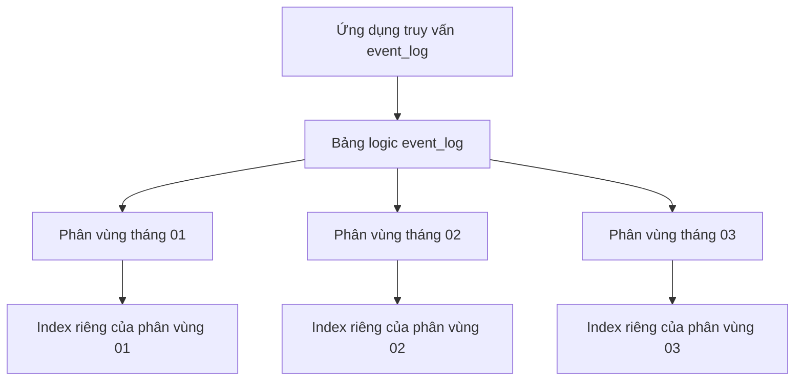

# Phân vùng bảng theo thời gian, miền dữ liệu hoặc khóa phân phối

## 1. Vì sao phân vùng là một quyết định của mô hình vật lý?

Trong module `DATABASE_DATA_MODELING`, người học chuyển yêu cầu nghiệp vụ thành mô hình dữ liệu rõ ràng: từ thực thể, quan hệ, ràng buộc và chuẩn hóa đến khóa, chỉ mục và lược đồ vật lý. Ở bước **Mô hình vật lý**, phân vùng (*partitioning*) là kỹ thuật chia một tập dữ liệu logic lớn thành nhiều đơn vị lưu trữ hoặc quản trị nhỏ hơn theo một quy tắc xác định.

Ví dụ một hệ thống xử lý sự kiện có 1 tỷ bản ghi và phải giữ dữ liệu trong 18 tháng. Người dùng chủ yếu tra sự kiện của một tenant trong một khoảng ngày, còn nhóm vận hành cần xóa dữ liệu hết hạn theo tháng. Có thể chia bảng sự kiện thành **phân vùng theo tháng** để truy vấn có điều kiện thời gian chỉ xét các phân vùng liên quan và để xử lý vòng đời dữ liệu theo từng phân vùng.

Tuy nhiên, thêm phân vùng không tự động làm mọi truy vấn nhanh hơn, cũng không thay thế khóa, chỉ mục, bảo mật hay chiến lược phân tán. Chọn sai khóa phân vùng có thể khiến truy vấn đọc tất cả phân vùng, dồn ghi vào một phân vùng nóng hoặc làm khó việc bảo đảm duy nhất toàn hệ thống.

Sau bài học, người học cần:

- Chọn được giữa **RANGE** theo thời gian, **LIST** theo miền nghiệp vụ và **HASH** theo khóa phân phối.
- Phân biệt **phân vùng trong một DBMS** với **sharding** trên nhiều nút, và nhận ra chúng có thể kết hợp.
- Thiết kế truy vấn để tận dụng *partition pruning*; vẫn chọn chỉ mục phù hợp bên trong phân vùng.
- Xử lý các giới hạn về `PRIMARY KEY`, `UNIQUE`, `FOREIGN KEY`, dữ liệu đến muộn và thay đổi khóa phân vùng.
- Lập kế hoạch tạo, lưu trữ, lưu trữ lạnh, loại bỏ và di chuyển phân vùng; kiểm chứng trên đúng DBMS và workload.

## 2. Bảng logic, phân vùng vật lý, sharding và chỉ mục khác nhau thế nào?

**Phân vùng ngang** (*horizontal partitioning*) giữ cùng tập cột nhưng chia **các hàng** vào những nhóm loại trừ nhau theo khóa phân vùng. Trong hệ quản trị hỗ trợ partitioned table, ứng dụng thường truy vấn tên bảng cha; DBMS quyết định phân vùng con nào cần đọc.



| Khái niệm | Đơn vị tổ chức | Mục đích phổ biến |
|---|---|---|
| **Phân vùng ngang** | Các nhóm **hàng** theo thời gian, miền hoặc giá trị hash | Giảm phạm vi dữ liệu cần xét, quản trị dữ liệu theo nhóm, phân tách tác vụ bảo trì |
| **Phân tách dọc** | Các nhóm **cột** hoặc bảng liên kết 1–1 | Tách cột lớn/ít dùng, bảo mật hoặc tối ưu truy cập |
| **Chỉ mục** | Cấu trúc phụ ánh xạ khóa tìm kiếm tới dữ liệu | Tìm, lọc, sắp xếp và bảo vệ tính duy nhất |
| **Sharding** | Dữ liệu chia trên **nhiều nút hoặc cụm** có đường định tuyến | Mở rộng dung lượng/ghi/đọc và phân bố tài nguyên giữa nút |
| **Replication** | Nhiều bản sao của dữ liệu | Tính sẵn sàng, phục hồi, cân bằng đọc tùy kiến trúc |

Một bảng được phân vùng thành 12 tháng **vẫn có thể nằm trên cùng một máy và dùng cùng nguồn CPU, RAM, I/O**. Phân vùng không đồng nghĩa với việc hệ thống có 12 máy hay tự tăng năng lực ghi lên 12 lần. Ngược lại, một hệ sharded có thể chứa bảng được phân vùng cục bộ trên mỗi shard.

Phân vùng cũng không phải phương án thay cho chuẩn hóa dữ liệu. Nếu quan hệ khách hàng–đơn hàng đang sai hoặc thiếu khóa ngoại, chia bảng thành nhiều phân vùng không sửa được sai sót logic đó.

## 3. Ba chiến lược phổ biến: thời gian, miền dữ liệu và khóa phân phối

### 3.1. RANGE: phân vùng theo khoảng giá trị, thường là thời gian

RANGE đặt hàng vào các khoảng liên tiếp, ví dụ các khoảng tháng dựa trên `occurred_at`:

```text
[2027-01-01 00:00 UTC, 2027-02-01 00:00 UTC) -> event_log_2027_01
[2027-02-01 00:00 UTC, 2027-03-01 00:00 UTC) -> event_log_2027_02
[2027-03-01 00:00 UTC, 2027-04-01 00:00 UTC) -> event_log_2027_03
```

Ký hiệu `[a, b)` nghĩa là **bao gồm a, không bao gồm b**. Hàng đúng thời khắc `2027-02-01 00:00 UTC` thuộc phân vùng tháng 2, không nằm trong tháng 1. Khoảng nửa mở tránh trùng ranh giới giữa hai phân vùng.

**Phù hợp khi:** truy vấn thường lọc theo khoảng ngày/giờ, dữ liệu có vòng đời theo thời gian và cần lưu trữ/xóa hàng loạt dữ liệu hết hạn.

**Đánh đổi:** ghi mới có thể tập trung ở phân vùng gần hiện tại; dữ liệu đến muộn vẫn phải tìm đúng phân vùng cũ; truy vấn không lọc thời gian có thể phải xét nhiều phân vùng.

### 3.2. LIST: phân vùng theo miền dữ liệu được chỉ định

LIST phân chia theo tập giá trị cụ thể, chẳng hạn `region_code IN ('APAC', 'EMEA', 'AMER')` hoặc nhóm loại chứng từ.

**Phù hợp khi:** các nhóm có quy tắc vòng đời, nơi lưu, bảo trì hoặc đường truy cập khác nhau và số miền ổn định, dễ quản lý.

**Đánh đổi:** miền giá trị mới cần kế hoạch tiếp nhận; phân bố hàng có thể không đều; thay đổi miền của một bản ghi có thể đồng nghĩa chuyển nó giữa phân vùng.

“Phân vùng theo tenant” đôi khi được thực hiện bằng LIST, nhưng tạo một phân vùng cho **mỗi tenant trong hàng chục nghìn tenant** có thể làm số đối tượng và kế hoạch truy vấn quá lớn. Cần cân nhắc nhóm tenant, HASH hoặc giải pháp phân tán khác.

### 3.3. HASH: phân vùng theo giá trị băm của khóa

HASH dùng hàm ánh xạ khóa tới một số nhóm, ví dụ bốn phân vùng theo `tenant_id`. Mục tiêu thường là dàn trải tập hàng và giúp truy vấn có điều kiện bằng trên khóa phân vùng chọn đúng nhóm.

**Phù hợp khi:** khóa phân phối ổn định, ứng dụng thường truy vấn theo khóa đó, không có vòng đời theo khoảng giá trị và cần chia số hàng tương đối đều trong nhiều nhóm.

**Đánh đổi:** thứ tự thời gian không liên quan tới phân vùng hash, nên xóa “toàn bộ dữ liệu trước tháng X” không thể chỉ đơn giản bỏ một phân vùng; một tenant đặc biệt lớn có thể vẫn làm nóng đúng một phân vùng.

### So sánh theo mục tiêu thiết kế

| Tiêu chí | RANGE theo thời gian | LIST theo miền | HASH theo khóa |
|---|---|---|---|
| Khóa phân vùng ví dụ | `occurred_at` | `region_code` | `tenant_id` |
| Điều kiện giúp pruning | Khoảng thời gian | Bằng/`IN` miền | Bằng khóa phân phối |
| Retention theo tháng | Rất thuận lợi | Chỉ thuận lợi nếu miền tương ứng vòng đời | Không thuận lợi trực tiếp |
| Dữ liệu phân bố đều? | Tùy lượng ghi theo giai đoạn | Tùy kích thước từng miền | Có thể tương đối đều nếu khóa/phân bố tốt |
| Dữ liệu mới/miền mới | Phải tạo phân vùng cho mốc tiếp theo | Phải định nghĩa nơi nhận giá trị miền mới | Giá trị khóa mới đi theo quy tắc hash |
| Rủi ro chính | Phân vùng hiện tại nóng, sự kiện đến muộn | Miền lệch và nhiều nhóm nhỏ | Tenant nóng, thay số nhóm phức tạp |

Quy tắc chọn **không chỉ dựa vào cột nào dễ chia**, mà dựa vào mẫu truy vấn, ràng buộc, dữ liệu phát triển và nhu cầu vận hành.

## 4. Từ mẫu truy cập đến khóa phân vùng

Giả sử một hệ thống giám sát thiết bị có các truy vấn sau:

| Mẫu truy cập | Tần suất | Điều kiện quan trọng | Hàm ý |
|---|---|---|---|
| A. Sự kiện 24 giờ gần nhất của tenant | Cao | `tenant_id = ?`, `occurred_at >= ?` | RANGE thời gian giúp giới hạn phân vùng; index tenant/thời gian giúp tìm bên trong |
| B. Tất cả lỗi của một thiết bị trong 30 ngày | Cao | `device_id = ?` và khoảng ngày | RANGE theo ngày/tháng + index device/time |
| C. Tra một sự kiện bằng `event_id`, không biết ngày | Trung bình | `event_id = ?` | RANGE theo thời gian có thể phải tra nhiều phân vùng |
| D. Xóa dữ liệu cũ hơn 18 tháng | Định kỳ | `occurred_at < cutoff` | RANGE theo tháng thuận lợi cho quản trị |
| E. Truy vấn mọi bản ghi của tenant bất kể thời gian | Trung bình | `tenant_id = ?` | HASH theo tenant có thể prune tốt hơn RANGE thời gian |
| F. Báo cáo tổng hợp toàn bộ dữ liệu năm | Theo lô | Đọc rất nhiều hàng | Partition không thay thế mô hình dữ liệu phân tích |

Không thể tối ưu hoàn hảo mọi mẫu A–F chỉ bằng một khóa phân vùng. Với yêu cầu retention và phần lớn truy vấn có khoảng thời gian, RANGE theo `occurred_at` là ứng viên hợp lý. Nếu phần lớn truy vấn truy cập toàn bộ lịch sử của một tenant và tải trải đều, HASH theo `tenant_id` có thể hợp lý hơn.

Đặc biệt, nếu chọn RANGE theo thời gian mà API chỉ gửi `event_id`, DBMS không thể tự suy ra tháng chứa sự kiện chỉ từ một ID không mang thông tin định tuyến đáng tin cậy. Cần xem xét **thay đổi hợp đồng truy vấn**, lưu bản đồ định tuyến ID → partition key hoặc chấp nhận truy vấn nhiều phân vùng.

## 5. DDL PostgreSQL 16: bảng sự kiện phân vùng RANGE theo tháng

Giả sử:

- `occurred_at` là thời điểm xảy ra sự kiện, lưu bằng `TIMESTAMPTZ`; quy tắc phân vùng dùng ranh giới UTC.
- Ứng dụng đọc sự kiện theo tenant và khoảng thời gian; retention là 18 tháng.
- `event_id` là định danh kỹ thuật được sinh từ identity; **không tuyên bố chỉ riêng `event_id` được ràng buộc duy nhất trên toàn bảng phân vùng**.
- Dữ liệu của những tháng ngoài phạm vi phân vùng đã tạo sẽ được xử lý bằng quy trình rõ ràng.

Ví dụ độc lập, dùng bảng `event_log`:

```sql
CREATE TABLE event_log (
    occurred_at TIMESTAMPTZ NOT NULL,
    event_id    BIGINT GENERATED ALWAYS AS IDENTITY,
    tenant_id   BIGINT NOT NULL,
    device_id   BIGINT NOT NULL,
    event_type  VARCHAR(40) NOT NULL,
    payload     JSONB,
    ingested_at TIMESTAMPTZ NOT NULL DEFAULT CURRENT_TIMESTAMP,

    CONSTRAINT pk_event_log PRIMARY KEY (occurred_at, event_id),
    CONSTRAINT ck_event_type_nonblank
        CHECK (char_length(btrim(event_type)) > 0)
) PARTITION BY RANGE (occurred_at);

CREATE TABLE event_log_2027_01
    PARTITION OF event_log
    FOR VALUES FROM ('2027-01-01 00:00:00+00')
               TO ('2027-02-01 00:00:00+00');

CREATE TABLE event_log_2027_02
    PARTITION OF event_log
    FOR VALUES FROM ('2027-02-01 00:00:00+00')
               TO ('2027-03-01 00:00:00+00');

CREATE TABLE event_log_2027_03
    PARTITION OF event_log
    FOR VALUES FROM ('2027-03-01 00:00:00+00')
               TO ('2027-04-01 00:00:00+00');

-- Định nghĩa index trên bảng phân vùng cha. PostgreSQL tạo các
-- index tương ứng cho các partition hiện có và về sau.
CREATE INDEX idx_event_log_tenant_time
    ON event_log (tenant_id, occurred_at DESC, event_id DESC);

CREATE INDEX idx_event_log_device_time
    ON event_log (device_id, occurred_at DESC);
```

**Điểm cần hiểu ở DDL:**

1. Bảng `event_log` là **bảng cha phân vùng**. PostgreSQL dùng các bảng con làm nơi lưu hàng thật; bảng cha không chứa một tập hàng heap duy nhất tương tự bảng thường.
2. `PRIMARY KEY (occurred_at, event_id)` **bao gồm cột phân vùng `occurred_at`**. Với PostgreSQL 16, ràng buộc `PRIMARY KEY`/`UNIQUE` trên bảng phân vùng phải bao gồm toàn bộ cột khóa phân vùng, và khóa phân vùng trong trường hợp này không phải biểu thức. Chỉ mục duy nhất thực tế được thực thi ở các phân vùng; không có một chỉ mục duy nhất toàn cục tự động bao trùm mọi partition.
3. `GENERATED ALWAYS AS IDENTITY` giúp cấp số ID khi ghi qua bảng cha theo cách thông thường; nhưng **identity/sequence không phải ràng buộc duy nhất toàn cục đối với riêng `event_id`**. Việc nhập dữ liệu thủ công, hợp nhất nguồn hoặc sự cố cấp phát có thể tạo trùng ID ở hai thời điểm khác nhau mà `PRIMARY KEY (occurred_at, event_id)` vẫn cho phép.
4. Các index trên `tenant_id` và `device_id` chỉ có ích sau khi xét pruning và đường truy cập **bên trong phân vùng**. Partition pruning loại bớt các bảng con; index giúp tìm ít hàng hơn ở những bảng con còn lại.
5. Không có `DEFAULT PARTITION` trong ví dụ để tránh âm thầm nhận mọi thời điểm không dự kiến. Một bản ghi ngoài các khoảng đã tạo sẽ bị từ chối; ứng dụng và vận hành cần giám sát lỗi định tuyến và tạo partition đúng lịch.

### Chèn dữ liệu và ranh giới tháng

```sql
-- Được định tuyến vào event_log_2027_02.
INSERT INTO event_log (occurred_at, tenant_id, device_id, event_type)
VALUES (
    '2027-02-01 00:00:00+00',
    42, 710, 'DEVICE_CONNECTED'
)
RETURNING event_id, occurred_at;

-- Được định tuyến vào event_log_2027_01.
INSERT INTO event_log (occurred_at, tenant_id, device_id, event_type)
VALUES (
    '2027-01-31 23:59:59+00',
    42, 710, 'DEVICE_DISCONNECTED'
);

-- Dự kiến lỗi: chưa có partition cho tháng 04/2027.
-- Chạy riêng trong môi trường thử nếu muốn xác nhận lỗi.
INSERT INTO event_log (occurred_at, tenant_id, device_id, event_type)
VALUES (
    '2027-04-10 08:00:00+00',
    42, 710, 'DEVICE_CONNECTED'
);
```

Câu lệnh thứ ba cố ý minh họa tình huống lỗi: PostgreSQL không tự tạo phân vùng tháng mới. Để không bị gián đoạn ghi, hệ thống cần quy trình migration hoặc job tạo partition trước hạn, nhưng phải bảo đảm không tạo khoảng chồng lấn hoặc sai ranh giới.

## 6. Partition pruning: bỏ qua phân vùng không liên quan

**Partition pruning** là khả năng loại phân vùng khi điều kiện truy vấn đủ rõ để DBMS xác định chúng không chứa hàng phù hợp. Nó thường là lợi ích chính của phân vùng theo thời gian.

Ví dụ truy vấn chỉ lấy sự kiện tháng 2 của tenant 42:

```sql
EXPLAIN (VERBOSE)
SELECT event_id, device_id, event_type, occurred_at
FROM event_log
WHERE tenant_id = 42
  AND occurred_at >= '2027-02-01 00:00:00+00'::TIMESTAMPTZ
  AND occurred_at <  '2027-03-01 00:00:00+00'::TIMESTAMPTZ
ORDER BY occurred_at DESC, event_id DESC
LIMIT 30;
```

Trên dữ liệu và thống kê thích hợp, PostgreSQL có thể chỉ cần quét `event_log_2027_02`, thay vì đọc hai phân vùng tháng 1 và tháng 3. Trong kế hoạch, quan sát tên partition được dùng và các tín hiệu loại partition. Không nên giả định một node plan cụ thể luôn xuất hiện: optimizer có nhiều lựa chọn tùy lượng dữ liệu.

### Cách viết điều kiện quan trọng

Nên dùng khoảng **đầu bao gồm, cuối loại trừ** trên chính khóa phân vùng:

```sql
WHERE occurred_at >= :from_instant
  AND occurred_at <  :to_instant
```

Một điều kiện như:

```sql
WHERE date(occurred_at) = DATE '2027-02-15'
```

có thể khiến pruning hoặc đường truy cập theo `occurred_at` khó hơn vì phép biến đổi áp dụng lên **cột** và cách hiểu ngày còn phụ thuộc múi giờ phiên. Hãy chuyển “ngày lịch của người dùng” thành cặp mốc thời gian đúng timezone nghiệp vụ và lọc trực tiếp trên timestamp.

Ví dụ, nếu báo cáo tính theo ngày ở Việt Nam, ranh giới 1 ngày có thể được tạo từ ngày-giờ địa phương với định danh vùng giờ:

```sql
WHERE occurred_at >=
      (TIMESTAMP '2027-02-15 00:00:00'
       AT TIME ZONE 'Asia/Ho_Chi_Minh')
  AND occurred_at <
      (TIMESTAMP '2027-02-16 00:00:00'
       AT TIME ZONE 'Asia/Ho_Chi_Minh')
```

Mặc dù ví dụ Việt Nam không có thay đổi giờ mùa hè trong khoảng này, thiết kế tổng quát vẫn phải tính DST đối với những múi giờ có thay đổi; không tự đồng nhất “một ngày lịch” với mọi khoảng 24 giờ.

### Pruning khi dùng tham số và truy vấn chuẩn bị

PostgreSQL có thể loại phân vùng ở giai đoạn lập kế hoạch hoặc trong lúc thực thi, tùy kiểu câu lệnh, tham số và kế hoạch. Một prepared statement không biết chính xác giá trị khi tạo generic plan vẫn có thể hưởng lợi từ *execution-time pruning* trong những tình huống được hỗ trợ. Hãy kiểm tra **truy vấn thực từ ứng dụng**, bao gồm kiểu tham số và kế hoạch, thay vì chỉ đo SQL dùng literal.

### Khi không thể pruning hiệu quả

```sql
-- Không có điều kiện trên occurred_at: có thể phải xét mọi partition.
SELECT *
FROM event_log
WHERE event_id = 250001;
```

Truy vấn bằng `event_id` đơn lẻ không chỉ ra tháng. Việc có `PRIMARY KEY(occurred_at,event_id)` không đồng nghĩa tìm kiếm chỉ theo `event_id` có một đường truy cập toàn cục. Có thể cần thêm chiến lược tra cứu ID → `occurred_at`, bổ sung ngày vào API, hoặc chọn mô hình phân vùng khác nếu đây là đường đọc quan trọng nhất.

## 7. LIST theo miền nghiệp vụ: vùng dữ liệu và chính sách độc lập

Xét hệ thống hóa đơn có `region_code` nhận một số giá trị đã biết. Bộ phận vận hành có thể cần lưu trữ và bảo trì khác nhau theo miền:

```sql
-- Ví dụ độc lập, không phụ thuộc bảng event_log.
CREATE TABLE invoice_by_region (
    region_code VARCHAR(12) NOT NULL,
    invoice_id  BIGINT NOT NULL,
    tenant_id   BIGINT NOT NULL,
    amount      NUMERIC(16, 2) NOT NULL,
    issued_at   TIMESTAMPTZ NOT NULL,
    CONSTRAINT pk_invoice_by_region
        PRIMARY KEY (region_code, invoice_id),
    CONSTRAINT ck_invoice_amount CHECK (amount >= 0)
) PARTITION BY LIST (region_code);

CREATE TABLE invoice_region_apac
    PARTITION OF invoice_by_region FOR VALUES IN ('APAC');

CREATE TABLE invoice_region_emea
    PARTITION OF invoice_by_region FOR VALUES IN ('EMEA');

CREATE TABLE invoice_region_amer
    PARTITION OF invoice_by_region FOR VALUES IN ('AMER');

-- Ví dụ có DEFAULT để nhận miền chưa khai báo.
CREATE TABLE invoice_region_other
    PARTITION OF invoice_by_region DEFAULT;
```

Với truy vấn `WHERE region_code = 'APAC'`, DBMS có thể loại các vùng khác. Với truy vấn chỉ lọc `tenant_id` mà không chỉ rõ `region_code`, lợi ích pruning giảm rõ rệt.

**Đánh đổi của `DEFAULT PARTITION`:** nó ngăn lỗi khi xuất hiện giá trị mới, nhưng dễ che giấu lỗi nhập mã như `'APACC'`. Khi muốn tạo phân vùng riêng cho giá trị đang nằm trong default partition, có thể cần di chuyển dữ liệu và kiểm tra ràng buộc/khóa trong giai đoạn attach. Dùng default phải đi cùng kiểm tra miền giá trị và giám sát số hàng rơi vào nhánh này.

**Thay đổi vùng của hóa đơn** có thể làm bản ghi chuyển phân vùng. Nếu `region_code` có trong khóa chính và các khóa ngoại, đổi vùng có thể tác động tham chiếu và lịch sử. Cần làm rõ vùng là thuộc tính phân loại có thể đổi, nơi phát hành bất biến hay một phần danh tính thực sự của hóa đơn. Không chọn khóa phân vùng mà nghiệp vụ thường xuyên sửa nếu chưa tính chi phí di chuyển.

Quan trọng: chia dữ liệu theo khu vực **không tự đồng nghĩa với lưu đúng quốc gia theo quy định dữ liệu**. Nếu yêu cầu residency thực sự đòi dữ liệu chỉ lưu tại một khu vực hạ tầng, phải thiết kế vị trí node/storage, replication, backup và kiểm soát truy cập; một partition LIST trong cùng máy chủ không đáp ứng yêu cầu địa lý.

## 8. HASH theo khóa phân phối: lợi ích và nguy cơ lệch tải

Ví dụ thiết bị ghi các số đo. Hệ thống chủ yếu truy vấn theo tenant, không có nhu cầu xóa nguyên tháng bằng cách bỏ partition. Một phương án là phân vùng hash theo `tenant_id`:

```sql
-- Ví dụ độc lập với các bảng phía trên.
CREATE TABLE telemetry_by_tenant (
    tenant_id   BIGINT NOT NULL,
    reading_id  UUID NOT NULL,
    observed_at TIMESTAMPTZ NOT NULL,
    metric_name VARCHAR(80) NOT NULL,
    metric_value DOUBLE PRECISION,
    CONSTRAINT pk_telemetry_by_tenant
        PRIMARY KEY (tenant_id, reading_id)
) PARTITION BY HASH (tenant_id);

CREATE TABLE telemetry_p0
    PARTITION OF telemetry_by_tenant
    FOR VALUES WITH (MODULUS 4, REMAINDER 0);

CREATE TABLE telemetry_p1
    PARTITION OF telemetry_by_tenant
    FOR VALUES WITH (MODULUS 4, REMAINDER 1);

CREATE TABLE telemetry_p2
    PARTITION OF telemetry_by_tenant
    FOR VALUES WITH (MODULUS 4, REMAINDER 2);

CREATE TABLE telemetry_p3
    PARTITION OF telemetry_by_tenant
    FOR VALUES WITH (MODULUS 4, REMAINDER 3);

CREATE INDEX idx_telemetry_tenant_time
    ON telemetry_by_tenant (tenant_id, observed_at DESC);
```

Với `WHERE tenant_id = 42`, hệ quản trị có thể tính bucket và chỉ xét một phân vùng hash. Với `WHERE observed_at >= ?` nhưng không biết tenant, nó có thể phải xét cả bốn phân vùng dù đã có index theo thời gian trong từng phân vùng.

**Không nhầm HASH partitioning với chia dữ liệu qua bốn máy.** Trong PostgreSQL thông thường, bốn partition trên vẫn thuộc một database, không tự phân phối qua bốn server. “Khóa phân phối” trong kiến trúc nhiều nút còn cần cơ chế routing từ khóa tới shard/node, cân bằng tải và xử lý sự cố mạng.

### Độ lệch (*skew*) và tenant nóng

HASH phân tán **khóa** vào nhóm, nhưng không bảo đảm mỗi nhóm có khối lượng byte hoặc số request như nhau. Nếu một tenant chiếm 40% traffic, mọi bản ghi của tenant đó vẫn có thể đi tới cùng một bucket. Bốn bucket có số lượng tenant gần bằng nhau nhưng một bucket chịu phần lớn ghi.

Khi có tenant nóng, cần cân nhắc:

- Chọn khóa phân phối có cardinality và phân bố tải phù hợp, chẳng hạn `device_id` thay vì `tenant_id` nếu truy vấn thường truy cập theo thiết bị.
- Kết hợp nhiều thành phần hoặc “salting” có kiểm soát để dàn tải; đổi lại truy vấn chỉ theo tenant phải truy cập nhiều bucket.
- Phân vùng đa cấp theo thời gian rồi theo hash nếu cả pruning thời gian và phân tán ghi đều quan trọng.
- Trong hệ sharded, có chiến lược tách tenant lớn, cân bằng shard và định tuyến thông minh khi tăng số nút.

**Thay số bucket không phải một thao tác chỉ sửa hằng số `MODULUS 4` thành `8`.** Phân bố hàng và ràng buộc của các partition hiện hữu phải được tổ chức lại theo khả năng DBMS; trong kiến trúc sharded còn có dữ liệu phải di chuyển giữa các nút. Cần migration và benchmark.

## 9. Chọn khóa phân vùng ảnh hưởng đến khóa chính và tính duy nhất

Đây là một trong những giới hạn quan trọng nhất khi chuyển mô hình logic thành mô hình vật lý.

### PostgreSQL 16: ràng buộc duy nhất phải mang khóa phân vùng

Với:

```sql
PARTITION BY RANGE (occurred_at)
```

trên bảng `event_log`, PostgreSQL 16 yêu cầu `PRIMARY KEY`/`UNIQUE` cấp bảng cha bao gồm `occurred_at` (và các cột khóa phân vùng khác nếu có). Vì vậy:

```sql
PRIMARY KEY (occurred_at, event_id)
```

là hợp lệ, còn ý định đặt `PRIMARY KEY (event_id)` trực tiếp trên **cùng bảng cha được RANGE partition bằng `occurred_at`** sẽ không đáp ứng yêu cầu đó.

Nguyên nhân là tính duy nhất được thực thi tại những chỉ mục của từng partition: nếu cặp hàng cùng khóa đầy đủ có cùng `occurred_at`, chúng phải thuộc cùng partition và bị index unique của partition đó phát hiện. Với chỉ `event_id`, hai bản ghi khác tháng có thể đi vào hai partition và không có một unique index toàn cục bao trùm để so sánh.

### Phân biệt các mục tiêu duy nhất

| Yêu cầu | Giải pháp cần cân nhắc |
|---|---|
| Mỗi (`occurred_at`, `event_id`) là duy nhất | `PRIMARY KEY(occurred_at, event_id)` trên bảng RANGE thời gian |
| `event_id` duy nhất tuyệt đối bất kể tháng | Chỉ identity/PK ghép theo thời gian **chưa đủ**; cần thiết kế cơ chế toàn cục phù hợp |
| Cặp (`source_system`, `source_event_id`) không bị nhập lại | Unique theo namespace, có thể trong bảng registry không phân vùng hoặc cơ chế điều phối được kiểm chứng |
| Một bản ghi con phải tham chiếu đúng sự kiện cha | Cần đủ thành phần khóa được tham chiếu; có thể phải lưu cả `occurred_at` và `event_id` |
| Hệ thống cần ID công khai không đoán được | Có thể dùng UUID/ULID hoặc mã khác, nhưng **vẫn phải** kiểm tra quyền và giải bài toán unique toàn cục |

Một lựa chọn là bảng registry **không phân vùng theo thời gian** giữ (`source_system`, `source_event_id`) với `UNIQUE`, rồi trong cùng giao dịch tạo sự kiện và ghi registry, quản lý cạnh tranh và lỗi retry. Cách này tăng điểm phối hợp và chi phí ghi; không phải “unique toàn cục miễn phí”.

### Khóa ngoại vào bảng phân vùng

PostgreSQL 16 hỗ trợ nhiều trường hợp khóa ngoại tới/từ bảng partitioned, nhưng khóa tham chiếu phải đáp ứng quy tắc unique/PK của bảng cha và việc thay đổi partition còn phải xét các phụ thuộc. Ví dụ bảng chú thích gắn với sự kiện:

```sql
CREATE TABLE event_annotation (
    occurred_at TIMESTAMPTZ NOT NULL,
    event_id    BIGINT NOT NULL,
    note_id     BIGINT NOT NULL,
    note_text   TEXT NOT NULL,
    CONSTRAINT pk_event_annotation
        PRIMARY KEY (occurred_at, event_id, note_id),
    CONSTRAINT fk_annotation_event
        FOREIGN KEY (occurred_at, event_id)
        REFERENCES event_log (occurred_at, event_id)
);
```

FK này mang cả khóa thời gian. Nếu chỉ lưu `event_id` ở bảng con, không thể giả định DBMS sẽ tìm đúng hàng cha ở mọi partition và bảo vệ quan hệ bằng FK đơn cột trong thiết kế hiện tại. Đồng thời, các bản ghi con còn tham chiếu có thể cản trở hoặc làm phức tạp thao tác tách/xóa partition cha khi hết retention; cần thiết kế vòng đời cả dữ liệu phụ thuộc.

**Chọn khóa phân vùng vì hiệu năng nhưng làm mất ràng buộc nghiệp vụ là sai thiết kế.** Nếu yêu cầu danh tính toàn cục hoặc FK đơn cột là bắt buộc, hãy cân nhắc lại cấu trúc bảng, bảng định danh riêng, phương án phân vùng, hoặc sản phẩm hỗ trợ ràng buộc toàn cục theo cách khác.

## 10. Chỉ mục trên bảng phân vùng: pruning và index là hai tầng khác nhau

Trong PostgreSQL, tạo B-tree trên bảng partitioned thường thiết lập một đối tượng index ở bảng cha và các index tương ứng trên từng partition. **Index ở cha mang tính cấu trúc/metadata**, không phải một B-tree duy nhất chứa entry của mọi phân vùng.

| Tình huống | Partition pruning | Chỉ mục bên trong partition |
|---|---|---|
| Tra sự kiện tháng 2, tenant 42 | Có thể loại các tháng khác | `(tenant_id, occurred_at DESC, event_id DESC)` giúp tìm đúng nhóm và thứ tự |
| Tra 1 sự kiện bằng `event_id`, không có ngày | Khó prune theo RANGE thời gian | Có thể phải xét index trên nhiều partition nếu có đường truy cập thích hợp |
| Tổng số sự kiện trong 18 tháng | Có thể phải xét tất cả partition còn lưu | Quét index chưa chắc nhanh hơn quét dữ liệu |
| Truy vấn 30 ngày theo `device_id` | Có thể chỉ xét 1–2 partition tùy khoảng | Index `(device_id, occurred_at DESC)` hỗ trợ tìm thiết bị trong partition |

**Không tạo index trên mọi cột của mọi partition** theo thói quen. Nếu một bảng có 60 partition và mỗi partition có 8 index, hệ thống có hàng trăm đối tượng index phải bảo trì. Query planner, thống kê, vacuum và migration đều phải xử lý các cấu trúc đó. Cần đo số partition, dung lượng index và thực tế truy vấn.

Điều quan trọng là **điều kiện trên khóa phân vùng** giúp loại bớt partition, còn **điều kiện trên khóa index** giúp hạn chế hàng trong các partition được giữ lại. Hai cơ chế bổ sung nhau.

### Phân vùng và `ORDER BY/LIMIT`

Nếu truy vấn có `ORDER BY occurred_at DESC LIMIT 30` nhưng không giới hạn tháng, DBMS vẫn có thể phải phối hợp kết quả từ nhiều partition, ví dụ bằng `Merge Append` hoặc kế hoạch khác. Khi truy vấn có điều kiện thời gian đủ hẹp, số partition liên quan ít hơn và chi phí có thể giảm. Một `LIMIT` nhỏ **không chứng minh** chỉ có một partition được đọc.

## 11. Vòng đời phân vùng: tạo trước, xử lý đến muộn, lưu trữ và hết hạn

Phân vùng theo thời gian thường có giá trị vận hành lớn khi đi kèm quy trình vòng đời rõ ràng.

### 11.1. Tạo trước phân vùng tương lai

Nếu ngày 1/4/2027 là mốc bắt đầu partition mới, đợi đến đúng 00:00 rồi mới chạy migration là rủi ro. Nên tạo trước một khoảng đủ để hỗ trợ lịch ghi, triển khai và lỗi clock; kiểm tra thiếu/đè khoảng định kỳ.

```sql
-- Chạy trước khi có sự kiện tháng 4/2027.
CREATE TABLE event_log_2027_04
    PARTITION OF event_log
    FOR VALUES FROM ('2027-04-01 00:00:00+00')
               TO ('2027-05-01 00:00:00+00');
```

Cần chạy trên môi trường mục tiêu có kiểm soát và tránh tạo trùng tên/khoảng. Với một số quy trình, công cụ quản lý partition giúp tự động hóa nhưng vẫn cần giám sát.

### 11.2. Dữ liệu đến muộn và hai loại thời gian

Một sự kiện có thể xảy ra vào 31/1 nhưng chỉ được gửi vào 10/2. Nếu partition theo `occurred_at`, nó đi vào tháng 1 dù `ingested_at` thuộc tháng 2. Hai cột phục vụ hai mục tiêu:

- `occurred_at`: thời điểm sự kiện **thực sự xảy ra** theo nguồn đã được xác minh; hữu ích cho phân tích lịch sử.
- `ingested_at`: thời điểm DBMS/đường nhập **ghi nhận** sự kiện; hữu ích cho giám sát trễ, retry và truy vết.

Không tự thay `occurred_at` bằng thời gian nhập chỉ để tránh lỗi phân vùng cũ. Phải quyết định dữ liệu trễ bao lâu còn được nhận, nếu partition tháng cũ đã tách thì gửi sang kho lưu trữ, hàng chờ xử lý đặc biệt hay từ chối theo hợp đồng tích hợp.

### 11.3. Tách và xử lý dữ liệu hết retention

Khi dữ liệu tháng cũ hết hạn, **tách partition** có thể thuận lợi hơn xóa từng hàng của một bảng khổng lồ. Trong PostgreSQL:

```sql
-- Chỉ minh họa thao tác quản trị sau khi đã có phê duyệt retention,
-- đối soát số liệu, phương án lưu trữ và đánh giá FK/phụ thuộc.
ALTER TABLE event_log
    DETACH PARTITION event_log_2027_01;
```

Sau khi tách, `event_log_2027_01` là bảng độc lập và dữ liệu của nó không còn xuất hiện qua bảng cha `event_log`. **Tách không đồng nghĩa xóa hay tự động lưu trữ an toàn**: cần quy trình backup/export, xác nhận người đọc dữ liệu lịch sử, kiểm tra FK, rồi mới cân nhắc xóa tài nguyên theo chính sách đã được duyệt.

Phiên bản PostgreSQL hỗ trợ biến thể `DETACH PARTITION CONCURRENTLY` trong những điều kiện nhất định; nó có các giới hạn riêng và khác về khóa/giao dịch. Không coi thao tác detach là luôn không khóa hoặc luôn tức thời, nhất là khi có nhiều liên kết và tải đồng thời.

### 11.4. Phân vùng mặc định: công cụ cứu hộ hay nơi tích tụ lỗi?

Nếu dùng `DEFAULT PARTITION`, dữ liệu ngoài khoảng định trước có thể đi vào phân vùng mặc định. Điều này giúp không mất ghi ngay khi thiếu partition, nhưng có thể giấu sai timezone, năm hoặc miền nhập. Khi bổ sung phân vùng mới, DBMS có thể phải kiểm tra hoặc di chuyển dữ liệu khỏi default, gây scan/lock.

Chỉ dùng default khi đã thiết kế theo dõi, cảnh báo, giới hạn dữ liệu và quy trình chuyển hàng về partition đúng. Với dữ liệu kiểm toán có yêu cầu nghiêm ngặt, từ chối và đưa vào hàng đợi lỗi có thể là lựa chọn dễ kiểm chứng hơn.

## 12. Độ lớn phân vùng: ngày, tuần, tháng hay nhiều cấp?

Không có công thức “bảng 1 tỷ hàng thì luôn chia theo ngày”. Chọn độ hạt là phép cân bằng:

| Chia theo | Thích hợp khi | Rủi ro |
|---|---|---|
| **Ngày** | Dữ liệu rất lớn mỗi ngày; retention hoặc truy vấn thường đúng ngày | Hàng trăm/nghìn partition qua nhiều năm, tăng chi phí catalog và planning |
| **Tuần** | Khối lượng và báo cáo theo tuần, cân bằng kích thước/số đối tượng | Ranh giới tuần và cách tính tuần nghiệp vụ cần chuẩn hóa |
| **Tháng** | Retention theo tháng, dữ liệu mỗi tháng ở mức quản lý được | Một tháng có thể quá lớn với hệ ghi cực cao |
| **Quý/năm** | Dữ liệu nhỏ hơn hoặc báo cáo theo kỳ dài | Ít pruning khi truy vấn ngắn; thao tác retention thô |
| **Đa cấp** | Ví dụ RANGE tháng rồi HASH tenant để dàn tải | Nhiều đối tượng, ràng buộc unique/PK và vận hành phức tạp hơn |

Cần ước lượng:

\[
\text{số partition còn lưu}
\approx
\frac{\text{thời gian retention}}{\text{độ dài mỗi partition}}
\]

Đây chỉ là ước lượng số partition theo thời gian, chưa tính partition tương lai, default hay các cấp con. Ví dụ retention 18 tháng với mỗi tháng một partition cho khoảng 18 phân vùng đang lưu, cộng phân vùng tạo trước. Nếu mỗi ngày một phân vùng trong 18 tháng, số đối tượng tăng lên hàng trăm.

Ngoài số hàng còn phải đo **byte/partition**, độ lớn index, VACUUM, thời gian backup/restore, thời gian tạo chỉ mục, số partition tham gia truy vấn, và tác động replication/CDC. Một phân vùng có vài triệu hàng nhỏ có thể dễ quản lý hơn phân vùng có ít hàng nhưng payload JSON rất lớn.

## 13. Khi cần cả thời gian và phân phối tải

Một hệ thống telemetry ghi cực cao có thể vừa cần retention theo tháng, vừa cần dàn ghi theo thiết bị hoặc tenant. Có thể cân nhắc **phân vùng nhiều cấp**: bảng cha RANGE theo `occurred_at`, bên trong mỗi tháng HASH theo `tenant_id`.

```text
event_log
  |
  +-- 2027_01 (RANGE tháng 1)
  |     +-- hash_0
  |     +-- hash_1
  |     +-- hash_2
  |     +-- hash_3
  |
  +-- 2027_02 (RANGE tháng 2)
        +-- hash_0
        +-- hash_1
        +-- hash_2
        +-- hash_3
```

**Lợi ích:** truy vấn theo cả tháng và tenant có thể thu hẹp cả hai cấp; retention vẫn quản lý theo tháng. **Chi phí:** một năm có 12 tháng × 4 bucket = 48 leaf partition, ngoài bảng cha và bảng cấp trung gian; index và thống kê cần được bảo trì theo số leaf; thay số bucket hoặc chính sách hash trở nên khó hơn.

Với PostgreSQL, một unique/PK ở bảng phân vùng nhiều cấp cần xét **tất cả các khóa phân vùng liên quan** để bảo đảm tính duy nhất có thể thực thi trên các leaf. Không tự giữ `PRIMARY KEY(occurred_at,event_id)` từ thiết kế một cấp rồi giả định nó vẫn hợp lệ cho mọi trường hợp subpartition HASH theo `tenant_id`. Cần kiểm chứng DDL và thiết kế lại khóa, thường bao gồm cả `tenant_id`, nếu cấp con cũng phân vùng theo tenant.

Nếu một tenant chiếm phần lớn tải, phân vùng HASH chỉ theo tenant có thể không chia tải của tenant đó sang nhiều bucket. Khi đó cần phân phối theo khóa chi tiết hơn, làm rõ phạm vi truy vấn và nguy cơ truy vấn scatter/gather. Việc giảm hotspot có thể phải đổi kiến trúc ghi, không thể chỉ thêm partition.

## 14. Partitioning so với sharding: khóa phân phối trên nhiều nút

Trong DBMS phân tán, **distribution key/shard key** quyết định nút hoặc tập nút giữ dữ liệu. Cùng là “chia theo hash”, nhưng có thêm các vấn đề vượt ra ngoài bảng phân vùng cục bộ:

1. **Định tuyến:** ứng dụng, proxy hay coordinator tính vị trí shard? Điều kiện truy vấn có chứa shard key để tránh gửi tới mọi shard không?
2. **Tính duy nhất:** `PRIMARY KEY`/`UNIQUE` có phạm vi toàn cụm hay chỉ trong shard? Khóa phân phối có bắt buộc nằm trong khóa duy nhất không?
3. **Join và giao dịch:** hai bảng cùng phân phối theo `tenant_id` có thể join nội nút; quan hệ chéo shard có thể cần network shuffle hoặc distributed transaction.
4. **Cân bằng tải:** tăng số node, tenant nóng, failover và rebalance cần di chuyển dữ liệu, log và chỉ mục ra sao?
5. **Tính nhất quán:** ghi vào shard nào là nguồn sự thật, retry, replication lag và xử lý sự cố mạng thế nào?
6. **Residency và backup:** vùng lưu và sao chép dữ liệu có phù hợp hợp đồng và quy định không?

Ví dụ, nếu `orders` và `order_lines` cùng sharding theo `tenant_id`, truy vấn đơn trong tenant có thể được định tuyến thuận lợi. Nếu chia `orders` theo `order_id` nhưng `order_lines` theo `product_id`, thao tác tạo đơn và truy vấn chi tiết có nguy cơ chạy chéo shard; việc bảo vệ khóa ngoại cũng phụ thuộc DBMS có hỗ trợ kiểm tra toàn cụm hay không.

Không mặc định hash bucket trong PostgreSQL thông thường là shard đa nút, cũng không coi một khóa phân phối là cơ chế phân quyền. Hệ thống multi-tenant vẫn phải xác thực tenant, kiểm soát quyền và ngăn truy cập chéo tenant.

## 15. Một số khác biệt giữa các hệ quản trị

Chi tiết dưới đây mang tính định hướng theo PostgreSQL 16, MySQL 8.0/InnoDB và SQL Server 2022. Trước khi thiết kế chính thức, kiểm tra **đúng phiên bản, engine và cấu hình** của hệ thống.

| Chủ đề | PostgreSQL 16 | MySQL 8.0/InnoDB | SQL Server 2022 |
|---|---|---|---|
| RANGE/LIST/HASH | Partitioning khai báo với `PARTITION BY` | Hỗ trợ các kiểu partition theo engine/biểu thức và giới hạn riêng | Partition function/scheme, gắn bảng/index với partition scheme |
| Pruning | Planner có thể prune lúc lập kế hoạch hoặc thực thi | Optimizer hỗ trợ partition pruning theo điều kiện phù hợp | Partition elimination theo predicate và scheme |
| PK/UNIQUE trên bảng phân vùng | Phải bao gồm khóa phân vùng theo giới hạn hệ thống | Unique key phải thỏa quy tắc bao gồm các cột dùng trong biểu thức partition; cần kiểm tra engine | Unique index trên bảng partitioned có quy tắc liên quan partitioning column và index alignment |
| FK và phân vùng | Có hỗ trợ FK với partitioned table theo ràng buộc/phiên bản | User-defined partitioning trong InnoDB có **giới hạn quan trọng về foreign key**, cần kiểm tra tài liệu bản dùng | Hỗ trợ FK nhưng cần xét thiết kế chỉ mục và việc chuyển partition |
| Chỉ mục | Có index tương ứng ở các partition con; không mặc định global B-tree | Khái niệm partition/index theo engine, lưu ý phạm vi duy nhất | Có aligned/nonaligned index, tác động trực tiếp tới `SWITCH`/quản trị |
| Retention | Có thể DETACH/DROP partition sau khi đối soát và xét phụ thuộc | Quản lý qua `ALTER TABLE ... DROP PARTITION` và các giới hạn engine | `SWITCH`/`MERGE`/`SPLIT` partition theo quy trình, xét alignment |

Đặc biệt, **không sao chép DDL PostgreSQL sang MySQL hoặc SQL Server chỉ bằng cách đổi tên câu lệnh**. Các hệ quản trị khác nhau về kiểu thời gian, khả năng FK, global/local index, ràng buộc unique, khóa migration và cách di chuyển partition. Các giới hạn còn thay đổi qua phiên bản và loại giấy phép/edition của một số sản phẩm.

### Hệ document, graph và phân tích

- **Document:** phân vùng/sharding thường dựa trên shard key của document. Chọn khóa có phân bố tốt nhưng vẫn hiện diện trong truy vấn phổ biến; các quy tắc unique trên shard có thể bị giới hạn theo shard key. Document lớn hoặc mảng tăng không giới hạn có thể gây vấn đề khác với bảng quan hệ.
- **Graph:** lựa chọn đặt node và edge trên cùng máy ảnh hưởng chi phí traversal; chia node theo miền nhưng thường xuyên duyệt cạnh chéo miền có thể tạo nhiều lượt trao đổi mạng. Partition đồ thị phải xét cộng đồng node, bậc và dạng truy vấn thực.
- **Kho phân tích/columnar:** partition theo ngày nạp hoặc ngày nghiệp vụ, clustering/sort và phân phối fact theo key có thể hỗ trợ pruning, nén và join. Cần phân biệt ngày sự kiện và ngày ingestion, giữ đúng grain và xử lý event đến muộn.

Mục tiêu vẫn là mô hình có thể tiến hóa và kiểm chứng, nhưng không có một sơ đồ partition chung tối ưu cho mọi kiểu lưu trữ.

## 16. Kiểm chứng phân vùng đã thiết kế

### 16.1. Xem cây partition và kích thước từng leaf

PostgreSQL 16 cung cấp hàm `pg_partition_tree`:

```sql
SELECT
    relid::regclass AS relation_name,
    parentrelid::regclass AS parent_name,
    isleaf,
    level
FROM pg_partition_tree('public.event_log'::regclass)
ORDER BY level, relid;

SELECT
    pg_size_pretty(pg_total_relation_size('public.event_log_2027_01'))
        AS january_total_size,
    pg_size_pretty(pg_indexes_size('public.event_log_2027_01'))
        AS january_index_size;
```

Kích thước bảng **cha** của partitioned table trong PostgreSQL không tự đại diện tổng dung lượng tất cả partition con. Muốn đo toàn bộ, cần tổng hợp trên các leaf đúng cấu trúc; không báo cáo `pg_total_relation_size` của cha như dung lượng toàn bộ dữ liệu.

### 16.2. Kiểm tra pruning và chỉ mục trên nhiều mẫu truy vấn

```sql
-- Đọc một khoảng tháng cụ thể và tenant cụ thể.
EXPLAIN (ANALYZE, BUFFERS)
SELECT event_id, device_id, occurred_at
FROM event_log
WHERE tenant_id = 42
  AND occurred_at >= '2027-02-01 00:00:00+00'::TIMESTAMPTZ
  AND occurred_at <  '2027-03-01 00:00:00+00'::TIMESTAMPTZ
ORDER BY occurred_at DESC, event_id DESC
LIMIT 30;

-- Không có điều kiện thời gian: đối chiếu số partition tham gia.
EXPLAIN (VERBOSE)
SELECT event_id, occurred_at
FROM event_log
WHERE tenant_id = 42
ORDER BY occurred_at DESC
LIMIT 30;
```

`EXPLAIN (ANALYZE, BUFFERS)` **chạy truy vấn thật**. Chỉ đo trên dữ liệu hoặc môi trường phù hợp, đặc biệt khi chuyển sang câu lệnh ghi. Cần đọc plan theo số partition thực sự được scan, `actual rows`, `Buffers`, thời gian tổng, chi phí `Append/Merge Append`, `Sort` và index scan. Kế hoạch một truy vấn đơn lẻ chưa đủ kết luận.

### 16.3. Bảng ca kiểm thử

| Ca kiểm thử | Kỳ vọng |
|---|---|
| Chèn đúng mốc đầu tháng 2 | Đi vào partition tháng 2, không phải tháng 1 |
| Chèn trước mốc cuối tháng 1 một giây | Đi vào partition tháng 1 |
| Chèn tháng chưa có partition và không có default | Bị từ chối rõ ràng, có cảnh báo/đường xử lý |
| Sự kiện tháng 1 nhập trong tháng 2 | Đi theo `occurred_at` vào tháng 1 nếu partition còn mở |
| Hai hàng trùng (`occurred_at`, `event_id`) | Bị từ chối bởi PK |
| Hai hàng cùng `event_id` nhưng khác `occurred_at` | Có thể hợp lệ với **PK ghép hiện tại**, minh họa rằng unique toàn cục theo `event_id` chưa được bảo đảm |
| Query tháng 2 có điều kiện thời gian | Pruning loại được partition không liên quan trong điều kiện hỗ trợ |
| Query chỉ theo `event_id` | Có thể xét nhiều partition; cần đánh giá đường đọc |
| Phân vùng thiếu index trên tenant | Vẫn có thể prune theo tháng, nhưng truy vấn tenant chậm trong partition còn lại |
| Tenant rất nóng trong HASH | Kiểm tra skew về kích thước, lượt ghi và latency |
| Đổi khóa phân vùng của hàng | Xác nhận hành vi di chuyển hàng, ràng buộc và tác động tới FK |
| DETACH partition đã hết hạn | Dữ liệu biến mất khỏi view của cha; kiểm tra phụ thuộc, archive và rollback |

**Kiểm chứng nghiệp vụ** luôn bao gồm quyền truy cập theo tenant, tính duy nhất cần bảo vệ, dữ liệu thời gian có múi giờ và chính sách retention. Một bài test pruning thành công không chứng minh tất cả điều kiện đó đã đúng.

## 17. Chuyển bảng lớn hiện có sang phân vùng

Với PostgreSQL 16, không nên giả định có thể biến một bảng heap thường thành partitioned parent hoàn chỉnh bằng một lệnh `ALTER TABLE ... PARTITION BY` đơn giản. Một lộ trình thường cần tạo cấu trúc mới, chuyển dữ liệu và điều chỉnh đường đọc/ghi.

1. **Khảo sát:** số hàng/byte theo từng tháng hoặc tenant, top truy vấn, khóa/FK/UNIQUE, index, dữ liệu NULL hoặc timestamp ngoài khoảng, hàng đến muộn và các consumer bên ngoài.
2. **Chọn thiết kế:** RANGE/LIST/HASH, độ hạt, khóa phân vùng, lược đồ khóa và index; nêu rõ các giới hạn duy nhất/toàn vẹn.
3. **Tạo bảng partitioned và các partition tương lai:** chuẩn hóa kiểu `TIMESTAMPTZ` và ranh giới; tạo constraint, index và chiến lược mặc định hoặc từ chối.
4. **Backfill theo lô:** đưa hàng từ bảng cũ sang bảng mới theo khóa phân vùng, kiểm soát độ trễ, WAL, locks và khối lượng tác vụ nền.
5. **Đồng bộ ghi mới:** dual-write hoặc cơ chế bắt thay đổi có kiểm soát; bảo đảm idempotency, thứ tự thao tác và xử lý retry.
6. **Đối soát:** tổng số hàng, giá trị tổng hợp, min/max timestamp, khóa trùng, bản ghi không có partition và các FK theo từng khoảng; kiểm tra trên toàn bộ dữ liệu cần chuyển.
7. **Đổi đường truy cập:** cập nhật ứng dụng, API, truy vấn thiếu thời gian, report, CDC và ORM; thử rollback nếu cutover thất bại.
8. **Bàn giao vận hành:** tạo partition trước lịch, giám sát phân vùng nóng, retention, backup, archive và thông báo khi dữ liệu đến muộn.

Một migration chỉ thành công khi mọi bản ghi vẫn được định tuyến đúng, những quy tắc unique/FK không bị mất và số liệu sau chuyển khớp với nguồn. Tốc độ truy vấn nhanh hơn nhưng sai tính duy nhất hoặc bỏ sót hàng là kết quả không đạt yêu cầu.

## 18. Những ngộ nhận và lỗi thiết kế hay gặp

| Ngộ nhận | Rủi ro | Cách xử lý |
|---|---|---|
| “Có partition thì query nào cũng nhanh hơn.” | Query không có predicate partition key vẫn đọc nhiều partition | Bắt đầu từ mẫu truy cập, đo pruning và index |
| “RANGE tháng tự tạo tháng mới.” | Ghi bị lỗi khi vượt thời gian đã khai báo | Tạo trước partition, giám sát cảnh báo thiếu |
| “HASH bốn bucket nghĩa là ghi trên bốn server.” | Vẫn cùng một DBMS nếu không có kiến trúc phân tán | Phân biệt local partition với sharding thực |
| “HASH luôn cân bằng tải.” | Một tenant nóng có thể dồn vào một bucket | Đo skew theo request/byte, thiết kế phân phối phù hợp |
| “PK trên `event_id` luôn duy nhất toàn bảng dù partition theo thời gian.” | Global unique không được bảo vệ theo DDL đó ở PostgreSQL | Bao gồm partition key hoặc thiết kế cơ chế unique toàn cục riêng |
| “Partition thay được index.” | Trong một partition vẫn có thể có hàng triệu bản ghi | Thiết kế index theo `WHERE`/`ORDER BY` thực |
| “Một partition cho mỗi tenant là tốt nhất.” | Quá nhiều đối tượng, catalog, index và chi phí planning | Nhóm miền, HASH hoặc cân nhắc shard riêng cho tenant lớn |
| “Dùng `date(occurred_at)` cũng prune như khoảng timestamp.” | Biểu thức có thể cản pruning/index và sai múi giờ | Quy đổi thành cặp mốc thời gian, lọc trực tiếp |
| “`DEFAULT PARTITION` sửa mọi trường hợp thiếu khoảng.” | Giấu dữ liệu sai và làm ATTACH partition phức tạp | Giám sát, validate và di chuyển dữ liệu về đúng partition |
| “Xóa partition hết hạn không ảnh hưởng bảng con.” | FK, retention và dữ liệu lịch sử có thể mâu thuẫn | Thiết kế vòng đời dữ liệu phụ thuộc và backup |
| “Tăng số bucket HASH chỉ đổi một tham số.” | Phải di chuyển/tái tổ chức dữ liệu và chỉ mục | Lập kế hoạch rebalance, thử trước khi mở rộng |
| “Partition theo region đáp ứng data residency.” | Bản sao/backup/storage vẫn có thể ở sai nơi | Bảo đảm vị trí lưu vật lý và chính sách replication |

## 19. Bài thực hành: chọn chiến lược cho nền tảng nhiều tenant

**Bối cảnh:** nền tảng IoT có 500 triệu số đo, tăng 5 triệu bản ghi mỗi ngày. Dữ liệu phải giữ 12 tháng; 90% truy vấn hỏi lịch sử của một thiết bị trong 7 ngày gần nhất, 5% truy vấn toàn bộ một tenant theo tháng, 5% còn lại tra một bản ghi chỉ có `reading_id`. Có 1.000 tenant, trong đó một tenant chiếm 35% lượng ghi; 3% sự kiện đến muộn hơn 10 ngày. Mỗi tháng phải xuất dữ liệu hết hạn sang kho lạnh rồi xóa khỏi hệ OLTP.

Hãy đề xuất thiết kế có luận cứ:

1. **Chọn partition key và độ hạt:** so RANGE theo ngày/tháng, HASH tenant và RANGE tháng + HASH. Nêu số partition ước lượng, đường truy vấn hưởng lợi và truy vấn bị bất lợi.
2. **Chọn khóa chính:** định nghĩa cách bảo vệ duy nhất của `reading_id`, đặc biệt nếu sử dụng PostgreSQL phân vùng theo thời gian. Có cần `(observed_at, reading_id)`, bảng registry hay đổi hợp đồng API tra cứu ID?
3. **Thiết kế chỉ mục:** đề xuất index cho truy vấn theo `device_id` + thời gian và theo `tenant_id` + thời gian; dự tính chi phí ghi khi số lượng index tăng.
4. **Xử lý skew:** nếu HASH theo `tenant_id`, vì sao tenant tạo 35% traffic vẫn gây hotspot? Đề xuất cách giảm skew và hệ quả với truy vấn chỉ biết tenant.
5. **Xử lý dữ liệu trễ:** quyết định sự kiện đến muộn vào partition cũ hay hàng đợi đặc biệt; quy định khi tháng đã được detach.
6. **Thiết kế retention:** tạo partition trước lịch, export, checksum/đối soát, DETACH, backup và xóa theo phê duyệt; ghi rõ cách xử lý FK/bản ghi phụ thuộc.
7. **Kế hoạch đo:** so `EXPLAIN (ANALYZE, BUFFERS)`, số partition scan, p95/p99 truy vấn, insert throughput, kích thước index, thao tác retention và độ trễ backfill trên dữ liệu đại diện.

### Checklist bàn giao

- [ ] Khóa phân vùng được chọn theo truy vấn, khả năng quản trị và quy tắc nghiệp vụ.
- [ ] Đã phân biệt partition trong một DB với sharding nhiều nút và xác định phạm vi uniqueness/FK.
- [ ] Ranh giới RANGE, timezone, miền LIST hoặc bucket HASH được định nghĩa rõ và kiểm thử ở biên.
- [ ] Truy vấn thực có predicate phù hợp để pruning; các partition còn lại có index cần thiết.
- [ ] Đã đo skew, hotspot, số partition, kích thước hàng/index và chi phí ghi/bảo trì.
- [ ] Có quy trình tạo trước, xử lý dữ liệu đến muộn, backup, archive, retention và rollback.
- [ ] Migration và kiểm thử xác nhận không mất hàng, không trùng danh tính nghiệp vụ, không sai tham chiếu.

Phân vùng hiệu quả khi **đường truy cập, khóa phân vùng và vòng đời dữ liệu cùng hướng tới một mục tiêu rõ ràng**. RANGE thuận lợi cho thời gian và retention; LIST phù hợp miền nghiệp vụ ổn định; HASH giúp phân bố theo khóa nhưng không xóa được hotspot hoặc sự phức tạp của sharding. Một mô hình vật lý đáng tin cậy phải đo được pruning và chi phí ghi, đồng thời giữ nguyên tính đúng đắn của danh tính và quan hệ khi số phân vùng tăng lên.
