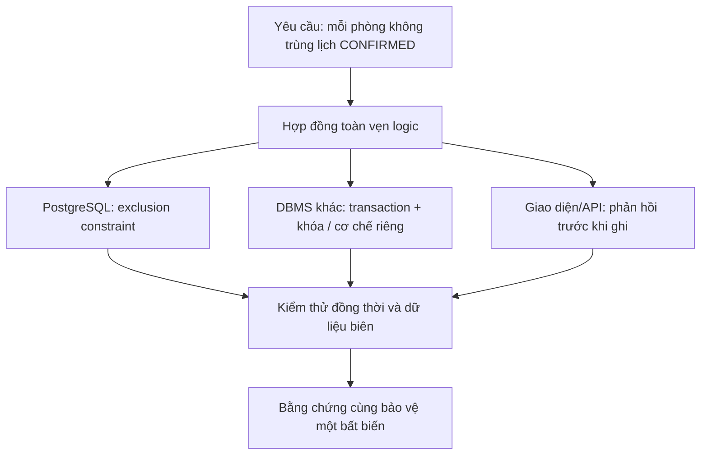

# Phân biệt ràng buộc logic với cơ chế thực thi riêng của hệ quản trị

## 1. Từ bất biến nghiệp vụ đến cơ chế thực thi

Trong module `DATABASE_DATA_MODELING`, người học rèn kỹ năng chuyển yêu cầu nghiệp vụ thành mô hình dữ liệu rõ ràng: xác định thực thể, quan hệ và bất biến, chuẩn hóa, lựa chọn khóa và chỉ mục, rồi xây lược đồ vật lý có thể tiến hóa và kiểm chứng. Ở chương **Mô hình vật lý**, một sai lầm dễ gặp là đồng nhất **quy tắc logic** với **một đoạn cú pháp SQL cụ thể**.

Ví dụ, yêu cầu “một phòng không được có hai lịch đã xác nhận chồng lấn thời gian” là một **bất biến của nghiệp vụ đặt phòng**. PostgreSQL có thể dùng ràng buộc loại trừ (*exclusion constraint*) để hỗ trợ thực thi; hệ quản trị khác có thể cần transaction cùng khóa hoặc một cơ chế điều phối tương đương. Quy tắc logic **không đổi** dù công nghệ thực thi thay đổi.

Hai tầng cần được mô tả riêng:

- **Tầng logic – điều gì luôn phải đúng?** Miền giá trị, tính duy nhất, quan hệ tham chiếu, giới hạn sức chứa, trạng thái hợp lệ, quy tắc qua nhiều bản ghi, tính nhất quán khi có giao dịch đồng thời.
- **Tầng vật lý – hệ thống buộc điều đó đúng bằng cách nào?** `NOT NULL`, `CHECK`, `UNIQUE`, `FOREIGN KEY`, index đặc thù, trigger, stored procedure, mức cô lập giao dịch, khóa, phần mềm ứng dụng hoặc dịch vụ điều phối.

Lời giải tốt nêu **phạm vi bảo đảm**, **thời điểm kiểm tra**, **hành vi khi vi phạm**, **khả năng bỏ qua cơ chế** và **cách kiểm thử**. Có DDL chạy thành công chưa chứng minh rằng mọi bất biến đã được bảo vệ.

### Mục tiêu học tập

Sau bài này, người học có thể:

1. Diễn đạt bất biến dưới dạng độc lập DBMS và phân loại bất biến trên một cột, một hàng, nhiều hàng, nhiều bảng hoặc qua thời gian.
2. Ánh xạ mỗi bất biến sang cơ chế của DBMS đích; chỉ rõ điều gì được bảo vệ **trong DB**, điều gì cần giao dịch hoặc nhiều thành phần hợp tác.
3. Nhận biết sự khác nhau giữa khả năng **khai báo** và khả năng **thực sự thực thi** ràng buộc theo phiên bản, engine và cấu hình.
4. Thiết kế kiểm thử giá trị biên, `NULL`, ghi đồng thời, nhập lô, migration và các đường ghi không đi qua giao diện chính.
5. Duy trì một “hợp đồng toàn vẹn” ổn định khi chuyển PostgreSQL, MySQL, SQL Server hoặc cơ sở dữ liệu document/graph/phân tích.

## 2. Viết ràng buộc logic trước khi chọn cú pháp

Xét dịch vụ đặt phòng họp cho nhiều tổ chức (*tenant*). Mô hình logic có `Tenant`, `Room` và `Reservation`.

| Mã | Bất biến logic | Phạm vi kiểm tra |
|---|---|---|
| L1 | Mỗi phòng thuộc đúng một tenant; lượt đặt phòng phải tham chiếu phòng thuộc cùng tenant | Liên bảng |
| L2 | Mã phòng `room_code` duy nhất **trong một tenant** | Nhiều hàng, theo phạm vi |
| L3 | Một lượt đặt phòng có thời điểm bắt đầu nhỏ hơn thời điểm kết thúc | Một hàng, liên cột |
| L4 | Số người tham dự là số nguyên dương | Một cột |
| L5 | Trạng thái chỉ thuộc `DRAFT`, `CONFIRMED` hoặc `CANCELLED`; mặc định ban đầu là `DRAFT` | Một cột và vòng đời |
| L6 | Lượt `CANCELLED` phải có lý do hủy; lượt chưa hủy không có lý do hủy | Một hàng, có điều kiện |
| L7 | Không có hai lượt `CONFIRMED` của **cùng phòng và tenant** có khoảng thời gian giao nhau | Nhiều hàng, có cạnh tranh đồng thời |
| L8 | Số người tham dự không vượt sức chứa của phòng | Liên bảng |
| L9 | Chỉ cho phép chuyển trạng thái theo sơ đồ đã duyệt | Trạng thái cũ, trạng thái mới, thời gian |
| L10 | Người dùng chỉ được thao tác trên dữ liệu mà họ có quyền | Chính sách truy cập |

Một yêu cầu có thể viết gần với toán học:

\[
\forall r:\quad r.\mathrm{starts\_at}<r.\mathrm{ends\_at}
\]

\[
\forall r_1\ne r_2,\quad
(r_1.\mathrm{tenant},r_1.\mathrm{room})=(r_2.\mathrm{tenant},r_2.\mathrm{room})
\land r_1.\mathrm{status}=r_2.\mathrm{status}=\mathrm{CONFIRMED}
\Rightarrow \mathrm{interval}(r_1)\cap \mathrm{interval}(r_2)=\varnothing
\]

Ở đây sử dụng khoảng **đầu bao gồm, cuối loại trừ** `[start, end)`: một lịch kết thúc đúng 10:00 và lịch khác bắt đầu đúng 10:00 **không chồng lấn**. Việc chọn cách hiểu ranh giới là quyết định nghiệp vụ, phải được ghi rõ trước khi chọn toán tử DBMS.

### Phân loại giúp chọn đúng cơ chế

| Loại bất biến | Ví dụ | Cơ chế thường phù hợp ở DB quan hệ |
|---|---|---|
| Hiện diện | `tenant_id` bắt buộc | `NOT NULL` |
| Miền giá trị | `attendees > 0`, trạng thái trong tập cho phép | `CHECK`, kiểu miền hoặc bảng tham chiếu |
| Duy nhất | (`tenant_id`, `room_code`) không trùng | `UNIQUE` hoặc unique index |
| Tồn tại tham chiếu | Phòng được đặt phải tồn tại | `FOREIGN KEY` |
| So sánh các cột của một hàng | `starts_at < ends_at` | `CHECK` |
| Quan hệ giữa các hàng | Hai lịch không chồng lấn | Exclusion/temporal constraint nếu hỗ trợ, hoặc giao dịch + đồng bộ |
| Dữ liệu từ bảng khác | `attendees <= room.capacity` | Giao dịch, trigger/thủ tục có khóa thích hợp hoặc thay đổi mô hình |
| Quá trình chuyển trạng thái | Không chuyển `CANCELLED → CONFIRMED` | Logic transaction, trigger, state machine và nhật ký |
| Phân quyền | Người thuộc tenant A không đọc tenant B | Xác thực/ủy quyền, có thể kết hợp row-level security |

Không cố nhét mọi quy tắc vào `CHECK`. Mỗi cơ chế có phạm vi hiểu biết và thời điểm kiểm tra riêng.

## 3. Cùng một logic có thể được thực thi ở nhiều tầng



Việc kiểm tra ở UI hoặc ứng dụng giúp người dùng nhận phản hồi sớm, nhưng không thay thế bảo vệ tại nơi mọi luồng ghi gặp nhau. Những luồng cần xét gồm API, background job, script bảo trì, importer, CDC/replication và công cụ của quản trị viên. Một ứng dụng có kiểm tra đầy đủ vẫn có thể có lỗi cạnh tranh nếu hai giao dịch cùng quan sát “phòng còn trống” rồi cùng tạo lịch.

**Nguyên tắc thực tế:**

- Bất biến mà DBMS có thể bảo vệ bằng **ràng buộc khai báo** nên được khai báo tại DB khi phù hợp với kiến trúc và yêu cầu.
- Với điều kiện liên hàng hoặc qua nhiều bảng, cần cơ chế **an toàn khi ghi đồng thời**, không chỉ truy vấn kiểm tra trước khi ghi.
- Với luật thay đổi liên tục, phụ thuộc người dùng/nguồn ngoài, hoặc đi qua nhiều dịch vụ, ứng dụng có thể chịu trách nhiệm điều phối; nhưng phải nêu mức nhất quán và cách khôi phục nếu có thất bại.
- Bản đặc tả logic là nguồn để viết **contract tests** áp dụng lại khi thay DBMS hoặc thư viện truy cập.

## 4. Ràng buộc khai báo trong SQL: mạnh nhưng có giới hạn rõ ràng

### 4.1. `NOT NULL` và giá trị thiếu

`NULL` không phải số 0, chuỗi rỗng hay `FALSE`. `NOT NULL` ngăn chèn/cập nhật hàng khi cột không có giá trị; nó không cấm `''` hoặc dấu cách.

### 4.2. `DEFAULT` không tự bảo đảm một bất biến

`DEFAULT 'DRAFT'` dùng khi lệnh ghi bỏ qua cột hoặc yêu cầu `DEFAULT`; việc gửi `NULL` rõ ràng không được biến thành mặc định một cách tự động theo SQL thông thường. Nếu trạng thái bắt buộc, dùng thêm `NOT NULL`. Nếu quy tắc là “mọi lượt mới **phải** khởi tạo ở DRAFT”, `DEFAULT` **chưa cấm** client ghi `CONFIRMED` ngay từ đầu: cần kiểm soát thao tác tạo hoặc chuyển trạng thái ở tầng phù hợp.

### 4.3. `CHECK` và logic ba giá trị

Trong PostgreSQL và nhiều hệ quản trị SQL, một `CHECK` chỉ từ chối khi biểu thức trả **FALSE**; biểu thức trả **TRUE** hoặc **UNKNOWN** do `NULL` có thể được chấp nhận.

| `attendees` | `CHECK (attendees > 0)` | Hành vi |
|---|---|---|
| `3` | TRUE | Chấp nhận |
| `0` | FALSE | Từ chối |
| `-2` | FALSE | Từ chối |
| `NULL` | UNKNOWN | Có thể chấp nhận nếu cột không `NOT NULL` |

Nếu người tham dự bắt buộc, khai báo `attendees INTEGER NOT NULL` **và** `CHECK (attendees > 0)`. Với điều kiện liên cột như `starts_at < ends_at`, cả hai mốc cũng phải được xử lý `NULL` có chủ đích.

```sql
-- Ví dụ: cấm NULL và khoảng thời gian rỗng/đảo chiều.
starts_at TIMESTAMPTZ NOT NULL,
ends_at   TIMESTAMPTZ NOT NULL,
CONSTRAINT ck_time_order CHECK (starts_at < ends_at)
```

`CHECK` phù hợp biểu thức bất biến của một hàng. Không dùng truy vấn con đọc bảng phòng trong một `CHECK` thông thường để giả vờ bảo vệ `attendees <= room.capacity`: loại phụ thuộc liên bảng này cần thiết kế khác.

### 4.4. `UNIQUE` khác `PRIMARY KEY`, và `NULL` khác nhau giữa DBMS

`PRIMARY KEY` chọn danh tính chính thức của một hàng và cấm `NULL` trên các thành phần. `UNIQUE` bảo vệ khóa ứng viên khác, ví dụ (`tenant_id`, `room_code`). Hai cột có thể cùng tạo một giá trị duy nhất dù từng cột riêng lẻ có thể lặp.

Đối với cột **cho phép `NULL`**, không được mặc định ngữ nghĩa của `UNIQUE` giống nhau trên mọi DBMS. PostgreSQL 16 mặc định xem các `NULL` là khác nhau trong unique constraint, đồng thời có cú pháp `NULLS NOT DISTINCT` để đổi quy tắc. MySQL thường cho phép nhiều giá trị `NULL` trong unique index; SQL Server có hành vi khác, đặc biệt với unique index đơn cột. Cần viết ca kiểm thử theo DBMS thực tế.

### 4.5. `FOREIGN KEY` là liên kết, không phải kiểm tra mọi quy tắc miền

`FOREIGN KEY (tenant_id, room_id) REFERENCES room(tenant_id, room_id)` bảo vệ rằng cặp tenant/phòng tồn tại. Khai báo hai FK đơn, một tới tenant và một tới room, có thể **không** ngăn dòng đặt phòng có tenant A nhưng phòng thuộc tenant B.

Trong PostgreSQL, khóa ngoại ghép dùng `MATCH SIMPLE` theo mặc định: nếu một thành phần tham chiếu là `NULL`, việc kiểm tra hàng cha có thể bị bỏ qua. Với liên kết bắt buộc, mọi thành phần FK nên `NOT NULL`. Với liên kết tùy chọn và muốn cả tổ hợp cùng thiếu, cân nhắc `MATCH FULL` nếu DBMS hỗ trợ, rồi kiểm thử ngữ nghĩa cụ thể.

## 5. Ví dụ thực thi bằng PostgreSQL 16: các bất biến khai báo

Lược đồ dưới đây minh họa L1–L6. Đây là **một mô hình ví dụ độc lập**, không ngụ ý rằng các ràng buộc còn lại đã được bảo vệ.

```sql
CREATE TABLE tenant (
    tenant_id BIGINT GENERATED ALWAYS AS IDENTITY PRIMARY KEY,
    tenant_name VARCHAR(150) NOT NULL
);

CREATE TABLE room (
    tenant_id BIGINT NOT NULL,
    room_id   BIGINT GENERATED ALWAYS AS IDENTITY,
    room_code VARCHAR(40) NOT NULL,
    capacity  INTEGER NOT NULL,
    CONSTRAINT pk_room PRIMARY KEY (tenant_id, room_id),
    CONSTRAINT fk_room_tenant
        FOREIGN KEY (tenant_id) REFERENCES tenant(tenant_id),
    CONSTRAINT uq_room_tenant_code UNIQUE (tenant_id, room_code),
    CONSTRAINT ck_room_capacity CHECK (capacity > 0),
    CONSTRAINT ck_room_code_nonblank
        CHECK (char_length(btrim(room_code)) > 0)
);

CREATE TABLE reservation (
    tenant_id           BIGINT NOT NULL,
    reservation_id      BIGINT GENERATED ALWAYS AS IDENTITY,
    room_id             BIGINT NOT NULL,
    starts_at           TIMESTAMPTZ NOT NULL,
    ends_at             TIMESTAMPTZ NOT NULL,
    attendees           INTEGER NOT NULL,
    booking_status      VARCHAR(16) NOT NULL DEFAULT 'DRAFT',
    cancellation_reason TEXT,
    created_at          TIMESTAMPTZ NOT NULL DEFAULT CURRENT_TIMESTAMP,

    CONSTRAINT pk_reservation
        PRIMARY KEY (tenant_id, reservation_id),
    CONSTRAINT fk_reservation_room
        FOREIGN KEY (tenant_id, room_id)
        REFERENCES room (tenant_id, room_id),
    CONSTRAINT ck_reservation_time
        CHECK (starts_at < ends_at),
    CONSTRAINT ck_reservation_attendees
        CHECK (attendees > 0),
    CONSTRAINT ck_reservation_status
        CHECK (booking_status IN ('DRAFT', 'CONFIRMED', 'CANCELLED')),
    CONSTRAINT ck_reservation_cancellation
        CHECK (
            (
                booking_status = 'CANCELLED'
                AND cancellation_reason IS NOT NULL
                AND char_length(btrim(cancellation_reason)) > 0
            )
            OR
            (
                booking_status <> 'CANCELLED'
                AND cancellation_reason IS NULL
            )
        )
);

-- Đường đọc minh họa; không thêm index tùy tiện cho mọi cột.
CREATE INDEX idx_reservation_room_time
    ON reservation (tenant_id, room_id, starts_at);
```

Đọc DDL theo hợp đồng:

1. `pk_room` và `pk_reservation` định danh hàng trong tenant; `UNIQUE(tenant_id, room_code)` bảo vệ mã phòng theo phạm vi đúng.
2. FK ghép đảm bảo `reservation.tenant_id` và `reservation.room_id` thuộc cùng một hàng `room`; vẫn cần kiểm soát quyền đọc/ghi theo tenant tại tầng bảo mật.
3. `NOT NULL` và `CHECK` bảo vệ sự hiện diện, miền số, tập trạng thái, thứ tự thời gian và ý nghĩa lý do hủy.
4. `DEFAULT 'DRAFT'` giúp khởi tạo tiện lợi nhưng không cấm client chèn `CONFIRMED`; quy tắc khởi tạo và chuyển trạng thái cần xử lý riêng.
5. **L7, L8 và L9 chưa được bảo vệ**: hai lịch `CONFIRMED` vẫn có thể chồng lấn; số người có thể vượt `room.capacity`; chuyển trạng thái có thể sai. Đây là phần phải thiết kế tiếp.

Chỉ mục `(tenant_id, room_id, starts_at)` giúp truy cập lịch của một phòng. Nó **không tự cấm chồng lấn**: chỉ mục B-tree thông thường phục vụ truy cập, còn tính duy nhất về khoảng thời gian đòi cơ chế khác.

## 6. Bất biến liên hàng: PostgreSQL hỗ trợ exclusion constraint

Muốn bảo vệ L7 (“không chồng lịch đã xác nhận”), PostgreSQL có **exclusion constraint** trên GiST, kết hợp so sánh bằng của tenant/phòng với phép giao nhau của khoảng thời gian.

```sql
-- Cần extension để có các operator class GiST cho kiểu số nguyên.
-- Cài đặt extension phụ thuộc quyền và cấu hình môi trường.
CREATE EXTENSION IF NOT EXISTS btree_gist;

ALTER TABLE reservation
    ADD CONSTRAINT ex_confirmed_room_time
    EXCLUDE USING gist (
        tenant_id WITH =,
        room_id WITH =,
        tstzrange(starts_at, ends_at, '[)') WITH &&
    )
    WHERE (booking_status = 'CONFIRMED');
```

Ý nghĩa:

- `tstzrange(starts_at, ends_at, '[)')` tạo khoảng thời gian với đầu bao gồm, cuối loại trừ.
- `&&` là toán tử kiểm tra hai khoảng **giao nhau**.
- `tenant_id WITH =` và `room_id WITH =` giới hạn xung đột trong **cùng tenant và phòng**.
- `WHERE (booking_status = 'CONFIRMED')` chỉ áp dụng ràng buộc đối với lịch đã xác nhận. Hai bản nháp có thể chồng nhau; khi cả hai cùng được chuyển sang `CONFIRMED`, DBMS phải kiểm soát xung đột.

Nếu lịch A là `[09:00,10:00)` và lịch B là `[10:00,11:00)` trong cùng phòng, chúng **không** giao nhau; nếu B bắt đầu lúc `09:59` thì giao nhau và không được cùng ở trạng thái `CONFIRMED`.

**Giới hạn vận hành:** extension phải được phép cài; GiST có chi phí lưu trữ, cập nhật và đặc tính hiệu năng riêng; constraint có thể làm một giao dịch phải chờ rồi báo lỗi khi giao dịch khác xác nhận lịch xung đột. Hãy kiểm thử đồng thời, giá trị biên và thời gian phản hồi trên dữ liệu thật. Cơ chế này là khả năng riêng của PostgreSQL, không phải một mệnh đề SQL có thể chuyển nguyên sang mọi DBMS.

### Vì sao ứng dụng kiểm tra trước rồi `INSERT` là chưa đủ?

Xét hai giao dịch cùng lúc:

```text
T1: SELECT lịch đã xác nhận chồng [09:00,10:00) -> không có
T2: SELECT lịch đã xác nhận chồng [09:30,10:30) -> không có
T1: INSERT lịch CONFIRMED [09:00,10:00)
T2: INSERT lịch CONFIRMED [09:30,10:30)
T1: COMMIT
T2: COMMIT
```

Nếu không có ràng buộc hoặc đồng bộ phù hợp, cả hai có thể thành công ở mức cô lập thường dùng, dù mỗi giao dịch đều “đã kiểm tra”. Đây là lỗi **check-then-act race**.

Exclusion constraint giúp DBMS phát hiện xung đột khi ghi. Trên DBMS không có cơ chế tương đương, một phương án là **mọi đường ghi** phải khóa cùng hàng `room` bằng `SELECT ... FOR UPDATE` trong một giao dịch, sau đó kiểm tra chồng lấn và ghi lịch trước khi commit. Cần đảm bảo mọi writer đi qua cùng giao thức khóa; chỉ “khóa các lịch đang trùng” có thể không giúp khi **chưa có hàng nào để khóa**. Một phương án khác là dùng isolation phù hợp, retry hoặc cấu trúc đặt chỗ có khóa duy nhất theo ô thời gian, nhưng đều phải được chứng minh an toàn trước race condition.

## 7. Bất biến liên bảng: sức chứa phòng không nằm trong một `CHECK` thông thường

Quy tắc L8 là:

\[
\forall r:\quad r.\mathrm{attendees}
\leq \mathrm{capacity}(\mathrm{room}(r))
\]

`capacity` nằm ở bảng `room`. Khai báo `CHECK (attendees <= room.capacity)` trực tiếp trong `reservation` không phải một ràng buộc SQL một hàng hợp lệ. Những lựa chọn cần cân nhắc:

| Phương án | Cách vận hành | Điều kiện để an toàn |
|---|---|---|
| Thẩm định ở API | Đọc sức chứa, từ chối lượt đặt vượt mức | Chỉ là phản hồi sớm; chưa đủ nếu nguồn ghi khác tồn tại hoặc sức chứa đổi đồng thời |
| Giao dịch có khóa | Khóa hàng phòng, đọc `capacity`, kiểm tra `attendees` rồi ghi | Mọi đường tạo/sửa lịch và sửa sức chứa phải tuân thủ giao thức; rollback khi sai |
| Trigger/thủ tục DB | DB tự đọc phòng và kiểm tra khi ghi | Phải xử lý khóa, cạnh tranh, quyền thực thi và cả thay đổi `room.capacity` |
| Đổi mô hình dữ liệu | Lưu hạng phòng/sức chứa được chốt tại thời điểm đặt hoặc dùng mô hình slot/seat | Phải giải thích rõ snapshot khác ràng buộc sức chứa hiện tại, tránh tạo bản sao không đồng bộ |

Ví dụ: khi sức chứa của phòng giảm từ 12 xuống 6, lịch đã có 10 người sẽ ra sao? Có hai hợp đồng khác nhau:

- **Lịch hiện tại luôn phải phù hợp sức chứa hiện tại:** giảm `capacity` phải bị từ chối hoặc phải điều chỉnh các lịch còn hiệu lực trong một transaction nhất quán.
- **Sức chứa lúc đặt là snapshot được chấp nhận:** lịch cũ giữ điều kiện đã xác nhận ở thời điểm đặt; phải lưu snapshot cùng chính sách xử lý khi phòng thay đổi.

Không thể chọn trigger đúng nếu chưa chốt bất biến nào trong hai bất biến trên. **Ràng buộc logic đi trước cơ chế thực thi**.

## 8. Bất biến theo thời gian: trạng thái hiện tại khác lịch sử chuyển trạng thái

`CHECK (booking_status IN (...))` xác nhận **giá trị hiện tại** nằm trong tập cho phép; nó không biết trạng thái trước khi `UPDATE`. Nếu yêu cầu:

```text
DRAFT -> CONFIRMED -> CANCELLED
   \-----> CANCELLED

CANCELLED không thể quay lại CONFIRMED.
```

thì cần xem **trạng thái cũ và mới** trong cùng thao tác có kiểm soát. Một giải pháp phổ biến là API/stored procedure thực hiện lệnh cập nhật có điều kiện:

```sql
-- PostgreSQL: chỉ xác nhận một reservation đang DRAFT.
-- Trong ứng dụng phải kiểm tra số hàng được RETURNING và xử lý kết quả 0 hàng.
UPDATE reservation
SET booking_status = 'CONFIRMED'
WHERE tenant_id = 42
  AND reservation_id = 9001
  AND booking_status = 'DRAFT'
RETURNING reservation_id, booking_status;
```

Điều kiện trong `WHERE` biến việc đọc trạng thái và cập nhật thành **một thao tác ghi có điều kiện** đối với hàng đó, giúp tránh một dạng lost update. Nhưng nếu ứng dụng còn cho phép `UPDATE` trực tiếp qua luồng khác, quy tắc chuyển trạng thái không được bảo vệ toàn diện. Có thể giới hạn quyền cập nhật trực tiếp, chỉ cho thao tác qua thủ tục, dùng trigger hoặc kiểm tra nhất quán ở tầng dịch vụ có kiểm soát.

Nếu phải kiểm toán, nên có bảng **lịch sử chuyển trạng thái** lưu thời gian, người thực hiện, trạng thái trước/sau, lý do và ID yêu cầu. Không dùng ID tự tăng thay cho thứ tự commit tuyệt đối; phải định nghĩa ngữ nghĩa thứ tự theo yêu cầu. Trigger có thể tự ghi lịch sử, nhưng cần xử lý retry, giao dịch rollback và event gửi ra hệ ngoài bằng mô hình outbox nếu cần bảo đảm phát hành đáng tin.

## 9. Khi nào kiểm tra: ngay trong câu lệnh hay lúc commit?

Một số bất biến có thể được thỏa **ở cuối giao dịch** dù tạm thời chưa thỏa ở giữa các câu lệnh. Ví dụ chuyển cấu trúc quan hệ có vòng phụ thuộc, hoặc đổi thứ tự một bộ bản ghi mà hai bước cập nhật trung gian có thể vi phạm unique key.

Trong PostgreSQL, một số loại ràng buộc như `FOREIGN KEY`, `UNIQUE`/`PRIMARY KEY` và exclusion constraint có thể khai báo `DEFERRABLE` với điều kiện áp dụng của từng loại. `CHECK` và `NOT NULL` thông thường **không hỗ trợ trì hoãn** bằng cách thêm `DEFERRABLE`.

Ví dụ độc lập về FK có thể trì hoãn:

```sql
CREATE TABLE parent_ref (
    id BIGINT PRIMARY KEY
);

CREATE TABLE child_ref (
    id BIGINT PRIMARY KEY,
    parent_id BIGINT NOT NULL,
    CONSTRAINT fk_child_parent
        FOREIGN KEY (parent_id) REFERENCES parent_ref(id)
        DEFERRABLE INITIALLY IMMEDIATE
);

BEGIN;
SET CONSTRAINTS fk_child_parent DEFERRED;

-- Ghi con trước cha: FK chưa được kiểm tra cuối cùng ngay lúc INSERT.
INSERT INTO child_ref (id, parent_id) VALUES (1, 10);
INSERT INTO parent_ref (id) VALUES (10);

COMMIT; -- Hợp lệ vì đến lúc COMMIT hàng cha đã tồn tại.
```

Nếu không chèn `parent_ref(10)` trước `COMMIT`, giao dịch phải bị từ chối. Đây là tính năng theo DBMS và loại constraint; không coi “trì hoãn” là “vô hiệu hóa vĩnh viễn”. Một số tối ưu khác có giới hạn riêng với khóa có thể trì hoãn, ví dụ sử dụng constraint làm đích xử lý xung đột `ON CONFLICT` của PostgreSQL.

### Thời điểm tạo ràng buộc trên dữ liệu cũ

Thêm `CHECK`/FK vào bảng lớn có sẵn bản ghi vi phạm là một bài toán khác với kiểm tra giao dịch mới. PostgreSQL có `NOT VALID` và `VALIDATE CONSTRAINT` cho những loại ràng buộc thích hợp (điển hình `CHECK` và `FOREIGN KEY`): ràng buộc mới vẫn áp lên thao tác ghi tiếp theo, còn việc xác nhận toàn bộ dữ liệu cũ được thực hiện theo bước riêng.

Không suy ra `NOT VALID` nghĩa là dữ liệu cũ đã hợp lệ. Khi bàn giao, phải thể hiện trạng thái **đã kiểm tra đủ dữ liệu** và có kết quả validation; không tự đánh dấu “đã bảo vệ dữ liệu toàn bảng” khi còn chưa validate.

## 10. Quy tắc “duy nhất khi chưa xóa mềm” và index có điều kiện

Giả sử hệ thống lưu người dùng đã ngừng hoạt động bằng `archived_at`; email chỉ cần duy nhất giữa những người **chưa lưu trữ** trong cùng tenant. Bất biến logic:

> Với mọi hai hàng đang hoạt động cùng tenant, email chuẩn hóa không được trùng.

Trong PostgreSQL có thể dùng **partial unique expression index**:

```sql
-- Ví dụ độc lập với các bảng đặt phòng.
CREATE TABLE customer_contact (
    contact_id BIGINT GENERATED ALWAYS AS IDENTITY PRIMARY KEY,
    tenant_id  BIGINT NOT NULL,
    email      TEXT NOT NULL,
    archived_at TIMESTAMPTZ
);

CREATE UNIQUE INDEX uq_active_contact_email
    ON customer_contact (tenant_id, lower(email))
    WHERE archived_at IS NULL;
```

Ở đây, `UNIQUE` chỉ áp dụng cho hàng có `archived_at IS NULL` và so sánh giá trị `lower(email)`. Khi hai giao dịch cùng chèn email đang hoạt động trùng, DBMS có thể từ chối một giao dịch. Tuy nhiên:

- `lower(email)` chỉ là một **quy tắc chuẩn hóa cụ thể**, chưa bao quát mọi đặc điểm của địa chỉ email, Unicode và collation. Phải chốt chính sách danh tính trước.
- Một **partial unique index** của PostgreSQL không tự làm đích khóa ngoại tương đương một `UNIQUE` constraint không điều kiện; thiết kế liên kết phải dùng một khóa ổn định khác.
- Khôi phục một bản ghi đã lưu trữ về trạng thái hoạt động có thể bị từ chối nếu email đã được người khác sử dụng trong tenant. Ứng dụng phải có quy trình xử lý xung đột.
- MySQL/SQL Server có khả năng và cú pháp khác nhau. SQL Server hỗ trợ filtered unique index theo các điều kiện và giới hạn của nó; MySQL có thể cần cột sinh/biểu thức và ràng buộc unique tương ứng, kết hợp ngữ nghĩa `NULL`. Không chuyển nguyên DDL này sang DBMS khác.

Đừng chuyển ràng buộc nghiệp vụ thành “một index chạy nhanh” mà quên vai trò toàn vẹn. Index ở ví dụ được tạo chủ yếu để **bảo vệ tính duy nhất có điều kiện**; hiệu năng tra cứu chỉ là lợi ích phụ.

## 11. Các cơ chế phụ thuộc DBMS và khả năng thực thi thật

Cùng một yêu cầu logic có thể có nhiều cách thực thi hoặc chỉ được bảo vệ một phần ở từng sản phẩm. Bảng dưới đây là định hướng cho **PostgreSQL 16**, **MySQL 8.0 với InnoDB** và **SQL Server 2022**; cần kiểm tra phiên bản/engine, SQL mode, collation và cấu hình thực tế.

| Nhu cầu | PostgreSQL 16 | MySQL 8.0 / InnoDB | SQL Server 2022 |
|---|---|---|---|
| Cột bắt buộc | `NOT NULL` | `NOT NULL` | `NOT NULL` |
| Miền giá trị, liên cột trong một hàng | `CHECK` | `CHECK` được thực thi từ **8.0.16**; phiên bản cũ có khác biệt | `CHECK`; lưu ý trạng thái ràng buộc bị vô hiệu hóa/untrusted khi dùng cách nạp/chuyển đổi phù hợp |
| Tính duy nhất theo tổ hợp | `UNIQUE`, unique index | Unique index/constraint với ngữ nghĩa `NULL`/collation của engine | `UNIQUE`/unique index, cần xét `NULL` và collation |
| Khóa ngoại | `FOREIGN KEY`, có khả năng `DEFERRABLE` ở loại phù hợp | FK trên InnoDB, quy tắc kiểm tra và cấu hình riêng, không có cú pháp trì hoãn tương đương | FK với cơ chế kiểm tra/ràng buộc riêng, không có deferrable như PostgreSQL |
| Duy nhất có điều kiện | Partial unique index `WHERE` | Thiết kế tương đương qua cột sinh/biểu thức nếu phù hợp, không cùng cú pháp | Filtered unique index theo khả năng sản phẩm |
| Không chồng lấn khoảng | Exclusion constraint với range/GiST | Thường cần transaction/khóa hoặc thiết kế lưu slot; không có cú pháp exclusion tương đương | Thường cần transaction/khóa hoặc thiết kế lưu slot; không có cú pháp exclusion tương đương |
| Ràng buộc theo trạng thái cũ → mới | Trigger hoặc giao thức cập nhật có điều kiện | Trigger/giao dịch/logic ứng dụng | Trigger/giao dịch/logic ứng dụng |
| Kiểm soát truy cập hàng | Row-Level Security (*RLS*) với chính sách PostgreSQL | Thường phối hợp quyền, view và logic ứng dụng theo kiến trúc | Row-Level Security với cơ chế chính sách riêng |
| Chuyển đổi dữ liệu cũ | `NOT VALID`/`VALIDATE CONSTRAINT` cho loại hỗ trợ | Migration có quy tắc online DDL/check theo phiên bản | Phân biệt ràng buộc được tin cậy (*trusted*) và trạng thái kiểm tra sau `WITH NOCHECK` |

**Bốn khác biệt rất dễ gây sai trong migration:**

1. **`CHECK` được chấp nhận cú pháp không chắc đã được thực thi** trên mọi phiên bản lịch sử. Trên MySQL 8.0 trước 8.0.16, cách xử lý `CHECK` khác đáng kể; phải tạo ca `INSERT` cố ý sai để xác minh.
2. **So sánh chuỗi và `NULL`:** cùng `UNIQUE(email)` có thể chấp nhận/từ chối tập dữ liệu khác nhau theo collation và ngữ nghĩa `NULL` của DBMS. Một hệ thống chuyển sang collation không phân biệt hoa thường có thể phát hiện mã trùng mà trước đây cho phép.
3. **Khả năng trì hoãn FK:** quy trình nhập dữ liệu chèn con trước cha trong một transaction có thể chạy được với FK `DEFERRABLE` của PostgreSQL nhưng không chuyển nguyên cách làm sang MySQL/SQL Server.
4. **Bảo đảm liên hàng:** PostgreSQL có exclusion constraint; DBMS khác có thể thiếu tính năng trực tiếp nên phải chuyển thành thiết kế giao dịch an toàn, không chỉ “bỏ đoạn SQL mà ứng dụng vẫn chạy”.

### Vì sao tắt kiểm tra FK là thay đổi hợp đồng?

Một số DBMS cho phép tạm dừng hoặc bỏ qua kiểm tra ràng buộc khi nhập dữ liệu. Đây không phải thao tác tương đương với “giao dịch sẽ kiểm tra lại tự động ở commit”. Nếu dùng chế độ không kiểm tra, có thể đưa dữ liệu mồ côi vào hệ thống; việc bật lại chưa chắc xác minh toàn bộ dữ liệu cũ nếu không chạy đúng bước validate/trust. Quy trình import phải ghi rõ ai cho phép, phạm vi, cách đối soát và trạng thái cuối cùng.

## 12. Tính nhất quán khi đồng thời: constraint, khóa và isolation

Khác biệt giữa kiểm tra logic và cơ chế DBMS bộc lộ rõ nhất dưới tải đồng thời.

| Tình huống | Kiểm tra đơn giản dễ lỗi | Cơ chế cần xét |
|---|---|---|
| Hai giao dịch cùng tạo email đang hoạt động | Cả hai `SELECT` đều “chưa tồn tại” | Unique index/constraint; ứng dụng xử lý lỗi trùng và retry phù hợp |
| Hai giao dịch xác nhận lịch giao nhau | Cả hai tự kiểm tra khi chưa có lịch đối thủ | Exclusion constraint hoặc giao thức khóa + isolation đã kiểm chứng |
| Đặt phòng và giảm sức chứa đồng thời | Cả hai đọc số cũ rồi cập nhật độc lập | Khóa cùng nguồn dữ liệu, transaction/trigger và quy tắc xử lý thay đổi |
| Hai yêu cầu chuyển trạng thái | Cả hai đọc `DRAFT` rồi ghi đè | `UPDATE ... WHERE booking_status = 'DRAFT'`, versioning hoặc khóa hàng |
| Hai dịch vụ cập nhật bản ghi trên hai database | Mỗi DB chỉ kiểm tra dữ liệu cục bộ | Quy định consistency, điều phối giao dịch hoặc quy trình bù/đối soát |

**Mức cô lập giao dịch** không phải một giá trị chung có hành vi hoàn toàn giống nhau trên mọi DBMS. `READ COMMITTED`, `REPEATABLE READ` và `SERIALIZABLE` có thực thi và cơ chế phát hiện xung đột riêng. PostgreSQL `SERIALIZABLE` có thể hủy giao dịch với lỗi serialization, đòi hỏi ứng dụng **retry cả transaction** theo chính sách an toàn. Không coi một câu `SELECT` rồi `INSERT` trong giao dịch là tự động chống race nếu chưa chứng minh theo mức cô lập, khóa và truy vấn cụ thể.

Đối với bất biến liên hàng, hãy kiểm tra **hai hoặc nhiều phiên làm việc chạy đồng thời** với thời điểm đan xen, thay vì chỉ thử các `INSERT` tuần tự. Một bài test mà chỉ chạy một kết nối không thể chứng minh cơ chế an toàn khi có cạnh tranh.

## 13. Quyền truy cập và toàn vẹn là hai loại bảo đảm

Ràng buộc FK ghép (`tenant_id`, `room_id`) có thể ngăn dữ liệu đặt phòng **liên kết chéo tenant**. Nhưng một người dùng có quyền gửi `tenant_id = 42` đến API vẫn có thể đọc dữ liệu tenant 42 nếu ứng dụng thiếu xác thực và kiểm soát quyền, dù mọi FK đều đúng.

Phân biệt:

- **Toàn vẹn dữ liệu:** DB từ chối trạng thái sai của bản ghi và quan hệ.
- **Phân quyền:** ai được phép đọc, tạo, sửa hoặc xóa bản ghi nào; bối cảnh người dùng/role phải được xác minh.
- **Kiểm toán:** ai thực hiện hành động và hệ thống đã ghi nhận bằng chứng nào, có bất biến lịch sử và retention ra sao.

PostgreSQL và SQL Server có cơ chế Row-Level Security riêng. Nếu dùng, phải xét role đặc biệt, chủ sở hữu bảng, bypass policy, connection pooling, rò rỉ ngữ cảnh tenant và các đường ghi ngoài ứng dụng. RLS có thể giúp giới hạn dữ liệu theo tenant nhưng không thay thế `UNIQUE`, `FOREIGN KEY` hay exclusion constraint.

## 14. Bảng hợp đồng triển khai: một nguồn sự thật cho nhiều công nghệ

Một tài liệu bàn giao nên lưu **mô tả bất biến** tách khỏi DDL:

| Mã | Bất biến nghiệp vụ | Hợp đồng thực thi trên PostgreSQL | Phạm vi còn cần xử lý |
|---|---|---|---|
| L1 | Đặt phòng đúng tenant | FK ghép (`tenant_id`, `room_id`) | Kiểm soát quyền tenant |
| L2 | Mã phòng duy nhất theo tenant | `UNIQUE(tenant_id, room_code)` | Quy tắc chuẩn hóa mã |
| L3 | Bắt đầu trước kết thúc | `NOT NULL` + `CHECK` | Chuẩn hóa timezone đầu vào |
| L4 | Người tham dự dương | `NOT NULL` + `CHECK` | Giới hạn tối đa theo sức chứa |
| L5 | Trạng thái hợp lệ, mặc định DRAFT | `NOT NULL`, `DEFAULT`, `CHECK` | Quy tắc trạng thái ban đầu và chuyển trạng thái |
| L6 | Hủy phải có lý do | `CHECK` liên cột | Chính sách nội dung và quyền hủy |
| L7 | Lịch CONFIRMED không chồng nhau | GiST exclusion constraint | Xử lý lỗi cạnh tranh ở ứng dụng |
| L8 | Không vượt sức chứa | Chưa có constraint khai báo trong ví dụ | Giao dịch/trigger, cả khi sức chứa đổi |
| L9 | Chuyển trạng thái hợp lệ | Cập nhật có điều kiện là một phần giải pháp | Mọi writer, nhật ký và quyền thao tác |
| L10 | Chỉ thao tác tenant được phép | Kiểm soát quyền, có thể kết hợp RLS | Xác thực và kiểm thử bypass |

Có thể thêm các trường phục vụ thực tế: người sở hữu yêu cầu, độ ưu tiên, DDL/migration tương ứng, phiên bản DBMS, lỗi trả về, mức bảo đảm, test ID, dữ liệu legacy chưa hợp lệ và trạng thái validation.

Khi chuyển DBMS, **giữ nguyên cột “Bất biến nghiệp vụ”**, viết lại cột “Hợp đồng thực thi” theo khả năng sản phẩm mới rồi chạy cùng bộ contract tests. Đây là cách bảo đảm “portable semantics” ngay cả khi cú pháp không portable.

## 15. Kiểm thử từ logic đến thực thi

Với ví dụ PostgreSQL ở trên, sau khi tạo thêm exclusion constraint, cần thử:

| Ca | Thao tác | Kỳ vọng |
|---|---|---|
| T1 | Chèn `attendees = 0` | Bị `CHECK` từ chối |
| T2 | Chèn `attendees = NULL` | Bị `NOT NULL` từ chối |
| T3 | `starts_at = ends_at` | Bị `CHECK` từ chối |
| T4 | `room_id` tồn tại nhưng thuộc tenant khác | Bị FK ghép từ chối |
| T5 | Hai phòng cùng mã trong một tenant | Bị `UNIQUE` từ chối |
| T6 | Hai tenant dùng cùng mã phòng | Được phép nếu quy tắc unique là theo tenant |
| T7 | Lịch `CANCELLED` không có lý do | Bị `CHECK` từ chối |
| T8 | Hai lịch `DRAFT` chồng lấn trong cùng phòng | Được phép theo quy tắc hiện tại |
| T9 | Hai lịch `CONFIRMED` chồng lấn trong cùng phòng | Một lịch phải bị từ chối, kể cả khi ghi đồng thời |
| T10 | Hai lịch `CONFIRMED` giáp ranh đúng điểm kết thúc/bắt đầu | Được phép với khoảng `[)` |
| T11 | Hai lịch `CONFIRMED` cùng giờ nhưng khác phòng/tenant | Được phép |
| T12 | Đặt 20 người vào phòng có sức chứa 10 | **Chưa được DDL ở mục 5/6 bảo vệ**; phải có test đỏ để thúc đẩy bổ sung cơ chế |
| T13 | `UPDATE` trực tiếp `CANCELLED → CONFIRMED` khi không xung đột thời gian | **Chưa được `CHECK` trạng thái bảo vệ**; test cần xác minh cơ chế vòng đời riêng |
| T14 | Hai client đặt cùng phòng cùng giờ bằng hai transaction đồng thời | Chỉ một `CONFIRMED` được tồn tại sau commit |
| T15 | Nhập lô có giá trị không hợp lệ hoặc tạm ngừng constraint | Kết quả và bước validate phải đúng hợp đồng nhập liệu |

**Test đỏ có chủ đích** (T12/T13) giúp thấy lỗ hổng thực thi đang tồn tại. Không nên sửa tài liệu thành “đã bảo vệ” chỉ vì ứng dụng UI thường không cho người dùng gửi giá trị sai.

### Kiểm tra metadata ràng buộc

```sql
-- PostgreSQL 16: đọc ràng buộc thực sự được lưu.
SELECT
    c.conname,
    c.contype,
    c.convalidated,
    c.condeferrable,
    c.condeferred,
    pg_get_constraintdef(c.oid) AS definition
FROM pg_constraint AS c
WHERE c.conrelid = 'public.reservation'::regclass
ORDER BY c.conname;

-- Kiểm tra những chỉ mục của bảng đặt phòng.
SELECT indexname, indexdef
FROM pg_indexes
WHERE schemaname = 'public'
  AND tablename = 'reservation'
ORDER BY indexname;
```

`convalidated` cho biết trạng thái validate của các ràng buộc liên quan, `condeferrable`/`condeferred` mô tả khả năng và mặc định trì hoãn. Đọc metadata giúp đối chiếu DDL với cơ sở dữ liệu thật nhưng chưa đủ để khẳng định trigger, transaction và quyền ghi đang được cấu hình an toàn. Cần chạy test hành vi cùng test đồng thời.

## 16. Thay đổi yêu cầu và migration mà vẫn giữ hợp đồng logic

Giả sử ban đầu trạng thái chỉ có `DRAFT` và `CONFIRMED`, sau đó nghiệp vụ bổ sung `CANCELLED`. Một quy trình thay đổi hợp lý:

1. **Cập nhật đặc tả logic:** thêm trạng thái, quy tắc hủy, ai được hủy và hệ quả đối với lịch chồng lấn.
2. **Đánh giá tất cả cơ chế liên quan:** `CHECK` tập trạng thái, exclusion predicate chỉ áp dụng `CONFIRMED`, trigger/state machine, API, báo cáo và tích hợp.
3. **Khảo sát dữ liệu hiện hữu:** có trạng thái ngoài tập, lý do hủy thiếu, dữ liệu cũ vi phạm quy tắc mới hoặc client gửi sai mã không?
4. **Xây migration có thể kiểm chứng:** cập nhật constraint, code, thử trên bản sao dữ liệu lớn; lên lịch tác động khóa và rollback.
5. **Triển khai theo giai đoạn:** các dịch vụ/consumer không được giả định chỉ có hai trạng thái; theo dõi lỗi constraint và phiên bản schema.
6. **Chạy lại contract tests:** thử các tình huống cũ lẫn mới, ghi đồng thời và trạng thái biên.

Ví dụ thêm một `CHECK` mới vào PostgreSQL trên bảng đã có dữ liệu:

```sql
-- Minh họa độc lập: bảng legacy_reservation đã tồn tại.
ALTER TABLE legacy_reservation
    ADD CONSTRAINT ck_legacy_time_order
    CHECK (starts_at < ends_at) NOT VALID;

-- Kiểm tra/sửa dữ liệu cũ, sau đó mới xác nhận toàn bộ.
ALTER TABLE legacy_reservation
    VALIDATE CONSTRAINT ck_legacy_time_order;
```

Hai lệnh là **một ví dụ migration**, không thuộc lược đồ đặt phòng đã tạo ở mục 5. `NOT VALID` không mặc định bỏ kiểm tra đối với hàng được chèn/cập nhật mới; nó trì hoãn việc quét xác nhận toàn bộ hàng cũ cho một bước khác. Không dùng nó cho mọi loại ràng buộc một cách máy móc: PostgreSQL không hỗ trợ `NOT VALID` trực tiếp cho mọi loại `UNIQUE`/`PRIMARY KEY`.

Nếu thay đổi DBMS, migration còn cần đối chiếu độ chính xác số, kiểu thời gian, timezone, collation, `NULL`, engine, thứ tự kiểm tra FK và hành vi trigger. Mỗi chi tiết có thể thay đổi tập dữ liệu được phép, tức thay đổi **ngữ nghĩa** chứ không chỉ cú pháp.

## 17. Khi không dùng cơ sở dữ liệu quan hệ

Khái niệm “bất biến logic” vẫn áp dụng khi lựa chọn **document**, **graph** hoặc **cơ sở dữ liệu phân tích**; chỉ cơ chế bảo vệ khác:

| Mô hình | Ví dụ bất biến | Cơ chế và giới hạn cần đánh giá |
|---|---|---|
| Document | Mỗi đơn có tổng tiền không âm; mỗi dòng có số lượng dương | Schema validation/document validation có thể kiểm tra cấu trúc và một số điều kiện trong document; ràng buộc liên document, transaction và unique theo namespace phụ thuộc DBMS |
| Document | Một mã đơn duy nhất trong tenant | Unique compound index nếu sản phẩm hỗ trợ; cần xét sharding key, `NULL` và cách cập nhật/nhập lại |
| Graph | Quan hệ `Reservation → Room` phải có đúng một đích | Unique constraint, relationship/edge constraint và transaction theo tính năng DBMS; không giả định mọi graph engine thực thi cardinality giống nhau |
| Graph | Không có hai đường quan hệ vi phạm nghiệp vụ | Có thể đòi truy vấn traversal + giao dịch/khóa; cần xem tính nhất quán và cạnh tranh |
| Phân tích/columnar | Một sự kiện nguồn không được đếm hai lần trong fact | Idempotent ingestion, khóa nghiệp vụ nguồn, deduplication và kiểm tra grain; hệ OLAP có thể không thực thi PK/FK như OLTP |
| Phân tích/columnar | Tổng tiền theo dimension là nhất quán | Quy tắc transform, lịch sử dimension, kiểm thử chất lượng và reconciliation; “khai báo khóa” không đồng nghĩa được cưỡng chế |

Ví dụ trong kho dữ liệu, một hệ thống có thể **khai báo** mối quan hệ fact–dimension để phục vụ optimizer hoặc mô tả metadata mà **không cưỡng chế** đầy đủ như FK của PostgreSQL. Nếu không kiểm chứng, dữ liệu fact mồ côi vẫn có thể lọt vào báo cáo. Vì vậy hợp đồng toàn vẹn cần được hiện thực qua pipeline và thử nghiệm đối soát khi DBMS không có enforcement phù hợp.

**Tiêu chí lựa chọn công nghệ:** không chỉ hỏi “DBMS có cú pháp cho ràng buộc này không?”, mà hỏi “các đường ghi thực tế có bị chặn khi vi phạm không, có xử lý cạnh tranh và lỗi giữa nút không, và ta có bằng chứng kiểm thử hay không?”.

## 18. Những ngộ nhận thường gặp

| Ngộ nhận | Vấn đề | Cách xử lý |
|---|---|---|
| “Đã có `CHECK` thì cột không thể `NULL`.” | `UNKNOWN` có thể được chấp nhận | Dùng `NOT NULL` và test NULL tường minh |
| “`DEFAULT 'DRAFT'` cấm trạng thái khác lúc tạo.” | Client vẫn có thể chỉ định giá trị hợp lệ khác | Bảo vệ quy tắc tạo và chuyển trạng thái |
| “Hai FK đơn đủ đảm bảo cùng tenant.” | Có thể liên kết phòng thuộc tenant khác | Dùng FK ghép hoặc ràng buộc tương đương |
| “Index B-tree trên thời gian cấm hai lịch chồng nhau.” | Index truy cập khác ràng buộc khoảng | Exclusion/temporal constraint hoặc giao dịch an toàn |
| “Đã `SELECT` kiểm tra trước khi ghi nên không race.” | Hai transaction có thể cùng quan sát trống | Constraint, khóa hoặc isolation + retry đúng |
| “`UNIQUE(email)` có cùng nghĩa trên mọi DBMS.” | `NULL`, collation, canonicalization khác | Chốt quy tắc nghiệp vụ, test trên từng sản phẩm |
| “`CHECK` mọi DBMS đều thực thi từ các bản cũ.” | Có phiên bản chỉ nhận cú pháp mà không enforce như kỳ vọng | Xác minh version/engine và ca ghi sai |
| “`NOT VALID` nghĩa là đã kiểm tra dữ liệu cũ.” | Dữ liệu legacy chưa được xác nhận | Sửa, `VALIDATE CONSTRAINT`, ghi nhận kết quả |
| “Trigger tự bảo đảm an toàn đồng thời.” | Trigger không có khóa/isolation phù hợp vẫn race | Thiết kế giao thức transaction và test đồng thời |
| “RLS là một FK nâng cao.” | RLS kiểm soát quyền, không xác minh liên kết | Tách bảo mật và toàn vẹn trong đặc tả |
| “Chuyển DDL chạy được là migration đúng.” | Khác biệt `NULL`, thời gian, unique, trigger có thể đổi nghĩa | Dùng hợp đồng bất biến và contract tests |
| “Một cơ chế DB bảo vệ mọi dịch vụ.” | Dữ liệu ở DB khác có thể ngoài phạm vi transaction | Nêu mức nhất quán xuyên dịch vụ và cơ chế đối soát |

## 19. Bài luyện tập: bảo vệ một quy tắc nghiệp vụ trên hai DBMS

Một hệ thống đăng ký lớp học có:

- `class_session`: mã lớp, tenant, số ghế, thời gian bắt đầu/kết thúc, trạng thái mở/đóng;
- `enrollment`: học viên, lớp, trạng thái đăng ký, thời điểm đăng ký;
- `payment`: học viên, lớp, số tiền và trạng thái thanh toán.

Nghiệp vụ yêu cầu:

1. Một học viên không có hai ghi danh **đang hoạt động** cho cùng lớp.
2. Không ghi danh nhiều người hơn sức chứa của lớp khi nhiều yêu cầu đến cùng lúc.
3. Học viên chỉ được ghi danh lớp thuộc tenant của mình.
4. Lớp đã đóng không được nhận ghi danh mới.
5. Số tiền thanh toán không âm, trạng thái thuộc tập cho phép, và lần cập nhật trạng thái phải hợp lệ.
6. Dữ liệu được nhập từ API và một dịch vụ đồng bộ ngoài giờ.

**Yêu cầu thực hành:**

1. Viết sáu bất biến dưới dạng độc lập DBMS; phân loại một cột, một hàng, nhiều hàng, liên bảng hay lịch sử trạng thái.
2. Ánh xạ từng bất biến sang **PostgreSQL 16**: ràng buộc khai báo nào là đủ, quy tắc nào cần partial unique index, quy tắc nào phải dùng transaction + khóa hoặc cơ chế khác?
3. Thiết kế một phiên bản tương đương cho **MySQL 8.0/InnoDB hoặc SQL Server 2022**. Ghi rõ tính năng không chuyển nguyên cú pháp, đặc biệt unique có điều kiện, `NULL`, trigger và isolation.
4. Mô phỏng hai giao dịch cùng lấy ghế cuối cùng. Nêu trình tự kiểm tra/khóa/ghi làm phát sinh race và một trình tự khác ngăn được race.
5. Viết bộ test cho trùng ghi danh, ghi danh khác tenant, số tiền âm, `NULL`, ghi danh lớp đã đóng, chuyển trạng thái sai và import bỏ qua validation.
6. Đề xuất migration cho bảng `enrollment` đang có dữ liệu trùng: cách phát hiện, giải quyết xung đột nghiệp vụ, tạo unique constraint hoặc cơ chế tương đương và xác nhận toàn bộ dữ liệu trước khi cutover.

### Checklist bàn giao

- [ ] Bất biến được viết bằng ngôn ngữ nghiệp vụ, có phạm vi, ngoại lệ và giá trị biên rõ ràng.
- [ ] Mỗi bất biến có cơ chế thực thi xác định, tên constraint/index/transaction và người chịu trách nhiệm.
- [ ] Phân biệt `CHECK`, `UNIQUE`, FK, exclusion, trigger, ứng dụng, RLS và giao dịch theo **loại vấn đề** chúng giải quyết.
- [ ] Đã kiểm tra tính năng theo phiên bản/engine, `NULL`, collation, thời điểm kiểm tra và chế độ tắt/bỏ qua constraint.
- [ ] Có thử nghiệm lỗi có chủ đích, đồng thời, nguồn ghi thay thế, migration và xử lý retry.
- [ ] Còn bất biến nào chưa được bảo vệ thì đã ghi rõ khoảng trống và phương án hoàn thiện.

**Mô hình logic nêu điều gì phải luôn đúng; lược đồ vật lý và các giao thức ghi quyết định hệ thống có thực sự giữ được điều đó hay không.** Khi tách hai tầng này và đối chiếu bằng contract tests, người thiết kế có thể thay DBMS hoặc mở rộng kiến trúc mà vẫn bảo vệ những quy tắc dữ liệu cốt lõi.
