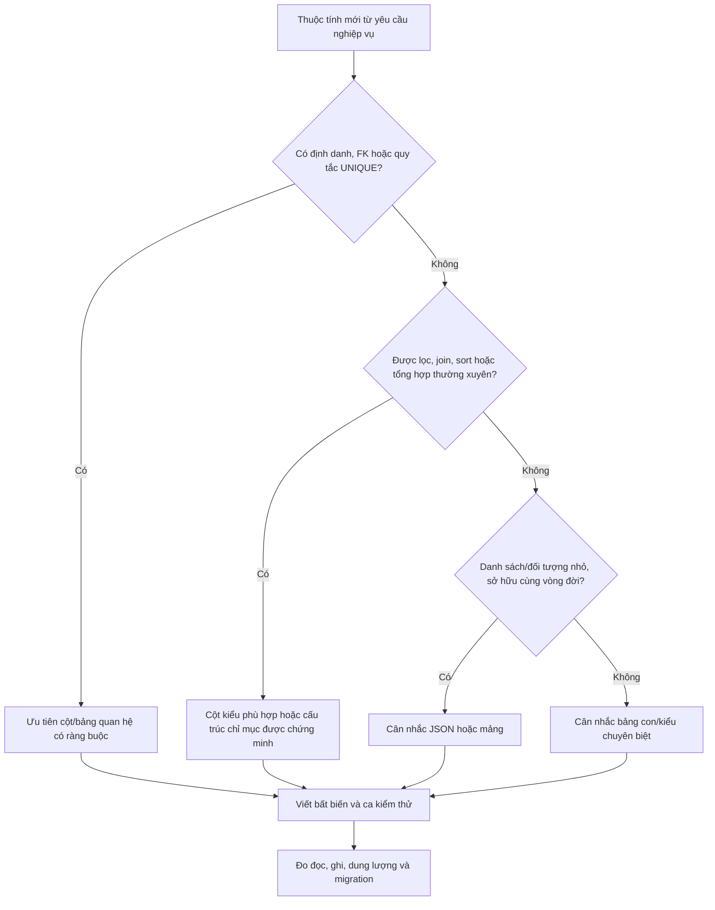

# Cột JSON, mảng hoặc kiểu đặc thù và các đánh đổi về truy vấn với ràng buộc

## 1. Một cột linh hoạt không làm mất đi nghĩa vụ mô hình hóa

Trong module `DATABASE_DATA_MODELING`, mục tiêu là chuyển yêu cầu nghiệp vụ thành mô hình dữ liệu rõ ràng và có thể kiểm chứng: xác định thực thể, quan hệ, ràng buộc, chuẩn hóa, khóa, chỉ mục và cuối cùng là lược đồ vật lý. Ở chương **Mô hình vật lý**, người thiết kế thường phải quyết định liệu một thuộc tính nên là **cột quan hệ thông thường**, **cấu trúc JSON**, **mảng** hay **kiểu chuyên biệt** do DBMS cung cấp.

Ví dụ hệ thống danh mục bán hàng phục vụ nhiều tenant có:

- Thuộc tính bắt buộc, được tìm kiếm và dùng trong giao dịch như `tenant_id`, `sku`, `price_amount`, `currency_code`.
- Thuộc tính chỉ một số nhóm hàng có như màu sắc, chất liệu, tính năng chống nước, dung tích hoặc thông số riêng của nhà sản xuất.
- Tập nhãn như `["eco","new","sale"]`.
- Khoảng thời gian được phép bán sản phẩm hoặc áp dụng chính sách.

Đưa mọi thứ vào một đối tượng JSON duy nhất có thể giúp nhập dữ liệu nhanh, nhưng làm yếu đi khả năng khai báo khóa ngoại, kiểu dữ liệu, điều kiện bắt buộc, thống kê và đường truy vấn. Ngược lại, tạo một cột hoặc bảng riêng cho **mọi** thuộc tính phát sinh cũng có thể khiến migration khó quản lý. Bài toán thực sự là **chọn biểu diễn dựa trên ngữ nghĩa, mẫu truy cập và ràng buộc cần thực thi**, không phải chọn kiểu dữ liệu linh hoạt nhất.

### Kết quả học tập

Sau bài này, người học có thể:

1. Phân biệt kiểu `JSON/JSONB`, mảng và các kiểu đặc thù với cấu trúc quan hệ được chuẩn hóa.
2. Quyết định dữ liệu nào nên nằm trong cột chuẩn, dữ liệu nào có thể lưu dưới dạng cấu trúc linh hoạt; chỉ ra rủi ro về cập nhật và tính nhất quán.
3. Hiểu sự khác nhau giữa **SQL `NULL`**, **JSON `null`**, khóa JSON vắng mặt và mảng rỗng.
4. Xác định bất biến nào có thể kiểm tra bằng `NOT NULL`, `CHECK`, `UNIQUE`, `FOREIGN KEY`; bất biến nào đòi xác thực schema, trigger hoặc transaction.
5. Thiết kế đường truy cập với B-tree, GIN, GiST hoặc kiểu index khác theo **toán tử thực sự được truy vấn**, rồi đo ảnh hưởng lên đọc và ghi.
6. Lập kế hoạch di chuyển một thuộc tính từ JSON/mảng sang mô hình quan hệ khi yêu cầu thay đổi.

## 2. Một ma trận lựa chọn biểu diễn

Hãy hỏi về **mỗi trường**, không hỏi trước “DBMS hỗ trợ JSON không?”:

| Câu hỏi | Nghiêng về cột/bảng quan hệ | JSON hoặc mảng có thể hợp lý |
|---|---|---|
| Thuộc tính là danh tính hoặc khóa nghiệp vụ? | Có; muốn `UNIQUE`, FK và kiểu chặt chẽ | Chỉ khi có cơ chế riêng chứng minh được tính duy nhất |
| Thuộc tính là bắt buộc cho mọi hàng? | Cột có `NOT NULL`/`CHECK` thường rõ ràng hơn | Có thể xác thực trong JSON, nhưng hợp đồng và cơ chế phức tạp hơn |
| Trường thường nằm trong `WHERE`, `JOIN`, `ORDER BY`? | Cột có index/thống kê trực tiếp rất thuận lợi | Cần toán tử, expression index hoặc cột dẫn xuất tương ứng |
| Tập giá trị là đối tượng nghiệp vụ độc lập? | Bảng con, khóa và FK | Nhúng chỉ khi vòng đời và tính nhất quán phù hợp |
| Dữ liệu hiếm gặp, thuộc tính thay đổi theo loại? | Có thể dùng bảng thuộc tính có schema rõ ràng | JSON thường giúp mở rộng cấu trúc mà không thêm hàng loạt cột |
| Danh sách nhỏ, thứ tự/giá trị thuộc cùng một bản ghi? | Bảng con nếu từng phần tử cần FK, unique hoặc cập nhật độc lập | Mảng có thể đơn giản nếu tập nhỏ và thao tác nguyên khối |
| Dữ liệu có đại số riêng như khoảng, tọa độ, mạng? | Cột có kiểu chuyên biệt nếu DBMS hỗ trợ và semantics rõ | JSON không nên thay kiểu chuyên biệt chỉ vì dễ nhập |
| Cần dùng lại trên DBMS khác? | Kiểu SQL thông dụng dễ chuyển hơn, nhưng vẫn cần kiểm tra | Cú pháp JSON/array/range và index có thể phụ thuộc mạnh vào DBMS |

**Nguyên tắc mặc định:** đặt các bất biến nghiệp vụ trung tâm vào mô hình quan hệ dễ kiểm tra; dùng cấu trúc linh hoạt cho dữ liệu thật sự linh hoạt, có ranh giới sở hữu và hợp đồng xác thực rõ ràng.



Sơ đồ chỉ định hướng. Một hệ thống có thể dùng **mô hình lai**: cột quan hệ cho khóa/giá/currency, JSONB cho thuộc tính đặc thù và bảng con cho quan hệ nhiều–nhiều có quy tắc toàn vẹn riêng.

## 3. Phân biệt `JSON`, `JSONB` và document database

Trong PostgreSQL 16, hai kiểu thường được cân nhắc:

- `JSON` lưu văn bản JSON đầu vào sau khi xác nhận cú pháp. Nó giữ nhiều đặc điểm biểu diễn đầu vào như khoảng trắng, thứ tự khóa và các khóa trùng trong văn bản. Các thao tác xử lý thường phải phân tích lại văn bản.
- `JSONB` lưu biểu diễn nhị phân đã phân tích của giá trị JSON. Nó thích hợp hơn cho nhiều thao tác truy vấn, có các toán tử và kiểu index mạnh như GIN. Nó **không giữ nguyên thứ tự khóa, khoảng trắng hay các khóa trùng** theo cách bản gốc đã nhập; khi có các khóa trùng, không được coi tất cả lần xuất hiện đều còn là dữ liệu phân biệt.

Ví dụ:

```sql
SELECT
    '{"color":"red","color":"blue"}'::json AS raw_json,
    '{"color":"red","color":"blue"}'::jsonb AS normalized_jsonb;
```

Nếu một hệ thống cần lưu **chính xác tài liệu gốc** để đối soát chữ ký, truy vết hoặc kiểm toán, không nên dùng bản JSONB đã chuẩn hóa làm bằng chứng duy nhất. Có thể lưu payload gốc và dữ liệu đã parse/chuẩn hóa ở hai trường có mục đích khác nhau, kèm chính sách bảo vệ dữ liệu nhạy cảm và retention.

JSONB là **kiểu cột trong một bảng quan hệ PostgreSQL**, không biến PostgreSQL tự động thành một document database với cùng tập tính năng phân tán, transaction, schema validation hay indexing như mọi sản phẩm document. Một document database thực sự có quy tắc lưu trữ, unique, shard key, giới hạn transaction và cách truy vấn riêng.

### JSON là một cây giá trị có kiểu

Một tài liệu JSON có thể chứa:

```json
{
  "color": "blue",
  "fragile": true,
  "weight_kg": 1.25,
  "dimensions_cm": {"length": 20, "width": 15},
  "compatible_models": ["A1", "A2"],
  "manufacturer_note": null
}
```

JSON có object, array, string, number, boolean và `null`. Nhưng một trường JSON **không tự động** có cùng cơ chế như cột `NUMERIC(10,2) CHECK (...)` hay khóa ngoại `REFERENCES product(...)`. Khi khách hàng nhập `"weight_kg": "heavy"`, văn bản vẫn là JSON hợp lệ; lỗi là lỗi **ngữ nghĩa dữ liệu**, không phải lỗi cú pháp JSON.

## 4. SQL `NULL`, JSON `null`, khóa vắng mặt và mảng rỗng

Đây là một nguồn lỗi phổ biến khi chuyển từ mô hình logic sang JSONB.

| Trạng thái | Biểu diễn | Có giống nhau không? |
|---|---|---|
| Không có giá trị SQL cho cả cột | `attributes IS NULL` | Cột thiếu giá trị; có thể chặn bằng `NOT NULL` |
| Cột chứa đối tượng rỗng | `'{}'::jsonb` | Giá trị JSON hợp lệ, không có khóa nào |
| Khóa `weight_kg` vắng mặt | `'{}'::jsonb` | Không có thông tin về trọng lượng |
| Khóa có JSON `null` | `'{"weight_kg":null}'::jsonb` | Khóa tồn tại và giá trị thuộc loại JSON null |
| Khóa có số 0 | `'{"weight_kg":0}'::jsonb` | Giá trị thực sự là số 0 |
| Khóa có chuỗi rỗng | `'{"weight_kg":""}'::jsonb` | Chuỗi, không phải JSON null |
| Mảng rỗng | `ARRAY[]::text[]` hoặc `[]` trong JSON | Danh sách đã biết không có phần tử, khác với chưa biết danh sách |

PostgreSQL cho phép quan sát rõ:

```sql
SELECT
    '{}'::jsonb ? 'weight_kg' AS missing_key_present,
    '{"weight_kg":null}'::jsonb ? 'weight_kg' AS null_key_present,
    '{"weight_kg":null}'::jsonb -> 'weight_kg' AS json_null_value,
    '{"weight_kg":null}'::jsonb ->> 'weight_kg' AS text_extraction,
    jsonb_typeof('{"weight_kg":null}'::jsonb -> 'weight_kg')
        AS json_value_type;
```

Kết quả logic:

- `missing_key_present = false`; `null_key_present = true`.
- Toán tử `->` lấy giá trị JSON/JSONB; khi khóa tồn tại và giá trị là JSON null, đó là một **giá trị JSONB null**, không phải SQL `NULL`. Nếu khóa không tồn tại, phép trích xuất trả SQL `NULL`.
- Toán tử `->>` chuyển giá trị sang văn bản; JSON null và khóa vắng mặt đều có thể dẫn đến SQL `NULL`. Chỉ nhìn vào kết quả `->>` sẽ **không phân biệt được** hai trường hợp.
- `jsonb_typeof` trả chuỗi `'null'` cho giá trị JSON null, nhưng trả SQL `NULL` khi đầu vào SQL là `NULL`.

Đối với một thuộc tính tùy chọn, người thiết kế phải chọn hợp đồng:

1. Khóa vắng mặt nghĩa là **không áp dụng**.
2. JSON null nghĩa là **chưa biết**, khác vắng mặt.
3. Hay cả hai được chuẩn hóa thành cùng một trạng thái và bị cấm lưu song song?

Không áp dụng một cách ngầm định. Khi có nhiều nguồn nhập, cùng một ý nghĩa nghiệp vụ có thể bị mã hóa thành ba giá trị khác nhau, làm sai lọc và tổng hợp.

## 5. Mô hình lai PostgreSQL 16: cột chuẩn, JSONB, mảng và khoảng thời gian

Giả sử nền tảng bán hàng nhiều tenant cần:

- `tenant_id`, `sku` duy nhất trong tenant, `price_amount` không âm, mã tiền tệ có cấu trúc rõ.
- Một tập thuộc tính mở rộng `attributes` dưới dạng JSON object. Nếu có `fragile` thì phải là boolean; nếu có `weight_kg` thì phải là JSON number, không nhận chuỗi hoặc JSON null.
- `tags` là một mảng nhãn nhỏ, có tối đa 20 phần tử, không chứa phần tử SQL `NULL`. Ví dụ này **chưa** khẳng định không có phần tử trùng hoặc bảo đảm FK tới danh mục nhãn.
- `available_during` là một khoảng thời gian tùy chọn; khoảng đã khai báo không được rỗng.

DDL sau dùng PostgreSQL 16:

```sql
CREATE TABLE tenant (
    tenant_id BIGINT GENERATED ALWAYS AS IDENTITY PRIMARY KEY,
    tenant_name VARCHAR(120) NOT NULL
);

CREATE TABLE catalog_product (
    product_id BIGINT GENERATED ALWAYS AS IDENTITY PRIMARY KEY,
    tenant_id  BIGINT NOT NULL REFERENCES tenant(tenant_id),
    sku        VARCHAR(64) NOT NULL,
    name       VARCHAR(200) NOT NULL,
    price_amount NUMERIC(14, 2) NOT NULL,
    currency_code VARCHAR(3) NOT NULL,
    attributes JSONB NOT NULL DEFAULT '{}'::jsonb,
    attribute_schema_version INTEGER NOT NULL DEFAULT 1,
    tags TEXT[] NOT NULL DEFAULT ARRAY[]::text[],
    available_during TSTZRANGE,
    created_at TIMESTAMPTZ NOT NULL DEFAULT CURRENT_TIMESTAMP,

    CONSTRAINT uq_product_tenant_sku UNIQUE (tenant_id, sku),
    CONSTRAINT ck_product_sku_nonblank
        CHECK (char_length(btrim(sku)) > 0),
    CONSTRAINT ck_product_price_nonnegative
        CHECK (price_amount >= 0 AND price_amount <> 'NaN'::numeric),
    CONSTRAINT ck_product_currency_format
        CHECK (currency_code ~ '^[A-Z]{3}$'),
    CONSTRAINT ck_product_attributes_object
        CHECK (jsonb_typeof(attributes) = 'object'),
    CONSTRAINT ck_product_attributes_fragile_boolean
        CHECK (
            NOT (attributes ? 'fragile')
            OR jsonb_typeof(attributes -> 'fragile') = 'boolean'
        ),
    CONSTRAINT ck_product_attributes_weight_number
        CHECK (
            NOT (attributes ? 'weight_kg')
            OR jsonb_typeof(attributes -> 'weight_kg') = 'number'
        ),
    CONSTRAINT ck_product_schema_version
        CHECK (attribute_schema_version > 0),
    CONSTRAINT ck_product_tags_count
        CHECK (cardinality(tags) <= 20),
    CONSTRAINT ck_product_tags_no_null_elements
        CHECK (array_position(tags, NULL) IS NULL),
    CONSTRAINT ck_product_available_nonempty
        CHECK (available_during IS NULL OR NOT isempty(available_during))
);
```

**Ý nghĩa và giới hạn của DDL:**

1. `UNIQUE (tenant_id, sku)` bảo vệ mã sản phẩm theo đúng phạm vi; `product_id` là khóa thay thế ổn định cho tham chiếu. Collation và quy tắc chuẩn hóa `sku` vẫn phải được chốt nếu muốn `abc` và `ABC` được xem như một mã.
2. `NOT NULL DEFAULT '{}'::jsonb` xác định cột `attributes` luôn chứa một JSON value; `CHECK jsonb_typeof(...)= 'object'` ngăn lưu JSON array hoặc scalar thay cho object.
3. Các `CHECK` về `fragile` và `weight_kg` chỉ bảo vệ **hai trường đã được mô tả**. Chúng không kiểm tra toàn bộ cấu trúc theo từng loại sản phẩm; cũng chưa cấm số `weight_kg` âm hoặc quá lớn. Nếu đó là bất biến quan trọng, phải thêm validation phù hợp và thử dữ liệu biên.
4. Kiểu `NUMERIC(14,2)` phù hợp một giả định tiền tệ nhất định; `currency_code` chỉ được kiểm tra định dạng ba chữ cái, **chưa xác nhận đó là mã tiền tệ được doanh nghiệp chấp nhận**. Muốn tính toàn vẹn danh mục tiền tệ, cân nhắc bảng `currency` và FK.
5. `tags TEXT[]` là danh sách có kiểu phần tử văn bản. `cardinality(tags) <= 20` chỉ giới hạn số phần tử; `array_position(tags, NULL) IS NULL` ngăn phần tử SQL null. Hai điều kiện **chưa** cấm nhãn `''`, nhãn trùng, nhãn không thuộc danh mục hoặc biến thể chữ hoa/thường.
6. `TSTZRANGE` là kiểu khoảng thời gian chuyên biệt PostgreSQL. Nó giúp biểu diễn ranh giới khoảng rõ hơn hai timestamp rời, nhưng ứng dụng phải có quy tắc đầu/cuối, múi giờ, khoảng trống và phép kiểm tra giao nhau.

PostgreSQL hỗ trợ `NUMERIC` với giá trị đặc biệt `NaN` trong một số ngữ cảnh; việc chặn `NaN` là chi tiết riêng ở ví dụ. Đừng sao chép cú pháp ép kiểu PostgreSQL `::numeric` sang mọi DBMS khác.

### 5.1. Thử chèn một bản ghi hợp lệ

Ví dụ tạo tenant và sản phẩm trong cùng một câu lệnh, tránh phụ thuộc vào ID cố định:

```sql
WITH new_tenant AS (
    INSERT INTO tenant (tenant_name)
    VALUES ('Cửa hàng Minh Hòa')
    RETURNING tenant_id
)
INSERT INTO catalog_product (
    tenant_id, sku, name, price_amount, currency_code,
    attributes, tags, available_during
)
SELECT
    tenant_id,
    'SKU-001',
    'Bình nước giữ nhiệt',
    299000.00,
    'VND',
    '{"color":"blue","fragile":false,"weight_kg":0.45}'::jsonb,
    ARRAY['eco', 'new']::text[],
    tstzrange(
        '2027-01-01 00:00:00+07'::timestamptz,
        '2028-01-01 00:00:00+07'::timestamptz,
        '[)'
    )
FROM new_tenant
RETURNING product_id, attributes, tags, available_during;
```

`attribute_schema_version` nhận mặc định `1`. Nếu gửi `attributes = NULL` rõ ràng, `NOT NULL` từ chối; DBMS không tự chuyển thành `{}` chỉ vì có `DEFAULT`. Nếu gửi `attributes = '{"fragile":"yes"}'::jsonb`, `CHECK` nhận ra loại string không phù hợp boolean. Nếu gửi `{"weight_kg": null}`, kiểm tra kiểu number từ chối.

### 5.2. Tên constraint giúp kiểm chứng được hợp đồng

Ràng buộc được đặt tên để khi script nhập hoặc API gặp lỗi có thể xác định quy tắc bị vi phạm. Tuy nhiên, không nên trả nguyên mọi chi tiết thông báo lỗi DBMS ra người dùng công khai: có thể tiết lộ cấu trúc nội bộ. Ứng dụng nên ánh xạ lỗi theo hợp đồng API, đồng thời lưu đủ ngữ cảnh trong log kiểm soát truy cập.

## 6. Mảng: gọn cho một tập nhỏ, yếu hơn bảng con ở tính toàn vẹn

Trong PostgreSQL, `TEXT[]` là kiểu mảng native. Một truy vấn có thể hỏi:

```sql
-- Sản phẩm có nhãn eco.
SELECT product_id, name
FROM catalog_product
WHERE tags @> ARRAY['eco']::text[];

-- Sản phẩm có ít nhất một nhãn eco hoặc sale.
SELECT product_id, name
FROM catalog_product
WHERE tags && ARRAY['eco', 'sale']::text[];
```

Toán tử `@>` diễn đạt chứa tất cả phần tử bên phải, còn `&&` diễn đạt hai mảng có phần tử chung. Với điều kiện phù hợp, PostgreSQL có thể dùng GIN index trên cột mảng; nhưng việc cập nhật toàn bộ mảng cho một thay đổi nhỏ vẫn là một thao tác cập nhật hàng theo cơ chế MVCC của PostgreSQL.

**Khi nào mảng có thể chấp nhận được?** Danh sách ngắn, ít thay đổi, không cần tham chiếu từng phần tử từ bảng khác, và ứng dụng thường lấy/trả cả tập cùng sản phẩm.

**Khi nào phải cân nhắc bảng con?**

- Mỗi tag có mã chuẩn, mô tả, trạng thái hoạt động hoặc chính sách quyền riêng; cần FK tới `tag_definition`.
- Mỗi tag chỉ xuất hiện **một lần** trên một sản phẩm, cần constraint được DBMS thực thi.
- Cần tra sản phẩm theo tag, thống kê tần suất hoặc cập nhật độc lập từng quan hệ ở quy mô lớn.
- Mỗi phần tử có thuộc tính riêng như `assigned_at`, `assigned_by` hoặc trọng số.

Một phương án quan hệ:

```sql
-- Phương án thay thế tags TEXT[] khi tag có danh tính nghiệp vụ.
CREATE TABLE tag_definition (
    tag_code VARCHAR(40) PRIMARY KEY,
    display_name TEXT NOT NULL
);

CREATE TABLE product_tag (
    product_id BIGINT NOT NULL
        REFERENCES catalog_product(product_id) ON DELETE CASCADE,
    tag_code VARCHAR(40) NOT NULL
        REFERENCES tag_definition(tag_code),
    assigned_at TIMESTAMPTZ NOT NULL DEFAULT CURRENT_TIMESTAMP,
    CONSTRAINT pk_product_tag PRIMARY KEY (product_id, tag_code)
);

-- Có thể cần index hướng từ tag tới các sản phẩm khi đọc theo tag.
CREATE INDEX idx_product_tag_code_product
    ON product_tag (tag_code, product_id);
```

Bảng `product_tag` có `PRIMARY KEY (product_id, tag_code)` nên không cho một tag xuất hiện trùng trên cùng sản phẩm, đồng thời có FK bảo đảm tag tồn tại. Nếu dùng thiết kế này làm **nguồn sự thật**, cần ngừng coi mảng `catalog_product.tags` là nguồn sự thật thứ hai; nếu còn duy trì cả hai, phải có cơ chế đồng bộ và đối soát rõ ràng.

### Mảng không phải cách thay thế mọi quan hệ nhiều–nhiều

Lưu các `product_id` của hàng liên quan trong một mảng ở bảng khác thường khiến kiểm tra khóa ngoại theo từng phần tử và xử lý khi xóa sản phẩm trở nên khó hơn. Một bảng liên kết thường minh bạch hơn với danh tính, cardinality và ràng buộc tham chiếu. Mảng là lựa chọn **vật lý theo mẫu truy cập và vòng đời**, không phải lý do để bỏ qua mô hình quan hệ logic.

## 7. JSONB: truy vấn cấu trúc linh hoạt, nhưng phải chọn toán tử

PostgreSQL có nhiều toán tử JSONB. Hai mẫu thường gặp:

```sql
-- Containment: thuộc tính color có giá trị blue.
SELECT product_id, name
FROM catalog_product
WHERE attributes @> '{"color":"blue"}'::jsonb;

-- Kiểm tra khóa color tồn tại (bất kể giá trị).
SELECT product_id, name
FROM catalog_product
WHERE attributes ? 'color';

-- Trích giá trị dạng văn bản để dùng trong biểu thức.
SELECT product_id, attributes ->> 'color' AS color
FROM catalog_product
WHERE attributes ->> 'color' = 'blue';
```

Ba điều kiện này không đồng nghĩa trong mọi trường hợp. `@> '{"color":"blue"}'` kiểm tra containment với giá trị JSON string; `? 'color'` chỉ kiểm tra tồn tại khóa top-level; `->>` trích ra văn bản để so sánh. Một index chỉ hỗ trợ tốt những toán tử mà **operator class của nó** được thiết kế để phục vụ.

### 7.1. GIN cho containment

```sql
-- Phù hợp khi truy vấn @> và một số toán tử jsonpath được dùng thường xuyên.
CREATE INDEX idx_product_attributes_path_gin
    ON catalog_product USING GIN (attributes jsonb_path_ops);

EXPLAIN
SELECT product_id, name
FROM catalog_product
WHERE attributes @> '{"color":"blue"}'::jsonb;
```

`jsonb_path_ops` có thể nhỏ và chuyên biệt hơn `jsonb_ops` đối với một số workload containment. Nhưng nó **không hỗ trợ toán tử tồn tại khóa `?`** tương tự operator class mặc định `jsonb_ops`. Nếu ứng dụng chủ yếu truy vấn `attributes ? 'color'`, phải đánh giá GIN `jsonb_ops` hoặc cách lưu khác:

```sql
-- PHƯƠNG ÁN THAY THẾ index ở trên, không tự tạo cả hai.
CREATE INDEX idx_product_attributes_ops_gin
    ON catalog_product USING GIN (attributes jsonb_ops);
```

Giữ hai GIN index lớn trên cùng một JSONB chỉ vì “một cái ops, một cái path_ops” có thể gây write amplification đáng kể. Phải lập bảng toán tử được sử dụng, đo query thật và chọn index dựa trên bằng chứng.

### 7.2. Expression B-tree khi một trường JSON được tìm thường xuyên

Nếu người dùng lọc màu rất nhiều, chỉ mục biểu thức có thể phù hợp:

```sql
CREATE INDEX idx_product_tenant_color
    ON catalog_product (tenant_id, (attributes ->> 'color'));

EXPLAIN
SELECT product_id, name
FROM catalog_product
WHERE tenant_id = 42
  AND attributes ->> 'color' = 'blue';
```

Index biểu thức B-tree này phục vụ **một đường truy cập xác định** theo tenant và màu. Nó không tự động phục vụ mọi truy vấn JSONB. Nếu sau này màu trở thành thuộc tính bắt buộc, có bộ mã hợp lệ và xuất hiện trong nhiều báo cáo, có thể nên đưa `color_code` thành cột chuẩn rồi bảo vệ bằng `NOT NULL`, `CHECK` hoặc FK.

### 7.3. Vì sao ép kiểu từ JSON dễ gây lỗi?

Ví dụ:

```sql
-- Có thể lỗi nếu weight_kg là chuỗi 'heavy' hoặc không phải giá trị số hợp lệ.
SELECT product_id,
       (attributes ->> 'weight_kg')::numeric AS weight_kg
FROM catalog_product;
```

Trong lược đồ mẫu, `CHECK` bảo vệ khóa `weight_kg` ở cấp **JSON number** nếu có, nhưng dữ liệu ngoại lai, bảng cũ không cùng constraint, hoặc bước migration trước khi ràng buộc được áp vẫn có thể chứa số sai miền/ngoài giới hạn cột đích. Lọc ở ứng dụng sau khi truy xuất chưa bảo đảm mọi luồng dữ liệu an toàn.

Nếu `weight_kg` thường xuyên tham gia so sánh, tổng hợp và yêu cầu số dương giới hạn cụ thể, một cột `NUMERIC(10,3)` có `CHECK` rõ ràng sẽ dễ kiểm tra hơn việc để ứng dụng tự ép kiểu và phân tích JSON trong mọi truy vấn.

### 7.4. JSONPath và cấu trúc lồng nhau

PostgreSQL hỗ trợ JSONPath và một số toán tử truy vấn như `@?` và `@@`. Chúng giúp diễn đạt điều kiện phức tạp trên mảng/đối tượng lồng nhau, nhưng **không có nghĩa mọi biểu thức JSONPath đều được index tăng tốc**. Khả năng dùng GIN phụ thuộc toán tử, dạng biểu thức và operator class. Kiểm tra `EXPLAIN` với dữ liệu đại diện, đặc biệt cho mảng lớn hoặc tài liệu có cấu trúc không đồng nhất.

## 8. Chỉ mục cho mảng và khoảng thời gian: chọn cấu trúc theo phép toán

Các kiểu đặc thù có **đại số truy vấn** riêng; không nên lấy B-tree làm lựa chọn mặc định cho mọi điều kiện.

```sql
-- GIN giúp tìm phần tử trong mảng cho các toán tử hỗ trợ như @> và &&.
CREATE INDEX idx_product_tags_gin
    ON catalog_product USING GIN (tags);

-- GiST phục vụ các toán tử khoảng thời gian như giao nhau (&&).
CREATE INDEX idx_product_availability_gist
    ON catalog_product USING GIST (available_during)
    WHERE available_during IS NOT NULL;

-- Sản phẩm có thời gian bán giao với khoảng yêu cầu.
EXPLAIN
SELECT product_id, name
FROM catalog_product
WHERE available_during &&
      tstzrange(
          '2027-06-01 00:00:00+00'::timestamptz,
          '2027-07-01 00:00:00+00'::timestamptz,
          '[)'
      );
```

Với `TSTZRANGE`, ta có thể kiểm tra khoảng có giao nhau, chứa mốc thời gian, chứa khoảng khác và các quan hệ khoảng theo toán tử hỗ trợ. GiST thích hợp cho một số điều kiện khoảng; nếu chỉ quan tâm đến thứ tự `lower(available_during)`, một expression B-tree có thể là ứng viên khác. Cần đánh giá theo truy vấn thực.

**Lưu ý ngữ nghĩa:** `available_during IS NULL` trong ví dụ có thể là “không giới hạn thời gian bán” **hoặc** “chưa biết thời gian bán”; chưa có quy tắc nào trong DDL phân biệt hai nghĩa. Nếu nghiệp vụ muốn sản phẩm luôn bán khi cột NULL, một truy vấn chỉ có `available_during && requested_range` sẽ **bỏ qua** chúng vì phép toán với SQL NULL trả UNKNOWN. API và logic đọc phải phản ánh lựa chọn về NULL.

### Một ví dụ ràng buộc chuyên biệt: chống chồng lấn

Khi một bảng lưu nhiều khung thời gian cho cùng phòng, quy tắc “không được chồng lấn” là **bất biến liên hàng**. PostgreSQL có thể kết hợp kiểu range, toán tử `&&` và exclusion constraint GiST:

```sql
-- Ví dụ độc lập với catalog_product.
-- Extension cung cấp operator class GiST cho so sánh bằng của BIGINT.
CREATE EXTENSION IF NOT EXISTS btree_gist;

CREATE TABLE room_slot (
    room_id BIGINT NOT NULL,
    slot_id BIGINT GENERATED ALWAYS AS IDENTITY PRIMARY KEY,
    active_window TSTZRANGE NOT NULL,
    CONSTRAINT ck_slot_window_nonempty
        CHECK (NOT isempty(active_window)),
    CONSTRAINT ex_room_slot_no_overlap
        EXCLUDE USING GIST (
            room_id WITH =,
            active_window WITH &&
        )
);
```

Ràng buộc trên từ chối hai hàng có cùng `room_id` và các khoảng giao nhau. Nếu khoảng `[09:00,10:00)` và `[10:00,11:00)` chạm nhau ở ranh giới, chúng không chồng lấn. Ví dụ này minh họa một **cơ chế PostgreSQL đặc thù**, không phải cú pháp phổ biến ở mọi hệ quản trị. Nó cũng có giới hạn nghiệp vụ: chỉ ngăn chồng thời gian, chưa xác nhận phòng tồn tại hay ai được đặt phòng.

## 9. Ràng buộc JSON/mảng: nơi nào DBMS bảo vệ, nơi nào ứng dụng bảo vệ?

Một JSON object hợp lệ có thể chứa dữ liệu sai nghiệp vụ. Cần viết hợp đồng rõ trước khi quyết định lưu kiểu linh hoạt.

| Bất biến | Cơ chế có thể dùng trong PostgreSQL | Khoảng trống cần lưu ý |
|---|---|---|
| `attributes` luôn là object | `JSONB NOT NULL` + `CHECK jsonb_typeof(...)= 'object'` | Object rỗng vẫn hợp lệ |
| `fragile`, nếu có, phải boolean | `CHECK` với `jsonb_typeof` | Không kiểm tra những khóa khác |
| `weight_kg` phải là số dương trong miền cho phép | `CHECK`/trigger hoặc cột `NUMERIC` riêng | Chỉ kiểm tra type `number` chưa đủ để bảo vệ miền |
| Thuộc tính phụ thuộc loại sản phẩm | Schema validation trong ứng dụng hoặc cơ chế DB được kiểm chứng | Không có một `JSON Schema` constraint native tổng quát tự động trong PostgreSQL 16 |
| Một nhãn chỉ xuất hiện một lần | Dạng quan hệ với `PRIMARY KEY(product_id, tag_code)` hoặc validation chuyên biệt | Mảng native có thể chứa trùng phần tử |
| Mọi nhãn phải thuộc danh mục hợp lệ | Bảng con + FK | FK thông thường không tham chiếu riêng từng phần tử mảng/JSON một cách tự động |
| Cấu trúc JSON có phiên bản | `attribute_schema_version` + validator tương ứng | Cột version chỉ là metadata nếu không có logic enforce |
| Tập tham chiếu tới sản phẩm khác | Bảng liên kết với FK | Lưu danh sách ID trong JSON không tự tạo FK |
| Không có lịch chồng lấn | Range + GiST exclusion constraint | Phụ thuộc tính năng DBMS và giao thức xử lý lỗi |

**Tránh hàm kiểm tra không ổn định trong `CHECK`.** PostgreSQL kỳ vọng ràng buộc `CHECK` có ý nghĩa bất biến đối với cùng nội dung hàng; nếu hàm phụ thuộc bảng khác, giờ hiện tại hoặc cấu hình thay đổi, dữ liệu cũ có thể thành sai mà DBMS không tự quét lại. Với quy tắc liên bảng hoặc phụ thuộc thời gian, cần transaction/trigger và cơ chế vận hành phù hợp, không nhúng tùy tiện vào `CHECK`.

### Khi dùng JSON Schema

JSON Schema có thể mô tả loại, trường bắt buộc, phạm vi số, dạng chuỗi, cấu trúc mảng và phụ thuộc giữa các thuộc tính theo chuẩn/thư viện được chọn. Nhưng **xác thực ở tầng ứng dụng** chỉ bảo vệ những thao tác thực sự đi qua validator. Với nhiều nguồn ghi, phải:

1. Định danh phiên bản schema và nguồn sự thật cho từng loại sản phẩm.
2. Dùng validator nhất quán tại API, importer và job.
3. Quy định có được ghi “extra fields” hay không và xử lý dữ liệu từ phiên bản cũ ra sao.
4. Có thử nghiệm DB-level cho các bất biến tối thiểu và test hợp đồng cho toàn bộ đường ghi.
5. Nếu dùng extension hoặc trigger để validate trong DB, kiểm tra tính tương thích, hiệu năng, quyền triển khai và cách nâng phiên bản validator.

Không tuyên bố “có cột `attribute_schema_version` nên DB tự thực thi schema version”. Cột chỉ có ý nghĩa khi có cơ chế diễn giải và cưỡng chế quy tắc tương ứng.

## 10. Đánh đổi truy vấn: biểu thức, thống kê, index-only và write amplification

### 10.1. Cột quan hệ dễ thống kê hơn thuộc tính JSON động

Với cột chuẩn như `price_amount` hoặc `currency_code`, optimizer thường có thống kê trực tiếp về miền và phân bố. Với `attributes ->> 'color'`, việc ước lượng có thể khó hơn khi giá trị ẩn trong nhiều dạng document, trừ khi thiết kế expression index/thống kê phù hợp. Một số thuộc tính có số lượng giá trị rất lệch theo tenant cũng gây dự đoán sai nếu không có thống kê đại diện.

Không giả định tạo GIN index xong là optimizer biết chính xác độ chọn lọc cho **mọi đường JSONPath**. Cần đọc `EXPLAIN`, so `rows` ước lượng với `actual rows` và kiểm tra nhiều giá trị thuộc tính.

### 10.2. Update một phần tử logic có thể tạo nhiều công ghi

Khi cập nhật một khóa nhỏ trong `attributes` hoặc thêm một phần tử vào `tags`, PostgreSQL vẫn cập nhật một hàng theo cơ chế MVCC. Các index có liên quan phải được duy trì; cấu trúc JSONB lớn có thể cần ghi dữ liệu mới và ảnh hưởng TOAST. GIN index có thể sinh nhiều entry từ một tài liệu/mảng. Không nên coi cập nhật JSON là tương đương sửa đúng vài byte tại chỗ.

Nếu ứng dụng thường cập nhật một thuộc tính ở tần suất cao, đưa nó thành cột quan hệ hoặc bảng con riêng có thể giúp giảm cập nhật dữ liệu không liên quan và làm ràng buộc rõ hơn. Nhưng một cột được index hoặc tham gia expression index vẫn có chi phí duy trì; cách tối ưu cuối cùng phải dựa trên phép đo.

### 10.3. JSONB và mảng rộng làm tăng chi phí đọc không cần thiết

`SELECT *` có thể chuyển nhiều dữ liệu JSONB/mảng tới ứng dụng ngay cả khi trang danh sách chỉ cần `product_id`, `sku` và `name`. Thiết kế API nên chọn đúng các trường cần thiết; cân nhắc tách payload rất lớn hoặc ít dùng sang bảng phụ có quan hệ 1–1 khi có căn cứ về truy vấn.

Với PostgreSQL, nếu `attributes` hay `tags` có kích thước lớn, cơ chế TOAST có thể lưu giá trị theo cách khác trong các trang phụ. Không dựa vào số hàng nhân “kích thước JSON trung bình” để suy ra chi phí I/O thực mà không đo kích thước heap, index và TOAST.

### 10.4. Không có index miễn phí

| Phương án | Tác dụng | Chi phí đáng chú ý |
|---|---|---|
| B-tree biểu thức `(tenant_id, attributes ->> 'color')` | Tra cứu màu theo tenant | Chỉ phục vụ đường biểu thức phù hợp; phải cập nhật khi giá trị JSON liên quan đổi |
| GIN `jsonb_path_ops` | Một số truy vấn containment/JSONPath | Không phục vụ `?` như `jsonb_ops`; nhiều entry và chi phí ghi |
| GIN `jsonb_ops` | Nhiều toán tử JSONB hơn, gồm tồn tại khóa | Có thể rộng hơn và tốn công duy trì hơn tùy dữ liệu |
| GIN mảng nhãn | `@>`, `&&` và các toán tử hỗ trợ | Chi phí index theo số phần tử, không tạo FK/unique cho phần tử |
| GiST range | Truy vấn khoảng giao nhau, exclusion | Cấu trúc và chi phí khác B-tree; không thay mọi loại sort |
| Cột chuẩn + B-tree | Ràng buộc rõ, tra cứu/sort dễ theo kiểu | Cần migration khi schema mở rộng, vẫn có chi phí index |

Trên bảng có nhiều triệu sản phẩm, **không tạo tất cả index minh họa** theo thói quen. Chọn một bộ ứng viên nhỏ tương ứng với truy vấn quan trọng, benchmark trên dữ liệu đại diện rồi giữ những index có ích rõ ràng.

## 11. Kiểm tra bằng `EXPLAIN` và số liệu dung lượng PostgreSQL

Các truy vấn sau chỉ có ý nghĩa khi đã nạp dữ liệu đủ lớn và gần phân bố thực tế:

```sql
-- 1. Truy vấn theo thuộc tính JSONB với containment.
EXPLAIN (ANALYZE, BUFFERS)
SELECT product_id, name
FROM catalog_product
WHERE attributes @> '{"color":"blue"}'::jsonb;

-- 2. Tra nhãn qua mảng.
EXPLAIN (ANALYZE, BUFFERS)
SELECT product_id, sku
FROM catalog_product
WHERE tags @> ARRAY['eco']::text[];

-- 3. Tra thuộc tính thường xuyên theo tenant.
EXPLAIN (ANALYZE, BUFFERS)
SELECT product_id, sku
FROM catalog_product
WHERE tenant_id = 42
  AND attributes ->> 'color' = 'blue';

-- 4. Dung lượng toàn bảng, index và các giá trị vượt ra TOAST.
SELECT
    pg_size_pretty(pg_relation_size('public.catalog_product'))
        AS heap_size,
    pg_size_pretty(pg_indexes_size('public.catalog_product'))
        AS index_size,
    pg_size_pretty(pg_total_relation_size('public.catalog_product'))
        AS total_size;
```

`EXPLAIN (ANALYZE, BUFFERS)` **thực sự chạy truy vấn**. Trong ví dụ này là `SELECT`, nhưng nếu dùng tương tự cho lệnh ghi cần môi trường kiểm thử hoặc transaction được kiểm soát. Khi đọc kế hoạch, xem:

- `Index Cond`, `Recheck Cond`, `Filter` và `Rows Removed by Filter`: điều kiện nào thật sự được xử lý qua index, điều kiện nào còn phải kiểm tra lại trên hàng?
- Số hàng ước lượng và thực tế: optimizer có đánh giá đúng độ chọn lọc của thuộc tính JSONB hoặc mảng không?
- `Buffers` và thời gian chạy: truy vấn tiết kiệm trang đọc thật hay chỉ thay đổi tên node trong kế hoạch?
- `Seq Scan`: trên bảng nhỏ hoặc query trả phần lớn dữ liệu, quét tuần tự có thể hoàn toàn hợp lý.

Đo chi phí ghi bằng cùng tập thử trước/sau index: tốc độ `INSERT`, p95 `UPDATE attributes`/`UPDATE tags`, dung lượng WAL, kích thước index, áp lực vacuum và ảnh hưởng đến cache. Chỉ kết luận khi cùng dữ liệu, query, bản DBMS và điều kiện tải.

## 12. Một thuộc tính từ JSON thành cột chuẩn: migration có kiểm chứng

Giả sử ban đầu trọng lượng `weight_kg` chỉ xuất hiện ở một số sản phẩm, nên nằm trong `attributes`. Sau này mọi giao dịch vận chuyển cần tính phí theo trọng lượng, tìm sản phẩm có trọng lượng trong khoảng và kiểm tra giá trị dương. Đây là tín hiệu để cân nhắc **đưa thuộc tính ra cột chuẩn**.

Quy trình:

1. **Chốt ngữ nghĩa:** đơn vị kg, độ chính xác, giá trị có thể `NULL` không, có cho trọng lượng bằng 0 không, và có phân biệt “không áp dụng” với “chưa đo” không?
2. **Khảo sát JSON cũ:** khóa vắng mặt, JSON null, string thay vì number, số âm, số quá lớn, giá trị ở nhiều đường dẫn và các phiên bản schema.
3. **Đo tác động:** hệ thống có bao nhiêu consumer đọc `attributes.weight_kg`, các luồng ghi nào cập nhật JSON, cache và export nào phụ thuộc cấu trúc cũ?
4. **Mở rộng schema:** thêm cột `weight_kg NUMERIC(10,3)` ban đầu nullable, hoặc lựa chọn kiểu phù hợp miền; chưa ép mọi hàng cũ phải đầy đủ.
5. **Sửa dữ liệu và backfill có kiểm soát:** chỉ ép kiểu sau khi xác minh JSON number và miền giá trị; xử lý dữ liệu ngoài giới hạn trước khi chuyển.
6. **Đồng bộ trong giai đoạn chuyển tiếp:** quy định một nguồn sự thật, cập nhật đường đọc/ghi theo thứ tự; nếu cần dual-write thì kiểm tra nhất quán, idempotency và rollback.
7. **Thêm constraint và index có căn cứ:** `CHECK (weight_kg > 0)`, `NOT NULL` chỉ khi hợp đồng cho phép và dữ liệu đã sạch; tạo B-tree nếu query thật sự lọc/sort theo trọng lượng.
8. **Đối soát rồi loại biểu diễn cũ:** kiểm tra số lượng, giá trị trước/sau, dữ liệu xuất, báo cáo; chỉ bỏ khóa JSON cũ khi không còn consumer phụ thuộc.

Ví dụ kiểm tra và chuyển đổi trong môi trường thử PostgreSQL:

```sql
-- 1. Phát hiện các hàng có khóa nhưng không phải JSON number.
SELECT product_id, attributes -> 'weight_kg' AS invalid_weight
FROM catalog_product
WHERE attributes ? 'weight_kg'
  AND jsonb_typeof(attributes -> 'weight_kg') <> 'number';

-- 2. Chỉ sau khi đã kiểm tra miền dữ liệu và xử lý lỗi ngoài giới hạn:
ALTER TABLE catalog_product
    ADD COLUMN weight_kg NUMERIC(10, 3);

-- 3. Backfill các JSON number; phép ép sang NUMERIC(10,3)
-- vẫn có thể lỗi nếu giá trị nằm ngoài miền cho phép.
UPDATE catalog_product
SET weight_kg = (attributes ->> 'weight_kg')::numeric
WHERE jsonb_typeof(attributes -> 'weight_kg') = 'number';

-- 4. Đặt điều kiện giá trị dương khi không NULL.
ALTER TABLE catalog_product
    ADD CONSTRAINT ck_product_weight_positive
    CHECK (weight_kg IS NULL OR weight_kg > 0);
```

Các lệnh trên là **lộ trình minh họa**, không phải một migration sẵn sàng chạy production. Trước bước 3 phải kiểm tra cả số âm, số 0 theo chính sách, độ lớn có thể vượt `NUMERIC(10,3)`, quy tắc làm tròn và dữ liệu có số thập phân dài. Bước 4 có thể thất bại nếu dữ liệu cũ chứa số không dương; cần dọn dữ liệu bằng quyết định nghiệp vụ, không sửa im lặng thành một giá trị giả.

**Đừng coi việc có cột `weight_kg` và khóa JSON `weight_kg` cùng lúc là hai nguồn sự thật mãi mãi.** Nếu chúng có thể lệch, phải chọn nơi chịu trách nhiệm và có cơ chế kiểm thử khác biệt trong giai đoạn chuyển.

## 13. Dữ liệu linh hoạt và tiến hóa schema

JSON thường được chọn vì nhóm sản phẩm có cấu trúc khác nhau. Điều đó hữu ích, nhưng phải kiểm soát tiến hóa:

| Thay đổi | Rủi ro nếu chỉ sửa JSON tự phát | Cách quản trị |
|---|---|---|
| Đổi tên `waterproof` → `water_resistant` | Truy vấn cũ không tìm được giá trị | Version schema, hỗ trợ đọc hai phiên bản trong giai đoạn chuyển |
| `weight_kg` từ string sang number | Ép kiểu lỗi, thống kê và báo cáo sai | Hợp đồng kiểu, migration, validation ở mọi đường ghi |
| Bổ sung trường bắt buộc riêng cho loại sản phẩm | Document cũ không có trường | Versioned schema, quy tắc mặc định đúng nghiệp vụ hoặc backfill |
| Đổi ý nghĩa của `tags` từ tùy chọn thành danh mục kiểm soát | Không có FK hoặc kiểm soát trùng | Chuyển sang bảng liên kết/định nghĩa tag |
| Nhúng quan hệ lớn vào một mảng JSON | Phình document, update tốn kém, khó FK và truy vấn | Tách thực thể/bảng con với khóa riêng |
| Sửa điều kiện khoảng thời gian | Mất nhất quán ranh giới, sai dữ liệu ngày/giờ | Quy định `[start,end)`, timezone và test biên |

Cần phân biệt **schema của JSON** (cấu trúc thuộc tính) với **schema của bảng** (kiểu cột và constraint). Một bản ghi có `attribute_schema_version = 2` không tự chuyển tài liệu từ phiên bản 1 lên phiên bản 2. Thêm trường mới cũng không có nghĩa tất cả bản ghi cũ sẽ tự có mặc định tương ứng. Chính sách nâng cấp phải ghi rõ cách đọc dữ liệu cũ, lúc nào cần backfill và khi nào có thể từ chối phiên bản không còn được hỗ trợ.

## 14. Portability: các DBMS không có cùng tập kiểu và toán tử

Cùng khái niệm “lưu JSON/mảng/khoảng” có cách thực thi khác nhau đáng kể:

| Chủ đề | PostgreSQL 16 | MySQL 8.0/InnoDB | SQL Server 2022 |
|---|---|---|---|
| JSON | `JSON` và `JSONB` native, toán tử `->`, `->>`, `@>`, `?` cùng JSONPath | Kiểu `JSON` native với hàm JSON và cú pháp truy cập riêng | Thường lưu văn bản JSON trong `NVARCHAR` và truy vấn bằng `JSON_VALUE`, `JSON_QUERY`, `OPENJSON`, `ISJSON` |
| Kiểm tra cú pháp JSON | Kiểu native nhận dữ liệu JSON hợp lệ | Kiểu `JSON` kiểm tra cú pháp/biểu diễn theo engine | Có thể dùng `ISJSON`/constraint theo chức năng hỗ trợ |
| Schema của từng trường JSON | `CHECK`, expression, trigger, validator ứng dụng/extension | Hàm và cơ chế validation tùy version, `CHECK` từ bản hỗ trợ thực thi | `CHECK`, hàm JSON, computed column, trigger/application |
| Array kiểu dữ liệu | `TEXT[]`, `INTEGER[]` và toán tử mảng | Thường biểu diễn mảng trong JSON thay vì một kiểu SQL array tổng quát tương đương | Thường dùng JSON array dạng văn bản hoặc bảng con |
| Kiểu khoảng thời gian | `TSRANGE`, `TSTZRANGE`, `DATERANGE` ... | Thường biểu diễn hai cột mốc, constraint và transaction/index theo nhu cầu | Thường biểu diễn hai cột mốc; cơ chế constraint/index khác |
| Index cho JSON/array | B-tree expression, GIN; GiST cho khoảng | Generated/functional index và multi-valued index theo phiên bản/khả năng | Index trên computed column/biểu thức được thiết kế theo cách riêng; không có cú pháp GIN như PostgreSQL |
| Không chồng lấn khoảng | GiST exclusion constraint khi phù hợp | Thường dùng giao dịch + khóa hoặc cấu trúc slot riêng | Thường dùng giao dịch + khóa hoặc cơ chế giao dịch/slot riêng |

Không dịch cơ học `jsonb_path_ops`, `TSTZRANGE` hoặc `EXCLUDE USING gist` sang MySQL/SQL Server. Ví dụ `CHECK` ở MySQL 8.0 cũng phải xét **đúng phiên bản** (các bản trước 8.0.16 không thực thi `CHECK` theo cách thường mong đợi). Trên SQL Server 2022, đừng mặc định có kiểu JSON native tương đương `JSONB` của PostgreSQL.

### Các kiểu đặc thù khác

- **`UUID`:** hữu ích cho định danh phân tán; độ rộng và khả năng sinh, sắp xếp/index khác khóa số tăng.
- **`INET`/`CIDR` (PostgreSQL):** mô hình địa chỉ/mạng IP với toán tử phù hợp; không nên nhét IP vào JSON string nếu cần kiểm tra miền và quan hệ subnet thường xuyên.
- **`ENUM`/domain:** ràng buộc miền giá trị, nhưng thêm/sửa tập giá trị cần migration và xét tính portable.
- **Spatial/geography/geometry:** biểu diễn tọa độ và hình học theo hệ tọa độ/đơn vị rõ; trên PostgreSQL nhiều chức năng địa lý thường cần PostGIS extension, **không mặc định có trong core**.
- **`ARRAY`/`RANGE`/`MULTIRANGE`:** tiện cho một số phép toán nhưng ràng buộc và khả năng chuyển DBMS phải được xem xét riêng.

Chọn kiểu đặc thù khi **đại số của kiểu đó phù hợp miền nghiệp vụ và workload**, không phải vì kiểu đó tồn tại trong danh sách DBMS hỗ trợ.

## 15. Khi nào chuyển từ JSON sang document database, graph hoặc kho phân tích?

Một bảng quan hệ có JSONB không phải lựa chọn duy nhất. So sánh theo **mẫu dữ liệu và yêu cầu toàn vẹn**:

### Document database

Phù hợp khi một đối tượng lớn thường được đọc/ghi như một document, các thuộc tính lồng nhau thay đổi theo loại, và hệ thống muốn phát triển trên mô hình document. Cần kiểm tra giới hạn kích thước document, compound/multikey index, khả năng unique theo shard key, mức đảm bảo transaction và validation. Nhúng một danh sách không giới hạn vào một document có thể gây chi phí cập nhật hoặc trần kích thước; tách sang collection quan hệ/tham chiếu có thể cần thiết.

### Graph database

Phù hợp khi truy vấn chủ yếu duyệt quan hệ nhiều bước như “sản phẩm nào tương thích với những thiết bị thuộc cùng hệ sinh thái”, đồ thị phụ tùng/phụ thuộc hoặc network traversal. Lưu danh sách ID trong JSON không thay thế được relationship/edge có danh tính và constraint khi truy vấn traversal là trọng tâm. Ngược lại, chỉ vì JSON có một danh sách liên kết nhỏ không có nghĩa cần chuyển cả hệ thống sang graph database.

### Kho phân tích/columnar

Nếu mục tiêu là tổng hợp nhiều tỷ sự kiện theo loại sản phẩm, tenant, thời gian hoặc thuộc tính, mô hình fact/dimension, cấu trúc columnar và bảng tổng hợp có thể thích hợp hơn quét JSONB trên OLTP. Phải xác định *grain*, cách flatten các thuộc tính, dữ liệu đến muộn, deduplication và bảo vệ khóa nguồn. Kho phân tích có thể khai báo PK/FK để mô tả mà không cưỡng chế như DBMS OLTP, nên cần kiểm thử chất lượng pipeline.

**Quyết định công nghệ** không chỉ dựa vào “hỗ trợ JSON không” mà dựa vào đường truy vấn, ràng buộc, khối lượng ghi, thay đổi schema và chi phí vận hành đo được.

## 16. Bộ kiểm thử biên của mô hình lai

Để chứng minh DDL và hợp đồng JSON/mảng đang khớp, chạy các trường hợp độc lập trên môi trường thử:

| Ca | Đầu vào/thao tác | Kỳ vọng |
|---|---|---|
| 1 | Bỏ qua cột `attributes` khi `INSERT` | DB dùng `{}` theo `DEFAULT` |
| 2 | Gửi `attributes = NULL` rõ ràng | `NOT NULL` từ chối |
| 3 | Gửi `attributes = '[]'::jsonb` | `CHECK` object từ chối |
| 4 | `{"fragile":true}` | Chấp nhận theo kiểm tra kiểu hiện tại |
| 5 | `{"fragile":"yes"}` hoặc `{"fragile":null}` | `CHECK` kiểu boolean từ chối |
| 6 | `{"weight_kg":1.25}` | Được phép theo `CHECK` hiện tại |
| 7 | `{"weight_kg":-5}` | **Chưa bị CHECK về kiểu từ chối**; test đỏ cho bất biến số dương chưa được thêm |
| 8 | `{"weight_kg":"heavy"}` | `CHECK` kiểu number từ chối |
| 9 | `tags = ARRAY[]::text[]` | Chấp nhận mảng rỗng theo hợp đồng |
| 10 | `tags` chứa 21 phần tử | Bị giới hạn `cardinality(tags) <= 20` từ chối |
| 11 | `tags = ARRAY['eco',NULL]` | `CHECK` không chứa SQL null từ chối |
| 12 | `tags = ARRAY['eco','eco']` | **Được phép theo DDL hiện tại**; muốn cấm trùng cần validation hoặc bảng liên kết |
| 13 | `available_during = 'empty'::tstzrange` | `CHECK` không cho khoảng rỗng từ chối |
| 14 | Hai khoảng giáp ranh trong `room_slot` | Chấp nhận nếu dùng ranh giới `[)` |
| 15 | Hai khoảng giao nhau cùng `room_id` | Exclusion constraint từ chối một thao tác |
| 16 | Truy vấn `attributes @> ...` với GIN path_ops | Kiểm tra plan, số hàng và buffer; index có thể hữu ích |
| 17 | Truy vấn `attributes ? 'color'` với **chỉ** path_ops | Không mặc định được hỗ trợ bởi operator class đó |
| 18 | Tra theo `tenant_id` và màu thường xuyên | Kiểm tra expression B-tree, tốc độ đọc và cập nhật |
| 19 | Migration `weight_kg` từ JSON sang NUMERIC | Không lỗi ép kiểu, không mất giá trị, hai nguồn không lệch trong giai đoạn chuyển |
| 20 | Nhập dữ liệu từ job không qua UI | Các bất biến DB vẫn được thực thi; validator ứng dụng phải được áp trên mọi đường ghi |

Những trường hợp được ghi là **test đỏ** (như số âm cho trọng lượng và tag trùng) nhắc rằng **lỗ hổng đã được nhận diện**, không phải kết luận DDL đúng hoàn toàn. Quyết định bổ sung constraint hoặc thay mô hình phải theo yêu cầu nghiệp vụ, sau đó chạy lại bộ test.

## 17. Các lỗi thiết kế thường gặp

| Quyết định dễ mắc | Vì sao sai hoặc rủi ro | Hướng sửa |
|---|---|---|
| “Mọi thuộc tính đều bỏ vào JSON cho linh hoạt.” | Mất FK/UNIQUE rõ ràng, thống kê và truy vấn khó tối ưu | Tách khóa và thuộc tính quan trọng thành cột/bảng chuẩn |
| “JSON parse được thì dữ liệu hợp lệ.” | Chuỗi có thể thay số, thiếu trường bắt buộc, sai miền | Schema validation và DB constraint tại nơi phù hợp |
| “JSON null và khóa vắng mặt giống nhau.” | Truy vấn và quy tắc mặc định có thể khác | Định nghĩa ngữ nghĩa, dùng `?`/`jsonb_typeof` để phân biệt |
| “Mảng tag bảo đảm từng tag tồn tại trong danh mục.” | Không tự có FK cho từng phần tử | Bảng liên kết có FK, hoặc cơ chế validation được kiểm chứng |
| “Mảng không chứa tag trùng theo mặc định.” | Array có thể lưu phần tử lặp | Dùng PK trên bảng con hoặc validator riêng |
| “GIN bất kỳ giúp mọi truy vấn JSON.” | Toán tử/opclass quyết định khả năng index | Chọn `jsonb_ops`/`jsonb_path_ops` theo điều kiện thật và `EXPLAIN` |
| “Tạo càng nhiều GIN/GiST index càng tốt.” | Index có thể rất rộng, tốn ghi và VACUUM | Đo workload, giảm chỉ mục trùng |
| “Sửa một khóa JSON không ảnh hưởng các trường khác.” | Cơ chế MVCC/TOAST và index có chi phí cho cả hàng/giá trị | Đo UPDATE, cân nhắc cột hoặc bảng con khi cập nhật nóng |
| “`CHECK jsonb_typeof='number'` đủ cho trọng lượng.” | Chưa bảo vệ số dương, độ chính xác hoặc đơn vị | Cột NUMERIC/validation phạm vi rõ ràng |
| “Cột version tự validate dữ liệu.” | Chỉ là con số nếu không có validator tương ứng | Contract version + validation trên mọi đường ghi |
| “JSONB giữ nguyên tài liệu nguồn.” | Có thể thay đổi biểu diễn/khóa trùng/thứ tự | Lưu payload gốc riêng nếu cần bằng chứng nguyên văn |
| “Kho phân tích thực thi mọi PK/FK khai báo như OLTP.” | Một số hệ chỉ dùng metadata/optimizer | Kiểm tra cơ chế enforcement và thêm pipeline data quality |

## 18. Bài thực hành: danh mục nhiều loại sản phẩm

**Bối cảnh:** một marketplace có 15 triệu sản phẩm thuộc 3.000 tenant. Có bốn loại chính: quần áo, điện tử, thực phẩm và thiết bị công nghiệp. Thuộc tính khác nhau:

- **Chung:** `tenant_id`, `sku`, `name`, `price_amount`, `currency_code`, `category_id`.
- **Quần áo:** `size`, `color`, `material`.
- **Điện tử:** `voltage`, `battery_capacity`, danh sách model tương thích.
- **Thực phẩm:** `expiry_date`, nhóm dị ứng có mã tiêu chuẩn.
- **Thiết bị công nghiệp:** `weight_kg`, khoảng nhiệt độ hoạt động, các lựa chọn cấu hình.

Trong 30 ngày gần nhất, ba đường truy vấn chính là: (A) tìm theo tenant, danh mục và giá; (B) tìm sản phẩm màu xanh trong tenant; (C) tra sản phẩm thuộc một nhóm dị ứng để cảnh báo. Mỗi ngày hệ thống nhập 500.000 sản phẩm và cập nhật thuộc tính của 2 triệu sản phẩm.

**Nhiệm vụ:**

1. Đề xuất bảng `product` có các cột quan hệ bắt buộc, `UNIQUE` theo tenant, giá và tiền tệ; xác định thuộc tính nào có thể ở JSONB **tạm thời**.
2. Chọn biểu diễn cho danh sách model tương thích và nhóm dị ứng. Nếu cần bảo đảm từng mã tồn tại trong danh mục và không trùng, giải thích vì sao bảng liên kết có FK/PK ghép tốt hơn mảng thuần.
3. Thiết kế hợp đồng JSON theo phiên bản: trường nào có thể vắng, trường nào cho phép JSON null, kiểu và miền của `weight_kg`, `voltage` và `expiry_date` ra sao?
4. So sánh GIN `jsonb_path_ops`, GIN `jsonb_ops` và expression B-tree cho truy vấn B. Đưa ra ít nhất hai truy vấn `EXPLAIN` và chỉ số đo.
5. Đề xuất cách mô hình hóa khoảng nhiệt độ hoạt động bằng hai cột có `CHECK` hoặc kiểu range thích hợp. Giải thích đánh đổi về portability và index.
6. Lập kế hoạch đưa `color` từ JSON sang cột chuẩn nếu truy vấn B tăng 100 lần, gồm backfill, kiểm tra số liệu, đồng bộ hai biểu diễn tạm thời và rollback.
7. Đánh giá chi phí ghi khi `attributes` có trung bình 60 khóa và `tags` có trung bình 40 phần tử. Số lượng tag này còn hợp với ràng buộc tối đa 20 ở ví dụ hay phải đổi yêu cầu/mô hình? Không tăng giới hạn một cách im lặng.

### Checklist bàn giao mô hình vật lý

- [ ] Đã phân biệt thuộc tính cốt lõi cần khóa/FK/UNIQUE với metadata linh hoạt.
- [ ] Đã xác định rõ SQL NULL, JSON null, khóa thiếu, chuỗi rỗng và mảng rỗng.
- [ ] Mỗi kiểu JSON/mảng/range có hợp đồng kiểu, giá trị biên và phiên bản dữ liệu.
- [ ] Toán tử truy vấn được ánh xạ tới index đúng operator class; đã đo đọc/ghi và dung lượng.
- [ ] Những liên kết tham chiếu từng phần tử đã có cơ chế kiểm tra toàn vẹn rõ ràng.
- [ ] Có chiến lược tránh hai nguồn sự thật khi chuyển JSON sang cột hoặc bảng con.
- [ ] Khác biệt DBMS, ứng dụng, pipeline dữ liệu và tác động migration đã được kiểm chứng.

**Kiểu linh hoạt mở rộng khả năng biểu diễn, không miễn trừ trách nhiệm định nghĩa và bảo vệ dữ liệu.** Khi dùng JSON, mảng hoặc kiểu đặc thù, người thiết kế phải chỉ ra bất biến nào được DBMS bảo vệ, truy vấn nào thực sự được hỗ trợ hiệu quả, chi phí ghi phát sinh ra sao và con đường tiến hóa sang một mô hình chặt chẽ hơn khi nghiệp vụ yêu cầu.
