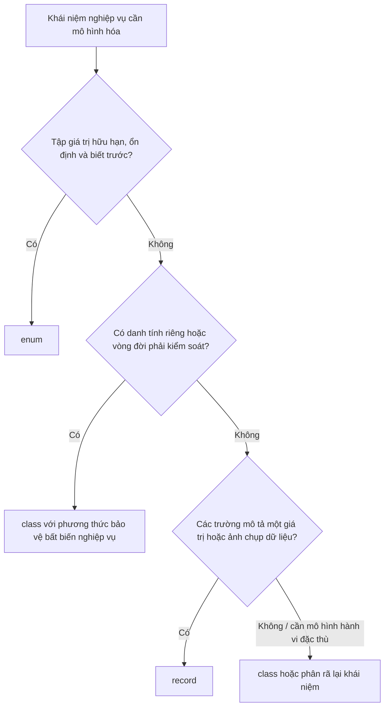

# Chọn `class`, `record` hoặc `enum` theo ý nghĩa và vòng đời dữ liệu

Khi chuyển yêu cầu nghiệp vụ thành mô hình dữ liệu, việc chọn kiểu Java không chỉ là chọn cú pháp ngắn nhất. Kiểu dữ liệu phải phản ánh **thứ gì có danh tính riêng**, **thứ gì được xác định bằng giá trị**, **thứ gì thuộc một tập lựa chọn hữu hạn** và **thứ gì được phép thay đổi theo thời gian**. Một lựa chọn đúng sẽ làm rõ ràng ràng buộc nghiệp vụ, giảm lỗi cập nhật, đồng thời tạo ranh giới dễ kiểm chứng giữa mô hình Java, API và lược đồ lưu trữ.

Bài học này nằm trong chương **Mô hình Java** của module **DATABASE_DATA_MODELING**: rèn kỹ năng chuyển yêu cầu nghiệp vụ thành mô hình dữ liệu, từ thực thể, quan hệ và ràng buộc đến chuẩn hóa, khóa, chỉ mục và lược đồ vật lý. Vì vậy, ta xem `class`, `record` và `enum` qua cả ý nghĩa trong chương trình lẫn tác động khi lưu dữ liệu vào cơ sở dữ liệu quan hệ, document, đồ thị hoặc hệ phân tích.

## 1. Ba câu hỏi trước khi viết code

Hãy bắt đầu từ nghiệp vụ thay vì từ từ khóa Java:

1. **Có danh tính độc lập với thuộc tính không?** Hai đơn hàng có thể có cùng tổng tiền, cùng trạng thái nhưng vẫn là hai đơn khác nhau. Chúng cần định danh ổn định và vòng đời riêng.
2. **Dữ liệu là một giá trị/ảnh chụp hay một đối tượng cần thay đổi?** Tọa độ, mã định danh, thông điệp yêu cầu và kết quả truy vấn thường có thể biểu diễn bằng giá trị bất biến. Đơn hàng thì phải kiểm soát các bước chuyển trạng thái.
3. **Tập phương án có thực sự đóng và tương đối ổn định không?** Trạng thái `DRAFT`, `PLACED`, `PAID`, `CANCELLED` có thể là một `enum`. Danh sách nhà vận chuyển hoặc loại ưu đãi được quản trị viên thêm lúc chạy hệ thống thì không nên đóng cứng thành `enum`.

| Tiêu chí | `class` | `record` (Java 16+) | `enum` |
| --- | --- | --- | --- |
| Ý nghĩa điển hình | Thực thể có danh tính, hành vi, hoặc cấu trúc cần kiểm soát linh hoạt | Giá trị, DTO, projection, ảnh chụp hoặc sự kiện mang dữ liệu | Tập hằng có tên, hữu hạn, được biết ở thời điểm biên dịch |
| Thay đổi trạng thái | Có thể cho phép thông qua phương thức nghiệp vụ; cũng có thể thiết kế bất biến | Các component không thể gán lại sau khi tạo; **chỉ bất biến nông** | Danh sách hằng cố định; tránh thêm trạng thái có thể biến đổi vào từng hằng |
| Quan hệ bằng nhau | Phải tự quyết định theo danh tính hoặc giá trị; mặc định là cùng tham chiếu | Tự sinh `equals`/`hashCode` dựa trên các component | Mỗi hằng là một thể hiện duy nhất; so sánh bằng `==` |
| Cơ chế Java | Hỗ trợ kế thừa tùy khai báo, constructor, trường và phương thức | Ngầm `final`, kế thừa `java.lang.Record`, không mở rộng class khác; có thể triển khai interface | Kế thừa `java.lang.Enum`, không tạo thêm hằng lúc chạy |
| Điểm cần chú ý khi lưu trữ | Danh tính, khóa chính, quản lý thay đổi và đồng thời | Bất biến và tương thích hợp đồng khi thêm/sửa component | Mã lưu trữ ổn định, thay đổi tên hằng và tập trạng thái |

> **Quy tắc thực dụng:** `class` phù hợp với thực thể có vòng đời; `record` phù hợp với dữ liệu được mô tả bằng giá trị; `enum` phù hợp với một tập lựa chọn đóng. Đây là tiêu chí thiết kế, không phải luật cứng: một `class` cũng có thể bất biến và một `record` cũng có thể chứa tham chiếu tới đối tượng thay đổi được.

### Sơ đồ quyết định



## 2. Phân biệt vòng đời nghiệp vụ, vòng đời đối tượng và vòng đời lược đồ

Ba loại vòng đời thường bị gộp nhầm:

- **Vòng đời nghiệp vụ:** đơn hàng chuyển từ nháp sang đã đặt, đã thanh toán hoặc hủy. Cùng một đơn hàng vẫn có một `order_id` xuyên suốt.
- **Vòng đời dữ liệu trong ứng dụng:** mỗi yêu cầu API có thể tạo một `record` đầu vào; mỗi lần đọc tạo một `record` kết quả mới. Các bản ghi này có thể sống rất ngắn và không phải thực thể lâu dài.
- **Vòng đời lược đồ/hợp đồng:** thêm trạng thái mới, đổi tên cột, thêm trường JSON hoặc đổi mã enum là thay đổi ảnh hưởng dữ liệu đã lưu và các ứng dụng sử dụng dữ liệu. `enum` đóng ở mức Java vẫn có thể phải tiến hóa theo yêu cầu nghiệp vụ.

Ví dụ, hai ảnh chụp `OrderSnapshot` của cùng đơn hàng có thể khác trạng thái và phiên bản. Chúng là hai **giá trị** ở hai thời điểm, còn `Order` vẫn là cùng một **thực thể**. Một snapshot không tự động là nhật ký kiểm toán; nếu cần chứng minh ai thay đổi gì, khi nào và vì sao, phải ghi sự kiện hoặc bản ghi audit riêng.

## 3. Ví dụ xuyên suốt: mô hình đơn hàng

Yêu cầu giản lược:

- Mỗi đơn hàng có mã định danh duy nhất, thời điểm tạo và số phiên bản.
- Đơn mới bắt đầu ở `DRAFT`, có thể sang `PLACED` hoặc `CANCELLED`.
- Đơn `PLACED` có thể sang `PAID` hoặc `CANCELLED`.
- `PAID` và `CANCELLED` là trạng thái kết thúc **trong quy trình đơn giản này**. Nếu nghiệp vụ có hoàn tiền, trả hàng hoặc hủy sau thanh toán thì phải bổ sung quy trình phù hợp.
- Ứng dụng cần xuất ảnh chụp đơn hàng để trả về API hoặc truyền sang tác vụ đọc dữ liệu.

Từ các yêu cầu đó, chọn:

| Khái niệm | Kiểu Java | Lý do |
| --- | --- | --- |
| `Order` | `class` | Có danh tính ổn định, trạng thái thay đổi qua các thao tác được kiểm soát |
| `OrderId` | `record` | Mã định danh là một giá trị; hai mã có cùng UUID biểu diễn cùng giá trị định danh |
| `OrderStatus` | `enum` | Các trạng thái trong phạm vi ví dụ là một tập hữu hạn |
| `OrderSnapshot` | `record` | Một ảnh chụp bất biến của thông tin tại thời điểm đọc |

Mã sau chạy được trên **Java 17+** khi lưu vào `OrderModelDemo.java`. Ví dụ tập trung vào mô hình nghiệp vụ, chưa tích hợp ORM hay giao dịch cơ sở dữ liệu.

```java
import java.time.Instant;
import java.util.Objects;
import java.util.UUID;

record OrderId(UUID value) {
    public OrderId {
        Objects.requireNonNull(value, "value");
    }
}

enum OrderStatus {
    DRAFT, PLACED, PAID, CANCELLED;

    boolean canMoveTo(OrderStatus next) {
        return switch (this) {
            case DRAFT -> next == PLACED || next == CANCELLED;
            case PLACED -> next == PAID || next == CANCELLED;
            case PAID, CANCELLED -> false;
        };
    }
}

final class Order {
    private final OrderId id;
    private final Instant createdAt;
    private OrderStatus status = OrderStatus.DRAFT;
    private long version = 0;

    Order(OrderId id, Instant createdAt) {
        this.id = Objects.requireNonNull(id, "id");
        this.createdAt = Objects.requireNonNull(createdAt, "createdAt");
    }

    void transitionTo(OrderStatus next) {
        Objects.requireNonNull(next, "next");
        if (!status.canMoveTo(next)) {
            throw new IllegalStateException(
                "Cannot change order from " + status + " to " + next
            );
        }
        status = next;
        version++;
    }

    OrderSnapshot snapshot() {
        return new OrderSnapshot(id, status, version, createdAt);
    }
}

record OrderSnapshot(
    OrderId id,
    OrderStatus status,
    long version,
    Instant createdAt
) {
    public OrderSnapshot {
        Objects.requireNonNull(id, "id");
        Objects.requireNonNull(status, "status");
        Objects.requireNonNull(createdAt, "createdAt");
        if (version < 0) {
            throw new IllegalArgumentException("version must be >= 0");
        }
    }
}

public class OrderModelDemo {
    public static void main(String[] args) {
        Order order = new Order(
            new OrderId(UUID.randomUUID()),
            Instant.now()
        );

        OrderSnapshot before = order.snapshot(); // DRAFT, version = 0
        order.transitionTo(OrderStatus.PLACED);
        order.transitionTo(OrderStatus.PAID);
        OrderSnapshot after = order.snapshot();  // PAID, version = 2

        System.out.println(before.status());   // DRAFT
        System.out.println(after.status());    // PAID
        System.out.println(after.version());   // 2

        // order.transitionTo(OrderStatus.CANCELLED);
        // Dòng trên sẽ ném IllegalStateException.
    }
}
```

**Tại sao thiết kế này có ý nghĩa?**

1. `Order` giữ `id` và `createdAt` ổn định; không có setter công khai làm thay đổi tùy tiện. Muốn đổi trạng thái phải đi qua `transitionTo`.
2. `OrderStatus` định nghĩa được tập lựa chọn hợp lệ; phương thức `canMoveTo` mô tả một phần quy tắc chuyển trạng thái. Các điều kiện bổ sung như “đã thu đủ tiền” vẫn phải kiểm tra bằng dữ liệu và dịch vụ nghiệp vụ tương ứng.
3. `OrderSnapshot` là giá trị độc lập với những thay đổi sau đó của `Order`. `before.status()` vẫn là `DRAFT` khi thực thể đã sang `PAID`.
4. `version` ở đây minh họa khái niệm phiên bản của đối tượng. Khi tích hợp JPA có `@Version`, nên để ORM quản lý việc tăng phiên bản; không sao chép cơ chế tăng thủ công này nguyên xi vào thực thể JPA.

### Vì sao không dùng một `record Order` cho tất cả?

Một `record` không cho phép gán lại component của chính nó. Muốn đổi trạng thái, ứng dụng phải tạo `Order` mới và thay thế giá trị cũ ở nơi lưu trữ. Điều đó **có thể hợp lệ** trong kiến trúc bất biến, nhưng cần quản lý rõ danh tính, kiểm soát tranh chấp cập nhật và phát sinh sự kiện. Với một thực thể có nhiều quy tắc chuyển trạng thái, `class` đóng gói các thao tác nghiệp vụ thường dễ đọc và khó dùng sai hơn.

Ngược lại, một `class` có getter/setter cho mọi thuộc tính không tự nhiên trở thành mô hình tốt: setter `setStatus(PAID)` không kiểm tra điều kiện có thể cho phép đơn nháp “nhảy cóc” sang đã thanh toán.

## 4. Dùng `record` đúng: bất biến nông và ràng buộc giá trị

`record` tự sinh constructor chuẩn, accessor mang tên component, `equals`, `hashCode` và `toString`; các trường component của record là `private final`. Tuy nhiên, `final` chỉ giữ **tham chiếu** không bị thay thế, không tự làm đối tượng được tham chiếu trở nên bất biến.

```java
import java.util.List;
import java.util.Objects;

record OrderTags(OrderId orderId, List<String> tags) {
    public OrderTags {
        Objects.requireNonNull(orderId, "orderId");
        tags = List.copyOf(tags); // Sao chép và chặn sửa danh sách từ bên ngoài.
    }
}
```

Nếu không sao chép, bên gọi có thể thay đổi `List` gốc sau khi tạo `OrderTags`; đó là sự thay đổi “ngầm” của giá trị. `List.copyOf` tạo danh sách không cho sửa cấu trúc và từ chối phần tử `null`; nhưng nếu phần tử là đối tượng có thể thay đổi thì vẫn cần sao chép sâu hoặc chọn kiểu phần tử bất biến. Cũng cần lưu ý rằng component kiểu **mảng** dùng cơ chế so sánh của mảng (theo tham chiếu) trong `equals` được sinh, vì thế `record Data(byte[] bytes)` không tự có ngữ nghĩa so sánh nội dung.

Constructor chuẩn có thể kiểm tra miền giá trị: số lượng phải dương, khoảng thời gian phải hợp lệ, đơn vị tiền phải được chỉ định. Các ràng buộc này phải nhất quán với validation ở API và database, nhưng không nên phó mặc hoàn toàn cho hai tầng bên ngoài.

**Ứng dụng phù hợp:** DTO request/response, khóa giá trị nhỏ như `OrderId`, cấu hình bất biến, projection từ truy vấn, sự kiện như `OrderPaid(OrderId id, Instant occurredAt)`. Khi một DTO thay đổi, hãy xem xét tương thích JSON/API hoặc schema sự kiện; đổi component của record có thể đổi constructor, accessor và hợp đồng serialization.

## 5. Dùng `enum` đúng: tập đóng và mã dữ liệu bền vững

`enum` hữu ích khi việc thêm lựa chọn mới phải đi qua cập nhật mã nguồn và kiểm thử. Nó hỗ trợ `switch` đầy đủ nhánh, không tạo hằng tùy ý lúc chạy và ngăn nhiều lỗi gõ sai chuỗi như `"PAID"`/`"PAYED"`.

Nhưng khi lưu vào cơ sở dữ liệu hoặc trao đổi qua API, cần phân biệt:

- **Tên hằng Java** (`PAID`) là định danh trong mã nguồn; đổi tên có thể phá dữ liệu cũ hoặc client nếu tên đó được dùng làm mã lưu trữ.
- **Mã nghiệp vụ ổn định** (ví dụ `"paid"`) có thể được gán tường minh, ánh xạ qua một lớp adapter/converter. Khi đổi tên hằng Java mà giữ mã nghiệp vụ, dữ liệu lưu có thể tiếp tục tương thích.
- **Vị trí ordinal** (`0`, `1`, `2`...) không phải mã nghiệp vụ. Chèn hoặc sắp xếp lại hằng có thể khiến dữ liệu cũ mang ý nghĩa khác. Tránh lưu `ordinal()`; với JPA, nếu dùng enum trực tiếp hãy chỉ định rõ `@Enumerated(EnumType.STRING)` khi tên hằng là hợp đồng chấp nhận được, hoặc dùng `AttributeConverter` để lưu mã riêng.

Ví dụ enum có mã cố định, độc lập với tên hằng:

```java
enum PaymentState {
    UNPAID("unpaid"),
    SETTLED("paid"),
    REFUNDED("refunded");

    private final String code;

    PaymentState(String code) {
        this.code = code;
    }

    public String code() {
        return code;
    }
}
```

Không dùng `enum` để thay thế bảng dữ liệu cho danh mục thường xuyên được thêm/xóa/sửa bởi người dùng (nhà cung cấp, kho hàng, nhãn tự định nghĩa...). Khi mỗi phương án có dữ liệu và hành vi khác nhau, cân nhắc `sealed interface` cùng nhiều `record`/`class` thay cho một enum ôm nhiều trường tùy chọn.

## 6. Chuyển mô hình Java thành mô hình lưu trữ

Kiểu Java và cấu trúc lưu trữ không có quan hệ một-một: một `class` thực thể có thể trở thành nhiều bảng đã chuẩn hóa; một `record` DTO có thể được tổng hợp từ nhiều bảng; `enum` có thể được lưu bằng chuỗi, mã ổn định hoặc khóa ngoại tới bảng danh mục tùy yêu cầu.

### Ví dụ lược đồ quan hệ (PostgreSQL)

```sql
CREATE TABLE orders (
    id UUID PRIMARY KEY,
    status VARCHAR(16) NOT NULL,
    version BIGINT NOT NULL DEFAULT 0,
    created_at TIMESTAMPTZ NOT NULL,
    CONSTRAINT ck_orders_status
        CHECK (status IN ('DRAFT', 'PLACED', 'PAID', 'CANCELLED')),
    CONSTRAINT ck_orders_version CHECK (version >= 0)
);
```

Ở đây:

- `OrderId` bọc `UUID` trong Java để không nhầm mã đơn với mã khách hàng; khi lưu trữ, adapter chuyển về cột `UUID`. Nếu dùng JPA, `OrderId` có thể cần ánh xạ bổ sung như converter/embeddable tùy cách triển khai.
- `status` là chuỗi và có `CHECK` để tránh giá trị lạ. Ràng buộc này **chỉ giới hạn tập giá trị**, chưa tự kiểm soát được bước chuyển `DRAFT -> PAID`; bước chuyển phải do logic nghiệp vụ và thao tác ghi có điều kiện bảo vệ.
- `version` hỗ trợ **optimistic locking**: chỉ cập nhật khi phiên bản đang lưu vẫn bằng phiên bản đã đọc. Điều này xử lý tranh chấp giữa nhiều yêu cầu; `private` trong Java không bảo vệ được trước một tiến trình khác.
- Chỉ thêm chỉ mục như `(status, created_at)` khi truy vấn và số liệu thực tế cho thấy có lợi; mỗi chỉ mục thêm chi phí ghi và bảo trì. Khóa chính đã có cấu trúc phục vụ truy cập theo `id`.

Ví dụ ghi có điều kiện cho bước `PLACED -> PAID` trong PostgreSQL. Ký hiệu `:order_id` và `:expected_version` là tham số đặt tên để thư viện truy cập dữ liệu thay thế bằng giá trị thực, không phải cú pháp chạy trực tiếp trong `psql`:

```sql
UPDATE orders
SET status = 'PAID',
    version = version + 1
WHERE id = :order_id
  AND status = 'PLACED'
  AND version = :expected_version;
```

Nếu số dòng cập nhật là `0`, cần đọc/đánh giá lại vì đơn có thể không tồn tại, trạng thái không hợp lệ hoặc đã có giao dịch khác cập nhật. Nếu có ORM, hãy dùng cơ chế khóa lạc quan của ORM và quản lý giao dịch tương ứng, tránh tự tăng phiên bản hai lần. Các thao tác liên quan thanh toán thực tế còn cần idempotency và nhất quán với dữ liệu giao dịch thanh toán.

### Với document, đồ thị và hệ phân tích thì sao?

| Kiểu lưu trữ | Cách áp dụng ý nghĩa từ Java |
| --- | --- |
| **Document** (ví dụ MongoDB) | Có thể lưu toàn bộ trạng thái đơn hàng trong một document; mã đơn vẫn là danh tính, payload đọc/ghi có thể là `record`. Cần tính tới cập nhật nguyên tử, version và hợp đồng JSON khi thêm trường. |
| **Đồ thị** | Một `class` hoặc entity nghiệp vụ có thể tương ứng với nút và quan hệ được lưu riêng; bản thân `record`/`enum` không quyết định kiểu cạnh hay tính duy nhất của nút. |
| **Phân tích / data warehouse** | Các snapshot và sự kiện bất biến thích hợp làm dữ liệu nguồn cho bảng fact hoặc lịch sử; trạng thái hiện tại không thay thế lịch sử trạng thái. Cần xác định khóa, thời điểm hiệu lực và cách xử lý thay đổi chiều dữ liệu. |

Lựa chọn vật lý phải xuất phát từ yêu cầu truy vấn, tính nhất quán, ràng buộc, khối lượng ghi/đọc và khả năng tiến hóa lược đồ. Một kiểu Java tốt giúp làm rõ nghĩa, nhưng không tự động quyết định thiết kế database.

## 7. Tích hợp JPA/Hibernate và ranh giới API

Khi đưa mô hình vào ứng dụng thực tế, hãy tách bạch **mô hình miền**, **mô hình lưu trữ** và **mô hình truyền dữ liệu** nếu yêu cầu mỗi lớp khác nhau.

- **Entity JPA:** thường dùng `class` có `@Entity`, khóa `@Id`, constructor không tham số phù hợp yêu cầu JPA và `@Version` để khóa lạc quan. `record` (ngầm `final` và không có constructor không tham số theo kiểu entity) không phù hợp để làm **JPA entity chuẩn**. Ngược lại, record rất phù hợp làm DTO hoặc projection.
- **DTO API:** dùng `record` khi mong muốn thông điệp mang giá trị cố định. Không trả nguyên entity chỉ vì tiện: quan hệ lazy, dữ liệu nội bộ và sự tiến hóa API có thể khác yêu cầu lưu trữ.
- **Enum trong API:** lựa chọn trả tên hằng, mã ổn định hay object mô tả phải được quy định thành hợp đồng. Khi mở rộng enum, client cũ có thể gặp giá trị chưa biết; chuẩn bị phương án xử lý thay vì giả định phía nhận luôn cập nhật đồng thời.
- **So sánh entity:** `class` mặc định dùng so sánh tham chiếu. Với entity lưu trữ, nếu cần `equals`/`hashCode` theo định danh thì phải thiết kế cẩn thận, đặc biệt với ID sinh sau khi persist và proxy ORM; không tự động sinh theo toàn bộ trường mutable.

Một cách phân ranh giới dễ kiểm soát là: request `record` → tầng ứng dụng kiểm tra đầu vào → thực thể `class` thực hiện hành vi → repository/transaction lưu thành công → response `record`. `enum` có thể được dùng bên trong và ánh xạ ra mã ổn định ở biên.

## 8. Các lỗi thiết kế thường gặp

| Lỗi | Hệ quả | Điều chỉnh |
| --- | --- | --- |
| Dùng `record` cho entity thay đổi liên tục, không xác định cách quản lý phiên bản | Mất cập nhật, vòng đời khó hiểu | Có chiến lược bất biến và optimistic locking rõ ràng hoặc dùng `class` quản lý hành vi |
| Dùng `class` với setter công khai cho mọi trường | Trạng thái bất hợp lệ được tạo dễ dàng | Dùng constructor/factory hợp lệ và các phương thức theo nghiệp vụ |
| Tưởng `record` là bất biến sâu | Danh sách/đối tượng lồng nhau vẫn đổi | Defensive copy, chọn component bất biến |
| Lưu enum bằng `ordinal` | Đổi thứ tự hằng làm sai nghĩa dữ liệu | Lưu tên hoặc mã ổn định có converter |
| Xem mọi bảng danh mục là `enum` | Mỗi thay đổi dữ liệu cần build/deploy | Dùng bảng danh mục và entity nếu tập được cấu hình lúc chạy |
| Chỉ kiểm tra chuyển trạng thái trên đối tượng Java | Ghi đồng thời hoặc đường ghi khác làm hỏng ràng buộc | Kết hợp validation nghiệp vụ, transaction, optimistic lock và constraint ở DB |
| Dùng một model cho entity JPA, request, response và dữ liệu lịch sử | Rò dữ liệu, phụ thuộc lẫn nhau, khó nâng cấp | Tách model theo ranh giới và viết mapping tường minh khi cần |

## 9. Bài tập tự kiểm tra

Cho hệ thống đặt lịch khám có `Appointment` (mã lịch, bệnh nhân, giờ hẹn, trạng thái), yêu cầu đăng ký lịch, hủy lịch, xem xác nhận lịch và một danh sách chuyên khoa do quản trị viên quản lý.

1. Chọn kiểu Java cho `Appointment`, `AppointmentId`, `AppointmentConfirmation` và `AppointmentStatus`. Giải thích dựa trên danh tính, vòng đời và tập giá trị.
2. Chuyên khoa khám nên là `enum` hay một entity/bảng danh mục? Nêu điều kiện có thể khiến quyết định thay đổi.
3. Xác định ít nhất hai ràng buộc cần kiểm tra ở Java và hai ràng buộc thích hợp ở database.
4. Nếu hai nhân viên đồng thời đổi trạng thái lịch hẹn, mô tả cách dùng `version` để tránh ghi đè.
5. Nếu thêm trạng thái `NO_SHOW` sau một năm, kể các nơi phải xem xét về tương thích: logic chuyển trạng thái, dữ liệu hiện có, constraint, API/client, báo cáo.

**Gợi ý đối chiếu:** `Appointment` thường là `class` vì có ID và vòng đời; `AppointmentId` và xác nhận lịch có thể là `record`; `AppointmentStatus` là `enum` khi trạng thái được kiểm soát theo bản phát hành; chuyên khoa nên là dữ liệu tham chiếu nếu người dùng được quyền quản trị danh mục khi hệ thống hoạt động. Ràng buộc cụ thể phải xuất phát từ nghiệp vụ: ví dụ giờ hẹn hợp lệ, không đặt trùng tài nguyên trong một khung giờ, ID duy nhất, trạng thái thuộc tập được hỗ trợ, và cập nhật đồng thời có điều kiện.

## 10. Checklist khi chốt mô hình

- [ ] Đã phân biệt **entity có danh tính** với **value object/DTO/snapshot**.
- [ ] Đã mô tả vòng đời và quy tắc chuyển trạng thái qua hành vi nghiệp vụ.
- [ ] Đã chọn `enum` chỉ cho tập lựa chọn đóng và có chiến lược mã lưu trữ tương thích.
- [ ] `record` không giữ tham chiếu mutable ngoài ý muốn và có validation cần thiết.
- [ ] Đã xác định khóa, tính duy nhất, ràng buộc, đồng thời và phiên bản ở nơi lưu trữ.
- [ ] Đã cân nhắc vòng đời API/schema, dữ liệu lịch sử và yêu cầu truy vấn trước khi chọn mô hình vật lý.

**Điểm cần ghi nhớ:** `class` mô tả rõ danh tính và hành vi trong suốt vòng đời của thực thể; `record` mô tả rõ một giá trị hoặc ảnh chụp; `enum` mô tả rõ tập trạng thái/lựa chọn đóng. Chất lượng mô hình đến từ việc giữ đúng các ý nghĩa đó qua **Java → API → database**, kể cả khi dữ liệu và yêu cầu nghiệp vụ thay đổi.
