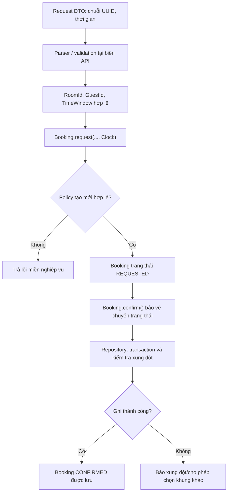
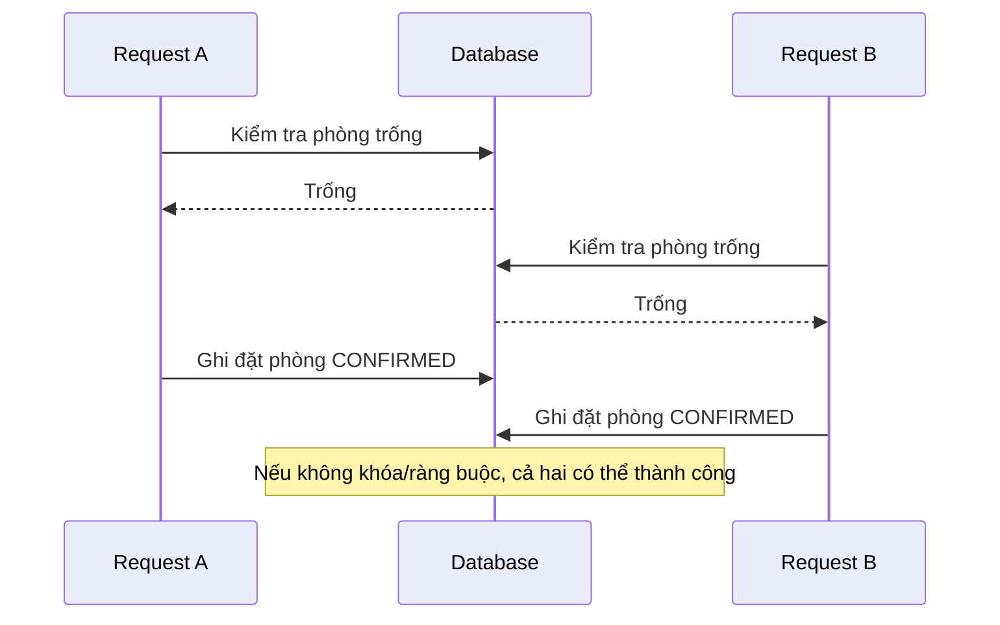

# Constructor, factory và điều kiện để đối tượng tồn tại hợp lệ

Một đối tượng Java có thể được khởi tạo thành công về mặt cú pháp nhưng vẫn **vô nghĩa về mặt nghiệp vụ**: đơn đặt phòng có giờ kết thúc trước giờ bắt đầu, dòng đơn hàng có số lượng âm, hoặc một đơn hàng được tạo thẳng ở trạng thái “đã thanh toán” dù chưa có giao dịch thanh toán. Nếu những trạng thái sai này lọt vào hệ thống, các lớp sử dụng đối tượng phải liên tục kiểm tra lại, lỗi thường chỉ xuất hiện khi lưu dữ liệu, xử lý đồng thời hoặc tích hợp với dịch vụ khác.

**Constructor và factory là ranh giới hình thành đối tượng hợp lệ.** Bài học thuộc chương **Mô hình Java** của module **DATABASE_DATA_MODELING**, nơi mục tiêu là chuyển yêu cầu nghiệp vụ thành mô hình thực thể, quan hệ và ràng buộc rõ ràng; tiếp đó thiết kế chuẩn hóa, khóa, chỉ mục và lược đồ vật lý, đồng thời cân nhắc hệ quan hệ, document, đồ thị và phân tích. Khi điều kiện hợp lệ được thể hiện bằng code có chủ đích, ta có cơ sở để xác định điều kiện nào còn phải được kiểm soát ở API, transaction và database.

## 1. “Đối tượng hợp lệ” nghĩa là gì?

Trong thiết kế miền nghiệp vụ, **invariant** (bất biến nghiệp vụ) là điều kiện luôn đúng tại những thời điểm một đối tượng được phép quan sát hoặc sử dụng. Nếu `TimeWindow` đã được tạo thì `start < end` phải đúng. Nếu `OrderLine` tồn tại thì số lượng phải dương. Nếu `Booking` đang ở trạng thái `CONFIRMED`, hệ thống phải có đủ thông tin được yêu cầu cho trạng thái đó.

Điều kiện hợp lệ có nhiều phạm vi:

| Cấp độ | Ví dụ | Nơi cần bảo vệ |
| --- | --- | --- |
| **Một trường** | `id != null`, số lượng `> 0`, mã không rỗng | Constructor/compact constructor, parser, constraint database |
| **Nhiều trường trong một value object** | `start < end`; tiền tệ phải đi cùng số tiền | Constructor hoặc factory của value object |
| **Nhiều trường trong một entity/aggregate** | Đơn đã gửi phải có ít nhất một dòng; tổng tiền bằng tổng dòng theo chính sách tính giá | Factory tạo aggregate và phương thức nghiệp vụ |
| **Chuyển trạng thái** | Chỉ đơn `DRAFT` mới được gửi duyệt | Phương thức nghiệp vụ kiểm tra trạng thái hiện tại |
| **Phụ thuộc ngữ cảnh** | Chỉ được đặt chỗ trong 90 ngày tới | Factory nhận `Clock`/policy hoặc dịch vụ ứng dụng |
| **Liên quan nhiều entity/giao dịch** | Không hai khách cùng đặt một phòng trong khoảng chồng lấn | Giao dịch, ràng buộc/khóa ở database và dịch vụ điều phối |

Không thể đưa tất cả các điều kiện vào một constructor: constructor không nên tự đi tìm dữ liệu từ network, kiểm tra quyền người dùng hoặc âm thầm mở transaction. Cũng không thể dựa hoàn toàn vào database: một object có thể được sử dụng, tính toán và gửi đi **trước khi lưu**. Tư duy đúng là chọn đúng ranh giới cho từng điều kiện, đồng thời tránh để một trạng thái sai đi qua ranh giới đó.

### Phân biệt ba khái niệm dễ nhầm

- **Validation đầu vào:** dữ liệu JSON có đúng định dạng UUID, ngày tháng và số không? Đầu vào sai cần phản hồi rõ ràng cho người dùng. DTO đầu vào có thể tạm chứa chuỗi thô.
- **Invariant của model:** một đối tượng `TimeWindow` được tạo thành công phải luôn có `start < end`. Các đường tạo đối tượng hợp lệ cần đi qua cùng quy tắc này.
- **Policy nghiệp vụ theo ngữ cảnh:** một phòng có còn trống vào thời điểm xác nhận không? Chính sách có thể đổi theo thời gian và phụ thuộc trạng thái chung, nên cần thêm kiểm tra tại lúc thực hiện hành động.

## 2. Khi nào dùng constructor, static factory, factory service?

| Cách tạo | Phù hợp khi | Điểm mạnh | Cần thận trọng |
| --- | --- | --- | --- |
| `public constructor` | Dữ liệu đầu vào đã đủ và cách tạo chỉ có một ý nghĩa rõ ràng | Dễ khám phá, gọi trực tiếp, hợp với value object nhỏ | Danh sách tham số dài dễ truyền nhầm; khó thể hiện nhiều ý nghĩa tạo |
| **Static factory** như `of`, `parse`, `createDraft` | Có tên ý nghĩa, chuẩn hóa dữ liệu, nhiều hình thức đầu vào hoặc cần chọn kiểu kết quả | Tên phương thức làm rõ ý định; có thể ẩn constructor | Cần tránh factory trở thành nơi làm mọi việc hoặc có side effect bất ngờ |
| **Factory service** | Việc tạo cần policy, dịch vụ/nguồn dữ liệu khác hoặc phối hợp nhiều aggregate | Tách quy tắc phụ thuộc ngữ cảnh khỏi việc tạo giá trị thuần túy | Đọc kiểm tra rồi ghi sau đó vẫn có race condition; cần bảo vệ ở transaction |
| **Builder** | Nhiều trường tùy chọn, quá trình lắp ghép nhiều bước | Gọi dễ đọc và có thể chuẩn bị cấu hình trước khi build | Trạng thái builder có thể chưa hợp lệ, nhưng sản phẩm sau `build()` phải hợp lệ |

Factory không phải một khái niệm bắt buộc tương ứng một pattern hay một framework cụ thể. Một phương thức `static Money.of(...)` đã là static factory. Một lớp `BookingService` tạo đối tượng sau khi kiểm tra chính sách có thể đóng vai trò factory ở tầng ứng dụng. Quan trọng là **ai chịu trách nhiệm kiểm tra điều kiện**, không phải tên lớp có hậu tố `Factory` hay không.

### Ví dụ: constructor gọn cho value object

```java
import java.util.Objects;
import java.util.UUID;

record CustomerId(UUID value) {
    public CustomerId {
        Objects.requireNonNull(value, "value");
    }

    static CustomerId parse(String raw) {
        Objects.requireNonNull(raw, "raw");
        return new CustomerId(UUID.fromString(raw));
    }
}
```

Ở đây `new CustomerId(uuid)` phù hợp khi caller đã có `UUID`. `CustomerId.parse(text)` diễn tả rõ hành động chuyển từ chuỗi, còn constructor chuẩn của record vẫn tập trung bảo vệ điều kiện `value != null`. Mọi đường tạo ra `CustomerId` thông qua các phương thức Java thông thường đều đi qua bước kiểm tra.

Record sử dụng **compact canonical constructor** `public CustomerId { ... }`. Với record, constructor này không ghi `this.value = value`; Java tự gán các tham số component vào trường sau khi thân constructor chạy. Nếu cần chuẩn hóa, có thể gán lại **tham số** trong thân compact constructor trước bước gán tự động.

## 3. Ví dụ xuyên suốt: tạo yêu cầu đặt phòng hợp lệ

Giả sử một hệ thống quản lý phòng họp có yêu cầu:

1. Mỗi đặt phòng có mã riêng, mã phòng, mã người đặt, khoảng thời gian và thời điểm gửi yêu cầu.
2. Khoảng thời gian phải có bắt đầu trước kết thúc.
3. Khi **tạo yêu cầu mới**, thời gian bắt đầu phải nằm trong tương lai; thời lượng không vượt 4 giờ.
4. Trạng thái ban đầu phải là `REQUESTED`. Sau đó có thể xác nhận `CONFIRMED` hoặc hủy `CANCELLED`; không thể xác nhận yêu cầu đã hủy.
5. Một phòng không được có hai lịch đã xác nhận chồng lấn. Điều kiện này phụ thuộc nhiều đặt phòng và cần kiểm tra nhất quán ở nơi lưu trữ.

Thiết kế đề xuất:



Sơ đồ cho thấy có hai lớp bảo vệ khác nhau: **đối tượng đơn lẻ hợp lệ** và **thao tác dùng chung tài nguyên hợp lệ**. Kiểm tra một đối tượng không thể tự chứng minh phòng còn trống khi các yêu cầu đồng thời cũng đang thay đổi dữ liệu.

### Mã Java 17+ có thể chạy

Lưu toàn bộ khối sau vào `BookingCreationDemo.java`. Ví dụ không dùng ORM hay database, chỉ mô tả tính hợp lệ trong miền nghiệp vụ. Ta dùng `Clock.fixed` để kết quả chạy không phụ thuộc ngày giờ thực tế.

```java
import java.time.Clock;
import java.time.Duration;
import java.time.Instant;
import java.time.ZoneOffset;
import java.util.Objects;
import java.util.UUID;

record BookingId(UUID value) {
    public BookingId {
        Objects.requireNonNull(value, "value");
    }
}

record RoomId(UUID value) {
    public RoomId {
        Objects.requireNonNull(value, "value");
    }
}

record GuestId(UUID value) {
    public GuestId {
        Objects.requireNonNull(value, "value");
    }
}

record TimeWindow(Instant startInclusive, Instant endExclusive) {
    public TimeWindow {
        Objects.requireNonNull(startInclusive, "startInclusive");
        Objects.requireNonNull(endExclusive, "endExclusive");
        if (!startInclusive.isBefore(endExclusive)) {
            throw new IllegalArgumentException(
                "Start must be before end"
            );
        }
    }

    Duration duration() {
        return Duration.between(startInclusive, endExclusive);
    }
}

enum BookingStatus {
    REQUESTED, CONFIRMED, CANCELLED
}

record BookingSnapshot(
    BookingId id,
    RoomId roomId,
    GuestId guestId,
    TimeWindow slot,
    BookingStatus status,
    Instant requestedAt
) {
    public BookingSnapshot {
        Objects.requireNonNull(id, "id");
        Objects.requireNonNull(roomId, "roomId");
        Objects.requireNonNull(guestId, "guestId");
        Objects.requireNonNull(slot, "slot");
        Objects.requireNonNull(status, "status");
        Objects.requireNonNull(requestedAt, "requestedAt");
    }
}

final class Booking {
    private final BookingId id;
    private final RoomId roomId;
    private final GuestId guestId;
    private final TimeWindow slot;
    private final Instant requestedAt;
    private BookingStatus status;

    // Tất cả đường dựng nội bộ dùng chung bất biến cấu trúc.
    private Booking(
        BookingId id,
        RoomId roomId,
        GuestId guestId,
        TimeWindow slot,
        Instant requestedAt,
        BookingStatus status
    ) {
        this.id = Objects.requireNonNull(id, "id");
        this.roomId = Objects.requireNonNull(roomId, "roomId");
        this.guestId = Objects.requireNonNull(guestId, "guestId");
        this.slot = Objects.requireNonNull(slot, "slot");
        this.requestedAt = Objects.requireNonNull(
            requestedAt, "requestedAt"
        );
        this.status = Objects.requireNonNull(status, "status");
        if (requestedAt.isAfter(slot.startInclusive())) {
            throw new IllegalArgumentException(
                "Request time cannot be after start time"
            );
        }
    }

    // Factory cho yêu cầu MỚI: kiểm tra quy tắc tại thời điểm tạo.
    public static Booking request(
        RoomId roomId,
        GuestId guestId,
        TimeWindow slot,
        Clock clock
    ) {
        Objects.requireNonNull(slot, "slot");
        Objects.requireNonNull(clock, "clock");
        Instant now = clock.instant();
        if (!slot.startInclusive().isAfter(now)) {
            throw new IllegalArgumentException(
                "New booking must start in the future"
            );
        }
        if (slot.duration().compareTo(Duration.ofHours(4)) > 0) {
            throw new IllegalArgumentException(
                "Booking duration exceeds four hours"
            );
        }
        return new Booking(
            new BookingId(UUID.randomUUID()),
            roomId,
            guestId,
            slot,
            now,
            BookingStatus.REQUESTED
        );
    }

    // Dùng nội bộ tại ranh giới persistence khi khôi phục dữ liệu.
    // Không kiểm tra lại quy tắc "phải bắt đầu trong tương lai".
    static Booking restoreFromStorage(
        BookingId id,
        RoomId roomId,
        GuestId guestId,
        TimeWindow slot,
        Instant requestedAt,
        BookingStatus status
    ) {
        return new Booking(
            id, roomId, guestId, slot, requestedAt, status
        );
    }

    public void confirm() {
        if (status != BookingStatus.REQUESTED) {
            throw new IllegalStateException(
                "Only REQUESTED booking can be confirmed"
            );
        }
        status = BookingStatus.CONFIRMED;
    }

    public void cancel() {
        if (status == BookingStatus.CANCELLED) {
            throw new IllegalStateException(
                "Booking is already cancelled"
            );
        }
        status = BookingStatus.CANCELLED;
    }

    public BookingSnapshot snapshot() {
        return new BookingSnapshot(
            id, roomId, guestId, slot, status, requestedAt
        );
    }
}

public class BookingCreationDemo {
    public static void main(String[] args) {
        Clock fixedClock = Clock.fixed(
            Instant.parse("2030-06-01T08:00:00Z"),
            ZoneOffset.UTC
        );

        TimeWindow slot = new TimeWindow(
            Instant.parse("2030-06-01T09:00:00Z"),
            Instant.parse("2030-06-01T10:30:00Z")
        );
        Booking booking = Booking.request(
            new RoomId(UUID.randomUUID()),
            new GuestId(UUID.randomUUID()),
            slot,
            fixedClock
        );

        System.out.println(booking.snapshot().status()); // REQUESTED
        booking.confirm();
        System.out.println(booking.snapshot().status()); // CONFIRMED
        booking.cancel();
        System.out.println(booking.snapshot().status()); // CANCELLED

        // booking.confirm(); // IllegalStateException
        // new TimeWindow(slot.endExclusive(), slot.startInclusive());
        // IllegalArgumentException
    }
}
```

**Điểm đáng chú ý:**

- `TimeWindow` không thể có đầu mút đảo ngược, kể cả khi được tạo qua nơi khác. Bất biến này **đúng cho mọi khoảng**, không phụ thuộc ngày hiện tại.
- `Booking.request` gắn việc tạo mới với các điều kiện **ở thời điểm yêu cầu**, dựa vào `Clock` được truyền vào. Bài kiểm thử có thể dùng đồng hồ cố định mà không cần chờ thời gian thật.
- `Booking` giữ constructor là `private`, nên code thông thường không thể tự chọn một trạng thái khởi tạo tùy ý bằng `new Booking(..., CONFIRMED)`.
- Phương thức `confirm` chỉ cho phép chuyển từ `REQUESTED`. Kiểm tra không nằm trong setter `setStatus` công khai; nó gắn với hành động nghiệp vụ.
- `BookingSnapshot` cung cấp dữ liệu đọc tại thời điểm gọi. Dù `Booking` thay đổi trạng thái sau đó, snapshot cũ vẫn giữ trạng thái cũ vì các trường của record đang sử dụng đều là kiểu bất biến.
- `restoreFromStorage` là một đường tái tạo có kiểm soát cho dữ liệu lịch sử; nó vẫn dùng constructor bảo vệ tính hợp lệ **cấu trúc**, nhưng cố ý không áp chính sách mới “phải bắt đầu trong tương lai” lên một booking đã tạo từ tháng trước.

Đây là mô hình tối giản: `restoreFromStorage` có mức truy cập package-private nên không phải hàng rào bảo mật với mọi code cùng package. Trong hệ thống thực, cần giới hạn trách nhiệm của mapper/repository và kiểm thử dữ liệu tái tạo; không biến đường restore thành API công khai để nhận trạng thái tùy ý từ người dùng.

## 4. Constructor bảo vệ invariant: kiểm tra, chuẩn hóa, sao chép

### 4.1. Kiểm tra điều kiện bắt buộc

Một constructor tốt kiểm tra các điều kiện có thể xác định từ **đối số hiện tại**:

```java
import java.math.BigDecimal;
import java.util.Objects;

record OrderLine(String productCode, int quantity, BigDecimal unitPrice) {
    public OrderLine {
        Objects.requireNonNull(productCode, "productCode");
        Objects.requireNonNull(unitPrice, "unitPrice");
        if (productCode.isBlank()) {
            throw new IllegalArgumentException("Blank product code");
        }
        if (quantity <= 0) {
            throw new IllegalArgumentException("Quantity must be positive");
        }
        if (unitPrice.signum() < 0) {
            throw new IllegalArgumentException("Negative unit price");
        }
    }
}
```

Trong ví dụ, constructor ngăn bản ghi dòng đơn hàng với số lượng âm hoặc mã sản phẩm rỗng. Nhưng một giá `BigDecimal` chưa chỉ ra tiền tệ. Nếu hệ thống bán nhiều tiền tệ, model tốt hơn nên dùng `Money` với mã tiền và quy tắc thập phân rõ ràng. Giá tổng còn cần kiểm tra chênh lệch làm tròn, khuyến mãi và thuế ở mức aggregate.

### 4.2. Chuẩn hóa trước khi lưu trường

Nếu hai cách viết phải được coi là cùng một giá trị, constructor có thể chuẩn hóa. Khi dùng record compact constructor, gán lại tham số component:

```java
import java.util.Locale;
import java.util.Objects;

record ProductCode(String value) {
    public ProductCode {
        Objects.requireNonNull(value, "value");
        value = value.strip().toUpperCase(Locale.ROOT);
        if (!value.matches("[A-Z0-9-]{3,24}")) {
            throw new IllegalArgumentException("Invalid product code");
        }
    }

    static ProductCode parse(String raw) {
        return new ProductCode(raw);
    }
}
```

Với chính sách trên, `ProductCode(" ab-12 ")` và `ProductCode("AB-12")` bằng nhau. Nhưng đây là **quyết định nghiệp vụ**: không tự cắt khoảng trắng hay đổi hoa/thường nếu nguồn dữ liệu coi chúng là khác nhau, đặc biệt với chuỗi định danh do hệ thống bên ngoài cấp. Khi đã lưu các mã chuẩn hóa làm khóa duy nhất, database phải có ràng buộc tương thích, tránh trường hợp ứng dụng coi hai mã như nhau còn database cho phép hai hàng khác nhau.

### 4.3. Sao chép phòng vệ đối với dữ liệu mutable

`final` và `record` không tự bảo vệ thành phần có thể thay đổi như `List` hoặc mảng.

```java
import java.util.List;
import java.util.Objects;

record Basket(List<OrderLine> lines) {
    public Basket {
        Objects.requireNonNull(lines, "lines");
        lines = List.copyOf(lines);
        if (lines.isEmpty()) {
            throw new IllegalArgumentException("Basket cannot be empty");
        }
    }
}
```

`List.copyOf` tạo danh sách không thể sửa bằng các thao tác thay đổi cấu trúc và không chấp nhận phần tử `null`. Tính bất biến sâu còn phụ thuộc `OrderLine` bên trong cũng bất biến (ở đây là record có các component bất biến). Với `byte[]`, phải sao chép cả lúc nhận và lúc trả mảng hoặc sử dụng kiểu giá trị thích hợp; nếu không, caller vẫn có thể sửa trạng thái sau khi constructor đã kiểm tra.

## 5. Static factory diễn tả “ý nghĩa của cách tạo”

Tên factory giúp phân biệt những đường tạo có ý nghĩa khác nhau:

| Tên phương thức | Ý nghĩa thường gặp | Thí dụ |
| --- | --- | --- |
| `of(...)` | Tạo từ các thành phần đã được chuẩn bị | `Money.of(amount, currency)` |
| `parse(...)` | Phân tích biểu diễn văn bản, có thể lỗi định dạng | `CustomerId.parse(raw)` |
| `from(...)` | Chuyển đổi từ kiểu hoặc biểu diễn khác | `TimeWindow.from(rangeDto)` |
| `createDraft(...)`, `request(...)` | Tạo một entity ở trạng thái khởi đầu cụ thể | `Booking.request(...)` |
| `restoreFromStorage(...)` | Tái tạo trạng thái đã lưu được tin cậy theo ranh giới nội bộ | `Booking.restoreFromStorage(...)` |

Đây là **quy ước đặt tên**, không phải API chuẩn của Java. Tên factory phải phản ánh hành vi thực tế. Nếu `createDraft` trả về một entity đã gửi, tên sai sẽ làm mất tác dụng của thiết kế.

Factory cũng có thể **chọn kết quả** dựa trên tham số hoặc tái sử dụng các đối tượng bất biến. Tuy nhiên, không nên dùng caching chỉ vì gọi là factory: entity có danh tính và trạng thái mutable cần quy tắc identity, lifecycle và quản lý luồng phù hợp.

### Một constructor dài dễ tạo nhầm

```java
record ShippingAddress(
    String street,
    String ward,
    String city,
    String province,
    String postalCode
) {}

// Dễ truyền nhầm các tham số cùng kiểu:
// Đây chỉ là ví dụ về rủi ro của danh sách tham số dài.
// new ShippingAddress("A", "B", "C", "D", "E");
```

Nếu nhiều tham số cùng kiểu `String`, hãy nhóm thành value object có tên như `Street`, `PostalCode` hoặc dùng factory có cấu trúc input rõ ràng. Builder phù hợp khi có nhiều lựa chọn tùy ý, nhưng sản phẩm cuối phải được kiểm tra trước khi trả về.

## 6. Builder không được cho phép đối tượng sai lọt ra ngoài

Builder là **đối tượng trung gian mutable** và có thể chưa hoàn chỉnh, khác với sản phẩm đã tạo. Vì vậy `build()` phải là ranh giới chốt tính hợp lệ.

Dùng lại hai kiểu `OrderLine` và `Basket` đã định nghĩa ở mục 4, một builder đơn giản có thể viết như sau:

```java
import java.util.List;
import java.util.ArrayList;

final class CartDraft {
    private final List<OrderLine> lines = new ArrayList<>();

    CartDraft add(OrderLine line) {
        lines.add(java.util.Objects.requireNonNull(line));
        return this;
    }

    Basket build() {
        return new Basket(lines);
    }
}
```

`new CartDraft()` có thể tồn tại tạm với danh sách rỗng vì đây là **quá trình xây dựng**, không phải `Basket` đã hợp lệ. `new CartDraft().build()` bị từ chối bởi constructor của `Basket`. Cách này tốt hơn việc cho phép `Basket` với trạng thái “chờ hợp lệ” rồi để tất cả nơi sử dụng kiểm tra `isValid()`.

Nếu các bước nghiệp vụ diễn ra trong thời gian dài và thực sự cần lưu trạng thái chưa hoàn chỉnh, hãy mô hình chúng là **trạng thái nghiệp vụ hợp lệ riêng** (ví dụ `OrderDraft` có quy tắc khác `SubmittedOrder`), thay vì coi một object không đủ dữ liệu là entity hoàn chỉnh.

## 7. Khác biệt giữa kiểm tra lúc tạo, lúc thay đổi và lúc khôi phục

Một trong những lỗi tinh vi là áp cùng một quy tắc thời gian cho **mọi lần dựng đối tượng**.

Giả sử yêu cầu đặt phòng mới phải bắt đầu trong tương lai. Một booking được tạo hợp lệ vào ngày 1/6 và diễn ra ngày 2/6 vẫn phải có thể được đọc từ database ngày 5/6. Nếu repository gọi lại `Booking.request` khi load dữ liệu, quy tắc “phải bắt đầu trong tương lai” sẽ từ chối booking lịch sử hoàn toàn hợp lệ.

Do đó:

- **Invariant cấu trúc bền vững:** ID không null, khoảng `start < end`, trạng thái thuộc miền được hỗ trợ; kiểm tra cả khi tạo mới lẫn tái tạo.
- **Điều kiện của thao tác tạo mới:** giờ bắt đầu trong tương lai, độ dài tối đa theo chính sách hiện hành; chỉ kiểm tra khi tiếp nhận yêu cầu mới.
- **Điều kiện chuyển trạng thái:** chỉ xác nhận nếu booking đang được yêu cầu, không xác nhận sau khi hủy; kiểm tra ngay lúc thao tác diễn ra.
- **Điều kiện toàn cục:** cùng phòng không có lịch đã xác nhận chồng lấn; cần bảo đảm tại transaction/database, nơi có thể quan sát các yêu cầu cạnh tranh.

**Không hiểu đường khôi phục là quyền bỏ qua mọi validation.** Dữ liệu từ database cũng có thể không còn hợp lệ do migration dở dang, ghi trực tiếp, version cũ hoặc lỗi tích hợp. Repository phải xác định rõ định dạng dữ liệu được hỗ trợ, kiểm tra invariant bền vững và có chiến lược xử lý dữ liệu sai: từ chối, ghi log, sửa qua migration, hoặc cô lập bản ghi để không phát tán model sai.

Với hệ thống dùng **event sourcing**, việc tái tạo trạng thái thường thông qua phát lại sự kiện lịch sử theo một quy tắc version hóa, không phải gọi lại các command hiện tại. Điều kiện áp cho command mới và điều kiện đọc sự kiện cũ cần được phân biệt để tránh thay đổi nghiệp vụ hôm nay khiến dữ liệu lịch sử không còn dựng lại được.

## 8. Không nhầm tính hợp lệ của một đối tượng với tính nhất quán toàn hệ thống

`Booking.request` chỉ biết slot của một booking và đồng hồ tại thời điểm gọi. Nó không thể quyết định liệu một phòng đã được đặt bởi tiến trình khác hay chưa.

Ví dụ hai request đồng thời:



Cho dù constructor và phương thức `confirm()` đều chính xác, cả hai booking vẫn có thể là đối tượng Java hợp lệ **riêng lẻ**, trong khi tổng thể dữ liệu bị xung đột. Cần thêm cơ chế bảo vệ ở nơi ghi dữ liệu:

- Định nghĩa giao dịch bao gồm kiểm tra và thay đổi trạng thái; chọn isolation/locking dựa trên loại xung đột.
- Dùng ràng buộc duy nhất cho khóa và mã duy nhất; với đặt lịch theo khoảng, có thể dùng **exclusion constraint** phù hợp của PostgreSQL để ngăn khoảng đã xác nhận chồng lấn cho cùng phòng. Việc chỉ dùng `UNIQUE(room_id, starts_at)` không ngăn các khoảng có giờ bắt đầu khác nhau nhưng giao nhau.
- Với cập nhật **cùng một hàng**, dùng optimistic locking bằng `version` để tránh lost update. Việc khóa theo phiên bản trên từng hàng không đủ ngăn hai hàng booking khác nhau tranh cùng một phòng.
- Xử lý kết quả ghi thất bại như một outcome nghiệp vụ có thể xảy ra: báo xung đột, cho chọn khung khác hoặc retry có điều kiện; không mặc định lần kiểm tra trước khi ghi sẽ luôn đúng.

## 9. Ràng buộc tương ứng trong database

Ví dụ lược đồ PostgreSQL cho booking:

```sql
CREATE TABLE room_bookings (
    id UUID PRIMARY KEY,
    room_id UUID NOT NULL,
    guest_id UUID NOT NULL,
    starts_at TIMESTAMPTZ NOT NULL,
    ends_at TIMESTAMPTZ NOT NULL,
    requested_at TIMESTAMPTZ NOT NULL,
    status VARCHAR(16) NOT NULL,
    version BIGINT NOT NULL DEFAULT 0,

    CONSTRAINT ck_time_window
        CHECK (starts_at < ends_at),
    CONSTRAINT ck_requested_at
        CHECK (requested_at <= starts_at),
    CONSTRAINT ck_booking_status
        CHECK (status IN ('REQUESTED', 'CONFIRMED', 'CANCELLED')),
    CONSTRAINT ck_booking_version CHECK (version >= 0)
);
```

Bảng trên phản ánh các invariant **kiểm được trên một hàng**. Trong hệ thống có bảng `rooms` và `guests`, nên cân nhắc khóa ngoại `room_id`, `guest_id` tới các bảng tương ứng nếu dữ liệu được quản lý trong cùng cơ sở dữ liệu. Chưa có ràng buộc không chồng lấn booking; nó cần được thiết kế riêng theo phạm vi tài nguyên và trạng thái, kết hợp transaction.

Ví dụ cập nhật trạng thái **một booking** với điều kiện trạng thái và phiên bản:

```sql
UPDATE room_bookings
SET status = 'CONFIRMED',
    version = version + 1
WHERE id = :booking_id
  AND status = 'REQUESTED'
  AND version = :expected_version;
```

`:booking_id` và `:expected_version` là placeholders tham số của thư viện truy cập dữ liệu, không phải cú pháp SQL thực thi trực tiếp trong `psql`. Nếu số dòng ảnh hưởng bằng `0`, có thể booking không tồn tại, đã đổi trạng thái hoặc đã được một giao dịch khác cập nhật. Repository phải phân loại trường hợp cho ứng dụng; nếu đã có ORM quản lý `@Version` thì không tự tăng version trùng lặp với cơ chế của ORM.

### Mapping Java ↔ database theo từng tầng

| Điều kiện | Java | Database |
| --- | --- | --- |
| Mã booking hợp lệ | `BookingId` kiểm tra UUID khác null | `PRIMARY KEY`, `NOT NULL` |
| Phòng và khách xác định | `RoomId`, `GuestId` khác null | `NOT NULL`, `FOREIGN KEY` nếu áp dụng |
| Khoảng thời gian đúng | `TimeWindow` kiểm tra `start < end` | `CHECK (starts_at < ends_at)` |
| Trạng thái thuộc tập hỗ trợ | `BookingStatus enum` | `CHECK`, mã ổn định hoặc bảng tham chiếu |
| Đường chuyển trạng thái hợp lệ | `confirm()`/`cancel()` | `UPDATE ... WHERE status = ...` và transaction |
| Không mất cập nhật cùng hàng | Không thể tự giải quyết bằng constructor | `version`/optimistic locking |
| Không đặt trùng phòng | Dịch vụ xác định yêu cầu, truy vấn xung đột | Transaction và ràng buộc/khóa để ngăn race |

**Nguyên tắc:** ràng buộc trong Java làm cho cách dùng model **đúng nghĩa**, còn ràng buộc trong database bảo vệ **dữ liệu dùng chung giữa nhiều client và tiến trình**. Có chủ đích lặp lại các ràng buộc ở hai tầng, miễn là chúng có cùng ý nghĩa và được cập nhật nhất quán khi schema thay đổi.

## 10. JPA/Hibernate, serializer và framework có thể khởi tạo theo đường khác

Đa số framework ORM có cơ chế dựng entity và nạp trường khác với lệnh `new` thông thường. Trong JPA, entity thường là `class` có constructor không đối số `public` hoặc `protected`, yêu cầu lớp và phương thức có khả năng tương thích với proxy/cơ chế provider khi cần. Vì vậy ví dụ `final class Booking` với constructor `private` phù hợp với domain model tự quản lý, **không phải mã có thể gắn `@Entity` rồi dùng nguyên xi**.

Để tích hợp JPA có vài hướng:

1. **Tách entity lưu trữ khỏi domain model**: repository map từ hàng dữ liệu/JPA entity sang `Booking` qua đường reconstitution nội bộ; giữ constructor domain nghiêm ngặt. Đổi lại là chi phí mapping.
2. **Dùng entity JPA trực tiếp làm domain entity**: tuân thủ yêu cầu constructor, mapping, lifecycle và proxy của JPA; giới hạn các setter, cung cấp factory/phương thức nghiệp vụ; dùng Bean Validation, database constraint và test rehydration thực tế. Constructor không đối số chỉ phục vụ framework có thể tạo trạng thái trung gian trước khi nạp hết trường, nên đừng nhầm trạng thái trung gian đó với một entity đã sẵn sàng cho nghiệp vụ.
3. **Dùng record làm DTO hoặc value object**: nhiều serializer hỗ trợ record, nhưng khả năng map record thành embeddable phụ thuộc phiên bản JPA/provider; không mặc định một record có thể làm JPA entity chuẩn.

**Annotation validation** như `@NotNull`, `@Positive` có giá trị tại các điểm framework thực sự kích hoạt validation; chúng không tự biến mọi constructor Java thành ranh giới được bảo vệ. Với các invariant đa trường hoặc cần so trạng thái trước/sau, cần code nghiệp vụ và constraint phù hợp.

**Deserialization** cũng phải được xem là đường nhập dữ liệu: request JSON không nên trực tiếp điều khiển trường `status` của entity, và không nên cho client gọi đường `restoreFromStorage`. Hãy nhận DTO, parse thành giá trị miền, gọi factory/command hợp lệ và ánh xạ exception dự kiến thành lỗi API có cấu trúc.

## 11. Phân loại lỗi và thiết kế API tạo đối tượng

Không phải mọi lỗi đều nên dùng một loại exception. Gợi ý:

| Tình huống | Phản ứng phù hợp |
| --- | --- |
| Chuỗi UUID sai cú pháp hoặc trường JSON thiếu | Trả lỗi validation có tên trường, không để lộ stack trace |
| Constructor nhận `null` ở trường bắt buộc | `NullPointerException` có thông điệp hoặc lỗi domain nhất quán |
| `TimeWindow(end, start)` hoặc số lượng âm | `IllegalArgumentException` hoặc kiểu lỗi validation miền |
| Gọi `confirm()` trên booking đã hủy | `IllegalStateException` hoặc domain exception cho trạng thái không hợp lệ |
| Phòng vừa được người khác đặt | Conflict ở tầng dịch vụ/repository; trả mã lỗi phù hợp, chẳng hạn HTTP 409 |
| Dữ liệu database không còn thỏa invariant sau migration | Lỗi toàn vẹn dữ liệu; chặn phát tán, ghi nhận và sửa theo quy trình |

Ví dụ một API tạo booking có thể đi theo luồng:

```text
JSON request
   -> kiểm tra cú pháp và trường bắt buộc
   -> parse UUID/Instant
   -> RoomId, GuestId, TimeWindow (constructor bảo vệ cấu trúc)
   -> Booking.request(..., clock) (policy tạo mới)
   -> transaction: lưu REQUESTED / xác nhận với kiểm tra xung đột
   -> DTO response từ BookingSnapshot
```

Đừng dùng `boolean isValid()` thay cho invariant của object đã công bố hợp lệ, vì caller có thể quên kiểm tra. Hàm kiểm tra trước có thể hữu ích để hiển thị phản hồi ngay trong giao diện, nhưng **tại điểm tạo/ghi thực tế vẫn phải kiểm tra lại**.

## 12. Tránh “chữa cháy” bằng setter hoặc giá trị mặc định giả

Những ví dụ sau khiến invariant khó kiểm soát:

```java
// Ví dụ nên tránh: đối tượng có thể tồn tại ở trạng thái không rõ nghĩa.
class BadBooking {
    String roomId;
    String guestId;
    java.time.Instant start;
    java.time.Instant end;
    String status = "CONFIRMED";
}
```

Caller có thể tạo `new BadBooking()` rồi đọc `status` khi `roomId` và thời gian đều `null`. Mặc định `CONFIRMED` còn cho phép một yêu cầu chưa qua điều kiện xác nhận mang trạng thái đã xác nhận.

Tránh các giá trị thay thế như `UUID(0,0)`, `"UNKNOWN"`, ngày `1970-01-01` hoặc số âm đặc biệt khi chúng không phải giá trị hợp lệ trong miền. Nếu dữ liệu thật sự tùy chọn, hãy thể hiện điều đó rõ bằng mô hình (ví dụ trường chưa biết chỉ hợp lệ ở trạng thái `DRAFT`) và kiểm tra trước khi chuyển sang trạng thái yêu cầu đủ thông tin. `Optional` thường hữu ích ở API trả kết quả tìm kiếm, nhưng không phải mặc định tốt cho mọi trường entity.

**Không cho rò `this` từ constructor** qua callback, đăng ký listener hoặc khởi chạy luồng trước khi các trường được dựng xong; code khác có thể quan sát trạng thái chưa hoàn chỉnh. Các tác động ngoài như gửi email, publish event và gọi payment API thường thuộc quy trình ứng dụng **sau khi** object được tạo hợp lệ và giao dịch đạt mốc thích hợp.

## 13. Kiểm chứng các điều kiện tạo và tái tạo

Khi thiết kế constructor/factory, cần nghĩ đến các trường hợp **đúng**, **sai** và **chỉ thay đổi theo thời gian/ngữ cảnh**.

| Tình huống | Kỳ vọng | Điểm kiểm tra |
| --- | --- | --- |
| `new TimeWindow(t1, t2)` với `t1 < t2` | Tạo thành công | Constructor record |
| `new TimeWindow(t, t)` | Bị từ chối | Constructor record |
| `new RoomId(null)` | Bị từ chối | Constructor record |
| Yêu cầu mới với `start == clock.instant()` | Bị từ chối | `Booking.request` |
| Yêu cầu mới dài hơn 4 giờ | Bị từ chối | `Booking.request` |
| Đặt phòng mới hợp lệ với đồng hồ cố định | `REQUESTED` | `Booking.request` |
| `confirm()` từ `REQUESTED` | `CONFIRMED` | Phương thức entity |
| `confirm()` từ `CANCELLED` | Bị từ chối | Phương thức entity |
| Khôi phục booking cũ có `start` đã qua | Thành công nếu dữ liệu cấu trúc hợp lệ | `restoreFromStorage` |
| Hai transaction cùng xác nhận phòng trong giờ giao nhau | Tối đa một thao tác hợp lệ được commit theo chính sách không chồng lấn | Database/transaction |

Khi có điều kiện như “trước 17:00” hoặc “trong vòng 30 ngày”, tiêm `Clock` hoặc trừu tượng policy để kiểm thử ranh giới thời gian một cách quyết định. Với điều kiện dữ liệu toàn cục, cần kiểm tra tích hợp transaction thật; một unit test chỉ mock repository trả “phòng trống” không đủ chứng minh an toàn trước race condition.

### Bài tập 1 — Thiết kế đơn hàng

Một đơn hàng cho phép tạo `DRAFT` chưa có dòng sản phẩm; khi chuyển sang `SUBMITTED` phải có ít nhất một dòng, địa chỉ giao hàng hợp lệ và tổng tiền không âm. Sau khi `SUBMITTED` không được thay trực tiếp danh sách dòng.

Hãy đề xuất constructor, static factory và các phương thức chuyển trạng thái sao cho không tồn tại `SUBMITTED` thiếu thông tin. Xác định invariant nào thuộc `OrderLine`, invariant nào thuộc aggregate `Order`, và constraint nào đặt tại database.

**Gợi ý:** `Order.createDraft(customerId)` tạo một trạng thái nháp có quy tắc hợp lệ riêng; `addLine` được phép khi còn nháp; `submit(address, pricingPolicy)` xác thực toàn bộ rồi mới đổi trạng thái. Không chỉ dựa vào một boolean `submitted` kết hợp setter công khai.

### Bài tập 2 — Factory phụ thuộc dữ liệu chung

Hệ thống cấp mã voucher duy nhất theo từng chiến dịch. Hai tiến trình cùng đọc thấy một mã chưa tồn tại và đều cố tạo voucher có mã đó. Hãy giải thích vì sao `VoucherCode` hợp lệ và `Voucher.create(...)` hợp lệ không đủ chống trùng, đề xuất ràng buộc SQL và phản hồi khi tranh chấp ghi.

**Gợi ý:** tạo unique constraint trên cặp `(campaign_id, code)`, xử lý unique violation trong transaction và trả lỗi phù hợp. Nếu dùng sinh mã tự động, có thể retry với mã khác theo chính sách giới hạn; không kết luận thành công chỉ vì đã kiểm tra tồn tại trước khi insert.

### Bài tập 3 — Tiến hóa quy tắc

Năm đầu, mỗi booking dài tối đa 4 giờ. Năm sau, quy định mới giới hạn 2 giờ. Cần tải và xem báo cáo các booking 3 giờ trong lịch sử. Hãy nêu nơi nên thay đổi quy tắc tạo mới và cách bảo đảm load dữ liệu cũ không lỗi; phân biệt schema migration, policy và hợp đồng API.

**Gợi ý:** thay policy của factory cho **command mới**; vẫn chấp nhận booking lịch sử thỏa invariant bền vững. Nếu có sự thay đổi ý nghĩa trạng thái hoặc dữ liệu cũ mất thông tin bắt buộc, cần chính sách versioning/migration tường minh.

## 14. Checklist trước khi hoàn tất mô hình

- [ ] Mỗi kiểu value object có constructor/factory bảo vệ bất biến tại chỗ, không để giá trị sai thoát ra.
- [ ] Mỗi entity được tạo ở trạng thái khởi đầu có nghĩa; không để caller tự gán trạng thái bằng setter tùy ý.
- [ ] Đã tách rõ invariant bền vững, policy tạo mới, điều kiện chuyển trạng thái và điều kiện dữ liệu toàn cục.
- [ ] Khi cần chuẩn hóa hoặc defensive copy, đã thực hiện trước khi đối tượng được công bố hợp lệ.
- [ ] Có đường khôi phục dữ liệu lịch sử được kiểm soát và không chạy lại policy tạo mới theo thời điểm hiện tại.
- [ ] Validation API, domain rule và constraint database nhất quán; có transaction/locking cho tính nhất quán đồng thời.
- [ ] ORM/serializer không trở thành đường bỏ qua invariant do mapping hoặc deserialization thiếu kiểm soát.
- [ ] Có kiểm tra trường hợp biên, tình huống chuyển trạng thái sai, load dữ liệu cũ và tranh chấp ghi thực tế.
- [ ] Khi đổi quy tắc tạo, đã xem xét tương thích dữ liệu đã lưu, API, báo cáo và chiến lược migration.

**Ghi nhớ:** constructor bảo đảm **cấu trúc giá trị đúng**; static factory diễn tả **cách hình thành đối tượng theo nghiệp vụ**; phương thức domain bảo vệ **chuyển trạng thái**; factory service và transaction/database bảo đảm **điều kiện phụ thuộc ngữ cảnh và dữ liệu dùng chung**. Việc chia đúng trách nhiệm giúp mô hình Java đáng tin cậy và giữ được tính nhất quán khi triển khai sang lược đồ vật lý.
