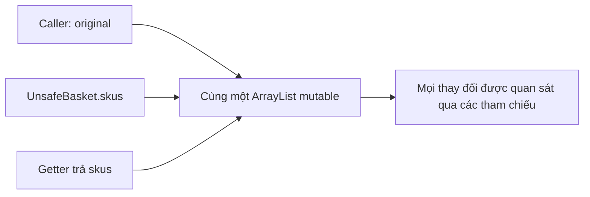
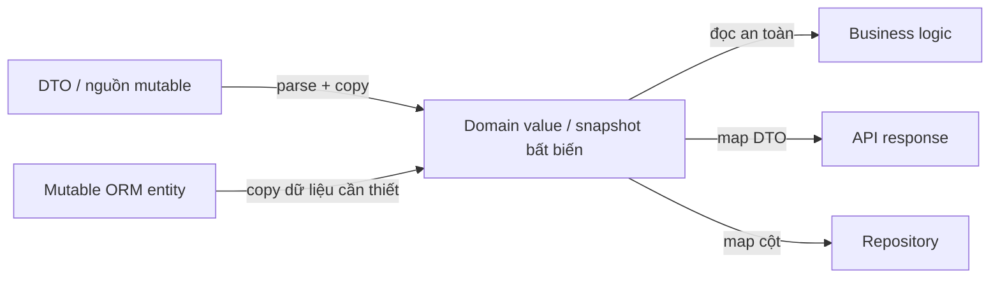

# Thiết kế bất biến và sao chép phòng vệ cho dữ liệu có thể sửa

Một đối tượng được khai báo `final` vẫn có thể thay đổi theo những cách khó nhìn thấy. Ví dụ, một snapshot đơn hàng giữ `List<OrderLine>` và một bộ dữ liệu nhị phân `byte[]`: nếu code bên ngoài còn tham chiếu tới danh sách hoặc mảng ban đầu, nó có thể sửa nội dung **sau khi snapshot đã được tạo**. Khi đó tổng tiền hiển thị, dữ liệu trả về API và dữ liệu dùng để ghi database có thể không còn phản ánh cùng một trạng thái nghiệp vụ.

Bài học thuộc chương **Mô hình Java** trong module **DATABASE_DATA_MODELING**. Mục tiêu của module là chuyển yêu cầu nghiệp vụ thành mô hình thực thể, quan hệ, ràng buộc, chuẩn hóa, khóa, chỉ mục và lược đồ vật lý rõ ràng; đồng thời so sánh mô hình quan hệ, document, đồ thị và phân tích để chọn cấu trúc có thể kiểm chứng, dễ tiến hóa. **Bất biến (immutability)** và **sao chép phòng vệ (defensive copying)** giúp giữ đúng ý nghĩa của dữ liệu khi đi qua các ranh giới này.

## 1. Bất biến là cam kết về hành vi, không chỉ là từ khóa

Một giá trị được xem là bất biến nếu **trạng thái có thể quan sát của nó không thay đổi sau khi tạo thành công**. Không có setter là điều kiện có ích, nhưng chưa đủ: tham chiếu tới một `List` hoặc `Date` có thể được dùng để thay đổi đối tượng mà không gọi setter của lớp chứa.

| Khái niệm | Nghĩa chính xác | Điều chưa được bảo đảm |
| --- | --- | --- |
| `final class` | Không thể tạo lớp con | Các trường và đối tượng được tham chiếu vẫn có thể thay đổi |
| `final` trên một trường | Không thể gán lại tham chiếu của trường sau khi khởi tạo | Không chặn sửa nội dung đối tượng được tham chiếu |
| `private` trên một trường | Không thể truy cập trực tiếp từ code bên ngoài lớp | Constructor/getter vẫn có thể làm lộ tham chiếu |
| `record` | Các trường component là `private final`; sinh accessor, constructor chuẩn và so sánh theo component | Chỉ bất biến **nông** nếu component mutable |
| `Collections.unmodifiableList(list)` | Cấm sửa danh sách **qua wrapper** | Vẫn quan sát được thay đổi của danh sách `list` gốc |
| `List.copyOf(list)` | Trả danh sách không cho sửa cấu trúc, độc lập với sửa cấu trúc về sau của nguồn mutable | Không sao chép sâu các phần tử mutable |
| `clone()` của mảng | Tạo một mảng mới với các phần tử tương ứng | Với mảng đối tượng, phần tử bên trong vẫn dùng chung tham chiếu |
| `String`, `UUID`, `Instant`, `BigDecimal` | Các kiểu giá trị Java thông dụng có hành vi bất biến | Không tự áp đặt mọi ràng buộc miền như đơn vị tiền, thời điểm hợp lệ |

Cần phân biệt ba mức:

1. **Bất biến của tham chiếu:** trường `final List<Item> items` luôn trỏ đến cùng một danh sách.
2. **Bất biến của cấu trúc chứa:** không ai thêm/xóa/thay phần tử trong danh sách qua bất cứ đường nào.
3. **Bất biến sâu của đồ thị dữ liệu:** cả danh sách và từng phần tử có thể quan sát đều không thay đổi.

Khi mô hình hóa một ảnh chụp nghiệp vụ, thông thường cần mức 3 **đối với tất cả các dữ liệu thuộc phạm vi ảnh chụp**. Không nhất thiết sao chép mọi đối tượng trong hệ thống: phải xác định rõ phần nào được sở hữu và phần nào có thể dùng chung an toàn.

## 2. Lỗi gốc: nhiều tham chiếu cùng trỏ đến dữ liệu mutable

Giả sử ứng dụng khởi tạo một giỏ hàng bằng danh sách do controller truyền vào:

```java
import java.util.ArrayList;
import java.util.List;

final class UnsafeBasket {
    private final List<String> skus;

    UnsafeBasket(List<String> skus) {
        this.skus = skus; // Giữ nguyên tham chiếu mutable của caller.
    }

    List<String> skus() {
        return skus;      // Trả lại đúng tham chiếu đó.
    }
}

final class UnsafeBasketExample {
    static void show() {
        List<String> original = new ArrayList<>();
        original.add("BOOK-001");
        UnsafeBasket basket = new UnsafeBasket(original);

        original.clear();
        System.out.println(basket.skus().size()); // 0: bị sửa từ phía input.

        basket.skus().add("PEN-002");              // Sửa từ phía output.
    }
}
```

Từ khóa `final` chỉ ngăn gán lại `skus`; nó không chặn thao tác `clear` hay `add` trên cùng danh sách.



Tên gọi của hiện tượng này là **aliasing**: nhiều biến/trường giữ tham chiếu tới cùng một đối tượng. Khi thiết kế, nên rà soát cả **đường vào** lẫn **đường ra**:

- **Đường vào:** constructor, factory, setter, builder, mapper, callback và deserializer có nhận tham chiếu của bên khác không?
- **Đường ra:** getter, accessor của record, iterator, `stream`, callback và phương thức trả kết quả có làm lộ dữ liệu mutable bên trong không?
- **Đường lồng nhau:** trong `List<List<T>>`, `Map<K, MutableValue>` hay `byte[][]`, đối tượng ở các lớp bên trong có còn thay đổi được không?

## 3. Kỹ thuật phòng vệ ở đường vào và đường ra

### 3.1. Danh sách và map chứa phần tử bất biến

Nếu các phần tử đã bất biến, `List.copyOf` và `Map.copyOf` thường là lựa chọn gọn:

```java
import java.util.List;
import java.util.Map;
import java.util.Objects;

record CatalogView(List<String> productCodes, Map<String, String> labels) {
    public CatalogView {
        productCodes = List.copyOf(
            Objects.requireNonNull(productCodes, "productCodes")
        );
        labels = Map.copyOf(
            Objects.requireNonNull(labels, "labels")
        );
    }
}
```

Constructor compact của `record` cho phép gán lại **tham số component**, rồi Java tự gán các tham số đó vào trường `final`. Sau khi tạo, accessor `productCodes()` trả một danh sách không cho phép sửa cấu trúc; `labels()` cũng vậy.

**Giới hạn và quyết định cần biết:**

- `List.copyOf` và `Map.copyOf` từ chối các phần tử/khóa/giá trị `null`. Đây là ràng buộc hữu ích nếu model không cho phép null, nhưng cần quyết định tại bước thiết kế.
- `Map.copyOf` không cam kết giữ thứ tự duyệt của map nguồn. Nếu thứ tự là một phần hợp đồng xuất dữ liệu, hãy dùng một cấu trúc có thứ tự và một bản sao được bao bọc thích hợp; đừng dựa vào thứ tự ngẫu nhiên.
- `List.copyOf` có thể tái sử dụng một danh sách đã bất biến; mục tiêu là **bảo đảm nội dung an toàn**, không nhất thiết cấp phát mảng mới mỗi lần.
- `List.copyOf` vẫn chỉ sao chép các tham chiếu phần tử. Dùng `List<String>` hoặc `List<Instant>` là an toàn hơn `List<MutableLine>` khi yêu cầu bất biến sâu.

### 3.2. Sự khác nhau giữa wrapper không sửa được và bản sao

```java
import java.util.ArrayList;
import java.util.Collections;
import java.util.List;

final class ViewVsCopyExample {
    static void show() {
        List<String> source = new ArrayList<>(List.of("A"));
        List<String> liveView = Collections.unmodifiableList(source);
        List<String> snapshot = List.copyOf(source);

        source.add("B");
        System.out.println(liveView); // [A, B] — thấy thay đổi ở nguồn.
        System.out.println(snapshot); // [A]    — giữ giá trị lúc sao chép.
    }
}
```

`Collections.unmodifiableList(source)` **không tự sao chép**; nó chỉ là một lớp xem không cho thao tác sửa thông qua chính wrapper. Nếu dùng `Collections.unmodifiableList(new ArrayList<>(source))`, ta đã thêm bước sao chép cấu trúc trước khi bọc. Cả hai cách vẫn chưa sao chép sâu các phần tử mutable.

Một số cách dễ gây hiểu nhầm:

| Cách viết | Sửa cấu trúc qua kết quả? | Sửa từ danh sách nguồn ảnh hưởng kết quả? | Các phần tử mutable độc lập? |
| --- | --- | --- | --- |
| `result = source` | Có | Có | Không |
| `Collections.unmodifiableList(source)` | Không | **Có** | Không |
| `new ArrayList<>(source)` | Có | Không đối với cấu trúc của danh sách | Không |
| `List.copyOf(source)` | Không | Không đối với cấu trúc của nguồn mutable | Không |
| `source.stream().toList()` (Java 16+) | Không | Không đối với cấu trúc của nguồn mutable sau khi tạo | Không |
| Tạo phần tử bất biến mới rồi `List.copyOf` | Không | Không, nếu tất cả dữ liệu quan sát thuộc các phần tử đã được chụp an toàn | Có, trong phạm vi đã chụp |

Khi nguồn đang bị sửa **đồng thời**, cả việc duyệt `stream` lẫn sao chép danh sách đều cần một cơ chế đồng bộ/hợp đồng snapshot phù hợp. Một lời gọi `copyOf` không tự biến việc đọc nhiều trường thành thao tác nguyên tử.

### 3.3. Mảng và các API dùng kiểu mutable

Mảng Java có thể sửa ở mọi thời điểm, kể cả khi trường chứa mảng được khai báo `final`. Quy tắc an toàn phổ biến là **sao chép khi nhận, sao chép khi trả**:

```java
import java.util.Arrays;
import java.util.Objects;

final class BinaryValue {
    private final byte[] content;

    BinaryValue(byte[] input) {
        this.content = Objects.requireNonNull(input, "input").clone();
    }

    byte[] content() {
        return content.clone();
    }

    @Override
    public boolean equals(Object other) {
        return this == other
            || (other instanceof BinaryValue that
                && Arrays.equals(content, that.content));
    }

    @Override
    public int hashCode() {
        return Arrays.hashCode(content);
    }
}
```

Nếu dùng `record BinaryValue(byte[] content)`, accessor được sinh sẽ trả thẳng tham chiếu mảng nếu không viết lại accessor. Kể cả khi override accessor để trả bản sao, `equals` và `hashCode` được sinh cho component mảng vẫn dùng ngữ nghĩa so sánh của mảng theo **tham chiếu**, không tự so sánh nội dung. Vì vậy, `final class` với `Arrays.equals`/`Arrays.hashCode` thường đơn giản hơn khi mảng là thành phần mang ý nghĩa giá trị.

Tương tự, các lớp cũ như `java.util.Date` và `Calendar` có thể thay đổi; khi phải tương tác với chúng, sao chép khi vào/ra hoặc chuyển sang kiểu `java.time` bất biến như `Instant`, `LocalDate`, `LocalDateTime`. Một `ByteBuffer` chỉ đọc được tạo bằng `asReadOnlyBuffer()` có thể vẫn chia sẻ vùng nhớ nền với buffer gốc; nếu cần dữ liệu không thay đổi thì phải quản lý quyền sở hữu vùng nhớ hoặc sao chép trước.

## 4. Ví dụ Java 17+ đầy đủ: snapshot đơn hàng không bị sửa qua tham chiếu

Giả sử yêu cầu nghiệp vụ:

1. Mỗi đơn hàng có mã định danh, các dòng sản phẩm và nhãn hiển thị.
2. Mỗi dòng có mã SKU, số lượng nguyên dương và đơn giá không âm.
3. Snapshot phải giữ nguyên các dòng và nhãn tại thời điểm tạo, kể cả khi controller tiếp tục sửa các collection đầu vào.
4. Nội dung đính kèm dạng byte phải được bảo vệ ở cả đầu vào và đầu ra.

Lưu đoạn sau vào `DefensiveCopyDemo.java` để chạy với **Java 17+**:

```java
import java.math.BigDecimal;
import java.util.ArrayList;
import java.util.Arrays;
import java.util.HashMap;
import java.util.List;
import java.util.Map;
import java.util.Objects;
import java.util.UUID;

record OrderId(UUID value) {
    public OrderId {
        Objects.requireNonNull(value, "value");
    }
}

record OrderLine(String sku, int quantity, BigDecimal unitPrice) {
    public OrderLine {
        Objects.requireNonNull(sku, "sku");
        sku = sku.strip();
        if (sku.isEmpty()) {
            throw new IllegalArgumentException("SKU must not be blank");
        }
        if (quantity <= 0) {
            throw new IllegalArgumentException(
                "Quantity must be positive"
            );
        }
        Objects.requireNonNull(unitPrice, "unitPrice");
        if (unitPrice.signum() < 0) {
            throw new IllegalArgumentException(
                "Unit price must not be negative"
            );
        }
    }

    BigDecimal lineTotal() {
        return unitPrice.multiply(BigDecimal.valueOf(quantity));
    }
}

record OrderSnapshot(
    OrderId id,
    List<OrderLine> lines,
    Map<String, String> labels
) {
    public OrderSnapshot {
        Objects.requireNonNull(id, "id");
        lines = List.copyOf(Objects.requireNonNull(lines, "lines"));
        labels = Map.copyOf(Objects.requireNonNull(labels, "labels"));
        if (lines.isEmpty()) {
            throw new IllegalArgumentException(
                "Order snapshot requires at least one line"
            );
        }
    }

    BigDecimal total() {
        return lines.stream()
            .map(OrderLine::lineTotal)
            .reduce(BigDecimal.ZERO, BigDecimal::add);
    }
}

final class FileContent {
    private final byte[] bytes;

    FileContent(byte[] source) {
        this.bytes = Objects.requireNonNull(source, "source").clone();
    }

    byte[] bytes() {
        return bytes.clone();
    }

    int size() {
        return bytes.length;
    }

    @Override
    public boolean equals(Object other) {
        return this == other
            || (other instanceof FileContent that
                && Arrays.equals(bytes, that.bytes));
    }

    @Override
    public int hashCode() {
        return Arrays.hashCode(bytes);
    }
}

public class DefensiveCopyDemo {
    public static void main(String[] args) {
        List<OrderLine> inputLines = new ArrayList<>();
        inputLines.add(new OrderLine(
            "BOOK-001", 2, new BigDecimal("49.50")
        ));

        Map<String, String> inputLabels = new HashMap<>();
        inputLabels.put("channel", "web");

        byte[] inputFile = { 1, 2, 3 };

        OrderSnapshot snapshot = new OrderSnapshot(
            new OrderId(UUID.randomUUID()), inputLines, inputLabels
        );
        FileContent file = new FileContent(inputFile);

        // Caller sửa nguồn SAU KHI tạo snapshot.
        inputLines.clear();
        inputLabels.put("channel", "mobile");
        inputFile[0] = 9;

        System.out.println(snapshot.lines().size());           // 1
        System.out.println(snapshot.labels().get("channel"));  // web
        System.out.println(snapshot.total());                  // 99.00
        System.out.println(file.bytes()[0]);                   // 1

        // Caller sửa một mảng do getter trả ra.
        byte[] result = file.bytes();
        result[0] = 7;
        System.out.println(file.bytes()[0]);                   // Vẫn là 1

        System.out.println(
            file.equals(new FileContent(new byte[] { 1, 2, 3 }))
        );                                                     // true

        // snapshot.lines().clear();
        // Nếu bỏ comment sẽ ném UnsupportedOperationException.
    }
}
```

**Giải thích thiết kế:**

- `OrderLine` chỉ chứa `String` và `BigDecimal` là những kiểu bất biến; constructor loại bỏ số lượng âm/0, SKU rỗng và giá âm. Đây là **value object** của một dòng được chụp.
- `OrderSnapshot` chỉ nhận `List<OrderLine>`, không nhận `List<MutableOrderLine>`. Vì phần tử bất biến, bản sao cấu trúc bằng `List.copyOf` là đủ cho dữ liệu các dòng trong ví dụ.
- `Map<String,String>` cũng an toàn về nội dung khi key và value bất biến. Nếu map chứa value là `List`, `Date` hay đối tượng có setter, cần thiết kế lại phần dữ liệu lồng nhau.
- `FileContent` là `final class` với trường `byte[]` riêng. Constructor và getter sao chép; `equals`/`hashCode` so sánh **nội dung** mảng để thể hiện ngữ nghĩa giá trị.
- `BigDecimal` trong ví dụ chưa chuẩn hóa scale; `new BigDecimal("10.0")` và `new BigDecimal("10.00")` có thể khác nhau dưới `equals` của record. Nếu đơn giá theo tiền tệ, nên thay thành `Money` có mã tiền và quy tắc chuẩn hóa/làm tròn rõ ràng.

Phạm vi “snapshot bất biến” ở đây là **các giá trị nằm trong snapshot sau khi tạo**, không phải toàn bộ đơn hàng ở nơi lưu. Snapshot chỉ ghi nhận một thời điểm; yêu cầu đọc nhất quán từ nhiều bảng hoặc nhiều thread vẫn cần cơ chế khác.

## 5. Khi sao chép collection vẫn bị sửa: phần tử mutable

`List.copyOf` chỉ chụp **cấu trúc danh sách**, không biến phần tử mutable thành bất biến:

```java
import java.util.List;

final class MutableLine {
    private final String sku;
    private int quantity;

    MutableLine(String sku, int quantity) {
        this.sku = sku;
        this.quantity = quantity;
    }

    String sku() {
        return sku;
    }

    int quantity() {
        return quantity;
    }

    void changeQuantity(int next) {
        quantity = next;
    }
}

record ShallowSnapshot(List<MutableLine> lines) {
    public ShallowSnapshot {
        lines = List.copyOf(lines);
    }
}

final class ShallowCopyExample {
    static void show() {
        MutableLine line = new MutableLine("BOOK-001", 2);
        ShallowSnapshot snapshot = new ShallowSnapshot(List.of(line));

        line.changeQuantity(99);
        System.out.println(snapshot.lines().get(0).quantity()); // 99
    }
}
```

Mặc dù `snapshot.lines()` không cho `add`/`remove`, phần tử trong danh sách vẫn là cùng `MutableLine` mà caller đang giữ. Nếu tạo snapshot từ dữ liệu mutable, hãy **chụp từng phần tử vào một kiểu bất biến**:

```java
import java.math.BigDecimal;
import java.util.List;

final class LineMappingExample {
    static List<OrderLine> snapshotLines(List<MutableLine> drafts) {
        return drafts.stream()
            .map(line -> new OrderLine(
                line.sku(),
                line.quantity(),
                new BigDecimal("49.50") // Đơn giá ví dụ.
            ))
            .toList();
    }
}
```

Trong ví dụ thứ hai, `OrderLine` chứa các dữ liệu bất biến. Nếu cần chuyển cả giá mutable, giảm giá, mã tiền hoặc danh sách tùy chọn, hãy tạo value object cho **từng thành phần** thay vì bỏ qua chúng. Việc đọc `sku` và `quantity` từ một `MutableLine` cũng phải thuộc cùng một thời điểm logic: nếu nguồn bị sửa đồng thời giữa các lần đọc, ta vẫn có thể tạo snapshot *không nhất quán* dù các giá trị sau khi chụp là bất biến.

### Đồ thị đối tượng phức tạp

| Cấu trúc nguồn | Sao chép an toàn khi mục tiêu là ảnh chụp bất biến |
| --- | --- |
| `List<String>` | `List.copyOf` nếu không có ý nghĩa đặc biệt về null |
| `List<MutableLine>` | Ánh xạ mỗi phần tử sang value object bất biến, rồi dùng danh sách bất biến |
| `Map<String, List<String>>` | Sao chép từng danh sách giá trị, sau đó sao chép map |
| `byte[][]` | Sao chép mảng ngoài và từng mảng `byte[]` bên trong |
| `Set<MutableKey>` hoặc `Map<MutableKey,V>` | Chuyển khóa sang kiểu bất biến; hash của khóa mutable là rủi ro lớn |
| Đồ thị có vòng tham chiếu | Cần xác định ranh giới ownership, có thể dùng cấu trúc bất biến/ID thay cho copy đệ quy tùy tiện |

Với map lồng nhau kiểu `Map<String,List<String>>`, có thể viết:

```java
import java.util.Map;
import java.util.List;
import java.util.stream.Collectors;

final class NestedCopy {
    static Map<String, List<String>> copy(
        Map<String, List<String>> source
    ) {
        return source.entrySet().stream()
            .collect(Collectors.toUnmodifiableMap(
                Map.Entry::getKey,
                entry -> List.copyOf(entry.getValue())
            ));
    }
}
```

Ở đây cả map và từng danh sách đều không sửa được; các chuỗi bên trong là bất biến. Nếu việc duyệt map nguồn diễn ra trong lúc thread khác đang sửa map, vẫn cần cơ chế đồng bộ hoặc một snapshot nguồn đáng tin cậy.

## 6. Quyền sở hữu (ownership) quan trọng hơn việc sao chép vô điều kiện

Không phải mọi tham chiếu đều nguy hiểm. Nếu kiểu nguồn đã bất biến và không có đường làm lộ trạng thái mutable bên trong, có thể **chia sẻ an toàn**:

- `String`, `Instant`, `LocalDate`, `Duration`, `UUID`, `BigDecimal` thường có thể giữ trực tiếp.
- Một `record` chỉ chứa các value object bất biến là ứng viên tốt cho việc dùng chung.
- Những tập hợp do thư viện bảo đảm không sửa được và chứa phần tử bất biến có thể dùng trực tiếp, tùy hợp đồng.

Nhưng cần sao chép hoặc chuyển thành kiểu bất biến ở nơi **chuyển quyền sở hữu**:



Nếu một factory nhận một danh sách đã bất biến, việc sao chép thêm mỗi lần có thể tốn CPU/bộ nhớ mà không tăng an toàn. `List.copyOf` giúp đơn giản hóa hợp đồng đầu vào, nhưng không thay thế việc đánh giá số lượng phần tử, giới hạn kích thước và chi phí tạo ảnh chụp lớn.

Nên ghi rõ hợp đồng của API:

- **Nhận một snapshot:** constructor/factory bảo đảm không giữ alias tới dữ liệu mutable đầu vào.
- **Trả một giá trị bất biến:** caller có thể đọc và chia sẻ an toàn, không thể sửa qua kết quả.
- **Trả một bản sao mutable có chủ đích:** caller được quyền sửa bản sao đó mà không ảnh hưởng nội bộ.
- **Trả live view:** caller sẽ nhìn thấy thay đổi của đối tượng nguồn; đây là hợp đồng khác và cần được gọi tên rõ ràng.

Tránh đặt tên `getSnapshot()` cho một live view có thể thay đổi theo thời gian.

## 7. Bất biến không tự động đồng nghĩa với thread-safe snapshot

Một ảnh chụp đã tạo đúng cách có thể chia sẻ giữa nhiều luồng đọc mà không bị sửa. Nhưng **quá trình tạo ảnh chụp từ nguồn mutable** có thể nhìn thấy dữ liệu ở nhiều thời điểm khác nhau.

Ví dụ tồn kho có hai trường: số lượng sẵn có và phiên bản. Nếu thread A giảm tồn kho rồi tăng phiên bản, trong khi thread B đọc hai trường không có đồng bộ, B có thể lấy một cặp dữ liệu chưa tương ứng với nhau.

Một cách kiểm soát bằng khóa nội bộ:

```java
record InventoryView(int available, long version) {
    public InventoryView {
        if (available < 0 || version < 0) {
            throw new IllegalArgumentException("Invalid inventory view");
        }
    }
}

final class Inventory {
    private final Object lock = new Object();
    private int available;
    private long version;

    Inventory(int initial) {
        if (initial < 0) {
            throw new IllegalArgumentException("Negative stock");
        }
        this.available = initial;
    }

    void reserve(int amount) {
        if (amount <= 0) {
            throw new IllegalArgumentException("Non-positive amount");
        }
        synchronized (lock) {
            if (amount > available) {
                throw new IllegalStateException("Not enough stock");
            }
            available -= amount;
            version++;
        }
    }

    InventoryView snapshot() {
        synchronized (lock) {
            return new InventoryView(available, version);
        }
    }
}
```

`snapshot()` chụp cả `available` và `version` dưới **cùng một khóa** mà các thao tác cập nhật cũng sử dụng. Vì vậy mỗi `InventoryView` biểu diễn một trạng thái nhất quán của đối tượng `Inventory` trong ví dụ. Nếu một đường cập nhật khác bỏ qua khóa, cam kết này không còn đúng.

Những điều cần phân biệt:

- `final` và `List.copyOf` bảo vệ tính bất biến **sau khi tạo**, không tự bảo đảm thao tác chụp là nguyên tử.
- `volatile` trên tham chiếu collection không khiến các phần tử của collection trở nên thread-safe hay bất biến.
- Copy-on-write và các cấu trúc đồng thời có ngữ nghĩa riêng; hãy hiểu rõ snapshot/iterator của từng API trước khi dùng.
- Nếu snapshot được tạo từ **nhiều hàng database**, cần transaction/cách đọc nhất quán tương ứng. Khóa `synchronized` trong một JVM không đồng bộ được nhiều instance ứng dụng.

## 8. Bất biến của Java và nhất quán dữ liệu lưu trữ là hai lớp khác nhau

`OrderSnapshot` bất biến ở bộ nhớ không có nghĩa hàng đơn hàng trong database bất biến. Một client khác có thể thay đổi giá hoặc số lượng sau khi snapshot được đọc.

Ví dụ lược đồ quan hệ cho đơn hàng và dòng đơn:

```sql
CREATE TABLE purchase_orders (
    id UUID PRIMARY KEY,
    version BIGINT NOT NULL DEFAULT 0,
    created_at TIMESTAMPTZ NOT NULL,
    CONSTRAINT ck_order_version CHECK (version >= 0)
);

CREATE TABLE purchase_order_lines (
    order_id UUID NOT NULL REFERENCES purchase_orders(id),
    line_no INTEGER NOT NULL CHECK (line_no > 0),
    sku VARCHAR(64) NOT NULL,
    quantity INTEGER NOT NULL CHECK (quantity > 0),
    unit_price NUMERIC(20, 4) NOT NULL CHECK (unit_price >= 0),
    PRIMARY KEY (order_id, line_no)
);
```

Đây là mô hình minh họa. Trong nghiệp vụ đa tiền tệ, cần mã tiền và chính sách làm tròn/precision phù hợp; `NUMERIC(20,4)` không phải lựa chọn mặc định cho mọi giá. Lược đồ cần bổ sung các quan hệ, ràng buộc và chỉ mục theo truy vấn thực tế.

Khi cập nhật một đơn hàng, có thể dùng **optimistic locking**:

```sql
UPDATE purchase_orders
SET version = version + 1
WHERE id = :order_id
  AND version = :expected_version;
```

`:order_id` và `:expected_version` là placeholder của thư viện truy cập dữ liệu. Nếu số hàng cập nhật là `0`, bản ghi có thể không tồn tại hoặc đã bị giao dịch khác thay đổi. Cần gói thao tác cập nhật version và thay đổi các dòng đơn liên quan **trong cùng transaction**; mọi đường ghi phải tuân thủ quy ước version thì cơ chế mới đáng tin cậy. Nếu dùng ORM với `@Version`, để ORM quản lý version thay vì tự tăng hai lần.

**Đọc snapshot nhiều bảng:** nếu repository đọc header trước, đọc các dòng sau mà không bảo đảm cùng một điểm nhìn, snapshot bất biến có thể ghi nhận một tổ hợp chưa từng tồn tại cùng lúc. Có thể dùng truy vấn nhất quán thích hợp hoặc transaction với mức cô lập được xác định (chẳng hạn `REPEATABLE READ` trong PostgreSQL khi phù hợp) để có dữ liệu nguồn thống nhất, rồi tạo `OrderSnapshot`.

**Bất biến không đồng nghĩa lịch sử bất biến:** nếu cần nhật ký kiểm toán, bản phát sinh sự kiện hoặc dữ liệu có giá trị pháp lý, phải có thiết kế lưu lịch sử/append-only, ràng buộc quyền ghi và quy trình kiểm chứng ở tầng lưu trữ. Một record Java bất biến không thay thế các cơ chế đó.

## 9. Ranh giới JPA, API, document và mô hình phân tích

### 9.1. Domain model, JPA entity và DTO

JPA/Hibernate thường quản lý entity `class` mutable, theo dõi thay đổi qua persistence context, lazy loading và các quy tắc constructor/proxy của provider. Không nên buộc mọi JPA entity phải là `record` bất biến hoặc gắn `final` một cách máy móc. Có thể:

1. Dùng entity JPA cho persistence và ánh xạ sang **domain snapshot/DTO bất biến** khi trả dữ liệu ra ngoài.
2. Trong domain, dùng value object bất biến như `Money`, `OrderId`, `TimeWindow`; ánh xạ bằng `@Embeddable` hoặc converter theo khả năng JPA/provider.
3. Không trả trực tiếp danh sách managed entity hay lazy collection của ORM qua API như một “snapshot bất biến”.
4. Khi cần sửa trạng thái nghiệp vụ, thực hiện qua phương thức domain/service và lưu trong transaction rõ ràng; snapshot đọc được tạo sau khi có dữ liệu nhất quán.

Không giả định `Collections.unmodifiableList(entity.getLines())` là snapshot: danh sách gốc có thể vẫn đổi khi ORM nạp hoặc cập nhật quan hệ. Hãy chuyển từng dòng sang DTO/value object bất biến và chụp danh sách sau khi đã truy xuất dữ liệu cần thiết.

### 9.2. JSON/API và cache

JSON không giữ tham chiếu bộ nhớ Java sau khi được serialize, nhưng object **trước khi serialize** vẫn có thể bị thay đổi. API nên tạo response DTO/snapshot từ trạng thái được đọc nhất quán, chọn kiểu trường rõ ràng và tránh deserializer gán trực tiếp collection đầu vào vào domain entity mà không kiểm tra.

Nếu cache giữ một value object bất biến, nhiều request có thể chia sẻ cùng tham chiếu mà không sợ sửa giá trị. Nhưng cache vẫn cần chiến lược **hết hạn, cập nhật và invalidation** khi dữ liệu nguồn đổi; “cache value bất biến” không đồng nghĩa “cache luôn mới”. Khi cần xem dữ liệu theo phiên bản, nên lưu thêm version/thời điểm hiệu lực.

### 9.3. Các loại lưu trữ khác

| Loại kho dữ liệu | Ý nghĩa của bất biến và snapshot |
| --- | --- |
| **Quan hệ** | Snapshot có thể ghép từ nhiều hàng; dùng transaction, khóa, constraint và version để tránh đọc/ghi không nhất quán |
| **Document** | Sao chép object lồng nhau trong Java trước khi ghi JSON/BSON; cập nhật nguyên tử tùy phạm vi document và version/điều kiện ghi; không nhầm bản sao ở bộ nhớ với transaction nhiều document |
| **Đồ thị** | Snapshot quan hệ giữa các nút/cạnh cần xác định thời điểm đọc, không chỉ sao chép các thuộc tính của một nút |
| **Phân tích / warehouse** | Các bản sự kiện/ảnh chụp bất biến giúp tái lập phép tính, nhưng cần khóa, mốc thời gian, version của dimension, chính sách sửa dữ liệu nguồn và xử lý dữ liệu đến muộn |

Ở mọi mô hình vật lý, cần bảo đảm ý nghĩa của đối tượng đã chọn trong Java còn đúng khi dữ liệu đi qua serializer, adapter, database và các consumer khác.

## 10. Tính đúng đắn, hiệu năng và chi phí bộ nhớ

Sao chép phòng vệ không miễn phí. Một danh sách lớn hoặc blob hàng trăm MB có thể khiến mỗi request tạo thêm nhiều dữ liệu trong heap. Tuy nhiên, bỏ copy mà không có quyền sở hữu rõ ràng có thể gây lỗi khó phát hiện hơn nhiều.

Một số chiến lược phù hợp:

- **Ưu tiên loại bỏ mutable ở biên:** dùng `Instant` thay `Date`, value object bất biến thay vì `Map<String,Object>` không có cấu trúc.
- **Chụp đúng dữ liệu cần dùng:** projection từ truy vấn chỉ lấy trường cần thiết; không sao chép cả graph entity chỉ để trả một vài thuộc tính.
- **Dùng chia sẻ an toàn:** tham chiếu tới dữ liệu thực sự bất biến có thể dùng chung; `List.copyOf` không nhất thiết cấp phát lại khi nguồn đã là list bất biến phù hợp.
- **Giữ giới hạn đầu vào:** kiểm soát kích thước tệp, số phần tử, độ sâu JSON và tài nguyên cho phép trước khi copy dữ liệu không tin cậy.
- **Đặt ranh giới stream rõ ràng:** với tệp lớn, stream và checksum có thể phù hợp hơn giữ toàn bộ `byte[]` trong một value object. Khi đó hợp đồng là luồng tiêu thụ/lưu trữ, không phải snapshot nhị phân nằm hết trong heap.
- **Đo trước khi tối ưu:** nếu profiling chứng minh việc copy là nút thắt, cân nhắc kiến trúc ownership, dữ liệu bất biến và tối ưu biểu diễn; không trả thẳng mutable buffer chỉ để giảm một lần copy mà chưa có hợp đồng an toàn.

**Cẩn thận với tính riêng tư dữ liệu:** sao chép `byte[]` tạo thêm bản trong bộ nhớ. Nó bảo vệ việc sửa alias nhưng không đảm bảo xóa sạch dữ liệu nhạy cảm từ mọi vùng nhớ sau khi dùng. Các yêu cầu về bảo vệ dữ liệu bí mật cần thiết kế riêng.

## 11. Những lỗi thường gặp khi xây dựng mô hình

| Lỗi | Tác động | Cách sửa |
| --- | --- | --- |
| `private final List<T>` nhưng giữ nguyên input mutable | Caller có thể sửa ngầm trạng thái nội bộ | Sao chép ở constructor/factory |
| Getter trả mảng nội bộ | Caller sửa phần tử dù trường `final` | Clone hoặc copy khi trả |
| Bọc bằng `unmodifiableList(source)` rồi gọi là snapshot | Thay đổi ở nguồn vẫn xuất hiện trong kết quả | Sao chép cấu trúc trước khi bọc |
| `List.copyOf(List<MutableItem>)` và kết luận bất biến sâu | Phần tử vẫn có thể bị sửa | Chuyển thành phần tử bất biến |
| `record X(byte[] data)` và trông đợi `equals` theo nội dung | Hai mảng cùng byte vẫn có thể không bằng nhau | Dùng lớp có `Arrays.equals`/`hashCode` hoặc ngữ nghĩa so sánh riêng |
| Snapshot đọc từ hai nguồn không đồng bộ | Dữ liệu có thể thuộc các thời điểm khác nhau | Dùng lock, transaction hoặc hợp đồng snapshot phù hợp |
| Cache giữ mutable DTO được dùng chung | Request này ảnh hưởng request khác | Cache value bất biến; thay bằng phiên bản mới khi cập nhật |
| Copy toàn bộ graph mọi nơi | Tăng bộ nhớ, thời gian và độ phức tạp | Xác định ownership và phạm vi dữ liệu cần chụp |
| Cho rằng record bất biến bảo vệ DB | Vẫn có lost update, dữ liệu lịch sử bị sửa | Bổ sung transaction, constraint, version và audit khi cần |

## 12. Tự kiểm tra bằng những trường hợp biên

Hãy phân biệt **tính bất biến sau tạo** và **tính nhất quán khi tạo** bằng các ca kiểm tra sau:

| Trường hợp | Kỳ vọng |
| --- | --- |
| Caller xóa danh sách nguồn sau `new OrderSnapshot(...)` | Danh sách trong snapshot giữ nguyên |
| Caller sửa map nhãn nguồn | Nhãn trong snapshot giữ nguyên |
| Caller gọi `snapshot.lines().clear()` | Ném `UnsupportedOperationException` |
| Caller sửa `byte[]` đầu vào hoặc mảng trả từ getter | Nội dung của `FileContent` giữ nguyên |
| Hai `FileContent` giữ các mảng byte khác tham chiếu nhưng cùng nội dung | `equals` trả `true`, `hashCode` nhất quán |
| Một `MutableLine` trong `List.copyOf` bị sửa | Shallow snapshot vẫn thấy thay đổi — chỉ ra vì sao cần copy phần tử |
| `Map<String,List<String>>` được sao chép theo từng lớp | Cả cấu trúc map và các list bên trong không bị thay đổi từ nguồn |
| Hai thread cập nhật và đọc `Inventory` qua cùng khóa | Mỗi `InventoryView` chụp cặp trạng thái/phiên bản nhất quán |
| Repository đọc header và detail ở hai snapshot DB khác nhau | Có thể sai ý nghĩa dù Java object đã bất biến |
| Thêm trường vào DTO/snapshot sau khi API đã phát hành | Cần đánh giá tương thích serialize/schema và client |

Không chỉ kiểm tra xem setter có tồn tại hay không. Hãy giữ một tham chiếu đến input mutable, tạo object, sửa input, rồi quan sát output; đồng thời thử sửa chính output. Với dữ liệu lồng nhau, cần sửa **phần tử ở lớp trong**. Với nguồn đồng thời, cần bài kiểm chứng việc tạo snapshot khi trạng thái thay đổi, lý tưởng bằng cách phối hợp luồng có kiểm soát hoặc kiểm thử tích hợp.

## 13. Bài tập ứng dụng

### Bài tập 1 — Đơn hàng có danh sách dòng mutable

Một API nhận `List<LineDraft>`, trong đó `LineDraft` có setter cho số lượng và đơn giá. Sau khi tạo response `OrderView`, middleware log hoặc controller vẫn giữ tham chiếu tới draft gốc.

Hãy chọn:

1. Kiểu Java cho `LineDraft` và `OrderLine`; giải thích vì sao chỉ `List.copyOf(drafts)` chưa đủ.
2. Cách chuyển các dòng thành value object bất biến rồi tạo `OrderView`.
3. Nơi cần kiểm tra số lượng dương, giá không âm, mã tiền tệ và logic tổng tiền.
4. Cách bảo đảm việc đọc order và lines từ database có cùng một điểm nhìn.

**Gợi ý:** dùng DTO mutable ở biên nếu framework yêu cầu, chuyển từng dòng sang `OrderLine` bất biến, rồi tạo `OrderView` chứa `List<OrderLine>` an toàn. Các ràng buộc dùng chung cần có ở domain và database, còn đọc nhiều bảng phải dùng transaction/cơ chế nhất quán thích hợp.

### Bài tập 2 — Tệp đính kèm và hash

Một record `Attachment(byte[] data)` được dùng làm khóa của `HashMap`. Hai upload có cùng byte nhưng là hai mảng khác nhau; sau khi thêm vào map, caller sửa mảng nguồn.

Hãy chỉ rõ hai lỗi khác nhau: **bình đẳng theo tham chiếu** và **aliasing mutable**. Đề xuất kiểu thay thế có kiểm tra kích thước đầu vào, copy vào/ra, `equals`/`hashCode` theo nội dung. Phân tích chi phí nếu blob rất lớn.

**Gợi ý:** một `final class` sở hữu mảng đã sao chép và so sánh `Arrays.equals`; với blob lớn, cân nhắc lưu object storage và biểu diễn metadata/hash/ID bất biến, kèm xác minh tính toàn vẹn thực tế.

### Bài tập 3 — Snapshot tồn kho qua nhiều tiến trình

Hệ thống đọc tồn kho từ hai bảng `stock_balances` và `stock_reservations`, rồi xuất `InventorySnapshot(available, reserved, version)`. Nhiều tiến trình có thể đặt hàng và giải phóng tồn cùng lúc.

Hãy giải thích tại sao `record` bất biến và `List.copyOf` không tự bảo đảm `available + reserved` tương ứng với một thời điểm. Thiết kế ranh giới transaction/điều kiện ghi hoặc mô hình cập nhật nguyên tử thích hợp; nêu cách phát hiện snapshot đã cũ.

**Gợi ý:** yêu cầu một điểm nhìn nhất quán khi đọc các bảng; khi ghi, bảo vệ tài nguyên chung bằng transaction, khóa hoặc điều kiện phiên bản. Dùng trường phiên bản để phát hiện thay đổi giữa các yêu cầu, nhưng không coi việc copy trong JVM là khóa trên database.

## 14. Checklist khi chốt model và lược đồ

- [ ] Đã xác định dữ liệu thuộc quyền sở hữu của đối tượng và nơi nào được phép chia sẻ tham chiếu.
- [ ] Đã phân biệt `final`, unmodifiable view, copy nông và bất biến sâu.
- [ ] Constructor/factory sao chép phòng vệ các collection, mảng hoặc đối tượng mutable ở đường vào.
- [ ] Getter/accessor không làm lộ dữ liệu mutable nội bộ ngoài hợp đồng đã công bố.
- [ ] Nếu collection chứa phần tử mutable, đã sao chép/chuyển đổi từng phần tử cần thiết.
- [ ] Nếu value object chứa mảng, đã thiết kế `equals`/`hashCode` theo nội dung khi ngữ nghĩa yêu cầu.
- [ ] Đã kiểm tra invariant trong quá trình tạo snapshot, kể cả khi có nguồn bị cập nhật đồng thời.
- [ ] Đã xác định transaction, khóa, version và ràng buộc database khi cần đọc/ghi nhất quán.
- [ ] Các DTO, entity JPA và biểu diễn JSON/document/analytics giữ đúng ý nghĩa của ảnh chụp.
- [ ] Đã tính tới kích thước dữ liệu, chi phí sao chép, tương thích API và vòng đời lịch sử.

**Ghi nhớ:** bất biến là lời cam kết rằng **giá trị đã tạo sẽ không đổi qua bất cứ tham chiếu hợp lệ nào**. Sao chép phòng vệ giúp thực hiện cam kết ấy tại các ranh giới có dữ liệu mutable. Để snapshot có ý nghĩa nghiệp vụ, còn cần đọc nguồn ở một trạng thái nhất quán và bảo vệ thao tác ghi bằng các cơ chế phù hợp trong database.
