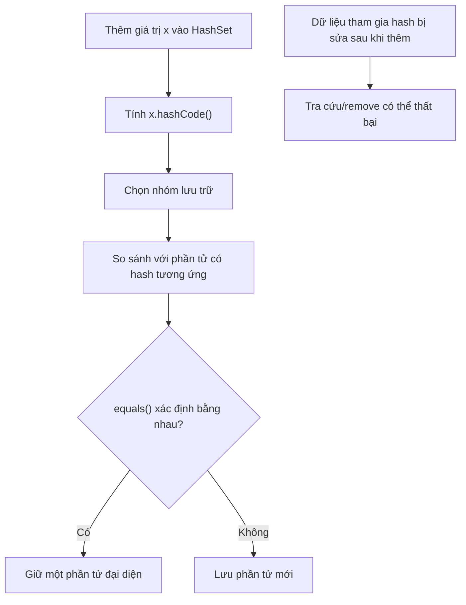

# `equals` và `hashCode` theo ngữ nghĩa của thực thể hoặc giá trị

Hai đối tượng Java có cùng dữ liệu hiển thị chưa chắc đại diện cho cùng một thực thể. Ngược lại, hai đối tượng được tải từ hai lần truy vấn khác nhau có thể đại diện cho **cùng một đơn hàng** mặc dù chúng nằm ở hai địa chỉ bộ nhớ và trạng thái được đọc ở hai thời điểm khác nhau. Việc triển khai `equals` và `hashCode` quyết định cách `HashSet`, `HashMap`, `distinct()`, kiểm tra trùng và nhiều cơ chế của thư viện hiểu thế nào là **“bằng nhau”**.

Bài này thuộc chương **Mô hình Java** của module **DATABASE_DATA_MODELING**. Trong phạm vi module, ta cần chuyển yêu cầu nghiệp vụ thành thực thể, quan hệ và ràng buộc rõ ràng; nối ngữ nghĩa Java với khóa, tính duy nhất, chuẩn hóa, chỉ mục và lược đồ vật lý; đồng thời biết khi nào mô hình quan hệ, document, đồ thị hoặc phân tích cần biểu diễn danh tính và giá trị khác nhau. Mục tiêu là lựa chọn **quy tắc bằng nhau phù hợp với miền nghiệp vụ**, rồi duy trì nó nhất quán qua Java, API và database.

## 1. Câu hỏi đầu tiên: “bằng nhau” theo nghĩa nào?

Trong một ứng dụng đặt hàng:

- Hai số tiền `Money(10.00, USD)` cùng đơn vị tiền và cùng giá trị là **hai giá trị bằng nhau**, bất kể được tạo từ request hay truy vấn nào.
- Hai mã `OrderId` chứa cùng UUID biểu diễn **cùng một giá trị định danh**.
- Hai đối tượng `Order` đại diện cùng một mã đơn hàng có thể là **cùng thực thể nghiệp vụ** ngay cả khi một bản đang `DRAFT` còn bản kia là `PAID`.
- Hai đơn hàng có cùng khách, cùng dòng hàng và cùng tổng tiền vẫn là **hai thực thể khác nhau** nếu chúng có `OrderId` khác nhau.
- Hai dòng xuất báo cáo có các cột bằng nhau có thể là **hai bản quan sát có cùng giá trị**; nếu nghiệp vụ phải giữ cả hai giao dịch gốc, việc xóa trùng theo toàn bộ cột sẽ làm mất thông tin.

Phân biệt nhanh:

| Khái niệm | Ngữ nghĩa bằng nhau thường phù hợp | Ví dụ |
| --- | --- | --- |
| **Value object** | Tất cả thành phần **có ý nghĩa** bằng nhau sau chuẩn hóa | `Money`, `Quantity`, `TimeWindow` |
| **Typed ID** | Giá trị bên trong bằng nhau **và cùng loại ID** | `OrderId` khác `CustomerId` |
| **Entity có ID ổn định** | Cùng danh tính nghiệp vụ, không phụ thuộc trạng thái mutable | `Order` có cùng `OrderId` |
| **Snapshot/DTO** | Các trường được chọn vào snapshot bằng nhau | `OrderSnapshot`, `PriceQuote` |
| **Sự kiện** | Phụ thuộc hợp đồng: cùng event ID hay cùng nội dung? | Hai event trùng payload vẫn có thể là hai lần phát sinh |
| **Danh mục/cấu hình** | Phải xác định trước khóa nghiệp vụ hoặc tính chất của dữ liệu | Mã tiền, mã kho, mã nhà cung cấp |

Không dùng cùng một chính sách cho mọi lớp chỉ vì IDE có nút *Generate equals/hashCode*. Hãy viết ra một câu có thể kiểm chứng, chẳng hạn: “Hai `Order` bằng nhau khi và chỉ khi chúng đại diện cùng `OrderId`”, hoặc “Hai `Money` bằng nhau khi số tiền đã chuẩn hóa và đơn vị tiền bằng nhau”.

## 2. Hợp đồng `equals` và `hashCode` của Java

`Object.equals(Object)` và `Object.hashCode()` có các yêu cầu quan trọng:

1. **Phản xạ (reflexive):** với đối tượng `x` khác `null`, `x.equals(x)` là `true`.
2. **Đối xứng (symmetric):** `x.equals(y)` và `y.equals(x)` phải cho cùng kết quả.
3. **Bắc cầu (transitive):** nếu `x.equals(y)` và `y.equals(z)` thì `x.equals(z)`.
4. **Nhất quán (consistent):** nếu các dữ liệu dùng để so sánh không đổi, các lần gọi lặp lại phải trả cùng kết quả.
5. **So với `null`:** `x.equals(null)` luôn là `false`.
6. **Quan hệ với hash:** nếu `x.equals(y)` thì **bắt buộc** `x.hashCode() == y.hashCode()`.

Điều ngược lại **không đúng**: hai đối tượng không bằng nhau vẫn có thể có cùng hash (hash collision). Hash là cách phân vùng dữ liệu để tăng tốc tra cứu, **không phải bằng chứng duy nhất về danh tính**. Một `hashCode` tốt có phân bố hợp lý, nhưng việc đúng hợp đồng quan trọng hơn việc cố tạo hash “độc nhất”.

Sơ đồ tác động đến `HashSet`:



Với `Object` mặc định, `equals` kiểm tra **cùng tham chiếu** và `hashCode` tương thích với ngữ nghĩa đó. Nếu override `equals`, phải override `hashCode` tương ứng. Không được hiểu `hashCode` mặc định luôn là địa chỉ bộ nhớ vật lý; JVM không cam kết như vậy.

### Bảng kiểm nhanh cho một implementation

| Câu hỏi | Vì sao quan trọng? |
| --- | --- |
| `equals(null)` có trả `false`? | Bảo toàn hợp đồng Object |
| Có đối xứng giữa class cha/con, proxy và đối tượng domain? | Tránh kết quả phụ thuộc chiều gọi |
| Các trường tham gia `equals` có tham gia `hashCode` với cùng ý nghĩa? | Để map/set tìm đúng phần tử |
| Những trường đó có thể đổi khi đối tượng đã là khóa map? | Tránh “mất” phần tử trong hash bucket |
| Một đối tượng transient đã có ID ổn định chưa? | Quyết định identity theo ID có an toàn không |
| Quy tắc Java có trùng với unique constraint/collation DB không? | Tránh Java coi trùng trong khi DB cho lưu hai hàng, hoặc ngược lại |

## 3. Value object: bằng nhau theo dữ liệu có ý nghĩa

Value object không có vòng đời/danh tính riêng. Khi giá trị của chúng tương đương theo quy tắc miền, chúng nên so sánh bằng nhau. Với Java 17+, `record` thuận tiện vì tự sinh `equals` và `hashCode` dựa trên tất cả **record components**.

Ví dụ định danh có kiểu mạnh:

```java
import java.util.Objects;
import java.util.UUID;

record OrderId(UUID value) {
    public OrderId {
        Objects.requireNonNull(value, "value");
    }
}

record CustomerId(UUID value) {
    public CustomerId {
        Objects.requireNonNull(value, "value");
    }
}
```

Hai `new OrderId(sameUuid)` bằng nhau theo giá trị, nhưng `OrderId` và `CustomerId` không bằng nhau dù bọc cùng UUID. Đây là lợi ích kép của typed ID: trình biên dịch giúp tránh truyền nhầm, còn `equals` tôn trọng ranh giới loại định danh.

### 3.1. Chuẩn hóa trước khi so sánh

Một value object có thể cần chuẩn hóa đầu vào để hai biểu diễn cùng ý nghĩa có cùng component:

```java
import java.util.Locale;
import java.util.Objects;

record Sku(String value) {
    public Sku {
        Objects.requireNonNull(value, "value");
        value = value.strip().toUpperCase(Locale.ROOT);
        if (!value.matches("[A-Z0-9-]{3,32}")) {
            throw new IllegalArgumentException("Invalid SKU");
        }
    }
}
```

Với quy tắc **được nghiệp vụ cho phép** đó, `Sku(" book-01 ")` bằng `Sku("BOOK-01")`. Nếu mã từ nguồn ngoài coi chữ hoa/chữ thường hoặc khoảng trắng là khác nhau, không được tự chuẩn hóa. Quy tắc chuẩn hóa cần được công bố và nhất quán với dữ liệu đã lưu, validation và unique constraint.

### 3.2. `BigDecimal`: bằng số học chưa chắc bằng theo `equals`

`BigDecimal` phân biệt scale trong `equals`:

```java
import java.math.BigDecimal;

final class DecimalEqualityExample {
    static void show() {
        BigDecimal a = new BigDecimal("10.0");
        BigDecimal b = new BigDecimal("10.00");

        System.out.println(a.compareTo(b) == 0); // true
        System.out.println(a.equals(b));          // false
        System.out.println(a.hashCode() == b.hashCode()); // false
    }
}
```

Khi `record Money(BigDecimal amount, Currency currency)` dùng `equals` mặc định, hai giá trị `10.0 USD` và `10.00 USD` sẽ khác nhau trừ khi được chuẩn hóa. Không nên viết `equals` chỉ dùng `compareTo() == 0` nhưng giữ `hashCode` mặc định của BigDecimal, vì khi đó hai đối tượng bằng nhau có thể có hash khác nhau.

Trong một số miền, scale lại **có ý nghĩa** (ví dụ độ chính xác đo lường của `2.50` khác `2.5`). Hãy quyết định ngữ nghĩa theo nghiệp vụ rồi thiết kế kiểu phù hợp.

### 3.3. Mảng và collection mutable

`record Payload(byte[] bytes)` không tự có so sánh theo nội dung mảng: `byte[]` mặc định so sánh theo tham chiếu. Nếu byte là giá trị cần so sánh nội dung, dùng defensive copy và `Arrays.equals`/`Arrays.hashCode` như ở ví dụ:

```java
import java.util.Arrays;
import java.util.Objects;

final class BinaryKey {
    private final byte[] bytes;

    BinaryKey(byte[] source) {
        this.bytes = Objects.requireNonNull(source, "source").clone();
    }

    byte[] bytes() {
        return bytes.clone();
    }

    @Override
    public boolean equals(Object other) {
        return this == other
            || (other instanceof BinaryKey key
                && Arrays.equals(bytes, key.bytes));
    }

    @Override
    public int hashCode() {
        return Arrays.hashCode(bytes);
    }
}
```

Nếu component là `List<T>`, bản thân `List.equals` so sánh từng phần tử theo thứ tự, nhưng danh sách mutable vẫn có thể làm thay đổi kết quả equality/hash sau khi object được thêm vào set/map. Muốn dùng như một value object ổn định, phải sao chép danh sách và bảo đảm từng phần tử tham gia equality cũng bất biến. Với `Set`, thứ tự không có nghĩa trong equality; với `Map`, so sánh dựa trên tập entry, không phụ thuộc thứ tự duyệt. Chọn cấu trúc theo ý nghĩa dữ liệu.

## 4. Entity: bằng nhau theo danh tính nghiệp vụ

Entity có danh tính ổn định xuyên suốt vòng đời, ngay cả khi trạng thái thay đổi. Ví dụ đơn hàng:

```text
Order{id=O-123, status=DRAFT, total=0}
                     |
                     v
Order{id=O-123, status=PLACED, total=100}
                     |
                     v
Order{id=O-123, status=PAID, total=100}
```

Nếu so sánh `Order` theo tất cả thuộc tính, việc thay đổi trạng thái làm cho “cùng đơn hàng” bị coi là khác. Nếu đặt `Order` làm key trong `HashMap` rồi thay `status`, hash có thể thay đổi khiến tra cứu thất bại.

Phương án rõ ràng cho domain object tự quản lý là **gán ID bất biến ngay khi tạo**, dùng ID để so sánh:

```java
import java.util.Objects;
import java.util.UUID;

record OrderId(UUID value) {
    public OrderId {
        Objects.requireNonNull(value, "value");
    }
}

enum OrderStatus { DRAFT, PLACED, PAID }

final class Order {
    private final OrderId id;
    private OrderStatus status;

    private Order(OrderId id, OrderStatus status) {
        this.id = Objects.requireNonNull(id, "id");
        this.status = Objects.requireNonNull(status, "status");
    }

    static Order createDraft() {
        return new Order(
            new OrderId(UUID.randomUUID()), OrderStatus.DRAFT
        );
    }

    // Ví dụ rehydration dùng ở lớp repository đáng tin cậy.
    static Order reconstitute(OrderId id, OrderStatus status) {
        return new Order(id, status);
    }

    OrderId id() {
        return id;
    }

    OrderStatus status() {
        return status;
    }

    void place() {
        if (status != OrderStatus.DRAFT) {
            throw new IllegalStateException("Only DRAFT may be placed");
        }
        status = OrderStatus.PLACED;
    }

    void pay() {
        if (status != OrderStatus.PLACED) {
            throw new IllegalStateException("Only PLACED may be paid");
        }
        status = OrderStatus.PAID;
    }

    @Override
    public boolean equals(Object other) {
        return this == other
            || (other instanceof Order that
                && id.equals(that.id));
    }

    @Override
    public int hashCode() {
        return id.hashCode();
    }
}

public class EntityEqualityDemo {
    public static void main(String[] args) {
        Order first = Order.createDraft();
        java.util.Set<Order> known = new java.util.HashSet<>();
        known.add(first);

        Order loaded = Order.reconstitute(
            first.id(), OrderStatus.PAID
        );

        System.out.println(first == loaded);      // false
        System.out.println(first.equals(loaded)); // true
        System.out.println(known.contains(loaded)); // true

        first.place();
        first.pay();
        System.out.println(known.contains(first)); // true
    }
}
```

**Giới hạn cần hiểu:** đây là một domain `final class` độc lập, **chưa phải JPA entity**. Nó nhận ID ổn định từ lúc tạo, nên `hashCode` không đổi khi chuyển trạng thái. Hai đối tượng có cùng ID nhưng khác status được xem là cùng danh tính, **không có nghĩa hai bản trạng thái nhất quán hoặc có thể tự gộp lại**. Khi lưu, vẫn cần kiểm soát phiên bản, giao dịch và cập nhật đồng thời.

Nếu mã định danh có thể bị thay đổi, equality theo ID không còn ổn định. Vì vậy `Order.id` là `private final` và không có setter. Trong thiết kế dùng ID do database sinh, phải cân nhắc riêng trạng thái trước khi persist.

## 5. Giá trị và entity khác nhau trong `HashSet`, `HashMap`

Cho `HashMap<OrderId, Order>`, mã `OrderId` bất biến là key an toàn và giúp tránh nhiều phức tạp khi entity thay đổi trạng thái. Với `Map<Money, PriceTier>`, chính sách chuẩn hóa số tiền và mã tiền trở nên quan trọng. Với `Map<Order, Metadata>`, cách triển khai hash của entity phải bền vững qua vòng đời sử dụng trong map.

### 5.1. Ví dụ lỗi do field mutable tham gia hash

```java
import java.util.HashSet;
import java.util.Objects;
import java.util.Set;

final class BadTicket {
    private final String id;
    private String status;

    BadTicket(String id, String status) {
        this.id = Objects.requireNonNull(id);
        this.status = Objects.requireNonNull(status);
    }

    void setStatus(String next) {
        status = Objects.requireNonNull(next);
    }

    @Override
    public boolean equals(Object other) {
        return this == other
            || (other instanceof BadTicket that
                && id.equals(that.id)
                && status.equals(that.status));
    }

    @Override
    public int hashCode() {
        return Objects.hash(id, status);
    }
}

final class MutableHashExample {
    static void show() {
        Set<BadTicket> tickets = new HashSet<>();
        BadTicket ticket = new BadTicket("T-1", "OPEN");
        tickets.add(ticket);

        ticket.setStatus("CLOSED");
        // contains/remove có thể thất bại: hash đã thay đổi.
        System.out.println(tickets.contains(ticket));
    }
}
```

Không có bảo đảm `contains` sẽ tìm được phần tử sau khi đổi các trường tham gia hash. Kết quả phụ thuộc bucket và xung đột hash tại thời điểm chạy. Giải pháp cho entity là dùng một ID ổn định để tính `equals`/`hashCode`, hoặc dùng **ID bất biến làm key** nếu entity có lifecycle phức tạp. Với value object, không cho thay đổi thành phần tham gia hash sau khi tạo.

### 5.2. Không dùng hash làm định danh duy nhất

Từ hash không thể suy ra chắc chắn hai giá trị bằng nhau. Không dùng `hashCode` 32-bit của Java làm khóa chính, mã giao dịch hoặc dấu vân tay bảo mật. Nếu muốn xác minh nội dung tệp, thiết kế digest đủ mạnh (chẳng hạn SHA-256) và giao thức xác minh phù hợp; vẫn phải phân biệt digest nội dung với ID nghiệp vụ và xem xét xử lý va chạm theo yêu cầu hệ thống.

## 6. Java record: lợi thế và giới hạn của equality tự sinh

Với một record:

```java
record Coordinates(double latitude, double longitude) {}
```

Java sinh `equals`/`hashCode` dựa trên component `latitude` và `longitude`. Điều này phù hợp nếu giá trị chính là cặp tọa độ theo một quy ước rõ ràng; nhưng không có nghĩa mọi record đều là value object **đúng về nghiệp vụ**.

Ví dụ cần cân nhắc:

- **`BigDecimal`:** scale khác nhau ảnh hưởng `equals`, trừ khi chuẩn hóa tại constructor.
- **`byte[]` và mảng khác:** mặc định dùng equality của mảng theo tham chiếu.
- **Danh sách mutable:** record có trường final, nhưng bản thân danh sách/element có thể bị sửa làm thay đổi `equals`/`hashCode`.
- **Số thực:** với vị trí hay đo lường, hai số gần nhau không mặc nhiên bằng nhau. Nếu dùng sai số `epsilon` trong `equals`, có thể vi phạm **tính bắc cầu**: A gần B, B gần C nhưng A không gần C.
- **DTO/API snapshot:** equality dựa trên tất cả component; thêm field mới có thể đổi ngữ nghĩa equality. Nếu cần định danh độc lập, đừng nhầm DTO với entity.

Ví dụ kiểm tra bất biến sâu cho danh sách:

```java
import java.util.List;
import java.util.Objects;

record CartSnapshot(List<String> skuCodes) {
    public CartSnapshot {
        skuCodes = List.copyOf(
            Objects.requireNonNull(skuCodes, "skuCodes")
        );
    }
}
```

`String` bất biến, nên `CartSnapshot` này có danh sách và phần tử bất biến; `equals`/`hashCode` của record ổn định sau khi tạo. Nếu thay bằng `List<MutableCartLine>`, `List.copyOf` chỉ bảo vệ cấu trúc, chưa bảo vệ giá trị của từng phần tử.

## 7. Bình đẳng qua kế thừa: bảo toàn đối xứng và bắc cầu

Class kế thừa làm equality khó hơn. Nếu class cha dùng `instanceof Parent` và class con thêm trường vào `equals`, có thể xảy ra:

```text
parent.equals(child) == true
child.equals(parent) == false
```

Điều này vi phạm đối xứng. Một hướng cho value object là dùng `final class` hoặc `record` để tránh quan hệ kế thừa làm thay đổi tập trường tham gia equality. Khi dùng kế thừa, phải có thiết kế equality ở toàn bộ hierarchy (quy tắc chọn kiểu, trường, đối xứng/bắc cầu) chứ không chỉ thêm `super.equals(...)` tùy tiện.

Hai lựa chọn kiểm tra loại đối tượng có hệ quả khác nhau:

| Cách kiểm tra | Thuận lợi | Rủi ro |
| --- | --- | --- |
| `getClass() == other.getClass()` | Chỉ so sánh cùng runtime class, hạn chế một số lỗi kế thừa | ORM proxy có runtime class khác với entity gốc |
| `other instanceof MyFinalClass` | Dễ viết với kiểu không kế thừa, cho phép proxy nếu có thể là subtype | Nếu class không final và con tùy ý mở rộng equality, có thể phá hợp đồng |

Đừng áp một “mẹo” chung cho mọi JPA entity. Proxy, bytecode enhancement và phân cấp entity phụ thuộc provider/kiểu mapping; cần chọn chính sách bằng nhau có thể kiểm tra khi đối tượng được tải từ persistence context khác nhau.

## 8. JPA/Hibernate: ID sinh sau `persist` và proxy

Đây là tình huống khác với ví dụ `Order` có ID được cấp ngay khi tạo:

1. `new CustomerEntity()` chưa có `id` khi database sinh khóa.
2. Sau `persist`/`flush` (tùy chiến lược), entity có ID.
3. Một đối tượng của cùng hàng có thể được tải qua `find`, `getReference` hoặc một persistence context khác.
4. Hibernate có thể tạo proxy hoặc dùng cơ chế enhancement; runtime class và thời điểm nạp thông tin có thể khác giữa các biểu diễn.

### 8.1. Vì sao so sánh ID bằng `Objects.equals(id, other.id)` có thể sai?

Hai entity **mới chưa lưu** đều có `id == null`. Nếu `equals` chỉ kiểm tra `Objects.equals(id, other.id)`, chúng sẽ được coi là bằng nhau dù là hai thực thể mới khác nhau. Điều này khiến `Set` bỏ một phần tử, hoặc association được thao tác sai trước khi persist.

### 8.2. Vì sao tính `hashCode` từ ID sinh sau có thể sai?

Một entity chưa lưu vào `HashSet` có `id == null`. Sau persist, ID xuất hiện, hash tính từ ID thay đổi, có thể làm `contains/remove` thất bại. Cách tạo ID trước khi persist tránh tình huống này, nhưng không phải mọi thiết kế đều làm được.

### 8.3. Những chiến lược có thể cân nhắc

| Chiến lược | Khi thích hợp | Hạn chế / điều kiện |
| --- | --- | --- |
| **Gán ID ổn định từ lúc tạo** (UUID, ULID theo chính sách) | Domain model tự quản lý ID, không phụ thuộc DB cấp ID | Phải bảo đảm cách sinh ID và ràng buộc duy nhất; thiết kế đúng khi import dữ liệu cũ |
| **Business key bất biến, duy nhất** | Có mã ổn định được nghiệp vụ công nhận và có DB constraint tương ứng | Nếu key thật sự có thể đổi hoặc chưa có lúc tạo, không phù hợp |
| **ID do database sinh; entity transient chỉ bằng chính nó; hash ổn định** | Cần identity sau persist mà không đổi hash trong collection | Cần giải quyết proxy/class và các trade-off phân bố hash; test theo provider |
| **Giữ entity trong persistence context; map/set bên ngoài dùng ID/value DTO** | Có thể tránh dùng entity làm hash key lâu dài | Vẫn phải rõ các thao tác collection/association do ORM quản lý |

Một minh họa đơn giản **không dùng proxy** cho entity có ID sinh muộn:

```java
import java.util.Objects;

class GeneratedIdEntity {
    private Long id; // null trước khi được cấp ID.

    Long id() {
        return id;
    }

    void assignIdForDemo(Long value) {
        if (id != null) {
            throw new IllegalStateException("ID already assigned");
        }
        id = Objects.requireNonNull(value, "value");
    }

    @Override
    public final boolean equals(Object other) {
        if (this == other) {
            return true;
        }
        if (!(other instanceof GeneratedIdEntity that)) {
            return false;
        }
        return id != null && id.equals(that.id);
    }

    @Override
    public final int hashCode() {
        // Không đổi khi id từ null trở thành giá trị thật.
        return GeneratedIdEntity.class.hashCode();
    }
}
```

Đoạn trên chỉ minh họa hai ý: **transient entity khác nhau không bằng nhau** và **hash không đổi khi ID được gán**. `hashCode` hằng theo lớp có thể làm giảm hiệu năng khi set/map chứa rất nhiều phần tử cùng lớp. Quan trọng hơn, đây **không phải recipe JPA/Hibernate hoàn chỉnh**: `final equals`, `instanceof`, proxy, hierarchy entity, access strategy và yêu cầu proxy của provider có thể tương tác phức tạp. Đối với JPA thực tế, cần lựa chọn cách nhận diện loại entity/proxy theo provider đang dùng và kiểm thử với `find`, `getReference`, dữ liệu transient/managed/detached cùng association.

Tuyệt đối không để setter công khai đổi ID hoặc business key nếu các trường đó là cơ sở equality. Với khóa nghiệp vụ tự nhiên, cần chắc chắn nó **thực sự bất biến** theo yêu cầu sản phẩm: email khách hàng, số điện thoại và tên hiển thị thường có thể sửa, nên hay là lựa chọn sai cho entity identity.

## 9. `equals` không phải unique constraint của database

Trong Java, `equals` chỉ có hiệu lực trên các đối tượng mà chương trình đang so sánh. Trong database, **khóa chính/khóa duy nhất và transaction** mới bảo vệ dữ liệu giữa các request hoặc nhiều tiến trình.

Giả sử:

```sql
CREATE TABLE orders (
    id UUID PRIMARY KEY,
    customer_id UUID NOT NULL,
    status VARCHAR(16) NOT NULL,
    total_amount NUMERIC(20, 2) NOT NULL,
    currency_code CHAR(3) NOT NULL,
    version BIGINT NOT NULL DEFAULT 0,
    CONSTRAINT ck_total_amount_nonnegative CHECK (total_amount >= 0),
    CONSTRAINT ck_version_nonnegative CHECK (version >= 0)
);

CREATE TABLE customers (
    id UUID PRIMARY KEY,
    customer_code VARCHAR(32) NOT NULL UNIQUE,
    display_name TEXT NOT NULL
);
```

Đây là hai bảng minh họa; trong hệ thống hoàn chỉnh còn cần `FOREIGN KEY` từ `orders.customer_id` sang `customers.id` nếu cùng database quản lý quan hệ và các khóa/chỉ mục theo truy vấn. `Order` bằng nhau theo `id`, trong khi `customer_code` là mã nghiệp vụ duy nhất của khách hàng; hai khái niệm có thể dùng trong equality/lookup khác nhau. Không dùng `total_amount`, `status` hoặc `display_name` làm identity nếu chúng được phép thay đổi.

### Cẩn thận với quy tắc chuẩn hóa và collation

Nếu `Sku("ab-1")` bằng `Sku("AB-1")` do Java chuẩn hóa uppercase nhưng cột DB dùng collation phân biệt hoa/thường và lưu cả hai giá trị, database có thể cho phép dữ liệu Java coi là trùng. Ngược lại, DB dùng collation không phân biệt hoa/thường/giọng hoặc quy tắc xử lý khoảng trắng khác Java có thể từ chối một cặp giá trị Java coi là khác nhau.

Hãy xác định **dạng chuẩn được lưu**, unique index/constraint tương ứng và một chính sách migration nếu dữ liệu đã tồn tại không tuân thủ. Đừng dựa vào `equals` để thay thế `UNIQUE`, cũng đừng mặc định rằng mọi DB đều dùng chung cách so sánh chuỗi với Java.

### Tính nhất quán khi ghi

Hai giao dịch có thể cùng kiểm tra “chưa có mã khách hàng” rồi cả hai cố insert. Kiểm tra bằng `HashSet` hoặc `equals` trong một JVM không ngăn race giữa tiến trình. Ràng buộc `UNIQUE(customer_code)` mới buộc database chấp nhận tối đa một dòng trong điều kiện phù hợp; ứng dụng phải xử lý lỗi trùng và có thể retry có kiểm soát khi mã được sinh tự động.

Nếu một order được hai giao dịch tải và sửa khác nhau, equality theo ID vẫn trả `true`; nó **không phát hiện lost update**. Dùng `version`/optimistic locking hoặc transaction/locking khác theo yêu cầu. Equality chỉ trả lời “cùng đối tượng nghiệp vụ không?”, không trả lời “bản dữ liệu này còn mới không?”.

## 10. Quan hệ, document, đồ thị và phân tích

Ngữ nghĩa danh tính hoặc giá trị phải được giữ khi chuyển từ object Java sang loại kho dữ liệu:

| Mô hình lưu trữ | Danh tính | Bình đẳng giá trị / điểm cần chú ý |
| --- | --- | --- |
| **Quan hệ** | Khóa chính, khóa ngoại, unique constraint; entity Java ánh xạ theo ID | Cột nhiều bảng có thể được tập hợp thành DTO/record có equality theo nội dung; phải thống nhất chuẩn hóa và collation |
| **Document** | `_id` hoặc khóa tài liệu có thể là danh tính ổn định | Hai document cùng payload nhưng `_id` khác thường là hai thực thể khác; nested value có thể bằng nhau theo nội dung |
| **Đồ thị** | Node/edge ID hoặc khóa nghiệp vụ tùy graph database và miền | Hai nút cùng nhãn/thuộc tính chưa chắc là một thực thể; quan hệ giữa các nút có danh tính và thời gian hiệu lực riêng |
| **Phân tích / warehouse** | Business key, surrogate key, event ID, thời điểm hiệu lực | Hai dòng fact cùng số liệu chưa chắc trùng sự kiện; dimension snapshot có version; dedup phải theo khóa và chính sách cụ thể |

Ví dụ trong pipeline phân tích, hai sự kiện “đặt hàng 100 USD” có cùng payload nhưng event ID khác nhau có thể là **hai sự kiện thật**. Nếu deduplicate bằng `record PurchaseEvent(amount, currency)`, ta có nguy cơ gộp mất giao dịch. Cần xác định event ID, nguồn và thời điểm; event ID có thể được dùng cho idempotency theo hợp đồng phát sự kiện, còn phần payload vẫn hữu ích để so sánh giá trị.

## 11. Lỗi thường gặp và cách sửa

| Lỗi | Hậu quả | Cách khắc phục |
| --- | --- | --- |
| Chỉ override `equals`, không override `hashCode` | Hai đối tượng bằng nhau có thể nằm ở hai bucket hash khác | Viết/kiểm tra đồng bộ cả hai |
| So sánh entity bằng toàn bộ field mutable | Cùng entity bị coi là khác sau cập nhật; HashSet khó tìm | Dùng danh tính ổn định |
| So sánh hai entity mới bằng `null == null` của ID | Hai entity transient bị coi trùng | Chỉ equal theo ID khi ID đã có hoặc dùng chiến lược gán ID sớm |
| Tính hash bằng ID sinh muộn | Hash đổi sau persist | Thiết kế hash ổn định hoặc dùng ID/value key riêng |
| Dùng `BigDecimal.compareTo` trong equals nhưng giữ hash theo scale | Vi phạm hợp đồng hash | Chuẩn hóa trước, hoặc triển khai cả equality/hash tương ứng |
| Dùng record chứa mảng mutable và mong equality theo nội dung | Mảng giống byte vẫn có thể không bằng nhau; hash có thể bất ổn | Sao chép phòng vệ và viết equality/hash theo nội dung |
| Dùng `equals` với sai số epsilon | Có thể mất tính bắc cầu | Lượng tử hóa theo quy tắc rõ ràng hoặc dùng hàm `approximatelyEqual` riêng |
| Dùng field có thể đổi trong key của `HashMap` | Tra cứu/remove thất bại sau cập nhật | Key bất biến; không sửa thành phần tham gia hash |
| Dùng `getClass()` cứng nhắc với ORM proxy | Entity và proxy cùng hàng có thể so sánh sai | Kiểm chứng chiến lược equality với provider/proxy thật |
| Dựa vào Java equality để bảo đảm tính duy nhất DB | Có thể trùng giữa nhiều tiến trình | PK/UNIQUE, transaction, xử lý conflict |
| Gộp dòng báo cáo theo toàn bộ nội dung | Mất hai sự kiện/trạng thái lịch sử khác nhau | Dedup theo event ID/business key và thời điểm quy định |

## 12. Kiểm thử có ý nghĩa

Với `equals`/`hashCode`, kiểm thử nên bao phủ **hợp đồng** và **vòng đời**, không chỉ kiểm tra một cặp object được tạo giống nhau.

| Tình huống | Kỳ vọng |
| --- | --- |
| `a.equals(a)`; `a.equals(null)` | `true`; `false` |
| `a.equals(b)` và `b.equals(a)` | Cùng kết quả |
| `a.equals(b)`, `b.equals(c)` | Nếu đều true, `a.equals(c)` phải true |
| `a.equals(b)` là true | `a.hashCode() == b.hashCode()` |
| Hai `OrderId` cùng UUID | Bằng nhau, cùng hash |
| `OrderId` và `CustomerId` cùng UUID | Không bằng nhau |
| Hai `Money` bằng số học nhưng scale nhập khác | Bằng nhau sau chính sách chuẩn hóa được xác định |
| Hai `Order` cùng ID nhưng status khác | Bằng nhau theo danh tính |
| Đổi status sau khi `Order` được đưa vào `HashSet` | Vẫn tìm được nếu hash chỉ phụ thuộc ID ổn định |
| Hai entity transient ID null (khi dùng DB-generated ID) | Không tự động bằng nhau |
| Entity từ `find` và proxy/detached cùng hàng | Theo ngữ nghĩa identity đã thiết kế; kiểm tra trên JPA provider thật |
| Thêm record chứa collection rồi sửa input mutable | Equality/hash của giá trị bất biến không đổi |
| Tạo hai giao dịch cùng mã khách hàng | Database không cho commit hai bản ghi trùng khi có constraint phù hợp |

Ví dụ kiểm tra hợp đồng đơn giản (chạy sau khi đã có các kiểu trong mục 4):

```java
import java.util.HashSet;
import java.util.Set;

final class OrderEqualityCheck {
    static void verify() {
        Order order = Order.createDraft();
        Order copy = Order.reconstitute(
            order.id(), OrderStatus.PAID
        );

        if (!order.equals(copy) || !copy.equals(order)) {
            throw new AssertionError("Symmetry or ID equality failed");
        }
        if (order.hashCode() != copy.hashCode()) {
            throw new AssertionError("Hash contract violated");
        }

        Set<Order> orders = new HashSet<>();
        orders.add(order);
        order.place();
        if (!orders.contains(copy)) {
            throw new AssertionError("Hash changed with entity status");
        }
    }
}
```

Đây là ví dụ tự kiểm tra, không thay thế test tích hợp ORM. Với entity thực, kiểm thử cần bao gồm transient → managed → detached, `flush`/`clear`, proxy reference, quan hệ `Set` trong entity và việc chuyển ID của provider. Những check này đặc biệt quan trọng nếu code sử dụng `equals` để hỗ trợ quan hệ và bộ nhớ đệm.

## 13. Bài tập ứng dụng

### Bài tập A — Mã hàng và chuẩn hóa

Hệ thống nhận mã SKU từ nhiều kênh: `" ab-02 "`, `"AB-02"` và `"Ab-02"`. Nghiệp vụ quy định mã không phân biệt hoa/thường và bỏ khoảng trắng ở hai đầu.

1. Thiết kế `Sku` dạng record hoặc final class sao cho các mã trên bằng nhau.
2. Giải thích cách chọn `equals`/`hashCode` và cách kiểm tra dữ liệu null/rỗng.
3. Thiết kế unique constraint hoặc cột lưu mã chuẩn hóa, đồng thời mô tả cách migration nếu DB đã tồn tại các mã trùng theo chính sách mới.

**Gợi ý:** chuẩn hóa bằng `strip().toUpperCase(Locale.ROOT)` trong constructor; dùng value object bất biến; DB phải thực thi tính duy nhất theo dạng chuẩn được lưu.

### Bài tập B — Entity dùng ID sinh muộn

Một `Invoice` có khóa `Long id` do database sinh khi persist. Ứng dụng thêm hai invoice mới (ID đều null) vào `HashSet` rồi lưu chúng.

1. Vì sao dùng `Objects.equals(id, other.id)` trong `equals` có thể làm mất một invoice?
2. Vì sao tính `hashCode` theo `id` có thể làm phần tử biến mất khỏi bucket sau khi persist?
3. Đề xuất ít nhất hai chiến lược giải quyết và nêu rủi ro về proxy/provider, hiệu năng và độ ổn định của ID.

**Gợi ý:** tạo UUID ổn định trước persist nếu miền và schema cho phép; nếu giữ generated ID, transient object chỉ bằng chính nó và hash phải ổn định trong vòng đời dùng làm key; cần test JPA thật.

### Bài tập C — Dedupe sự kiện giao dịch

Hai sự kiện `PaymentReceived` cùng `amount=100.00` và `currency=USD`, nhưng khác `eventId` và `paymentId`. Hệ thống dùng `Set<PaymentReceived>` để bỏ sự kiện trùng.

1. Equality theo toàn bộ payload có phù hợp không? Vì sao?
2. Nên phân biệt event ID, payment ID và thông tin thanh toán như thế nào?
3. Đề xuất nơi bảo đảm idempotency khi event được xử lý bởi nhiều tiến trình.

**Gợi ý:** so sánh/tìm trùng theo khóa được hợp đồng truyền tin quy định, không chỉ theo tiền. Database có thể lưu bảng `processed_events(event_id PRIMARY KEY, processed_at, ...)` trong transaction liên quan để tránh xử lý lặp theo chính sách; cần tính đến retry và phạm vi ID.

## 14. Checklist trước khi chốt model

- [ ] Đã mô tả thành lời ngữ nghĩa **cùng danh tính** hoặc **cùng giá trị** cho từng lớp.
- [ ] `equals` đáp ứng phản xạ, đối xứng, bắc cầu, nhất quán và so sánh `null`.
- [ ] Mọi cặp đối tượng bằng nhau có cùng `hashCode`; không kỳ vọng hash duy nhất.
- [ ] Thành phần tham gia equality/hash đã bất biến hoặc ổn định trong thời gian dùng làm key.
- [ ] Value object có chính sách chuẩn hóa `BigDecimal`, mã, mảng, collection và các đơn vị khi cần.
- [ ] Entity có chiến lược ID rõ ràng cho transient/managed/detached và không dùng field trạng thái mutable làm identity.
- [ ] Với JPA/Hibernate, đã kiểm tra proxy, key sinh sau persist, hierarchy và association set theo provider thực tế.
- [ ] Đã đối chiếu Java equality với PK/UNIQUE, kiểu cột, collation, chuẩn hóa và ràng buộc dữ liệu.
- [ ] Đã tách kiểm tra danh tính khỏi kiểm soát version, transaction, tính duy nhất toàn cục và audit.
- [ ] Pipeline document/graph/analytics phân biệt bản ghi bằng nội dung với thực thể/sự kiện có ID riêng.

**Ghi nhớ:** `equals` trả lời **“hai đối tượng này được xem là một theo ngữ nghĩa nào?”**; `hashCode` giúp Java tìm chúng hiệu quả mà vẫn phải tuân thủ câu trả lời ấy. Với **value object**, hãy so sánh những thành phần có ý nghĩa đã được chuẩn hóa. Với **entity**, hãy dựa vào danh tính ổn định và xử lý rõ vòng đời ID. Đồng thời dùng khóa, ràng buộc và giao dịch ở database để bảo đảm ngữ nghĩa đó vẫn đúng khi dữ liệu được dùng chung.
