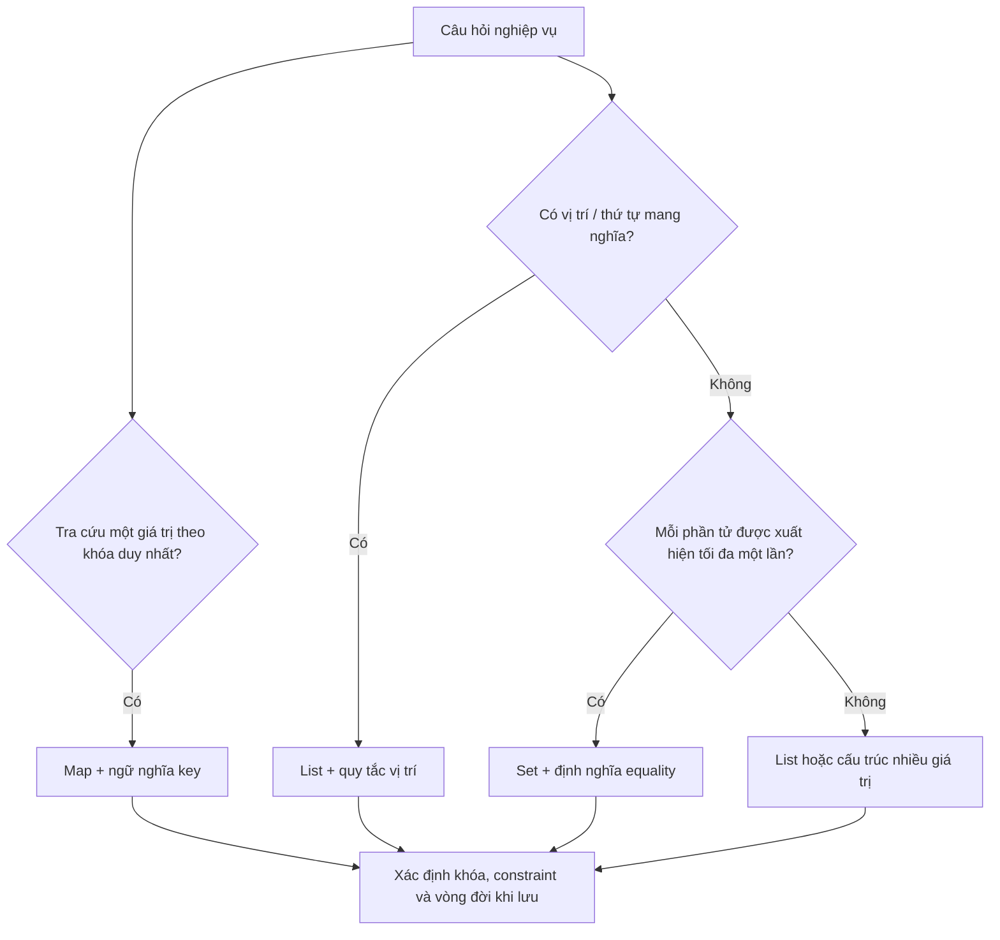
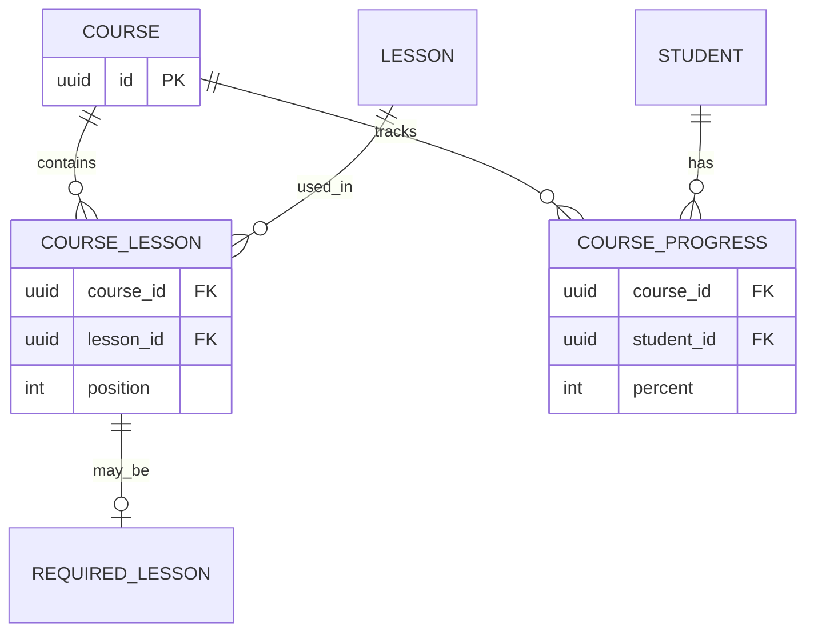

# List, Set và Map theo thứ tự, tính duy nhất và kiểu quan hệ

Giả sử một hệ thống đào tạo có khóa học gồm các bài theo **thứ tự học**, một tập bài **bắt buộc**, và bảng tra cứu **tiến độ của từng học viên**. Cả ba đều là tập hợp dữ liệu, nhưng không thể tùy tiện thay `List` bằng `Set` hoặc `Map`: thứ tự, quy tắc trùng lặp và ý nghĩa khóa tra cứu quyết định dữ liệu nào được xem là hợp lệ.

Bài này nằm trong chương **Mô hình Java** của module **DATABASE_DATA_MODELING**. Mục tiêu của module là chuyển yêu cầu nghiệp vụ thành mô hình thực thể, quan hệ và ràng buộc rõ ràng, từ chuẩn hóa, khóa, chỉ mục đến lược đồ vật lý, đồng thời so sánh lưu trữ quan hệ, document, đồ thị và phân tích. Vì vậy, ta sẽ chọn `List`, `Set` và `Map` theo **ý nghĩa nghiệp vụ**, kiểm tra hành vi trong Java, rồi chuyển các ý nghĩa ấy thành quan hệ và ràng buộc có thể kiểm chứng trong database.

## 1. Ba câu hỏi quyết định loại collection

Trước khi chọn một interface Java, hãy tự trả lời:

1. **Thứ tự có mang ý nghĩa không?** Nếu “Bài 1 → Bài 2 → Bài 3” là lộ trình học, đổi thứ tự có thể đổi hành vi sản phẩm. Một danh sách có thể biểu diễn thứ tự, còn tập hợp thông thường không cam kết vị trí.
2. **Hai phần tử cùng giá trị/danh tính có được xuất hiện nhiều lần không?** Một playlist có thể phát cùng bài hát hai lần. Ngược lại, một học viên không nên có hai enrollment có cùng khóa học và mã học viên chỉ vì thao tác được gửi lại.
3. **Có khóa nào dùng để tìm một giá trị không?** Tiến độ học viên có thể được tra bằng `StudentId`. Trong phạm vi một khóa học, mỗi ID chỉ ánh xạ tới một tiến độ hiện tại.

| Interface | Ngữ nghĩa cốt lõi | Trùng lặp | Thứ tự / tra cứu | Ví dụ |
| --- | --- | --- | --- | --- |
| `List<E>` | Dãy phần tử có chỉ số | **Cho phép** theo hợp đồng, dù nghiệp vụ có thể cấm | Truy cập theo vị trí; thứ tự có ý nghĩa | Danh sách bài học, dòng hóa đơn, chuỗi thao tác |
| `Set<E>` | Tập các phần tử khác nhau theo quy tắc bằng nhau | **Không cho phép** hai phần tử bằng nhau cùng tồn tại | Không có chỉ số vị trí; thứ tự duyệt tùy implementation | Tag duy nhất, quyền đã cấp, tập thành viên |
| `Map<K,V>` | Ánh xạ khóa → giá trị | **Khóa duy nhất**; các giá trị `V` có thể trùng | Tìm bằng khóa; thứ tự duyệt tùy implementation | ID → tiến độ, mã sản phẩm → tồn kho |

Một `Map<K,V>` không phải một `Collection<V>`: nó là cấu trúc các cặp khóa/giá trị, với `keySet()`, `values()` và `entrySet()` để xem từng khía cạnh. `Map` không có nghĩa tự động là “quan hệ một-một”: nhiều khóa khác nhau có thể trỏ tới cùng một giá trị.

> **Quy tắc lựa chọn:** Chọn theo hợp đồng dữ liệu trước; chọn `ArrayList`, `HashSet`, `HashMap` hay cấu trúc có thứ tự sau khi đã xác định ngữ nghĩa cần giữ.

## 2. Thứ tự không có cùng nghĩa ở mọi collection

### 2.1. `List` giữ vị trí và có thể lặp

```java
import java.util.List;

final class SequenceExample {
    static void show() {
        List<String> playlist = List.of("INTRO", "QUIZ", "INTRO");
        System.out.println(playlist.get(0));         // INTRO
        System.out.println(playlist.get(2));         // INTRO
        System.out.println(playlist.size());          // 3
        System.out.println(playlist.equals(
            List.of("QUIZ", "INTRO", "INTRO")
        ));                                            // false
    }
}
```

Hai danh sách bằng nhau khi cùng kích thước và từng phần tử tại cùng vị trí bằng nhau. Danh sách `["A", "B"]` khác `["B", "A"]` dù tập giá trị có vẻ giống nhau. Việc `List` **cho phép** phần tử lặp không đồng nghĩa mọi nghiệp vụ nên cho phép; nếu khóa học không được gắn cùng một bài hai lần, hãy kiểm tra ràng buộc đó riêng.

### 2.2. `Set` coi tính duy nhất là phần cốt lõi

```java
import java.util.HashSet;
import java.util.Set;

final class UniqueExample {
    static void show() {
        Set<String> tags = new HashSet<>();
        System.out.println(tags.add("JAVA")); // true
        System.out.println(tags.add("JAVA")); // false
        System.out.println(tags.size());       // 1
    }
}
```

`Set.add` trả `false` khi tập đã chứa một phần tử bằng nhau. Nhưng kết quả phụ thuộc chính sách `equals`/`hashCode` của phần tử (hoặc comparator của sorted set). Nếu phần tử là entity có ID sinh muộn hoặc khóa mutable, sự duy nhất có thể không phản ánh nghiệp vụ như mong muốn. Nên ưu tiên value object và typed ID bất biến khi tạo tập danh tính.

### 2.3. `Map` giữ duy nhất khóa, không giữ duy nhất giá trị

```java
import java.util.HashMap;
import java.util.Map;

final class LookupExample {
    static void show() {
        Map<String, Integer> scores = new HashMap<>();
        scores.put("S-1", 80);
        scores.put("S-2", 80); // Giá trị 80 có thể lặp.
        Integer previous = scores.put("S-1", 90);

        System.out.println(previous);          // 80
        System.out.println(scores.get("S-1")); // 90
        System.out.println(scores.size());     // 2
    }
}
```

`put` với khóa đã có **thay thế** giá trị cũ. Nếu dữ liệu là lịch sử điểm của một học viên, `Map<StudentId,Integer>` làm mất các lần thi trước; cần cấu trúc chứa nhiều lần thi hoặc entity có ID và thời điểm riêng.

## 3. Lựa chọn implementation: thứ tự duyệt, sắp xếp và chi phí

Java Collections Framework phân biệt **interface** (hợp đồng) và **implementation** (cách lưu/duyệt). Bảng sau mô tả hành vi điển hình cho Java 17+:

| Cấu trúc | Đặc điểm thứ tự | Thao tác phổ biến | Khi phù hợp |
| --- | --- | --- | --- |
| `ArrayList` | Giữ thứ tự theo chỉ số | `get(i)` nhanh; chèn/xóa giữa danh sách có thể dịch nhiều phần tử | Dãy đọc, thường xuyên duyệt hoặc truy cập vị trí |
| `LinkedList` | Giữ thứ tự phần tử | Có chi phí nút/tham chiếu; `get(i)` thường phải duyệt | Một số thao tác ở đầu/cuối, thường cân nhắc `ArrayDeque` nếu cần queue/deque |
| `HashSet` | **Không bảo đảm** thứ tự duyệt | `contains/add/remove` trung bình nhanh với hash ổn định | Tập không quan tâm thứ tự |
| `LinkedHashSet` | Thông thường giữ **thứ tự chèn** | Chi phí bộ nhớ hơn `HashSet` | Cần duyệt các phần tử duy nhất theo thứ tự lần đầu xuất hiện |
| `TreeSet` | Duyệt theo thứ tự sắp xếp bằng comparator/natural order | Thường `O(log n)` | Tập cần thứ tự sắp xếp và truy vấn khoảng |
| `HashMap` | **Không bảo đảm** thứ tự duyệt | `get/put/remove` trung bình nhanh với hash tốt | Tra cứu theo khóa |
| `LinkedHashMap` | Mặc định giữ thứ tự chèn; có thể cấu hình thứ tự truy cập | Thêm metadata cho liên kết | Cần duyệt map theo thứ tự ổn định |
| `TreeMap` | Duyệt theo thứ tự sắp xếp của khóa | Thường `O(log n)` | Tra cứu theo range, điều hướng khóa |

Những độ phức tạp là mô hình chung, không phải cam kết mọi thao tác đều `O(1)`. Hiệu năng còn phụ thuộc kích thước dữ liệu, hash collision, bộ nhớ, cách duyệt và các yêu cầu đồng thời. `HashMap` có thể cho ra thứ tự trông “ổn định” trong vài lần chạy, nhưng đó không phải hợp đồng sản phẩm; đổi dữ liệu hoặc phiên bản JVM có thể đổi thứ tự.

### 3.1. Thứ tự chèn khác thứ tự sắp xếp

```java
import java.util.LinkedHashSet;
import java.util.Set;
import java.util.TreeSet;

final class OrderModes {
    static void show() {
        Set<Integer> inserted = new LinkedHashSet<>();
        inserted.add(30);
        inserted.add(10);
        inserted.add(20);
        System.out.println(inserted); // [30, 10, 20]

        Set<Integer> sorted = new TreeSet<>(inserted);
        System.out.println(sorted);   // [10, 20, 30]
    }
}
```

`LinkedHashSet` hữu ích khi muốn bỏ trùng nhưng giữ thứ tự xuất hiện ban đầu; `TreeSet` biểu diễn thứ tự theo phép so sánh, không phải thứ tự được người dùng kéo-thả. Nếu thứ tự là một dữ liệu nghiệp vụ có thể chỉnh sửa, hãy lưu **vị trí/sequence number** rõ ràng, đừng chỉ dựa vào thứ tự chèn ngầm của collection.

### 3.2. `TreeSet`/`TreeMap` và comparator

Với cấu trúc sắp xếp, comparator trả kết quả `0` nghĩa là hai khóa được cấu trúc coi là tương đương để tìm/chèn, kể cả khi `equals` trên object trả `false`. Nếu comparator chỉ so `lastName`, hai học viên khác ID nhưng trùng họ có thể bị `TreeSet` gộp thành một.

```java
import java.util.Comparator;
import java.util.Set;
import java.util.TreeSet;

record Student(String id, String lastName) {}

final class ComparatorExample {
    static void show() {
        Comparator<Student> byNameThenId = Comparator
            .comparing(Student::lastName)
            .thenComparing(Student::id);
        Set<Student> students = new TreeSet<>(byNameThenId);
        students.add(new Student("S-1", "Tran"));
        students.add(new Student("S-2", "Tran"));
        System.out.println(students.size()); // 2
    }
}
```

Trong ví dụ này, comparator theo họ **và** ID tránh gộp hai học viên trùng họ. Tuy nhiên, do `record Student` có equality theo cả `id` và `lastName`, nếu một thay đổi trường không có trong comparator được thêm vào record, comparator và `equals` có thể lại bất nhất. Khi dùng `SortedSet` như một `Set` theo contract đầy đủ, comparator nên **nhất quán với equals** trong miền khóa đang dùng, hoặc phải nêu rõ ngữ nghĩa khác; nếu mục tiêu thực sự là uniqueness theo ID, cân nhắc dùng `Set<StudentId>` và sắp xếp khi hiển thị.

## 4. Quan hệ nghiệp vụ không tự xuất hiện từ collection

Java collection chỉ lưu cách **một đối tượng đang tham chiếu các giá trị khác trong bộ nhớ**. Nó chưa xác định khóa ngoại, quyền sở hữu, bản ghi lịch sử, transaction hay tính nhất quán giữa nhiều tiến trình.



| Quan hệ nghiệp vụ | Java có thể biểu diễn | Lưu trữ quan hệ thường dùng |
| --- | --- | --- |
| Một đơn hàng có các dòng theo thứ tự hiển thị | `List<OrderLine>` | Bảng `order_lines` với `order_id` và `position` |
| Một bài có các tag duy nhất | `Set<TagCode>` | Bảng nối `article_tags` với `PRIMARY KEY(article_id, tag_code)` |
| Mỗi học viên có một tiến độ hiện tại trong một khóa | `Map<StudentId, Progress>` trong phạm vi khóa | Bảng `course_progress` với `PRIMARY KEY(course_id, student_id)` |
| Một học viên có nhiều lần thi | `List<Attempt>` hoặc `Map<StudentId,List<Attempt>>` nếu nhóm theo học viên | Bảng `attempts`, mỗi lần thi có ID riêng và thời điểm |
| Nhiều học viên học nhiều khóa | `Set<StudentId>` trong một aggregate khóa, hoặc collection phía học viên | Bảng nối `enrollments(course_id, student_id)` |
| Một sản phẩm thuộc nhiều danh mục và ngược lại | `Set<CategoryId>` ở biên đọc | Bảng quan hệ nhiều-nhiều có khóa ghép |

Từ `List` hay `Set` **không thể suy ra đầy đủ cardinality**: danh sách có thể chứa nhiều đối tượng nhưng vẫn chỉ là một phần của aggregate, còn `Map` có thể chứa danh sách và biểu diễn một-nhiều. Phải xác định riêng: thực thể nào có danh tính, quan hệ có thuộc tính riêng không, quan hệ được tạo/hủy như thế nào, có cần lưu lịch sử không.

## 5. Ví dụ xuyên suốt: khóa học, bài bắt buộc và tiến độ

Yêu cầu đơn giản:

- Khóa học có danh sách các bài theo vị trí (`List<LessonId>`). Trong **khóa học này**, một bài không được xuất hiện hai lần; đây là ràng buộc **thêm** so với hợp đồng `List`.
- Một số bài thuộc tập `requiredLessons` (`Set<LessonId>`); tập này phải là **tập con** của những bài trong khóa học.
- Mỗi học viên có một giá trị phần trăm tiến độ hiện tại (`Map<StudentId,Integer>`) trong khoảng 0–100; nhiều học viên được phép có cùng phần trăm.
- Kết quả đọc phải không thể thay đổi qua các collection nguồn sau khi tạo snapshot.

### Mã Java 17+ có thể chạy

Lưu toàn bộ đoạn sau thành `CourseCollectionDemo.java`:

```java
import java.util.ArrayList;
import java.util.HashMap;
import java.util.HashSet;
import java.util.List;
import java.util.Map;
import java.util.Objects;
import java.util.Set;
import java.util.UUID;

record LessonId(UUID value) {
    public LessonId {
        Objects.requireNonNull(value, "value");
    }
}

record StudentId(UUID value) {
    public StudentId {
        Objects.requireNonNull(value, "value");
    }
}

record CourseSnapshot(
    List<LessonId> lessonOrder,
    Set<LessonId> requiredLessons,
    Map<StudentId, Integer> progressPercent
) {
    public CourseSnapshot {
        lessonOrder = List.copyOf(
            Objects.requireNonNull(lessonOrder, "lessonOrder")
        );
        requiredLessons = Set.copyOf(
            Objects.requireNonNull(requiredLessons, "requiredLessons")
        );
        progressPercent = Map.copyOf(
            Objects.requireNonNull(progressPercent, "progressPercent")
        );

        if (lessonOrder.isEmpty()) {
            throw new IllegalArgumentException(
                "Course must have lessons"
            );
        }
        Set<LessonId> knownLessons = new HashSet<>(lessonOrder);
        if (knownLessons.size() != lessonOrder.size()) {
            throw new IllegalArgumentException(
                "Lesson ID must be unique within this course"
            );
        }
        if (!knownLessons.containsAll(requiredLessons)) {
            throw new IllegalArgumentException(
                "Required lesson is missing from lesson order"
            );
        }
        for (Integer percent : progressPercent.values()) {
            if (percent < 0 || percent > 100) {
                throw new IllegalArgumentException(
                    "Progress must be between 0 and 100"
                );
            }
        }
    }

    List<LessonId> requiredInLearningOrder() {
        return lessonOrder.stream()
            .filter(requiredLessons::contains)
            .toList(); // Giữ thứ tự học, không dựa vào thứ tự Set.
    }
}

public class CourseCollectionDemo {
    public static void main(String[] args) {
        LessonId intro = new LessonId(UUID.randomUUID());
        LessonId practice = new LessonId(UUID.randomUUID());
        LessonId review = new LessonId(UUID.randomUUID());
        StudentId learner = new StudentId(UUID.randomUUID());

        List<LessonId> ordered = new ArrayList<>(
            List.of(intro, practice, review)
        );
        Set<LessonId> required = new HashSet<>(
            Set.of(intro, review)
        );
        Map<StudentId, Integer> progress = new HashMap<>();
        progress.put(learner, 75);

        CourseSnapshot snapshot = new CourseSnapshot(
            ordered, required, progress
        );

        // Nguồn mutable đổi sau khi snapshot được tạo.
        ordered.clear();
        required.clear();
        progress.put(learner, 10);

        System.out.println(snapshot.lessonOrder().size());       // 3
        System.out.println(snapshot.lessonOrder().get(0)
            .equals(intro));                                     // true
        System.out.println(snapshot.requiredInLearningOrder()
            .equals(List.of(intro, review)));                    // true
        System.out.println(snapshot.progressPercent().get(learner)); // 75

        // snapshot.lessonOrder().clear(); // UnsupportedOperationException
        // new CourseSnapshot(List.of(intro, intro), Set.of(intro), Map.of());
        // IllegalArgumentException: lesson ID trùng
    }
}
```

Ở ví dụ này, `List` giữ thứ tự môn học; `Set` biểu diễn membership/uniqueness; `Map` biểu diễn hàm tra cứu tiến độ. `List.copyOf`, `Set.copyOf` và `Map.copyOf` bảo vệ cấu trúc collection; các phần tử `LessonId`/`StudentId` và `Integer` là bất biến nên dữ liệu snapshot không thể bị sửa qua chúng.

**Ba quyết định nghiệp vụ quan trọng:**

1. `List` vốn cho phép trùng. Constructor dùng `new HashSet<>(lessonOrder).size()` để cấm **bài ID trùng trong cùng một khóa**. Nếu hệ thống cho phép lặp một bài hai lần trong lộ trình, ràng buộc này phải thay đổi.
2. `Set.copyOf` loại phần tử trùng mà không báo lỗi nếu nguồn là collection có phần tử lặp. Nếu request có `List` và nghiệp vụ yêu cầu **thông báo lỗi khi người dùng gửi trùng**, cần kiểm tra trước khi chuyển sang `Set`.
3. `Map<StudentId,Integer>` chỉ giữ tiến độ **hiện tại**. Nó không lưu từng lần cập nhật, người sửa, hay thời điểm. Muốn lịch sử/kiểm toán phải thiết kế entity/bảng sự kiện riêng.

### Cảnh báo về nhất quán đồng thời

`CourseSnapshot` được tạo an toàn sau khi đã nhận **ba collection nguồn nhất quán**. Nhưng nếu một thread đổi `ordered`, `required` hoặc `progress` trong lúc thread khác sao chép, kết quả có thể không nhất quán hoặc việc sao chép thất bại. Phải giữ cùng một ranh giới đồng bộ/transaction khi đọc nguồn; bất biến sau khi tạo không thay thế tính nguyên tử của bước chụp.

## 6. Ánh xạ sang mô hình quan hệ: thứ tự, unique và khóa tra cứu

Để thực hiện đúng yêu cầu trong PostgreSQL, cần mô hình hóa danh sách bài học thành **quan hệ có thuộc tính vị trí**, tập bài bắt buộc thành quan hệ không trùng, và map tiến độ thành quan hệ có khóa ghép.

```sql
CREATE TABLE courses (
    id UUID PRIMARY KEY,
    title TEXT NOT NULL
);

CREATE TABLE lessons (
    id UUID PRIMARY KEY,
    title TEXT NOT NULL
);

CREATE TABLE students (
    id UUID PRIMARY KEY,
    display_name TEXT NOT NULL
);

-- Danh sách bài học trong từng khóa: có vị trí và cấm lặp lesson ID.
CREATE TABLE course_lessons (
    course_id UUID NOT NULL REFERENCES courses(id),
    lesson_id UUID NOT NULL REFERENCES lessons(id),
    position INTEGER NOT NULL CHECK (position > 0),
    PRIMARY KEY (course_id, lesson_id),
    UNIQUE (course_id, position)
);

-- Một bài bắt buộc phải là bài đã thuộc khóa học.
CREATE TABLE required_course_lessons (
    course_id UUID NOT NULL,
    lesson_id UUID NOT NULL,
    PRIMARY KEY (course_id, lesson_id),
    FOREIGN KEY (course_id, lesson_id)
        REFERENCES course_lessons(course_id, lesson_id)
);

-- Một học viên có một tiến độ hiện tại trong một khóa.
CREATE TABLE course_progress (
    course_id UUID NOT NULL REFERENCES courses(id),
    student_id UUID NOT NULL REFERENCES students(id),
    percent SMALLINT NOT NULL CHECK (percent BETWEEN 0 AND 100),
    PRIMARY KEY (course_id, student_id)
);
```

### 6.1. Trật tự của `List` cần cột và `ORDER BY`

`position` biểu diễn thứ tự có ý nghĩa. Để khôi phục `List<LessonId>`:

```sql
SELECT lesson_id
FROM course_lessons
WHERE course_id = :course_id
ORDER BY position ASC;
```

`:course_id` là tham số đặt tên do thư viện truy cập dữ liệu thay giá trị, không phải cú pháp trực tiếp của `psql`. Trong SQL, **không có `ORDER BY` thì thứ tự dòng kết quả không được bảo đảm**, kể cả khi dữ liệu có khóa chính hoặc index. `PRIMARY KEY(course_id, lesson_id)` bảo đảm mỗi lesson xuất hiện tối đa một lần trong khóa; `UNIQUE(course_id, position)` ngăn hai lesson dùng cùng vị trí.

Hai constraint đó **chưa bảo đảm vị trí liên tục 1,2,3…**. Nếu khi xóa bài 2 cần dồn các vị trí 3,4,…, phải thiết kế hành vi reorder trong transaction; một số hệ thống cố ý để khoảng trống để dễ chèn. Khi hoán đổi hai vị trí đang bị unique constraint kiểm tra, thao tác cập nhật trực tiếp có thể vi phạm duy nhất tạm thời; cần kế hoạch cập nhật vị trí an toàn (như tạm dùng vị trí trống, khóa thích hợp, hoặc constraint được defer nếu phù hợp với PostgreSQL).

### 6.2. `Set` tương ứng uniqueness trong phạm vi quan hệ

`PRIMARY KEY(course_id, lesson_id)` ở `required_course_lessons` bảo đảm cùng một bài không được gắn hai lần trong khóa. Composite foreign key buộc bài bắt buộc thật sự có trong `course_lessons`. Đây là ràng buộc **database** bảo vệ được ngay cả khi dữ liệu được ghi từ một dịch vụ khác không dùng `Set` Java.

Nếu thực thể quan hệ có thuộc tính như `assignedAt`, `assignedBy`, `isRequired` hoặc thời điểm hiệu lực, đừng cố ẩn tất cả trong một `Set<LessonId>`. Có thể cần entity `CourseLesson` hoặc bảng nối có metadata để biểu diễn vòng đời quan hệ.

### 6.3. `Map` tương ứng khóa → một giá trị hiện tại

`PRIMARY KEY(course_id, student_id)` thể hiện trong phạm vi một khóa, mỗi học viên chỉ có một bản tiến độ hiện tại. Đọc thành map:

```sql
SELECT student_id, percent
FROM course_progress
WHERE course_id = :course_id;
```

Khi map dữ liệu trả về, phải xác định rõ xử lý trường hợp trùng key (nếu kết quả đến từ một join không duy nhất). Đừng âm thầm ghi đè bản sau lên bản trước nếu việc trùng thể hiện lỗi mô hình hoặc lỗi truy vấn.

Nếu cần lưu lịch sử tiến độ, bảng `progress_events(event_id, course_id, student_id, percent, occurred_at, ...)` là một khái niệm khác. Từ lịch sử ấy có thể tính **bản mới nhất** để dựng `Map<StudentId,Integer>` tại thời điểm đọc, nhưng phải định nghĩa cách xử lý các bản có cùng timestamp hoặc sự kiện đến muộn.

## 7. Cardinality và bảng nối: `Map` không phải lúc nào cũng là 1–1

Cần hiểu cardinality ở cấp nghiệp vụ:

| Cardinality | Ví dụ | Java ở phía đọc | Gợi ý mô hình lưu |
| --- | --- | --- | --- |
| 1–1 | Một đơn có một địa chỉ giao hàng hiện tại | `Address` hoặc `Optional<Address>` khi thực sự có thể thiếu | Cột nhúng hoặc bảng con với unique FK |
| 1–N có thứ tự | Một khóa có dãy bài học | `List<LessonId>` | FK + `position` + khóa/unique theo phạm vi |
| 1–N không thứ tự | Một bài có nhiều tag khác nhau | `Set<TagId>` | Bảng con/bảng nối với unique pair |
| N–N | Nhiều học viên học nhiều khóa | `Set<StudentId>` hoặc `Set<CourseId>` theo chiều đọc | `enrollments(course_id, student_id)` với khóa ghép |
| Khóa → một giá trị hiện tại | Tiến độ của học viên theo khóa | `Map<StudentId, Integer>` | Khóa ghép `(course_id, student_id)` |
| Khóa → nhiều giá trị | Các lần thi của từng học viên | `Map<StudentId,List<Attempt>>` khi cần nhóm trong bộ nhớ | Bảng `attempts` có PK riêng và FK tới học viên/khóa |

Một bảng nối N–N có thể chứa thêm ngày ghi danh, trạng thái, role, điểm và nguồn dữ liệu. Khi đó **enrollment là thực thể quan hệ có dữ liệu riêng**, nên có thể mô hình thành `Enrollment` thay vì chỉ `Set<StudentId>`.



Sơ đồ minh họa cấu trúc quan hệ. Nếu sản phẩm có chính sách bài bắt buộc theo **phiên bản khóa học**, hoặc tiến độ theo **lần ghi danh**, khóa sẽ cần bổ sung version/enrollment ID; không thể mặc định một `StudentId` luôn ánh xạ tới đúng một tiến độ cho toàn bộ lịch sử.

## 8. `Map` trong Java: ghi đè, dữ liệu thiếu và xử lý trùng khóa

### 8.1. `get` trả `null` có thể mang hai nghĩa

Với `HashMap`, `get(key) == null` có thể vì **không có key** hoặc vì key được ánh xạ tới `null`. `containsKey` phân biệt hai trường hợp. Với `Map.of`/`Map.copyOf`, khóa và giá trị `null` bị từ chối, nên việc trả null có thể được hiểu là không có key theo hợp đồng tương ứng.

```java
import java.util.HashMap;
import java.util.Map;

final class MissingVsNull {
    static void show() {
        Map<String, Integer> scores = new HashMap<>();
        scores.put("S-1", null);

        System.out.println(scores.get("S-1"));         // null
        System.out.println(scores.containsKey("S-1")); // true
        System.out.println(scores.containsKey("S-2")); // false
    }
}
```

Đối với dữ liệu nghiệp vụ, thay vì dùng `null` cho nhiều ý nghĩa “chưa thi”, “không có quyền” hoặc “đang xử lý”, hãy thiết kế một kiểu trạng thái hoặc record rõ nghĩa; đừng dùng một giá trị đặc biệt lẫn với thiếu key.

### 8.2. `Collectors.toMap` không tự biết cách xử lý trùng key

```java
import java.util.List;
import java.util.Map;
import java.util.stream.Collectors;

record StudentScore(String studentId, int score) {}

final class DuplicateKeyExample {
    static void show() {
        List<StudentScore> input = List.of(
            new StudentScore("S-1", 60),
            new StudentScore("S-1", 90)
        );

        // Không có merge function: ném IllegalStateException khi key trùng.
        // Map<String, Integer> invalid = input.stream()
        //     .collect(Collectors.toMap(
        //         StudentScore::studentId, StudentScore::score
        //     ));

        Map<String, Integer> highestScore = input.stream()
            .collect(Collectors.toMap(
                StudentScore::studentId,
                StudentScore::score,
                Integer::max
            ));
        System.out.println(highestScore.get("S-1")); // 90
    }
}
```

`Integer::max` ở đây là chính sách **điểm cao nhất**, không phải cách mặc định cho mọi nghiệp vụ. Nếu dữ liệu mang “điểm mới nhất”, phải có thời điểm và quy tắc chọn bản mới nhất. Nếu trùng key là lỗi bất thường, nên fail rõ ràng thay vì chọn im lặng một bản.

### 8.3. Khóa `Map` phải ổn định

`HashMap` và `HashSet` phụ thuộc `equals`/`hashCode`. Nếu key mutable bị đổi sau `put`, `get` hoặc `remove` có thể không tìm thấy giá trị. Với dữ liệu có identity như `Student`/`Course`, nên dùng `StudentId`/`CourseId` bất biến làm key. Nếu dùng `TreeMap`, comparator quyết định ngữ nghĩa tương đương của khóa như đã phân tích ở mục 3.

## 9. Bất biến, null và API collection

Khi trao giá trị qua các tầng, cần phân biệt:

| Cách tạo | Bất biến cấu trúc? | Nhận `null`? | Phát hiện phần tử trùng? |
| --- | --- | --- | --- |
| `List.of("A","B")` | Có | Không | `List` cho phép trùng |
| `Set.of("A","B")` | Có | Không | Ném `IllegalArgumentException` nếu truyền phần tử trùng |
| `Map.of("A",1)` | Có | Không với key/value | Ném `IllegalArgumentException` nếu key trùng |
| `List.copyOf(source)` | Có | Không với phần tử | Giữ phần tử trùng và thứ tự |
| `Set.copyOf(source)` | Có | Không với phần tử | **Gộp** các phần tử trùng |
| `Map.copyOf(source)` | Có | Không với key/value | Nguồn map vốn đã có key duy nhất theo chính sách của nó |
| `Collections.unmodifiableList(source)` | Chỉ cấm sửa qua wrapper | Theo dữ liệu nguồn | Vẫn phản ánh sửa nguồn |

`List.copyOf` và `Map.copyOf` không làm sâu các phần tử/value mutable; nếu cần bất biến toàn bộ dữ liệu, từng phần tử phải là value object bất biến hoặc được sao chép/chuẩn hóa. Những snapshot lớn cũng cần đánh giá chi phí bộ nhớ và đồng bộ khi chụp từ nguồn.

Trong DTO, `List.empty` và `null` có thể mang nghĩa khác nhau: “không có phần tử” khác “chưa nạp” hoặc “không cung cấp trường”. Hãy định nghĩa hợp đồng API trước khi thay `null` bằng collection rỗng ở mọi nơi.

## 10. Quan hệ qua JPA/Hibernate: collection không tự tạo constraint

ORM hỗ trợ mapping `@OneToMany`, `@ManyToMany` và các cơ chế lưu collection khác nhau. Nhưng kiểu Java chỉ là **một phần** quyết định:

- `List` có thể cần `@OrderColumn` nếu muốn persist vị trí của quan hệ; `@OrderBy` sắp xếp theo thuộc tính khi đọc là ngữ nghĩa **khác** thứ tự do người dùng chỉnh. Mức hỗ trợ cụ thể còn phụ thuộc phiên bản JPA/provider.
- `Set` trong entity ORM cần `equals`/`hashCode` ổn định cho phần tử. ID sinh sau persist, proxy và trạng thái transient có thể làm quan hệ `Set` hoạt động bất ngờ nếu equality sai.
- `Map` có thể ánh xạ bằng `@MapKey`, `@MapKeyColumn` hoặc quan hệ/bảng riêng, tùy khóa được lấy từ entity hay giá trị. Không suy rằng mỗi map nhất thiết có một bảng hai cột.
- **Owning side**, cascade, orphan removal và transaction là quyết định về vòng đời quan hệ, không được quyết định chỉ bởi `List`/`Set`. `CascadeType.REMOVE` với nhiều-nhiều dùng chung entity có thể gây tác động không mong muốn.
- Khi expose dữ liệu ra API, tránh trả trực tiếp managed collection/lazy proxy. Chuyển sang DTO/snapshot có thứ tự/uniqueness đúng nghĩa sau khi đọc dữ liệu nhất quán.

Không dùng `new HashSet<>(items)` như cách “sửa lỗi” quan hệ duplicate nếu nguồn có các hàng trùng bất thường: nó có thể che giấu lỗi JOIN hoặc thiếu unique constraint. Cần xác định và sửa nguyên nhân ở mô hình/DB.

## 11. Đồng thời và thay đổi collection

`ArrayList`, `HashSet` và `HashMap` không phải container thread-safe cho các thay đổi đồng thời không phối hợp. Nếu một thread đang cập nhật trong khi thread khác duyệt, có thể gặp kết quả không nhất quán hoặc exception. Không dựa vào fail-fast iterator như một cơ chế bảo vệ tính đúng đắn.

Một số lựa chọn:

- **Trạng thái bất biến:** mỗi lần thay đổi tạo snapshot mới và công bố tham chiếu theo cơ chế phù hợp, tránh sửa nội dung đang được đọc.
- **Đồng bộ bằng khóa:** các thao tác đọc/chụp và ghi liên quan phải dùng cùng một khóa khi cần điểm nhìn nhất quán.
- **Concurrent collections:** `ConcurrentHashMap` cho phép thao tác đồng thời trên map, nhưng không cung cấp một transaction nguyên tử cho mọi khóa trong nhiều thao tác. Nó không cho key/value `null`.
- **Database transaction:** dữ liệu dùng chung giữa nhiều JVM/instance phải bảo vệ bằng khóa, unique constraint, optimistic locking hoặc cơ chế database phù hợp; `synchronized` trong một JVM không đủ.

Ví dụ cập nhật điểm hiện tại an toàn theo một khóa đơn lẻ:

```java
import java.util.concurrent.ConcurrentHashMap;
import java.util.concurrent.ConcurrentMap;

final class ScoreCache {
    private final ConcurrentMap<String, Integer> scores =
        new ConcurrentHashMap<>();

    void keepHighest(String studentId, int nextScore) {
        if (nextScore < 0 || nextScore > 100) {
            throw new IllegalArgumentException("Score out of range");
        }
        scores.merge(studentId, nextScore, Integer::max);
    }

    Integer highest(String studentId) {
        return scores.get(studentId);
    }
}
```

`merge` tính cập nhật nguyên tử cho từng key theo hợp đồng `ConcurrentHashMap`. Điều này không chứng minh trạng thái cache luôn nhất quán với database hoặc quy tắc phân quyền của học viên; cần chiến lược đồng bộ, version và invalidation riêng. `Map.copyOf(scores)` tạo kết quả không sửa được, nhưng khi nguồn đang thay đổi nó không bảo đảm snapshot nhiều khóa có cùng một thời điểm logic.

## 12. Document, đồ thị và phân tích: giữ nguyên nghĩa của tập hợp

| Kiểu lưu trữ | Thứ tự, uniqueness và key |
| --- | --- |
| **Document** | Array JSON/BSON giữ thứ tự phần tử, có thể trùng. Object/map có key tên trường, nhưng không tự thay thế unique constraint nghiệp vụ; cần chiến lược validate, cập nhật document và index phù hợp. |
| **Đồ thị** | Nút và cạnh biểu diễn quan hệ; hai cạnh có cùng đầu-cuối có thể là hai sự kiện/quan hệ hợp lệ hoặc dữ liệu trùng tùy miền. Nếu cạnh có thứ tự, lưu `position`/`sequence` trên cạnh hay node quan hệ. |
| **Phân tích / warehouse** | Bảng fact không có thứ tự tự nhiên; “top N” cần `ORDER BY` và quy tắc hòa. Dedup theo event ID/business key thích hợp, không mặc định dùng `DISTINCT` trên toàn bộ cột. |
| **Quan hệ** | List cần `position` và truy vấn có `ORDER BY`; Set cần PK/UNIQUE theo phạm vi; Map cần khóa đơn/ghép bảo đảm mỗi key có một giá trị theo hợp đồng. |

Trong mô hình document, một array `lessonIds` có thể chứa ID trùng nếu không kiểm tra; đổi sang `Set` khi đọc Java sẽ **làm mất thông tin trùng**. Trong hệ đồ thị, các cạnh `ENROLLED_IN` có thể mang ngày đăng ký và trạng thái riêng; gộp theo cặp endpoint làm mất lịch sử nếu nghiệp vụ cho phép tái đăng ký. Trong warehouse, một bảng có nhiều dòng cho cùng mã học viên thường là dữ liệu theo **thời điểm**, không phải sai trùng đơn giản.

## 13. Những lỗi thiết kế thường gặp

| Lỗi | Hệ quả | Cách điều chỉnh |
| --- | --- | --- |
| Dùng `HashSet` để giữ trình tự người dùng kéo thả | Thứ tự duyệt không bảo đảm | `List` + vị trí nghiệp vụ; có thể dùng `LinkedHashSet` chỉ khi cần thứ tự chèn và uniqueness |
| Dùng `List` rồi quên kiểm tra trùng | Một đối tượng xuất hiện nhiều lần trái chính sách | Xác định ràng buộc distinct theo ID và unique constraint ở DB |
| Dùng `Set` để “xử lý” dữ liệu trùng từ DB | Che giấu lỗi JOIN/constraint, mất thông tin | Kiểm tra nguồn và khóa quan hệ |
| Dùng `Map` cho lịch sử nhiều giá trị mỗi khóa | Bản mới ghi đè bản cũ | `List<Attempt>` hoặc bảng event có ID/thời điểm |
| Dùng entity mutable làm key `HashMap` | Tra cứu sai sau khi đổi field/hash | Dùng typed ID/value key bất biến |
| Nghĩ SQL tự trả dữ liệu theo `position` | Kết quả có thể sai thứ tự | `ORDER BY position` trong query |
| Dùng `TreeSet` comparator không phân biệt đủ identity | Mất phần tử khác nhau theo nghiệp vụ | Comparator nhất quán hoặc dùng ID làm tập, sort ở view |
| Dùng `Set.copyOf` để “validate” input trùng | Phần tử trùng bị gộp im lặng | Kiểm tra distinct count trước, báo lỗi rõ |
| Chỉ dùng Java `Set` để chống trùng toàn hệ thống | Nhiều request vẫn có thể insert trùng | PK/UNIQUE, transaction và xử lý conflict |
| Dùng `ConcurrentHashMap` như database transaction | Nhiều-key operation không nguyên tử; cache có thể stale | Thiết kế transaction/version và cơ chế sync với nguồn |

## 14. Bài tập thực hành

### Bài tập A — Danh sách dòng đơn hàng

Một đơn hàng có các dòng hiển thị theo vị trí, có thể chứa cùng một `ProductId` nhiều lần vì khác lô hoặc chương trình ưu đãi. Hãy chọn `List`, `Set` hay `Map`. Đề xuất bảng `order_lines` (khóa, vị trí, SKU, quantity, discount) sao cho phép nhiều dòng cùng sản phẩm, nhưng cấm trùng vị trí trong một đơn. Viết truy vấn khôi phục đúng thứ tự.

**Gợi ý:** dùng `List<OrderLine>`; định danh dòng có thể là `(order_id,line_no)` hoặc `line_id` riêng, `UNIQUE(order_id,position)` để giữ vị trí. Không đặt `UNIQUE(order_id,product_id)` nếu nghiệp vụ cho phép sản phẩm lặp theo dòng.

### Bài tập B — Thành viên và phân quyền

Một nhóm có nhiều thành viên, một người có thể là thành viên của nhiều nhóm. Mỗi quan hệ thành viên có `role`, `joinedAt` và `status`. Đề xuất cách lưu và cách biểu diễn Java để kiểm tra nhanh danh sách ID hiện tại, đồng thời không làm mất metadata và lịch sử thay đổi.

**Gợi ý:** bảng `group_memberships(group_id,user_id,...)` với khóa ghép nếu chỉ cho một membership hiện tại; có thể cần membership ID và thời gian hiệu lực để lưu lịch sử. `Set<UserId>` chỉ là projection membership, không đủ làm toàn bộ mô hình khi quan hệ có thuộc tính.

### Bài tập C — Điểm nhiều lần thi

Dữ liệu có ba attempt của cùng một học viên: 60, 90, 75 tại ba thời điểm khác nhau. API cần trả **điểm cao nhất**, **điểm gần nhất** và **toàn bộ lịch sử**. Hãy chọn ba representation phù hợp và viết chính sách chuyển từ `List<Attempt>` sang từng representation, tránh ghi đè không chủ đích trong `Map`.

**Gợi ý:** lưu tất cả attempt có ID và timestamp; tạo `Map<StudentId,Integer>` cho điểm cao nhất theo `max`; điểm mới nhất cần `occurredAt` và quy tắc tie-break; lịch sử là `List<Attempt>` có `ORDER BY occurred_at, attempt_id` khi cần kết quả xác định.

### Bài tập D — Kiểm tra lược đồ khóa học

Cho ba collection `lessonOrder`, `requiredLessons` và `progressPercent` ở mục 5. Hãy chỉ ra các invariant không thể kiểm chứng chỉ từ một field: required là subset của lesson, lesson ID duy nhất, tiến độ 0–100. Xác định invariant được giữ bởi constructor, PK/UNIQUE/CHECK/FK nào được giữ ở database, và quy tắc nào cần transaction khi thay đổi nhiều bảng cùng lúc.

**Gợi ý:** ràng buộc liên bảng có thể dùng composite FK; không có constraint đơn giản nào ở ví dụ tự bảo đảm vị trí liên tục. Khi chuyển bài qua vị trí khác, cần ghi có điều kiện và xử lý unique constraint trong một transaction.

## 15. Checklist chốt mô hình

- [ ] Đã trả lời rõ thứ tự, trùng lặp và khóa tra cứu có ý nghĩa gì trong nghiệp vụ.
- [ ] Chỉ dùng `List` khi cần dãy/vị trí hoặc cho phép phần tử lặp; nếu cấm trùng đã thêm invariant phù hợp.
- [ ] Chỉ dùng `Set` khi uniqueness được định nghĩa rõ theo `equals`/`hashCode` hoặc comparator phù hợp.
- [ ] Với `Map`, đã xác định chính sách ghi đè, thiếu khóa, giá trị null và trùng key.
- [ ] Key và các phần tử tham gia equality đều ổn định trong vòng đời dùng làm map/set.
- [ ] Thứ tự chèn, thứ tự sắp xếp và thứ tự nghiệp vụ được phân biệt rõ.
- [ ] Khi lưu quan hệ SQL, đã thiết kế PK/FK, `UNIQUE`, vị trí và `ORDER BY` đúng phạm vi.
- [ ] Với dữ liệu có thời gian hiệu lực hoặc lịch sử, không làm mất thông tin bằng cách gộp thành map/set hiện tại.
- [ ] Các collection đưa qua API hoặc cache có ranh giới bất biến/ownership phù hợp.
- [ ] Có cơ chế transaction, concurrency và constraint để dữ liệu nhất quán giữa nhiều request.
- [ ] Mapping sang document, graph và warehouse vẫn bảo toàn thứ tự, tập giá trị và danh tính quan hệ.

**Ghi nhớ:** `List` trả lời **“các phần tử nằm theo dãy nào?”**; `Set` trả lời **“những phần tử riêng biệt nào thuộc tập?”**; `Map` trả lời **“mỗi khóa đang ánh xạ tới giá trị nào?”**. Đó là ba ngữ nghĩa khác nhau. Khi biến chúng thành bảng, document, cạnh đồ thị hoặc dữ liệu phân tích, phải làm rõ vị trí, khóa, tính duy nhất, lịch sử và ranh giới transaction để mô hình không mất nghĩa.
