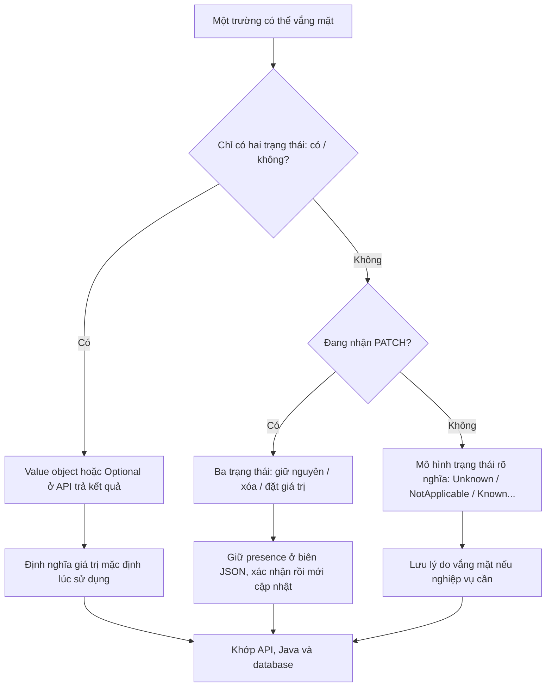

# Biểu diễn phần tử tùy chọn mà không đánh đồng thiếu với giá trị mặc định

Giả sử hệ thống thông báo cho phép người dùng đặt **số thông báo tối đa mỗi ngày**. Một người chưa thiết lập giới hạn cá nhân sẽ dùng chính sách mặc định của tổ chức, chẳng hạn 20 thông báo/ngày. Người khác chủ động chọn **0** để tắt thông báo. Nếu hệ thống lưu cả hai trường hợp thành `0`, hoặc tự điền `20` vào nơi chưa cấu hình, nó sẽ không còn biết đâu là lựa chọn thật của người dùng và đâu là giá trị được suy ra.

Vấn đề trở nên rõ hơn ở API cập nhật một phần: một request **không có** trường `notificationLimit` có thể mang nghĩa “giữ nguyên”, còn request có `"notificationLimit": null` mang nghĩa “xóa cấu hình riêng, trở lại kế thừa”. Cả hai khác với `"notificationLimit": 0`. Đây là bài toán mô hình dữ liệu, không chỉ là chọn `Optional` hay `null` trong Java.

Bài học thuộc chương **Mô hình Java** trong module **DATABASE_DATA_MODELING**. Phạm vi module là chuyển yêu cầu nghiệp vụ thành thực thể, quan hệ và ràng buộc, từ chuẩn hóa, khóa, chỉ mục tới lược đồ vật lý; so sánh lưu trữ quan hệ, document, đồ thị và phân tích để mô hình rõ nghĩa, tiến hóa được và kiểm chứng được. Ta sẽ phân loại những trạng thái “không có dữ liệu”, thiết kế Java 17+, rồi đối chiếu cách thể hiện trên JSON/API, SQL và các kho dữ liệu khác.

## 1. “Thiếu” không phải một giá trị mặc định

Một trường có thể không mang giá trị vì nhiều lý do **khác nhau về nghiệp vụ**.

| Trạng thái | Câu hỏi thực tế | Ví dụ | Có được tự đổi thành mặc định? |
| --- | --- | --- | --- |
| **Không được gửi (omitted)** | Caller không đề cập trường này? | PATCH không có `notificationLimit` | Không: với PATCH, thường là giữ nguyên |
| **Xóa có chủ đích (explicit clear)** | Caller yêu cầu bỏ giá trị đã cấu hình? | `"notificationLimit": null` theo hợp đồng PATCH cụ thể | Không: đây là một **hành động** |
| **Chưa cấu hình (unset/inherit)** | Trạng thái đang lưu chưa có override? | Cột `notification_limit IS NULL` | Có thể **tính** mặc định khi sử dụng, không nhất thiết ghi đè vào storage |
| **Giá trị tường minh** | Caller thật sự chọn số nào? | `"notificationLimit": 0` | Không: `0` có thể nghĩa là chặn tất cả |
| **Chuỗi hoặc collection rỗng** | Caller đã cung cấp giá trị rỗng? | `""`, `[]` | Phụ thuộc miền, không tự xem là thiếu |
| **Không biết (unknown)** | Giá trị có tồn tại nhưng chưa thu thập? | Chưa biết ngày sinh | Không nhất thiết tương đương “không áp dụng” |
| **Không áp dụng (not applicable)** | Khái niệm có nghĩa với đối tượng này không? | Ngày hết hạn cho quyền vĩnh viễn | Cần mô hình riêng nếu quan trọng |
| **Chưa tải (not loaded)** | Ứng dụng chưa truy vấn dữ liệu? | ORM association đang lazy | Không được kết luận giá trị thực sự vắng mặt |
| **Bị ẩn (redacted)** | Có dữ liệu nhưng người gọi không được xem? | Trường nội bộ bị giới hạn quyền | Không nên báo “không có dữ liệu” nếu điều đó sai nghĩa |

**Định nghĩa quan trọng:** “tùy chọn” thường chỉ nói rằng một giá trị *có thể vắng mặt*, nhưng **không cho biết nguyên nhân**, cũng không cho biết phải làm gì khi vắng mặt. Chỉ thêm `?`, `null`, `Optional` hoặc một giá trị sentinel chưa đủ để diễn đạt mọi trạng thái trong bảng.

### Ví dụ phản chứng

Xét ba yêu cầu cập nhật:

```json
{}
```

```json
{"notificationLimit": null}
```

```json
{"notificationLimit": 0}
```

Với hợp đồng API được chọn cho bài học:

1. `{}`: **không thay đổi** giới hạn đã lưu.
2. `null`: **xóa** giới hạn riêng để **kế thừa** cấu hình tổ chức.
3. `0`: **đặt rõ ràng** giới hạn bằng 0.

Nếu tất cả được parse thành `Optional<Integer>` rồi `Optional.empty()` cho cả thiếu trường lẫn `null`, bước tiếp theo không còn biết nên **giữ nguyên** hay **xóa**. Đây là thông tin đã mất ngay tại ranh giới API.

## 2. Quy trình chọn mô hình đúng

Trước khi viết code, hãy trả lời các câu hỏi:

1. **Ý nghĩa của việc không có giá trị là gì?** Chưa cấu hình, không áp dụng, chưa biết, bị xóa hay chưa tải?
2. **Giá trị rỗng/0 có hợp lệ không?** `0` thông báo có khác không cấu hình? Một danh sách rỗng có nghĩa “không có thành viên” hay “chưa truy vấn thành viên”?
3. **Có giá trị mặc định động không?** Chính sách tổ chức có thể đổi, nên người chưa override phải tự nhận giá trị mới hay giữ số cũ?
4. **Đang tạo mới, thay thế toàn bộ hay cập nhật một phần?** POST, PUT và PATCH có thể có hợp đồng thiếu trường khác nhau.
5. **Có cần phân biệt các lý do vắng mặt qua database và analytics không?** Nếu cần phân tích “chưa biết” khác “không áp dụng”, một cột nullable thường không đủ.



Không nhất thiết cần một kiểu phức tạp cho mọi trường tùy chọn. `Optional<CustomerId>` ở phương thức tìm kiếm có thể là đủ. Nhưng khi vắng mặt ảnh hưởng đến **cách cập nhật, tính tiền, phân quyền hoặc dữ liệu lịch sử**, cần diễn đạt chính xác hơn.

## 3. `Optional<T>`: diễn đạt có hoặc không trong Java

`java.util.Optional<T>` biểu diễn một kết quả **có giá trị** hoặc **không có giá trị**. Nó phù hợp với những method như “tìm đơn hàng theo ID” khi việc không tìm thấy là tình huống bình thường.

```java
import java.util.Map;
import java.util.Optional;
import java.util.UUID;

record CustomerId(UUID value) {}
record CustomerName(String value) {}

final class CustomerLookup {
    private final Map<CustomerId, CustomerName> names;

    CustomerLookup(Map<CustomerId, CustomerName> names) {
        this.names = Map.copyOf(names);
    }

    Optional<CustomerName> findName(CustomerId id) {
        return Optional.ofNullable(names.get(id));
    }
}
```

`findName(id)` trả `Optional.empty()` nếu không có tên theo ID trong map. Caller phải quyết định điều gì xảy ra khi tìm không thấy thay vì dereference `null`:

```java
import java.util.Optional;

final class OptionalUsage {
    static String display(Optional<CustomerName> result) {
        return result
            .map(CustomerName::value)
            .filter(name -> !name.isBlank())
            .orElse("Khách không xác định");
    }
}
```

Ở đây chuỗi “Khách không xác định” là **dữ liệu hiển thị do UI lựa chọn**, không phải tên được âm thầm gán và lưu cho khách hàng.

### Những API quan trọng

| API | Ý nghĩa | Lưu ý |
| --- | --- | --- |
| `Optional.of(value)` | Giá trị chắc chắn khác null | Ném lỗi nếu null |
| `Optional.ofNullable(value)` | Chuyển null thành `empty` | Chỉ dùng nếu null đã được quy ước là vắng mặt |
| `Optional.empty()` | Không có giá trị | Không mang lý do vắng mặt |
| `map(f)` | Chuyển giá trị nếu có | Nếu `f` trả `null`, kết quả map thành `Optional.empty()` |
| `flatMap(f)` | Ghép chuỗi tính toán mà `f` trả về Optional | Tránh `Optional<Optional<T>>` |
| `ifPresent` / `ifPresentOrElse` | Xử lý nhánh có/không | Phù hợp tác vụ không cần trả giá trị |
| `orElse(value)` | Trả giá trị thay thế | Biểu thức `value` được đánh giá **ngay**, kể cả Optional không rỗng |
| `orElseGet(supplier)` | Tính giá trị thay thế khi cần | Dùng nếu fallback tốn công hoặc có side effect |
| `orElseThrow(...)` | Không có thì trả lỗi xác định | Khi nghiệp vụ yêu cầu bắt buộc có dữ liệu |

Không gọi `get()` khi chưa bảo đảm hiện diện; việc phát sinh `NoSuchElementException` thường không phải thông báo nghiệp vụ tốt. Không sử dụng `Optional.ofNullable(x).orElse(0)` bừa bãi nếu `0` là một lựa chọn có ý nghĩa riêng.

### Khi nào không nên dùng `Optional`?

- **Không dùng `Optional` để mô hình ba trạng thái của PATCH:** nó chỉ có hai trường hợp, không đủ phân biệt *omitted* với *explicit clear*.
- **Cân nhắc tránh `Optional` làm field của JPA entity hoặc DTO wire:** chuẩn JPA không quy định mọi provider tự ánh xạ `Optional` như thuộc tính persistent; serializer và các thư viện cũng có cách xử lý riêng. Thường giữ field nullable/giá trị domain rõ nghĩa rồi trả `Optional` qua method.
- **Không dùng `Optional` chỉ để che dấu invariant bị vi phạm:** nếu `OrderId` luôn bắt buộc, constructor phải từ chối null thay vì trả `Optional<OrderId>` cho mọi nơi.
- **Không coi Optional là cơ chế tải dữ liệu:** `Optional.empty()` không phân biệt “đã đọc và không có” với “chưa đọc”.

## 4. Giá trị mặc định là quy tắc tính toán, không nhất thiết là dữ liệu lưu

Giả sử giới hạn thông báo của tổ chức là 20 hôm nay và được cập nhật thành 15 tuần sau.

| Người dùng | Giá trị lưu `configuredLimit` | Giá trị hiệu lực khi mặc định = 20 | Khi mặc định đổi thành 15 |
| --- | ---: | ---: | ---: |
| A chưa cấu hình | `NULL` | 20 | 15 |
| B chủ động chọn 0 | `0` | 0 | 0 |
| C chủ động chọn 20 | `20` | 20 | 20 |

Nếu hệ thống sao chép 20 vào cột của A khi tạo tài khoản, sau này không thể phân biệt A chưa cấu hình với C đã **chủ động chọn 20**. Khi chính sách tổ chức đổi, liệu A có cần đổi theo không? Không thể biết chỉ từ cột `20`.

Nên giữ hai khái niệm:

- **Giá trị được cấu hình**: `Optional<Integer>`, hoặc cột nullable, cho biết có override hay không.
- **Giá trị hiệu lực**: số nguyên được **tính từ override và policy hiện hành**.

```java
import java.util.Optional;

final class LimitRule {
    static int effective(
        Optional<Integer> configured,
        int organizationDefault
    ) {
        if (organizationDefault < 0 || organizationDefault > 100) {
            throw new IllegalArgumentException("Invalid default");
        }
        return configured.orElse(organizationDefault);
    }
}
```

Hàm trên giữ `Optional.of(0)` thành `0`; chỉ `empty` mới dùng mặc định. Nếu policy có thời điểm hiệu lực, cấp tổ chức, nhóm người dùng hoặc version, cách tính có thể phải nhận thêm context. Không âm thầm ghi giá trị hiệu lực vào trường “đã cấu hình” nếu nghiệp vụ yêu cầu giữ phân biệt.

## 5. Cập nhật từng phần: cần ba trạng thái, không phải hai

Với `PATCH`, riêng một trường cần tối thiểu:

1. **Unchanged** — request không đề cập; giữ giá trị đã có.
2. **Clear** — request đề cập thao tác xóa; bỏ override để quay về trạng thái không có cấu hình.
3. **Replace(value)** — request đề cập giá trị mới; **0 vẫn là giá trị mới hợp lệ**.

Có thể dùng một **sealed interface** trong Java 17+ để làm các trường hợp rõ ràng ở cấp kiểu, thay vì truyền `Integer` nullable và một boolean mơ hồ.

### 5.1. Ví dụ Java 17+ đầy đủ, có thể chạy

Lưu đoạn sau vào `OptionalFieldDemo.java`. Không cần thư viện ngoài JDK. Ví dụ giữ ngữ nghĩa "không cấu hình riêng" bằng field nullable **bên trong entity**, còn API update buộc phải truyền một biến thể rõ nghĩa.

```java
import java.util.Objects;
import java.util.Optional;
import java.util.UUID;

public class OptionalFieldDemo {

    record UserId(UUID value) {
        public UserId {
            Objects.requireNonNull(value, "value");
        }
    }

    record DeliveryNote(String text) {
        public DeliveryNote {
            Objects.requireNonNull(text, "text");
            text = text.strip();
            if (text.isEmpty()) {
                throw new IllegalArgumentException(
                    "Delivery note must not be blank"
                );
            }
        }
    }

    sealed interface FieldUpdate<T>
        permits FieldUpdate.Unchanged,
                FieldUpdate.Clear,
                FieldUpdate.Replace {

        T applyTo(T current);

        record Unchanged<T>() implements FieldUpdate<T> {
            @Override
            public T applyTo(T current) {
                return current;
            }
        }

        record Clear<T>() implements FieldUpdate<T> {
            @Override
            public T applyTo(T current) {
                return null; // Null chỉ dùng nội bộ để nói "không override".
            }
        }

        record Replace<T>(T value) implements FieldUpdate<T> {
            public Replace {
                Objects.requireNonNull(value, "value");
            }

            @Override
            public T applyTo(T current) {
                return value;
            }
        }
    }

    record PreferencesPatch(
        FieldUpdate<DeliveryNote> note,
        FieldUpdate<Integer> notificationLimit
    ) {
        public PreferencesPatch {
            Objects.requireNonNull(note, "note");
            Objects.requireNonNull(
                notificationLimit, "notificationLimit"
            );
        }
    }

    static final class Preferences {
        private final UserId userId;
        // Null = không có ghi chú / không có override, theo định nghĩa miền.
        private DeliveryNote note;
        private Integer configuredNotificationLimit;

        Preferences(UserId userId) {
            this.userId = Objects.requireNonNull(userId, "userId");
        }

        Optional<DeliveryNote> note() {
            return Optional.ofNullable(note);
        }

        Optional<Integer> configuredNotificationLimit() {
            return Optional.ofNullable(configuredNotificationLimit);
        }

        int effectiveNotificationLimit(int organizationDefault) {
            if (organizationDefault < 0 || organizationDefault > 100) {
                throw new IllegalArgumentException("Invalid default");
            }
            return configuredNotificationLimit != null
                ? configuredNotificationLimit
                : organizationDefault;
        }

        void apply(PreferencesPatch patch) {
            Objects.requireNonNull(patch, "patch");

            DeliveryNote nextNote = patch.note().applyTo(note);
            Integer nextLimit = patch.notificationLimit()
                .applyTo(configuredNotificationLimit);

            // Kiểm tra toàn bộ giá trị dự kiến TRƯỚC khi ghi trạng thái.
            if (nextLimit != null && (nextLimit < 0 || nextLimit > 100)) {
                throw new IllegalArgumentException(
                    "Configured limit must be 0..100"
                );
            }

            note = nextNote;
            configuredNotificationLimit = nextLimit;
        }
    }

    public static void main(String[] args) {
        Preferences prefs = new Preferences(
            new UserId(UUID.randomUUID())
        );

        System.out.println(prefs.effectiveNotificationLimit(20)); // 20

        // Không động đến ghi chú, nhưng chủ động đặt giới hạn = 0.
        prefs.apply(new PreferencesPatch(
            new FieldUpdate.Unchanged<>(),
            new FieldUpdate.Replace<>(0)
        ));
        System.out.println(prefs.effectiveNotificationLimit(20)); // 0
        System.out.println(
            prefs.configuredNotificationLimit().isPresent()
        ); // true

        // Đặt ghi chú, nhưng xóa override của giới hạn.
        prefs.apply(new PreferencesPatch(
            new FieldUpdate.Replace<>(
                new DeliveryNote("  Giao tại quầy lễ tân  ")
            ),
            new FieldUpdate.Clear<>()
        ));
        System.out.println(prefs.effectiveNotificationLimit(20)); // 20
        System.out.println(prefs.effectiveNotificationLimit(15)); // 15
        System.out.println(prefs.note().orElseThrow().text());
        // Giao tại quầy lễ tân

        // Không trường nào được cập nhật.
        prefs.apply(new PreferencesPatch(
            new FieldUpdate.Unchanged<>(),
            new FieldUpdate.Unchanged<>()
        ));
        System.out.println(prefs.note().isPresent()); // true
    }
}
```

**Vì sao ví dụ dùng cả `Optional` lẫn `null`?** Trong `Preferences`, `null` được dùng ở phạm vi nội bộ với nghĩa **đã xác định** là “không có override”. Getter trả `Optional` để caller không cần truy cập null trực tiếp. Tuy nhiên, trong `PreferencesPatch`, `null` đơn lẻ không thể biểu đạt cả “không gửi” và “yêu cầu xóa”, nên ta dùng ba biến thể của `FieldUpdate`.

Việc `apply` tính `nextNote` và `nextLimit` rồi **kiểm tra trước khi gán** giúp tránh cập nhật nửa chừng nếu giới hạn không hợp lệ. Đây chỉ là thao tác trên **một đối tượng trong bộ nhớ**, chưa có cơ chế thread-safety hay transaction database. Khi nhiều request cùng cập nhật, repository còn cần version/locking để tránh ghi đè nhau.

### 5.2. Nếu giá trị `null` cũng có nghĩa nghiệp vụ riêng?

Hợp đồng ví dụ dùng `Clear` để đưa trường về “không có override”. Nếu domain thật sự cần **đặt một giá trị `null` có ý nghĩa riêng** và cũng có thao tác xóa, ba trạng thái chưa đủ. Ta cần thêm một biến thể như `SetExplicitNull` hoặc một value type mô tả trạng thái cụ thể. Không cố ép hai hành động khác nhau thành một `Clear`.

Mặt khác, nếu request đã qua parsing mà có một `FieldUpdate.Replace<>(null)`, constructor cố ý từ chối để không cho “đặt giá trị” biến thành “xóa” một cách im lặng.

## 6. JSON/API: không làm mất thông tin presence khi parse

Việc truyền tải JSON có ít nhất ba biểu diễn cần phân biệt cho một field: **không có key**, key có giá trị `null`, và key có một giá trị thực.

| JSON request | Kiểm tra key | Biến thể domain trong ví dụ |
| --- | --- | --- |
| `{}` | Không tồn tại `notificationLimit` | `Unchanged` |
| `{"notificationLimit":null}` | Có key, value là `null` | `Clear` |
| `{"notificationLimit":0}` | Có key, số nguyên `0` | `Replace(0)` |
| `{"notificationLimit":15}` | Có key, số nguyên `15` | `Replace(15)` |
| `{"notificationLimit":""}` | Có key, chuỗi không phải số | Lỗi validation, không tự coi là thiếu |
| `{"notificationLimit":-1}` | Có key, số ngoài miền | Lỗi validation, không tự đổi thành `0` |

Ở biên API, một mapper cần kiểm tra **key có xuất hiện hay không** trước khi chuyển sang model. Ví dụ minh họa với Jackson (`JsonNode`, cần dependency Jackson trong dự án):

```java
import com.fasterxml.jackson.databind.JsonNode;

final class PatchParser {
    static OptionalFieldDemo.FieldUpdate<Integer> limitChange(
        JsonNode root
    ) {
        if (!root.isObject()) {
            throw new IllegalArgumentException("Object JSON required");
        }
        if (!root.has("notificationLimit")) {
            return new OptionalFieldDemo.FieldUpdate.Unchanged<>();
        }

        JsonNode value = root.get("notificationLimit");
        if (value.isNull()) {
            return new OptionalFieldDemo.FieldUpdate.Clear<>();
        }
        if (!value.isIntegralNumber() || !value.canConvertToInt()) {
            throw new IllegalArgumentException(
                "notificationLimit must be an integer or null"
            );
        }
        return new OptionalFieldDemo.FieldUpdate.Replace<>(
            value.intValue()
        );
    }
}
```

`root.has("field")` phân biệt key vắng mặt với key có `null`. Trong khi đó, các helper kiểu `hasNonNull` hoặc một DTO chỉ có field `Integer` nullable có thể khiến hai trạng thái bị nhập làm một. Code trên minh họa cách giữ **presence**; adapter thực tế còn cần kiểm tra tên field lạ, quyền sửa và validation phù hợp.

### Chú ý về HTTP PATCH

- Với **JSON Merge Patch** (media type `application/merge-patch+json`), member không xuất hiện giữ nguyên, `null` thường dùng để **xóa member**, còn giá trị khác dùng để thay thế theo quy tắc merge patch. Cách này không phù hợp nếu API cần dùng `null` như một giá trị có ý nghĩa riêng.
- Với **JSON Patch** (media type `application/json-patch+json`), client gửi các thao tác như `add`, `remove` và `replace` theo đường dẫn. Nó có thể tách rõ thao tác với giá trị, nhưng phải thực thi đúng điều kiện/path và hợp đồng của API.
- Với **PUT** thay thế toàn bộ tài nguyên, trường thiếu có thể có ngữ nghĩa khác PATCH. Không áp ngữ nghĩa “giữ nguyên” của PATCH cho PUT nếu hợp đồng không quy định như vậy.
- Việc một serializer bỏ qua trường có giá trị null hoặc giá trị mặc định có thể **thay đổi ý nghĩa request**. Cấu hình serialization phải phù hợp hợp đồng presence; không tùy tiện bật omit-null hoặc omit-default trên request DTO dùng cho PATCH.

**Đối với field chỉ đọc** bị ẩn vì phân quyền, không nên giải thích việc field vắng khỏi response là “người dùng không cấu hình”. Đó có thể là projection hoặc cơ chế redaction.

## 7. SQL: `NULL`, `DEFAULT`, `0` và giá trị hiệu lực

Từ mô hình `Preferences`, một schema PostgreSQL minh họa:

```sql
CREATE TABLE user_preferences (
    user_id UUID PRIMARY KEY,
    delivery_note TEXT NULL,
    notification_limit SMALLINT NULL,
    version BIGINT NOT NULL DEFAULT 0,

    CONSTRAINT ck_note_nonblank CHECK (
        delivery_note IS NULL
        OR length(btrim(delivery_note)) > 0
    ),
    CONSTRAINT ck_limit CHECK (
        notification_limit IS NULL
        OR notification_limit BETWEEN 0 AND 100
    ),
    CONSTRAINT ck_version_nonnegative CHECK (version >= 0)
);
```

Ở đây:

- `notification_limit IS NULL` có nghĩa **không có override** và sẽ áp dụng chính sách khi cần.
- `notification_limit = 0` có nghĩa người dùng **chủ động chọn 0**.
- `notification_limit = 20` là override cụ thể, **không tự đổi** khi mặc định tổ chức thay đổi.
- `delivery_note IS NULL` nghĩa không có ghi chú; chuỗi rỗng/chuỗi toàn khoảng trắng bị `CHECK` từ chối theo chính sách của ví dụ.
- `version` chuẩn bị cho optimistic locking khi cập nhật cùng hàng qua nhiều request.

### 7.1. `DEFAULT` trong SQL khác mặc định nghiệp vụ

Nếu schema dùng:

```sql
-- Minh họa sự khác biệt; KHÔNG chạy cùng schema bên trên nếu chưa
-- quyết định thay đổi chính sách lưu trữ.
ALTER TABLE user_preferences
    ALTER COLUMN notification_limit SET DEFAULT 20;
```

thì INSERT không chỉ định cột này có thể lưu `20` thay vì `NULL`. Khi đó **mất thông tin “người dùng chưa cấu hình”** cho các hàng insert ấy. Ngoài ra, với cột nullable, việc INSERT **tường minh** `NULL` không được tự thay bằng 20 chỉ vì có `DEFAULT 20`. Hãy phân biệt:

| Thao tác INSERT | Cột có `DEFAULT 20`, cho phép NULL | Ý nghĩa |
| --- | --- | --- |
| Bỏ hẳn `notification_limit` | Lưu 20 | Dùng mặc định của schema tại thời điểm insert |
| Dùng từ khóa `DEFAULT` | Lưu 20 | Yêu cầu DB điền default |
| Ghi tường minh `NULL` | Lưu NULL | Không có override theo schema bài học |
| Ghi tường minh `0` | Lưu 0 | Chọn 0 |

Nếu muốn người chưa cấu hình **thừa kế mặc định động**, tránh áp `DEFAULT 20` lên cột override. Mặc định nghiệp vụ nên được giải quyết ở một policy/config có phiên bản hoặc hiệu lực rõ ràng.

### 7.2. Đọc giá trị hiệu lực bằng `COALESCE`

```sql
SELECT user_id,
       notification_limit AS configured_limit,
       COALESCE(notification_limit, :organization_default)
           AS effective_limit
FROM user_preferences
WHERE user_id = :user_id;
```

`COALESCE` trả toán hạng đầu tiên khác `NULL`. Vì vậy `0` được giữ nguyên, còn `NULL` dùng fallback. `:organization_default` và `:user_id` là placeholders của thư viện truy cập dữ liệu, không phải cú pháp có thể chạy trực tiếp trong `psql`.

Trong các tính toán báo cáo, cần giữ cả `configured_limit` và `effective_limit` nếu muốn phân biệt lựa chọn của người dùng với giá trị áp dụng. Nếu mặc định khác theo thời điểm hoặc từng tổ chức, truy vấn phải lấy đúng policy tương ứng; đừng thay một hằng số hiện hành cho mọi bản ghi lịch sử.

### 7.3. Cập nhật có điều kiện: *thiếu trường* khác *đặt NULL*

Một cách ánh xạ request PATCH xuống SQL là truyền **cờ presence** riêng cùng giá trị:

```sql
UPDATE user_preferences
SET delivery_note =
        CASE WHEN :note_supplied
             THEN :note_value
             ELSE delivery_note
        END,
    notification_limit =
        CASE WHEN :limit_supplied
             THEN :limit_value
             ELSE notification_limit
        END,
    version = version + 1
WHERE user_id = :user_id
  AND version = :expected_version;
```

Khi `limit_supplied = FALSE`, giữ nguyên; khi `TRUE` và `limit_value = NULL`, xóa override; khi `TRUE` và `limit_value = 0`, đặt 0. Đây là **bốn tham số diễn đạt hai cặp presence/value**, không phải dùng `COALESCE(:limit_value, notification_limit)` vì `COALESCE` sẽ coi **xóa bằng NULL** như **không thay đổi**.

Trong ứng dụng thực tế, các tham số phải được **bind** đúng kiểu SQL và cập nhật trong transaction. Khi không có trường nào cần sửa, có thể bỏ qua UPDATE để không tăng version vô ích. Nếu UPDATE ảnh hưởng 0 hàng, phải phân biệt không tồn tại, version không khớp hoặc trường hợp khác theo chính sách và phản hồi xung đột phù hợp. Nếu ORM quản lý `@Version`, đừng tăng version thủ công thêm lần nữa.

### 7.4. Logic ba giá trị và ràng buộc SQL

`NULL` trong SQL không phải số 0, chuỗi rỗng hay boolean `false`. So sánh kiểu `notification_limit = NULL` không dùng để tìm NULL; hãy dùng:

```sql
SELECT user_id
FROM user_preferences
WHERE notification_limit IS NULL;
```

Các biểu thức có `NULL` thường cho kết quả **UNKNOWN**, không phải TRUE/FALSE thông thường. `CHECK` trong SQL chấp nhận biểu thức TRUE **hoặc UNKNOWN** (chỉ bác bỏ FALSE), vì thế phải thiết kế `NOT NULL` hoặc điều kiện rõ khi dữ liệu bắt buộc có giá trị. Trong ví dụ, `notification_limit` cố ý nullable, còn `version BIGINT NOT NULL` không được thiếu.

PostgreSQL còn có `IS DISTINCT FROM` cho so sánh null-safe khi cần phát hiện thay đổi giữa hai giá trị có thể NULL:

```sql
SELECT
    NULL IS DISTINCT FROM 0   AS differs_from_zero,
    NULL IS DISTINCT FROM NULL AS differs_from_null;
-- true, false
```

Đây là cú pháp PostgreSQL minh họa; với database khác, cần kiểm tra cú pháp và ngữ nghĩa tương ứng.

## 8. Quan hệ tùy chọn: 0..1 khác “chưa tải”

Một order có thể chưa được phân công người duyệt: quan hệ `Order → Approver` là **0..1**. Trong cơ sở dữ liệu quan hệ, có thể lưu `approver_id UUID NULL REFERENCES users(id)`. Nếu cột `NULL`, tại thời điểm đọc quan hệ này không có người duyệt được gán.

Tuy nhiên, trong tầng JPA/Hibernate:

- Một association cấu hình **lazy** có thể **chưa được tải**, nhưng vẫn có quan hệ thật trong database.
- Một getter chứa `null` theo cách triển khai không nhất thiết chứng minh “không có” nếu DTO chỉ mới được nạp một phần hoặc tầng mapping bỏ trường.
- Một quan hệ **0..N** có thể thực sự rỗng (`[]`), nhưng cũng có thể chưa được query. Trạng thái tải dữ liệu và cardinality là **hai trục riêng**.
- Không trả `Optional.empty()` từ repository khi thực tế **chưa truy vấn** rồi cho caller hiểu là “không tìm thấy”.

Trong API, hãy phân biệt **projection** (trường không được request/không được quyền xem) với **giá trị đã biết là không tồn tại**. Nếu một workflow cần thông tin thiếu/không áp dụng/đang chờ, nên trả trạng thái domain rõ ràng thay vì lợi dụng null.

### Quan hệ với ràng buộc cơ sở dữ liệu

```sql
-- Dùng như ví dụ nếu bảng orders và users đã tồn tại:
-- ALTER TABLE orders
-- ADD COLUMN approver_id UUID NULL REFERENCES users(id);
```

Khóa ngoại bảo đảm `approver_id` **khác NULL** phải trỏ tới một người tồn tại; nó không tự bảo đảm quy trình duyệt hợp lệ. Nếu người duyệt chỉ được chọn từ một nhóm có vai trò cụ thể, còn cần kiểm tra quyền/nghiệp vụ, transaction và có thể ràng buộc chuyên biệt.

## 9. Khi “không biết” và “không áp dụng” phải được lưu riêng

Một cột nullable chỉ có thể phân biệt cơ bản **có giá trị** và **NULL**, không thể tự trả lời NULL do chưa đo, chưa nhập, không áp dụng hay đã bị xóa.

Ví dụ dữ liệu phân tích về `warranty_end` (ngày hết hạn bảo hành):

| Trường hợp | Diễn giải |
| --- | --- |
| `Known(2028-12-31)` | Có ngày kết thúc đã xác định |
| `Unknown` | Có khái niệm bảo hành nhưng chưa biết ngày |
| `NotApplicable` | Sản phẩm không có chính sách ngày kết thúc |
| `NotProvided` | Bên gửi chưa cung cấp trường, cần bổ sung |

Nếu các trạng thái ấy ảnh hưởng thống kê, SLA hoặc workflow, hãy thiết kế một **sum type** (các biến thể trạng thái) ở Java và cột reason/status tương ứng ở database. Một cách minh họa Java 17+:

```java
import java.time.LocalDate;
import java.util.Objects;

sealed interface WarrantyEnd
    permits WarrantyEnd.Known,
            WarrantyEnd.Unknown,
            WarrantyEnd.NotApplicable {

    record Known(LocalDate date) implements WarrantyEnd {
        public Known {
            Objects.requireNonNull(date, "date");
        }
    }

    record Unknown() implements WarrantyEnd {}
    record NotApplicable() implements WarrantyEnd {}
}
```

Khi dùng `WarrantyEnd.Unknown`, ứng dụng có thể giải thích “chưa biết”; với `NotApplicable`, ứng dụng không nên nhắc người dùng nhập ngày hết hạn. Chỉ có `Optional<LocalDate>` không thể phân biệt hai trường hợp này.

Lược đồ có thể phản ánh quy tắc:

```sql
CREATE TABLE product_warranties (
    product_id UUID PRIMARY KEY,
    end_state VARCHAR(16) NOT NULL,
    end_date DATE NULL,

    CONSTRAINT ck_end_state CHECK (
        end_state IN ('KNOWN', 'UNKNOWN', 'NOT_APPLICABLE')
    ),
    CONSTRAINT ck_end_consistency CHECK (
        (end_state = 'KNOWN' AND end_date IS NOT NULL)
        OR
        (end_state <> 'KNOWN' AND end_date IS NULL)
    )
);
```

Schema này yêu cầu nếu trạng thái là `KNOWN` thì phải có ngày, còn hai trạng thái kia không được đi kèm ngày. Một biến thể `NOT_PROVIDED` chỉ cần bổ sung khi nghiệp vụ **thật sự** coi nó là trạng thái bền vững; trong nhiều API, “không được gửi” chỉ là thông tin về **request**, không nên lưu thành trạng thái của product.

## 10. Document, đồ thị và phân tích: giữ nguyên ngữ nghĩa vắng mặt

| Kho dữ liệu | Các trạng thái dễ bị nhập làm một | Cách mô hình phù hợp |
| --- | --- | --- |
| **Quan hệ** | `NULL` có thể đại diện nhiều lý do; `DEFAULT` có thể lấp mất “chưa override” | Cột nullable theo nghĩa chính xác, status/reason riêng nếu cần, `NOT NULL`/`CHECK`/FK |
| **Document/JSON** | Member **vắng mặt** khác member có `null`; mapper có thể tự gán default | Quy định presence trong API, dùng schema validation; lưu nguồn và phiên bản nếu cần |
| **Đồ thị** | Không có cạnh `ASSIGNED_TO` chưa chắc người duyệt không tồn tại: cạnh có thể chưa nạp hoặc nằm ngoài quyền xem | Phân biệt quan hệ thực sự không có, dữ liệu chưa truy vấn và projection |
| **Phân tích/warehouse** | Số `0` khác chưa biết; bỏ mất reason có thể làm sai mẫu số thống kê | Cột trạng thái chất lượng/khả dụng, số lượng đo thật, thời điểm hiệu lực và chính sách xử lý missing |

Trong document database, truy vấn tìm trường **không tồn tại** và trường có giá trị **null** có thể có ngữ nghĩa hoặc hành vi khác nhau tùy engine. Không tự suy luận từ Java `Optional.empty()` rằng JSON nguồn không có key; nếu sự khác biệt quan trọng, cần mang theo thông tin presence ở ingestion.

Trong báo cáo, **0 đơn hàng** là một giá trị quan sát cụ thể, còn **không có dữ liệu đơn hàng** có thể là do nguồn chưa đồng bộ. Nếu cả hai được thay bằng 0, dashboard có thể báo sai hiệu quả kinh doanh. Hãy lưu trạng thái tính toán, thời điểm cập nhật và phân biệt các số liệu thực đo với giá trị ước lượng hoặc fallback.

## 11. Các anti-pattern cần tránh

| Cách viết/thiết kế | Vì sao sai hoặc rủi ro? | Thay thế |
| --- | --- | --- |
| `int limit = 0` khi field request vắng mặt | Vắng mặt bị trộn với chủ động chọn 0 | Theo dõi presence, rồi dùng `Unchanged/Clear/Replace` |
| `Integer limit = null` cho mọi trạng thái PATCH | Không phân biệt omitted với explicit clear | Mô hình thao tác có ít nhất ba trạng thái |
| `Optional.empty()` cho cả chưa tải và không có | Caller coi dữ liệu chưa đọc là không tồn tại | Tách trạng thái tải/đọc khỏi trạng thái miền |
| `value == 0 ? default : value` | Mất lựa chọn 0 hợp lệ | Fallback chỉ khi thật sự **không có override** |
| `value.isBlank() ? null : value` ở mọi nơi | Chuỗi rỗng có thể mang nghĩa thật hoặc là input sai | Đặt chính sách theo từng field |
| `map.get(key) == null` nghĩa là không có key | Map có thể chứa key ánh xạ null | Dùng `containsKey` hoặc map cấm null theo hợp đồng |
| `map.getOrDefault(key, x)` để thay null | Nếu key **có tồn tại** và value null, kết quả vẫn có thể là null | Quy định missing/null rõ; dùng xử lý hai nhánh thích hợp |
| `COALESCE(:patchValue, column)` cho PATCH | Không thể thực hiện thao tác xóa thành NULL | Có cờ presence hoặc thao tác tường minh |
| `DEFAULT 20` trên cột override cần kế thừa động | Lưu 20 cả khi người dùng chưa chọn | Cột override `NULL` và tính effective qua policy |
| Dùng một `NULL` cho unknown, not applicable, withheld | Không thể thống kê và xử lý workflow chính xác | Status/reason có ràng buộc |
| Cho rằng Optional field trong entity được mọi ORM/serializer hiểu | Mapping phụ thuộc thư viện và version | Dùng kiểu lưu trữ được hỗ trợ, chuyển ở biên |
| Mặc định chèn vào dữ liệu lịch sử khi thiếu field | Mất ngữ nghĩa lịch sử, có thể bịa dữ liệu | Migration theo policy, lưu version/source khi cần |

## 12. Kiểm thử theo ma trận presence × value × policy

Kiểm thử chỉ một giá trị “bình thường” không đủ. Hãy bao phủ trường **không xuất hiện**, **null**, **0**, **giá trị hợp lệ**, **giá trị sai** và **mặc định thay đổi**.

| Input/trạng thái | Kết quả mong đợi |
| --- | --- |
| PATCH `{}` khi đang lưu `12` | Giữ `12` |
| PATCH `{"notificationLimit":null}` khi đang lưu `12` | Xóa override, `configuredLimit` trở thành vắng mặt |
| PATCH `{"notificationLimit":0}` | Lưu và dùng `0`, không fallback |
| PATCH `{"notificationLimit":25}` | Lưu 25 nếu trong miền cho phép |
| PATCH `{"notificationLimit":-1}` | Từ chối, không sửa các field khác |
| PATCH `{"notificationLimit":""}` | Từ chối sai kiểu, không coi là missing |
| Chưa override, mặc định tổ chức từ 20 đổi sang 15 | Effective đổi từ 20 sang 15 |
| Override tường minh 20, mặc định tổ chức từ 20 đổi sang 15 | Effective vẫn là 20 |
| `note` không gửi trong PATCH | Giữ ghi chú hiện tại |
| `note: null` theo hợp đồng | Xóa ghi chú |
| `note: ""` và policy cấm trống | Lỗi validation, không tự xóa |
| Hai request PATCH cùng đọc version cũ | Ít nhất một cập nhật phải được phát hiện conflict theo cơ chế version |
| Cột `notification_limit IS NULL` | Query chọn đúng các user chưa cấu hình, không chọn user đã đặt 0 |
| `WarrantyEnd.Unknown` vs `NotApplicable` | Workflow và thống kê phân biệt được hai trạng thái |

Tại API boundary, kiểm thử cả serializer/deserializer thực tế: một số cấu hình tự bỏ field bằng default/null, hoặc điền giá trị nguyên thủy mặc định trước khi business logic nhận được request. Tại database, kiểm thử `NULL` và `0`, constraint, câu lệnh cập nhật có presence flag và trường hợp optimistic locking.

## 13. Bài tập thực hành

### Bài tập A — Cấu hình phí vận chuyển

Một cửa hàng có `defaultShippingFee = 30_000 VND`. Người bán có thể đặt phí riêng cho từng sản phẩm, trong đó **0 VND** nghĩa là miễn phí vận chuyển. Một sản phẩm chưa override dùng giá mặc định của cửa hàng.

Hãy thiết kế `ShippingFeeOverride`, cách tính phí hiệu lực và cột SQL. Phân biệt request **không gửi**, **xóa override**, **đặt 0**. Nêu điều gì xảy ra nếu mặc định cửa hàng đổi thành 35.000 VND.

**Gợi ý:** giữ override dưới dạng value object `Money` có thể vắng mặt; 0 vẫn là một giá trị `Money` hợp lệ. Cập nhật một phần cần ba thao tác. Không sao chép mặc định vào cột override khi chưa có lựa chọn riêng.

### Bài tập B — Ngày kết thúc không rõ

Hệ thống quản lý hợp đồng có các loại: hợp đồng có thời hạn, hợp đồng vô thời hạn, và hợp đồng mà ngày kết thúc **chưa được cập nhật**. Một `Optional<LocalDate>` có đủ diễn đạt cả ba không? Hãy đề xuất sealed type, invariant ở constructor và cấu trúc bảng để không bao giờ có `end_state = 'KNOWN'` nhưng `end_date IS NULL`.

**Gợi ý:** `Known(date)`, `OpenEnded`, `Unknown`; với hợp đồng có ngày bắt đầu, kiểm tra ngày kết thúc không trước ngày bắt đầu khi ở biến thể `Known`. Database có trạng thái và CHECK nhất quán.

### Bài tập C — Quan hệ người duyệt

Một đơn hàng có `approver_id` nullable. API quản trị trả danh sách đơn hàng nhưng chỉ nạp người duyệt khi mở chi tiết; một số người dùng không có quyền xem thông tin này.

Hãy phân biệt **không có người duyệt**, **chưa nạp** và **bị ẩn**. Đề xuất DTO và cách thiết kế endpoint/projection không khiến client hiểu nhầm. Nêu constraint FK và nơi kiểm tra quyền.

**Gợi ý:** dùng response/metadata hoặc hợp đồng endpoint rõ ràng, không đồng nhất mọi trường bị lược bỏ với `Optional.empty()`; FK quản lý tính toàn vẹn tham chiếu, còn phân quyền thuộc API/service.

### Bài tập D — Đồng bộ nhật ký và báo cáo

Một pipeline phân tích có cột `sales_count`: `0` nghĩa **đã đồng bộ và xác nhận không có đơn**; `NULL` nghĩa **chưa nhận dữ liệu từ nguồn**. Dashboard đang dùng `COALESCE(sales_count,0)` để vẽ biểu đồ.

Hãy mô tả thống kê nào có thể sai, đề xuất cách biểu diễn trạng thái đồng bộ và quy tắc hiển thị. Nếu báo cáo cần tổng theo tuần, nêu cách chọn mẫu số và xử lý ngày thiếu dữ liệu.

**Gợi ý:** phân biệt ngày có 0 thực và ngày chưa đồng bộ, lưu trạng thái `COMPLETE/PENDING/FAILED` cùng thời điểm dữ liệu; không thay missing bằng 0 trước khi xác định chính sách thống kê.

## 14. Checklist chốt model và schema

- [ ] Đã mô tả riêng **không gửi**, **không có giá trị**, **chủ động xóa**, **giá trị 0/rỗng** và **mặc định** khi chúng có nghĩa khác nhau.
- [ ] Dùng `Optional` cho kết quả có/không khi chỉ có hai trạng thái; không dùng nó để che mất trạng thái PATCH.
- [ ] Có ADT/operation rõ ràng cho cập nhật từng phần: giữ nguyên, xóa, đặt giá trị.
- [ ] Đã xác định liệu mặc định được **tính lúc sử dụng** hay được **lưu cố định khi tạo**; không trộn hai chính sách.
- [ ] Parser JSON giữ thông tin key **có xuất hiện hay không**, validation từ chối kiểu và giá trị không hợp lệ.
- [ ] Cột SQL `NULL` và `0` có nghĩa khác nhau; `DEFAULT`, `COALESCE` và UPDATE không làm mất ngữ nghĩa.
- [ ] Các trạng thái unknown/not-applicable/not-loaded/redacted được tách riêng nếu cần cho workflow, phân quyền hoặc báo cáo.
- [ ] Có `NOT NULL`, `CHECK`, FK và version/transaction phù hợp tại database.
- [ ] Đã kiểm thử cả null, vắng mặt, 0, chuỗi rỗng, policy đổi, dữ liệu lịch sử và hai PATCH đồng thời.
- [ ] API, JPA mapping, document/graph và analytics cùng diễn đạt được trạng thái đã chọn hoặc ghi rõ sự mất mát thông tin.

**Ghi nhớ:** `Optional.empty()` không có nghĩa là số 0, chuỗi rỗng, giá trị mặc định, “chưa tải” hay “bị ẩn”. Với **giá trị tùy chọn**, hãy bảo toàn ý nghĩa của sự vắng mặt. Với **PATCH**, hãy bảo toàn cả **thao tác giữ nguyên, xóa và đặt giá trị**. Với **database**, hãy thiết kế nullable field, constraint và policy tính mặc định sao cho khi dữ liệu đi qua các tầng, hệ thống không biến một lựa chọn thật thành một giá trị được tự suy đoán.
